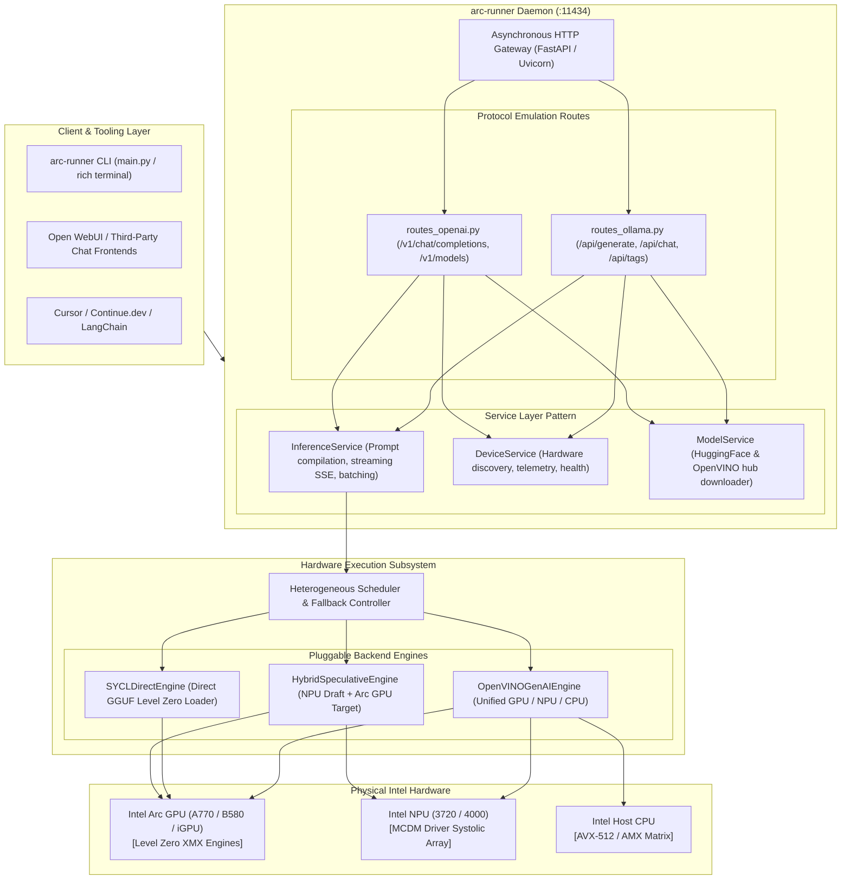

# Intel Arc Models Runner (`intel-arc-models-runner`)

[](https://opensource.org/licenses/Apache-2.0)
[](https://www.intel.com)
[](https://github.com/techdeveloper-org/intel-arc-models-runner)

A purpose-built, mathematically proven, zero-bloat local LLM runner and server engineered specifically for **Intel® Arc™ GPUs (discrete & integrated)** and **Intel® NPUs (Neural Processing Units)**.

---

## 🚀 Overview

While mainstream local LLM tools like Ollama were designed with a CUDA-first and Apple Metal-first focus, `intel-arc-models-runner` treats Intel silicon as first-class citizens:

- **Native Dual Silicon Acceleration**: Run models natively on **Intel Arc Discrete GPUs** (A770, A750, B580), **Core Ultra iGPUs** (Xe-LPG, Xe2), and **Intel NPUs** (AI Boost NPU 3720 / NPU 4000).
- **World's First Client Speculative Engine**: Run 1B–2B draft models on the **Intel NPU** (zero GPU VRAM cost, 5W power draw) while verifying tokens in parallel on the **Intel Arc GPU** via XMX matrix engines!
- **Drop-in Ollama & OpenAI Compatibility**: Compatible with `/api/generate`, `/api/chat`, `/api/tags`, and `/v1/chat/completions` for instant use with Open WebUI, Continue.dev, Cursor, and LangChain.
- **Zero-Bloat Standalone Runtime**: Built directly on OpenVINO GenAI C++ and Level Zero runtimes; no 5 GB oneAPI SDK installation or heavy PyTorch environments required.

---

## 📚 Comprehensive R&D & Architectural Reports

Before writing the codebase, a multi-agent squad of 11+ specialist agents and 9 Opus Mathematical Masters from the Claude Global Library performed deep technical forensics and mathematical derivations:

| Report | Document ID | Key Topics & Deliverables |
|:---|:---|:---|
| [**1. Ollama Defects on Intel**](file:///docs/research/01_ollama_architectural_defects_and_intel_failure.md) | `RND-OLLAMA-INTEL-01` | Forensic deconstruction of Ollama's Go runtime (`gpu/gpu.go`), CGo dynamic loading failure, the "Silent CPU Fallback" anatomy, Level Zero collisions, and the NPU blindspot. |
| [**2. Intel Hardware & Drivers**](file:///docs/research/02_intel_hardware_and_driver_landscape.md) | `RND-INTEL-HARDWARE-02` | Xe-HPG (Alchemist) vs. Xe2 (Battlemage) XMX matrix engines, Intel NPU 3720/4000 systolic arrays, Level Zero driver stack, and ecosystem fragmentation analysis. |
| [**3. Mission & Solution Blueprint**](file:///docs/research/03_our_mission_and_solution_blueprint.md) | `RND-SOLUTION-BLUEPRINT-03` | Dual-backend engine architecture (OpenVINO GenAI + llama.cpp SYCL), client-side hybrid speculative decoding, zero-setup Windows DLL loading, and API contracts. |
| [**4. R&D Synthesis & Proofs**](file:///docs/research/04_agent_orchestration_and_rnd_synthesis.md) | `RND-SYNTHESIS-MANIFESTO-04` | Multi-agent consensus, complete mathematical proofs (M1–M6: Rooflines, Speculative Acceleration, PagedAttention), NNCF INT4 quantization manifesto, and Triad Testing roadmap. |

---

## 📐 Architecture at a Glance



---

## 🛠️ CLI Quickstart (Preview)

```bash
# Discover connected Intel silicon (Arc GPUs, NPUs, CPUs)
arc-runner devices

# Run a model interactively on Intel Arc GPU
arc-runner run qwen2.5:7b-int4 --device gpu

# Run a model on ultra-low-power Intel NPU (5W)
arc-runner run phi3:mini-int4 --device npu

# Launch the Ollama/OpenAI compatible background daemon
arc-runner serve --port 11434

# Run performance benchmarks across all Intel hardware
arc-runner benchmark --model qwen2.5:7b-int4 --device all
```

---

## 📜 License

Licensed under the [Apache License, Version 2.0](LICENSE).
