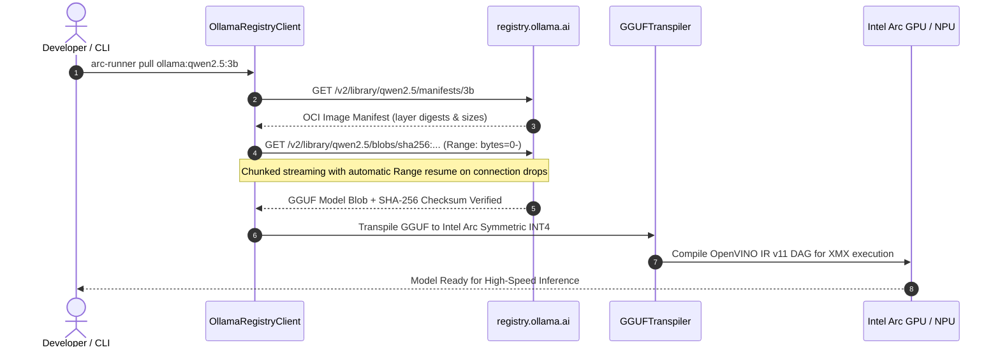

# Universal Remote Ollama Model Ingestion

`arc-runner` enables downloading and running any model directly from the official **Ollama Library** (`registry.ollama.ai`) without needing the Ollama daemon or desktop application installed on the host machine.

---

## 1. Quick Start Commands

```bash
# Pull any model from Ollama library and transpile to Intel Arc INT4 OpenVINO IR
arc-runner pull ollama:qwen2.5:3b

# Alternatively pull with explicit namespace
arc-runner pull ollama:library/deepseek-r1:1.5b

# Inspect downloaded and transpiled models
arc-runner models

# Run fast, flat token generation on Intel Arc GPU
arc-runner run qwen2.5-3b-int4 --device GPU --prompt "Explain the Theory of Relativity"
```

---

## 2. Ingestion Architecture



---

## 3. Features & Resiliency

1. **Direct OCI Distribution Protocol**: Queries `registry.ollama.ai` directly via Docker distribution v2 API schemas.
2. **Anonymous Bearer Token Authentication**: Negotiates anonymous pull bearer tokens seamlessly with `https://ollama.com/auth/token`.
3. **HTTP Range Stream Resumption**: If large multi-gigabyte downloads are interrupted by network latency or timeouts, `OllamaRegistryClient` automatically resumes downloading from the exact byte offset (`Range: bytes={downloaded}-`), preventing wasted bandwidth.
4. **Content-Addressable SHA-256 Verification**: Every downloaded layer blob is cryptographically verified against the manifest digest before being accepted into the local cache (`~/.arc-runner/models/blobs/`).
5. **Zero-Overhead Ahead-of-Time Transpilation**: Immediately transforms non-native GGUF k-quants into Intel Xe-HPG/Xe-LPG XMX native symmetric INT4 Group 128 format.
