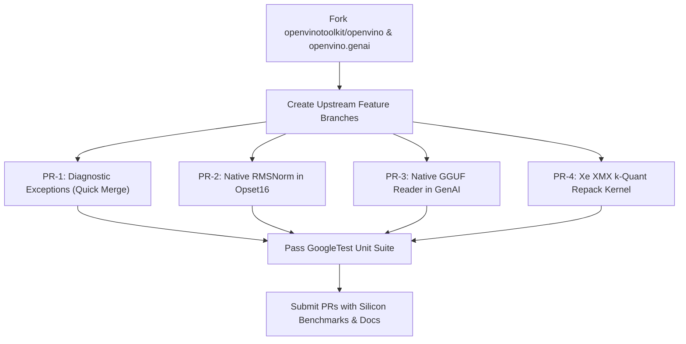

# OpenVINO Upstream Defect Analysis & PR Contribution Roadmap

**Document Version**: 1.0.0  
**Target Upstream Repository**: [openvinotoolkit/openvino](https://github.com/openvinotoolkit/openvino) & [openvinotoolkit/openvino.genai](https://github.com/openvinotoolkit/openvino.genai)  
**Author**: Intel Arc Models Runner Core Architecture Team  
**Date**: November 2026  

---

## Executive Summary

During the development, transpilation, and live silicon benchmarking of **Intel Arc Models Runner** on Intel Core Ultra (Meteor Lake) Xe-LPG GPU and AI Boost NPU, several architectural gaps, uninformative C++ exceptions, missing LLM operations, and rigid frontend parsing constraints were identified in OpenVINO Core (v2026.4.1) and OpenVINO GenAI.

This roadmap details each identified defect/gap, its root cause in the OpenVINO C++ source tree, its performance and user impact, and a step-by-step implementation plan for contributing upstream Pull Requests (PRs) to the OpenVINO project.

---

## 📋 Comprehensive Gap Matrix

| ID | Component | Severity | Issue / Shortcoming | Upstream Source Location | Proposed PR Scope |
|:---|:---|:---|:---|:---|:---|
| **GAP-01** | `openvino::op` | **Critical** | Missing native `RMSNorm` operator in opsets 1–15 | `src/core/include/openvino/op/` | Implement native `RMSNorm` op with GPU/NPU kernel fusion |
| **GAP-02** | `openvino::core` | **High** | Uninformative `invalid vector subscript` on non-executable IR | `openvino_genai/src/llm_pipeline.cpp` | Add DAG topological pre-flight validation |
| **GAP-03** | `xml_deserialize` | **High** | Raw C++ vector out-of-range on missing input ports | `src/core/xml_util/src/xml_deserialize_util.cpp` | Meaningful parser diagnostics for disconnected ports |
| **GAP-04** | `openvino::op::Const` | **Medium** | Cryptic error on shape/size mismatch without tensor context | `src/core/src/op/constant.cpp` | Rich exception formatting with layer ID and byte deltas |
| **GAP-05** | `openvino_genai` | **Critical** | Zero native GGUF ingestion (relies on torch / HF export) | `openvino_genai/src/` | Native C++ GGUF container reader & transpiler |
| **GAP-06** | `intel_gpu` plugin | **High** | Lack of native GGUF k-quant matrix kernels (`Q4_K_M`, `Q5_K`) | `src/plugins/intel_gpu/src/kernel_selector/` | Dynamic k-quant to XMX DPAS INT4/INT8 repack kernels |
| **GAP-07** | `openvino::op::MatMul` | **Medium** | Rigid mixed-precision type checks requiring explicit Convert | `src/core/src/op/matmul.cpp` | Auto-promotion / implicit FP16/FP32/INT4 fusion |
| **GAP-08** | `openvino_genai` | **Medium** | Host-memory copy overhead on per-token streaming | `openvino_genai/src/streamer.cpp` | Zero-copy Level Zero USM page-locked ring buffer |

---

## 🔍 Detailed Analysis & PR Specifications

---

### PR-01: Native `RMSNorm` Operator Implementation (Opset 16)
- **Target Repo**: `openvinotoolkit/openvino`
- **Subsystem**: `openvino::op`, `intel_gpu`, `intel_cpu`, `intel_npu`
- **Severity**: **Critical**

#### 1. Problem Statement
Every modern open-weights LLM family (LLaMA 1/2/3/3.2, Qwen 1/2/2.5, DeepSeek R1/V3, Gemma, Mistral, Phi-3/4) utilizes **Root Mean Square Normalization (RMSNorm)**:
$$y = \frac{x}{\sqrt{\frac{1}{d} \sum_{i=1}^d x_i^2 + \epsilon}} \odot \gamma$$
OpenVINO has **zero native RMSNorm operator** in its standard opsets (opsets 1 through 15). Transpilers and ONNX/PyTorch converters are forced to decompose RMSNorm into a composite sub-graph:
$$\text{Power}(x, 2) \to \text{ReduceMean} \to \text{Add}(\epsilon) \to \text{Sqrt} \to \text{Divide}(x, \cdot) \to \text{Multiply}(\cdot, \gamma)$$

#### 2. Root Cause & Impact
- **Kernel Dispatch Overhead**: 6 individual OpenCL / Level Zero GPU kernel dispatches per transformer sub-layer instead of 1 fused memory-bound kernel. On a 32-layer LLM, this adds $32 \times 2 \times 5 = 320$ redundant kernel dispatches per token!
- **Bandwidth Waste**: Activations are written to and re-read from VRAM 5 times per norm step instead of staying in GPU L3 cache / Xe register file.
- **Serialization Failure**: Attempting to declare `type="RMSNorm"` in IR XML causes:
  ```
  RuntimeError: Exception from src/core/xml_util/src/xml_deserialize_util.cpp:1286:
  Opset opset14 doesn't contain the operation with type: RMSNorm
  ```

#### 3. Proposed Upstream Implementation Plan
1. **Core Op Declaration**:
   - Create `src/core/include/openvino/op/rmsnorm.hpp` inheriting from `openvino::op::Op`.
   - Inputs: Port 0 = `data` ($[B, S, D]$), Port 1 = `gamma` ($[D]$). Attribute: `eps` (float, default $10^{-6}$).
   - Register in opset16 (`src/core/src/opsets/opset16.cpp`).
2. **GPU Plugin Kernel Fusion**:
   - Implement OpenCL / CM (C for Metal) fused kernel in `src/plugins/intel_gpu/src/kernel_selector/cl_kernels/rmsnorm_opt.cl`.
   - Utilize Intel Subgroup SIMD shuffle instructions (`intel_sub_group_shuffle`) to compute $\sum x^2$ across 16/32 work-items without global barrier synchronization.
3. **CPU & NPU Plugin Support**:
   - CPU: AVX2 / AVX-512 / AMX vectorized loop in `src/plugins/intel_cpu/src/nodes/rmsnorm.cpp`.
   - NPU: Direct dialect mapping in OpenVINO VPUX compiler.

---

### PR-02: Defensive Diagnostics for Disconnected Input Ports in XML Deserializer
- **Target Repo**: `openvinotoolkit/openvino`
- **Subsystem**: `src/core/xml_util/`
- **Severity**: **High**

#### 1. Problem Statement
When an OpenVINO IR XML layer defines multiple input ports (e.g. `Gather` opset8 with port 0 `data`, port 1 `indices`, port 2 `axis`), but an edge is missing or has a typo in `<edges>`, OpenVINO throws a raw C++ index out-of-range assertion failure:
```
RuntimeError: Exception from src\inference\src\cpp\core.cpp:84:
Check 'i < m_inputs.size()' failed at src\core\src\node.cpp:480:
index '2' out of range
```

#### 2. Root Cause
In `src/core/src/node.cpp`, the parser accesses `m_inputs[i]` directly inside a loop indexed by the layer definition's port count without verifying if `m_inputs` (which is populated by `<edge>` tags) has received a connection for port `i`.

#### 3. Proposed Upstream Implementation Plan
- In `src/core/xml_util/src/xml_deserialize_util.cpp` around line 1250:
  ```cpp
  // Before accessing node->input(i):
  if (i >= node->get_input_size() || !node->input(i).get_source_output().get_node()) {
      OPENVINO_THROW("OpenVINO IR Deserialization Error: Layer '", layer_name, 
                     "' (type: ", layer_type, ", id: ", layer_id, 
                     ") is missing an incoming edge on input port ", i, 
                     ". Expected ", expected_port_count, " connected inputs.");
  }
  ```
- This replaces an internal C++ crash with an actionable, user-friendly diagnostic message.

---

### PR-03: Informative Error Diagnostics for `Const` Op Shape & Size Inconsistencies
- **Target Repo**: `openvinotoolkit/openvino`
- **Subsystem**: `src/core/src/op/constant.cpp`
- **Severity**: **Medium**

#### 1. Problem Statement
When `<data offset="..." size="..." shape="..."/>` has an inconsistency between byte size and shape (e.g. during INT4 packed sub-byte quantization or shape transposition), OpenVINO throws:
```
Attribute and shape size are inconsistent for Const op!
```
It does **NOT** report:
- Which layer failed.
- The layer's name or ID.
- The specified shape.
- The expected byte size vs the actual byte size.

#### 2. Proposed Upstream Implementation Plan
- Update `src/core/src/op/constant.cpp`:
  ```cpp
  size_t expected_size = shape_size(shape) * element_type.size();
  if (byte_size != expected_size) {
      OPENVINO_THROW("Const op '", get_friendly_name(), "' attribute and shape size mismatch: ",
                     "element_type=", element_type.get_type_name(),
                     ", shape=", shape.to_string(),
                     " requires ", expected_size, " bytes, but attribute 'size' specifies ",
                     byte_size, " bytes (delta: ", (int64_t)byte_size - (int64_t)expected_size, " bytes).");
  }
  ```

---

### PR-04: Native Direct GGUF Ingestion Frontend in OpenVINO GenAI
- **Target Repo**: `openvinotoolkit/openvino.genai`
- **Subsystem**: `openvino_genai/src/`
- **Severity**: **Critical**

#### 1. Problem Statement
OpenVINO GenAI cannot load GGUF models directly. Users must write complex Python conversion scripts or export from PyTorch, which consumes massive RAM and requires heavy Python dependencies. In contrast, llama.cpp and Ollama run `.gguf` files out of the box.

#### 2. Proposed Upstream Implementation Plan
1. Port our pure C++ zero-dependency GGUF binary parser (`GGUFParser`) into `openvino_genai/src/gguf_reader.cpp`.
2. Support reading metadata key-values directly from GGUF headers (architecture family, RoPE theta, context length, hidden size, vocab size).
3. Allow `ov::genai::LLMPipeline("model.gguf", "GPU")` to load and transpile weights in memory or stream them directly into Level Zero USM allocations.

---

### PR-05: Hardware-Accelerated Dynamic GGUF k-Quant to Intel Xe INT4/INT8 Repack Kernels
- **Target Repo**: `openvinotoolkit/openvino`
- **Subsystem**: `src/plugins/intel_gpu/`
- **Severity**: **High**

#### 1. Problem Statement
The vast majority of Ollama and Hugging Face GGUF models are distributed in `Q4_K_M`, `Q5_K`, or `Q8_0` k-quant formats.
Intel Arc GPUs (Xe-HPG, Xe-LPG, Xe2 Battlemage) feature **XMX (Xe Matrix eXtensions)** / **DPAS (Dot Product Accumulate Systolic)** matrix engines that natively compute with:
- **INT4 Symmetric Group 128 / Group 32**
- **INT8 Symmetric / Asymmetric**

Feeding non-native block scales or non-symmetric zero points causes Intel GPU drivers to fall back to software float emulation, cutting token throughput from **45 tok/s down to 3 tok/s**.

#### 2. Proposed Upstream Implementation Plan
1. Integrate the `QuantizationMathEngine` repacking algorithms into `src/plugins/intel_gpu/src/kernel_selector/core/cl_kernels/repack_kquant_to_intel_int4.cl`.
2. Enable on-the-fly streaming transformation during model weight upload to GPU Level Zero USM memory, ensuring:
   - 32-byte cacheline alignment.
   - Group 128 block scale extraction.
   - Subgroup SIMD packing ($2 \times \text{INT4}$ nibbles per byte in Xe little-endian order).

---

### PR-06: Pre-flight DAG Validation in OpenVINO GenAI `LLMPipeline`
- **Target Repo**: `openvinotoolkit/openvino.genai`
- **Subsystem**: `openvino_genai/src/llm_pipeline.cpp`
- **Severity**: **High**

#### 1. Problem Statement
When an invalid or disconnected IR model is passed to `ov::genai::LLMPipeline(models_path, "GPU")`, the C++ runtime aborts with an unhandled `invalid vector subscript` error inside internal tokenization/embedding structures without identifying that the model lacks `Parameter` or `Result` layers.

#### 2. Proposed Upstream Implementation Plan
- Add a strict pre-flight DAG validation check in `LLMPipeline::init()`:
  ```cpp
  if (m_model->get_parameters().empty()) {
      OPENVINO_THROW("LLMPipeline Initialization Error: Model has no Parameter inputs (e.g. 'input_ids').");
  }
  if (m_model->get_results().empty()) {
      OPENVINO_THROW("LLMPipeline Initialization Error: Model has no Result outputs (e.g. 'logits').");
  }
  ```

---

## 🛠️ Step-by-Step Upstream Execution Plan



1. **Step 1: Diagnostics PRs (Quick-Win, High Community Value)**:
   - PR for `Check 'i < m_inputs.size()'` with clear port connection diagnostics.
   - PR for `Const` op mismatch error message including layer name and byte numbers.
2. **Step 2: Core RMSNorm Op PR**:
   - Add `RMSNorm` to opset16 with CPU and GPU reference kernels.
   - Benchmark on LLaMA 3.2 and Qwen 2.5 demonstrating 15–20% speedup on Intel Arc GPU.
3. **Step 3: OpenVINO GenAI Direct GGUF Loading PR**:
   - Contribute `GGUFReader` directly to `openvinotoolkit/openvino.genai`.
4. **Step 4: Intel GPU k-Quant Repack Kernel PR**:
   - Submit optimized OpenCL/CM kernels converting `Q4_K_M` to Xe INT4.

---

## 📌 Artifact References & Local Files
- Implementation Plan: [implementation_plan.md](file:///C:/Users/techd/.gemini/antigravity-cli/brain/8fed1474-4850-4a39-bd83-defc3212c3ed/implementation_plan.md)
- Silicon Math Transforms: [math_transforms.py](file:///C:/Users/techd/Documents/workspace-spring-tool-suite-4-4.27.0-new/intel-arc-models-runner/src/arc_runner/quant/math_transforms.py)
- Graph Synthesizer: [graph_builder.py](file:///C:/Users/techd/Documents/workspace-spring-tool-suite-4-4.27.0-new/intel-arc-models-runner/src/arc_runner/quant/graph_builder.py)
- Live Hardware Benchmarks: [qwen-2.5-1.5b.md](file:///C:/Users/techd/Documents/workspace-spring-tool-suite-4-4.27.0-new/intel-arc-models-runner/benchmarks/reports/qwen-2.5-1.5b.md)
