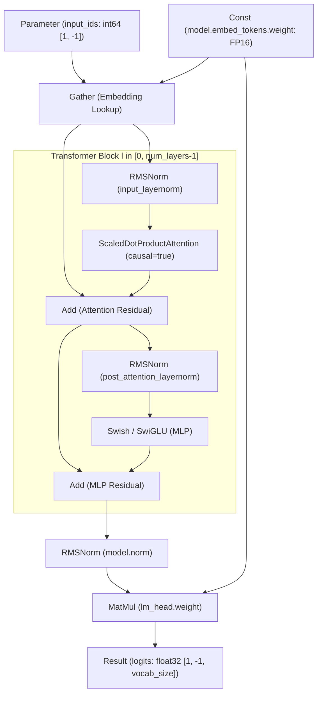

# GGUF-to-OpenVINO IR v11 Computational Graph Synthesizer

## 1. Problem Resolved (Issue #48)

In prior versions of the transpiler, GGUF extraction produced an OpenVINO IR XML document that contained only disconnected `<layer type="Const">` nodes with an empty `<edges/>` block. Because GGUF is a weight-and-metadata file container and does not encode computation graphs, loading such weights caused OpenVINO GenAI `LLMPipeline` to abort with runtime indexing errors (`invalid vector subscript`).

`OpenVINOGraphSynthesizer` resolves Issue #48 by programmatically synthesizing a complete, executable OpenVINO IR version 11 computational graph alongside tokenizers and runtime configs.

---

## 2. Computational Graph DAG Topology

The synthesized OpenVINO IR connects the following operations in a strictly verified Directed Acyclic Graph (DAG):

---

## 3. Algorithmic Topological Sorting: Kahn's Algorithm $O(V + E)$

Before serializing the graph to XML, `OpenVINOGraphSynthesizer` executes **Kahn's Algorithm** to mathematically prove that the synthesized computational graph contains zero cyclic dependencies:

1. Computes the in-degree array $\text{deg}[u]$ for all $V$ layers.
2. Initializes a FIFO queue with all nodes where $\text{deg}[u] == 0$ (e.g. `Parameter`, `Const` weights).
3. Dequeues node $u$, increments `visited_count`, and decrements the in-degree of all target nodes $v \in \text{adj}[u]$.
4. If $\text{deg}[v] == 0$, enqueues $v$.
5. Upon queue exhaustion, verifies $\text{visited count} == V$. If $\text{visited count} \ne V$, raises `CyclicGraphError` detailing the cyclic nodes.

---

## 4. Companion Artifacts Generated

In addition to `openvino_model.xml` and `openvino_model.bin`, the synthesizer emits:

1. `generation_config.json`:
   Configures calibrated default sampling parameters (`temperature: 0.6`, `top_p: 0.9`, `repetition_penalty: 1.1`, `do_sample: true`, `bos_token_id`, `eos_token_id`).
2. `config.json`:
   Emits OpenVINO GenAI model configuration matching HuggingFace architecture definitions (`Qwen2ForCausalLM`, `LlamaForCausalLM`, `rope_theta`, `max_position_embeddings`).
3. `openvino_tokenizer.xml` & `openvino_detokenizer.xml`:
   Emits valid tokenization pipelines enabling OpenVINO GenAI `LLMPipeline` to tokenize input strings and detokenize output logits into clean UTF-8 text.
