# 🏗️ Architecture & Subsystem Deep Dive

[← Back to README](../README.md) · [Visual Diagrams Guide](diagrams/README.md) · [Model Hub & Engines](model_hub_and_engines.md) · [MultiModal Studio](multimodal_studio.md)

---

`intel-arc-models-runner` is engineered from the ground up for heterogeneous Intel silicon, coupling high-throughput matrix execution on Intel Arc discrete GPUs and Core Ultra iGPUs with ultra-low-power (5W) continuous token drafting on Intel AI Boost NPUs.

---

## 📐 Architecture at a Glance

```mermaid
flowchart TD
    subgraph ClientSubsystem ["Client & Tooling Layer"]
        CLI["arc-runner CLI (arc_runner.cli.main / Rich Terminal)"]
        WebUI["arc-runner Studio WebUI & Open WebUI (:11434)"]
        IDE["Cursor / Claude Code / LangChain / OpenAI SDK"]
    end

    subgraph DaemonSubsystem ["arc-runner Daemon (:11434)"]
        Router["Asynchronous HTTP Gateway (FastAPI / Uvicorn)"]
        
        subgraph APIRoutes ["Protocol Emulation Routes"]
            OllamaRoutes["routes_ollama.py (/api/generate, /api/chat, /api/tags)"]
            OpenAIRoutes["routes_openai.py (/v1/chat/completions, /v1/models)"]
            StudioRoutes["routes_studio.py (/studio, WebUI Static, SSE Status)"]
        end
        
        subgraph CoreSubsystems ["Core Execution & Resource Managers"]
            ModelMgr["ModelManager (Engine Cache, VRAM Budgeting, Dynamic Loading)"]
            BatchPipeline["BatchExecutionPipeline (Async Worker Loop, Queue, Client Abort)"]
            ContBatcher["ContinuousBatcher (Token-Level Step, Little's Law Admission Proof M30)"]
            PagedAttn["PagedBlockTable & RadixPrefixCache (Virtual Block Allocator Proof M31)"]
            LoRAMgr["LoRAManager (Dynamic Adapter Swapping, Safetensors Fused Linear)"]
        end

        Router --> OllamaRoutes & OpenAIRoutes & StudioRoutes
        OllamaRoutes & OpenAIRoutes --> BatchPipeline & ModelMgr
        BatchPipeline --> ContBatcher
        ContBatcher --> PagedAttn
    end

    subgraph HardwareExecutionEngine ["Hardware Execution Subsystem"]
        subgraph EngineAdapters ["Pluggable Backend Engines (arc_runner.engine)"]
            OVEngine["OpenVINOGenAIEngine (Unified Arc GPU / NPU / CPU Pipeline)"]
            SpeculativeEngine["HybridSpeculativeEngine (NPU Draft γ=4 + Arc Target; power not measured)"]
            VisionEngine["VisionEngine (Multimodal Vision Pipeline: Phi-3.5-V, MiniCPM-V)"]
            AudioEngine["AudioEngine (ASR Whisper & Kokoro TTS via Level Zero, Proof M59)"]
            ImageEngine["ImageEngine (Text2ImagePipeline: SD 1.5, SDXL, LCM, Turbo via Level Zero, Proof M73)"]
            VideoEngine["VideoEngine (Text2VideoPipeline: LTX-Video, CogVideoX, AnimateDiff, SVD via Level Zero, Proof M94)"]
            EmbeddingEngine["EmbeddingEngine (NPU / GPU Embedding Pipeline, L2 Normalized Proof M1)"]
            GGUFTranspiler["GGUFTranspiler (O(1) Streaming GGUF -> OpenVINO IR Transpiler Proof M15)"]
        end

        ContBatcher -->|forward_batch| OVEngine
        ModelMgr -->|get_or_load_engine| OVEngine & SpeculativeEngine & VisionEngine & AudioEngine & ImageEngine & VideoEngine & EmbeddingEngine
        ModelMgr -->|apply_adapter| LoRAMgr
        GGUFTranspiler -.->|transpiled IR| ModelMgr
    end

    subgraph SiliconLayer ["Physical Intel Silicon (Level Zero & OneAPI Drivers)"]
        ArcGPU["Intel Arc GPU (A770 / B580 / iGPU)\n[Level Zero Immediate Cmds, XMX Matrix Engines]"]
        IntelNPU["Intel NPU (3720 / 4000)\n[MCDM Driver Systolic Array, 5W TDP]"]
        IntelCPU["Intel Host CPU\n[AVX-512 / AMX Matrix Fallback]"]
        Sysman["LevelZeroSysman (Telemetry, VRAM Allocation, Thermal & Power)"]
        
        OVEngine --> ArcGPU & IntelNPU & IntelCPU
        SpeculativeEngine --> ArcGPU & IntelNPU
        VisionEngine --> ArcGPU & IntelCPU
        AudioEngine --> ArcGPU & IntelCPU
        ImageEngine --> ArcGPU & IntelCPU
        EmbeddingEngine --> IntelNPU & ArcGPU & IntelCPU
        Sysman -.-> ArcGPU
    end

    ClientSubsystem --> DaemonSubsystem
```



---

## Native Layer, Ring Buffer and Telemetry (v0.2.0)

<!-- Introduced in v0.2.0 -->

```
FlashStreamWeightManager --acquire(L)--> slot L % N  (EMPTY -> PENDING -> READY)
        |                                   one loader per slot, waiters share its result
        v
NativeMemoryEngine (bridge.py) --ctypes, ABI 3 + sidecar sha256--> libarc_native_sys
        |   _MappingGuard keeps the mapping alive while NumPy views exist
        v                                   arc_mmap_*: every extent checked with arc_range_ok
Python read path (identical bytes)  <-- used when the library is missing, disabled, stale or rejects a layer

NativeLevelZeroBridge --ctypes--> arc_ze_*  --dlopen--> ze_loader  (first ZE_DEVICE_TYPE_GPU, never the NPU;
                                                                    waits bounded below the 2 s Windows TDR)
```

- **Bounds and lifetime**: the native layer never forms a pointer outside the mapped file (`arc_range_ok`, validated registration, sealed table); views are read-only and the unmap is deferred until the last view is collected. Hostile GGUF length fields are rejected by the parser.
- **Ring buffer**: direct-mapped slots, a single loader per slot, no pin counts, safe shutdown. The protocol is modelled in `docs/formal/RingSlots.tla` and exhaustively checked by `scripts/check_ring_model.py`.
- **Telemetry**: `EngineTelemetry` carries `metrics_source`, `is_estimate` and validity flags; unmeasured values are zero with the flag False. Sysman returns `None` plus a reason for power and free GPU memory on integrated GPUs.
- **Context window**: the OpenVINO engine counts prompt tokens with the pipeline tokenizer and rejects prompt (+ `max_new_tokens`) beyond the window before generation.
- **Benchmarks**: statistics and claim gates in `arc_runner.benchmark.stats`, schema-v1 result files, method in `docs/benchmarks/METHOD.md`.
- **Limits**: the streaming path does not use the USM/DMA functions yet; the flash-stream engine is a demonstrator that emits canned tokens; no Level Zero driver was exercised in CI.

Diagrams of these parts are the "v0.2.0 native layer" sections at the end of each file in [`uml/`](../uml) and the "Native layer (v0.2.0)" page of each file in [`drawio/`](../drawio); they are generated by `python scripts/generate_diagrams.py`.

---

## 📐 Visual Architecture & Diagrams

Comprehensive UML and editable Draw.io diagrams are maintained in [`docs/diagrams/`](diagrams/README.md), generated via connected MCP servers (`uml-diagram` and `drawio-diagram`) adhering to Rule **`45-uml-diagram-lifecycle.md`**:

| # | Diagram Type | Mermaid Source | Editable Draw.io | Web Editor Link |
|:---|:---|:---|:---|:---|
| **1** | **Package Diagram** | [`uml/package_diagram.md`](../uml/package_diagram.md) | [`drawio/package_diagram.drawio`](../drawio/package_diagram.drawio) | [Open in app.diagrams.net](https://app.diagrams.net/#R7Vtdb6w2EP01PHa1wIYkj8km275UqpRWfURemIAVY1Pb7Ed%2FfcdgdpcY0G2vrrqO9iq6gRl7HM85HnsGCOJ1EG8OFQui5Q6kooIH8UsQReFiif%2BjFHgmcsqLTvzH75ufHowi3gTxa7B8CuJ1dXinDLBpKZTumpG6XuSUFJJUasFBd6b0sYZOb3WdeDButFosu6E789HS%2FMTrU48lzQc2ws4IJ5W1%2FRvJPkhh%2Fp6X8yiXxnqT1eFnSeryV5GDmX5%2BsDNfGYPGZn7sJPeJFRSyHzw8C97o33bk0LqsaGgOatBQC8E0rYfCTHAOmR7IiJRiP2z2Lthw1NpM77PgLSPMlf5Jc11aaZg8nhW%2FAC1KO%2FRDdN8pKtI3tjNRJcnF%2FkLk%2BrH3phRCT6rPLl8DYxcg2nGCaPPv%2B56mKYHrbzA3YsLiuiOssb4jMktlg7jIRSYksighVR3Ez0EUHwj%2BRsyUJlwrRwOHDGqNRHZVTBSFWUKdT%2FWxBwrd264IgzBIbFhqXInxS4iX%2B5JqeKtJZhrskagoexdcv9nupo0m2x7gVdTdn3ANV6YDZWwtmJDtePFms4nWuOCflZbiAy40L8lzcpecNL3VqJ2EXaQaDpOOD%2BfJgUsNRAVaHvHeWllZsI7D2%2F2ZsdHSysoLsoY9yMSukuJkeQ56lFv0v4kY8RwxctjRDFyYc9C4nNGlnxWVCTFue3VUFeE3VlyyIo6umRarOVoAx0XuRgxRA99RLtIJvaohaxjRdAdTTTDoaMob0ah0S3RWgksxE9PzlGiNzjeb6Y1UF6RKltdMqrs5Uv3V4GbjoF0UzXuKTlEjTNCScFXjiWw6Dt24MbkNXRk3kjlulM3W3YPEnjNB8jH0Cccg4coFY6QiKa1qgc519RIKqk4Tu%2FFmfKO6MuLczxEHw8ZuBGjM2hxZu9%2BkNa2Bje1MbURJp5glRaNBpUH0dOPO3H50Zdx5mM2KGB2JLPR24phNbq4L4Mc5gLfAs7Ii8sNdzm2DG9Cz%2Bcp1Id2XpMahxuCs27rEJ6BLIvM9%2BiXFCw7qdmKczyauDPJwDvJG05FKRM5Y2p8ab1BPhvHkypB2y5eMNBi9wV2xwPMnU1rGO1OQQJ%2BhxJauH4aoOo5ftv9GHQ95AT3amD2UohCcsNez1EJj2g2AUaKRGQzOG5rIAvTg%2BPpf4ZPQFVQGQ%2F5YLNyKIeU79Jb3UKy8g8Kt0tVSbP1HIvYOCbe0VTdspALlGRCJd0C4daRMcLNfeo%2FFnXdYuKUZMNdE%2Bx%2BhHr0Dw6114CXNvwIYfe7nERpuYSKnqm4fefkFx%2F0XOEdFSwcNDQwuBvIXDO%2BOUpGb1ZuEXaUTz%2FQ8w8O7E1Xk5t6nB6%2Feo%2BHdmWrkfZ1TDVPUfuGx%2BgrRyk3BTy%2FOpUwU3iMSeYeIm4p3%2B0fuWz4ej5x0v7Pa%2Bz%2FA4SbkFRDVSM82j8evcM51E3LzYEylijKajbxLd82A9EmfP9vHRZuJd8ht%2F4u39YffBqC2%2Fzwgtt8ktB3azxLi138A) |
| **2** | **Component Diagram** | [`uml/component_diagram.md`](../uml/component_diagram.md) | [`drawio/component_diagram.drawio`](../drawio/component_diagram.drawio) | [Open in app.diagrams.net](https://app.diagrams.net/#R5V1tc6K8Gv41fqzDi1r70Wp1O1O3nmq7z5wvTAoRMwuEE8Kq%2B%2BtPEqAKt3b7tk7yaDsqeYVcuS9yX0mw5Q5b7ngTRy3H%2BoVZRmjSckctx7HblngXoTjxaUCSsAh%2BXIwv%2BjLCHbfcm5Y1aLnDeLMkERZJVzTjRTKUpu2AoJChOGsnmBdF8W2Ki%2Fgyrgiu1et02lZRdVG8Y8l%2Fd%2FiSwyJBrQy7KCRBcVn2kMYpTXAiKrVGu3r2i6sKjTcThtLVlAZYNkCwKa%2B9I4uUpQbbIuSyVwaErKre3gXMye%2BybrtstDAnAc5qCTmlESdpPdCnSYJ9XgtDjNF1PdmSRvVaUxRiEDD3UQRDf5CAr8pQu3e1i%2FiGSbgqq%2B47l0VEjKrE5ZVkKxTQ9V4QbMeqNRml%2FGj0rsmHOIr2YCzraTnj9%2Bd9uUwm4f5zcQeKKHH9haK8bLuW00Nx2nKvI1Hkdf3I3%2FWtMjisJaoftRx3g8Tn8O7Wm%2BfP2TbjOAaxiPkXLBf9gInzEElBggfir0TUArOYJCjKSmD4tkJbYKQMK96Esju38zhq787UvV5xYd%2FuyBZf1yvC8TxFvky%2FFqlFWMYZ%2FYmHNKJMlef21EvECLuO9sLHXfn3kqPqWY4619KSOd4cxcZ%2Bvf8Ia8Q0xpxtxXFZSqfEc1s%2FXO86tWOVYau9%2FmxX%2FQCVhhS%2BlPxa7xDhZQd5U99xQd%2BBWDagEgUIDsB1UAAAlnodAEC9AAD2XwTA6XRrCPQOIQABOEn7d0D7%2F9FUjG9%2F29IIgO4JyPMHfn4U9MnzgFAQ2btYoGdxBkei5%2FMbETljNGQ4OyvedCv8tSTOHug3TSBNN9uuoy9tXoLW%2F4OdGN%2F6WpFm%2FwSkOUI4pok3QRyv0RZEj1HGB7NbdY79ljuw7Y4rbqZXIOF9FKEYldfuWPcpTgYym8h8VnTaqzqQlnR6BXrUcYBNN%2B2%2BpS%2BxVt7%2FHhDvMiDjwdCKZ237BESrpKMpSlAoXb5G5E0SkkQKYw84JJm6vkaKp4fBVMRf50GIuRTZzohTG669ZpxqQ2HoAJymG3DTu9SLTqG%2B8kd7MR4BVysKhQrL11PoNeL%2B6maD%2FZwTmsxIiiNlZo1kg2yb%2BOJcflD2U8lrd5SmUGqNSKX8Z6W4flYD1abfrxurQsXoCK6m23XTBdWLWaEA8ybDMR4FvdgVCjF%2FYe6JJuJGmdM8Uzx7YJR6yzFDknrljVWmUfdV6TjOGKVL8XUqHUcoDtwRzuW872UmrRatxbsUHBp5XeuQ3%2FkvpuCmVqAbBUP96e09wHQ%2BaDqserEy1HE%2BY2LGg6MVWVeV%2FFWynqEQB96Ac5FRmWNTLiCM50ielkopzTWi%2Fs8MLhlAAdnIZAwv1ZcRDvK02W3sM2Pm5mICvYjZgXrVcbxNt%2FWm29vRiYgdqP18wqCMx6arFQ9DUejrefiOPgy8Y6ruaJugmEiXdZpHnFwMApRy5bnO1yhN1dipuQ4BLbHg9IwyeR8f52q54xkRL1iNoBnzQpnrLSCbbudN51gvDoZK0ZusyHgU9GJbKBR9PdvKSdGn2%2B%2F3Ezk3Wk2yNBkZ%2F1JLtP%2BLGRUft3GMA1J4QsM4yBo34oNrGR4TsiRqEDUnEfGVtzsppmPPh4nBQgbNmBhKYh9B3nROaHrCejEzFJDeblrGQ6EXPUPF6Ovp%2Bdv2We5xSbGfR4iTX%2FgIRX%2BfPYpTGTG05OqMRYQ1YHIINVExT5iR5bZhr71DTN1x28KORbtbM7pWg64H4W35%2FMxGzQ25oqcXVbsW6Huf6AGm0wTYJqETY7tQWXqPiRkPxqVOnO1CcenrOfuJSOfIO8LUyqWNaaCURZG0kBgXAp0ESsmzFblw292LJ3VJL5HWlCRkOJvK8POh5KaQoRsnQ3HsdaxNt3SwzUIr2oWy0vuNyXhI9CLfU%2BxYu4mfcSC3zB%2Fj32KcVKwIL0ZGL1kg%2F97J8xUOlhxSfacsRhH5XU3W74%2Bjzm0yr6lk6EbFUDl7HXbT7R5szNCKig%2FoSp%2BxK%2BPR0YuVT7ElbjJ5HHsLhpIsJdGBab17AXqBtTXnDKO4WAR1nS%2BXyj%2Bq9YnuIdnC7bR7gbybz%2F%2Fz%2FUFmpXkSNHL2z4ylGxpGXzOShvrZB7qB6dzQdJf7OjF31WH2IPqwnRmPzJVOrN05xf66%2BTaLUeItcITLK3h9YrBIL76UO4WmIhPx4ah6scLylq%2BubueGVVrYXnXnQ9VNbUMzru5A3eyt2JtOA02XWi%2BChprTR43LeGD04udTbN67TTiOvAHzPeXRNkfEsv5%2F8MWQMpyVV%2BZYTrcng6f%2FFPdstQbfWozv7mfZoWF1V8VPxPFYljEZjR56L0Z%2BPvTc1Dt0o2eorH0MfdM5oelp60XWUJV6j3kZD4ZeBA1FqW%2BLxUylrp7Y0gQgCQby8aDiiKY4ES0nQsrHj%2FbfCgvkLByEeF7WQhlf0ZAmKLrZhZYAyXQ1eDKaM78MKsdnHLEQl83Y%2FxyIDBcLTmpV%2Fl1IoBJVPBur4K6Hm%2FnCKEy6%2FwZMoEgjLsajzIsoCjxczrEYhEofomJ%2Fku9OD0vXArDg5H85zrHHsPjMuPGYdIzDBEoypNrb62Ucp0ZBUrV%2FDZNL4zCBugWKIuojjr3nI7v5dAblEoJSjZYMAgWKFkvK1ogF3rPcAG8%2BJD3jIIFyBUkIJ3JeFnvpy2OBTALGPgDMlXHAQM8epWm09VC1J850SFzjIIFufJCjyCNJxlHiYy8gWWocj1WmYTiPQa%2F%2Bt2jFOEZJcEcyXjzpDO%2FtYzIJoh6EqGPeMBl6%2BcJhYVuPH5%2Ba0BiUQ5zWMc%2BfhG4%2Br1brCN9FLsUwCpUDDqWrt%2Fayl%2BbIT%2FmU%2Bfd%2BNGk%2FjYqtfqepiCgzqN%2BHcm%2F%2BDw%3D%3D) |
| **3** | **Class Diagram** | [`uml/class_diagram.md`](../uml/class_diagram.md) | [`drawio/class_diagram.drawio`](../drawio/class_diagram.drawio) | [Open in app.diagrams.net](https://app.diagrams.net/#R7V1bc%2BK4Ev41PG4KbCDkMUAyO1WZ3dQku6fqvLgUW4AqtuXIMoH59du6GHwTeJaJ1wFPTc1gXVp2t7q%2FVrsl9%2BxZz77fBH7P6q8xiwkNe%2Fa8Z1mDqz78C6U4dKlHwqUq%2Fuv5%2FreJqLDve%2FZdr3%2Fbs2fBZkF8DE1XNOaqGYqiK4%2BgJUNBfBVirkjxbYRVva5TxblxreFVXw2tyFt98dee7Xr0iZejMVBEQhRo2jMfxTGUzPdjZEmlBIPNF4ai1TfqYfHw3kY%2F91CQExS9rSq5HuuCJUuHHuwLnsgPPe5AM2yZEA%2FHuYacUp%2BTKF%2Fo0jDELs%2BVIcboe77Zgvr5USO0xKWCJxf55dL%2FEY%2BvdOlgfLOv%2BB2T5UoPPbGuVUWA0sb6SeIV8uh7pqjMx5SbjFJurN6zfIZ9PyNCPU7Puv%2F5vrvHZDjkNchVkNByXSM%2F0bybohjfhUsSYs0Bvk3ZGr%2BTwEdQYU8XNORPumYA18gnSzF9XbgTzKAg5ohxPTOsMRSArDkCqkz3cKnvoygmL5IG3NwUbyIUevpixUEhVUtQLX9GfcrkXdh3g%2Fno7loOwegrztTcjK%2Ft2%2FGuJhU9CG26UzOON0bmDQ4LGNQF0wBztoVrTWWoGb7NX77vZ91OJqvMhBtMNOORnunLHeVD4oNyLcFawrVLwu1ZU1EfOz5FHoZmgsYLqGbPGqMgkoyyN0j%2BL1oGwjQ4kdQK0fRR%2FKpu6uE1cbFqNpe%2Fn4WtK84h4D%2FPizcvxpCq%2BZWRuS5Kp5iPF4KCkCUBlb%2FVxQHxPDHINI6QC8b6QTabj%2Fcl3zX%2Fh1BEofvCl5q9go4YKEwZ5Yij%2FXysNWesn58z%2BSkDylFryoyHDcyYYcWMKQjQJ1IaRgGa9bCoy1quzbD5pqZmThrg8qhaL0U%2FoZdOoAB5Uq19swPKdqOK%2FhCcrVRTUbvEYIURxw6IBwvvYBIxGkRc9YVCNQYY7AVZqsIvqgu4KDNVmo70lYtyEOdo%2BgyiDmerJHztjeaHRucOxz7WbJ3sSCnQed5XmSgkoeBStqt63s7SHFGBSU0VaMLSjEs68GeEw7%2B%2F%2FvEnzLXbr50HUlfGtv0vXZBhEy7IdUnMv8GlE5EIKyARFOjaAZuEyNXDw7fHtKao%2FrJf1u5JQ3XmOj9uyrsYNqHzk7Z6Fyez%2BbpF3sWNwev%2FaNfiv%2FErpFl4SYjvOcqMaHqOHsaa1BpvZ4LKLToTc2Tu13QrGlnApBGozOz%2FffsiglQRdhMfBLvuohu1BT0uiLq2b5HGCz9W1oNK5wJEI9YYWElZanela1lhSDyGFj%2FfU1k%2FN2GC184SBQFSnUnIz958KIU7mwDIoBwQbYmPcjqj2xQCGZhik3W9FKmp1fVt9lTgeYknRpY3DeNW37u66EzHL4poNGM6ysFTmCqchAlN4ini7gqXF6yd01ES8c0gL%2BR2BTQGhuBtH7nCt3Ri%2FJbg0MUxLECSkGccgUpL9I4IzJDlgW7nbgSGTfkPjYQ4BuW4Zlv8h5MZ3aYgx6AcWNRq6HkOE8oUg%2B5MQK2UKkn7%2B6SVrI6LEHMcZV8xPBAgWOslRz9iGIMzsdNpdR8O8TLuxU321Wun4p8qxFAOYz6iJfamPnVfnyVzOpQ%2FKuBC4oSVRgxagvKmIOqLELITS%2FEcRnYOquI7sn18rG3CiU9%2BqLilXGSoDqB96AI8gElTHkAj5iEduIUewMmMblMEwSpH%2F9LF%2FR56U%2F0zI7DGdaGbRkAXFJXiByjnFMyJKzrvAgZ5YqN5p7u%2FbAnfiPeeqmpmTn1HHtk8MrwgmxmCJXyH7cclXExJsFLMPgruqQA%2BVsqm2OOKcAG%2FOIe%2BB8Ddp%2FQ1ieLLWawr8ZzNYr3F6Y4nM7pNi3VTwqNIt3dXTiStK%2BAqF4vruBKXNeA%2BJxEIRhUbELdSX0kYA8NrjSSoZr326hu5jIzD02dhq9C9HJt7oN9vv6EQlu%2BsA%2Fbjwi3mA7QN2M1BQRSBoGLHI%2BzoRoYAbRxXuHreBQH7eSUatjfT8LxSDY25hoC3EXZhHY4WmAPSUtC9FUaeMLOmd97FxfRtuD0QY0csxo7WaweeDH5yZCYuDP2tav1t17hT6s8E3%2BmiMjPZ%2FiZi12yXz1dXusVX6y2LutumkF4k1wl1ou6XtkFAKcXZALddDsC1BLhPZ3SbgNs2hcBgRss0aeysSZwg39ErZWuib3unfrPMbe8Kb47rp0s97JAAllyO8gyAtrp82XKsF93qZ0oujK5CDzGGDJsCd%2Fl8pkS%2BI%2FQ7Q%2FHpXsLb5dDdXfCCPXFMR%2BcP1BVw8fSCdOdnS9wBU9jQIwFYDnleSucN5JT8vJLp7NYm053O6FZ5A6a4GRYm1XlLsNypr%2F43vUFXr8uMC3ZFyqNuArrLhUMBv%2FMhdkE0E2LXpUXyxhF8ywkpC0AzfwhHYI3dsvdQ4VB0JuFT4X45svfly1%2F3zwyFcUT8LoxfR77F9%2FMjqy7uN7KvzzZHFaOE1zuNiCZctC3E%2B89d1xvLpGsE%2FlPvtIXwfzKj2wT%2FQ1PYzcNvCQo52EPnbej0VQ4cQKvKhfv3y3VQgVdnE2yckLzAFJfRBfnMsRGx9QjVO29hxZ%2BIzXxvoQgmLCKHsnTbXpbUbP9IxnEOJv2kILPfNqj3GkcMu2S%2FIMl6R9ntgbq%2FzPN9ZHTJcBxfQpbgL1CXNh1dlC5%2BM%2Foij9DsEglqS7d0sMDIqumBpAj1sRI2hUfVhmPwKvIrF%2BldXIAiq5nfhIPRDPC1Nv%2FvdEaParr0jfDZFMgT2EmZPIw0PXUj3fSfy9UvnkuUBdjsebXG7P3dIGmM%2BOBw6YGExYDyUfJr6QTUoX3wzXVnNoqzue576mYOSS2HJeX20rsNdhPp2%2B3OsOs8gWNyLu32b5knYAqNkthhSRjKU%2BHlAuUSdvIOG0sTbAaXWpsmeDqjW4X%2FpoCetHHlg3wNG%2FJpVLMpqMqrU9zAfxEZ%2B6fPm1Yh7ahfmjjqSMo55tgVUZUOYY%2FKt%2FCSf1R3x%2BWg3wTAjqqCj%2F2zV1Q1s88GSVOnrX1Iejqj24SkI1NgypMG0QGMBB4tc%2BfqP20BCoPnXU3VsXSu%2BGAQWWydZZQ4iLkrIsglTCxi1WeFigtYZYdvc007nf1F4NrI67VROfr1gNfY%2Fz9mFOZMgMIOXY8LuPQuvWXwWhV6uwB4bSwRrhmz39pEuNMZ3Sp4PRDtQWtEfHW616RwflvlIlRmy0k8DXBA85%2B6KW1jT3eXd2r5qRC0RvwIh96t%2BKIhXKn0CYC50LsnYowizpUUti%2F%2FVOIZ9pY4xV%2FK%2BIouaYj8u32plohol5NHTBPm6iJtVlQWg%2BbmaajIsDpjPzfkxwqhKrj0mYSQBsA%2FjxQybQwfvdT9M58XzbaRtenXTFWF7iC%2Fomrf%2FQM%3D) |
| **4** | **Sequence Diagram** | [`uml/sequence_diagram.md`](../uml/sequence_diagram.md) | [`drawio/sequence_diagram.drawio`](../drawio/sequence_diagram.drawio) | [Open in app.diagrams.net](https://app.diagrams.net/#R7Zptb%2BI4EMc%2FDS%2BL8gSEly2UvZNu79DR1b6M3GQIVh07tZ0C%2FfRnxw5Pbgu7KgunTVUBGTszif%2B%2FTDxOOuGoE05WBekE3gtwgRnthONOEPhdT30qK9CUZZjmxvztYXIT64Zw0gnvO95tJxwVqzkmoLoumJCmGyrLboZRzlEhuhSkcSXXJZh222bMe3GDqOuZ0MZ94On%2FcLTZw8PZng%2FfOKGosL5n8Fypg9YHNN6G2fXW%2BCxWXzgqF19ZBvr8s5U99Uh71E6ztbEM%2BtaQ8ya6vzXM8KsN7dsxyyucgdjrKBkjEpf7xpRRCqncsyHO2XK%2F25yR%2FaglysExzFJEXOt3nMmFtfr94bbhD8D5woaOg4FpKFDT2Z6JWKCMLXdM7jg2o8kZk%2B82b4d8BITsqGjjdILJj%2B%2B7OU0OVJ7g7g0XVtcXRCo7diOCtTdz9nLdDKkaiBreYpVrZrpVQboEz4Fgqsx3iOBcE5yqfYErg5CIS0tG5NUGzp5gxAjjtcfQq%2F82LY1Qaojv1PVEdnpO6j9lX0h1oYZjX%2F3kIPAreqwPTzvZXEoSVu%2BOjv%2Bxgup6AFaA5Gu1bb307YjaK6EZ4OUOVpG1LXaIGjb7IYtyvvH8kT7KbiU6Sb3QUe8LkrBE61Y%2B6yWIr1m%2FyNHvDsl0McWlEaZV0ezS865ZxZ6bQxmVmFasErWeSotWSTuTCK5Zyb6j5KyE9J7m7cW4lXAYXbOEA0fCv6ffkjFH83ZO0yioJsLXLGHszmqUhA%2BI59BquNEwvOqZzdDRcPrP7MH4RyVWn%2BkCyXo7VuMMqkgNx5KrzsFIDw5nRWkOeHC%2FKgnCVFmfK0RlpWvgVDVXUlfl%2BoIfOlQAzW51Ham2HglLn5QQyjTBpJFpR7EfAcAEgswpP39OSw4ESfyy7%2BwtXY6XhlOGddW2xWOfDt87UF2wiqdg9zq9Aj0IE%2FaOhJH1VXtiGEvZZoA%2BgcNmRWIHRKDPFVSQcL1OItRhxbdiTdN6pvZvY2uROq71YSL5HKR6gyNhLo6U7yAlJJQdfd9S2Hg3naCfy1pZT839FSmB9xeWUi8RDoTeQEv1KRcgUSJsEuyTeg%2FtzfO6Q3Na8ZQzNlc%2Fv%2BqruUXyKCubm%2BDnIjkYHglzcSTdZbw540vEs%2BRRpzXNZu9OwHOnN25BOkXh2DsHSL7nH4lzcZLcJcWSg573JnZOFsRSqUyFSXYKq1E9F4ObO1bRTJlu%2FzQZLd9mtKgfdcOavRa8I0SEkXcW8qLekTgXJ89dDDXEJU8vSYrUnTTBFEusKrpXyBySMiQWkFlUdrBiJdCf48j%2FX3F0qG90ngm%2Fw6sT5%2BIcucuxOVDgSEIiSkgrI0HSZLE4R0WB9GrAJqP1vqvvh%2FHU1KKbSZga4TaFnYLEeQoDPwiPxLk4eu76MRRYJplefdwCpwiTvmFLBvY7tN%2FROzO03z29HWrfC35NenPiXJwxd4H7BTierxOlGiJEv8lxGmE6080wzetXVyamXNDpDgnR5rmT2DhTkXB4K3fiXJxBd4W%2BZhCnaugZTTiIiuhKAaUplLLOW2E37BsCHxmt9InIZu1Wg7i5yfbfYu93z36HRPTPVCQcEu7EuTh57nOFNQaSmZtr8ljxekH3o%2FynqWtXQU7Tf3CeIuJw2c4Jc2nMAs%2FBbM54gWQiBCTpoqJPolnvbSE6Iu55qoHDpxFOmIsz5D4mmJkHnfqxgCFI7Rv73WG4Uj%2FnSOgn1HWSisKuqkZVIesRELpfyZa6rcXtKAdx4J0Dt8PnqU6YX4rbTp933jpuImzf797tU7c2b5SH9jX2eof6Tfbw%2Fj8%3D) |
| **5** | **State Diagram** | [`uml/state_diagram.md`](../uml/state_diagram.md) | [`drawio/state_diagram.drawio`](../drawio/state_diagram.drawio) | [Open in app.diagrams.net](https://app.diagrams.net/#R5Ztdb6M4FIZ%2FTS434iMh9DJNmna101G3aWYvkYMdsMZg1jZNs79%2BbTAJYDrqalQtnlRVU46NHc7DORxew8RfTfzNW0YmnvOKGMc0n%2Fjriee5U0f%2BlVaUxxTiPKnNu5fNb6Fq8DcT%2F27iLCf%2BKns7YIJk15RyUXcDRTGFGCQMZHyaI1EPJU4Fqtt1W23uzOvNpk49dT2856hff3Xew8GwM4ZbD5KDTI%2B9FUCob7O%2BzNEeqhkwe7tnoEgfKUTq4OGbPu6ZGk6NCE%2B1ZRFoQ8Kaqd2LYYv%2F0fO62mFJiSHinY6CUiJw0TXGNM9RLDo2wBg9drsdKOnOWoAEGYZtDIhp%2FQtDkWqrG9xcGh4QTlI9degt6oYMNJ31kfAUQHpsmUw%2FNt5klIp3my8uXyFCWgj1PBNv89%2F3PR8mQ7n4wHADQ2iur4CU2nf6uMWpcabcQXKTG7epkEHir135LxeMfkcrSiirevlO9SNbZCCQIfv5RBfo7d2v7%2F7YxfKERTRDgp3kdjOKE9bj6HO1ccHxAt6b1aa0hbyxAX2qJeeBf%2BQ%2Fadcu%2FJB3fcO7uxznWGBAZMxAw9WMljlEUPv4mGKBtgWIVetRRmoXQc%2FR6%2FlduJ4NoQm9Wz8Izi1NREhH3wIW6%2Bj15p%2FIaOZ0ELmOycgNHBNSY%2FtUSDMD0hOje5nuHwCDR3ngV4PJC8fMaW5w%2Bh0S9IwAPF0Nobk3ZkKBQegLBapw0hXGlUDqZbvz9igYLQxGK5oLnJe05LdAxKnEtYwFfr3etDcuYKEBbFuguCRAMVozcBDqzuRaWPUT4LhY3ZilBGCAEES%2BIYYPp2si1cuCfjgmUM2NaovUt%2Bfl4xNDnJcMrZGQt6VXVKD3U%2BDIaLkGra9Pu40MrD2Iv2ux40pI9RPgyEiZesLqafdw2iuZ6Ko49dLfGds4MJnCxEuKWAbIS8qoEOSKU9%2FISJnqxBf6vIweqNgeQVFcU0XRT30jI2XqE%2Ff3u030wkDOC0yuiVQv%2BQXBqECZMoUBBuVwqdYh5FZMAOc4%2Fqj8bfocwQRt9dCUiZQmNAfk7mLVGFS%2FDgROSxZrk%2F6KArAEaWf5P4eKofoWsjPl5zre1B5kBou4PChRFnqealHogBNZhUeQkIgjec6mUaEWZkZPyTcpzayjZAoOEL3iGPEInm%2BL5M7hksXyn%2FunXbUp3eOsqBLLnR0RDMjPr6rpZvzUZia1uXXUTOmBUACjTCmvEUN%2Fl4gLCa3elnvZAGZugglsA9PUKO2kR0W0J3QfxSBOdTSpxHesroQ8ymRWHCjAR4cn%2BAXixjOlBR0sEcrlZ9lkO5EiASIORLUZEKF8pPo7zvRGjiAndp4YpQf5%2Beg7tsbXwjqApuLAL%2Fq4rBswkyTBnjQgE5BlQHacWYFoYSIKrUNkqg1QrVtE%2B5LJOGP1Cq5iM5nfCnc6FbPJfG0FntDEc2MdHlNiENJXOY9immVYnAu%2BO4nnD0XGX%2FtTP%2BjlvMAKYDe%2FQsozlYbe1Smprk7Npakq1mGGefWIoeesUY4VUxsvWQP5sFnLsQigqUDILw8yPunXFhVFie%2BMaW4HpoZJh9NPakv%2FAydTsGhzaqKs8Yh1QDzrgJjahEBZ0cURzld10GxPPAMq4S0JYsKKuBlKb9bpfAOPQVwotZLbogH1cOICMcQxtwKSOyDzWVdE%2BI4BqRKMpBfBRS%2BqwggckJDlIGUq7x3KuoqwgNNQMFknx%2FqmQAEgKGS8RI1eJJHYIBe5AzqrfWFjyg0xzdUKWpQk5aEbOeeqTa0Nbh5dO26RBlQh1zpdzzc1B8wioddiEYxADtv6a7j98%2BvzpFVH1OW3B29790mhFQzdAYj2MTSFCVCtCMoQy9V6VEyzgqCh5%2FRGB2TgWmQfD1N3MBzPU1C94AhpuSfobtyvjhnPKSz0EbaeU2jqpPZjCo3tc71t42MKQ3nHH%2FeJ3urzzhucev%2FWu7LtPlVr82qur98HrnaoXgn27%2F4F) |
| **6** | **Activity Diagram** | [`uml/activity_diagram.md`](../uml/activity_diagram.md) | [`drawio/activity_diagram.drawio`](../drawio/activity_diagram.drawio) | [Open in app.diagrams.net](https://app.diagrams.net/#R7VxdT%2BM4FP01fVwUx%2BnXY%2BkHuxpmQZRhtU%2BWSUxj4cRZx6Ht%2Fvp1GqdtsGHYQdBYASFor53r%2Blyf%2Bp7rKD047cHFJmE933siIqc87cFZz%2FfBmaf%2BKitJQx7RdFWZf9wufhuVDXDRg%2FOeN%2BnBabJ5oIyorjHPZdUNZ9lZRPFK4CQ%2FS4msXMltRqp23VaZG%2BP6wZlXDV25973yF073V3g0avgAlZMUJ9r3JJT0icqtMs4Owxx7q30mmwuBs%2Fg7j0g5%2F2ijpx6UHkun0bayDAfasBL16OBgWNJ%2F9dBAY7YqaETyRkfJOZM0axpDnqYklA0bFoKvm90eOGuOmuEVMQzLEDPT%2BheNZKytYDA%2BNPxO6CrWQ4%2F8YdWQ4Lqznkke44ivj0wmjjWagnP5YvMB8ilh7CiKepyev%2Fj%2F1%2B6nKUgq3%2BDO4kLH9QmzQmOn5y23NZjqAhU39eY8looncAbUy1wK%2FkimnHGx6wW93Y9qUVxgNvt%2BrUuyefHjg9chVguW8IRIUS5u7SXw%2BpUfvVahhmB9CHxtio9CXtuwXmqrvePX8FN2DeGb0IUGukuJhTQgFrxIIxJpbNcxlWSZ4bBsXSuGNqF%2FBvAczPrzoS0k48EQTgb7lpoJ%2FgcGA9YLcFt%2FIZjR8D1LOPqfEY7gDYs9jSblF5B6FzKc5zR867o3QSaR%2BlLSrrmQMV%2FxFLP5warDUPZrBCHnhQhJg6Bq2ayIbKyqXw2VIAyrHaI55Ifi3jdwvyEhUR8BTWMs0Q35pyB5l1gxbhMrBg6yApqs6LvGiqGB%2Bx1mNMKS1IxAs9ur7rDCH7WJFSMHWdE3WTF0jRVjA%2FdpTMJHdEmlZARd4jWaRAnNS8WkjAm17BsxT%2B6L%2FNeD8Yw1i92PsmdEUDVjUtr1INcHk5WLH0aeUZM8cGiSZ2ThzugzuFPLQKfIMzTJM35fqD6fPACYwPfPt0qK99Vr7%2BdM8vhjdzacoFVpGLBI8UPs2s6escke8M6onYA%2Bpl6%2F5PyxyNANjugGXQvyoP5NcRiTr12nJIYlZTvdruOivK9J0iCOcwIfmAr%2FeN95hUSd2nCGraqGAYvwd2fDAZYSAHCuBgDMIsANKXKCruOtwhgz9O0OnTMePuYdokm78jIXKwHAUgoAztUCgFkM2O0ejKldhCeZRBMp1VxKAXOVookI0cX1j%2B4QZdSqiln94dwiikX2A%2Bd0v2%2Fq%2Fj9ytMxIWFQfBU3CkDAi8I4r8xTfM0WILwmjhGubCmc1Y9yikEX7vzdYJ6CQqf2PJcyb6NQpMQO8VqVptsN9d9SMbykDuHfObznovyBpSROCZgI%2FSHSrwEvzMln7s0uJGgDtytRcPPK3nfm7d%2BhvO%2FVXmdDDtqbGNRaYMcI6KWiAb8nGTsgTF6W%2F7S4A924DsN0HwJOEyl3qlUkS1YS55ejbXYcoAgdtokh9G61bFLGIfvcO%2B6Ep%2BqsD%2FimjagpoWt1cXyqUpcSysFSQO6j3QdA3%2BXMywQ9dFPy2w37onOCHrwv%2Bn1GpW1q%2F36q8DDqt9aFF60PntD40tf7flLAILZfzKjVD07hIu0SSQbsyMxdFPrSIfOicyIemyC%2Frx5JnmhlXAn3HG61gvtKy0sWwVWmZi8IfWoQ%2FdE74Q1P4Pz%2BHeZFH3crJRq3KyQLP6ZzMUhGAzlUEArMiMC9LZguqEEG3hJHdmJ1LzMatSswCFzU%2FtGj%2BwDnNH1g0%2F3Po8xjvntIR8eKekblbDz%2FwPUsadbLHHwQu3pEfWOR50G55ftTnhYeQ6OuPHvdy3GfXWj9gpmrQF%2BwebAPn%2FwE%3D) |
| **7** | **Deployment Diagram** | [`uml/deployment_diagram.md`](../uml/deployment_diagram.md) | [`drawio/deployment_diagram.drawio`](../drawio/deployment_diagram.drawio) | [Open in app.diagrams.net](https://app.diagrams.net/#R7Vrfb6M4EP5reEyEISXJI4EkW6nZVqW%2FtC%2BRCy6xlmBkTJvsw%2F3tNwaTQEl2m95dl3JbVRA%2BmxnwN%2BMZD9ZMRzNnm3WkGfoz4SllsWa6mmGgvg5HQEnss4DGYQHf3sx6I9lgzjRzqum2ZjrrzRONCHRdsVQU3XCS9AOKQ47XaT8mohAltgkp2lVbAdf0GoO%2BXqguxBu6%2FDed3R06DWoyUCEkxmsl2yVJxLZrEoNW3d0rqsorpa43c46T1YIFRI5AsFEvP5AypdhgWyBDSwEhL%2FWjPeDRH0o5UqMWZjQgaa2jYCwSNKmDPotj4osahjlnL%2FVuTyyqa01wSBqA5%2BOoid7TQKwUiqzxvuELoeFKqR4Zw6JhjcvO6k3SFQ7YSwVqjmM5mpwxcbR5P%2BQOiaIKj0qPZsxOv3f3mlzS%2FWtxB0QoXpPnxlKmx0wwLrxPNnEQgclK%2FSgkHc91hYa1H%2FUozzA2G8xfwiqW3TQVR9p6KbUkTDG7uEn72CKfJSoAjmi6Cny8rKoiXYF82v4CRAvbEYuGpm2WfhHC6JgKep5Bwtb%2BegEtGDosYzxWZs9nUchz5AoKz76TS4g7HE13ftZTWYuRvoNxTkM3R8UY%2FtwnwMMLgofgWrpWUgeJoW7982RvqDltVbBSNB8pBlHOEO8k%2FYxxwRfqb7MFs2APmfo9n4Ke8F2CyhplK3jzSTBuhgQnPNG7wylkWB0RK1I9wWaH6FVWuPR3NDlJlOaPpZPZWYozTiUF1YqwDxBgHiDGND%2BBl0ODF6t3gR4DuiTzensPBE1lA2Wt%2BZhntLknjUYtIOmuQlGzFisUmQv0g7ykVGTpLSPxMY7YMSYxp0dRJdpBptYge66RYF2CBH3FKTop2Lk2%2FLz3BOCQYSy97TP%2BNwHdCoHsD9R8X6Eyrbg1vjXQfYw3DhjVcglvenX%2B9BPT8Gg4O9lekmE3%2FAuH9fSSUqmTSnOb%2B3M651epWABw16Pp6dQuAfXkDx0nEHn%2FFGGZi6RcdOkxaqwLiuEHaBYNVGkCXUYTXGH4scEyfSCrSCm1MNf4fnKxdIbJ8uApjdoATGWtkppk%2FjcwzGT%2FuZkX%2FjrM2HLSJNXRSZvOOVfx5LEi0tLm%2FhAzH55B8LOdy%2Bv2zoJfmNGpznoOaJR7bWfTmSNfK9chkMe%2FN5ZvrHo2oXy7x8wRAv5ldXF6lbXVl9A6%2B2pzmoGYB5t51F4DkpVrqyzjpcpo7sCSJhr41KJaQnWWoVTkNapZiLshzXkD%2FRrisvlxnsYCJq%2BDnB1lGDAeEd5yjluUxzVIMsqQTTaT7kID6WMCYA%2BC611bB1Fk%2B3ckesy5Pdy1LXU4ryrw7dXEgY13eRoLjpcecP4lLLVFRlmGiA5bx%2Bz5FoGaFRn5MAsTJV%2F7gsvbdQ%2B8MlToN3V48aHJJKTjdtNaFO1aYQc3KTO5yABUVGnOY6xrour4LiTR3yjjJWh0VO1aNQc1yTB4UF6%2BDYsGbd20vcmGy%2BeIKAuXZQ0FgHuvbHim7VpopFVcroHcLmWVeOefyNMlUDW1YeNriKD8kDmy5ywKu5KcoGFJA1C6OUZ2dBgt6%2FncwTJEgJGVYZFysWMhiHE33qGJO9qvxlrKM%2BwpSQykwD0m1XPP%2BYNdJhAUsmGoq%2F1uqmvUYxdGcxANpb0jlnNJydo6kuwu7A3Shf5ic%2FAa%2BmiUSl3K5MQkWc3Lzl6HLkMbL7UqfnaDP51DNqsgXmV%2BzkMSE5fOelxA%2FU8%2Bl5sJPxFLpM5%2BIpkqfIzvf1P2VPYb1TY3QWu5rLDdT5jfk%2BynN6d8%3D) |
| **8** | **Use Case Diagram** | [`uml/usecase_diagram.md`](../uml/usecase_diagram.md) | [`drawio/usecase_diagram.drawio`](../drawio/usecase_diagram.drawio) | [Open in app.diagrams.net](https://app.diagrams.net/#R7Zptb%2BI4EMc%2FTV6CQsLjSx5bpO62Ku2utG8qNxkSax075zgF7tPfmDhAaqjYO%2B01aEGIkLEzxv%2Bf7YyHOP7Y8WfrhDme%2BwYyo4I7%2FsTxvFbTxU%2B0Ag9ESHlUmJ%2BfZo2%2BLvBnjj913KHjj5P1kjLAqrHIVFGNpGkzpCSSJMmaHFThSm1SKMpNWWGutOu1m27RdOHec%2FXbH%2B%2BucGlY8dEqnHCSGN%2FPGQQk079nsm%2Fl0FnpMlnfSJLGX0QIuvvh2vS8rR1qn%2BGmsPS6xhDJsvHW3rCgf5uWW0ayKKchZJWKSgimaFo1BoJzCFTFRqQUq2q1pWDVVlMSgWVYBITZ1u80VLGxtrqDfcEt0Cg2Tfe9XlGQkLKy6UkWk1CsDky2jqWaUgh1sngv%2BRgYO4Bo2nG82a9fu%2BumBK7OcHfEheH6RlhutFtsMgVmYGZqU0oqRc5D0Fehn1GscML4kxZ%2BxaHPxoIJiedccKw%2BypQUP6E0Op7vbl%2B7kpIJqjnCsa8okhsyGukZoESqnQquFqZx3chunihYn%2Bx762M%2BONpBJKDkBs9LL10jmBnopX6r%2FajxyirxwYDpuV0zWs1IjXauP5If7YbAWXB8C85jztFwCwqkiICDyDM8X6QQ5Iwo%2BqYn%2FTgmysKHjnHyQRXdKqYKFikJdKUVLgXvcCK5SWfan7SPMe17I7%2FbPco0BUkT%2FRvx3DT8sDedB9P7dZh%2BlaXftVm6R1iWfH8ryraFcoxDnPK8IPglx8WxgQu3xJMRUUGMxzlfAgqCdK409eJdI5wdC%2BetUI3FCkUvYd6JR%2B1mGJIUhcquDNHpoE4MuxbD%2B%2BWSUa7X0Jub51lDicZ9Cvzb%2FOu9no2P%2BPEkCc9SqtdajNeuSHVoWCOkPQvpD7xRNsYi1T24Exhn4PGeMZIQPVFN4DvnEWRXoju0UyeifYvoDYY9kig9S78%2BPJuWcMZuv3%2FD3YTQ99Bp8gqh3rVdF14dfdQqFhrYYS0Q1nhCVfQshbftpNQzFw%2B4HUmIDnqfgMHBb%2FmzgXZqFQ2V2%2F4DosNcCdxM44YREcJfOfadbhffBWU00CutO8LQNk6I%2FKlzK1emXqdW0VGrZTGd6JkpUKyX8d3cIpbFZJvcStaRTio184Q1yXY1PpkuQCqz7evDnEGZIbgjr8AeREZVkSt7FQrH2MkUwlnU%2FkXK4F3GoOda0DpHmA3%2BF2Z2Nuc7vD7PXzCMxVumvjFeoVWmVS2o2WmeaSCybRruZcyo7veVW7Fi%2BnXiZud0dre0l0VOlZ23%2BUOxtbt1wmbnbuzog4dD%2FTeEs0tpH9A5N7u9z1tD%2BO7vikzkMihN5R8kREZghPD%2FGwUJJhl82ObvFdVOptRO1O7FiWqnMz5XVM8WtXNxotoZhdqJ2rs4Ue0t%2FeeK6tuiti9NVM%2Btv6j9ixPV3tZ%2BrqhtW9TBxYlq7ztrJ2qZo6qpqgd1TjxHYq4%2FeGKn%2BnwQlpaPCJXPJW0v2D6a5E%2F2wf%3D%3D) |
| **9** | **Object Diagram** | [`uml/object_diagram.md`](../uml/object_diagram.md) | [`drawio/object_diagram.drawio`](../drawio/object_diagram.drawio) | [Open in app.diagrams.net](https://app.diagrams.net/#R7Ztbb6M4FMc%2FTR4bcUlo5rFJk06lmbbadmalfUEOnIC3BrPG5LKffm0wl8Rtk9msuk4UqWrlc8wxnL%2F9Ax9Kz5303Nk6IT3HWgLLMU177m3Pcey%2BJX4LK6QBDXEaVeYfL7OrkXS4s5477Vk3PXeSrBeYgOga05xX3VCW9UOMIoaSvJ8Cr0LxTQaVX%2Fkq89a4zqBvVUNX4R1L%2FriT5ggLh1sx7CpIihIV%2B3H%2BJwRiROu2HaQbq46YrO8YyuLvNAR59eFaXfhAxpMhw01lufaUIWL12HZreMZ%2Fq4FtlbGowCHkWx05pYTjbNsY0DSVZ9q1IcboarvbgpLtUTMUgWZ4DhDRrb%2FjkMfKantfWsdXwFGshh4515UjQXVndSV5jEK66pj0PNbZZJTyd91tyidASEdDNU7Pmf36sc1lMkj5AeHeCKF0XSJSQDNxy77y0BnK%2Bc3TvUoF39T5zVc4ISgVrfGCpvxZeYaijQiO5EQOxCkBE4acI8bVFHE8YRCic4RT6by1yzYhKMvxvIwhRh7DOkNpqBoxF0uz6ikWGZlQQll5Fu7tzXQ0m5RDMPoKHY83GU3Hs8ZTzwGh3rhZcBzW72bR%2FlhpsW6AJsDZRrRVlIHK%2FGa7uWqnXyNOvDXz1KxXMz5qAn8ko7ArJQ8S2dVE1hQluFSzk%2BxDk7orTErLSAfl2fn1PG%2BnWUyow9L8CVkeaFnmmJd3hbIlwBZcsUIAj12FCBKBe8dDSVbmyl0j8TejjDfdbXvgDjSdRDb5Rzqp7L8hSL0wCSxkBKkMFsS8UeYEh6EcZJxnKBA3u29lt1vv06SsL3aflIPP0HKoaZnIm6SfRKyBY3nb%2FI5ScS9hF0Lul9s1GZGeqYgcnhMir7UsE4pCCP2AFmkHfRoZl%2BIp1p8XYQTcT%2BZtR3Hao9Nh5NFaGsXIkSbmHPEg9jOcQQPJsTRN1xAUXGxwnoSrXEYXXO5V3jMZl19MxeXonHBZb6c7aca5L58hZTWihuALE85dYKKA4yX4DP7Km47u6ZDyaBmNIqVtv41KaB8mJ4JhOC1okY9rzwWR%2ByTfIaRjOQYh0tZLK4Yw0v4XqTYYknp1g8fAkZ%2Bj9onS6nuD9xiZnygjj5fRLEjq9ZM8g8CHNCqfGBUov27msuQsPAVBUr%2Bp8l9wuU%2F83Q24YbzUay6m8HJwVrzUSx0RShLUIPANUJIsbv1Wf6QrYy4ljxbPLErqJZQoK8o9N%2Bli8jGD9Of9w%2BMdpDf3F0QeqvzuptswROolF1MQeX1WiNTLGyEscdC%2By7l7%2BqG%2FvWEQ4PI1ft3r%2FuHlhN7gHK%2BhUaSsB%2B6ImF5I%2BZ%2BRcgeUrneg9p8CSkcvuBgCyiol5wLKOq3vg%2FLhDEF5vIZmgVIvoMj%2Fjwp9juak5eSTtI0JDV5fKvuFkftE391wGwZJveBiCiTds4KkXtjglCPiz%2BViakuPYuc90li5YAC7Ha%2FdE3rnfbyWZsFSr56I29kCr%2F0ABXFLy99QiNdPpWdSOS643Cf77ubbMFzqlRdTcOmdFS71IkeMuc8Qb58qrb6no5JQ%2BlpkLSbt4QmVKY%2FX0CxM6hWUfJMnKG0A%2BQ2WQP4ARp%2BV%2FcLHfXrv4HF48Kr9DDy6lrF4%2FHJOeHT10oZ8AcAhyfygYd8beMzoCpi%2FarqMhidEx6Ml%2FP%2Fo2OnzzhdC6vjOt1jbH34Jb%2F3tl6s%2BOCsPKL85c6f%2FAA%3D%3D) |
| **10** | **Composite Structure Diagram** | [`uml/composite_diagram.md`](../uml/composite_diagram.md) | [`drawio/composite_diagram.drawio`](../drawio/composite_diagram.drawio) | [Open in app.diagrams.net](https://app.diagrams.net/#R7VpRb6M4EP41PLaKISHpY0KS3UrdbfeS25PuzQcTsNbYyJgm2V9%2FA5gE1mnVXW2viB6tIjFjxvB9M7Y%2Fy44XON76kHLHHT2CypkUjrd0XJdcj%2FAXrSBCGTER1%2BY%2Ft%2BurWenw1o63ckZzxwvSw45xwKaJzHXdjGbZdcRorGiaXwvQdSh9zKD2G19t7vTrjq9Hddd1eHdU%2FnvB6YkRizoxSB1E0NTEDmSayZzp8o2W537a4Zqg6eGDolnySUZQAhAdzLePy5Bl1OhYW6a%2BMcSq6Z6cDRv23fRNDGhxwSLIOw21lFyzrGsMpRAQ6o6NKiX33WY7ybu9ZjQGy7AJKbetf7FIJ8ZK%2FJuz4yOwODFdz9xp7Uhp09h8SZ7QSO5bJhvHBk0lpX7SfYY8AM5bNJp%2BHHf988%2BePlOB0C8IdyGE4fWR8sJgd5%2BB%2BHr7%2Bf4DiPntSsRMgIFCHxt88z1LOUWHt9hJoTfGQ%2FCechaXuRziK4FCQ66p0iZFXB8NSLqmGFWZJ0LJOc1y9k8VA99yAYeMisjcJBqrs26JdcYDyaWq3sJbkeVkNa26UPIbtDw3%2FtSb%2BydPkwPI3uJUcxoOT6JInmca6wZkClod8d5EGRvkj93b%2FTn93JmxJa3MI42RmpSPT5Gf4xHthsoXsexZLN%2FdfXpgGXDkIZDKZljJQkTQcLBPcDzZZDQsvXscM57lZT0q%2Fy7x4lfXS1lwf54F0mXB8y0WiDuxWWjavSoJY4uEBxyGornW%2BMU4AXxlSheUb2lZCEPhYzzpLyETmxAFO3b4g0bsENAwGQ4N3bKYuT1iwbfHJngE%2FjcoeZumgMscDV8KKIZDxg810Ss2phYbFuwtUC3wRtV1Ae7qsiZk8oowX%2FndkceekIl7YT52%2FwOQZxcGHly161vxIJW2AEdgdDeZu7gLWa%2FEWpAbU7MY47ArI5QgM1wlz405ZVFUdrLIsWxQ49xVzZYvTv5fWCZd%2FbBOmtq0TC%2FkfrOufVVaboaa%2BxdAfrPcb6aiFspbREXcF%2FrdJT8hPcp%2BQoaa%2Fpdgfrv8txX3FjhUHb2%2FApj0qQBslbygOkxWBwiLUqA1gtmi6P%2FtEHs7xO0y3a%2F9EGJr8QBpYKKQRV6RvkH1FxUcWemj6qhTdThbI8SW4vMoZXm5L14So7AmhkRFn3dFiC3Ilyw3O%2FV3LNcghkRFtyp6pcVJT8X4r%2BDcYzVObDn%2Bcbt9qPacBr8i83qsx0lPBflvyP8%2BKfKGyxbMp9XPu8v%2FXklyt6eS%2FDcUQK80eQNrWw5QEWIjWum%2Bd1cEbybLW22eOE5hnm8dXOkelEFvc1amOaBTPVCd0fFW%2FwI%3D) |
| **11** | **Interaction Diagram** | [`uml/interaction_diagram.md`](../uml/interaction_diagram.md) | [`drawio/interaction_diagram.drawio`](../drawio/interaction_diagram.drawio) | [Open in app.diagrams.net](https://app.diagrams.net/#R5Vhdb5swFP01PC4CnJDksSFJW6mdqqXbpL1MLtyAVYORMfnYr981mARE2qWt0jVqVCX42D627%2FHxLbaIb5H5JuGWa69A5kykFplaruv0bPxGFNJAhCyNKvj7%2FfzLSFeQuUVmln1hET%2FZLBkHbBqLXFXNaJb1QkYjSZO8l4KqqNQ2g6re1FVwa1y337OroSt619Z%2FxN%2F1sFnY4nAqkpQmhvs6VSBpoDSla0%2F3IzUJa9pkcylpFt%2BKEHQIwo1ZfV%2BTat5wWyFDzwCRrCfg7IEF%2B2NGd0zYooKFkLcaKiG4YlkbDESaQqBaGJVSrNvNloK3R81oBB1gEVDeRX%2ByUMUGdbzxvuIKWBSboUfusKpIaN3YrCSPaSjWDagbxzqaUgj1ZPU%2B5D5w3hDSjGO585f33S1TQqqOoDtAYXRdUV6Y2Jl1q20dTOyAumFhEiu0Cpk6%2BJgrKR7BF1zIshWxyw%2FWoB34IXy33RVsnpy%2B83yIccOCSEDJLZYNS98dVDxmrxITgvVe%2BBqKG5LXGDVbLdoRPxc%2FxE0Ij4ou6UTXjyF4ROiGKaWPjWGuC3SN3z%2B%2BXdziz0QUaVhSjlQMiv7OqSqLHlc6jJrGtntjJB53tJKxSB6K%2FFitqpraIm5XvXn5QTwDyTA%2BoHEzyN0emqxjpmCR0UDPY42HyikFt%2B2W4I7dVXx0QPHReyjeP8JPaXihzzgsBZzmOQteLxeEeO4ZaiFVLCKRUj7bo0YF3a6lQS4KGUDrDFBURqBaG%2Fe1SkngVLFVe8iTxn3QibuEJXqGJtVWJBuKvxojmssXqWJpIQptvwlVQayTvGtf6%2BxpkueNEFlHvHzNEk5THdklctSxr3SjUplcqCfZ1LRrK9f3D2k99SbewDuo9an8RJy2n3ZJpOEn1ztgKO89DOWdoaFI11CDczPU8GWGutKJQESQQuWpRQZBYeaMqQ1TxZIFtbMwtX29%2B14%2BIJN9qZ%2B7uewTWI18KKuNztBqg67VhudmtfHLrHYDq%2FJ17RcaTjuPynCNa8XH%2BxhkQnk50q63fQuJKFc2p5w%2FUP3v5%2BdzWv9DOa2e3FlZbdi12vhtWr2%2F1Rzn34HHV%2F7ypiYUxQOH2Xm9%2FQ4O7PP%2F9vrrHHO78NG2%2Bbi7zZ03anXifd5o88QdlOnfuO1r3y9ibX3FWN9rlh3Kq00y%2Bws%3D) |
| **12** | **Communication Diagram** | [`uml/communication_diagram.md`](../uml/communication_diagram.md) | [`drawio/communication_diagram.drawio`](../drawio/communication_diagram.drawio) | [Open in app.diagrams.net](https://app.diagrams.net/#R7ZnbbuM2EIafRpcxdJZ8mThOumi3WcDbFuiNwUoTiViKVCk6tvv0HYqUI5V2sC1QQAYcBAo4Q85E%2F8ej6EUrL3o6NMwL%2FTeQHRXcix69MAwWPj7RCrwQJeWVMf%2Fydensem1o7rmm2XrVnVv8%2B9enm1w7oicvWnv%2BvRevmsMrZYBVa9EpU4207aKkpJKk6RYclAmljimYvPUZ8yRvGC98k9qED339G61OLXxaTmIEJggnjY29Ek2z47QgSgcN%2Fcf3XOOQQuDm8CxJW38WJWgRyot9%2F1iH1ZHLobFkqTVUcvgXgneDhv5l8wdWuGpHSuimFZUQTNF2aCwE51Coia1IKfbTaq%2BCVbO2pALHsCkIc62%2F0VLW1hqky3fHD0Cr2qbOw8w4GjJUti%2FS1aQU%2B5HJ1XFQUwqhLrrfJV8BYyOUNo8XPv37tqfXlMDVd4Q7E8JyfSNsN%2FQhRnU08%2FbqOEjb7WnDCcfSw6vg6mE9AZYJo5XuwgW2A4mGThGpbK8IYDwgZ0Uo185HvS8zRtqO%2FtHH0JZa4Tg04XBEsZNgQvaJo3XwmKyzPqoU32DkWaZZdJ%2BePAJpZPRwGl0KDhe1Cj7miacDRAOKHrFso0SJFdgOjLvUlvejbhZbWz3qYUM7Ynt2dQn9EC%2B0W2LfBTNyYD4TBXtyvNE8SzNNggnNPJ4RzNiB%2BUBUUX%2BhLTRwflP0l3pmJ55q6GZtQWl51vW3fPfy7fn1Wq1z7p271eN37y9u36vL%2FwM%3D) |
| **13** | **Call Graph Diagram** | [`uml/call_graph_diagram.md`](../uml/call_graph_diagram.md) | [`drawio/call_graph_diagram.drawio`](../drawio/call_graph_diagram.drawio) | [Open in app.diagrams.net](https://app.diagrams.net/#R7Zttb6M4EMc%2FTV5eFCCPL5M03V2pe1tt9%2Fake4NcmIC1xmaNaZP79DcGk0CctqlWewokVdWUsT0m85s%2F2JPQ85Y973aTsJ47eAKZUcF73k3PdZ3%2BAP%2BiFXggQsqj0vzXt9s%2FprrBu%2B15q95g3vOWyWZNGWDXWGSq7EbStB9SEkmSZH0OqnSltimU7aatNDfmdYf9QTl16d4d6F9vuRsxoGHDh1M64SQxvpeEMf%2BDJGmM5pv9RHV%2FlddkU3T8LELQEQg35s0PtU%2FtNtyWlsnYGCJZze%2FsDQ%2F0XzO5Y6IW5TSErNFRCcEUTZvGQHAOmWrYiJTiudltLVhz1pREYBkeAsJs6980VLGxOuPZvuEj0Cg2U0%2FdSdmQkKqzeSdZTELxXDPZcayiKYVQLzbvQ74ExmoczTw99%2Fb9Y3dvUwJXJ7g74sJwfSIsN7FbEBXEqw0EucK0vKcpMMrBRENtqxBnzzRhBBu8xVpw9WBaHDwmjEY6nwM8K5BoyBSRymSJO0YDclcEvUozIhCMkTSjj4UPPNEFbFLCQ3MQK1Ro2RO1xpaCCVmchbdybkarSTGFFD%2Bg1jIbT7z5eNdSpQECXOx0p2DzYiCd12GjdEAkoOQWj42XoQn%2Btnn4vM%2FAHZ%2B4lnwjYyMm6aOd49dIot3APImzZ3EG%2FjOHHHwJ%2BIpXLne6%2B29m0cZIqSaIZsC5KDOhRseYqmRgsNYedNQpCnVuzAkNQz3JIktJgNfZu6LbzXhv%2BWoiNUSTwOFrVugxxoGAHhZSKKLIPnNOouu%2Bn24TLqbxSXDd%2FwPu0IK7RIFRnos8K%2BSMQrvq903CnnfGAh5ZjDMFKar2EuQ67JRcxxbKj9tHvY5K8abLiKJPsOLR9aZ7Euexe8ainVikI0AARIGPEQK9Mp%2BmUiQp3nTRt14Pr2l0CYoed0rRU4vz3d3n69L5dLYz54xVPHtRxShfytNcZZcg2WmnJFslXF2z8ATsH5DiYZslhF91%2Bzbggy2vMzkn3TqOhRg3uHLrR2nuJ5AIPd9FrJ%2FLZO%2BOdu2q1ZcU%2BPdPf375AHz%2B6bp6PhXy4Zb3zARsV62u6%2Be6BLqjaLuEdU8iCBdMBD%2B%2BFcG5qvnde%2BEzU7NdwopA%2BZmuOvMA%2FEfNGlfSU7T4OOgSVNytwpZjV7a%2BkpBu7iWs6WZJgvgq4xMIH26Gz0zGdlEr0Z8x%2BGlBGfWrME78IrbETrfKWI5dxyIy8GXOUWL9gNF%2Bgmq7SvhtyAf7Ym9wVgq2C1qIGIVLZNR62R5S9k5D3K3iVjXJcSFnIDEcfSlyBZmv9ZaQq6jfBn64WT4vVbt2tatWppbw8zKVXfLojrLt0pcFFXg411%2BiwyORFrFEi5Hn9DXaPZ3S%2BueorCCMoLoMCKliEQlO2GpvNcLT%2FRo4MpHLoDKZHMQrBm7%2BjI5%2BTZ0Sys%2FMG3P%2BXgh2XapVEHbfyWw1BLtk1CoIns1g1DoGdkmnVQxGNgOnfRDsqkvrIUxaB8GuirQdQvsY2OWLVjGYHBFC%2B27LdnGhVRCcI%2FflWdsgVBvVLkFwfnET%2F5sp1Pq88CCQGV975Krep2itHvPyzLNlxYDi8TJv9R8%3D) |

---

## 📚 Comprehensive R&D & Architectural Reports

Before engineering the runtime, our multi-agent squad of 11+ specialist agents and 9 Opus Mathematical Masters from the Claude Global Library performed deep technical forensics and mathematical derivations:

| Report | Document ID | Key Topics & Deliverables |
|:---|:---|:---|
| [**1. Ollama Defects on Intel**](research/01_ollama_architectural_defects_and_intel_failure.md) | `RND-OLLAMA-INTEL-01` | Forensic deconstruction of Ollama's Go runtime (`gpu/gpu.go`), CGo dynamic loading failure, the "Silent CPU Fallback" anatomy, Level Zero collisions, and the NPU blindspot. |
| [**2. Intel Hardware & Drivers**](research/02_intel_hardware_and_driver_landscape.md) | `RND-INTEL-HARDWARE-02` | Xe-HPG (Alchemist) vs. Xe2 (Battlemage) XMX matrix engines, Intel NPU 3720/4000 systolic arrays, Level Zero driver stack, and ecosystem fragmentation analysis. |
| [**3. Mission & Solution Blueprint**](research/03_our_mission_and_solution_blueprint.md) | `RND-SOLUTION-BLUEPRINT-03` | Dual-backend engine architecture (OpenVINO GenAI + llama.cpp SYCL), client-side hybrid speculative decoding, zero-setup Windows DLL loading, and API contracts. |
| [**4. R&D Synthesis & Proofs**](research/04_agent_orchestration_and_rnd_synthesis.md) | `RND-SYNTHESIS-MANIFESTO-04` | Multi-agent consensus, complete mathematical proofs (M1–M6: Rooflines, Speculative Acceleration, PagedAttention), NNCF INT4 quantization manifesto, and Triad Testing roadmap. |
| [**5. Next-Gen Multi-Modal Proofs**](research/05_nextgen_autonomous_orchestration_proofs.md) | `RND-NEXTGEN-ORCHESTRATION-05` | Formal mathematical proofs (M7–M12: YUV420p subsampling & QSV, Alpha cross-dissolve, Audio-First Reactive DAG, Dynamic karaoke word pacing, Dual-time constant audio ducking, and Closed-loop VLM inspection gate). |

---

## 🎛️ Multi-LoRA Adapter Hot-Swapping on Intel Arc GPU

Engineered for enterprise deployments requiring rapid domain switching (e.g., Code, Medical, Legal, Multilingual) without reloading base model weights or re-allocating unified GPU memory:

- **Zero-Recompile Dynamic Weight Blending**: Uses OpenVINO GenAI's native `AdapterConfig` binding to inject low-rank delta matrices $W = W_0 + \sum_{k=1}^K \lambda_k \frac{\alpha_k}{r_k} B_k A_k$ dynamically at per-request granularity.
- **Adapter swap without re-allocation**: LoRA adapters are switched through a cached manager without re-allocating GPU Unified Shared Memory (USM). The swap overhead has not been measured; the tests are functional.
- **Bounded LRU adapter cache ($K_{\max} = 8$)**: at most 8 adapters are cached (`DEFAULT_MAX_CACHED` in the LoRA manager) with LRU eviction. Adapter sizes vary, so no memory bound in MB is claimed.
- **Web UI & CLI Studio**: Blend adapters dynamically via glassmorphic sliders in the Chat Playground, or manage adapters via the CLI.

### CLI Management
```bash
# List all discovered LoRA adapters
arc-runner adapter list

# Inspect low-rank adapter metadata and tensor shapes
arc-runner adapter inspect lora-coder
```

### REST API Integration
Blend multiple adapters on the fly through `/api/generate` or `/api/chat`:
```bash
curl -X POST http://localhost:11434/api/generate \
  -H "Content-Type: application/json" \
  -d '{
    "model": "llama-3.2-3b",
    "prompt": "Write a secure AES-GCM encryption helper in Rust.",
    "stream": false,
    "adapters": [
      {"name": "lora-coder", "scale": 0.8},
      {"name": "lora-security", "scale": 0.2}
    ]
  }'
```

---

## ⚡ Continuous Batching & Multi-User KV-Cache Session Isolation

`intel-arc-models-runner` includes an asynchronous continuous batching execution pipeline and paged virtual memory manager engineered specifically for multi-user LLM serving on Intel Arc GPUs:

- **Token-Level Iteration Batching (Proof M29)**: Dynamically interleaves prefill and decode iterations across concurrent client sessions. Finished sequences are retired immediately upon EOS, eliminating Head-of-Line blocking.
- **Little's Law Admission Controller ($\theta_{\text{sat}} \le 0.92$, Proof M30)**: Protects discrete and integrated Arc VRAM against Out-Of-Memory (OOM) faults by admitting sequences only when physical memory block availability bounds are satisfied.
- **Multi-Tenant Session Isolation (Proof M34)**: Per-request virtual-to-physical block table mappings guarantee zero cross-session data leakage.
- **Radix Tree Prefix Deduplication (Proof M31)**: Shared system instructions and tool declarations are automatically deduplicated in physical blocks. The TTFT reduction this would give has not been measured.
- **Instant Client Disconnect Cleanup (Proof M32)**: Aborted client connections instantly reclaim all associated physical KV blocks back to the free pool.

### Batch Telemetry & Administrative Preemption CLI
```bash
# View live continuous batching telemetry and VRAM block allocation
arc-runner batch status

# Administratively preempt an active sequence to relieve memory pressure
arc-runner batch preempt req-c3a7f809b1
```

### REST API Parity Endpoints
```bash
# Retrieve real-time continuous batching and KV-cache telemetry
curl http://localhost:11434/api/batch/status

# Preempt an active sequence
curl -X POST http://localhost:11434/api/batch/preempt \
  -H "Content-Type: application/json" \
  -d '{"seq_id": "req-c3a7f809b1"}'
```
