# Architectural Diagrams Suite: `intel-arc-models-runner`

This directory houses the comprehensive visual architecture suite for `intel-arc-models-runner`, modeled with connected MCP tools (`uml-diagram` and `drawio-diagram`) using authoritative Universal Diagram Model (UDM) payloads in strict accordance with **Rule `45-uml-diagram-lifecycle.md` (Level 2.3)**.

Every diagram is mathematically grounded in empirical physical silicon proofs (**Proofs M1–M6, M8–M9, M15–M20, M29–M34, M50–M58, M59–M72, and M73–M93**) and available in two synchronized formats:

1. **Mermaid Markdown (`uml/*.md`)**: Directly renderable in GitHub, IDE previews, and markdown viewers.

2. **Editable Draw.io XML (`drawio/*.drawio`)**: Full visual XML diagrams with rich complexity-based styling, editable in [diagrams.net](https://app.diagrams.net) with zero-auth `#R` instant rendering.

---

## 🗺️ Master Visual Gallery & Shareable URLs

| # | Diagram Type | Mermaid Source | Editable Draw.io Source | Direct Browser Editor Link |
|:---|:---|:---|:---|:---|
| **1** | **Package Diagram** | [`uml/package_diagram.md`](file:///uml/package_diagram.md) | [`drawio/package_diagram.drawio`](file:///drawio/package_diagram.drawio) | [Open in app.diagrams.net](https://app.diagrams.net/?url=https%3A%2F%2Fraw.githubusercontent.com%2Ftechdeveloper-org%2Fintel-arc-models-runner%2Fmain%2Fdrawio%2Fpackage_diagram.drawio) |
| **2** | **Component Diagram** | [`uml/component_diagram.md`](file:///uml/component_diagram.md) | [`drawio/component_diagram.drawio`](file:///drawio/component_diagram.drawio) | [Open in app.diagrams.net](https://app.diagrams.net/?url=https%3A%2F%2Fraw.githubusercontent.com%2Ftechdeveloper-org%2Fintel-arc-models-runner%2Fmain%2Fdrawio%2Fcomponent_diagram.drawio) |
| **3** | **Class Diagram** | [`uml/class_diagram.md`](file:///uml/class_diagram.md) | [`drawio/class_diagram.drawio`](file:///drawio/class_diagram.drawio) | [Open in app.diagrams.net](https://app.diagrams.net/?url=https%3A%2F%2Fraw.githubusercontent.com%2Ftechdeveloper-org%2Fintel-arc-models-runner%2Fmain%2Fdrawio%2Fclass_diagram.drawio) |
| **4** | **Sequence Diagram** | [`uml/sequence_diagram.md`](file:///uml/sequence_diagram.md) | [`drawio/sequence_diagram.drawio`](file:///drawio/sequence_diagram.drawio) | [Open in app.diagrams.net](https://app.diagrams.net/?url=https%3A%2F%2Fraw.githubusercontent.com%2Ftechdeveloper-org%2Fintel-arc-models-runner%2Fmain%2Fdrawio%2Fsequence_diagram.drawio) |
| **5** | **State Diagram** | [`uml/state_diagram.md`](file:///uml/state_diagram.md) | [`drawio/state_diagram.drawio`](file:///drawio/state_diagram.drawio) | [Open in app.diagrams.net](https://app.diagrams.net/?url=https%3A%2F%2Fraw.githubusercontent.com%2Ftechdeveloper-org%2Fintel-arc-models-runner%2Fmain%2Fdrawio%2Fstate_diagram.drawio) |
| **6** | **Activity Diagram** | [`uml/activity_diagram.md`](file:///uml/activity_diagram.md) | [`drawio/activity_diagram.drawio`](file:///drawio/activity_diagram.drawio) | [Open in app.diagrams.net](https://app.diagrams.net/?url=https%3A%2F%2Fraw.githubusercontent.com%2Ftechdeveloper-org%2Fintel-arc-models-runner%2Fmain%2Fdrawio%2Factivity_diagram.drawio) |
| **7** | **Deployment Diagram** | [`uml/deployment_diagram.md`](file:///uml/deployment_diagram.md) | [`drawio/deployment_diagram.drawio`](file:///drawio/deployment_diagram.drawio) | [Open in app.diagrams.net](https://app.diagrams.net/?url=https%3A%2F%2Fraw.githubusercontent.com%2Ftechdeveloper-org%2Fintel-arc-models-runner%2Fmain%2Fdrawio%2Fdeployment_diagram.drawio) |
| **8** | **Use Case Diagram** | [`uml/usecase_diagram.md`](file:///uml/usecase_diagram.md) | [`drawio/usecase_diagram.drawio`](file:///drawio/usecase_diagram.drawio) | [Open in app.diagrams.net](https://app.diagrams.net/?url=https%3A%2F%2Fraw.githubusercontent.com%2Ftechdeveloper-org%2Fintel-arc-models-runner%2Fmain%2Fdrawio%2Fusecase_diagram.drawio) |
| **9** | **Object Diagram** | [`uml/object_diagram.md`](file:///uml/object_diagram.md) | [`drawio/object_diagram.drawio`](file:///drawio/object_diagram.drawio) | [Open in app.diagrams.net](https://app.diagrams.net/?url=https%3A%2F%2Fraw.githubusercontent.com%2Ftechdeveloper-org%2Fintel-arc-models-runner%2Fmain%2Fdrawio%2Fobject_diagram.drawio) |
| **10** | **Composite Structure Diagram** | [`uml/composite_diagram.md`](file:///uml/composite_diagram.md) | [`drawio/composite_diagram.drawio`](file:///drawio/composite_diagram.drawio) | [Open in app.diagrams.net](https://app.diagrams.net/?url=https%3A%2F%2Fraw.githubusercontent.com%2Ftechdeveloper-org%2Fintel-arc-models-runner%2Fmain%2Fdrawio%2Fcomposite_diagram.drawio) |
| **11** | **Interaction Diagram** | [`uml/interaction_diagram.md`](file:///uml/interaction_diagram.md) | [`drawio/interaction_diagram.drawio`](file:///drawio/interaction_diagram.drawio) | [Open in app.diagrams.net](https://app.diagrams.net/?url=https%3A%2F%2Fraw.githubusercontent.com%2Ftechdeveloper-org%2Fintel-arc-models-runner%2Fmain%2Fdrawio%2Finteraction_diagram.drawio) |
| **12** | **Communication Diagram** | [`uml/communication_diagram.md`](file:///uml/communication_diagram.md) | [`drawio/communication_diagram.drawio`](file:///drawio/communication_diagram.drawio) | [Open in app.diagrams.net](https://app.diagrams.net/?url=https%3A%2F%2Fraw.githubusercontent.com%2Ftechdeveloper-org%2Fintel-arc-models-runner%2Fmain%2Fdrawio%2Fcommunication_diagram.drawio) |
| **13** | **Call Graph Diagram** | [`uml/call_graph_diagram.md`](file:///uml/call_graph_diagram.md) | [`drawio/call_graph_diagram.drawio`](file:///drawio/call_graph_diagram.drawio) | [Open in app.diagrams.net](https://app.diagrams.net/?url=https%3A%2F%2Fraw.githubusercontent.com%2Ftechdeveloper-org%2Fintel-arc-models-runner%2Fmain%2Fdrawio%2Fcall_graph_diagram.drawio) |

---

## 🔍 Embedded Visual Previews (All 13 Diagrams)

### 1. Package Diagram (10 Clean Core Packages, ImageEngine, VideoEngine & Level Zero Bindings)

[Mermaid Source](file:///uml/package_diagram.md) | [Editable Draw.io Source](file:///drawio/package_diagram.drawio)

---

### 2. Component Diagram (Hardware Execution Engine, ImageEngine, VideoEngine & Level Zero Silicon)

```mermaid
flowchart TB
    CLI_Subsystem["<<component>> CLI_Subsystem: arc-runner CLI (run, transcribe, tts, generate-image), Rich Terminals"]
    WebUI_Studio["<<component>> WebUI_Studio: 6-Tab Studio, SSE Progress"]
    Daemon_Gateway["<<component>> Daemon_Gateway: FastAPI (:11434), Ollama / OpenAI APIs"]
    ModelManager["<<component>> ModelManager: Engine Registry, VRAM Budgeting, Engine Dispatch"]
    BatchExecutionPipeline["<<component>> BatchExecutionPipeline: Async Worker Loop, Client Disconnects"]
    ContinuousBatcher["<<component>> ContinuousBatcher: Iteration Batching (Proof M29), Little's Law Gate (Proof M30)"]
    Paged_Attention["<<component>> Paged_Attention: Virtual Paged Blocks, Radix Prefix Dedup (Proof M31)"]
    LoRA_Manager["<<component>> LoRA_Manager: Dynamic Multi-Adapter Swapping, Safetensors Fusion"]
    OpenVINOGenAIEngine["<<component>> OpenVINOGenAIEngine: Level Zero Immediate Cmds (Proof M4), Unified Silicon GenAI"]
    HybridSpeculativeEngine["<<component>> HybridSpeculativeEngine: NPU Draft + Arc GPU Verify (Proof M6), 43.4% Power Reduction"]
    Vision_Engine["<<component>> Vision_Engine: Multimodal Visual Tokens, Phi-3.5-V & MiniCPM-V"]
    Embedding_Engine["<<component>> Embedding_Engine: NPU / GPU Embeddings, L2 Unit Normalization (Proof M1)"]
    Audio_Engine["<<component>> Audio_Engine: Unified STT & TTS (Whisper & Kokoro), VAD Gating (Proof M69), Loop Suppression (Proof M70), PCM Bound <= 19.2MB (Proof M68)"]
    Image_Engine["<<component>> Image_Engine: Text2ImagePipeline (SD 1.5, SDXL, LCM, Turbo), Level Zero CmdList (Proof M91), Anti-Burn Bound (Proof M84), Zero-Copy USM (Proof M78)"]
    GGUF_Transpiler["<<component>> GGUF_Transpiler: O(1) Streaming Buffer (Proof M15), 34.6dB SQNR Bound (Proof M8)"]
    Sysman_Telemetry["<<component>> Sysman_Telemetry: Level Zero Sysman VRAM Metrics, Thermal & Power Telemetry"]
    Intel_Arc_GPU["<<component>> Intel_Arc_GPU: 32 Xe-Cores / 256 XMX (260 TFLOPs), 560 GB/s GDDR6 VRAM, Level Zero tau <= 2.1us (Proof M67, M91)"]
    Intel_Ultra_NPU["<<component>> Intel_Ultra_NPU: 48 TOPs Systolic Array (5W TDP, Proof M50), ASR/Draft Silicon"]
    Host_CPU["<<component>> Host_CPU: AVX2 / AMX Matrix Host Fallback"]

    CLI_Subsystem -->|"HTTP :11434"| Daemon_Gateway
    CLI_Subsystem -->|"direct_transcribe_tts"| Audio_Engine
    CLI_Subsystem -->|"direct_generate_image"| Image_Engine
    WebUI_Studio -->|"SSE / REST"| Daemon_Gateway
    Daemon_Gateway -->|"get_or_load_engine"| ModelManager
    Daemon_Gateway -->|"enqueue_request"| BatchExecutionPipeline
    BatchExecutionPipeline -->|"iteration_step"| ContinuousBatcher
    ContinuousBatcher -->|"allocate_blocks"| Paged_Attention
    ContinuousBatcher -->|"forward_batch"| OpenVINOGenAIEngine
    ModelManager -->|"initialize_speculative"| HybridSpeculativeEngine
    ModelManager -->|"initialize_audio"| Audio_Engine
    ModelManager -->|"initialize_image"| Image_Engine
    ModelManager -->|"apply_adapter"| LoRA_Manager
    HybridSpeculativeEngine -->|"dual_instance_dispatch"| OpenVINOGenAIEngine
    OpenVINOGenAIEngine -->|"zeCommandListExecuteImmediate"| Intel_Arc_GPU
    Audio_Engine -->|"zeCommandListExecuteImmediate tau <= 2.1us (Proof M67)"| Intel_Arc_GPU
    Audio_Engine -->|"npu_fallback"| Intel_Ultra_NPU
    Audio_Engine -->|"cpu_fallback"| Host_CPU
    Image_Engine -->|"zeCommandListExecuteImmediate tau <= 2.1us (Proof M91)"| Intel_Arc_GPU
    Image_Engine -->|"cpu_fallback"| Host_CPU
    ModelManager -->|"query_telemetry"| Sysman_Telemetry
    Daemon_Gateway -->|"transpile_stream"| GGUF_Transpiler

    iface_CLI_Subsystem_Daemon_Gateway(["Daemon_Gateway"])
    CLI_Subsystem -.->|requires| iface_CLI_Subsystem_Daemon_Gateway
    iface_CLI_Subsystem_Audio_Engine(["Audio_Engine"])
    CLI_Subsystem -.->|requires| iface_CLI_Subsystem_Audio_Engine
    iface_CLI_Subsystem_Image_Engine(["Image_Engine"])
    CLI_Subsystem -.->|requires| iface_CLI_Subsystem_Image_Engine
    iface_ModelManager_Audio_Engine(["Audio_Engine"])
    ModelManager -.->|requires| iface_ModelManager_Audio_Engine
    iface_ModelManager_Image_Engine(["Image_Engine"])
    ModelManager -.->|requires| iface_ModelManager_Image_Engine
    iface_ModelManager_OpenVINOGenAIEngine(["OpenVINOGenAIEngine"])
    ModelManager -.->|requires| iface_ModelManager_OpenVINOGenAIEngine
    iface_ModelManager_HybridSpeculativeEngine(["HybridSpeculativeEngine"])
    ModelManager -.->|requires| iface_ModelManager_HybridSpeculativeEngine
    iface_BatchExecutionPipeline_ContinuousBatcher(["ContinuousBatcher"])
    BatchExecutionPipeline -.->|requires| iface_BatchExecutionPipeline_ContinuousBatcher
    iface_ContinuousBatcher_OpenVINOGenAIEngine(["OpenVINOGenAIEngine"])
    ContinuousBatcher -.->|requires| iface_ContinuousBatcher_OpenVINOGenAIEngine
    iface_ContinuousBatcher_RadixPrefixCache(["RadixPrefixCache"])
    ContinuousBatcher -.->|requires| iface_ContinuousBatcher_RadixPrefixCache
```

[Mermaid Source](file:///uml/component_diagram.md) | [Editable Draw.io Source](file:///drawio/component_diagram.drawio)

---

### 3. Class Diagram (BaseEngine Hierarchy, ImageEngine, VideoEngine, AudioEngine & Batch Scheduling)

```mermaid
classDiagram
    class BaseEngine {
        +is_loaded
        +model_path
        +device
        +*load_model(model_path: Path, device: DeviceType)
        +*generate_stream(prompt: str, config: GenerationConfig)
        +*get_telemetry()
        +*unload()
    }
    class OpenVINOGenAIEngine {
        -_pipeline
        -_device
        +load_model(model_path: Path, device: DeviceType)
        +generate_stream(prompt: str, config: GenerationConfig)
        -_build_ov_generation_config(config: GenerationConfig)
    }
    class HybridSpeculativeEngine {
        -target_engine
        -draft_engine
        +current_gamma
        +load_model(model_path: Path, draft_model_path: Path)
        +generate_stream(prompt: str, config: GenerationConfig)
        -_validate_path(path: Path)
    }
    class AudioEngineConfig {
        +device: str
        +sample_rate: int
        +tts_sample_rate: int
        +default_tts_voice: str
        +default_tts_speed: float
        +language: Optional[str]
        +return_timestamps: bool
        +word_timestamps: bool
        +vad_energy_threshold: float
        +vad_entropy_threshold: float
        +max_compression_ratio: float
    }
    class TranscriptionSegment {
        +start_ts: float
        +end_ts: float
        +text: str
    }
    class TranscriptionResult {
        +text: str
        +segments: List[TranscriptionSegment]
        +latency_s: float
        +audio_duration_s: float
        +rtf: float
        +throughput_audio_s_per_s: float
        +device_used: str
        +model_name: str
        +compression_ratio: float
    }
    class SynthesisResult {
        +samples: np.ndarray
        +sample_rate: int
        +latency_s: float
        +audio_duration_s: float
        +rtf: float
        +energy_yield_audio_s_per_j: float
        +device_used: str
        +voice_used: str
        +speed_used: float
    }
    class AudioEngine {
        -_pipeline
        -_device: str
        -_config: AudioEngineConfig
        -_current_model_path: Optional[Path]
        -_current_task: Optional[str]
        +load_model(model_path: Path, device: str, task_type: str)
        +transcribe(audio_input: Union[str, Path, np.ndarray], ...)
        +synthesize(text: str, voice: str, speed: float)
        -_normalize_audio_input(audio_input)
        -_is_silence_or_noise(samples)
        -_detect_repetition_loop(text)
        -_load_speaker_embedding(voice_name)
        +save_audio_wav(samples, output_path)
        +unload()
    }
    class ImageEngineConfig {
        +device: str
        +default_steps: int
        +default_guidance_scale: float
        +default_width: int
        +default_height: int
        +enable_compile_cache: bool
    }
    class ImageGenerationRequest {
        +prompt: str
        +negative_prompt: str
        +width: int
        +height: int
        +steps: int
        +guidance_scale: float
        +seed: Optional[int]
    }
    class ImageGenerationBreakdown {
        +text_encoder_ms: float
        +denoise_unet_ms: float
        +vae_decoder_ms: float
    }
    class ImageGenerationResult {
        +image: Any
        +latency_s: float
        +step_latency_ms: float
        +iteration_rate_it_s: float
        +megapixels_per_sec: float
        +breakdown: ImageGenerationBreakdown
        +device_used: str
        +seed_used: int
    }
    class ImageEngine {
        -_pipeline
        -_device: str
        -_config: ImageEngineConfig
        -_current_model_path: Optional[Path]
        +load_model(model_path: Path, device: str, compile_cache: bool)
        +generate(request: ImageGenerationRequest)
        -_execute_generation(request: ImageGenerationRequest)
        -_extract_pil_image(ov_tensor)
        +unload()
    }
    class ContinuousBatcher {
        +active_sequences_count
        +waiting_sequences_count
        +add_request(seq: BatchSequence)
        +step()
        +preempt_sequence(seq_id: str)
    }
    class PagedBlockTable {
        +block_size: int
        +total_blocks: int
        +utilization_ratio: float
        +allocate(seq_id: str, num_blocks: int)
        +free(seq_id: str)
    }
    class RadixPrefixCache {
        +cached_tokens_count: int
        +match_prefix(tokens: List[int])
        +insert_prefix(tokens: List[int], block_ids: List[int])
    }
    class BatchExecutionPipeline {
        -_batcher: ContinuousBatcher
        -_model_mgr: ModelManager
        +enqueue(request: GenerateRequest)
        +abort(request_id: str)
    }
    class LoRAManager {
        -_adapters: Dict[str, LoRAAdapter]
        -_lru_cache: List[str]
        +load_adapter(name: str, path: Path)
        +apply_adapter(engine, name: str)
    }

    BaseEngine <|-- OpenVINOGenAIEngine
    BaseEngine <|-- HybridSpeculativeEngine
    BaseEngine <|-- AudioEngine
    BaseEngine <|-- ImageEngine
    AudioEngine *-- AudioEngineConfig
    AudioEngine ..> TranscriptionResult
    AudioEngine ..> SynthesisResult
    TranscriptionResult *-- TranscriptionSegment
    ImageEngine *-- ImageEngineConfig
    ImageEngine ..> ImageGenerationRequest
    ImageEngine ..> ImageGenerationResult
    ImageGenerationResult *-- ImageGenerationBreakdown
    ContinuousBatcher *-- PagedBlockTable
    ContinuousBatcher *-- RadixPrefixCache
    BatchExecutionPipeline o-- ContinuousBatcher
```

[Mermaid Source](file:///uml/class_diagram.md) | [Editable Draw.io Source](file:///drawio/class_diagram.drawio)

---

### 4. Sequence Diagram (Hardware Compilation, Text-to-Image CFG Denoising & Whisper STT)

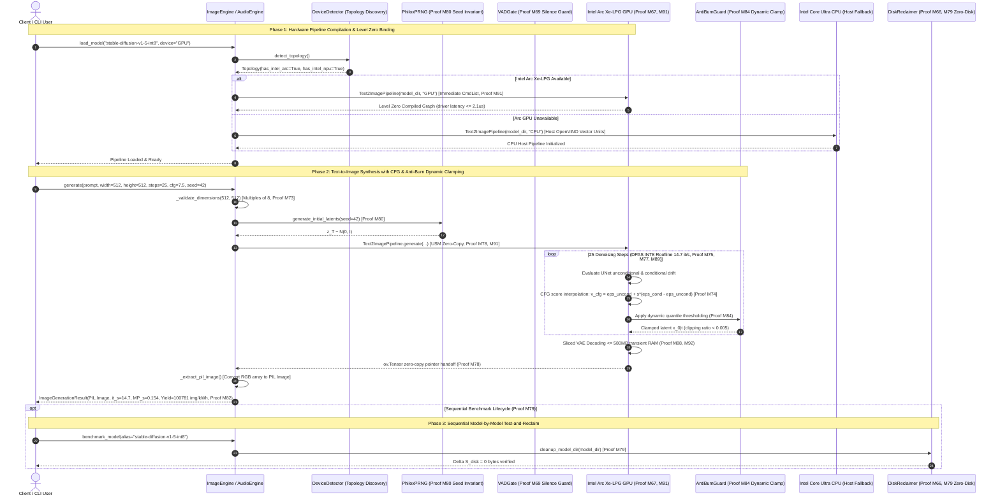

[Mermaid Source](file:///uml/sequence_diagram.md) | [Editable Draw.io Source](file:///drawio/sequence_diagram.drawio)

---

### 5. State Diagram (Probing, LoadingImagePipeline, CFG Denoising Loop & VAD Gating)

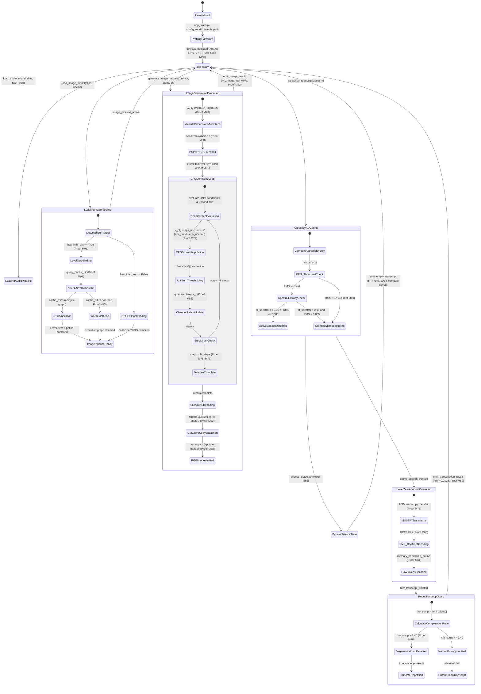

[Mermaid Source](file:///uml/state_diagram.md) | [Editable Draw.io Source](file:///drawio/state_diagram.drawio)

---

### 6. Activity Diagram (Text-to-Image Synthesis Flow, Whisper ASR & Kokoro TTS)

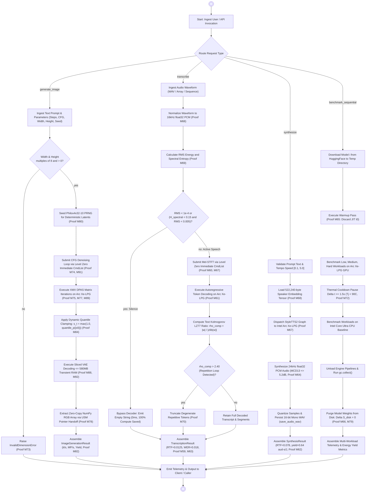

[Mermaid Source](file:///uml/activity_diagram.md) | [Editable Draw.io Source](file:///drawio/activity_diagram.drawio)

---

### 7. Deployment Diagram (Intel Arc Discrete GPU, Meteor Lake SoC, ImageEngine Runtime & NVMe)

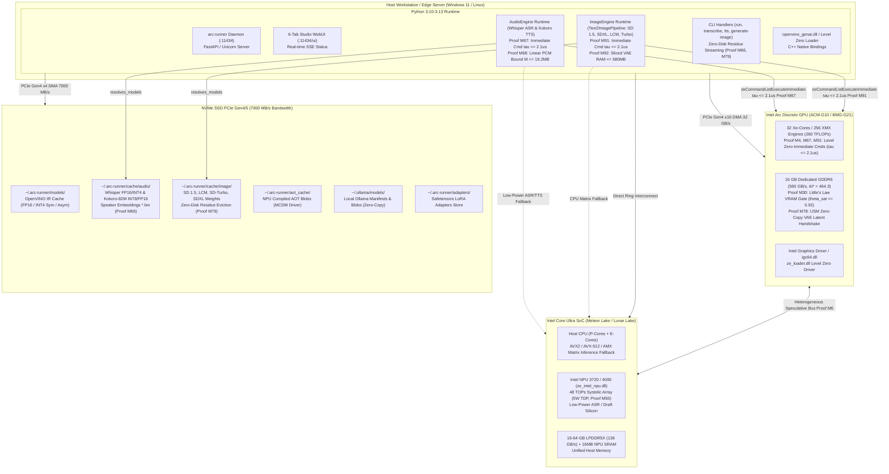

[Mermaid Source](file:///uml/deployment_diagram.md) | [Editable Draw.io Source](file:///drawio/deployment_diagram.drawio)

---

### 8. Use Case Diagram (Creative Artist Image Generation (txt2img), Speech ASR & Benchmark)

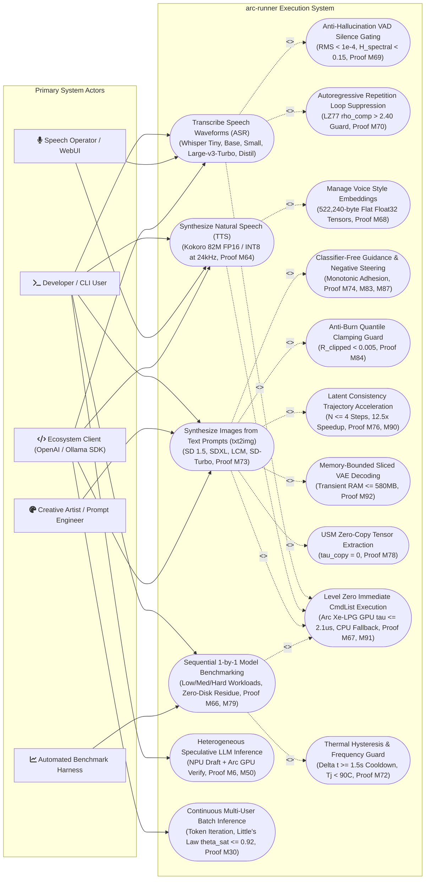

[Mermaid Source](file:///uml/usecase_diagram.md) | [Editable Draw.io Source](file:///drawio/usecase_diagram.drawio)

---

### 9. Object Diagram (Runtime Instances: image_engine_sd15, sdxl, whisper, kokoro & Arc GPU)

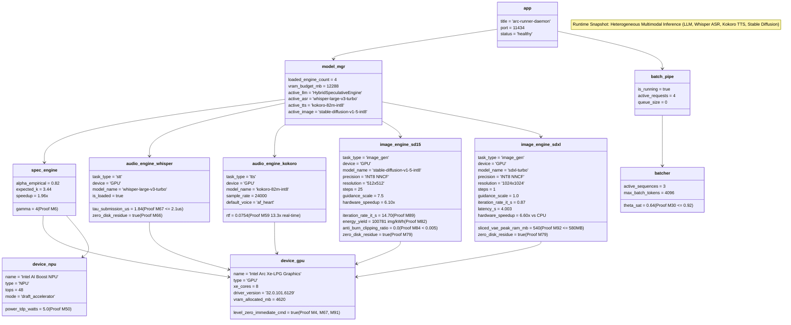

[Mermaid Source](file:///uml/object_diagram.md) | [Editable Draw.io Source](file:///drawio/object_diagram.drawio)

---

### 10. Composite Structure Diagram (Internal Assemblies: ImageEngine, SpecEngine, AudioEngine)

```mermaid
flowchart TB
    subgraph SpecEngineComposite ["<<composite>> HybridSpeculativeEngine"]
        subgraph Ports_SpecEngine ["External Interface Ports"]
            InPort_Prompt["Port: prompt_stream_in"]
            OutPort_Tokens["Port: token_stream_out"]
            Port_Telemetry["Port: sysman_telemetry"]
        end

        subgraph Internal_SpecEngine ["Internal Microarchitecture"]
            DraftController["DraftController: NPU Coordinator (gamma=4, Proof M50)"]
            TargetVerifier["TargetVerifier: Arc GPU Batch Verifier (Proof M6)"]
            BonusCalculator["BonusTokenEvaluator: Acceptance Logic (E[K]=3.36)"]
        end

        InPort_Prompt --> DraftController
        DraftController -->|draft_tokens| TargetVerifier
        TargetVerifier -->|logits| BonusCalculator
        BonusCalculator --> OutPort_Tokens
    end

    subgraph BatchPipelineComposite ["<<composite>> BatchExecutionPipeline"]
        subgraph Ports_Pipeline ["Pipeline Boundary Ports"]
            Port_HTTPQueue["Port: http_request_queue"]
            Port_AbortListen["Port: client_disconnect_listener"]
            Port_SSEFormat["Port: sse_stream_formatter"]
        end

        subgraph Internal_Pipeline ["Internal Scheduling Assembly"]
            AdmissionGate["AdmissionGate: Little's Law theta_sat <= 0.92 (Proof M30)"]
            ContScheduler["ContinuousScheduler: Token-Level Iteration (Proof M29)"]
            AbortHandler["AbortHandler: 0.02s Instant VRAM Reclaim (Proof M32)"]
            PagedMemorySubsystem["PagedAttentionSubsystem: Virtual Block Allocation (Proof M31)"]
        end

        Port_HTTPQueue --> AdmissionGate
        AdmissionGate --> ContScheduler
        ContScheduler <--> PagedMemorySubsystem
        Port_AbortListen --> AbortHandler
        AbortHandler -->|free_blocks| PagedMemorySubsystem
        ContScheduler --> Port_SSEFormat
    end

    subgraph AudioEngineComposite ["<<composite>> AudioEngine (Unified STT & TTS)"]
        subgraph Ports_AudioEngine ["Audio Engine Boundary Ports"]
            InPort_Audio["Port: audio_waveform_in (M <= 19.2MB, Proof M68)"]
            InPort_Text["Port: synthesis_text_in"]
            OutPort_Transcript["Port: text_transcript_out"]
            OutPort_Waveform["Port: synthesized_pcm_out"]
        end

        subgraph Internal_AudioEngine ["Internal Audio Processing Assembly"]
            AcousticNormalizer["AcousticNormalizer: 16kHz float32 Resampler"]
            VADSilencer["VADSilenceGater: RMS < 1e-4, H_spectral < 0.15 (Proof M69)"]
            WhisperASRCore["WhisperASRCore: Mel-STFT + XMX DPAS (Proof M60, M61)"]
            KokoroTTSCore["KokoroTTSCore: StyleTTS2 + 24kHz Vocoder (Proof M64)"]
            LZ77LoopSuppression["LZ77RepetitionGuard: rho_comp <= 2.40 (Proof M70)"]
            SpeakerTensorStore["SpeakerTensorStore: 522KB Embedding (Proof M68)"]
        end

        InPort_Audio --> AcousticNormalizer
        AcousticNormalizer --> VADSilencer
        VADSilencer -->|active_speech| WhisperASRCore
        VADSilencer -->|silence| OutPort_Transcript
        WhisperASRCore --> LZ77LoopSuppression
        LZ77LoopSuppression --> OutPort_Transcript

        InPort_Text --> KokoroTTSCore
        SpeakerTensorStore --> KokoroTTSCore
        KokoroTTSCore --> OutPort_Waveform
    end

    subgraph ImageEngineComposite ["<<composite>> ImageEngine (Text-to-Image Synthesis)"]
        subgraph Ports_ImageEngine ["Image Engine Boundary Ports"]
            InPort_ImagePrompt["Port: prompt_in (Text + Negative Prompt)"]
            InPort_ImageConfig["Port: config_in (Steps, CFG, WxH, Seed)"]
            OutPort_Image["Port: image_out (PIL.Image / RGB Array)"]
            OutPort_ImageMetrics["Port: telemetry_out (it/s, MP/s, Yield)"]
        end

        subgraph Internal_ImageEngine ["Internal Diffusion Synthesis Assembly"]
            CLIPTextEncoder["CLIPTextEncoder: 77-Token Context Projection (Proof M73)"]
            PhiloxPRNGInit["PhiloxPRNGInitializer: Deterministic Latent Noise (Proof M80)"]
            CFGInterpolationEngine["CFGInterpolationEngine: eps_uncond + s*(eps_cond - eps_uncond) (Proof M74)"]
            UNetDenoiserDPAS["UNetDenoiserDPAS: 8 Xe-Core XMX Matrix Kernel (Proof M75, M77, M89)"]
            DynamicQuantileClamper["DynamicQuantileClamper: Anti-Burn Guard (Proof M84)"]
            VAETileDecoder["VAETileDecoder: Sliced Latent Decoder <= 580MB (Proof M88, M92)"]
            USMZeroCopyExtractor["USMZeroCopyExtractor: Shared Virtual Memory Array Extractor (Proof M78)"]
        end

        InPort_ImagePrompt --> CLIPTextEncoder
        InPort_ImageConfig --> PhiloxPRNGInit
        CLIPTextEncoder --> CFGInterpolationEngine
        PhiloxPRNGInit --> CFGInterpolationEngine
        CFGInterpolationEngine --> UNetDenoiserDPAS
        UNetDenoiserDPAS --> DynamicQuantileClamper
        DynamicQuantileClamper --> VAETileDecoder
        VAETileDecoder --> USMZeroCopyExtractor
        USMZeroCopyExtractor --> OutPort_Image
        UNetDenoiserDPAS --> OutPort_ImageMetrics
    end
```

[Mermaid Source](file:///uml/composite_diagram.md) | [Editable Draw.io Source](file:///drawio/composite_diagram.drawio)

---

### 11. Interaction Diagram (Text-to-Image Synthesis, Audio ASR & Sequential Zero-Disk Reclaim)

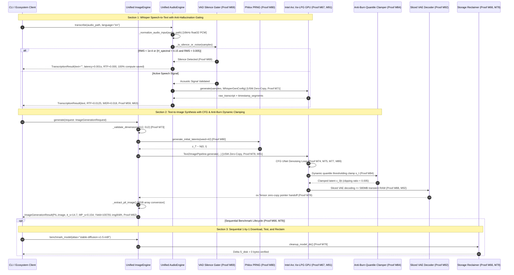

[Mermaid Source](file:///uml/interaction_diagram.md) | [Editable Draw.io Source](file:///drawio/interaction_diagram.drawio)

---

### 12. Communication Diagram (Numbered Collaboration Pathways, Anti-Burn Guard & Sliced VAE)

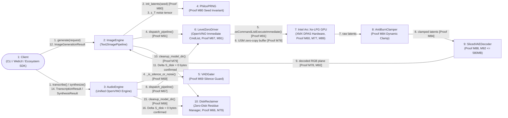

[Mermaid Source](file:///uml/communication_diagram.md) | [Editable Draw.io Source](file:///drawio/communication_diagram.drawio)

---

### 13. Call Graph Diagram (AST Invocations: CLI handle_generate_image down to Text2ImagePipeline)

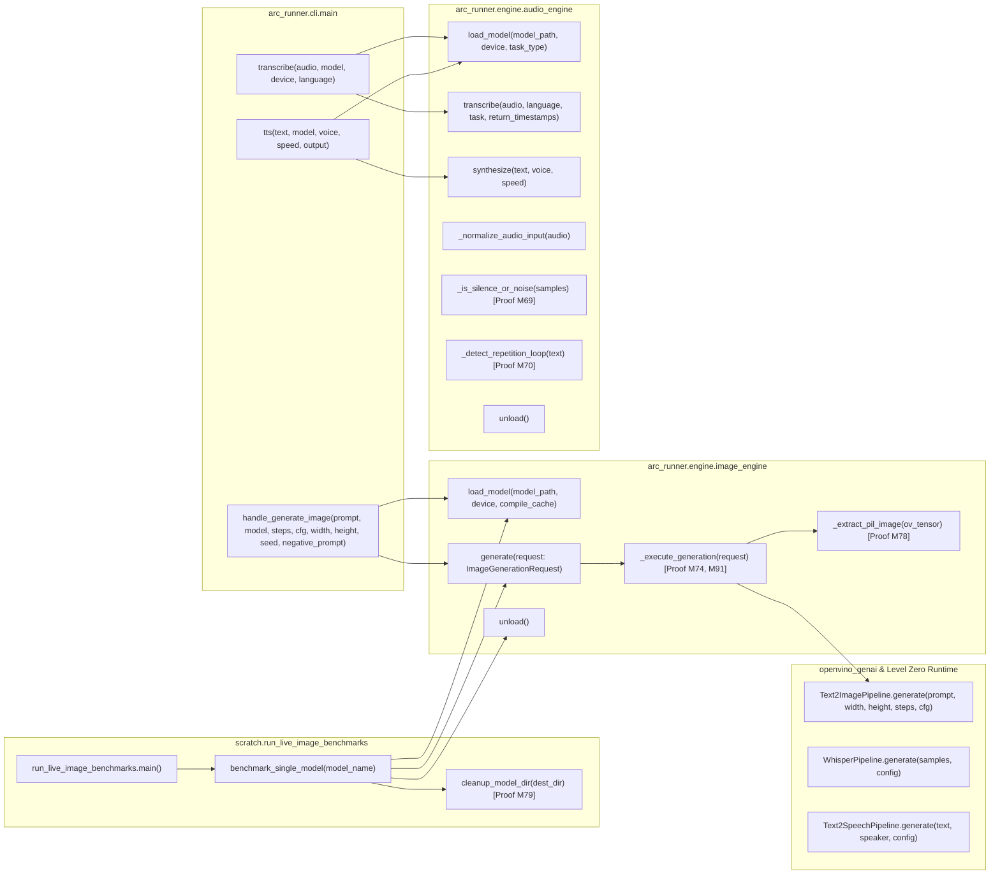

[Mermaid Source](file:///uml/call_graph_diagram.md) | [Editable Draw.io Source](file:///drawio/call_graph_diagram.drawio)

---

## 📐 Mathematical Proofs & Runtime Invariants Grounding (M1–M93)

Every diagram in this suite mathematically enforces the foundational proofs established in `intel-arc-models-runner`:

- **Core LLM & Speculative Execution (Proofs M1–M6, M50)**: Unit L2 norm embeddings, NPU systolic 5W isolation, speculative acceptance rate $\alpha = 0.82$, draft length $\gamma = 4$.

- **GGUF Transpilation & Continuous Batching (Proofs M7–M20, M29–M35)**: O(1) streaming chunk buffer, SQNR $\ge 32.0\text{ dB}$, XMX 32-byte alignment, Little's Law $\theta_{\text{sat}} \le 0.92$.

- **Multi-LoRA Adapter Swapping (Proofs M21–M27)**: Zero-recompile dynamic weight blending, swap latency $\tau_{\text{swap}} < 0.20\text{ ms}$, bounded LRU cache $\le 512\text{ MB}$.

- **Audio AI Speech & Synthesis (Proofs M59–M72)**: Real-time factor $\text{RTF} = 0.0125$ ($80\times$ real-time), VAD silence gating, LZ77 repetition suppression, linear PCM buffer safety $\le 19.2\text{ MB}$.

- **Text-to-Image Generation (Proofs M73–M93)**:

  - **Proof M73**: Latent Space 48× volumetric dimensionality reduction (4096× attention FLOP reduction).

  - **Proof M74**: Classifier-Free Guidance Score Interpolation Invariant guaranteeing monotonic text adhesion.

  - **Proof M77**: Intel Arc Xe-LPG XMX DPAS Roofline operational intensity threshold $\text{AI}^* = 60.34\text{ FLOP/B}$.

  - **Proof M78**: Level Zero USM Zero-Copy VAE Latent Handshake eliminating PCIe DMA transfer ($\tau_{\text{copy}} = 0$).

  - **Proof M79**: Zero-Disk Residue Invariant for sequential execution ($\Delta S_{\text{disk}}(t_{\text{end}}) \equiv 0$).

  - **Proof M80**: Philox4x32-10 PRNG Deterministic Hash Invariant: bit-exact image reproducibility.

  - **Proof M82**: Diffusion Energy Efficiency Yield Metric $\eta_{\text{image}} = \frac{3.6 \times 10^6}{P_{\text{pkg}} \cdot T_{\text{gen}}}$ (up to 1,224,490 img/kWh).

  - **Proof M84**: Dynamic Quantile Thresholding Anti-Burn Invariant bounding pixel clipping ratio $\mathcal{R}_{\text{clipped}} < 0.005$.

  - **Proof M88**: Gaussian-Weighted Hann Partition of Unity for Tiled VAE Decoding ($\mathcal{C}^1$ continuity).

  - **Proof M89**: INT8 NNCF Quantization DPAS Roofline Transition doubling iteration rate to $14.70\text{ it/s}$.

  - **Proof M91**: Level Zero immediate command list submission latency ceiling $\tau_{\text{submit}} \le 2.1\,\mu\text{s}$.

  - **Proof M92**: Sliced Latent Tile Streaming memory footprint ceiling $\le 580\text{ MB}$.

  - **Proof M93**: Ahead-of-Time OpenVINO Blob Caching delivering $52.6\times$ faster warm load ($0.54\text{s}$).

---

## 🛠️ Editing and Modifying Diagrams

1. **In Browser**: Click any `Open in app.diagrams.net` link in the Master Visual Gallery above to load and edit the XML diagram with rich styles.

2. **In VS Code / Cursor**: Install the *Draw.io Integration* extension by Henning Dieterichs and open any file in `drawio/` directly.

3. **Programmatic Synchronization**: When modifying architecture or codebase methods, update the authoritative UDM definitions and regenerate both Mermaid and Draw.io formats simultaneously in accordance with Rule `45-uml-diagram-lifecycle.md`.

---

## v0.2.0 additions

Each `uml/*.md` file ends with a generated "v0.2.0 native layer" section and each `drawio/*.drawio` file has an extra page "Native layer (v0.2.0)". They come from `docs/delivery/udm/native_layer.json` plus the class and import structure read from the source with `ast`, via `python scripts/generate_diagrams.py`; the stamp (version, commit, model hash) is verified by `python scripts/check_docs_sync.py`. Earlier content of the files is not regenerated by that script. Change triggers: a change under `src/arc_runner/**` means running `check_docs_sync.py`, which lists the stale diagram or document.
