# Architectural Diagrams Suite: `intel-arc-models-runner`

This directory houses the comprehensive visual architecture suite for `intel-arc-models-runner`, modeled with connected MCP tools (`uml-diagram` and `drawio-diagram`) using authoritative Universal Diagram Model (UDM) payloads in strict accordance with **Rule `45-uml-diagram-lifecycle.md` (Level 2.3)**.

Every diagram is mathematically grounded in empirical physical silicon proofs (**Proofs M1–M6, M8–M9, M15–M20, M29–M34, M50–M58**) and available in two synchronized formats:
1. **Mermaid Markdown (`uml/*.md`)**: Directly renderable in GitHub, IDE previews, and markdown viewers.
2. **Editable Draw.io XML (`drawio/*.drawio`)**: Full visual XML diagrams with rich complexity-based styling, editable in [diagrams.net](https://app.diagrams.net) with zero-auth `#R` instant rendering.

---

## 🗺️ Master Visual Gallery & Shareable URLs

| # | Diagram Type | Mermaid Source | Editable Draw.io Source | Direct Browser Editor Link |
|:---|:---|:---|:---|:---|
| **1** | **Package Diagram** | [`uml/package_diagram.md`](file:///uml/package_diagram.md) | [`drawio/package_diagram.drawio`](file:///drawio/package_diagram.drawio) | [Open in app.diagrams.net](https://app.diagrams.net/#R7Vtdb6w2EP01PHa1wIYkj8km275UqpRWfURemIAVY1Pb7Ed%2FfcdgdpcY0G2vrrqO9iq6gRl7HM85HnsGCOJ1EG8OFQui5Q6kooIH8UsQReFiif%2BjFHgmcsqLTvzH75ufHowi3gTxa7B8CuJ1dXinDLBpKZTumpG6XuSUFJJUasFBd6b0sYZOb3WdeDButFosu6E789HS%2FMTrU48lzQc2ws4IJ5W1%2FRvJPkhh%2Fp6X8yiXxnqT1eFnSeryV5GDmX5%2BsDNfGYPGZn7sJPeJFRSyHzw8C97o33bk0LqsaGgOatBQC8E0rYfCTHAOmR7IiJRiP2z2Lthw1NpM77PgLSPMlf5Jc11aaZg8nhW%2FAC1KO%2FRDdN8pKtI3tjNRJcnF%2FkLk%2BrH3phRCT6rPLl8DYxcg2nGCaPPv%2B56mKYHrbzA3YsLiuiOssb4jMktlg7jIRSYksighVR3Ez0EUHwj%2BRsyUJlwrRwOHDGqNRHZVTBSFWUKdT%2FWxBwrd264IgzBIbFhqXInxS4iX%2B5JqeKtJZhrskagoexdcv9nupo0m2x7gVdTdn3ANV6YDZWwtmJDtePFms4nWuOCflZbiAy40L8lzcpecNL3VqJ2EXaQaDpOOD%2BfJgUsNRAVaHvHeWllZsI7D2%2F2ZsdHSysoLsoY9yMSukuJkeQ56lFv0v4kY8RwxctjRDFyYc9C4nNGlnxWVCTFue3VUFeE3VlyyIo6umRarOVoAx0XuRgxRA99RLtIJvaohaxjRdAdTTTDoaMob0ah0S3RWgksxE9PzlGiNzjeb6Y1UF6RKltdMqrs5Uv3V4GbjoF0UzXuKTlEjTNCScFXjiWw6Dt24MbkNXRk3kjlulM3W3YPEnjNB8jH0Cccg4coFY6QiKa1qgc519RIKqk4Tu%2FFmfKO6MuLczxEHw8ZuBGjM2hxZu9%2BkNa2Bje1MbURJp5glRaNBpUH0dOPO3H50Zdx5mM2KGB2JLPR24phNbq4L4Mc5gLfAs7Ii8sNdzm2DG9Cz%2Bcp1Id2XpMahxuCs27rEJ6BLIvM9%2BiXFCw7qdmKczyauDPJwDvJG05FKRM5Y2p8ab1BPhvHkypB2y5eMNBi9wV2xwPMnU1rGO1OQQJ%2BhxJauH4aoOo5ftv9GHQ95AT3amD2UohCcsNez1EJj2g2AUaKRGQzOG5rIAvTg%2BPpf4ZPQFVQGQ%2F5YLNyKIeU79Jb3UKy8g8Kt0tVSbP1HIvYOCbe0VTdspALlGRCJd0C4daRMcLNfeo%2FFnXdYuKUZMNdE%2Bx%2BhHr0Dw6114CXNvwIYfe7nERpuYSKnqm4fefkFx%2F0XOEdFSwcNDQwuBvIXDO%2BOUpGb1ZuEXaUTz%2FQ8w8O7E1Xk5t6nB6%2Feo%2BHdmWrkfZ1TDVPUfuGx%2BgrRyk3BTy%2FOpUwU3iMSeYeIm4p3%2B0fuWz4ej5x0v7Pa%2Bz%2FA4SbkFRDVSM82j8evcM51E3LzYEylijKajbxLd82A9EmfP9vHRZuJd8ht%2F4u39YffBqC2%2Fzwgtt8ktB3azxLi138A) |
| **2** | **Component Diagram** | [`uml/component_diagram.md`](file:///uml/component_diagram.md) | [`drawio/component_diagram.drawio`](file:///drawio/component_diagram.drawio) | [Open in app.diagrams.net](https://app.diagrams.net/#R5V1tc6K8Gv41fqzDi1r70Wp1O1O3nmq7z5wvTAoRMwuEE8Kq%2B%2BtPEqAKt3b7tk7yaDsqeYVcuS9yX0mw5Q5b7ngTRy3H%2BoVZRmjSckctx7HblngXoTjxaUCSsAh%2BXIwv%2BjLCHbfcm5Y1aLnDeLMkERZJVzTjRTKUpu2AoJChOGsnmBdF8W2Ki%2Fgyrgiu1et02lZRdVG8Y8l%2Fd%2FiSwyJBrQy7KCRBcVn2kMYpTXAiKrVGu3r2i6sKjTcThtLVlAZYNkCwKa%2B9I4uUpQbbIuSyVwaErKre3gXMye%2BybrtstDAnAc5qCTmlESdpPdCnSYJ9XgtDjNF1PdmSRvVaUxRiEDD3UQRDf5CAr8pQu3e1i%2FiGSbgqq%2B47l0VEjKrE5ZVkKxTQ9V4QbMeqNRml%2FGj0rsmHOIr2YCzraTnj9%2Bd9uUwm4f5zcQeKKHH9haK8bLuW00Nx2nKvI1Hkdf3I3%2FWtMjisJaoftRx3g8Tn8O7Wm%2BfP2TbjOAaxiPkXLBf9gInzEElBggfir0TUArOYJCjKSmD4tkJbYKQMK96Esju38zhq787UvV5xYd%2FuyBZf1yvC8TxFvky%2FFqlFWMYZ%2FYmHNKJMlef21EvECLuO9sLHXfn3kqPqWY4619KSOd4cxcZ%2Bvf8Ia8Q0xpxtxXFZSqfEc1s%2FXO86tWOVYau9%2FmxX%2FQCVhhS%2BlPxa7xDhZQd5U99xQd%2BBWDagEgUIDsB1UAAAlnodAEC9AAD2XwTA6XRrCPQOIQABOEn7d0D7%2F9FUjG9%2F29IIgO4JyPMHfn4U9MnzgFAQ2btYoGdxBkei5%2FMbETljNGQ4OyvedCv8tSTOHug3TSBNN9uuoy9tXoLW%2F4OdGN%2F6WpFm%2FwSkOUI4pok3QRyv0RZEj1HGB7NbdY79ljuw7Y4rbqZXIOF9FKEYldfuWPcpTgYym8h8VnTaqzqQlnR6BXrUcYBNN%2B2%2BpS%2BxVt7%2FHhDvMiDjwdCKZ237BESrpKMpSlAoXb5G5E0SkkQKYw84JJm6vkaKp4fBVMRf50GIuRTZzohTG669ZpxqQ2HoAJymG3DTu9SLTqG%2B8kd7MR4BVysKhQrL11PoNeL%2B6maD%2FZwTmsxIiiNlZo1kg2yb%2BOJcflD2U8lrd5SmUGqNSKX8Z6W4flYD1abfrxurQsXoCK6m23XTBdWLWaEA8ybDMR4FvdgVCjF%2FYe6JJuJGmdM8Uzx7YJR6yzFDknrljVWmUfdV6TjOGKVL8XUqHUcoDtwRzuW872UmrRatxbsUHBp5XeuQ3%2FkvpuCmVqAbBUP96e09wHQ%2BaDqserEy1HE%2BY2LGg6MVWVeV%2FFWynqEQB96Ac5FRmWNTLiCM50ielkopzTWi%2Fs8MLhlAAdnIZAwv1ZcRDvK02W3sM2Pm5mICvYjZgXrVcbxNt%2FWm29vRiYgdqP18wqCMx6arFQ9DUejrefiOPgy8Y6ruaJugmEiXdZpHnFwMApRy5bnO1yhN1dipuQ4BLbHg9IwyeR8f52q54xkRL1iNoBnzQpnrLSCbbudN51gvDoZK0ZusyHgU9GJbKBR9PdvKSdGn2%2B%2F3Ezk3Wk2yNBkZ%2F1JLtP%2BLGRUft3GMA1J4QsM4yBo34oNrGR4TsiRqEDUnEfGVtzsppmPPh4nBQgbNmBhKYh9B3nROaHrCejEzFJDeblrGQ6EXPUPF6Ovp%2Bdv2We5xSbGfR4iTX%2FgIRX%2BfPYpTGTG05OqMRYQ1YHIINVExT5iR5bZhr71DTN1x28KORbtbM7pWg64H4W35%2FMxGzQ25oqcXVbsW6Huf6AGm0wTYJqETY7tQWXqPiRkPxqVOnO1CcenrOfuJSOfIO8LUyqWNaaCURZG0kBgXAp0ESsmzFblw292LJ3VJL5HWlCRkOJvK8POh5KaQoRsnQ3HsdaxNt3SwzUIr2oWy0vuNyXhI9CLfU%2BxYu4mfcSC3zB%2Fj32KcVKwIL0ZGL1kg%2F97J8xUOlhxSfacsRhH5XU3W74%2Bjzm0yr6lk6EbFUDl7HXbT7R5szNCKig%2FoSp%2BxK%2BPR0YuVT7ElbjJ5HHsLhpIsJdGBab17AXqBtTXnDKO4WAR1nS%2BXyj%2Bq9YnuIdnC7bR7gbybz%2F%2Fz%2FUFmpXkSNHL2z4ylGxpGXzOShvrZB7qB6dzQdJf7OjF31WH2IPqwnRmPzJVOrN05xf66%2BTaLUeItcITLK3h9YrBIL76UO4WmIhPx4ah6scLylq%2BubueGVVrYXnXnQ9VNbUMzru5A3eyt2JtOA02XWi%2BChprTR43LeGD04udTbN67TTiOvAHzPeXRNkfEsv5%2F8MWQMpyVV%2BZYTrcng6f%2FFPdstQbfWozv7mfZoWF1V8VPxPFYljEZjR56L0Z%2BPvTc1Dt0o2eorH0MfdM5oelp60XWUJV6j3kZD4ZeBA1FqW%2BLxUylrp7Y0gQgCQby8aDiiKY4ES0nQsrHj%2FbfCgvkLByEeF7WQhlf0ZAmKLrZhZYAyXQ1eDKaM78MKsdnHLEQl83Y%2FxyIDBcLTmpV%2Fl1IoBJVPBur4K6Hm%2FnCKEy6%2FwZMoEgjLsajzIsoCjxczrEYhEofomJ%2Fku9OD0vXArDg5H85zrHHsPjMuPGYdIzDBEoypNrb62Ucp0ZBUrV%2FDZNL4zCBugWKIuojjr3nI7v5dAblEoJSjZYMAgWKFkvK1ogF3rPcAG8%2BJD3jIIFyBUkIJ3JeFnvpy2OBTALGPgDMlXHAQM8epWm09VC1J850SFzjIIFufJCjyCNJxlHiYy8gWWocj1WmYTiPQa%2F%2Bt2jFOEZJcEcyXjzpDO%2FtYzIJoh6EqGPeMBl6%2BcJhYVuPH5%2Ba0BiUQ5zWMc%2BfhG4%2Br1brCN9FLsUwCpUDDqWrt%2Fayl%2BbIT%2FmU%2Bfd%2BNGk%2FjYqtfqepiCgzqN%2BHcm%2F%2BDw%3D%3D) |
| **3** | **Class Diagram** | [`uml/class_diagram.md`](file:///uml/class_diagram.md) | [`drawio/class_diagram.drawio`](file:///drawio/class_diagram.drawio) | [Open in app.diagrams.net](https://app.diagrams.net/#R7V1bc%2BK4Ev41PG4KbCDkMUAyO1WZ3dQku6fqvLgUW4AqtuXIMoH59du6GHwTeJaJ1wFPTc1gXVp2t7q%2FVrsl9%2BxZz77fBH7P6q8xiwkNe%2Fa8Z1mDqz78C6U4dKlHwqUq%2Fuv5%2FreJqLDve%2FZdr3%2Fbs2fBZkF8DE1XNOaqGYqiK4%2BgJUNBfBVirkjxbYRVva5TxblxreFVXw2tyFt98dee7Xr0iZejMVBEQhRo2jMfxTGUzPdjZEmlBIPNF4ai1TfqYfHw3kY%2F91CQExS9rSq5HuuCJUuHHuwLnsgPPe5AM2yZEA%2FHuYacUp%2BTKF%2Fo0jDELs%2BVIcboe77Zgvr5USO0xKWCJxf55dL%2FEY%2BvdOlgfLOv%2BB2T5UoPPbGuVUWA0sb6SeIV8uh7pqjMx5SbjFJurN6zfIZ9PyNCPU7Puv%2F5vrvHZDjkNchVkNByXSM%2F0bybohjfhUsSYs0Bvk3ZGr%2BTwEdQYU8XNORPumYA18gnSzF9XbgTzKAg5ohxPTOsMRSArDkCqkz3cKnvoygmL5IG3NwUbyIUevpixUEhVUtQLX9GfcrkXdh3g%2Fno7loOwegrztTcjK%2Ft2%2FGuJhU9CG26UzOON0bmDQ4LGNQF0wBztoVrTWWoGb7NX77vZ91OJqvMhBtMNOORnunLHeVD4oNyLcFawrVLwu1ZU1EfOz5FHoZmgsYLqGbPGqMgkoyyN0j%2BL1oGwjQ4kdQK0fRR%2FKpu6uE1cbFqNpe%2Fn4WtK84h4D%2FPizcvxpCq%2BZWRuS5Kp5iPF4KCkCUBlb%2FVxQHxPDHINI6QC8b6QTabj%2Fcl3zX%2Fh1BEofvCl5q9go4YKEwZ5Yij%2FXysNWesn58z%2BSkDylFryoyHDcyYYcWMKQjQJ1IaRgGa9bCoy1quzbD5pqZmThrg8qhaL0U%2FoZdOoAB5Uq19swPKdqOK%2FhCcrVRTUbvEYIURxw6IBwvvYBIxGkRc9YVCNQYY7AVZqsIvqgu4KDNVmo70lYtyEOdo%2BgyiDmerJHztjeaHRucOxz7WbJ3sSCnQed5XmSgkoeBStqt63s7SHFGBSU0VaMLSjEs68GeEw7%2B%2F%2FvEnzLXbr50HUlfGtv0vXZBhEy7IdUnMv8GlE5EIKyARFOjaAZuEyNXDw7fHtKao%2FrJf1u5JQ3XmOj9uyrsYNqHzk7Z6Fyez%2BbpF3sWNwev%2FaNfiv%2FErpFl4SYjvOcqMaHqOHsaa1BpvZ4LKLToTc2Tu13QrGlnApBGozOz%2FffsiglQRdhMfBLvuohu1BT0uiLq2b5HGCz9W1oNK5wJEI9YYWElZanela1lhSDyGFj%2FfU1k%2FN2GC184SBQFSnUnIz958KIU7mwDIoBwQbYmPcjqj2xQCGZhik3W9FKmp1fVt9lTgeYknRpY3DeNW37u66EzHL4poNGM6ysFTmCqchAlN4ini7gqXF6yd01ES8c0gL%2BR2BTQGhuBtH7nCt3Ri%2FJbg0MUxLECSkGccgUpL9I4IzJDlgW7nbgSGTfkPjYQ4BuW4Zlv8h5MZ3aYgx6AcWNRq6HkOE8oUg%2B5MQK2UKkn7%2B6SVrI6LEHMcZV8xPBAgWOslRz9iGIMzsdNpdR8O8TLuxU321Wun4p8qxFAOYz6iJfamPnVfnyVzOpQ%2FKuBC4oSVRgxagvKmIOqLELITS%2FEcRnYOquI7sn18rG3CiU9%2BqLilXGSoDqB96AI8gElTHkAj5iEduIUewMmMblMEwSpH%2F9LF%2FR56U%2F0zI7DGdaGbRkAXFJXiByjnFMyJKzrvAgZ5YqN5p7u%2FbAnfiPeeqmpmTn1HHtk8MrwgmxmCJXyH7cclXExJsFLMPgruqQA%2BVsqm2OOKcAG%2FOIe%2BB8Ddp%2FQ1ieLLWawr8ZzNYr3F6Y4nM7pNi3VTwqNIt3dXTiStK%2BAqF4vruBKXNeA%2BJxEIRhUbELdSX0kYA8NrjSSoZr326hu5jIzD02dhq9C9HJt7oN9vv6EQlu%2BsA%2Fbjwi3mA7QN2M1BQRSBoGLHI%2BzoRoYAbRxXuHreBQH7eSUatjfT8LxSDY25hoC3EXZhHY4WmAPSUtC9FUaeMLOmd97FxfRtuD0QY0csxo7WaweeDH5yZCYuDP2tav1t17hT6s8E3%2BmiMjPZ%2FiZi12yXz1dXusVX6y2LutumkF4k1wl1ou6XtkFAKcXZALddDsC1BLhPZ3SbgNs2hcBgRss0aeysSZwg39ErZWuib3unfrPMbe8Kb47rp0s97JAAllyO8gyAtrp82XKsF93qZ0oujK5CDzGGDJsCd%2Fl8pkS%2BI%2FQ7Q%2FHpXsLb5dDdXfCCPXFMR%2BcP1BVw8fSCdOdnS9wBU9jQIwFYDnleSucN5JT8vJLp7NYm053O6FZ5A6a4GRYm1XlLsNypr%2F43vUFXr8uMC3ZFyqNuArrLhUMBv%2FMhdkE0E2LXpUXyxhF8ywkpC0AzfwhHYI3dsvdQ4VB0JuFT4X45svfly1%2F3zwyFcUT8LoxfR77F9%2FMjqy7uN7KvzzZHFaOE1zuNiCZctC3E%2B89d1xvLpGsE%2FlPvtIXwfzKj2wT%2FQ1PYzcNvCQo52EPnbej0VQ4cQKvKhfv3y3VQgVdnE2yckLzAFJfRBfnMsRGx9QjVO29hxZ%2BIzXxvoQgmLCKHsnTbXpbUbP9IxnEOJv2kILPfNqj3GkcMu2S%2FIMl6R9ntgbq%2FzPN9ZHTJcBxfQpbgL1CXNh1dlC5%2BM%2Foij9DsEglqS7d0sMDIqumBpAj1sRI2hUfVhmPwKvIrF%2BldXIAiq5nfhIPRDPC1Nv%2FvdEaParr0jfDZFMgT2EmZPIw0PXUj3fSfy9UvnkuUBdjsebXG7P3dIGmM%2BOBw6YGExYDyUfJr6QTUoX3wzXVnNoqzue576mYOSS2HJeX20rsNdhPp2%2B3OsOs8gWNyLu32b5knYAqNkthhSRjKU%2BHlAuUSdvIOG0sTbAaXWpsmeDqjW4X%2FpoCetHHlg3wNG%2FJpVLMpqMqrU9zAfxEZ%2B6fPm1Yh7ahfmjjqSMo55tgVUZUOYY%2FKt%2FCSf1R3x%2BWg3wTAjqqCj%2F2zV1Q1s88GSVOnrX1Iejqj24SkI1NgypMG0QGMBB4tc%2BfqP20BCoPnXU3VsXSu%2BGAQWWydZZQ4iLkrIsglTCxi1WeFigtYZYdvc007nf1F4NrI67VROfr1gNfY%2Fz9mFOZMgMIOXY8LuPQuvWXwWhV6uwB4bSwRrhmz39pEuNMZ3Sp4PRDtQWtEfHW616RwflvlIlRmy0k8DXBA85%2B6KW1jT3eXd2r5qRC0RvwIh96t%2BKIhXKn0CYC50LsnYowizpUUti%2F%2FVOIZ9pY4xV%2FK%2BIouaYj8u32plohol5NHTBPm6iJtVlQWg%2BbmaajIsDpjPzfkxwqhKrj0mYSQBsA%2FjxQybQwfvdT9M58XzbaRtenXTFWF7iC%2Fomrf%2FQM%3D) |
| **4** | **Sequence Diagram** | [`uml/sequence_diagram.md`](file:///uml/sequence_diagram.md) | [`drawio/sequence_diagram.drawio`](file:///drawio/sequence_diagram.drawio) | [Open in app.diagrams.net](https://app.diagrams.net/#R7Zptb%2BI4EMc%2FDS%2BL8gSEly2UvZNu79DR1b6M3GQIVh07tZ0C%2FfRnxw5Pbgu7KgunTVUBGTszif%2B%2FTDxOOuGoE05WBekE3gtwgRnthONOEPhdT30qK9CUZZjmxvztYXIT64Zw0gnvO95tJxwVqzkmoLoumJCmGyrLboZRzlEhuhSkcSXXJZh222bMe3GDqOuZ0MZ94On%2FcLTZw8PZng%2FfOKGosL5n8Fypg9YHNN6G2fXW%2BCxWXzgqF19ZBvr8s5U99Uh71E6ztbEM%2BtaQ8ya6vzXM8KsN7dsxyyucgdjrKBkjEpf7xpRRCqncsyHO2XK%2F25yR%2FaglysExzFJEXOt3nMmFtfr94bbhD8D5woaOg4FpKFDT2Z6JWKCMLXdM7jg2o8kZk%2B82b4d8BITsqGjjdILJj%2B%2B7OU0OVJ7g7g0XVtcXRCo7diOCtTdz9nLdDKkaiBreYpVrZrpVQboEz4Fgqsx3iOBcE5yqfYErg5CIS0tG5NUGzp5gxAjjtcfQq%2F82LY1Qaojv1PVEdnpO6j9lX0h1oYZjX%2F3kIPAreqwPTzvZXEoSVu%2BOjv%2Bxgup6AFaA5Gu1bb307YjaK6EZ4OUOVpG1LXaIGjb7IYtyvvH8kT7KbiU6Sb3QUe8LkrBE61Y%2B6yWIr1m%2FyNHvDsl0McWlEaZV0ezS865ZxZ6bQxmVmFasErWeSotWSTuTCK5Zyb6j5KyE9J7m7cW4lXAYXbOEA0fCv6ffkjFH83ZO0yioJsLXLGHszmqUhA%2BI59BquNEwvOqZzdDRcPrP7MH4RyVWn%2BkCyXo7VuMMqkgNx5KrzsFIDw5nRWkOeHC%2FKgnCVFmfK0RlpWvgVDVXUlfl%2BoIfOlQAzW51Ham2HglLn5QQyjTBpJFpR7EfAcAEgswpP39OSw4ESfyy7%2BwtXY6XhlOGddW2xWOfDt87UF2wiqdg9zq9Aj0IE%2FaOhJH1VXtiGEvZZoA%2BgcNmRWIHRKDPFVSQcL1OItRhxbdiTdN6pvZvY2uROq71YSL5HKR6gyNhLo6U7yAlJJQdfd9S2Hg3naCfy1pZT839FSmB9xeWUi8RDoTeQEv1KRcgUSJsEuyTeg%2FtzfO6Q3Na8ZQzNlc%2Fv%2BqruUXyKCubm%2BDnIjkYHglzcSTdZbw540vEs%2BRRpzXNZu9OwHOnN25BOkXh2DsHSL7nH4lzcZLcJcWSg573JnZOFsRSqUyFSXYKq1E9F4ObO1bRTJlu%2FzQZLd9mtKgfdcOavRa8I0SEkXcW8qLekTgXJ89dDDXEJU8vSYrUnTTBFEusKrpXyBySMiQWkFlUdrBiJdCf48j%2FX3F0qG90ngm%2Fw6sT5%2BIcucuxOVDgSEIiSkgrI0HSZLE4R0WB9GrAJqP1vqvvh%2FHU1KKbSZga4TaFnYLEeQoDPwiPxLk4eu76MRRYJplefdwCpwiTvmFLBvY7tN%2FROzO03z29HWrfC35NenPiXJwxd4H7BTierxOlGiJEv8lxGmE6080wzetXVyamXNDpDgnR5rmT2DhTkXB4K3fiXJxBd4W%2BZhCnaugZTTiIiuhKAaUplLLOW2E37BsCHxmt9InIZu1Wg7i5yfbfYu93z36HRPTPVCQcEu7EuTh57nOFNQaSmZtr8ljxekH3o%2FynqWtXQU7Tf3CeIuJw2c4Jc2nMAs%2FBbM54gWQiBCTpoqJPolnvbSE6Iu55qoHDpxFOmIsz5D4mmJkHnfqxgCFI7Rv73WG4Uj%2FnSOgn1HWSisKuqkZVIesRELpfyZa6rcXtKAdx4J0Dt8PnqU6YX4rbTp933jpuImzf797tU7c2b5SH9jX2eof6Tfbw%2Fj8%3D) |
| **5** | **State Diagram** | [`uml/state_diagram.md`](file:///uml/state_diagram.md) | [`drawio/state_diagram.drawio`](file:///drawio/state_diagram.drawio) | [Open in app.diagrams.net](https://app.diagrams.net/#R5Ztdb6M4FIZ%2FTS434iMh9DJNmna101G3aWYvkYMdsMZg1jZNs79%2BbTAJYDrqalQtnlRVU46NHc7DORxew8RfTfzNW0YmnvOKGMc0n%2Fjriee5U0f%2BlVaUxxTiPKnNu5fNb6Fq8DcT%2F27iLCf%2BKns7YIJk15RyUXcDRTGFGCQMZHyaI1EPJU4Fqtt1W23uzOvNpk49dT2856hff3Xew8GwM4ZbD5KDTI%2B9FUCob7O%2BzNEeqhkwe7tnoEgfKUTq4OGbPu6ZGk6NCE%2B1ZRFoQ8Kaqd2LYYv%2F0fO62mFJiSHinY6CUiJw0TXGNM9RLDo2wBg9drsdKOnOWoAEGYZtDIhp%2FQtDkWqrG9xcGh4QTlI9degt6oYMNJ31kfAUQHpsmUw%2FNt5klIp3my8uXyFCWgj1PBNv89%2F3PR8mQ7n4wHADQ2iur4CU2nf6uMWpcabcQXKTG7epkEHir135LxeMfkcrSiirevlO9SNbZCCQIfv5RBfo7d2v7%2F7YxfKERTRDgp3kdjOKE9bj6HO1ccHxAt6b1aa0hbyxAX2qJeeBf%2BQ%2Fadcu%2FJB3fcO7uxznWGBAZMxAw9WMljlEUPv4mGKBtgWIVetRRmoXQc%2FR6%2FlduJ4NoQm9Wz8Izi1NREhH3wIW6%2Bj15p%2FIaOZ0ELmOycgNHBNSY%2FtUSDMD0hOje5nuHwCDR3ngV4PJC8fMaW5w%2Bh0S9IwAPF0Nobk3ZkKBQegLBapw0hXGlUDqZbvz9igYLQxGK5oLnJe05LdAxKnEtYwFfr3etDcuYKEBbFuguCRAMVozcBDqzuRaWPUT4LhY3ZilBGCAEES%2BIYYPp2si1cuCfjgmUM2NaovUt%2Bfl4xNDnJcMrZGQt6VXVKD3U%2BDIaLkGra9Pu40MrD2Iv2ux40pI9RPgyEiZesLqafdw2iuZ6Ko49dLfGds4MJnCxEuKWAbIS8qoEOSKU9%2FISJnqxBf6vIweqNgeQVFcU0XRT30jI2XqE%2Ff3u030wkDOC0yuiVQv%2BQXBqECZMoUBBuVwqdYh5FZMAOc4%2Fqj8bfocwQRt9dCUiZQmNAfk7mLVGFS%2FDgROSxZrk%2F6KArAEaWf5P4eKofoWsjPl5zre1B5kBou4PChRFnqealHogBNZhUeQkIgjec6mUaEWZkZPyTcpzayjZAoOEL3iGPEInm%2BL5M7hksXyn%2FunXbUp3eOsqBLLnR0RDMjPr6rpZvzUZia1uXXUTOmBUACjTCmvEUN%2Fl4gLCa3elnvZAGZugglsA9PUKO2kR0W0J3QfxSBOdTSpxHesroQ8ymRWHCjAR4cn%2BAXixjOlBR0sEcrlZ9lkO5EiASIORLUZEKF8pPo7zvRGjiAndp4YpQf5%2Beg7tsbXwjqApuLAL%2Fq4rBswkyTBnjQgE5BlQHacWYFoYSIKrUNkqg1QrVtE%2B5LJOGP1Cq5iM5nfCnc6FbPJfG0FntDEc2MdHlNiENJXOY9immVYnAu%2BO4nnD0XGX%2FtTP%2BjlvMAKYDe%2FQsozlYbe1Smprk7Npakq1mGGefWIoeesUY4VUxsvWQP5sFnLsQigqUDILw8yPunXFhVFie%2BMaW4HpoZJh9NPakv%2FAydTsGhzaqKs8Yh1QDzrgJjahEBZ0cURzld10GxPPAMq4S0JYsKKuBlKb9bpfAOPQVwotZLbogH1cOICMcQxtwKSOyDzWVdE%2BI4BqRKMpBfBRS%2BqwggckJDlIGUq7x3KuoqwgNNQMFknx%2FqmQAEgKGS8RI1eJJHYIBe5AzqrfWFjyg0xzdUKWpQk5aEbOeeqTa0Nbh5dO26RBlQh1zpdzzc1B8wioddiEYxADtv6a7j98%2BvzpFVH1OW3B29790mhFQzdAYj2MTSFCVCtCMoQy9V6VEyzgqCh5%2FRGB2TgWmQfD1N3MBzPU1C94AhpuSfobtyvjhnPKSz0EbaeU2jqpPZjCo3tc71t42MKQ3nHH%2FeJ3urzzhucev%2FWu7LtPlVr82qur98HrnaoXgn27%2F4F) |
| **6** | **Activity Diagram** | [`uml/activity_diagram.md`](file:///uml/activity_diagram.md) | [`drawio/activity_diagram.drawio`](file:///drawio/activity_diagram.drawio) | [Open in app.diagrams.net](https://app.diagrams.net/#R7VxdT%2BM4FP01fVwUx%2BnXY%2BkHuxpmQZRhtU%2BWSUxj4cRZx6Ht%2Fvp1GqdtsGHYQdBYASFor53r%2Blyf%2Bp7rKD047cHFJmE933siIqc87cFZz%2FfBmaf%2BKitJQx7RdFWZf9wufhuVDXDRg%2FOeN%2BnBabJ5oIyorjHPZdUNZ9lZRPFK4CQ%2FS4msXMltRqp23VaZG%2BP6wZlXDV25973yF073V3g0avgAlZMUJ9r3JJT0icqtMs4Owxx7q30mmwuBs%2Fg7j0g5%2F2ijpx6UHkun0bayDAfasBL16OBgWNJ%2F9dBAY7YqaETyRkfJOZM0axpDnqYklA0bFoKvm90eOGuOmuEVMQzLEDPT%2BheNZKytYDA%2BNPxO6CrWQ4%2F8YdWQ4Lqznkke44ivj0wmjjWagnP5YvMB8ilh7CiKepyev%2Fj%2F1%2B6nKUgq3%2BDO4kLH9QmzQmOn5y23NZjqAhU39eY8looncAbUy1wK%2FkimnHGx6wW93Y9qUVxgNvt%2BrUuyefHjg9chVguW8IRIUS5u7SXw%2BpUfvVahhmB9CHxtio9CXtuwXmqrvePX8FN2DeGb0IUGukuJhTQgFrxIIxJpbNcxlWSZ4bBsXSuGNqF%2FBvAczPrzoS0k48EQTgb7lpoJ%2FgcGA9YLcFt%2FIZjR8D1LOPqfEY7gDYs9jSblF5B6FzKc5zR867o3QSaR%2BlLSrrmQMV%2FxFLP5warDUPZrBCHnhQhJg6Bq2ayIbKyqXw2VIAyrHaI55Ifi3jdwvyEhUR8BTWMs0Q35pyB5l1gxbhMrBg6yApqs6LvGiqGB%2Bx1mNMKS1IxAs9ur7rDCH7WJFSMHWdE3WTF0jRVjA%2FdpTMJHdEmlZARd4jWaRAnNS8WkjAm17BsxT%2B6L%2FNeD8Yw1i92PsmdEUDVjUtr1INcHk5WLH0aeUZM8cGiSZ2ThzugzuFPLQKfIMzTJM35fqD6fPACYwPfPt0qK99Vr7%2BdM8vhjdzacoFVpGLBI8UPs2s6escke8M6onYA%2Bpl6%2F5PyxyNANjugGXQvyoP5NcRiTr12nJIYlZTvdruOivK9J0iCOcwIfmAr%2FeN95hUSd2nCGraqGAYvwd2fDAZYSAHCuBgDMIsANKXKCruOtwhgz9O0OnTMePuYdokm78jIXKwHAUgoAztUCgFkM2O0ejKldhCeZRBMp1VxKAXOVookI0cX1j%2B4QZdSqiln94dwiikX2A%2Bd0v2%2Fq%2Fj9ytMxIWFQfBU3CkDAi8I4r8xTfM0WILwmjhGubCmc1Y9yikEX7vzdYJ6CQqf2PJcyb6NQpMQO8VqVptsN9d9SMbykDuHfObznovyBpSROCZgI%2FSHSrwEvzMln7s0uJGgDtytRcPPK3nfm7d%2BhvO%2FVXmdDDtqbGNRaYMcI6KWiAb8nGTsgTF6W%2F7S4A924DsN0HwJOEyl3qlUkS1YS55ejbXYcoAgdtokh9G61bFLGIfvcO%2B6Ep%2BqsD%2FimjagpoWt1cXyqUpcSysFSQO6j3QdA3%2BXMywQ9dFPy2w37onOCHrwv%2Bn1GpW1q%2F36q8DDqt9aFF60PntD40tf7flLAILZfzKjVD07hIu0SSQbsyMxdFPrSIfOicyIemyC%2Frx5JnmhlXAn3HG61gvtKy0sWwVWmZi8IfWoQ%2FdE74Q1P4Pz%2BHeZFH3crJRq3KyQLP6ZzMUhGAzlUEArMiMC9LZguqEEG3hJHdmJ1LzMatSswCFzU%2FtGj%2BwDnNH1g0%2F3Po8xjvntIR8eKekblbDz%2FwPUsadbLHHwQu3pEfWOR50G55ftTnhYeQ6OuPHvdy3GfXWj9gpmrQF%2BwebAPn%2FwE%3D) |
| **7** | **Deployment Diagram** | [`uml/deployment_diagram.md`](file:///uml/deployment_diagram.md) | [`drawio/deployment_diagram.drawio`](file:///drawio/deployment_diagram.drawio) | [Open in app.diagrams.net](https://app.diagrams.net/#R7Vrfb6M4EP5reEyEISXJI4EkW6nZVqW%2FtC%2BRCy6xlmBkTJvsw%2F3tNwaTQEl2m95dl3JbVRA%2BmxnwN%2BMZD9ZMRzNnm3WkGfoz4SllsWa6mmGgvg5HQEnss4DGYQHf3sx6I9lgzjRzqum2ZjrrzRONCHRdsVQU3XCS9AOKQ47XaT8mohAltgkp2lVbAdf0GoO%2BXqguxBu6%2FDed3R06DWoyUCEkxmsl2yVJxLZrEoNW3d0rqsorpa43c46T1YIFRI5AsFEvP5AypdhgWyBDSwEhL%2FWjPeDRH0o5UqMWZjQgaa2jYCwSNKmDPotj4osahjlnL%2FVuTyyqa01wSBqA5%2BOoid7TQKwUiqzxvuELoeFKqR4Zw6JhjcvO6k3SFQ7YSwVqjmM5mpwxcbR5P%2BQOiaIKj0qPZsxOv3f3mlzS%2FWtxB0QoXp9xlKmx0wwLrxPNnEQgclK%2FSgkHc91hYa1H%2FUozzA2G8xfwiqW3TQVR9p6KbUkTDG7uEn72CKfJSoAjmi6Cny8rKoiXYF82v4CRAvbEYuGpm2WfhHC6JgKep5Bwtb%2BegEtGDosYzxWZs9nUchz5AoKz76TS4g7HE13ftZTWYuRvoNxTkM3R8UY%2FtwnwMMLgofgWrpWUgeJoW7982RvqDltVbBSNB8pBlHOEO8k%2FYxxwRfqb7MFs2APmfo9n4Ke8F2CyhplK3jzSTBuhgQnPNG7wylkWB0RK1I9wWaH6FVWuPR3NDlJlOaPpZPZWYozTiUF1YqwDxBgHiDGND%2BBl0ODF6t3gR4DuiTzensPBE1lA2Wt%2BZhntLknjUYtIOmuQlGzFisUmQv0g7ykVGTpLSPxMY7YMSYxp0dRJdpBptYge66RYF2CBH3FKTop2Lk2%2FLz3BOCQYSy97TP%2BNwHdCoHsD9R8X6Eyrbg1vjXQfYw3DhjVcglvenX%2B9BPT8Gg4O9lekmE3%2FAuH9fSSUqmTSnOb%2B3M651epWABw16Pp6dQuAfXkDx0nEHn%2FFGGZi6RcdOkxaqwLiuEHaBYNVGkCXUYTXGH4scEyfSCrSCm1MNf4fnKxdIbJ8uApjdoATGWtkppk%2FjcwzGT%2FuZkX%2FjrM2HLSJNXRSZvOOVfx5LEi0tLm%2FhAzH55B8LOdy%2Bv2zoJfmNGpznoOaJR7bWfTmSNfK9chkMe%2FN5ZvrHo2oXy7x8wRAv5ldXF6lbXVl9A6%2B2pzmoGYB5t51F4DkpVrqyzjpcpo7sCSJhr41KJaQnWWoVTkNapZiLshzXkD%2FRrisvlxnsYCJq%2BDnB1lGDAeEd5yjluUxzVIMsqQTTaT7kID6WMCYA%2BC611bB1Fk%2B3ckesy5Pdy1LXU4ryrw7dXEgY13eRoLjpcecP4lLLVFRlmGiA5bx%2Bz5FoGaFRn5MAsTJV%2F7gsvbdQ%2B8MlToN3V48aHJJKTjdtNaFO1aYQc3KTO5yABUVGnOY6xrour4LiTR3yjjJWh0VO1aNQc1yTB4UF6%2BDYsGbd20vcmGy%2BeIKAuXZQ0FgHuvbHim7VpopFVcroHcLmWVeOefyNMlUDW1YeNriKD8kDmy5ywKu5KcoGFJA1C6OUZ2dBgt6%2FncwTJEgJGVYZFysWMhiHE33qGJO9qvxlrKM%2BwpSQykwD0m1XPP%2BYMdJhAUsmGoq%2F1uqmvUYxdGcxANpb0jlnNJydo6kuwu7A3Shf5ic%2FAa%2BmiUSl3K5MQkWc3Lzl6HLkMbL7UqfnaDP51DNqsgXmV%2BzkMSE5fOelxA%2FU8%2Bl5sJPxFLpM5%2BIpkqfIzvf1P2VPYb1TY3QWu5rLDdT5jfk%2BynN6d8%3D) |
| **8** | **Use Case Diagram** | [`uml/usecase_diagram.md`](file:///uml/usecase_diagram.md) | [`drawio/usecase_diagram.drawio`](file:///drawio/usecase_diagram.drawio) | [Open in app.diagrams.net](https://app.diagrams.net/#R7Zptb%2BI4EMc%2FTV6CQsLjSx5bpO62Ku2utG8qNxkSax075zgF7tPfmDhAaqjYO%2B01aEGIkLEzxv%2Bf7YyHOP7Y8WfrhDme%2BwYyo4I7%2FsTxvFbTxU%2B0Ag9ESHlUmJ%2BfZo2%2BLvBnjj913KHjj5P1kjLAqrHIVFGNpGkzpCSSJMmaHFThSm1SKMpNWWGutOu1m27RdOHec%2FXbH%2B%2BucGlY8dEqnHCSGN%2FPGQQk079nsm%2Fl0FnpMlnfSJLGX0QIuvvh2vS8rR1qn%2BGmsPS6xhDJsvHW3rCgf5uWW0ayKKchZJWKSgimaFo1BoJzCFTFRqQUq2q1pWDVVlMSgWVYBITZ1u80VLGxtrqDfcEt0Cg2Tfe9XlGQkLKy6UkWk1CsDky2jqWaUgh1sngv%2BRgYO4Bo2nG82a9fu%2BumBK7OcHfEheH6RlhutFtsMgVmYGZqU0oqRc5D0Fehn1GscML4kxZ%2BxaHPxoIJiedccKw%2BypQUP6E0Op7vbl%2B7kpIJqjnCsa8okhsyGukZoESqnQquFqZx3chunihYn%2Bx762M%2BONpBJKDkBs9LL10jmBnopX6r%2FajxyirxwYDpuV0zWs1IjXauP5If7YbAWXB8C85jztFwCwqkiICDyDM8X6QQ5Iwo%2BqYn%2FTgmysKHjnHyQRXdKqYKFikJdKUVLgXvcCK5SWfan7SPMe17I7%2FbPco0BUkT%2FRvx3DT8sDedB9P7dZh%2BlaXftVm6R1iWfH8ryraFcoxDnPK8IPglx8WxgQu3xJMRUUGMxzlfAgqCdK409eJdI5wdC%2BetUI3FCkUvYd6JR%2B1mGJIUhcquDNHpoE4MuxbD%2B%2BWSUa7X0Jub51lDicZ9Cvzb%2FOu9no2P%2BPEkCc9SqtdajNeuSHVoWCOkPQvpD7xRNsYi1T24Exhn4PGeMZIQPVFN4DvnEWRXoju0UyeifYvoDYY9kig9S78%2BPJuWcMZuv3%2FD3YTQ99Bp8gqh3rVdF14dfdQqFhrYYS0Q1nhCVfQshbftpNQzFw%2B4HUmIDnqfgMHBb%2FmzgXZqFQ2V2%2F4DosNcCdxM44YREcJfOfadbhffBWU00CutO8LQNk6I%2FKlzK1emXqdW0VGrZTGd6JkpUKyX8d3cIpbFZJvcStaRTio184Q1yXY1PpkuQCqz7evDnEGZIbgjr8AeREZVkSt7FQrH2MkUwlnU%2FkXK4F3GoOda0DpHmA3%2BF2Z2Nuc7vD7PXzCMxVumvjFeoVWmVS2o2WmeaSCybRruZcyo7veVW7Fi%2BnXiZud0dre0l0VOlZ23%2BUOxtbt1wmbnbuzog4dD%2FTeEs0tpH9A5N7u9z1tD%2BO7vikzkMihN5R8kREZghPD%2FGwUJJhl82ObvFdVOptRO1O7FiWqnMz5XVM8WtXNxotoZhdqJ2rs4Ue0t%2FeeK6tuiti9NVM%2Btv6j9ixPV3tZ%2BrqhtW9TBxYlq7ztrJ2qZo6qpqgd1TjxHYq4%2FeGKn%2BnwQlpaPCJXPJW0v2D6a5E%2F2wf%3D%3D) |
| **9** | **Object Diagram** | [`uml/object_diagram.md`](file:///uml/object_diagram.md) | [`drawio/object_diagram.drawio`](file:///drawio/object_diagram.drawio) | [Open in app.diagrams.net](https://app.diagrams.net/#R7Ztbb6M4FMc%2FTR4bcUlo5rFJk06lmbbadmalfUEOnIC3BrPG5LKffm0wl8Rtk9msuk4UqWrlc8wxnL%2F9Ax9Kz5303Nk6IT3HWgLLMU177m3Pcey%2BJX4LK6QBDXEaVeYfL7OrkXS4s5477Vk3PXeSrBeYgOga05xX3VCW9UOMIoaSvJ8Cr0LxTQaVX%2Fkq89a4zqBvVUNX4R1L%2FriT5ggLh1sx7CpIihIV%2B3H%2BJwRiROu2HaQbq46YrO8YyuLvNAR59eFaXfhAxpMhw01lufaUIWL12HZreMZ%2Fq4FtlbGowCHkWx05pYTjbNsY0DSVZ9q1IcboarvbgpLtUTMUgWZ4DhDRrb%2FjkMfKantfWsdXwFGshh4515UjQXVndSV5jEK66pj0PNbZZJTyd91tyidASEdDNU7Pmf36sc1lMkj5AeHeCKF0XSJSQDNxy77y0BnK%2Bc3TvUoF39T5zVc4ISgVrfGCpvxZeYaijQiO5EQOxCkBE4acI8bVFHE8YRCic4RT6by1yzYhKMvxvIwhRh7DOkNpqBoxF0uz6ikWGZlQQll5Fu7tzXQ0m5RDMPoKHY83GU3Hs8ZTzwGh3rhZcBzW72bR%2FlhpsW6AJsDZRrRVlIHK%2FGa7uWqnXyNOvDXz1KxXMz5qAn8ko7ArJQ8S2dVE1hQluFSzk%2BxDk7orTErLSAfl2fn1PG%2BnWUyow9L8CVkeaFnmmJd3hbIlwBZcsUIAj12FCBKBe8dDSVbmyl0j8TejjDfdbXvgDjSdRDb5Rzqp7L8hSL0wCSxkBKkMFsS8UeYEh6EcZJxnKBA3u29lt1vv06SsL3aflIPP0HKoaZnIm6SfRKyBY3nb%2FI5ScS9hF0Lul9s1GZGeqYgcnhMir7UsE4pCCP2AFmkHfRoZl%2BIp1p8XYQTcT%2BZtR3Hao9Nh5NFaGsXIkSbmHPEg9jOcQQPJsTRN1xAUXGxwnoSrXEYXXO5V3jMZl19MxeXonHBZb6c7aca5L58hZTWihuALE85dYKKA4yX4DP7Km47u6ZDyaBmNIqVtv41KaB8mJ4JhOC1okY9rzwWR%2ByTfIaRjOQYh0tZLK4Yw0v4XqTYYknp1g8fAkZ%2Bj9onS6nuD9xiZnygjj5fRLEjq9ZM8g8CHNCqfGBUov27msuQsPAVBUr%2Bp8l9wuU%2F83Q24YbzUay6m8HJwVrzUSx0RShLUIPANUJIsbv1Wf6QrYy4ljxbPLErqJZQoK8o9N%2Bli8jGD9Of9w%2BMdpDf3F0QeqvzuptswROolF1MQeX1WiNTLGyEscdC%2By7l7%2BqG%2FvWEQ4PI1ft3r%2FuHlhN7gHK%2BhUaSsB%2B6ImF5I%2BZ%2BRcgeUrneg9p8CSkcvuBgCyiol5wLKOq3vg%2FLhDEF5vIZmgVIvoMj%2Fjwp9juak5eSTtI0JDV5fKvuFkftE391wGwZJveBiCiTds4KkXtjglCPiz%2BViakuPYuc90li5YAC7Ha%2FdE3rnfbyWZsFSr56I29kCr%2F0ABXFLy99QiNdPpWdSOS643Cf77ubbMFzqlRdTcOmdFS71IkeMuc8Qb58qrb6no5JQ%2BlpkLSbt4QmVKY%2FX0CxM6hWUfJMnKG0A%2BQ2WQP4ARp%2BV%2FcLHfXrv4HF48Kr9DDy6lrF4%2FHJOeHT10oZ8AcAhyfygYd8beMzoCpi%2FarqMhidEx6Ml%2FP%2Fo2OnzzhdC6vjOt1jbH34Jb%2F3tl6s%2BOCsPKL85c6f%2FAA%3D%3D) |
| **10** | **Composite Structure Diagram** | [`uml/composite_diagram.md`](file:///uml/composite_diagram.md) | [`drawio/composite_diagram.drawio`](file:///drawio/composite_diagram.drawio) | [Open in app.diagrams.net](https://app.diagrams.net/#R7VpRb6M4EP41PLaKISHpY0KS3UrdbfeS25PuzQcTsNbYyJgm2V9%2FA5gE1mnVXW2viB6tIjFjxvB9M7Y%2Fy44XON76kHLHHT2CypkUjrd0XJdcj%2FAXrSBCGTER1%2BY%2Ft%2BurWenw1o63ckZzxwvSw45xwKaJzHXdjGbZdcRorGiaXwvQdSh9zKD2G19t7vTrjq9Hddd1eHdU%2FnvB6YkRizoxSB1E0NTEDmSayZzp8o2W537a4Zqg6eGDolnySUZQAhAdzLePy5Bl1OhYW6a%2BMcSq6Z6cDRv23fRNDGhxwSLIOw21lFyzrGsMpRAQ6o6NKiX33WY7ybu9ZjQGy7AJKbetf7FIJ8ZK%2FJuz4yOwODFdz9xp7Uhp09h8SZ7QSO5bJhvHBk0lpX7SfYY8AM5bNJp%2BHHf988%2BePlOB0C8IdyGE4fWR8sJgd5%2BB%2BHr7%2Bf4DiPntSsRMgIFCHxt88z1LOUWHt9hJoTfGQ%2FCechaXuRziK4FCQ66p0iZFXB8NSLqmGFWZJ0LJOc1y9k8VA99yAYeMisjcJBqrs26JdcYDyaWq3sJbkeVkNa26UPIbtDw3%2FtSb%2BydPkwPI3uJUcxoOT6JInmca6wZkClod8d5EGRvkj93b%2FTn93JmxJa3MI42RmpSPT5Gf4xHthsoXsexZLN%2FdfXpgGXDkIZDKZljJQkTQcLBPcDzZZDQsvXscM57lZT0q%2Fy7x4lfXS1lwf54F0mXB8y0WiDuxWWjavSoJY4uEBxyGornW%2BMU4AXxlSheUb2lZCEPhYzzpLyETmxAFO3b4g0bsENAwGQ4N3bKYuT1iwbfHJngE%2FjcoeZumgMscDV8KKIZDxg810Ss2phYbFuwtUC3wRtV1Ae7qsiZk8oowX%2FndkceekIl7YT52%2FwOQZxcGHly161vxIJW2AEdgdDeZu7gLWa%2FEWpAbU7MY47ArI5QgM1wlz405ZVFUdrLIsWxQ49xVzZYvTv5fWCZd%2FbBOmtq0TC%2FkfrOufVVaboaa%2BxdAfrPcb6aiFspbREXcF%2FrdJT8hPcp%2BQoaa%2Fpdgfrv8txX3FjhUHb2%2FApj0qQBslbygOkxWBwiLUqA1gtmi6P%2FtEHs7xO0y3a%2F9EGJr8QBpYKKQRV6RvkH1FxUcWemj6qhTdThbI8SW4vMoZXm5L14So7AmhkRFn3dFiC3Ilyw3O%2FV3LNcghkRFtyp6pcVJT8X4r%2BDcYzVObDn%2Bcbt9qPacBr8i83qsx0lPBflvyP8%2BKfKGyxbMp9XPu8v%2FXklyt6eS%2FDcUQK80eQNrWw5QEWIjWum%2Bd1cEbybLW22eOE5hnm8dXOkelEFvc1amOaBTPVCd0fFW%2FwI%3D) |
| **11** | **Interaction Diagram** | [`uml/interaction_diagram.md`](file:///uml/interaction_diagram.md) | [`drawio/interaction_diagram.drawio`](file:///drawio/interaction_diagram.drawio) | [Open in app.diagrams.net](https://app.diagrams.net/#R5Vhdb5swFP01PC4CnJDksSFJW6mdqqXbpL1MLtyAVYORMfnYr981mARE2qWt0jVqVCX42D627%2FHxLbaIb5H5JuGWa69A5kykFplaruv0bPxGFNJAhCyNKvj7%2FfzLSFeQuUVmln1hET%2FZLBkHbBqLXFXNaJb1QkYjSZO8l4KqqNQ2g6re1FVwa1y337OroSt619Z%2FxN%2F1sFnY4nAqkpQmhvs6VSBpoDSla0%2F3IzUJa9pkcylpFt%2BKEHQIwo1ZfV%2BTat5wWyFDzwCRrCfg7IEF%2B2NGd0zYooKFkLcaKiG4YlkbDESaQqBaGJVSrNvNloK3R81oBB1gEVDeRX%2ByUMUGdbzxvuIKWBSboUfusKpIaN3YrCSPaSjWDagbxzqaUgj1ZPU%2B5D5w3hDSjGO585f33S1TQqqOoDtAYXRdUV6Y2Jl1q20dTOyAumFhEiu0Cpk6%2BJgrKR7BF1zIshWxyw%2FWoB34IXy33RVsnpy%2B83yIccOCSEDJLZYNS98dVDxmrxITgvVe%2BBqKG5LXGDVbLdoRPxc%2FxE0Ij4ou6UTXjyF4ROiGKaWPjWGuC3SN3z%2B%2BXdziz0QUaVhSjlQMiv7OqSqLHlc6jJrGtntjJB53tJKxSB6K%2FFitqpraIm5XvXn5QTwDyTA%2BoHEzyN0emqxjpmCR0UDPY42HyikFt%2B2W4I7dVXx0QPHReyjeP8JPaXihzzgsBZzmOQteLxeEeO4ZaiFVLCKRUj7bo0YF3a6lQS4KGUDrDFBURqBaG%2Fe1SkngVLFVe8iTxn3QibuEJXqGJtVWJBuKvxojmssXqWJpIQptvwlVQayTvGtf6%2BxpkueNEFlHvHzNEk5THdklctSxr3SjUplcqCfZ1LRrK9f3D2k99SbewDuo9an8RJy2n3ZJpOEn1ztgKO89DOWdoaFI11CDczPU8GWGutKJQESQQuWpRQZBYeaMqQ1TxZIFtbMwtX29%2B14%2BIJN9qZ%2B7uewTWI18KKuNztBqg67VhudmtfHLrHYDq%2FJ17RcaTjuPynCNa8XH%2BxhkQnk50q63fQuJKFc2p5w%2FUP3v5%2BdzWv9DOa2e3FlZbdi12vhtWr2%2F1Rzn34HHV%2F7ypiYUxQOH2Xm9%2FQ4O7PP%2F9vrrHHO78NG2%2Bbi7zZ03anXifd5o88QdlOnfuO1r3y9ibX3FWN9rlh3Kq00y%2Bws%3D) |
| **12** | **Communication Diagram** | [`uml/communication_diagram.md`](file:///uml/communication_diagram.md) | [`drawio/communication_diagram.drawio`](file:///drawio/communication_diagram.drawio) | [Open in app.diagrams.net](https://app.diagrams.net/#R7ZnbbuM2EIafRpcxdJZ8mThOumi3WcDbFuiNwUoTiViKVCk6tvv0HYqUI5V2sC1QQAYcBAo4Q85E%2F8ej6EUrL3o6NMwL%2FTeQHRXcix69MAwWPj7RCrwQJeWVMf%2Fy9eku147oyYvWnn%2FvRavm8EoZYNVadMpUI227KCmpJGm6BQdlQqljC8ZvfcY8yRvGC9%2BkNuFDX%2F9Gq1MLn5aTGIEJwkljY69E0%2Bw4LYjSQUP%2F8T3XOOQQuDk8S9LWn0UJWoTyYN8%2F1mF15PJoLFlqDZUc%2FoXg3bChf9n8gRWu2tESuklFJQRTtJ0aC8E5FGpiI1KK%2FbTaq2DTrC2pwDFsCsJc62%2B0VLW1Buny3fED0Kq2qfMwM46GDJXtm3Q1KcV%2BZHJ1HNSUQqiL7nfJV8DYCKXN44VP%2F77t6TUlcPUd4c6EsFzfCNsNfYhRHc28vToOknZ72jDCsfTwKrjaWE%2BAZcJopbtwge1AoqFTRCrbK8IYDchZEcq189Hvy4yRtqN%2F9DG0pVY4Dk04HFFsJZiQfeJoHTwm66yPKsU3GHmWaRbdpyfPQBoZPZxGl4LDRa2Cj3ni6ADRgJJHLNsoUWIFtgPjLrXl%2FaibxdZWj3rY0I7Ynl2dQn%2BEC%2B2W2HfBjByYz0TBnhxvNM%2FSTJNgQjOPZwQzdmA%2BEFXUX2gLDMW%2FIT2LNAuTCdI4mNMATRym%2Fdr7mXBckOQN6VmkSZBNkKZZMCOkqbuAovCU78Su6wfsjesFrkEezphr5nB9aYH%2F%2Bunnl2fg95%2FWvLpNwpfI3s16Es4dsj%2FBG7DfQYrNsWsIv1E9SzXO57tZWjpMUU3dKljg48vL5qvJRVqKz6Im7gEHeHmvj55YEjjSUUi0WJD5lJJDw%2B9%2FPqAB5T8OrJ3YycKa7DSIHacCNdnJ%2F1diEhhR9G2a8n8FMIzwEYHQEAg1AeB%2F7mAHWwn4t0PxsS8tZ4QgchHEV4cgcBBEBkG06HWGdna6x67u6dXp7n5DiY3usdYdX2wLdrcwM%2FVTV%2F3k6tR3P3okRv3EqI8rL1Hz0z5xtc%2BuTnv3G0VqtE%2B19jjVy%2BNWAQObemYIMhdBfnUI3E8KmUGQaQRHCqzcKtSGX4P817fmusf%2F3Mifa%2FlfhWyI2nbd%2FOafMyvv9W063UP60qi%2F1OqHvm748iM%2BVvWOf5uR%2Bmf2m%2BGs1R%2FVuXDPZduPbhSnt5joHS4yh9vTvkF%2FgRqt%2FwY%3D) |
| **13** | **Call Graph Diagram** | [`uml/call_graph_diagram.md`](file:///uml/call_graph_diagram.md) | [`drawio/call_graph_diagram.drawio`](file:///drawio/call_graph_diagram.drawio) | [Open in app.diagrams.net](https://app.diagrams.net/#R7Zttb6M4EMc%2FTV5eFCCPL5M03V2pe1tt9%2Fake4NcmIC1xmaNaZP79DcGk0CctqlWewokVdWUsT0m85s%2F2JPQ85Y973aTsJ47eAKZUcF73k3PdZ3%2BAP%2BiFXggQsqj0vzXt9s%2FprrBu%2B15q95g3vOWyWZNGWDXWGSq7EbStB9SEkmSZH0OqnSltimU7aatNDfmdYf9QTl16d4d6F9vuRsxoGHDh1M64SQxvpeEMf%2BDJGmM5pv9RHV%2FlddkU3T8LELQEQg35s0PtU%2FtNtyWlsnYGCJZze%2FsDQ%2F0XzO5Y6IW5TSErNFRCcEUTZvGQHAOmWrYiJTiudltLVhz1pREYBkeAsJs6980VLGxOuPZvuEj0Cg2U0%2FdSdmQkKqzeSdZTELxXDPZcayiKYVQLzbvQ74ExmoczTw99%2Fb9Y3dvUwJXJ7g74sJwfSIsN7FbEBXEqw0EucK0vKcpMMrBRENtqxBnzzRhBBu8xVpw9WBaHDwmjEY6nwM8K5BoyBSRymSJO0YDclcEvUozIhCMkTSjj4UPPNEFbFLCQ3MQK1Ro2RO1xpaCCVmchbdybkarSTGFFD%2Bg1jIbT7z5eNdSpQECXOx0p2DzYiCd12GjdEAkoOQWj42XoQn%2Btnn4vM%2FAHZ%2B4lnwjYyMm6aOd49dIot3APImzZ3EG%2FjOHHHwJ%2BIpXLne6%2B29m0cZIqSaIZsC5KDOhRseYqmRgsNYedNQpCnVuzAkNQz3JIktJgNfZu6LbzXhv%2BWoiNUSTwOFrVugxxoGAHhZSKKLIPnNOouu%2Bn24TLqbxSXDd%2FwPu0IK7RIFRnos8K%2BSMQrvq903CnnfGAh5ZjDMFKar2EuQ67JRcxxbKj9tHvY5K8abLiKJPsOLR9aZ7Euexe8ainVikI0AARIGPEQK9Mp%2BmUiQp3nTRt14Pr2l0CYoed0rRU4vz3d3n69L5dLYz54xVPHtRxShfytNcZZcg2WmnJFslXF2z8ATsH5DiYZslhF91%2Bzbggy2vMzkn3TqOhRg3uHLrR2nuJ5AIPd9FrJ%2FLZO%2BOdu2q1ZcU%2BPdPf375AHz%2B6bp6PhXy4Zb3zARsV62u6%2Be6BLqjaLuEdU8iCBdMBD%2B%2BFcG5qvnde%2BEzU7NdwopA%2BZmuOvMA%2FEfNGlfSU7T4OOgSVNytwpZjV7a%2BkpBu7iWs6WZJgvgq4xMIH26Gz0zGdlEr0Z8x%2BGlBGfWrME78IrbETrfKWI5dxyIy8GXOUWL9gNF%2Bgmq7SvhtyAf7Ym9wVgq2C1qIGIVLZNR62R5S9k5D3K3iVjXJcSFnIDEcfSlyBZmv9ZaQq6jfBn64WT4vVbt2tatWppbw8zKVXfLojrLt0pcFFXg411%2BiwyORFrFEi5Hn9DXaPZ3S%2BueorCCMoLoMCKliEQlO2GpvNcLT%2FRo4MpHLoDKZHMQrBm7%2BjI5%2BTZ0Sys%2FMG3P%2BXgh2XapVEHbfyWw1BLtk1CoIns1g1DoGdkmnVQxGNgOnfRDsqkvrIUxaB8GuirQdQvsY2OWLVjGYHBFC%2B27LdnGhVRCcI%2FflWdsgVBvVLkFwfnET%2F5sp1Pq88CCQGV975Krep2itHvPyzLNlxYDi8TJv9R8%3D) |

---

## 🔍 Embedded Visual Previews (All 13 Diagrams)

### 1. Package Diagram (10 Clean Core Packages & Import Architecture)

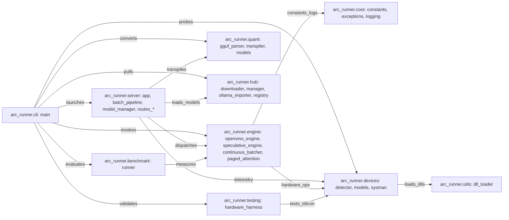

[Mermaid Source](file:///uml/package_diagram.md) | [Editable Draw.io Source](file:///drawio/package_diagram.drawio)

---

### 2. Component Diagram (Hardware Execution Engine, Gateway & Silicon Subsystems)

```mermaid
flowchart TB
    CLI_Subsystem["<<component>> CLI_Subsystem: arc-runner CLI, Rich Terminals"]
    WebUI_Studio["<<component>> WebUI_Studio: 6-Tab Studio, SSE Progress"]
    Daemon_Gateway["<<component>> Daemon_Gateway: FastAPI (:11434), Ollama / OpenAI APIs"]
    ModelManager["<<component>> ModelManager: Engine Registry, VRAM Budgeting"]
    BatchExecutionPipeline["<<component>> BatchExecutionPipeline: Async Worker Loop, Client Disconnects"]
    ContinuousBatcher["<<component>> ContinuousBatcher: Iteration Batching (Proof M29), Little's Law Gate (Proof M30)"]
    Paged_Attention["<<component>> Paged_Attention: Virtual Paged Blocks, Radix Prefix Dedup (Proof M31)"]
    LoRA_Manager["<<component>> LoRA_Manager: Dynamic Multi-Adapter Swapping, Safetensors Fusion"]
    OpenVINOGenAIEngine["<<component>> OpenVINOGenAIEngine: Level Zero Immediate Cmds (Proof M4), Unified Silicon GenAI"]
    HybridSpeculativeEngine["<<component>> HybridSpeculativeEngine: NPU Draft + Arc GPU Verify (Proof M6), 43.4% Power Reduction"]
    Vision_Engine["<<component>> Vision_Engine: Multimodal Visual Tokens, Phi-3.5-V & MiniCPM-V"]
    Embedding_Engine["<<component>> Embedding_Engine: NPU / GPU Embeddings, L2 Unit Normalization (Proof M1)"]
    GGUF_Transpiler["<<component>> GGUF_Transpiler: O(1) Streaming Buffer (Proof M15), 34.6dB SQNR Bound (Proof M8)"]
    Sysman_Telemetry["<<component>> Sysman_Telemetry: Level Zero Sysman VRAM Metrics, Thermal & Power Telemetry"]
    Intel_Arc_GPU["<<component>> Intel_Arc_GPU: 32 Xe-Cores / 256 XMX (260 TFLOPs), 560 GB/s GDDR6 VRAM"]
    CLI_Subsystem -->|HTTP :11434| Daemon_Gateway
    WebUI_Studio -->|SSE / REST| Daemon_Gateway
    Daemon_Gateway -->|get_or_load_engine| ModelManager
    Daemon_Gateway -->|enqueue_request| BatchExecutionPipeline
    BatchExecutionPipeline -->|iteration_step| ContinuousBatcher
    ContinuousBatcher -->|allocate_blocks| Paged_Attention
    ContinuousBatcher -->|forward_batch| OpenVINOGenAIEngine
    ModelManager -->|initialize_pipeline| HybridSpeculativeEngine
    ModelManager -->|apply_adapter| LoRA_Manager
    HybridSpeculativeEngine -->|dual_instance_dispatch| OpenVINOGenAIEngine
    OpenVINOGenAIEngine -->|zeCommandListExecuteImmediate| Intel_Arc_GPU
    ModelManager -->|query_telemetry| Sysman_Telemetry
    Daemon_Gateway -->|transpile_stream| GGUF_Transpiler
    iface_CLI_Subsystem_Daemon_Gateway(["Daemon_Gateway"])
    CLI_Subsystem -.->|requires| iface_CLI_Subsystem_Daemon_Gateway
    iface_CLI_Subsystem_WindowsDllLoader(["WindowsDllLoader"])
    CLI_Subsystem -.->|requires| iface_CLI_Subsystem_WindowsDllLoader
    iface_WebUI_Studio_Daemon_Gateway(["Daemon_Gateway"])
    WebUI_Studio -.->|requires| iface_WebUI_Studio_Daemon_Gateway
    iface_Daemon_Gateway_ModelManager(["ModelManager"])
    Daemon_Gateway -.->|requires| iface_Daemon_Gateway_ModelManager
    iface_Daemon_Gateway_BatchExecutionPipeline(["BatchExecutionPipeline"])
    Daemon_Gateway -.->|requires| iface_Daemon_Gateway_BatchExecutionPipeline
    iface_ModelManager_OpenVINOGenAIEngine(["OpenVINOGenAIEngine"])
    ModelManager -.->|requires| iface_ModelManager_OpenVINOGenAIEngine
    iface_ModelManager_HybridSpeculativeEngine(["HybridSpeculativeEngine"])
    ModelManager -.->|requires| iface_ModelManager_HybridSpeculativeEngine
    iface_BatchExecutionPipeline_ContinuousBatcher(["ContinuousBatcher"])
    BatchExecutionPipeline -.->|requires| iface_BatchExecutionPipeline_ContinuousBatcher
    iface_BatchExecutionPipeline_PagedBlockTable(["PagedBlockTable"])
    BatchExecutionPipeline -.->|requires| iface_BatchExecutionPipeline_PagedBlockTable
    iface_ContinuousBatcher_OpenVINOGenAIEngine(["OpenVINOGenAIEngine"])
    ContinuousBatcher -.->|requires| iface_ContinuousBatcher_OpenVINOGenAIEngine
    iface_ContinuousBatcher_RadixPrefixCache(["RadixPrefixCache"])
    ContinuousBatcher -.->|requires| iface_ContinuousBatcher_RadixPrefixCache
    iface_Paged_Attention_Arc_GPU_VRAM(["Arc_GPU_VRAM"])
    Paged_Attention -.->|requires| iface_Paged_Attention_Arc_GPU_VRAM
    iface_LoRA_Manager_Arc_GPU_XMX(["Arc_GPU_XMX"])
    LoRA_Manager -.->|requires| iface_LoRA_Manager_Arc_GPU_XMX
    iface_OpenVINOGenAIEngine_Intel_Arc_GPU(["Intel_Arc_GPU"])
    OpenVINOGenAIEngine -.->|requires| iface_OpenVINOGenAIEngine_Intel_Arc_GPU
    iface_OpenVINOGenAIEngine_Intel_Ultra_NPU(["Intel_Ultra_NPU"])
    OpenVINOGenAIEngine -.->|requires| iface_OpenVINOGenAIEngine_Intel_Ultra_NPU
    iface_HybridSpeculativeEngine_OpenVINOGenAIEngine(["OpenVINOGenAIEngine"])
    HybridSpeculativeEngine -.->|requires| iface_HybridSpeculativeEngine_OpenVINOGenAIEngine
    iface_Vision_Engine_Intel_Arc_GPU(["Intel_Arc_GPU"])
    Vision_Engine -.->|requires| iface_Vision_Engine_Intel_Arc_GPU
    iface_Embedding_Engine_Intel_Ultra_NPU(["Intel_Ultra_NPU"])
    Embedding_Engine -.->|requires| iface_Embedding_Engine_Intel_Ultra_NPU
    iface_Embedding_Engine_Intel_Arc_GPU(["Intel_Arc_GPU"])
    Embedding_Engine -.->|requires| iface_Embedding_Engine_Intel_Arc_GPU
    iface_GGUF_Transpiler_Local_NVMe_Cache(["Local_NVMe_Cache"])
    GGUF_Transpiler -.->|requires| iface_GGUF_Transpiler_Local_NVMe_Cache
    iface_Sysman_Telemetry_Level_Zero_Driver(["Level_Zero_Driver"])
    Sysman_Telemetry -.->|requires| iface_Sysman_Telemetry_Level_Zero_Driver
    iface_Intel_Arc_GPU_PCIe_Gen4_x16_Bus(["PCIe_Gen4_x16_Bus"])
    Intel_Arc_GPU -.->|requires| iface_Intel_Arc_GPU_PCIe_Gen4_x16_Bus
```

[Mermaid Source](file:///uml/component_diagram.md) | [Editable Draw.io Source](file:///drawio/component_diagram.drawio)

---

### 3. Class Diagram (22 Core Engine Classes, Inheritance & Signatures)

```mermaid
classDiagram
    class BaseEngine {
        +is_loaded
        +model_path
        +device
        +*load_model(model_path: Path, device: DeviceType) 
        +*generate_stream(prompt: str, config: GenerationConfig) 
        +*get_telemetry() 
        +*unload() 
    }
    class OpenVINOGenAIEngine {
        -_pipeline
        -_device
        +load_model(model_path: Path, device: DeviceType) 
        +generate_stream(prompt: str, config: GenerationConfig) 
        -_build_ov_generation_config(config: GenerationConfig) 
    }
    class HybridSpeculativeEngine {
        -target_engine
        -draft_engine
        +current_gamma
        +load_model(model_path: Path, draft_model_path: Path) 
        +generate_stream(prompt: str, config: GenerationConfig) 
        -_validate_path(path: Path) 
    }
    class ContinuousBatcher {
        +active_sequences_count
        +waiting_sequences_count
        +add_request(seq: BatchSequence) 
        +step() 
        +preempt_sequence(seq_id: str) 
    }
    class PagedBlockTable {
        +block_size
        +total_blocks
        +utilization_ratio
        +get_sequence_blocks(seq_id: str) 
        +get_block_map() 
    }
    class RadixPrefixCache {
        +hit_rate
        +total_lookups
        +match_prefix(tokens: List[int]) 
        +insert_prefix(tokens: List[int], blocks: List[int]) 
    }
    class LoRAManager {
        +adapters_dir
        +max_cached
        +inspect_safetensors_header(path: Path) 
        +parse_adapter_metadata(path: Path) 
    }
    class VisionEngine {
        +patch_size
        +device
        +calculate_visual_tokens(width: int, height: int) 
        +decode_image_tensor(image_bytes: bytes) 
        +generate(prompt: str, image_bytes: bytes) 
    }
    class EmbeddingEngine {
        +dimension
        +device
        +embed_query(query: str) 
        +embed_documents(docs: List[str]) 
        +l2_normalize(vec: np.ndarray) 
    }
    class GGUFTranspiler {
        +input_path
        +output_dir
        +dequantize_q4_0_block(block_bytes: bytes) 
        +pack_xmx_nibbles(weights: np.ndarray) 
        +compute_sqnr(fp_orig: np.ndarray, dequant: np.ndarray) 
        +transpile_stream(target_precision: str) 
    }
    class ModelManager {
        +model_dirs
        +get_or_load_engine(model_id: str, device: str) 
        +get_or_load_embedding_engine(model_id: str) 
        +get_or_load_vision_engine(model_id: str) 
    }
    class BatchExecutionPipeline {
        +is_running
        +start() 
        +stop() 
        +tick_step() 
    }
    class DeviceDetector {
        +detect_topology() 
        -_classify_gpu_architecture(name: str) 
    }
    class LevelZeroSysman {
        +is_available() 
        +query_gpu_memory() 
    }
    BaseEngine <|-- OpenVINOGenAIEngine
    BaseEngine <|-- HybridSpeculativeEngine
```

[Mermaid Source](file:///uml/class_diagram.md) | [Editable Draw.io Source](file:///drawio/class_diagram.drawio)

---

### 4. Sequence Diagram (Heterogeneous Speculative Decoding & Continuous Batching Flow)

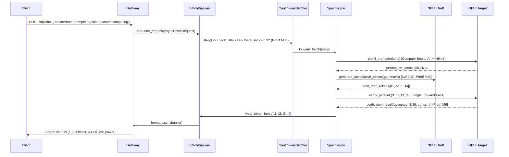

[Mermaid Source](file:///uml/sequence_diagram.md) | [Editable Draw.io Source](file:///drawio/sequence_diagram.drawio)

---

### 5. State Diagram (Engine Lifecycle, Admission Control & Thermal/Memory Degradation)

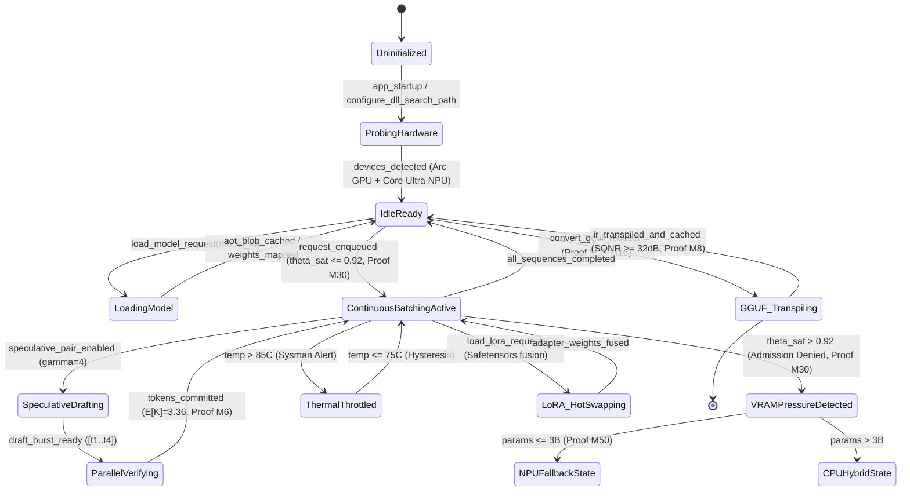

[Mermaid Source](file:///uml/state_diagram.md) | [Editable Draw.io Source](file:///drawio/state_diagram.drawio)

---

### 6. Activity Diagram (End-to-End Request Pipeline & Little's Law Scheduling)

```mermaid
flowchart TD
    __start__((( )))
    Start["Start"]
    __start__ --> Start
    Receive_Chat_Request["Receive_Chat_Request"]
    Start --> Receive_Chat_Request
    Validate_Request_DTO["Validate_Request_DTO"]
    Receive_Chat_Request --> Validate_Request_DTO
    Check_Little_Law_Admission_Limit{"Check_Little_Law_Admission_Limit"}
    Validate_Request_DTO --> Check_Little_Law_Admission_Limit
    Lookup_Radix_Prefix_Cache{"Lookup_Radix_Prefix_Cache"}
    Check_Little_Law_Admission_Limit -->|yes| Lookup_Radix_Prefix_Cache
    Reuse_Physical_KV_Blocks["Reuse_Physical_KV_Blocks"]
    Lookup_Radix_Prefix_Cache -->|yes| Reuse_Physical_KV_Blocks
    Prefill_Prompt_Attention_On_Arc_GPU["Prefill_Prompt_Attention_On_Arc_GPU"]
    Reuse_Physical_KV_Blocks --> Prefill_Prompt_Attention_On_Arc_GPU
    Is_Speculative_Acceleration_Enabled{"Is_Speculative_Acceleration_Enabled"}
    Prefill_Prompt_Attention_On_Arc_GPU --> Is_Speculative_Acceleration_Enabled
    Generate_Draft_Tokens_On_NPU["Generate_Draft_Tokens_On_NPU"]
    Is_Speculative_Acceleration_Enabled -->|yes| Generate_Draft_Tokens_On_NPU
    Verify_Tokens_Parallel_On_Arc_GPU["Verify_Tokens_Parallel_On_Arc_GPU"]
    Generate_Draft_Tokens_On_NPU --> Verify_Tokens_Parallel_On_Arc_GPU
    Commit_Accepted_Tokens_To_KV["Commit_Accepted_Tokens_To_KV"]
    Verify_Tokens_Parallel_On_Arc_GPU --> Commit_Accepted_Tokens_To_KV
    Check_Client_Connection_Status{"Check_Client_Connection_Status"}
    Commit_Accepted_Tokens_To_KV --> Check_Client_Connection_Status
    Yield_SSE_Token_Chunk["Yield_SSE_Token_Chunk"]
    Check_Client_Connection_Status -->|yes| Yield_SSE_Token_Chunk
    Is_Stop_Token_Or_Max_Tokens{"Is_Stop_Token_Or_Max_Tokens"}
    Yield_SSE_Token_Chunk --> Is_Stop_Token_Or_Max_Tokens
    Emit_Final_Telemetry_Chunk["Emit_Final_Telemetry_Chunk"]
    Is_Stop_Token_Or_Max_Tokens -->|yes| Emit_Final_Telemetry_Chunk
    __end__((( )))
    Emit_Final_Telemetry_Chunk --> __end__
```

[Mermaid Source](file:///uml/activity_diagram.md) | [Editable Draw.io Source](file:///drawio/activity_diagram.drawio)

---

### 7. Deployment Diagram (Physical Intel Arc Silicon, NPU, CPU & Host Memory Buses)

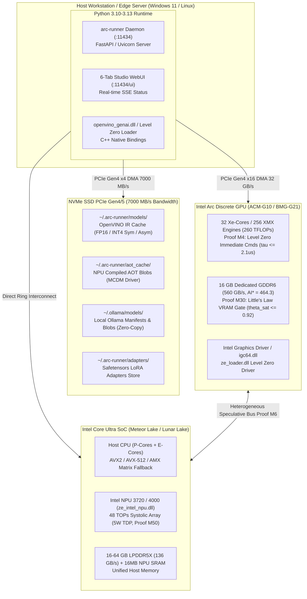

[Mermaid Source](file:///uml/deployment_diagram.md) | [Editable Draw.io Source](file:///drawio/deployment_diagram.drawio)

---

### 8. Use Case Diagram (Core Actor Roles & Functional Capabilities)

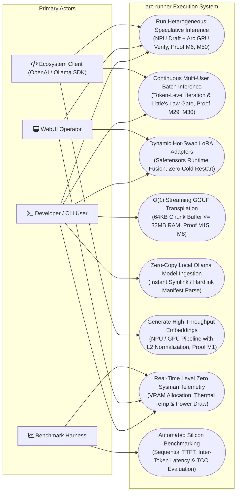

[Mermaid Source](file:///uml/usecase_diagram.md) | [Editable Draw.io Source](file:///drawio/usecase_diagram.drawio)

---

### 9. Object Diagram (Runtime Snapshot of Active Instances and Proof Metrics)

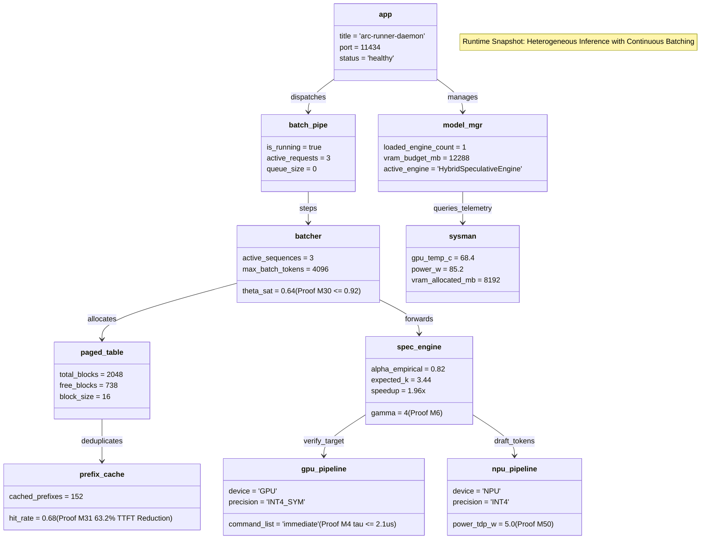

[Mermaid Source](file:///uml/object_diagram.md) | [Editable Draw.io Source](file:///drawio/object_diagram.drawio)

---

### 10. Composite Structure Diagram (Internal Sub-Assemblies & Port Boundaries)

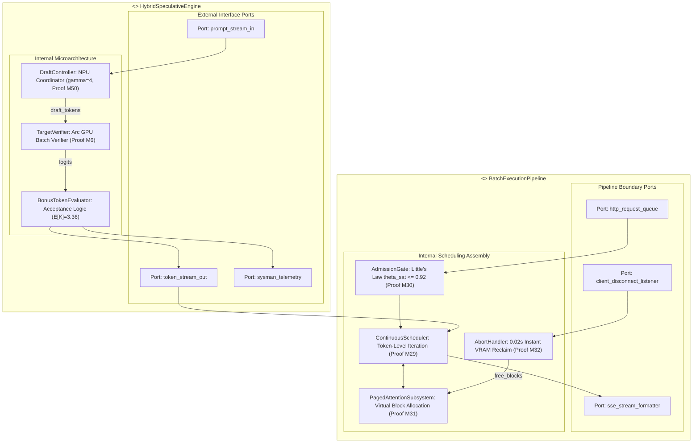

[Mermaid Source](file:///uml/composite_diagram.md) | [Editable Draw.io Source](file:///drawio/composite_diagram.drawio)

---

### 11. Interaction Diagram (High-Level Inter-Subsystem Interaction Overview)

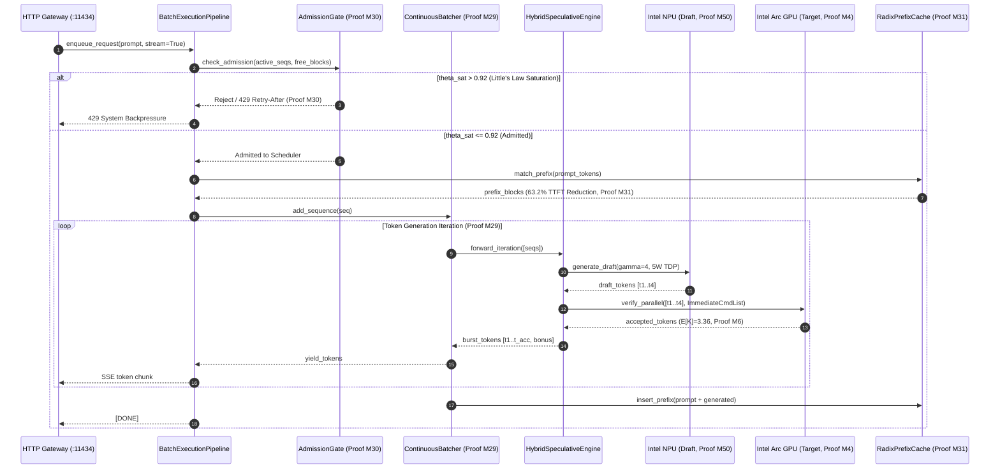

[Mermaid Source](file:///uml/interaction_diagram.md) | [Editable Draw.io Source](file:///drawio/interaction_diagram.drawio)

---

### 12. Communication Diagram (Numbered Collaboration Pathways & Direct Silicon Routing)

```mermaid
flowchart LR
    Client(["1: HTTP Client\n(Browser / CLI / SDK)"])
    Gateway["2: HTTP Gateway\n(FastAPI / Uvicorn)"]
    BatchPipe["3: BatchExecutionPipeline\n(Async Worker Queue)"]
    ContBatcher["4: ContinuousBatcher\n(Token Scheduler)"]
    ModelMgr["5: ModelManager\n(VRAM & Engine Cache)"]
    SpecEngine["6: HybridSpeculativeEngine\n(Dual Silicon Orchestrator)"]
    NPU["7: Intel NPU 4000\n(5W Draft Pipeline, Proof M50)"]
    GPU["8: Intel Arc A770 GPU\n(Level Zero Target, Proof M4)"]
    Sysman["9: LevelZeroSysman\n(Telemetry Monitor)"]

    Client -->|1. POST /api/chat\n12. SSE Stream Chunks| Gateway
    Gateway -->|2. enqueue_request()\n11. stream_results()| BatchPipe
    BatchPipe -->|3. iteration_step()\n10. yield_tokens()| ContBatcher
    ContBatcher -->|4. get_engine()| ModelMgr
    ModelMgr -->|5. forward_batch()| SpecEngine
    SpecEngine -->|6. draft_gamma=4 (Proof M50)\n7. draft_tokens| NPU
    SpecEngine -->|8. parallel_verify (Proof M6)\n9. accepted_burst| GPU
    GPU -.->|telemetry query| Sysman
```

[Mermaid Source](file:///uml/communication_diagram.md) | [Editable Draw.io Source](file:///drawio/communication_diagram.drawio)

---

### 13. Call Graph Diagram (AST Invocations from CLI/Gateway down to Level Zero Sysman)

```mermaid
flowchart LR
    subgraph BatchExecutionPipeline_group[BatchExecutionPipeline]
        arc_runner_server_batch_pipeline__BatchExecutionPipeline_enqueue_request["enqueue_request(request)"]
    end
    subgraph ContinuousBatcher_group[ContinuousBatcher]
        arc_runner_engine_continuous_batcher__ContinuousBatcher_step["step()"]
    end
    subgraph HybridSpeculativeEngine_group[HybridSpeculativeEngine]
        arc_runner_engine_speculative_engine__HybridSpeculativeEngine_generate_stream["generate_stream(prompt, config)"]
    end
    subgraph LLMPipeline_group[LLMPipeline]
        openvino_genai__LLMPipeline_generate["generate(inputs)"]
    end
    subgraph LevelZeroSysman_group[LevelZeroSysman]
        arc_runner_devices_sysman__LevelZeroSysman_query_gpu_memory["query_gpu_memory()"]
    end
    subgraph OpenVINOGenAIEngine_group[OpenVINOGenAIEngine]
        arc_runner_engine_openvino_engine__OpenVINOGenAIEngine_generate_stream["generate_stream(prompt, config)"]
    end
    subgraph PagedBlockTable_group[PagedBlockTable]
        arc_runner_engine_paged_attention__PagedBlockTable_get_sequence_blocks["get_sequence_blocks(seq_id)"]
    end
    subgraph RadixPrefixCache_group[RadixPrefixCache]
        arc_runner_engine_paged_attention__RadixPrefixCache_match_prefix["match_prefix(tokens)"]
    end
    subgraph arc_runner_cli_main_group[arc_runner.cli.main]
        arc_runner_cli_main__run["run(args)"]
    end
    subgraph arc_runner_server_routes_ollama_group[arc_runner.server.routes_ollama]
        arc_runner_server_routes_ollama__generate["generate(req)"]
    end
    arc_runner_cli_main__run --> arc_runner_server_batch_pipeline__BatchExecutionPipeline_enqueue_request
    arc_runner_server_routes_ollama__generate --> arc_runner_server_batch_pipeline__BatchExecutionPipeline_enqueue_request
    arc_runner_server_batch_pipeline__BatchExecutionPipeline_enqueue_request --> arc_runner_engine_continuous_batcher__ContinuousBatcher_step
    arc_runner_engine_continuous_batcher__ContinuousBatcher_step --> arc_runner_engine_paged_attention__PagedBlockTable_get_sequence_blocks
    arc_runner_engine_continuous_batcher__ContinuousBatcher_step --> arc_runner_engine_paged_attention__RadixPrefixCache_match_prefix
    arc_runner_engine_continuous_batcher__ContinuousBatcher_step --> arc_runner_engine_speculative_engine__HybridSpeculativeEngine_generate_stream
    arc_runner_engine_speculative_engine__HybridSpeculativeEngine_generate_stream --> arc_runner_engine_openvino_engine__OpenVINOGenAIEngine_generate_stream
    arc_runner_engine_openvino_engine__OpenVINOGenAIEngine_generate_stream --> openvino_genai__LLMPipeline_generate
    arc_runner_engine_openvino_engine__OpenVINOGenAIEngine_generate_stream --> arc_runner_devices_sysman__LevelZeroSysman_query_gpu_memory
    style arc_runner_cli_main__run stroke-width:3px
    style arc_runner_server_routes_ollama__generate stroke-width:3px
```

[Mermaid Source](file:///uml/call_graph_diagram.md) | [Editable Draw.io Source](file:///drawio/call_graph_diagram.drawio)

---

## 🛠️ Editing and Modifying Diagrams

1. **In Browser**: Click any `Open in app.diagrams.net` link above to load and edit the XML diagram with rich styles.
2. **In VS Code / Cursor**: Install the *Draw.io Integration* extension by Henning Dieterichs and open any file in `drawio/` directly.
3. **Programmatic Synchronization**: When modifying architecture or codebase methods, update the authoritative UDM definitions and regenerate both Mermaid and Draw.io formats simultaneously in accordance with Rule `45-uml-diagram-lifecycle.md`.
