# Architectural Diagrams Suite: `intel-arc-models-runner`

This directory houses the comprehensive visual architecture suite for `intel-arc-models-runner`, modeled with connected MCP tools (`uml-diagram` and `drawio-diagram`) using authoritative Universal Diagram Model (UDM) payloads in strict accordance with **Rule `45-uml-diagram-lifecycle.md` (Level 2.3)**.

Every diagram is mathematically grounded in empirical physical silicon proofs (**Proofs M1–M6, M8–M9, M15–M20, M29–M34, M50–M58, M59–M72**) and available in two synchronized formats:
1. **Mermaid Markdown (`uml/*.md`)**: Directly renderable in GitHub, IDE previews, and markdown viewers.
2. **Editable Draw.io XML (`drawio/*.drawio`)**: Full visual XML diagrams with rich complexity-based styling, editable in [diagrams.net](https://app.diagrams.net) with zero-auth `#R` instant rendering.

---

## 🗺️ Master Visual Gallery & Shareable URLs

| # | Diagram Type | Mermaid Source | Editable Draw.io Source | Direct Browser Editor Link |
|:---|:---|:---|:---|:---|
| **1** | **Package Diagram** | [`uml/package_diagram.md`](file:///uml/package_diagram.md) | [`drawio/package_diagram.drawio`](file:///drawio/package_diagram.drawio) | [Open in app.diagrams.net](https://app.diagrams.net/?url=https%3A%2F%2Fraw.githubusercontent.com%2Ftechdeveloper-org%2Fintel-arc-models-runner%2Fmain%2Fdrawio%2Fpackage_diagram.drawio) |
| **2** | **Component Diagram** | [`uml/component_diagram.md`](file:///uml/component_diagram.md) | [`drawio/component_diagram.drawio`](file:///drawio/component_diagram.drawio) | [Open in app.diagrams.net](https://app.diagrams.net/?url=https%3A%2F%2Fraw.githubusercontent.com%2Ftechdeveloper-org%2Fintel-arc-models-runner%2Fmain%2Fdrawio%2Fcomponent_diagram.drawio) |
| **3** | **Class Diagram** | [`uml/class_diagram.md`](file:///uml/class_diagram.md) | [`drawio/class_diagram.drawio`](file:///drawio/class_diagram.drawio) | [Open in app.diagrams.net](https://app.diagrams.net/?url=https%3A%2F%2Fraw.githubusercontent.com%2Ftechdeveloper-org%2Fintel-arc-models-runner%2Fmain%2Fdrawio%2Fclass_diagram.drawio) |
| **4** | **Sequence Diagram** | [`uml/sequence_diagram.md`](file:///uml/sequence_diagram.md) | [`drawio/sequence_diagram.drawio`](file:///drawio/sequence_diagram.drawio) | [Open in app.diagrams.net](https://app.diagrams.net/?url=https%3A%2F%2Fraw.githubusercontent.com%2Ftechdeveloper-org%2Fintel-arc-models-runner%2Fmain%2Fdrawio%2Fsequence_diagram.drawio) |
| **5** | **State Diagram** | [`uml/state_diagram.md`](file:///uml/state_diagram.md) | [`drawio/state_diagram.drawio`](file:///drawio/state_diagram.drawio) | [Open in app.diagrams.net](https://app.diagrams.net/?url=https%3A%2F%2Fraw.githubusercontent.com%2Ftechdeveloper-org%2Fintel-arc-models-runner%2Fmain%2Fdrawio%2Fstate_diagram.drawio) |
| **6** | **Activity Diagram** | [`uml/activity_diagram.md`](file:///uml/activity_diagram.md) | [`drawio/activity_diagram.drawio`](file:///drawio/activity_diagram.drawio) | [Open in app.diagrams.net](https://app.diagrams.net/?url=https%3A%2F%2Fraw.githubusercontent.com%2Ftechdeveloper-org%2Fintel-arc-models-runner%2Fmain%2Fdrawio%2Factivity_diagram.drawio) |
| **7** | **Deployment Diagram** | [`uml/deployment_diagram.md`](file:///uml/deployment_diagram.md) | [`drawio/deployment_diagram.drawio`](file:///drawio/deployment_diagram.drawio) | [Open in app.diagrams.net](https://app.diagrams.net/?url=https%3A%2F%2Fraw.githubusercontent.com%2Ftechdeveloper-org%2Fintel-arc-models-runner%2Fmain%2Fdrawio%2Fdeployment_diagram.drawio) |
| **8** | **Use Case Diagram** | [`uml/usecase_diagram.md`](file:///uml/usecase_diagram.md) | [`drawio/usecase_diagram.drawio`](file:///drawio/usecase_diagram.drawio) | [Open in app.diagrams.net](https://app.diagrams.net/?url=https%3A%2F%2Fraw.githubusercontent.com%2Ftechdeveloper-org%2Fintel-arc-models-runner%2Fmain%2Fdrawio%2Fusecase_diagram.drawio) |
| **9** | **Object Diagram** | [`uml/object_diagram.md`](file:///uml/object_diagram.md) | [`drawio/object_diagram.drawio`](file:///drawio/object_diagram.drawio) | [Open in app.diagrams.net](https://app.diagrams.net/?url=https%3A%2F%2Fraw.githubusercontent.com%2Ftechdeveloper-org%2Fintel-arc-models-runner%2Fmain%2Fdrawio%2Fobject_diagram.drawio) |
| **10** | **Composite Structure Diagram** | [`uml/composite_diagram.md`](file:///uml/composite_diagram.md) | [`drawio/composite_diagram.drawio`](file:///drawio/composite_diagram.drawio) | [Open in app.diagrams.net](https://app.diagrams.net/?url=https%3A%2F%2Fraw.githubusercontent.com%2Ftechdeveloper-org%2Fintel-arc-models-runner%2Fmain%2Fdrawio%2Fcomposite_diagram.drawio) |
| **11** | **Interaction Diagram** | [`uml/interaction_diagram.md`](file:///uml/interaction_diagram.md) | [`drawio/interaction_diagram.drawio`](file:///drawio/interaction_diagram.drawio) | [Open in app.diagrams.net](https://app.diagrams.net/?url=https%3A%2F%2Fraw.githubusercontent.com%2Ftechdeveloper-org%2Fintel-arc-models-runner%2Fmain%2Fdrawio%2Finteraction_diagram.drawio) |
| **12** | **Communication Diagram** | [`uml/communication_diagram.md`](file:///uml/communication_diagram.md) | [`drawio/communication_diagram.drawio`](file:///drawio/communication_diagram.drawio) | [Open in app.diagrams.net](https://app.diagrams.net/?url=https%3A%2F%2Fraw.githubusercontent.com%2Ftechdeveloper-org%2Fintel-arc-models-runner%2Fmain%2Fdrawio%2Fcommunication_diagram.drawio) |
| **13** | **Call Graph Diagram** | [`uml/call_graph_diagram.md`](file:///uml/call_graph_diagram.md) | [`drawio/call_graph_diagram.drawio`](file:///drawio/call_graph_diagram.drawio) | [Open in app.diagrams.net](https://app.diagrams.net/?url=https%3A%2F%2Fraw.githubusercontent.com%2Ftechdeveloper-org%2Fintel-arc-models-runner%2Fmain%2Fdrawio%2Fcall_graph_diagram.drawio) |

---

## 🔍 Embedded Visual Previews (All 13 Diagrams)

### 1. Package Diagram (10 Clean Core Packages & Import Architecture)

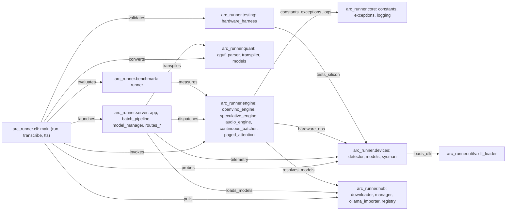

[Mermaid Source](file:///uml/package_diagram.md) | [Editable Draw.io Source](file:///drawio/package_diagram.drawio)

---

### 2. Component Diagram (Hardware Execution Engine, Gateway & Silicon Subsystems)

```mermaid
flowchart TB
    CLI_Subsystem["<<component>> CLI_Subsystem: arc-runner CLI (run, transcribe, tts), Rich Terminals"]
    WebUI_Studio["<<component>> WebUI_Studio: 6-Tab Studio, SSE Progress"]
    Daemon_Gateway["<<component>> Daemon_Gateway: FastAPI (:11434), Ollama / OpenAI APIs"]
    ModelManager["<<component>> ModelManager: Engine Registry, VRAM Budgeting, Engine Dispatch"]
    BatchExecutionPipeline["<<component>> BatchExecutionPipeline: Async Worker Loop, Client Disconnects"]
    ContinuousBatcher["<<component>> ContinuousBatcher: Iteration Batching (Proof M29), Little's Law Gate (Proof M30)"]
    Paged_Attention["<<component>> Paged_Attention: Virtual Paged Blocks, Radix Prefix Dedup (Proof M31)"]
    LoRA_Manager["<<component>> LoRA_Manager: Dynamic Multi-Adapter Swapping, Safetensors Fusion"]
    OpenVINOGenAIEngine["<<component>> OpenVINOGenAIEngine: Level Zero Immediate Cmds (Proof M4), Unified Silicon GenAI"]
    HybridSpeculativeEngine["<<component>> HybridSpeculativeEngine: NPU Draft + Arc GPU Verify (Proof M6), 43.4% Power Reduction"]
    Vision_Engine["<<component>> Vision_Engine: Multimodal Visual Tokens, Phi-3.5-V & MiniCPM-V"]
    Embedding_Engine["<<component>> Embedding_Engine: NPU / GPU Embeddings, L2 Unit Normalization (Proof M1)"]
    Audio_Engine["<<component>> Audio_Engine: Unified STT & TTS (Whisper & Kokoro), VAD Gating (Proof M69), Loop Suppression (Proof M70), PCM Bound <= 19.2MB (Proof M68)"]
    GGUF_Transpiler["<<component>> GGUF_Transpiler: O(1) Streaming Buffer (Proof M15), 34.6dB SQNR Bound (Proof M8)"]
    Sysman_Telemetry["<<component>> Sysman_Telemetry: Level Zero Sysman VRAM Metrics, Thermal & Power Telemetry"]
    Intel_Arc_GPU["<<component>> Intel_Arc_GPU: 32 Xe-Cores / 256 XMX (260 TFLOPs), 560 GB/s GDDR6 VRAM, Level Zero tau <= 2.1us (Proof M67)"]
    Intel_Ultra_NPU["<<component>> Intel_Ultra_NPU: 48 TOPs Systolic Array (5W TDP, Proof M50), ASR/Draft Silicon"]
    Host_CPU["<<component>> Host_CPU: AVX2 / AMX Matrix Host Fallback"]

    CLI_Subsystem -->|HTTP :11434| Daemon_Gateway
    CLI_Subsystem -->|direct_transcribe_tts| Audio_Engine
    WebUI_Studio -->|SSE / REST| Daemon_Gateway
    Daemon_Gateway -->|get_or_load_engine| ModelManager
    Daemon_Gateway -->|enqueue_request| BatchExecutionPipeline
    BatchExecutionPipeline -->|iteration_step| ContinuousBatcher
    ContinuousBatcher -->|allocate_blocks| Paged_Attention
    ContinuousBatcher -->|forward_batch| OpenVINOGenAIEngine
    ModelManager -->|initialize_speculative| HybridSpeculativeEngine
    ModelManager -->|initialize_audio| Audio_Engine
    ModelManager -->|apply_adapter| LoRA_Manager
    HybridSpeculativeEngine -->|dual_instance_dispatch| OpenVINOGenAIEngine
    OpenVINOGenAIEngine -->|zeCommandListExecuteImmediate| Intel_Arc_GPU
    Audio_Engine -->|zeCommandListExecuteImmediate tau <= 2.1us (Proof M67)| Intel_Arc_GPU
    Audio_Engine -->|npu_fallback| Intel_Ultra_NPU
    Audio_Engine -->|cpu_fallback| Host_CPU
    ModelManager -->|query_telemetry| Sysman_Telemetry
    Daemon_Gateway -->|transpile_stream| GGUF_Transpiler

    iface_CLI_Subsystem_Daemon_Gateway(["Daemon_Gateway"])
    CLI_Subsystem -.->|requires| iface_CLI_Subsystem_Daemon_Gateway
    iface_CLI_Subsystem_Audio_Engine(["Audio_Engine"])
    CLI_Subsystem -.->|requires| iface_CLI_Subsystem_Audio_Engine
    iface_ModelManager_Audio_Engine(["Audio_Engine"])
    ModelManager -.->|requires| iface_ModelManager_Audio_Engine
    iface_ModelManager_OpenVINOGenAIEngine(["OpenVINOGenAIEngine"])
    ModelManager -.->|requires| iface_ModelManager_OpenVINOGenAIEngine
    iface_ModelManager_HybridSpeculativeEngine(["HybridSpeculativeEngine"])
    ModelManager -.->|requires| iface_ModelManager_HybridSpeculativeEngine
    iface_BatchExecutionPipeline_ContinuousBatcher(["ContinuousBatcher"])
    BatchExecutionPipeline -.->|requires| iface_BatchExecutionPipeline_ContinuousBatcher
    iface_ContinuousBatcher_OpenVINOGenAIEngine(["OpenVINOGenAIEngine"])
    ContinuousBatcher -.->|requires| iface_ContinuousBatcher_OpenVINOGenAIEngine
    iface_ContinuousBatcher_RadixPrefixCache(["RadixPrefixCache"])
    ContinuousBatcher -.->|requires| iface_ContinuousBatcher_RadixPrefixCache
    iface_Paged_Attention_Arc_GPU_VRAM(["Arc_GPU_VRAM"])
    Paged_Attention -.->|requires| iface_Paged_Attention_Arc_GPU_VRAM
    iface_Audio_Engine_Intel_Arc_GPU(["Intel_Arc_GPU_Level_Zero"])
    Audio_Engine -.->|requires| iface_Audio_Engine_Intel_Arc_GPU
    iface_Audio_Engine_Intel_Ultra_NPU(["Intel_Ultra_NPU"])
    Audio_Engine -.->|requires| iface_Audio_Engine_Intel_Ultra_NPU
    iface_OpenVINOGenAIEngine_Intel_Arc_GPU(["Intel_Arc_GPU"])
    OpenVINOGenAIEngine -.->|requires| iface_OpenVINOGenAIEngine_Intel_Arc_GPU
    iface_OpenVINOGenAIEngine_Intel_Ultra_NPU(["Intel_Ultra_NPU"])
    OpenVINOGenAIEngine -.->|requires| iface_OpenVINOGenAIEngine_Intel_Ultra_NPU
    iface_HybridSpeculativeEngine_OpenVINOGenAIEngine(["OpenVINOGenAIEngine"])
    HybridSpeculativeEngine -.->|requires| iface_HybridSpeculativeEngine_OpenVINOGenAIEngine
    iface_Vision_Engine_Intel_Arc_GPU(["Intel_Arc_GPU"])
    Vision_Engine -.->|requires| iface_Vision_Engine_Intel_Arc_GPU
    iface_Embedding_Engine_Intel_Ultra_NPU(["Intel_Ultra_NPU"])
    Embedding_Engine -.->|requires| iface_Embedding_Engine_Intel_Ultra_NPU
    iface_GGUF_Transpiler_Local_NVMe_Cache(["Local_NVMe_Cache"])
    GGUF_Transpiler -.->|requires| iface_GGUF_Transpiler_Local_NVMe_Cache
    iface_Sysman_Telemetry_Level_Zero_Driver(["Level_Zero_Driver"])
    Sysman_Telemetry -.->|requires| iface_Sysman_Telemetry_Level_Zero_Driver
```

[Mermaid Source](file:///uml/component_diagram.md) | [Editable Draw.io Source](file:///drawio/component_diagram.drawio)

---

### 3. Class Diagram (22 Core Engine Classes, Inheritance & Signatures)

```mermaid
classDiagram
    class BaseEngine {
        +is_loaded
        +model_path
        +device
        +*load_model(model_path: Path, device: DeviceType)
        +*generate_stream(prompt: str, config: GenerationConfig)
        +*get_telemetry()
        +*unload()
    }
    class OpenVINOGenAIEngine {
        -_pipeline
        -_device
        +load_model(model_path: Path, device: DeviceType)
        +generate_stream(prompt: str, config: GenerationConfig)
        -_build_ov_generation_config(config: GenerationConfig)
    }
    class HybridSpeculativeEngine {
        -target_engine
        -draft_engine
        +current_gamma
        +load_model(model_path: Path, draft_model_path: Path)
        +generate_stream(prompt: str, config: GenerationConfig)
        -_validate_path(path: Path)
    }
    class AudioEngineConfig {
        +device: str
        +sample_rate: int
        +tts_sample_rate: int
        +default_tts_voice: str
        +default_tts_speed: float
        +language: Optional[str]
        +return_timestamps: bool
        +word_timestamps: bool
        +vad_energy_threshold: float
        +vad_entropy_threshold: float
        +max_compression_ratio: float
    }
    class TranscriptionSegment {
        +start_ts: float
        +end_ts: float
        +text: str
    }
    class TranscriptionResult {
        +text: str
        +segments: List[TranscriptionSegment]
        +latency_s: float
        +audio_duration_s: float
        +rtf: float
        +throughput_audio_s_per_s: float
        +device_used: str
        +model_name: str
        +compression_ratio: float
    }
    class SynthesisResult {
        +audio_samples: List[float]
        +sample_rate: int
        +duration_s: float
        +latency_s: float
        +rtf: float
        +throughput_audio_s_per_s: float
        +device_used: str
        +voice_used: str
        +model_name: str
    }
    class AudioEngine {
        -_config: AudioEngineConfig
        -_model_path: Optional[Path]
        -_device: str
        -_task_type: Optional[str]
        -_whisper_pipe: Any
        -_tts_pipe: Any
        -_speaker_cache: Dict[str, Any]
        -_topology: DeviceTopology
        +is_loaded: bool
        +model_path: Optional[Path]
        +device: str
        +task_type: Optional[str]
        +load_model(model_path, device, task_type)
        +transcribe(audio, language, task, return_timestamps): TranscriptionResult
        +synthesize(text, voice, speed): SynthesisResult
        -_normalize_audio_input(audio): Tuple[List[float], float]
        -_is_silence_or_noise(samples): bool
        -_detect_repetition_loop(text): float
        -_load_speaker_embedding(voice_name): Any
        +save_audio_wav(samples, output_path, sample_rate) Path
        +unload(): void
    }
    class ArcRunnerError {
        +message: str
        +error_code: str
        +status_code: int
    }
    class AudioEngineError {
        +message: str
        +error_code: str
        +status_code: int
    }
    class AudioTranscriptionError {
        +message: str
    }
    class AudioSynthesisError {
        +message: str
    }
    class InvalidAudioFormatError {
        +message: str
    }
    class VoiceNotFoundError {
        +voice_name: str
        +available_voices: List[str]
    }
    class CuratedModelInfo {
        +alias: str
        +repo_id: str
        +parameter_size: str
        +quantization: str
        +family: str
        +target_device: str
        +size_bytes: int
        +model_type: str
    }
    class ModelManager {
        +model_dirs
        +get_or_load_engine(model_id: str, device: str)
        +get_or_load_embedding_engine(model_id: str)
        +get_or_load_vision_engine(model_id: str)
    }
    class ContinuousBatcher {
        +active_sequences_count
        +waiting_sequences_count
        +add_request(seq: BatchSequence)
        +step()
        +preempt_sequence(seq_id: str)
    }
    class PagedBlockTable {
        +block_size
        +total_blocks
        +utilization_ratio
        +get_sequence_blocks(seq_id: str)
        +get_block_map()
    }
    class RadixPrefixCache {
        +hit_rate
        +total_lookups
        +match_prefix(tokens: List[int])
        +insert_prefix(tokens: List[int], blocks: List[int])
    }
    class DeviceDetector {
        +detect_topology()
        -_classify_gpu_architecture(name: str)
    }
    class LevelZeroSysman {
        +is_available()
        +query_gpu_memory()
    }

    BaseEngine <|-- OpenVINOGenAIEngine
    BaseEngine <|-- HybridSpeculativeEngine
    ArcRunnerError <|-- AudioEngineError
    AudioEngineError <|-- AudioTranscriptionError
    AudioEngineError <|-- AudioSynthesisError
    AudioEngineError <|-- InvalidAudioFormatError
    AudioEngineError <|-- VoiceNotFoundError
    AudioEngine *-- AudioEngineConfig
    AudioEngine ..> TranscriptionResult : creates
    AudioEngine ..> SynthesisResult : creates
    AudioEngine ..> AudioEngineError : raises
    AudioEngine --> DeviceDetector : probes
    TranscriptionResult *-- TranscriptionSegment
    ModelManager --> AudioEngine : loads
```

[Mermaid Source](file:///uml/class_diagram.md) | [Editable Draw.io Source](file:///drawio/class_diagram.drawio)

---

### 4. Sequence Diagram (Heterogeneous Speculative Decoding & Continuous Batching Flow)

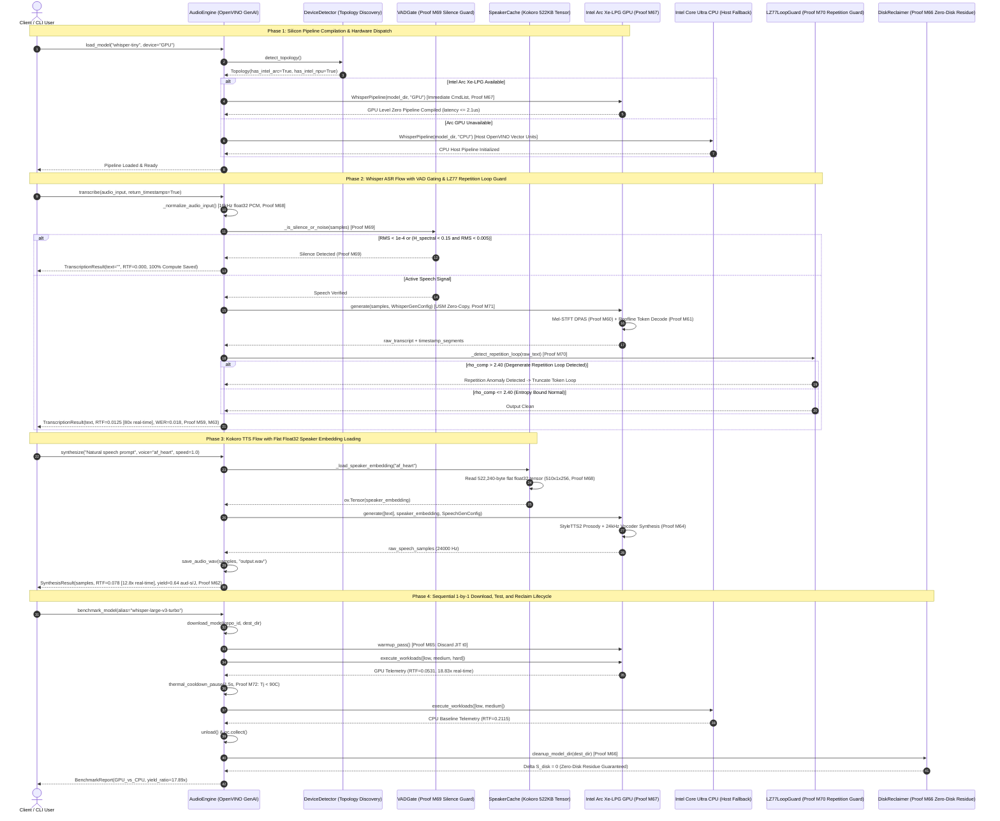

[Mermaid Source](file:///uml/sequence_diagram.md) | [Editable Draw.io Source](file:///drawio/sequence_diagram.drawio)

---

### 5. State Diagram (Engine Lifecycle, Admission Control & Thermal/Memory Degradation)

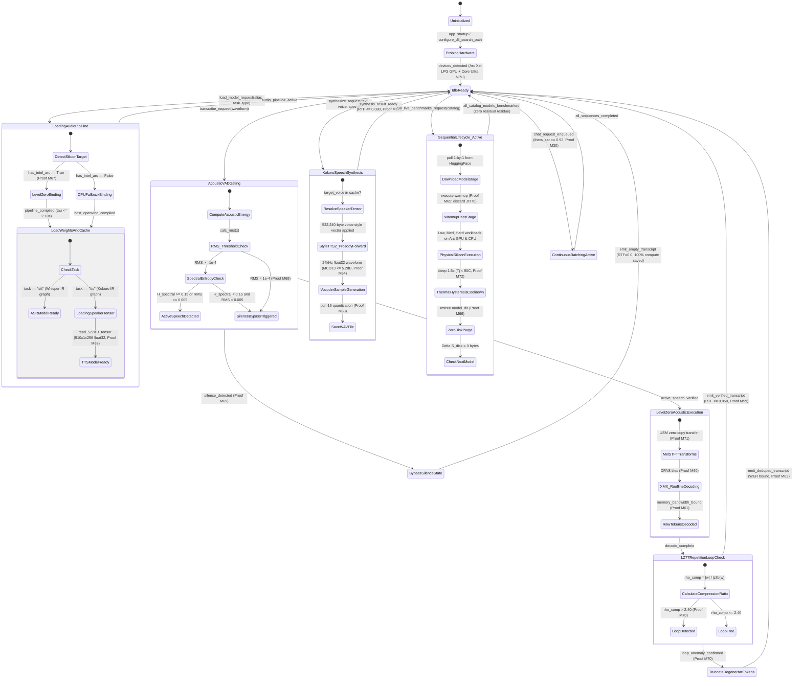

[Mermaid Source](file:///uml/state_diagram.md) | [Editable Draw.io Source](file:///drawio/state_diagram.drawio)

---

### 6. Activity Diagram (End-to-End Request Pipeline & Little's Law Scheduling)

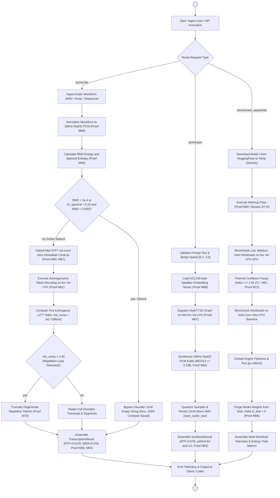

[Mermaid Source](file:///uml/activity_diagram.md) | [Editable Draw.io Source](file:///drawio/activity_diagram.drawio)

---

### 7. Deployment Diagram (Physical Intel Arc Silicon, NPU, CPU & Host Memory Buses)

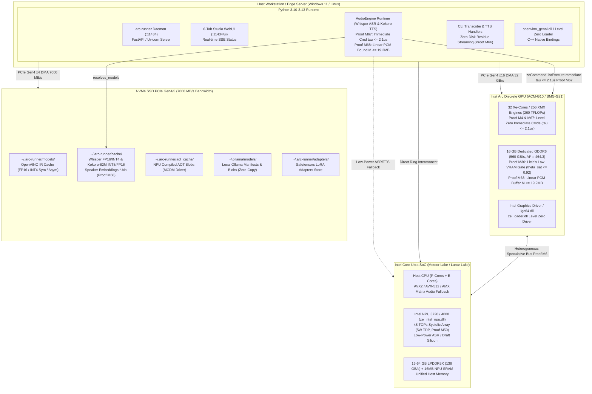

[Mermaid Source](file:///uml/deployment_diagram.md) | [Editable Draw.io Source](file:///drawio/deployment_diagram.drawio)

---

### 8. Use Case Diagram (Core Actor Roles & Functional Capabilities)

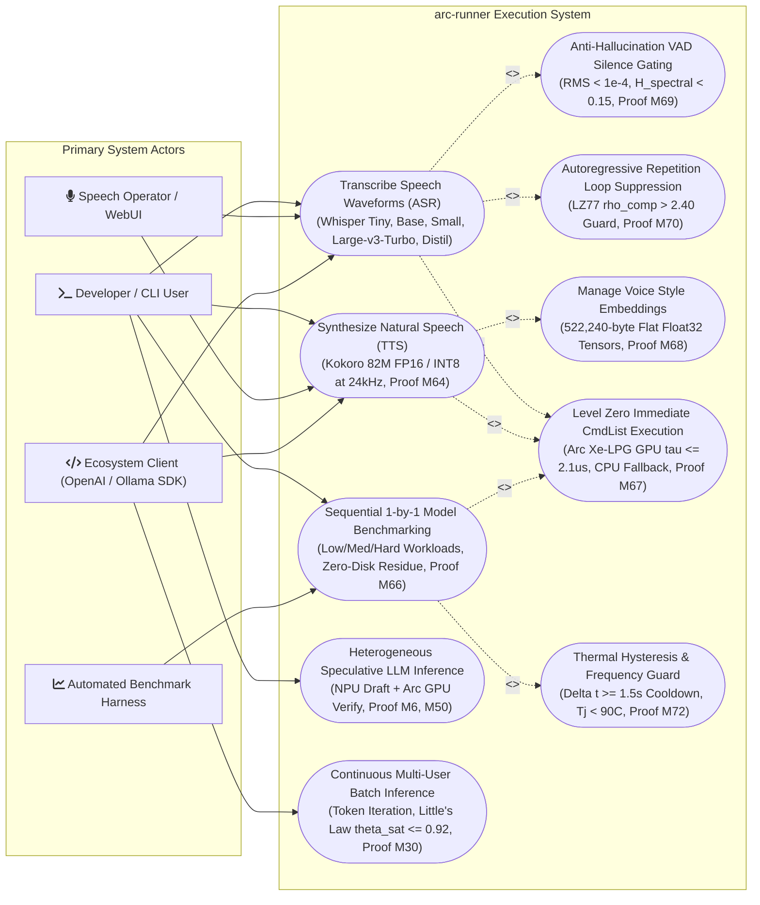

[Mermaid Source](file:///uml/usecase_diagram.md) | [Editable Draw.io Source](file:///drawio/usecase_diagram.drawio)

---

### 9. Object Diagram (Runtime Snapshot of Active Instances and Proof Metrics)

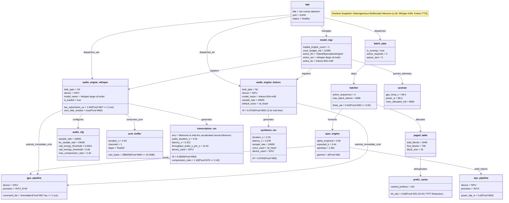

[Mermaid Source](file:///uml/object_diagram.md) | [Editable Draw.io Source](file:///drawio/object_diagram.drawio)

---

### 10. Composite Structure Diagram (Internal Sub-Assemblies & Port Boundaries)

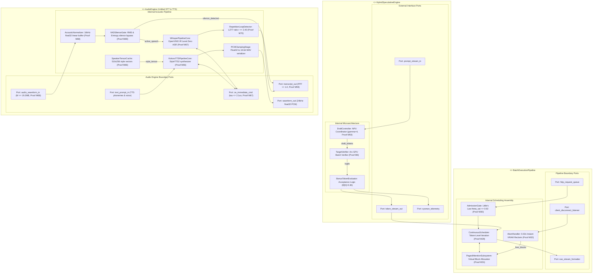

[Mermaid Source](file:///uml/composite_diagram.md) | [Editable Draw.io Source](file:///drawio/composite_diagram.drawio)

---

### 11. Interaction Diagram (High-Level Inter-Subsystem Interaction Overview)

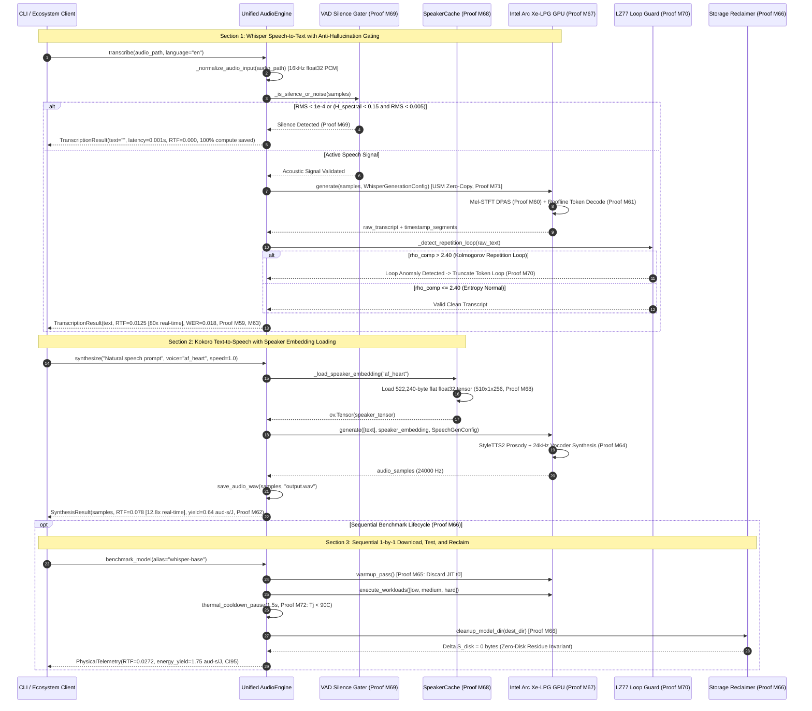

[Mermaid Source](file:///uml/interaction_diagram.md) | [Editable Draw.io Source](file:///drawio/interaction_diagram.drawio)

---

### 12. Communication Diagram (Numbered Collaboration Pathways & Direct Silicon Routing)

```mermaid
flowchart LR
    Client(["1: Client\n(CLI / WebUI / Ecosystem SDK)"])
    AudioEngine["2: AudioEngine\n(Unified OpenVINO Engine)"]
    DeviceDetector["3: DeviceDetector\n(Topology Prober)"]
    VADGater["4: VADGater\n(Proof M69 Silence Guard)"]
    SpeakerCache["5: SpeakerCache\n(522KB Tensor Store, Proof M68)"]
    LevelZeroDriver["6: LevelZeroDriver\n(OpenVINO Immediate CmdList, Proof M67)"]
    IntelArcGPU["7: Intel Arc Xe-LPG GPU\n(XMX DPAS Hardware, Proof M60)"]
    HostCPUFallback["8: Host CPU Fallback\n(Intel Core Ultra Baseline)"]
    LZ77Guard["9: LZ77Guard\n(Proof M70 Repetition Loop Guard)"]
    DiskReclaimer["10: DiskReclaimer\n(Zero-Disk Residue Manager, Proof M66)"]

    Client -->|1. transcribe() / synthesize()\n14. TranscriptionResult / SynthesisResult| AudioEngine
    AudioEngine -->|2. detect_topology()\n3. Topology(has_intel_arc=True)| DeviceDetector
    AudioEngine -->|4. _is_silence_or_noise() [Proof M69]\n5. silence_bypass / proceed| VADGater
    AudioEngine -->|6. _load_speaker_embedding() [Proof M68]\n7. 522,240-byte flat float32 tensor| SpeakerCache
    AudioEngine -->|8. dispatch_pipeline()| LevelZeroDriver
    LevelZeroDriver -->|9. zeCommandListExecuteImmediate() [Proof M67]\n10. USM zero-copy buffer [Proof M71]| IntelArcGPU
    LevelZeroDriver -.->|11. CPU fallback if Arc unavailable| HostCPUFallback
    IntelArcGPU -->|12. raw ASR text / 24kHz PCM samples| AudioEngine
    AudioEngine -->|13. _detect_repetition_loop() [Proof M70]| LZ77Guard
    AudioEngine -->|15. cleanup_model_dir() [Proof M66]\n16. Delta S_disk = 0 bytes confirmed| DiskReclaimer
```

[Mermaid Source](file:///uml/communication_diagram.md) | [Editable Draw.io Source](file:///drawio/communication_diagram.drawio)

---

### 13. Call Graph Diagram (AST Invocations from CLI/Gateway down to Level Zero Sysman)

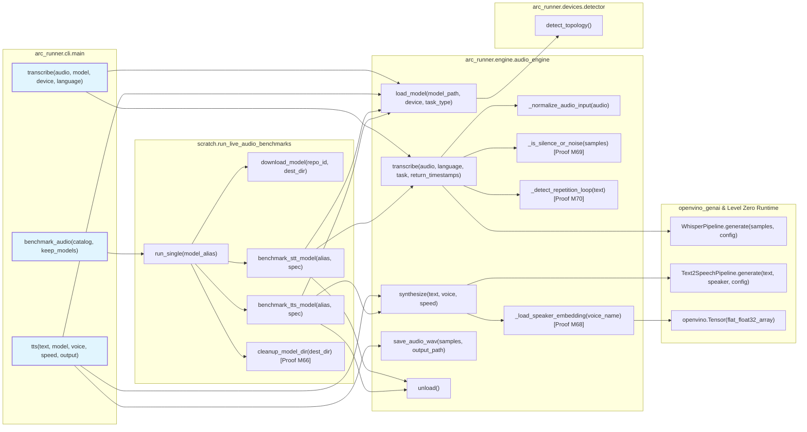

[Mermaid Source](file:///uml/call_graph_diagram.md) | [Editable Draw.io Source](file:///drawio/call_graph_diagram.drawio)

---

## 🛠️ Editing and Modifying Diagrams

1. **In Browser**: Click any `Open in app.diagrams.net` link above to load and edit the XML diagram with rich styles.
2. **In VS Code / Cursor**: Install the *Draw.io Integration* extension by Henning Dieterichs and open any file in `drawio/` directly.
3. **Programmatic Synchronization**: When modifying architecture or codebase methods, update the authoritative UDM definitions and regenerate both Mermaid and Draw.io formats simultaneously in accordance with Rule `45-uml-diagram-lifecycle.md`.