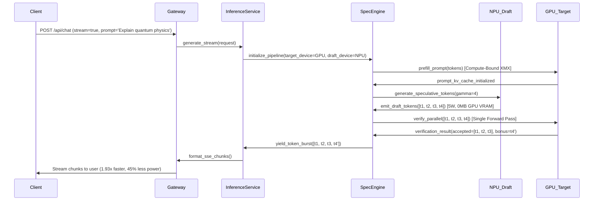
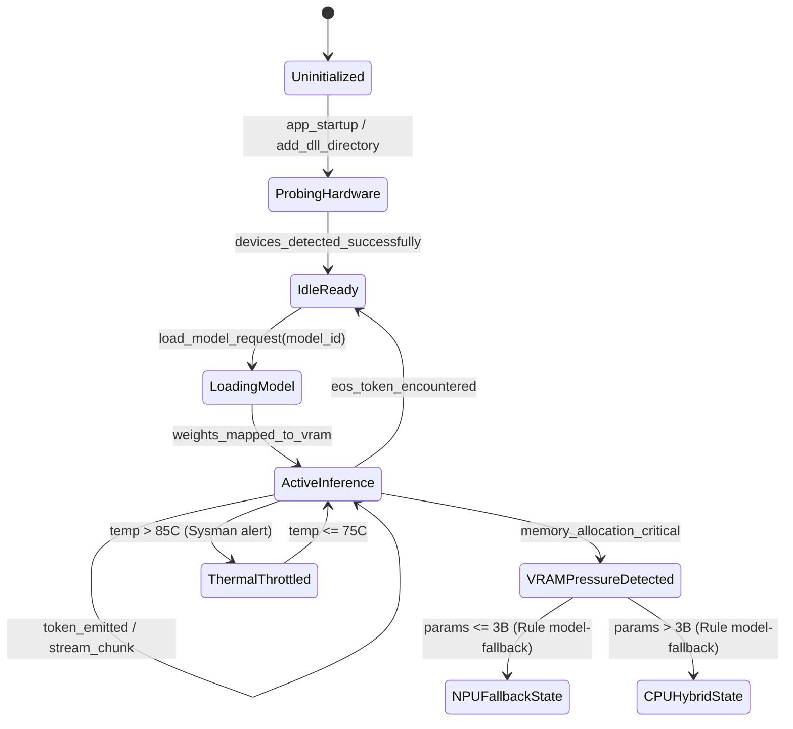

# Architectural Diagrams Suite: `intel-arc-models-runner`

This directory houses the comprehensive visual architecture suite for `intel-arc-models-runner`, modeled using connected MCP servers (`uml-diagram` and `drawio-diagram`) with authoritative UDM (Universal Diagram Model) payloads in accordance with Rule **`45-uml-diagram-lifecycle.md`**.

Every diagram is available in two synchronized formats:
1. **Mermaid Markdown (`uml/*.md`)**: Directly renderable in GitHub, IDE previews, and markdown viewers.
2. **Editable Draw.io XML (`drawio/*.drawio`)**: Full visual XML diagrams with rich complexity-based styling, editable in [diagrams.net](https://app.diagrams.net), Draw.io Desktop, or VS Code Draw.io extension.

---

## 🗺️ Master Visual Gallery & Shareable URLs

| # | Diagram Type | Mermaid Source | Editable Draw.io Source | Direct Browser Editor Link |
|:---|:---|:---|:---|:---|
| **1** | **Component Diagram** | [`uml/component_diagram.md`](file:///uml/component_diagram.md) | [`drawio/component_diagram.drawio`](file:///drawio/component_diagram.drawio) | [Open in app.diagrams.net](https://app.diagrams.net/#H5VzbcqM4EP0aP06Ki%2B14Hh07t6pkko2T2dl9oRToADWAWCF82a%2FfFogYEE4mNTNeYTupxHS3JNDpPkgtwcCeDeyLdRwNLGMJLAtpMrDnA8syTwz8i1JIXOqFiV%2BKnx4vPk2Ewr4Y2OcDYzqwZ%2FH6JYwATQOa8dKMpOmJFxKfkTg7SYCXVfFNCqVe6kpxo11reGKUTZfVW4b4tWevJYzQa9RhlpUkJJZ1z2ic0gQSbNSYb9upV1dVGq8vGUmDW%2BqB6ABvLa99KKoUtXqbUnI6lgKfVc2bW8Ei%2FFe2bcpO8%2FPQg6xhyCmNeJg2hS5NEnB5Q0YYo6um2QuNmq2mxAdFsHBJpEr%2FDD0eSKk5%2FrxVXEHoB7LpiXVaKmJSGcsryQLi0VVNpPZj1ZuMUr5Tve3yGURRDUbZzsC6%2BHjZ18tkAu73q%2BuoQuK6JFEu%2B25gjUmcDuyzCKs8ax65W9%2BSYr9h1DwaWPaa4P%2FZzbWzyJ%2BzTcYhVrSEuZ9Yjn7AhMPBMnTRc940wi9vG2TAliDx45vKKRDKIv7itS%2B8%2FiSPo5PtBdlnAUcasOcmfl0FIYdFSlxhv0JrlGWc0e8woxFlRX32uPigBsM%2FqskvRuLntUTlgFZxtjLgOax3Qmi%2B7WYYtEBj4GyDx7KWoYR90zxcbX3fMqQsqLm9WbkLkfHmv9b8lhOhXPrRD7mYrbhYN%2BQtuLASpAtoAqOAYBSfDhCKjwKC%2BRtBsIajBgrjLhRUEPaCwfBtDIqIOrT%2BNw2NABjtgWfnBGKaOJeEw4psFDWeMUlD%2FOsDoo5Guy3cgPDdWk58NVwPmF3tykO0pNdxh2cpQPc9tkeWvtx6uhuAMo4OrfO1ItbJHoj1OnkB7EEXnAWOLHG0olhUkeYgKkDUQe6r%2FplwN1DUHJFMcBblpAxPUHWZAybXceVMWpLrZ8W7FKT7Ht0TQ19qrfIJXf0vI%2BnQul8rcjXNfQxbiwngTmpFSnwGh0SRsys54AN3lozEDocIZCe0THBcHHLKHB4Ai0l0VMPXVnJAM4Y11QxUB%2BJ9j%2FL23FQvllUzNF0hdWgY2FoxrZqh%2BfVMWyT6nQfww6yLJNMcQy4uFwNaqghLOBF1iTRQSRhPPPTEfTlkzqrovaMi2XaOQDeWVfNPdbT7HtrtGape9KpmaDrC6dAg0Itdu3I0v5pdr4ADo2J%2BQvPMuWNuANj9BIediimjOTIlg39yNFG0sAZX6F9wCPRM3O%2FHxKPtdIBuPKqmm1pY9j2O2%2FNRvahUzce8Gyy9R0ArJq0a%2Ba1MepdC8vX6y51zCcn02jlP%2FDBREwMV8n6a79Qlb%2BhcoTseZm3vEdCLWC0109TAt%2B9B3Z58DnWiVUvNwTQC6NA6f6QVo6rZl1%2FPqIu%2FZjfOPGTg8nfp1M9fnHW8PiZuVFb4NSNHNTn0Llq9C9L2BFIvhtzH%2Fp2rzTMLPWeRIrQR4eES3ovVrGa6Yz3ygKNWWTrWLGrVvM8HcOtd%2FLanLXrF7z4SQNcJh8iZMhfvtJnLAIG%2BvH9SzL7dfsMzuSWchUjbRhniWXHuk2K2bTxe3Nzdo%2BSzUvZyPn9AtzK%2BPkxvyxKjosSl2J1Xljie%2BG%2FNaMaahb%2BaKvoQ8n3nA2U7tFZ8oCaSPh5avYfkVKd5kG3sjaJnlIHzFHFGnC8dBL3YZJxGoStidYqXYUwZIxsZp8OJCNO7%2B0UXPd8ln%2BaheBRs8epEYvXHuD07MmpuT6g042ZbzTZ9APS%2B04CymVonZrbVXNTHoqr3cOjFymp26obStFxpMa4eH%2B9LQAb21DSH9rATkcSbioc68YimkIj5a1I9NDr5UZxU7gLPh4VshTIeUJ8mJDrfSiViwq6BV0Zz5kqR9DZOmA%2ByX0c%2FhyqDcmLXaPL3YqSmh6bZJhFUhhORtHufrMaYjFRMJr3DRE0YPW630hl%2F5NC1pa5foJg%2FyX%2F%2FAypqSuZBLN%2Bj6GHXAr7GmEw6MDntHSZqaqaWARW3eep1PMGmMSwVBnVcenhXUfMX85wIi%2Bsk4yQRW%2FX7eX%2Fp4rJqMNUjfNQUxg0sixd5%2FA2MCpziGLyweP7TmMVexyZDnUEyOkDqHblV094aSLezuZjEzBmeCMMvC44IveSi1H2YQlSs9%2FQcKFvvaKrZ7Hhpiyxfez1O3abQVm%2FkseVrgIoCxZuA7PP%2FAA%3D%3D) |
| **2** | **Sequence Diagram** | [`uml/sequence_diagram.md`](file:///uml/sequence_diagram.md) | [`drawio/sequence_diagram.drawio`](file:///drawio/sequence_diagram.drawio) | [Open in app.diagrams.net](https://app.diagrams.net/#HlVTBjpswEP0aHxsBzobd4y4h7aWntOrZxbNg1djUmAL9%2Bo5jm0CzWbVSFIn3Zt7Yb2ZMaEHoaWolyZJfYHqhFaFHkmXpLsF%2FREFVmgtVe%2Fjrl9OHR0fQE6ElSZ4JLdrpVUjA0Eb31oexrttxwWrD2n6nwHopO3fg%2BcB5eFM32%2B8SX9rLZ4n70WLJSATfaKReRLE2aJ%2Fh54CHdgc6Xsus1aJmO300rGs%2Baw7u%2FnwKV987RSfKZ4%2FkhwDUJlZPr8BZ%2FA6l0%2BBZPQgO%2FSbQai2t6LZgpZWCym4wZowet2GvWm6rdqyGG%2BBcMXmLfhPcNgFND09X4hOIugmlH7PcEy2LweEmfcO4HlfQrY%2FRTaO1vUtfLS9AylUXQx2Snf4%2Fd7mmAWX%2FQe4NCRpGkMkheFei%2F4ZQlzmohqEB3y%2FD7YfXC%2BZcYNeiab2do%2FFGD4qD004JfRkbYeHcscqxI44aYo3FXfM0bo0stHTVMJeW6fGhzBHvrdE%2FYMU8HXL6fFiY2FJsxsuyQRamu6ak7zcO1wB0C9bM%2BB1VkuDk%2FNf3eJ2nfcSa1Sg9BIyFEa4X6ff6gnhozf1jYsydEQv5q2Xevh3IxucjvlmXhMuzRcs%2F) |
| **3** | **Class Diagram** | [`uml/class_diagram.md`](file:///uml/class_diagram.md) | [`drawio/class_diagram.drawio`](file:///drawio/class_diagram.drawio) | [Open in app.diagrams.net](https://app.diagrams.net/#H7Vttc5s4EP41%2FhiPAcd2Pto4aTPntpmmL3OfGAXWRlNAnJAdu7%2F%2BVkhgMDghl4TjfJ7JJGGl3YV906NF9Cy7Z91sw6BnDjbAE8qinjXvmabRH%2BBvpELkMo9GK0X%2B%2Fu3mYiIHrJuedd0bTHuWHW6XNACc6rNEqGkkjvseJStOwqQfgVCixC4GNa7HFLmk1xz2B0q1Em8O5I9l5xwD6pVkGEpIREIt2w5IkiBlvtdRFJUJDLcfOIn9T8wD%2BfDeVj%2F3UIqTEr2dooxHmrDimWpjT7inv7VeQxtstaYeJKWJgrFA0LhMdFkUgStKNMI5eyxPW7KgrDUmK6gQ7l0SVKk%2FqSd8TTVGV%2FuBj0BXvlY9McdqICTZZP0kiU889lggVe2YWZMzJo4O701uQxAUXKj19Mybl%2FPmj8khEg3E1YiwdPyRYK1tNyMJXEcrGoG2gNhlZk0eaRgQHLBmSxaJez1i4DUJ6EqGr4t3AhwJiSBc6MgwR0hAXwuCUrnmcFkQkDihD6kMvLkZbGMSefrCF5iQaiamVmCzgPH0LqxrY355PU5VcPYLCiNXo7E1HeUjmevRabM8zQRsjxrPeNrBmC7AQhB8h9daylAbfFe%2BfNxHXe4TvxBwZpZhREf6Kpf8lPuQrj3YyLnDinN75iyU2e7IKdPUu7xnjkgYpzaytiT9O%2FNgQ11QU%2Bbp%2F99k4aqZGXNwqapdcnJaS%2B5yWg0DTZyAEQ%2F0DTxgXaiZZv3aOC5xfX0Pf%2Fyw5cUnEmHm8kpgolNFOWbKsRExFbSFQNKkLG4DWEoJMkAo1pGpJofU86SSWRITF1eARTptPtpTvmqnDpHEkH0ZpOXCR0ZACTPOBBFkH%2BSNAtF6eSCW4xAzrlEcGoNhC3F4WROHBx4MaOqOox48nt2HFUI7th07G1bDhJ%2B0YOZRXbrLXHNCtcJPVO7H6SInxd3J%2F0xbrvRHEh4XzMFnaVFzWpfMK8CCTgQ46BOQQGMScxbGolBcbLXOL%2BlKET8oFqwOtqKmOm6FJKIDL2ff0LmR7a%2BjX73L%2BVG9whEQgDbiRAnRN76n1%2FKuI2mTnCl%2FunNNeS7WJw1jvY2aMq4E%2B5cYoh%2B3n79ggE1vzwimqZMtq%2BzmphDGyPYE7%2BrmScXNFzGNQS0XkpttHCxChPYXi0932chh1l%2BgK2XJUFVOFqvj6OcCAQq6XsByHRQhyomXh3FbkGPURnW46irieLWZrzoEOLLt%2Fjshjn8FblSVKmlrDk6%2BJ8HnIltHSM5EqaHo4MKtn4vFM1HcEEq0UiwMoxLG93%2FaiznFbaw4A4mmHh4d%2BLhbQMIwq0gioA%2BOj3YOdBlyZXc26dvzxaIKC36DI%2F2WZnKe8TWTinUtnXPitcD4B6HSYeRgVDuiHYEOrzd0p7BDbXPypLDDRbJ%2BCKlwaBiCR6Vql4Uh1hsnoIk4aECcq8R%2FCjJUW5ofdw%2FyXVgM7jrAmNmcX6I0dvSVUXZ1Y%2BQwaQU5VPuqWT8BlIvTYlHbfjqsCB4ny5ezyepFsHI8ATyI60IsSOSC42NxYWiDdPJCVprLGeYwEWmNOvU6c9kWGmmly2lU25xdQSOvNrRhNEzzVuBItdF4cnAEPUqXu6xtYU5UMSp2MXS1kBVGCpDif0gmTGyp9isk6%2BB%2FsKN5g9DuFFipdkNVlM5BgCtD54xRnnXwwUEPM4Me3ehuZJqLGOU3qIMWvEFzg21wb8LzVyp9W16cfJ5ftYUVhm2kuVltY3YFK7za0OMOQYXMrGWoQCMqKMY5Zt0jjTz2mCDM31DOolDaobzZrztGxR7AIdx1VvE6yafrBfnD3ffbaMmOvKBQvLhoIzyJarg%2FN%2BB2i3y2ZjgXgGfjsktHImoOc6IbAZ%2FXhXvgKUY9r%2FTPevjwQIQ5bLrUZ5Xhfb1cbZxeMO76gBZK9wHpGv4RoR1ncpPB1smX4nC1J6EPRegIKexijgXNqdWB9s5btgMEOnve8vWG7hQQqD1wWd3Yc%2FhrDYkobeLhqyamC%2B402UXui84k%2BEQcUWDjkM3COAC1ZX9CTTo113JO8jda7N8%2ByQtzjnxlovkL3%2FOUvx3C0ezzoeybpZQh%2FWzJuv4b) |
| **4** | **State Diagram** | [`uml/state_diagram.md`](file:///uml/state_diagram.md) | [`drawio/state_diagram.drawio`](file:///drawio/state_diagram.drawio) | [Open in app.diagrams.net](https://app.diagrams.net/#H5Zpbb%2BMoFMc%2FTR6n8iUX97HNZTvSzqpq2t1Hi8KJjYqNF3DS7KdfbENih3SU1SqSPalG1fgAB%2Fj%2FDD6cMgrno3D1mbFR4G1BSMrzUbgYBYF%2F5%2Bnf2go55oTmSWN%2Be119i6qCcDUKlyPvYRTOs88NZaCrplyqphoqijtCUSJQJu9yUI0rtS%2BgKTdljbnTbzC%2B85quG%2FeBV%2F0L54cWHiUdH37jJEeZ8b1WSFWjWRz7aLuyDrPP3wQq0h%2BcQDV58mnmPa7cVR7JvrHMpsaQCNu1fzSs6T%2BmX98IlpSUgOxUVJwzRYuuEfM8B6w6NiQE33WrbTjr9lqgBBzDGiPmWv%2BiRKXG6k%2FvjwVPQJPUdB0Fs6YgQ7aymYlMEeG7lsnV0aopOFdfFh8lnwNjLYSmn1Gw%2Bu9tD9MUkKsL3J1xYbhuESuNdmbeam%2FF1A00N%2F3wmCq9SMKFr%2F8rleAfMOeMi7pW6NU%2FukQvBHbOfnjRFXx%2BOXz%2F5xLrFxZ4Bkrs9bP14kWNH%2FOuWgl2R%2FDBuDGlLeTWhsyrlhwc%2F0w%2FbTcSXqRu6Kj7ltOcKoqYXjPEkVrwMidAjMa7lCpYFwhXpTu9UrsIToReTJbRYnwOTRQ8htPpocSuCC30IxLYrN5gckVGY6%2BDyPdcRv7UcyFZ21UhjR1Iz4K%2F6%2B3%2BCQmy0xO%2FGUxB1GdOE4fTd8LgBRDZ3wyhSdBnQlOH0O8cVYGTiTBuBNLJbnd47gWjmcPoASu6he%2F5BvSs8e3udv3iFDmc%2Fnx5%2BPEsQMpSwAKUjptvKII43fj6BevegfXH89sKMfaO8Ic5jN0IqJPNL4z6xMmeT1ug5s9vT%2Fv36hR7U5hON7%2BecfIdTq8piAyx11RwpdgN73w9I3VJAiEnD1VSRz9hhqSk%2BNJcgis6kATWxjUXKuUJzxFbHq2GQ1WvQ0HyUmBjMkNUSCRgxAr%2FHysBDFVRVKfL6wrv5hZQUcRST0qVhelHj4GQmDAWEyp0wMCFe1TqHZ3QpTMeHB03qUBgSzHImJjQLZYl1s9yUzI2ACpjl8pkcFTcFALTB9Q4q46nsYC%2FS5BqFETNs25lA7s%2Bg5m4YKaDA%2BNmDnb1l0zGmd7V9GJRPN4e%2FlrSZxxTF8dscDjcJIHSWuUxZFTVp07zddEaAspinJb5x1XR4FJsD7HdBRRmvwIFNwUAXMaGRI51vKtAnImEe7cmztAY3rfDPeNnkOmAKtbHfI71aHgeY0EVxchNdQ4BSTQ0JIHnINGDR5msm0yZqqSozF4liTZFL2X9R%2Fr6%2B%2F5tY%2FIzg%2FjKRy6v%2B8Hxck%2F1bV5JzesXhWUzTwOi5Z7sFWRFl1U0mTew1nuZobwaEwOhBkHpzBZo804DouSmAY6UWjvgrALVdyJW%2FkGHbWfuEzjKyxTV18AIL98ZLPt9wWZmv7M2AXlvgrdWAjI0Vdr5R2u7rtrukX6Y73nPc1ytOl%2FcczPtWzcKu7cXdam9wGhvTdYN6ouT4fJf) |
| **5** | **Deployment Diagram** | [`uml/deployment_diagram.md`](file:///uml/deployment_diagram.md) | [`drawio/deployment_diagram.drawio`](file:///drawio/deployment_diagram.drawio) | [Open in app.diagrams.net](https://app.diagrams.net/#H7Vnfc9o4EP5r%2FAgj2Y6BR2wD7Vy5Ycql6dwLo9iK0dRIHlkQ6MP97beSZcAx6YU27fgyzWQwWq13bX3740NyvMjxpvtN7rhoR2XJBHe82HFd3EfwCVLKE5EynlXi27%2BmvaGe8KaON3HQ2PGizf6B5RRU16JUlRopin7KSCbJpuxzqipT6lDQat7OVeKGX9fvo8p1Zd5F%2Bt%2BLjncgljZs4MoIJxtrO6ZFLg4bysErik%2BOzu3VVjf7mSTFei5Sqlcg3duX97VNbTY9VJJBYAWZrP3jk2DJvlrn2K5atmUpLRuKSohcsaIpTATnNFENGZFSPDbVHkTe9FqQjLYEy4TkbekdS9XaSnEwOk28oyxbW9dDd1BNbEitbN%2BkXJNUPJ6J2utYr6YUQj07fVryiOb5GY7Wj%2BNOr7%2F3%2BJpSw%2F3f5i6YsLjuSL61a%2Be4AdkUjhfmYDJsjqKcVYG1iIzJ4R3jqUbLRRgeBt3F8RwuXh8GoX0MF93eb7nawhcd3T5c%2F6CSm4gL%2BkOjODq6yRpOmyPH9fYEru8g0VbLQ6moTaFSHWrkAS%2BTZcn2Hi7hWkFuezGGr49rpuiyIImefoS4B9mD4Gppb9Y6BZVsQxWV1sLiNA4hy%2FNI5EIaR950OgkiqB5hqaT4Qs9m4sEoROg4Uwega97AZryi%2B2chxN8OM0haKuCh5AHG1opvYT80h4%2Bn2D%2FK1mdhj0e%2BzTmbb9nR8reCCOQ2jl4UYl4rxIhMenILqS97KaEbKH4mmBxvjLHv%2BSYenuAqxZanVFtEz2B5BvUTqOLxZDi9CFUQDSfh9KXAuNcDg5vABBeAcS8A47m%2FABe%2FhUtxUGvBPYz7qdGs0lcUlO8YF6uMcsKqqTeJzmjYIXRuWuh8ENDgQFS364gka1plzj9gvH%2FKKu1KK5VvN5OwF3QIrOCqLrqI3mvcZpTrZrjHcDea7AvCDQ8E1kZ3DPC4piW%2B54rmq7FMVjErEwktazVb3P7ujlUIBM3YeWl7%2FDWxM2jFzjia92YYHQtwOJ%2F1ZvrF0ZLlLNEx0sGcDt5Wdxy2YLHk1vxkYonmvLFkO11tdQlmWRL4VXPsZs39cXw61R9H7f5Id6Yv%2Fk2lgMtH%2BNEB5alC5ytd5YKkVL5thLrVFeuHO8PI9LpZaJpcyhKiYMlBEMcfgwqoG10EjMa0s%2BzlFXAa%2BF3CCV9HX6RIaFkKXfgWJPmi92Ku5yqRkHR1mytJVksR%2FWYqVWQNu8xUcHuzSG%2FFgCTSXFOn76KXAK6lU1OXyZPxh0Vv4uh9PyPsZnrj7wCuy0wGtzdgxp8%2B925w5eOYnWg8%2Fwyfc6Ik2%2BthktCcSqJYRxnnKwDVKUqD2zsyplaC6E%2BTYN7A%2BPIRqqwM55GhpEceCjSHmerKi22Xmc4rINcxqtPerjFUZ%2F6U6lRALj%2BO58ZYaGoi0J8bnXrhtnyzcHWL8bQ3bC5tykCG6cc50lEUz8eXUorydKxPrWCkN0thWUFiT8WGTYRaSCDzd5Fl0DSjNasRUq1FJjjJJyepRU%2FrNbArxVYmVmSXUxGZ0XP%2B%2Bv1cRdIcesKu6fLnwtXeI9GFUXKzH2roI5qSe8mSCrSYSX2qCL8B9cmti4xyfdb4%2F8cP%2FyDZ%2FMkAnuk8cyRq7z87fG6edsNsfeBdn7KbG8xBuzf5Fw%3D%3D) |
| **6** | **Activity Diagram** | [`uml/activity_diagram.md`](file:///uml/activity_diagram.md) | [`drawio/activity_diagram.drawio`](file:///drawio/activity_diagram.drawio) | [Open in app.diagrams.net](https://app.diagrams.net/#H7ZtdT%2Bs4EIZ%2FTS8XxXHTj8uefnDQigVRDkd7FZlk2lgkcdZxod1fv05j0wYbxB4EjTdbIdSOnXEy46eZN657eNrDi22W9nzvEXhJWd7Ds57vozNP%2FpdWyCMW03xdm3%2FcLn4bVQ140cPznjfp4Wm2XdEUZNeElaLuRoriLKZkzUlWnuUgaldiV0Ddrtpqc2Ncv3%2Fm1UPX7n2v%2BsPT5yM8Gjd8oNpJTjLlexIJ%2BkjFThpnh2GOvWmf2fackyK5ZDFU1x9v1aX3K4%2BV03hXW4YDZVhzPTo6GJb0bzU0UjFbb2gMZaOjYCwVtGgaI5bnEImGjXDOnprdVixtjlqQNRiGZURS0%2FqTxiJRVjQYHxq%2BA10nauiRP6wbMqI7qyspExKzpyOTGUcdTc6YeLX5EPIppOlRFtU4PX%2Fx7499vkwOuXiHO4sLlddHkm5U7NR1i50OpjxA5k1%2B%2BJYIyQmeIfm2FJw9wJSljO97YW%2F%2Fki2ShdRmf57rAravnj56O8RywgLLQPBqcisvfS%2Bo%2Fai5ilUIng6J16bkKOXaRtRUWz87fit%2B0q5C%2BK7oYiO6S0G4MELM2SaPIVaxfUqogGVBoqr1SRLaDP2LAM%2FRLJgPbSkZD4Z4Mnhu0ST4n5gMrCfgTn8hmNnwPUs6gq9IR%2F8dkz2PJ9UXkPwUpaQsafTeeW8GGWL5paRcMy4StmY5SecHq0pD1a%2BRhJJteAQNQOW0WYNozKpfTRWHlMg7RHPIT417YMT9BiKQpxBOEyLCG%2FhrA2WXqBi3iYqBg1Rgk4rANSqGRtzvSEpjIkATEc5ur7pDhT9qExUjB6kITCqGrlExNuJ%2BUYbXnGWFCKckSiAOL%2FLw9zuTi4Rl95vy11PwgpXF%2FiXtBXAqrxMquxrk%2BmCyEvhpyIyayOChiczIQszoK4jR4s8pZIYmMuOPperrkUHIDHzwbScFeCDfe6%2Fx47GH7txc%2Bq0quZBFdh8y1nZmxiYz6INZOwE0pja%2FgU0JkhVY0W3NSnf4CFpVfCEXlbpmoMGFc1odmWJ9T0Sa6rvIRAh5LZTl4VUenl%2F%2F6A4kA0u5dUJIXBTuyKLckXPSHZnaXVZZ33f3nMbhsoBoU52RJGSek%2FtUovC%2FWKkWkdokVlzU98gi8JFzCh%2BZEv%2BFXHkLpE6pllGrqjJ9cm6qFmSR%2Bsg5re%2BbWv8ccuDVU%2BMZJysR3srg5WVVm%2F3Rpdps3KraTN9N3Lq9WIT9R7N1AkJMYX8nK6DVTpNxTThJU0g7J1%2BQZ6nATsiIiyLft4h89xbkLSvyU5ZlVIr7KIJCQKxhuWXWtZb%2FLCIoaBUiLkp82%2BK8e6vzluX5yUYwDmsOMsiPstyCiMUQLgUUHQLE77cKEBdlvG2d3r2FestK%2FZ8UUnXnCKfJJn%2Bobh9LwUH%2F0rkThGDLL1BPR4g%2BGbcIsWh199blsanVL0rJAysUI1c8vCRbVWqZhHTwGTHq%2ByY8J3tIjF1U8bbleeycisemin%2FxkPh1jjr1iBgFrSrIsEXUu%2FOMGFvUPXZO3WNT3c8rbb%2BgMiLhpRyPRmVdoHWIk0G7yjIXlT22KHvsnLLHprKf53GHSBhaaqwTkuCihMcWCY%2Bdk%2FDYshL%2FMvRlQvablmO2uU9h7tZeUDRC5lQ%2F2W5QXai5NdMtUhy3W4of9XllT7Y6%2Fmj3%2B3Gffaveb4%2FVJv%2F9Aft9%2Fnj%2BDw%3D%3D) |
| **7** | **Package Diagram** | [`uml/package_diagram.md`](file:///uml/package_diagram.md) | [`drawio/package_diagram.drawio`](file:///drawio/package_diagram.drawio) | [Open in app.diagrams.net](https://app.diagrams.net/#H7Zlfj9owDMA%2FTR%2BH2gZ63OMB1%2B1l0iQ27XHKGtNGlyZdmvJnn34JTaG5QnWbNImcQAhR27GJf7EbmgAtA5TuSxbE4RZkTQUP0CqI42gS6k8tBZ4JQnneir99TT%2FMjQKlAXoOwqcALcv9hjLQpoWoVWuGq2pCKM4lLusJB9W6UocKWr3VtWInbjydhG3o1n0cmjdankaElDg%2BotYJx6X1%2FQVnLzg3v2d1jtJ31rks9x8lrorPgoCZPtnbmU%2BNQ%2BOTHFrJQ2IFueyCR2fBmv62kSObsryhBGrHUAnBFK1cYSY4h0w5Miyl2LlmG8HcqJWZ3mvBOsNsKP1OiSqsNEoez4pPQPPChp7HD62ixJ2xnUldYCJ2PdEwj102pRDqqvqc8iUw1oNo4wRx%2BvdjT9OUwNUb3F1wYbluMWts7rDMfshGc5GTjFGbBXXoUqsTclzDhgnIAC0KpWsHrSL9dVdQBesKZ8Zgp5eWlm0EV2s73Ngo%2FLNDMo3b6xOJaGoGUMaWggl5jIfSNI2XukQXtZLiBXqaVbJIZslJ03k1Tk9lpWB%2FNVXROE5dHCBKUPKgr62XqU3vwb3cnddYHFpZ0VteUYcF23WdnzyPwdJyy%2BtNKNEYyhqkTsedZp8mim8Z53S0MoWEO8w%2BzCS8ZZizMZgEtjTTt8s7z%2But9sZ4JmM8geeU38tztNfeGM%2BHAU9aVkKqYVECJ09mh6qvRAV6z77QErsDnrtQB3kPj6%2BLeQeiN7A2io5biFxwzJ7PUkvG2DlcatHIDJzNnMIyB%2BXcRf6VngSGFd26If8rifmABMMNz4oL%2FdEzFMg3FI8DFL8akNR%2FEjPfSHT%2Fqz3vT%2Bgd9KcoGqAgtK6w8q5FXaCReEdj%2BPyiFJwqIb1n4V%2BTGj6A8LFJJe%2BhSQ0fHjS1Z%2B3pAgf%2FSmL4v9%2FHkpj5VhI9mytP5e343vmHe9qitd2BS3fKcxxwPOhBz38A) |

---

## 🔍 Embedded Visual Previews

### 1. Component Diagram
```mermaid
flowchart TB
    CLI_Subsystem["<<component>> CLI_Subsystem: Client Interface"]
    Daemon_Gateway["<<component>> Daemon_Gateway: HTTP API Layer (FastAPI)"]
    Inference_Service["<<component>> Inference_Service: Core Service Layer"]
    Device_Service["<<component>> Device_Service: Hardware Discovery Service"]
    Model_Registry["<<component>> Model_Registry: Model Store & Hub"]
    Heterogeneous_Orchestrator["<<component>> Heterogeneous_Orchestrator: Execution Scheduler"]
    OpenVINO_GenAI_Engine["<<component>> OpenVINO_GenAI_Engine: Unified Silicon Engine"]
    SYCL_Direct_Engine["<<component>> SYCL_Direct_Engine: GGUF Engine"]
    Hybrid_Speculative_Engine["<<component>> Hybrid_Speculative_Engine: Cooperative Accelerator Pipeline"]
    Intel_Arc_Discrete_GPU["<<component>> Intel_Arc_Discrete_GPU: Hardware Silicon"]
    Intel_Core_Ultra_NPU["<<component>> Intel_Core_Ultra_NPU: Hardware Silicon"]
    CLI_Subsystem -->|Loopback HTTP (:11434)| Daemon_Gateway
    Daemon_Gateway -->|Async Dispatch| Inference_Service
    Daemon_Gateway -->|Telemetry Query| Device_Service
    Inference_Service -->|Route Request| Heterogeneous_Orchestrator
    Heterogeneous_Orchestrator -->|Speculative Mode| Hybrid_Speculative_Engine
    Hybrid_Speculative_Engine -->|Dual Instance Dispatch| OpenVINO_GenAI_Engine
    OpenVINO_GenAI_Engine -->|Level Zero Immediate Cmds| Intel_Arc_Discrete_GPU
    OpenVINO_GenAI_Engine -->|MCDM Driver Stateful Pipeline| Intel_Core_Ultra_NPU
```

### 2. Sequence Diagram (Hybrid Speculative Streaming)


### 3. State Diagram (Hardware Degradation Lifecycle)


---

## 🛠️ Editing and Modifying Diagrams

1. **In Browser**: Click any `Open in app.diagrams.net` link above to immediately load and edit the XML diagram with rich styles.
2. **In VS Code**: Install the official `Draw.io Integration` extension and open any file in the `drawio/` folder.
3. **In Draw.io Desktop**: Open `drawio/*.drawio` directly.
