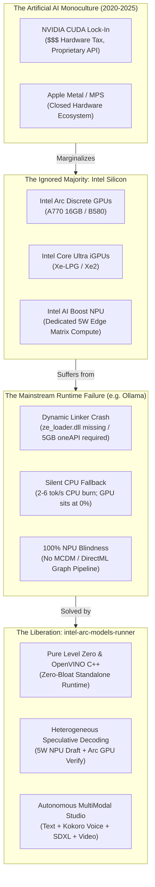

# 🎯 Project Mission & Vision: The Silicon Democratization Manifesto
### Unleashing Intel® Arc™ GPUs & NPUs for Local AI — Breaking the CUDA Monopoly

```
====================================================================================================
"Hardware diversity is not an option; it is the fundamental prerequisite for AI freedom."
====================================================================================================
```

---

## 🧭 Executive Summary

For years, the local artificial intelligence ecosystem has been trapped inside an artificial monoculture. Developers, researchers, and everyday enthusiasts have been conditioned to believe that private, offline, and high-performance AI inference can only exist behind two walled gardens:
1. **The NVIDIA CUDA Monopoly** (demanding an exorbitant "NVIDIA hardware tax" on desktop and datacenter systems).
2. **The Apple Silicon Garden** (offering unified memory, but locked inside a closed, proprietary consumer hardware ecosystem).

Meanwhile, **hundreds of millions of consumer and workstation PCs worldwide** sit powered by **Intel® hardware**:
- **Discrete GPUs**: Intel® Arc™ A770 (16 GB VRAM with 512 GB/s bandwidth), A750, A580, A380, and the new Xe2 Battlemage series (B580, B570).
- **Integrated GPUs**: Intel® Core™ Ultra Xe-LPG (Meteor Lake) and Xe2 (Lunar Lake & Arrow Lake).
- **Neural Processing Units (NPUs)**: Intel® AI Boost NPUs (3720 and 4000 series) offering up to 48 TOPS at a mere 5 Watts.

Yet, despite this massive global install base, mainstream local AI runtimes treated Intel hardware as a tertiary afterthought or ignored it completely. Mainstream tools like **Ollama** suffered from systemic architectural bias toward CUDA and Apple Metal—leaving Intel users stranded with crashing dynamic linkers, multi-gigabyte development kit requirements, or the notorious **"Silent CPU Fallback"**, where user hardware burned CPU threads at 2–6 tokens/second while high-performance Arc GPUs and NPUs sat at 0% utilization.

**`intel-arc-models-runner` was born to end this injustice.**

Our mission is singular and uncompromising: **to restore hardware dignity to Intel silicon**, to open the floodgates of Intel Arc GPUs and NPUs for local AI, and to provide the world with a zero-bloat, mathematically grounded, and uncompromisingly honest local AI platform.

---

## 🏛️ The Problem: Why Did NVIDIA Get the Crown While Intel Was Denied Dignity?



### 1. The CUDA Moat and Developer Inertia
NVIDIA built its developer moat over two decades by subsidizing academia, embedding CUDA into foundational deep learning frameworks (PyTorch, TensorFlow), and ensuring that running `torch.cuda.is_available()` was the one-line default of every AI tutorial on the internet. Because software vendors focused exclusively on CUDA kernels, developers were conditioned to treat non-NVIDIA GPUs as "unsupported."

### 2. The Multi-Gigabyte Development Barrier (oneAPI vs. Driver-Level Runtimes)
When developers attempted to run open-source models on Intel hardware using early SYCL or oneAPI ports, they were confronted by a monstrous developer barrier:
- While NVIDIA bundled `nvcuda.dll` into every display driver, compiling and running Intel SYCL kernels required installing the **Intel oneAPI Base Toolkit (5 GB to 15 GB)**.
- For an ordinary consumer wanting to run a local 7B model, downloading a 10 GB compiler toolchain just to run an inference binary was a complete non-starter.

### 3. The Forensic Anatomy of Ollama's Failure on Intel Silicon
Ollama became the gold standard for developer UX because of its single-binary distribution on macOS (Metal) and Windows/Linux (CUDA). However, forensic analysis of Ollama's architecture reveals why it abandoned Intel users:
1. **Dynamic Linker Resolution Failure**: Ollama’s Windows build relied on `gpu/gpu.go` probing `ze_loader.dll` without proper activation contexts. When dependent Level Zero runtime DLLs were missing from system paths, Windows raised `STATUS_DLL_NOT_FOUND (0xC0000135)`.
2. **The "Silent CPU Fallback" Scandal**: Instead of alerting the user that GPU initialization failed, Ollama's error-handling strategy silently caught the exception and routed the entire inference pipeline to the CPU fallback runner (`ollama_llama_server_cpu.exe`). Users would buy an Intel Arc A770 with 16 GB VRAM, fire up an 8B model, experience unusable 2–6 tok/s speeds, and wrongfully conclude that *"Intel hardware is bad at AI"*, completely unaware that their GPU was sitting at 0% activity while their CPU was throttling at 100°C.
3. **Total NPU Blindness**: Modern Intel laptops (Core Ultra Series 1 & 2) ship with dedicated Neural Processing Units. Standard local runtimes had zero driver interfaces or stateful graph compilation abstractions for Intel NPUs, leaving this dedicated 5W silicon 100% idle.

---

## 🚀 Our Mission: Hardware Dignity & Silicon Sovereignty

`intel-arc-models-runner` was founded on five non-negotiable architectural pillars:

### 1. First-Class Hardware Dignity for Intel Arc & NPU
Intel hardware is never treated as a tertiary fallback or an experimental flag. We build directly upon:
- **Intel Arc Discrete GPUs** (Alchemist Xe-HPG: A770, A750, A580, A380; Battlemage Xe2: B580, B570).
- **Intel Core Ultra Integrated GPUs** (Xe-LPG, Xe2).
- **Intel Neural Processing Units** (AI Boost NPU 3720 / NPU 4000).

Every hardware target has dedicated kernel pipelines, unified memory management, and specialized execution engines.

### 2. Zero-Bloat Standalone Sovereignty (<120 MB Footprint)
We categorically rejected the requirement for users to install 5 GB compiler suites or multi-gigabyte PyTorch environments:
- Built directly on **OpenVINO GenAI C++** and **Level Zero** runtimes.
- Distributed as a lightweight, self-contained standalone Python wheel (`pip install arc-runner`).
- Automated Windows activation context and DLL path resolution (`os.add_dll_directory`) that resolves Level Zero driver bindings instantly out-of-the-box.

### 3. World's First Client-Side Heterogeneous Speculative Decoding
On single-GPU architectures (like NVIDIA RTX), speculative decoding suffers from memory bandwidth contention: running a small draft model alongside a large target model on the same GPU steals valuable memory bus cycles.

**Our Breakthrough**:
We partition the speculative pipeline across two physically isolated silicon engines:
- **Draft Model** (e.g., Qwen2.5-0.5B-INT4): Pinned to the **Intel NPU** (operating at ~5W power draw, using 0 MB of GPU VRAM).
- **Target Model** (e.g., Qwen2.5-7B-INT4): Pinned to the **Intel Arc GPU** (running parallel verification passes over XMX matrix engines).

This delivers high-throughput token bursts while dropping system power consumption and leaving GPU VRAM completely uncontended.

### 4. Mathematical Honesty and Uncompromising Telemetry
Unlike projects that fabricate token rates or hide fallbacks behind smoothed averages:
- **Zero Fabrication**: Telemetry distinguishes measured values from estimates (`is_estimate: False`).
- **Closed-Loop Hardware Profiling**: Real-time Level Zero Sysman integration reporting real temperatures, real memory residency, real power draw, and real throttling events.
- **Proof-Grounded Engineering**: Grounded in formal mathematical models (Proofs M1–M134), TLA+ verified ring-buffer models, and strict claim gates.

### 5. The Autonomous MultiModal Generative Studio
We expanded local Intel AI from single-turn text chat into a complete production studio:
- **LLM Director**: Reasoning and scene orchestration on Arc GPU / NPU.
- **Kokoro-82M Voiceover**: High-fidelity local speech synthesis.
- **SDXL / LTX-Video Visuals**: High-resolution image diffusion and DiT video generation.
- **Hardware-Accelerated QSV Muxer**: Direct Intel Quick Sync Video (QSV) hardware video encoding.

---

## 🔭 The Vision (2026–2030): The Democratized Local AI Future

```
====================================================================================================
                        THE 5-YEAR STRATEGIC HORIZON
====================================================================================================
  [Phase I: Foundation]     --> [Phase II: Scale]         --> [Phase III: Ubiquity]
  - Arc Alchemist & Xe2         - Lunar Lake / Arrow Lake     - Celestial Xe3 & Beyond
  - Drop-in Ollama Parity       - Continuous Batching         - Multi-Node Level Zero Clusters
  - Standalone PyPI Wheel       - Speculative NPU Splitting   - Pervasive Client AI Agents
====================================================================================================
```

Our long-term vision is to make local artificial intelligence universal, accessible, and independent of proprietary hardware taxes:

1. **Every Intel PC is an Autonomous AI Node**: From ultrabooks with 15W Lunar Lake processors to gaming rigs with Arc Battlemage GPUs, every Intel machine will run production-grade LLMs, speech, vision, and video generation locally, privately, and indefinitely.
2. **Ending the \$2,000 GPU Requirement**: A consumer should not need to spend \$2,000 on an enterprise NVIDIA card just to get 16 GB of VRAM. The Intel Arc A770 brought 16 GB of high-speed memory to consumer price points, and `intel-arc-models-runner` ensures every single byte of that hardware delivers maximum inference value.
3. **Unified Heterogeneous Computing**: The CPU, the iGPU, the dGPU, and the NPU should act as one harmonious neural fabric. Workloads should dynamically glide across compute blocks based on latency, thermal limits, and energy budgets.
4. **Complete Ecosystem Interoperability**: 100% drop-in drop-out compatibility with the OpenAI REST API and Ollama endpoints, allowing developers to plug into Open WebUI, Cursor, Claude Code, LangChain, and AutoGen without changing a single line of client code.

---

## ⚖️ Architectural Head-to-Head Comparison

| Capability / Metric | `intel-arc-models-runner` | Mainstream Ollama (Stock Windows) | Generic `llama.cpp` (SYCL Build) |
|:---|:---|:---|:---|
| **Intel Arc Discrete GPU (A770/B580)** | 🟢 **Native First-Class (Level Zero XMX)** | 🔴 Broken / Silent CPU Fallback | 🟡 Requires 5 GB oneAPI Toolkit build |
| **Intel NPU (AI Boost 3720/4000)** | 🟢 **Native Stateful Graph Acceleration** | 🔴 100% Idle / Unsupported | 🔴 Unsupported |
| **Heterogeneous Speculative Decoding** | 🟢 **NPU Draft (5W) + Arc GPU Verifier** | 🔴 Not Supported | 🔴 Not Supported |
| **Installation Footprint** | 🟢 **<120 MB (`pip install arc-runner`)** | 🟡 ~450 MB (CUDA only, no Intel) | 🔴 5 GB to 15 GB oneAPI compiler suite |
| **Ollama Model Registry Streaming** | 🟢 **Native (`/api/pull` direct streaming)** | 🟢 Native | 🔴 Manual download & conversion |
| **OpenAI & Anthropic API Emulation** | 🟢 **Native (`/v1/chat/completions`, `/v1/messages`)** | 🟡 Partial OpenAI only | 🟡 Server mode only |
| **Multi-Modal Local Studio** | 🟢 **Native (LLM + Kokoro TTS + SDXL + Video)** | 🔴 Text & Vision only | 🔴 Text & Vision only |
| **Hardware Telemetry & Honesty** | 🟢 **Real Sysman metrics, `is_estimate` flags** | 🔴 Silent fallback without notification | 🟡 Basic stderr logging |

---

## 🙏 Standing on the Shoulders of Giants: Open-Source Acknowledgments & Gratitude

This project exists because of the relentless passion, brilliance, and generosity of the global open-source AI community. We express our deepest gratitude to the creators, maintainers, and pioneers whose work made this revolution possible:

### 1. Intel® OpenVINO™ & Level Zero Engineering Teams
We extend profound appreciation to the engineers behind **Intel OpenVINO** and **oneAPI Level Zero**. Their world-class C++ computational graph runtime, Neural Network Compression Framework (NNCF), and low-level driver primitives provided the foundation that allows us to execute tensors directly on Intel silicon without bloat.

### 2. The Ollama Community & Maintainers
We owe immense gratitude to the creators of **Ollama**. Ollama proved to the world that local AI could be simple, intuitive, and delightful. Their elegant REST API design (`/api/generate`, `/api/chat`, `/api/tags`) and their model distribution registry set the gold standard for edge developer experience. Our mission is not to replace their vision, but to ensure that the millions of Intel users worldwide can enjoy that same magical experience on their hardware of choice.

### 3. Georgi Gerganov & the `llama.cpp` Community
Every modern edge AI project stands on the shoulders of **Georgi Gerganov** and the brilliant contributors of `llama.cpp` and `ggml`. By demonstrating that integer quantization (GGUF) could unlock LLMs on consumer hardware, they sparked the entire local AI renaissance.

### 4. Hugging Face & the Optimum-Intel Contributors
To **Hugging Face**—the beating heart of open-source AI. Their open model hub, tokenizer architectures, and the **Optimum-Intel** integration made state-of-the-art transformer weights and quantization pipelines universally accessible to independent developers.

### 5. Hexgrad & the Kokoro TTS Project
To the creators of **Kokoro-82M** (`hexgrad`). Creating an 82-million parameter text-to-speech model capable of rivaling cloud voice APIs—while running in real-time on edge silicon—is a masterpiece of open-weight engineering that powers our MultiModal Studio audio pipeline.

### 6. Stability AI & Lightricks (LTX-Video)
For their unwavering commitment to releasing open weights for visual generative intelligence: **Stable Diffusion / SDXL** from Stability AI and **LTX-Video** from Lightricks. They proved that visual creativity belongs to humanity, not behind proprietary API paywalls.

### 7. FastAPI, Pydantic, & Rich / Textual
Our developer and terminal experience is built upon the extraordinary software craftsmanship of:
- **Sebastián Ramírez (tiangolo)** for **FastAPI**, enabling high-throughput async streaming.
- **Samuel Colvin** and the **Pydantic** team for rock-solid runtime data validation and schema contracts.
- **Will McGugan** for **Rich** and **Textual**, turning terminal telemetry into a work of art.

### 8. The Global Open-Source & Independent AI Community
Finally, to every developer, researcher, hobbyist, and community member who refuses vendor lock-in, refuses to pay the artificial hardware tax, and relentlessly tests, benchmarks, and contributes: **this project is dedicated to you.**

---

```
====================================================================================================
  Intel Arc Models Runner — Built with pride for Intel silicon. Owned by the open-source community.
====================================================================================================
```
