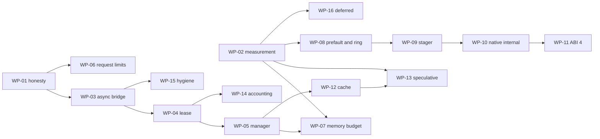

# MASTER PLAN v8 - arc-runner Native Layer: Finish, Harden, Prove, and Document Every Decision
### Base: Gemini's "10/10 Enterprise Architecture Master Plan" (conversation 700d4ff3) | Corrected by 17 skill-verified agent reviews | Orchestrated from `claude-global-library`

> **Plan file location (author machine):** `C:\Users\techd\.claude\plans\sunny-painting-pebble.md`
> **Gemini's original plan (kept as the base spec):** `C:\Users\techd\.gemini\antigravity-cli\brain\700d4ff3-bc4b-4c7a-88b8-a15dc6ba9d13\implementation_plan.md` (+ `transcript.jsonl`, stopped at step 443)
> **Status (2026-10-29, review pass 3, v8):** PLANNING ONLY, nothing implemented. Defects found in review passes 1-2 and their fixes are in Section 17, which also holds the executable slice plan and the environment split. Gemini's native-layer work is already committed on `main` (commit c7312e0), so that commit is the baseline.
> **Resume rule:** read Section 0, then Section 13 (state), then continue. Everything needed is in this file; chat history is not required.

---

## 00. ONE-PAGE SUMMARY AND PRECEDENCE (v8, read this first)

**Precedence:** Sections 20 (v8.2), 19 (v8.1), 18 (v8) and 17 (v7) override everything else (20 > 19 > 18 > 17); then Sections 14, 15, 16 (added later) override conflicting text in 5, 7, 8.6, 10, 11. Specifically: UML/drawio = FULL regeneration of all 13 types (15.2, not "selective 7"); roster = Section 5 plus 14.3 plus 16.1 (no `?` left, all verified); rules = 8.1 plus 16.2; execution track = LEAN (default) or FULL (14.7), your choice at approval.

**What gets done:** (1) Step 0 verification: CLOUD part now, LOCAL-only facts via `scripts/probe_hardware.py` (17.2); (2) issue + branch; (3) fix C-series bugs red-first (bounds, dtype, lifetime, ring buffer), Level Zero/Sysman honesty, engine telemetry honesty, benchmark protocol with no fabricated rows; (4) tests by an independent author; (5) docs, SRS, CLAUDE.md, CHANGELOG, VERSION 0.2.0; (6) all 13 UML + drawio regenerated from hand-built UDM and guarded by `scripts/check_docs_sync.py`; (7) CI, packaging, committed DLL with hash/ABI check; (8) every stage documented and versioned in `docs/delivery/` with a decision log. (9) v8: benchmarking program B1-B10 (Section 18) covering all domains of the existing suite, native micro-benchmarks and a v0.1.0-vs-v0.2.0 regression gate, with schema-validated JSON and generated doc tables.
**Gates needing your OK:** push, merge, tag/release (PyPI + GHCR publish).
**Known limits of this plan (honest):** hardware facts and real token cost are only settled by Step 0 and by running; per-agent skill lists are enumerated at each stage start, not here; FULL track is expensive (est. 4-6M tokens, unmeasured).

---

## 0. How to read this plan

| Part | Sections | Purpose |
|:--|:--|:--|
| Why | 1-3 | Problem, evidence, corrections to Gemini's maths |
| How (process) | 4-6 | Routing, agent/skill orchestration, token control |
| Traceability | 7-8 | Per-stage versioned docs, decision log, trace matrix |
| What (code) | 9-10 | Architecture, classes, methods, variables, tests |
| When | 11-12 | Waves, gates, git flow, risks, definition of done |
| State | 13 | Resume checkpoint, repo/hardware facts, open items |
| Review history | 14-16 | self-review v5, doc/UML sync plan, roster and rules audit (historical scores in 14.1 are v4/v5 and are superseded by 18.10) |
| Current execution plan | 17-18 | environment split, slices S-A..S-F, measurable gates, benchmarking program; these override everything else |
| Final fixes | 20 | CI naming, DLL-per-slice rule, platform support policy, local-gate slices, release rollback, approval batching |
| Wave-to-slice map | 19.1 | how W1-W3 of Section 11 map onto the slices of 17.4 |

---

## 1. Executive problem statement

Gemini built a native C/C++ layer (Win32 memory-mapped weight streaming + Level Zero USM bridge), changed the OpenVINO engine to use real `perf_metrics`, and started Sysman telemetry, then ran out of tokens right after the README edit (step 443). 26 tests pass, but 17 skill-verified reviews show:

1. **Memory-safety bugs** in the C layer (integer wrap in bounds checks, unchecked counts, views that outlive the mapping).
2. **Fabricated numbers still present**: Sysman power `22.0 W`, Sysman "free memory" from system RAM, engine fallbacks `len(text.split())`, `elapsed*200`, benchmark `REFERENCE_SWEEP` rows with hard-coded TTFT/TPS/power.
3. **Plan maths is wrong** (Theorems 1-4) and several README claims rest on it.
4. **Tests do not match the plan** (N3, N4, N5, N6, E3, E5, E7, E8 absent/renamed; P8, P9 missing).
5. **Not shipped**: no CI, no packaging of the DLL, no issue/commit/release, no SRS/CLAUDE.md/VERSION/CHANGELOG.

**Goal:** a correct, bounded, honestly-measured native layer, with every claim backed by a measurement, every decision recorded with its reason, and every stage documented so any future session can continue without re-discovery.

---

## 2. Evidence base (verdicts from the 17 skill-verified reviews)

Legend: **C**=confirmed, **P**=partly, **R**=refuted, **V**=must verify on disk/machine first.

### 2.1 Native C / Python bridge (`src/arc_runner/native/`, `engine/flash_stream/weight_streamer.py`)
| ID | Sev | Where | Finding | Verdict | Fix (design element) |
|:--|:--|:--|:--|:--|:--|
| C1 | CRIT | `arc_flash_stream_mmap.c` ~183/209/239 | `offset+size > file_size` wraps uint64, then `base_ptr+offset` OOB | C | `arc_range_ok()` helper: `size<=fsz && off<=fsz-size` |
| C2 | HIGH | `arc_mmap_register_layer` | `tensor_count>64` reads past `tensors[64]`; extents never validated at register | C (name-NUL overrun **R**: `strncmp` bounded) | validate count/dims/extents/name, copy-then-publish |
| C3 | HIGH | `bridge.py` register | ctypes silently wraps negative/huge ints; `min(len,64)` truncates; names cut at 127 | C | `_validate_u64`, raise on overflow, no truncation |
| C4 | HIGH | `weight_streamer.py:226` vs `173-193` | native path = float32 view for every tensor type; fallback differs; BF16 read as f16 | C | dtype from `tensor_type`; quantized -> raw `uint8` view |
| C5 | HIGH | views | arrays outlive `UnmapViewOfFile`; arrays writeable over `PAGE_READONLY` | C | keep-alive owner, `writeable=False`, deferred close |
| C6 | HIGH | slots | slot chosen under lock, loaded outside -> duplicates; `close()` nulls `_native_engine` under prefetch threads | C | `_RingSlot` state machine (EMPTY/PENDING/READY) + pin count + join threads |
| C7 | MED | lock/unlock | codes collide with `GetLastError`; single `is_locked` bool; VirtualLock quota 1453; never called | C | `ArcStatus` codes + `locked_bytes`; best-effort `try_pin` |
| C8 | MED | `CreateFileA` | UTF-8 path misread; MAX_PATH | C | `CreateFileW` + `\\?\` |
| C9 | LOW | 32-bit casts | `(SIZE_T)size` truncates | C | `size<=SIZE_MAX` guard |
| C10 | LOW | `build_native.py` | global `-mavx2` (15 ymm instrs in DLL, SIGILL risk) | C (`-static-libgcc` **P**: DLL imports only KERNEL32/UCRT) | drop `-mavx2` (no AVX2 code exists) |
| X1 | MED | LRU | `time.time()` ties (~15.6 ms); cyclic layer scan = 0% LRU hit | C | direct-mapped `layer % slots`, monotonic tick |
| X2 | MED | eviction | `gc.collect()` under lock; "O(1) RAM" claim false (page cache/working set); `get_active_memory_bytes` = virtual size | C | collect outside lock; add `get_resident_memory_bytes()` |
| X3 | V | reshape | GGUF `ne[0]` fastest -> `reshape(dims)` may need reversed dims | V | micro-test at Step 0 |
| X4 | LOW | layer lookup | linear scan <=256x64 is microseconds | **not a bottleneck** | no hash table |

### 2.2 Level Zero + Sysman (`arc_level_zero_bridge.c/.h`, `devices/sysman.py`)
| ID | Sev | Finding | Verdict | Fix |
|:--|:--|:--|:--|:--|
| L1 | HIGH | `query_package_power` returns constant `22.0`; `zesDeviceGetPowerProperties` does not exist; this iGPU has **0 power domains** | C | return `None` + reason; energy-counter path (`zesPowerGetEnergyCounter`) for platforms with domains |
| L2 | HIGH | memory "free" from `GlobalMemoryStatusEx` / `total//2`; iGPU has **0 memory modules** | C | `(total, None)` + reason (shared system memory) |
| L3 | MED | `stype` values look wrong (code 0x1-0x5, 0x11; recalled 0x7,0xd,0xe,0xf,0x15,0x16); driver does not validate; only 0x3 proven | V | read `ze_api.h` at Step 0, named constants |
| L4 | HIGH | `drivers[0]/devices[0]`; machine has driver0=Arc iGPU (type 1, id 0x7d55), driver1=NPU (type 5) | C | select `ZE_DEVICE_TYPE_GPU` |
| L5 | MED | create-call return codes ignored, leaks on failure | C | check every call, single cleanup path |
| L6 | LOW | queue priority 1 = LOW | C | NORMAL (0) |
| L7 | MED | `memcpy` fallback only if symbol missing, not on copy error | C | fallback on error (host/shared ptrs) |
| L8 | MED | 10 s sync > Windows TDR 2 s; reset after timeout unsafe; no fence/event overlap | C | polled wait < 2 s, mark context dead on timeout/device-lost |
| L9 | LOW | `arc_ze_destroy` leaks USM; fn pointers not nulled | C | track allocations |
| L10 | LOW | size guard; N4 verified live (`2**62` -> None) | C | explicit guard |
| L11 | MED | `zesInit` must be called **first** (after `zeInit` it returned uninitialized); only frequency telemetry works (2 domains) | C | init order fixed |
| L12 | MED | USM bridge is dead code (nothing calls `allocate_usm`/`dma_copy`) -> Theorem 5 overlap unrealised | C | keep, document, not wired in this release |

### 2.3 Engine + benchmark
| ID | Sev | Finding | Verdict | Fix |
|:--|:--|:--|:--|:--|
| E1 | HIGH | fabricated fallbacks in `openvino_engine.py` 207-231, 334 **and** benchmark 346-348 | C | `metrics_source` + validity flags, no invented values |
| E2 | HIGH | `ContextWindowExceededError` never raised (`KVCacheManager.check_headroom` exists, checks prompt only) | C | enforce prompt + `max_new_tokens` with real tokenizer count |
| E3 | LOW | `generate([p])` / `generate(p)` retry swallows real errors | C | one call form, narrow excepts |
| E4 | MED | `u8` KV default-on with no quality gate | C | gate on KL/PPL before default |
| E5 | V | `get_throughput()` definition (decode-only vs total) | V | read OpenVINO 2026.4.1 docs/source |
| E6 | LOW | stream path counts callback chunks as tokens; TPS defined differently from `generate()` | C | tokenizer counts; one definition |
| H1 | HIGH | benchmark `REFERENCE_SWEEP` rows (ttft 165.0, tps 54.2, power_w 22.0) beside real rows; README/results JSON may contain them | C | tag `projected` or remove; audit README + JSON |
| H2 | MED | Ollama TTFT ~503/502/524 ms suspiciously constant; CPU vs iGPU; Q4_K_M vs OV INT4 | hypothesis | fair protocol (Section 10.9) |

### 2.4 Tests (26 pass, coverage differs from plan)
P1 weak; P6 not skipped without GPU; P8 absent; P9 mislabelled (is Sysman); N3, N4, N5, N6, E3, E5, E7, E8 absent/renamed. Hardware marker = `@pytest.mark.hardware` + `require_intel_gpu` (tests/conftest.py).

---

## 3. Corrections to Gemini's maths (replace in README/docs; each becomes a Decision Log entry)

Notation: `N_L` layers, `d` hidden, `d_kv = H_kv*d_h`, `d_ff` FFN width, `L` prompt tokens, `S` context length, `W` weight bytes.

| Theorem | Gemini | Correct form | Effect |
|:--|:--|:--|:--|
| T1 prefill | `N_L(2L^2 d + 8 L d^2)` | `FLOPs = N_L * L * (4d^2 + 4 d d_kv + 6 d d_ff) + N_L * 2 L^2 d` (SwiGLU FFN = `6 d d_ff`) | 1.5B@512: 1.36e12 (plan 2.93e11) = **4.6x**; 32B 4.6x; 72B 3.2x. Measured TTFT 100-156 ms implies ~60-100-token prompt or a different peak -> recompute with real `L` |
| T2 roofline | `99.8% of roofline` using `eta=0.61` | `TPS_max = B_sustained / (W + KV_bytes)`; no extra `eta` when B is already "sustained" | real decode = **~61%** of 74.5 GB/s; peak depends on memory type (V: LPDDR5x-7467 ~119 GB/s vs CIM saw 2x8GB@5600 ~89.6 GB/s) |
| T3 KV | `+18-25%` from u8 | `KV_bytes/token = 2 N_L H_kv d_h b` (b=2 FP16, 1 u8); gain `= (KV_fp16*S/2) / (W + KV_fp16*S)` | 1.5B: 28,672 B/token; **~3.5% at S=2048**, 18% needs S~12k |
| T4 Python overhead | `+15%` | gain `= 1/(1 - f_python)`, `f_python` must be measured end-to-end; streaming is I/O bound (layer read 40-90 ms vs 0.18 ms) | probably **<1%**; 13 tok/s for 32B needs ~239 GB/s (> peak) |
| Xe-LPG | 1,792 lanes, 4.03 TFLOPs XMX, 256 KB SLM | 896 FP32 lanes; 4.03 TFLOPs is FP32 vector; no XMX on Meteor Lake (V); 256 KB SLM is Xe2 | text fixed |
| NT loads | `_mm_stream_load_si128` L3 bypass | ineffective on write-back mapped pages; **code has no CPU copy to bypass** | not built; measurement script only |
| NPU draft | 5 W, 2.5-3.2x energy | unsourced for NPU 3720 (FP16/INT8 only); ~1.0-1.15x or slower on 1.5B; shares LPDDR bus | no code change; claim marked unverified |

---

## 4. Routing (decision tree, recorded)

Human nodes (answered by you): D01 **Brownfield** | D02 **yes** RE whole repo | D03 **yes** Ph0 | D04 **yes** Ph1 | D05 no | D06 **yes** Ph2 | D07 no | D08 **yes** Ph4 | D09 **yes** Ph5 | D10 no | D11 **yes** Ph7 | D12 **yes** Ph8.
Auto nodes: D13 **Squad** | D14 **pattern:79** silicon-architecture (lead `heterogeneous-systems-engineer`, math `silicon-mathematics-expert`) | D15 **B1** F.1+F.2+F.6 (re-evaluate: GGUF parser = untrusted input) | D16 always C+E | D17 B1 context-eng + A.5 | D18 B2 (Ph1 runs) | D19 B1 orchestrator-agent | D21 **B1** (LLM stack -> A.6, A.6.1, H) | D22 B1 self-correct <=3 (SC.3 escalates) | D23 B2 unless RE marks DIRTY (then IV.1/IV.2).
Path string: `D01:Brownfield -> D02:B2 -> D03:B2 -> D04:B2 -> D06:B2 -> D08:B2 -> D09:B2 -> D11:B2 -> D12:B2 -> D13:B1 -> D14:B60(pattern:79) -> D15:B1 -> D16:B1 -> D17:B1 -> D18:B2 -> D19:B1 -> D21:B1 -> D22:B1 -> D23:B2 -> phase:execution-plan`

### 4.1 Phase timeline

```
 S00 intake/route
   |
 S01 RE (whole repo) ----> S02 Ph0 PRD/BRD ----> S03 Ph1 HLD + ADRs ----> S04 Ph2 joint validation
                                                                              |
 S05 Ph4 reconciliation <-----------------------------------------------------+
   |
 S06 Ph5 SRS + UML/drawio ----> S07 Ph7 task routing ----> S08 Ph8 pre-impl alignment
   |
 S09 A.5 context + A.6/A.6.1 harness setup
   |
 S10 Ph B implementation:  W1 (parallel A,B,C,D) -> gate -> W2 (ring buffer, tests) -> gate -> W3 (benchmark, docs, CI)
   |
 S11 Ph C anti-hallucination (NLI/FactScore >= 0.95) -> S12 Ph D QA -> S13 Ph F security (F.1,F.2,F.6)
   |
 S14 Ph H harness eval/regression -> S15 Ph E reliability (RS >= 0.95) -> S16 Ph G integration + release (user gates)
   |
 S17 retrospective + memory + RESUME.md
 (SC.1/SC.2 loop wraps any REJECT, max 3, SC.3 escalates to user)
```

---

## 5. Agent + skill orchestration matrix (all agents verified to exist, see 14.2)

Rule for EVERY row: agent reads its `agent.md` + **all** skills (frontmatter + Mandatory + Optional) in chunks, grouped <=150 KB per agent instance, returns quote-per-skill proof inside its own report file. `?` = existence not yet verified (run `ls agents/<name>/agent.md`; if absent, REPORT, do not invent; find substitutes with `knowledge-graph/_discovery/query_discovery.py`).

| Stage | Agents | Output doc(s) |
|:--|:--|:--|
| S01 RE | codebase-archaeology-agent, ast-graph-engineer, impact-analysis-agent, reverse-engineering-analyst, codebase-kg-engineer, as-built-doc-generator | S01 as-built, call graph, dead code, impact map (feeds UML UDM) |
| S02 Ph0 | business-analyst-agent, product-manager-agent, research-strategist, technology-scout-analyst, ba-pm-mathematics-expert | PRD/BRD (short: hardening scope) |
| S03 Ph1 | solution-architect, consensus-agent | HLD + ADR-0001..0009 |
| S04 Ph2 | business-analyst-agent, product-manager-agent, ba-pm-mathematics-expert | joint validation report |
| S05 Ph4 | context-faithfulness-engineer, business-analyst-agent, product-manager-agent | reconciliation report |
| S06 Ph5 | uml-from-code-engineer, uml-structural/behavioral/interaction-diagram-engineer, mermaid-diagram-engineer, drawio-diagram-architect, uml-diagram-mathematics-expert, harness-engineering-architect | SRS.md + 13 UML/drawio (Sections 8.6, 15) |
| S07 Ph7 | context-engineering-agent, prompt-generation-expert, context-faithfulness-engineer, security-testing-engineer, agile-business-mathematics-expert | task routing table (agent x work package x skills x files) |
| S08 Ph8 | scrum-master-agent, business-analyst-agent, product-manager-agent, context-engineering-agent, prompt-generation-expert | alignment checklist, go/no-go |
| S09 A.5/A.6/A.6.1 | context-engineering-agent, harness-engineering-architect, harness-mathematics-expert, loop-engineering-architect | stop conditions, budgets, model-switch policy |
| S10 Ph B | **lead** heterogeneous-systems-engineer; c-cpp-systems-engineer (x4 groups), gpu-driver-engineer, gpu-architecture-specialist, cpu-architecture-specialist, hardware-performance-engineer, accelerator-architect, llm-serving-engineer, llm-quantization-engineer; math: silicon-mathematics-expert (opus, via delegation, 13 skills in 4 parts); python/test engineers (discover) | code + wave reports |
| S11 Ph C | hallucination-detector, context-faithfulness-engineer | NLI/FactScore report on docs/claims |
| S12 Ph D | QA agents (discover); harness-engineering-architect (test-gap mapping) | QA report (coverage, DRE; targets stated honestly) |
| S13 Ph F | threat-modeling-specialist, sast-engineer, secrets-detection-specialist, dependency-vulnerability-analyst, security-lead-auditor (+ cyber-mathematics-expert if CVSS used) | STRIDE (GGUF parser, DLL loader), SAST of C, secrets scan, verdict |
| S14 Ph H | harness-evaluation-engineer, harness-mathematics-expert, testing-mathematics-expert | eval/regression gate report |
| S15 Ph E | reliability-auditor | RS computation |
| SC loop | root-cause-analysis-agent, context-faithfulness-engineer, prompt-generation-expert, context-engineering-agent | RCA + correction ADR per REJECT |
| Squad lead | orchestrator-agent | dispatch log |
| Already done (17 reviewers) | c-cpp A/B/C/D, hw-perf, cpu-arch, gpu-arch, gpu-driver, hetero+accel, llm-serving/quant, foundation+mlops, harness A/B, loop A/B, context, prompt | backfilled as S10 `review-digest` (reconstructed, flagged as such) |

**Skill-split sizes (already measured):** algorithm-design-complexity-core 189 KB (own agent), mlops-core 93 KB, bare-metal-architecture-core 66 KB, kernel-driver-development-core 59 KB, hardware-protocols-core 54 KB, cpu-microarchitecture-core 50 KB, embedded-linux-core 46 KB; all others 15-45 KB.

**Cost reality check (estimate, not measured):** the 17-agent review round consumed ~2.9M subagent tokens (+~0.4M wasted on three invalid reports). Running every roster agent through all its skills could be several million more. Controls: per-stage token budget (Section 6), stages with tiny scope (S02, S04, S05) produce one-page docs, and you may veto stages at plan approval.

---

## 6. Token-lean orchestration (rules)

1. **Agents write their own report file** and return only a <=150-word summary + path. (Saves ~1.5k tokens per agent in my context and gives the audit trail for free.)
2. **Main session does mechanical work** (pytest, gcc, git, packaging, CI YAML, JSON, version files, INDEX/TRACE updates) - no agent for that.
3. **Digest, not reports**: each agent receives only its slice (<=4k tokens: findings for its files, acceptance criteria, ownership list, doc path to write). No full plan/brief to anyone.
4. **Resume via SendMessage** while the conversation lives; in a new conversation, spawn fresh agents with the digest (they still read their skills, in chunks, with proof).
5. **Large output filtered**: `token-optimizer` MCP (`optimize_read_params`, `smart_read_analyze`, `context_budget_status`); pytest/benchmark logs trimmed to failures + tail.
6. **Gates before spend**: next wave starts only when the previous gate is green; each stage has a token budget in its `STAGE.md` (stop condition from A.6) and stops with a report if exceeded.
7. **Models**: sonnet implementers, opus only `silicon-mathematics-expert`; fallback chain on real rate limits only (sonnet -> opus -> fable -> ask you).
8. **Checkpoints**: after each gate -> local commit on feature branch + `session-mgr` `session_save` + update `docs/delivery/RESUME.md`.

---

## 7. Documentation and traceability system (`docs/delivery/`)

Purpose: every agent statement, decision, and change is a versioned file; a future session reads `RESUME.md` + `INDEX.md` and knows what was decided and why. Lives under `docs/` (exempt from the 5-root-files rule).

### 7.1 Layout
```
docs/delivery/
  RESUME.md                  current stage, last gate, next action, open questions (updated every gate)
  INDEX.md                   doc_id | title | version | status | stage | path | updated | commit
  DECISION_LOG.md            append-only DL-### entries (never edited; superseded by new entries)
  TRACEABILITY.md            finding -> requirement -> ADR -> code symbol -> test -> evidence doc
  adr/ADR-000N-<slug>.md     architecture decisions (versioned)
  stages/
    S00-intake-routing/      STAGE.md + agent-reports/
    S01-reverse-engineering/ ... S17-retrospective/
      STAGE.md               inputs, agents+skills, decisions made, outputs, gate result, token spend, version
      agent-reports/<agent>.v<N>.md   one file per agent invocation (immutable once approved)
  review-digest/             backfill of the 17 reviews (marked "reconstructed")
scripts/check_delivery_docs.py   CI check: front matter valid, INDEX parity, versions monotonic
```

### 7.2 Document front matter (every .md in docs/delivery)
```yaml
doc_id: DOC-S03-HLD           # stable, never reused
title: High-Level Design - native layer hardening
stage: S03
version: 1.2.0                # semver; see 7.3
status: draft | reviewed | approved | superseded
created: 2026-10-29
updated: 2026-10-30
authors: [solution-architect, consensus-agent]   # library agent names
reviewers: [user]
inputs: [DOC-S01-ASBUILT@1.0.0, DOC-S02-PRD@1.1.0]
supersedes: null
related_issue: "#N"
git_commit: <filled at commit>
```
Bottom of each doc: **Revision history** table (version | date | author | what changed | why | commit).

### 7.3 Version policy
- **patch** (x.y.Z): wording, typos, clarifications, no change of meaning.
- **minor** (x.Y.0): new content, new finding, new evidence; conclusions unchanged.
- **major** (X.0.0): a decision or conclusion changed. Requires a new `DL-###` that references the old one, and the old doc keeps `status: superseded` with a pointer.
- Never delete or overwrite history: edit = new version + revision-history row; INDEX + TRACEABILITY updated in the same commit; commit trailer `Doc-Version: DOC-S03-HLD@1.2.0`.
- `check_delivery_docs.py` fails CI if front matter is malformed, a doc is missing from INDEX, a version goes backwards, or a changed doc has no new revision row.

### 7.4 Agent report template (`agent-reports/<agent>.v<N>.md`)
1. Header: agent, persona, model, stage, task (digest id), date, tokens used.
2. **Skill proof table**: skill | size | lines read | verbatim quote | relevance (no quote = report invalid).
3. Findings: claim | verdict (confirmed/partly/refuted/unverified) | evidence | file:line.
4. Decisions proposed (-> become DL entries after review).
5. Files touched (must match ownership), tests added/changed, before/after numbers.
6. Unverified items and confidence; escalations; REQUEST-TO-OWNER items.

### 7.5 Decision Log entry template (`DECISION_LOG.md`, append-only)
`DL-### | date | stage | decision | WHY | alternatives rejected (and why) | evidence (doc_id@ver, file:line, measurement) | proposed by (agent) | approved by (user/gate) | affects (ADR, code, tests) | supersedes`

### 7.6 Seed decisions (already made; to be written into DECISION_LOG.md as DL-001..)
| DL | Decision | Why | Rejected alternative |
|:--|:--|:--|:--|
| 001 | Gemini plan stays the base spec | user instruction; most work already done and tests pass | restart from scratch (waste) |
| 002 | Route to `silicon-architecture`, pattern 79; math = `silicon-mathematics-expert` | discovery tool + domain-refs + CLAUDE.md math rule | `systems-programming` only; generic `mathematics-engineer` |
| 003 | Every agent reads ALL skills (frontmatter+mandatory+optional), grouped <=150 KB, quote proof | user rule; three first agents falsely reported reading | sampling skills; mandatory-only |
| 004 | Do NOT build MOVNTDQA L3-bypass | ineffective on WB pages; no CPU copy exists; page-fault cost dominates | implement as written in plan |
| 005 | Host USM default for streamed weights, confirmed by Step-0 timing | iGPU shares LPDDR; device USM adds a copy; shared USM migrates | device USM (plan), shared USM |
| 006 | Sysman returns `None` + reason, never fabricated values | machine reports 0 power domains / 0 memory modules | keep 22.0 W / RAM-as-VRAM |
| 007 | Sealed-after-registration flag (release/acquire), not rwlock | table immutable after load; zero reader cost | rwlock |
| 008 | Direct-mapped ring slots (`layer % slots`) | cyclic scan makes LRU hit rate 0%; no timestamps | LRU |
| 009 | Remove global `-mavx2`; no AVX2 code now | no intrinsics in sources; SIGILL risk; YAGNI | runtime-dispatched AVX2 TU |
| 010 | Commit prebuilt DLL with safeguards (ABI/hash check, Python fallback) | user decision (3 agents advised against) | gitignore + CI build |
| 011 | Release/tag only on your separate OK | release triggers PyPI + GHCR publish (irreversible) | auto-release |
| 012 | Keep tracked `uml/`+`drawio/` | repo precedent (26 files) despite rule 45 | untrack |
| 013 | Leave root `CONTRIBUTING.md` | pre-existing, out of scope; reported | move to docs/ |
| 014 | Keep float telemetry fields, add validity flags | avoids breaking consumers/tests | change to Optional |
| 015 | Tests authored by a different agent than implementers | avoids Goodhart on weak tests | implementers write tests |
| 016 | Agents write their own report files | token cost + audit trail | main session transcribes |
| 017 | Version 0.1.0 -> 0.2.0 | new feature + behaviour fixes | patch bump |
| 018 | Restate/remove T1-T4, 18-25%, 99.8%, NPU energy claims | math checked by 5 agents | keep |
| 019 | LEAN track skips Ph0/Ph2/Ph4/Ph7/Ph8, S11, S14, S15 (only if user picks LEAN) | proportionality (14.7) | FULL track |
| 020 | Full regeneration of all 13 UML/drawio types once | rule 45 s3.1: new package | selective regen |
| 021 | Rules 03,04,06-10,13-18,20-26,30-32,34,42-43 marked not applicable | languages/frameworks untouched | re-audit each session |

### 7.7 Trace matrix seed (`TRACEABILITY.md`)
| Finding | Requirement | ADR | Code symbol | Test | Evidence |
|:--|:--|:--|:--|:--|:--|
| C1 | FR-001, NFR-001 | ADR-0002 | `arc_range_ok`, `arc_mmap_get_tensor_ptr` | `test_arc_range_ok_uint64_wrap_rejected` | S10 W1 A report |
| C2/C3 | FR-001 | ADR-0002 | `arc_mmap_register_layer`, `NativeMemoryEngine.register_layer`, `_validate_u64` | N3 tests | S10 W1 A |
| C4 | FR-001 | ADR-0002 | `dtype_for_tensor_type` | `test_get_tensor_buffer_f16_dtype_matches_fallback` | S10 W1 A |
| C5 | FR-001 | ADR-0003 | `_MappingGuard`, `NativeMemoryEngine.close` | `test_close_with_live_view_defers_unmap` | S10 W1 A |
| C6/X1 | FR-001 | ADR-0004 | `_RingSlot`, `_reserve_slot` | `test_acquire_concurrent_same_layer_single_load` | S10 W2 A |
| L1/L2 | FR-003 | ADR-0009 | `LevelZeroSysman.query_*` | `test_query_package_power_none_without_domains` | S10 W1 B |
| E1/E2 | FR-002, FR-004 | ADR-0006 | `_telemetry_from_perf_metrics`, `_enforce_context_window` | E7 tests | S10 W1 C |
| H1 | FR-005 | ADR-0007 | `BenchSample`, `evaluate_speedup_gate` | `test_gate_rejects_projected_rows` | S10 W3 |

---

## 8. Rule compliance + tooling

### 8.1 CLAUDE.md / rules matrix
| Rule | Application |
|:--|:--|
| Plan mode | Active; scope change re-enters plan mode (done at each revision) |
| Library-only orchestration | Section 5; prompts start with library-path line; absent agents reported |
| Issue before fix | `github_create_issue` first; labels `native`, `correctness`, `fake-telemetry`, `docs-drift`, `not-implemented`; commits reference `#N` |
| MCP-first | Section 8.2 |
| 01 common standards | specific exceptions, no swallow (E3); structured logging via `arc_runner.core.logging.get_logger(name)` with key-value `extra`; no secrets; validate input; functions <20 lines target; tests `test_<function>_<scenario>_<expected>`; conventional commits; Python stays snake_case (surrounding code wins over camelCase line, DL) |
| 12 docstrings-only | Google-style docstring on every public/protected function; zero narrating inline comments (TODO/FIXME/noqa/algorithm notes allowed); Doxygen headers in C |
| ASCII-only new Python | cp1252 safe (old files already non-ASCII, untouched) |
| 11 doc governance | create SRS.md, CLAUDE.md, VERSION (`0.2.0`), CHANGELOG.md at root; everything else under `docs/`; CONTRIBUTING.md untouched (reported) |
| 44 SRS | SRS.md sections 1-6, append-only FR/NFR with Source=#N, AC per FR, Change Log row |
| 45 UML | FULL regen of all 13 types (Section 15.2 overrides 8.6), UDM `model_data` hand-built |
| 46 architecture docs | CLAUDE.md `## Architecture & Structure`, README `## Architecture`, `docs/architecture.md`, tag `<!-- Introduced in v0.2.0 -->` |
| Engine v2 hook-free | no hooks re-added; Stop hook may auto-open a PR on feature branches (accept/report) |
| Attribution | commits end `Co-Authored-By: Claude Sonnet 5.5 <noreply@anthropic.com>`; PR body ends with Claude Code line |

### 8.2 MCP usage
`standards-loader` (Step 0), `pre-tool-gate` `validate_agent_dispatch` before each wave, `post-tool-tracker` (`increment_progress`, `check_commit_readiness`), `policy-enforcement` `verify_compliance` (end), `github-api` (issue, labels, branch, PR, `github_validate_build`, merge, close), `git-ops` (status, diff, commit, push, log), `push-gate` `check_push_allowed` before push, `session-mgr` checkpoints, `token-optimizer`, `uml-diagram` + `drawio-diagram`. Not used: jira, jenkins, figma, GA4/GTM/GSC, vector-db, LLM provider MCPs, trends, dataforseo (and `dataforseo`, `google-search-console` failed to connect: irrelevant).

### 8.3 Step 0 - verify before any edit (read-only; the single authoritative list, 14.8 only gives commands; environment split in 17.2)
1 `ze_api.h`/`zes_api.h` struct types. 2 memory type/speed (CIM). 3 `PerfMetrics.get_throughput` definition. 4 GGUF dim order. 5 XMX absence / SLM size. 6 USM timing micro-benchmark (host/device/shared) in scratchpad. 7 ctypes array attribute assignment for keep-alive owner. 8 baseline pytest counts. 9 snapshot of `native/` (untracked) + hashes. 10 `ls` every `?` agent.

### 8.4 SRS content (SRS.md, append-only)
FR-001 bounded native tensor access; FR-002 truthful telemetry; FR-003 Sysman real-or-None; FR-004 context-window enforcement; FR-005 benchmark provenance + fair Ollama comparison. NFR-001 input validation/security; NFR-002 portable fallback when native lib missing/mismatched; NFR-003 reproducible measurements; NFR-004 documentation traceability (docs/delivery).

### 8.5 CLAUDE.md (new) required headings
`## Project Overview`, `## Architecture & Structure` (incl. native package tree, `docs/delivery/` pointer, `RESUME.md` as session entry point), `## Development Guidelines` (docstring rule, ASCII, hardware marker, how to build native lib, doc versioning rule).

### 8.6 UML/drawio content notes (SUPERSEDED scope: Section 15.2 requires FULL regeneration of all 13 types; this list only names the must-contain symbols)
Class: `NativeMemoryEngine`, `NativeLevelZeroBridge`, `_MappingGuard`, `FlashStreamWeightManager`, `_RingSlot`, `LevelZeroSysman`, `OpenVINOGenAIEngine`, `EngineTelemetry`, `KVCacheManager`, `BenchSample`. State: `_RingSlot` EMPTY->PENDING->READY->(pinned)->EMPTY. Deployment: Python process, `libarc_native_sys.dll` + sidecar, `ze_loader.dll`, GPU/NPU drivers, GitHub Actions windows runner. Output `uml/*.md`, `drawio/*.drawio`; failures logged, never block.

---

## 9. System architecture

```
+--------------------------------------------------------------------------------------+
|                 CLI / FastAPI / OpenAI + Ollama compatible API (unchanged)             |
+--------------------------------------------------------------------------------------+
        |                                    |                                |
        v                                    v                                v
+-----------------------+      +---------------------------+     +---------------------------+
| OpenVINOGenAIEngine   |      | FlashStreamWeightManager  |     | LevelZeroSysman           |
| engine/openvino_...py |      | engine/flash_stream/...   |     | devices/sysman.py         |
| - perf_metrics only   |      | - _RingSlot state machine |     | - GPU-only selection      |
| - context-window gate |      | - direct-mapped slots     |     | - None + reason           |
| - validity flags      |      | - pin counts, join on close|    | - zesInit first           |
+-----------------------+      +---------------------------+     +---------------------------+
        |                                    |
        |                                    v
        |                      +---------------------------------------------+
        |                      | native/bridge.py (ctypes)                   |
        |                      |  NativeMemoryEngine | NativeLevelZeroBridge  |
        |                      |  _MappingGuard keep-alive | python fallback   |
        |                      +---------------------------------------------+
        |                                    |  (ABI version + SHA-256 checked on load)
        |                                    v
        |                      +---------------------------------------------+
        |                      | libarc_native_sys.dll                       |
        |                      |  arc_flash_stream_mmap.c  (CreateFileW,     |
        |                      |   MapViewOfFile, VirtualLock best-effort)   |
        |                      |  arc_level_zero_bridge.c  (GPU select, USM,  |
        |                      |   polled sync < TDR, dead-context flag)     |
        |                      +---------------------------------------------+
        v                                    |
 openvino_genai (GPU/CPU/NPU)                v
                                  ze_loader.dll -> Intel Arc iGPU (type 1) | NPU (type 5, not used for USM)
```

---

## 10. Code-level specification (classes, files, methods, variables)

Convention: existing names kept where they work; **NEW** = new symbol; **CHG** = changed behaviour/signature. Python: ASCII, Google docstrings, no narrating comments, logger = `get_logger("<module>")`. C: C17, `-Wall -Wextra -Wpedantic -Werror`. Signatures marked (re-read) must be re-read from the file at execution; the target behaviour is binding.

### 10.1 `native/arc_flash_stream_mmap.h/.c` (owner A)
Constants (kept): `ARC_MAX_PATH 1024`, `ARC_MAX_TENSORS_PER_LAYER 64`, `ARC_MAX_LAYERS 256`, `ARC_MAX_NAME_LEN 128`. **NEW** `ARC_NATIVE_ABI_VERSION 2`.
Structs kept (layout frozen, guarded by `_Static_assert`): `ArcTensorDescriptor` {`char name[128]`, `uint32_t tensor_type`, `uint32_t n_dims`, `uint64_t dims[4]`, `uint64_t file_offset`, `uint64_t size_bytes`} = 184 B; `ArcLayerDescriptor` {`int32_t layer_idx`, `uint32_t tensor_count`, `uint64_t total_layer_bytes`, `ArcTensorDescriptor tensors[64]`} = 11,792 B.
**CHG** `ArcMmapContext` becomes opaque in the header (body in `.c`): fields `file_handle`, `map_handle`, `uint8_t* base_ptr`, `uint64_t file_size`, `uint32_t total_layers`, `ArcLayerDescriptor layers[256]` (~3 MB, heap), `uint64_t locked_bytes` (replaces `is_locked`), `atomic_bool sealed`, `int32_t last_status`, `uint32_t last_os_error`.
**NEW** `typedef enum ArcStatus { ARC_OK=0, ARC_ERR_INVALID_ARG=-1, ARC_ERR_RANGE=-2, ARC_ERR_TOO_MANY_TENSORS=-3, ARC_ERR_BAD_EXTENT=-4, ARC_ERR_SEALED=-5, ARC_ERR_NOT_SEALED=-6, ARC_ERR_LOCK_FAILED=-7, ARC_ERR_OPEN_FAILED=-8, ARC_ERR_CLOSED=-9 } ArcStatus;`
Functions:
| Function | Behaviour |
|:--|:--|
| `static inline bool arc_range_ok(uint64_t fsize, uint64_t off, uint64_t sz)` **NEW** | `return sz <= fsize && off <= fsize - sz;` used everywhere |
| `ArcMmapContext* arc_mmap_open(const char* utf8_path, int32_t* out_status)` **CHG** | UTF-8 -> `MultiByteToWideChar` -> `CreateFileW` (`\\?\` for long paths), `FILE_SHARE_READ|FILE_SHARE_DELETE`; reject `file_size > SIZE_MAX` on 32-bit; failure -> NULL + `out_status` + `last_os_error` |
| `int arc_mmap_register_layer(ctx, const ArcLayerDescriptor*)` **CHG** | copy to local; reject sealed (-5), `layer_idx<0 or >=256`, `tensor_count>64` (-3), `n_dims>4`, each extent via `arc_range_ok` (-4); force `name[127]=0`; recompute `total_layer_bytes` with overflow check; publish only on success |
| `int arc_mmap_seal(ctx)` **NEW** | release-store `sealed=true`; after this `register_layer` returns -5 |
| `const uint8_t* arc_mmap_get_tensor_ptr(ctx, layer_idx, name, uint64_t* out_size)` | requires sealed (-6 -> NULL); acquire-load; `arc_range_ok` re-check; NULL on any error and sets `last_status` |
| `int arc_mmap_lock_range(ctx, off, sz)` / `arc_mmap_unlock_range` **CHG** | `arc_range_ok`; reject `sz==0`; update `locked_bytes`; on Win32 error store `last_os_error`, return -7 (never a raw `GetLastError`) |
| `int32_t arc_mmap_last_status(ctx)`, `uint32_t arc_mmap_last_os_error(ctx)`, `uint64_t arc_mmap_file_size(ctx)`, `uint32_t arc_mmap_layer_count(ctx)` **NEW** | accessors for opaque ctx |
| `void arc_mmap_close(ctx)` | idempotent for NULL; clears locks; no double free |
| `uint32_t arc_native_abi_version(void)`, `const char* arc_native_build_info(void)` **NEW** | checked by `bridge.py` on load |

`build_native.py` (owner A) **CHG**: functions `find_compiler() -> str` (`shutil.which("gcc")`, clear error), `compile_library(output: Path) -> None` (flags `-O2 -std=c17 -Wall -Wextra -Wpedantic -Werror -shared -Wl,--no-undefined`, no `-mavx2`, build to temp then atomic rename), `write_build_info(dll: Path) -> Path` (sidecar `libarc_native_sys.build.json`: sha256, gcc version, flags, git SHA, ABI version), `main() -> int`.

### 10.2 `native/arc_level_zero_bridge.h/.c` (owner B)
Kept: `ArcUsmType {ARC_USM_HOST, ARC_USM_DEVICE, ARC_USM_SHARED}`, `ArcZeContext` fields `ze_driver, ze_device, ze_context, ze_command_queue, ze_command_list, is_initialized`. **NEW fields**: `uint32_t device_type`, `int32_t last_status`, `uint8_t is_dead`, `uint64_t sync_timeout_ms` (default 1500, hard max 1900 < TDR 2000), allocation table `{void* ptr; size_t size;}[ARC_MAX_TRACKED_ALLOCS]` (**NEW** const).
**NEW** private header `arc_ze_types.h`: named constants `ZE_STYPE_DEVICE_PROPERTIES`, `ZE_STYPE_DEVICE_MEMORY_PROPERTIES`, `ZE_STYPE_CONTEXT_DESC`, `ZE_STYPE_COMMAND_QUEUE_DESC`, `ZE_STYPE_COMMAND_LIST_DESC`, `ZE_STYPE_DEVICE_MEM_ALLOC_DESC`, `ZE_STYPE_HOST_MEM_ALLOC_DESC` (values from the real header after Step 0), `ZE_DEVICE_TYPE_GPU=1`.
| Function | Behaviour |
|:--|:--|
| `ArcZeContext* arc_ze_init(void)` **CHG** | `zeInit(GPU_ONLY)`; loop all drivers x devices, `zeDeviceGetProperties`, pick first `ZE_DEVICE_TYPE_GPU` (NPU type 5 never accepted); check every create call; queue priority NORMAL; single cleanup label; `is_initialized` only on full success |
| `void* arc_ze_alloc_usm(ctx, size_t size, ArcUsmType)` **CHG** | guard `0 < size <= ARC_MAX_USM_BYTES`; record in allocation table; NULL + `last_status` on failure |
| `int arc_ze_dma_copy_async(ctx, dst, src, size)` **CHG** | on `zeCommandListAppendMemoryCopy` error -> `memcpy` only for host/shared pointers, returns distinct code `ARC_ZE_FALLBACK_MEMCPY` |
| `int arc_ze_synchronize(ctx)` **CHG** | poll `zeCommandQueueSynchronize` in <=250 ms slices up to `sync_timeout_ms`; on timeout/`ZE_RESULT_ERROR_DEVICE_LOST` set `is_dead`, never reset a possibly in-flight list |
| `int arc_ze_is_dead(ctx)`, `int32_t arc_ze_last_status(ctx)`, `uint32_t arc_ze_device_type(ctx)` **NEW** | accessors |
| `void arc_ze_free_usm(ctx, ptr)` | NULL-safe; removes from table |
| `void arc_ze_destroy(ctx)` | frees outstanding USM, destroys list/queue/context in reverse order, nulls function pointers |

### 10.3 `native/bridge.py` + `core/exceptions.py` (owner A)
**NEW** in `core/exceptions.py` (verify base `ArcRunnerError` constructor first): `NativeLayerError(ArcRunnerError)`, `NativeBoundsError(NativeLayerError)`.
Module constants (**NEW**): `_U64_MAX = (1 << 64) - 1`, `_MAX_TENSORS_PER_LAYER = 64`, `_MAX_NAME_BYTES = 127`, `_MAX_DIMS = 4`, `_EXPECTED_ABI_VERSION = 2`, `_ENV_DISABLE_NATIVE = "ARC_NATIVE_DISABLE"`.
Kept: `ArcTensorDescriptor`, `ArcLayerDescriptor` (ctypes mirrors; add `assert ctypes.sizeof(...) == 184 / 11792` at import), `_load_native_library()`, `_configure_signatures(dll)`.
- `_load_native_library() -> Optional[ctypes.CDLL]` **CHG**: honour `ARC_NATIVE_DISABLE`; on `OSError`/missing symbol/ABI mismatch/sidecar sha256 mismatch -> log WARNING (structured: `reason`, `path`) and return None (fallback path, plan N5).
- `_validate_u64(value: int, field: str) -> int` **NEW**; `dtype_for_tensor_type(tensor_type) -> np.dtype` **NEW** (F32->float32, F16->float16, I8->int8, BF16/quantized -> uint8 raw); `_reshape_dims(dims) -> tuple` **NEW** (applies GGUF order result from Step 0).
- `class _MappingGuard` **NEW**: holds the engine reference and a view counter; released when the last numpy view is garbage-collected; `close()` defers `arc_mmap_close` until count is 0.
- `class NativeMemoryEngine` methods: `__init__(file_path=None)`; `is_available` (property); `is_open` (property); `open_model(file_path) -> bool` (raises `FileNotFoundError` if missing, `NativeLayerError` on native failure); `register_layer(layer_idx, tensors) -> bool` **CHG** (raises `NativeBoundsError` instead of truncating/False); `seal() -> None` **NEW**; `get_tensor_buffer(layer_idx, tensor_name, dtype, dims=None) -> Optional[np.ndarray]` **CHG** (read-only, keep-alive owner, rejects `out_size % itemsize != 0`); `lock_range`/`unlock_range` **CHG** (best-effort, returns bool, logs `os_error`); `last_error() -> Tuple[int,int]` **NEW**; `close()` idempotent; `__del__` guarded.
- `class NativeLevelZeroBridge` **CHG**: `allocate_usm(size_bytes, usm_type="host")` (default host, DL-005; rejects `<=0` and `>=2**63`), `dma_copy_async`, `synchronize() -> int`, `is_dead` property **NEW**, `free_usm`, `destroy`.

### 10.4 `engine/flash_stream/weight_streamer.py` (owner A, wave 2)
**NEW** `class SlotState(enum.Enum): EMPTY, PENDING, READY`.
**NEW** `@dataclass class _RingSlot`: `layer_idx: int = -1`, `state: SlotState = EMPTY`, `pin_count: int = 0`, `ready_event: threading.Event`, `arrays: Dict[str, np.ndarray]`, `load_error: Optional[BaseException] = None`.
`FlashStreamWeightManager` attrs: kept `_lock` (-> `threading.RLock`), `ring_buffer_slots`; **NEW** `_slots: List[_RingSlot]`, `_closing: threading.Event`, `_prefetch_threads: Set[threading.Thread]`, `_pointer_cache: Dict[Tuple[int,str], Tuple[int,int]]` (layer,name)->(address,size) built in `index_layers`, `_slot_wait_timeout_s: float = 30.0`.
Methods: `index_layers()` **CHG** (registers, validates every extent at load, seals, fills pointer cache); `_slot_index_for(layer_idx) -> int` **NEW** (`layer_idx % ring_buffer_slots`); `_reserve_slot(layer_idx) -> Tuple[_RingSlot, bool]` **NEW** (under lock: if READY same layer -> reuse; if PENDING same layer -> wait on event; if other layer pinned -> wait with timeout, then `TimeoutError`; else mark PENDING + set layer_idx); `_load_layer_into_slot(layer_idx, slot_idx)` **CHG** (local bind of native engine, dtype/shape fixed, load outside lock, set READY/`load_error`, set event); `acquire_layer_weights(layer_idx)` **CHG** (reserve -> wait -> `pin_count += 1`); `prefetch_layer_async(layer_idx, slot_idx)` **CHG** (skips if layer resident, registers thread); `release_layer_slot(slot_idx)` **CHG** (decrement pin; `gc.collect()` outside lock only when slot is recycled); `get_active_memory_bytes()` (documented as mapped/virtual); `get_resident_memory_bytes()` **NEW** (Win32 `GetProcessMemoryInfo` working set); `close()` **CHG** (set `_closing`, join prefetch threads, drop arrays, then close native); `_calculate_tensor_byte_size`: unknown quantized type raises instead of returning `max(n,1)`; `_read_tensor_array` fallback: BF16 not mapped to float16.

### 10.5 `devices/sysman.py` (owner B)
Remove `_MemoryStatusEx` and the `GlobalMemoryStatusEx` path; replace `_ZeDeviceMemProps` with correct struct + named stype. `LevelZeroSysman` attrs: kept `_dll`, device list; **NEW** `_gpu_handles: List[Any]`, `_unavailable_reasons: Dict[str, str]`. Methods: `_load_library()`, `_configure_signatures()`; `_init_devices()` **CHG** (`zesInit(0)` first, enumerate drivers/devices, keep only GPU); `is_available()`; `query_gpu_memory(device_index=0) -> Tuple[Optional[int], Optional[int]]` **CHG** (`(total, None)` unless `zesMemoryGetState` available, never RAM); `query_package_power(device_index=0) -> Optional[float]` **CHG** (energy-counter delta watts or `None`); `query_frequency_mhz(device_index=0) -> Optional[float]` **NEW**; `get_unavailable_reason(metric: str) -> Optional[str]` **NEW**.

### 10.6 `engine/openvino_engine.py` + `engine/models.py` (owner C)
`EngineTelemetry` (models.py) keeps all fields; **NEW** fields: `metrics_source: str = "unavailable"` ("ov_perf_metrics" | "wallclock_stream" | "unavailable"), `is_estimate: bool = False`, `is_ttft_valid: bool = False`, `is_tps_valid: bool = False`, `prompt_tokens: int = 0`, `tpot_ms: float = 0.0`, `decode_tokens_per_second: float = 0.0`, `kv_cache_precision: str = ""`, `has_fallback_been_used: bool = False`.
`OpenVINOGenAIEngine` new/changed methods: `_build_ov_properties(device) -> Dict[str, Any]` **NEW** (CACHE_DIR, KV_CACHE_PRECISION gated, PERFORMANCE_HINT, SDPA only for GPU); `_count_prompt_tokens(prompt) -> int` **NEW** (real tokenizer); `_enforce_context_window(prompt_tokens, max_new_tokens) -> None` **NEW** (uses `KVCacheManager.check_headroom` and also checks `prompt_tokens + max_new_tokens`; raises `ContextWindowExceededError`); `_invoke_pipeline(prompt, ov_config)` **NEW** (single call form, narrow `TypeError` handling only for return-type shape); `_telemetry_from_perf_metrics(raw_result, wall_sec) -> EngineTelemetry` **NEW**; `_telemetry_unavailable(wall_sec, reason) -> EngineTelemetry` **NEW** (zeros + `metrics_source="unavailable"`, flags False); `generate()` / `generate_stream()` **CHG** (no `len(split())`, no `elapsed*200/500`; stream TTFT only from real `first_token_time`, label `wallclock_stream`; empty prompt resets telemetry and returns immediately).

### 10.7 Benchmark (owner G): `src/arc_runner/benchmark/stats.py` **NEW** + `scratch/run_live_real_models_benchmark_and_compare.py` **CHG**
`stats.py`: `@dataclass(frozen=True) BenchSample {model_id, backend, iteration, ttft_ms, decode_tps, prompt_tokens, completion_tokens, source: Literal["measured","derived","projected"], is_warmup: bool, fallback_used: bool}`; `median(values)`, `coefficient_of_variation(values)`, `bootstrap_ci(values, alpha=0.05, n_resamples=2000, seed=0) -> Tuple[float,float]`, `warmup_converged(values, window=3, eps=0.05) -> bool`, `is_within_roofline(tps, weight_bytes, kv_bytes, bandwidth_gbs) -> bool`, `evaluate_speedup_gate(arc: List[BenchSample], ref: List[BenchSample]) -> ClaimGateResult` (passes only if bootstrap-ratio lower bound > 1.0, all samples `measured`, none `fallback_used`, CV <= 10%), `@dataclass ClaimGateResult {passed, reason, ratio_lo, ratio_hi, n_arc, n_ref, is_suspect}`.
Script: `LiveSequentialBenchmarkRunner.query_ollama` (keep; add `keep_alive`, `num_ctx`, `temperature=0`; TTFT from `prompt_eval_duration`, decode TPS from `eval_count/eval_duration`), `run_arc_runner_model` (uses telemetry validity flags; no fallbacks), **NEW** `warmup_backend(...)`, `measure_interleaved_ab(...)`, `write_results(raw_samples, provenance)` (JSON includes raw samples, OpenVINO/driver versions, git SHA, hardware, quantization labels), remove `REFERENCE_SWEEP`/hard-coded `power_w` (power `null` unless Sysman measured), `render_summary_table` shows `source` and CPU-vs-iGPU labels.

### 10.8 Tests (author != implementers)
Files: update `tests/test_native_system_layer.py`, `tests/conftest.py`; **NEW** `tests/test_flash_stream_ring.py`, `tests/test_sysman_honesty.py`, `tests/test_openvino_engine_telemetry.py`, `tests/test_benchmark_stats.py`. Naming `test_<function>_<scenario>_<expected>`; plan id in docstring.
| Plan id | Test (example name) | Kind |
|:--|:--|:--|
| P1 | `test_load_native_library_missing_symbol_returns_none` | unit |
| P6 | `test_arc_ze_init_selects_gpu_not_npu` | `@hardware`, `require_intel_gpu`; NOT_RUN without GPU |
| P8 | `test_generate_ttft_under_200ms_uses_perf_metrics` | `@hardware` |
| P9 | `test_kv_cache_u8_vs_f16_greedy_prefix_matches` | `@hardware` |
| P10 | `test_query_gpu_memory_total_only_labelled_shared` | unit/hardware |
| N3 | `test_arc_range_ok_uint64_wrap_rejected`, `test_register_layer_oob_extent_rejected`, `test_truncated_gguf_rejected_subprocess` | negative |
| N4 | `test_allocate_usm_oversize_returns_none` (host/device/shared) | negative/hardware |
| N5 | `test_native_disabled_falls_back_byte_identical` (env + OSError + stale ABI) | negative |
| N6 | `test_sysman_returns_none_without_driver` (patch `CDLL` -> OSError) | negative |
| N7/N8 | double close, free NULL | negative |
| E3 | `test_tensor_crossing_4k_64k_boundary_reads_exact_bytes` | edge |
| E4 | `test_concurrent_acquire_same_layer_loads_once` | edge |
| E5 | `test_register_80_layers_boundary_ok_and_256_plus_rejected` | edge |
| E6 | `test_generate_empty_prompt_returns_zero_tokens_and_resets_telemetry` | edge |
| E7 | `test_generate_over_context_raises_before_pipeline_call` | edge |
| E8 | `test_virtuallock_quota_failure_falls_back_unpinned` (mock 1453) | edge |
| new | `test_telemetry_never_contains_synthetic_values`, `test_close_with_live_view_defers_unmap`, `test_gate_rejects_projected_rows`, `test_bootstrap_ci_deterministic_with_seed` | regression |
Rule: every critical-fix test must FAIL on the pre-fix code (verified on the snapshot), pass after. Skipped hardware tests are logged NOT_RUN, never counted as pass.

### 10.9 Benchmark protocol (fair and gated)
Warmup >=3 discarded runs (until last 3 TTFT CV <= 5%, max 5), then >=10 timed (target 30, stop when 95% CI half-width <= 3%); interleaved A/B with Ollama; same prompts, `num_ctx`, `max_tokens`, `temperature=0`; decode TPS both sides = generated tokens / decode duration; report cold start separately; label CPU vs iGPU and Q4_K_M vs OV INT4; measure KV effect with an S-sweep (512/2k/8k/16k). Claim passes only if the CI bound clears; any failing model fails the claim; result above roofline ceiling -> SUSPECT (human). Quality gate for default-on `u8` KV: KL < 0.1 nats on a fixed sample set.

### 10.10 Packaging, CI, docs files
`pyproject.toml` (version 0.2.0; package-data `"arc_runner.native" = ["*.dll","*.so","*.h","*.c","*.json"]`), `src/arc_runner/__init__.py` (`__version__ = "0.2.0"`), `VERSION` (`0.2.0`), `CHANGELOG.md` (Keep a Changelog, `[UNRELEASED]` then `[0.2.0] - <date>`), `MANIFEST.in` (`recursive-include src/arc_runner/native *.dll *.so *.c *.h *.json`), `.gitignore` (`.cache/`), `.github/workflows/windows-native.yml` (renamed in v8.2: hosted windows-latest has no GPU, so it never runs hardware tests; windows-latest, MinGW via choco, `python src/arc_runner/native/build_native.py`, `pytest -q -m "not hardware"`, `python scripts/check_delivery_docs.py`, upload DLL artifact), `scripts/check_delivery_docs.py` (**NEW**, stdlib only). **DLL:** commit prebuilt DLL + sidecar (DL-010).

---

## 11. Waves, gates, loops

| Wave | Content | Gate (all must pass) |
|:--|:--|:--|
| Step 0 | verification list 8.3 + baseline | facts recorded in `S00`/`S10` docs |
| W1 (parallel, exclusive files) | A: 10.1+10.3; B: 10.2+10.5; C: 10.6; D: scratch measurement script only | `-Werror` build (single builder A), existing tests green, ownership check (`git status --porcelain` + hashes), each critical fix has failing-before test (drafted, finished W2) |
| W2 | A: 10.4; tests agent: 10.8 | native + new tests green; full `-m "not hardware"` green; hardware tests run on this iGPU or logged NOT_RUN |
| W3 | G: 10.7/10.9; docs; packaging/CI; UML/drawio; SRS/CLAUDE/CHANGELOG/VERSION | benchmark gate rules; docs checker green; README claims match JSON |
| Slice map | see 19.1: W1 = S-A, S-B, S-D; W2 = S-C; W3 = S-E1, S-E2, S-F | gates of Section 11 apply per slice |
| Quality phases | S11 C (NLI/FactScore >= 0.95), S12 D, S13 F, S14 H, S15 E (RS >= 0.95) | per template; report honestly if unreachable (e.g. DRE/coverage targets) |

**Loops:** fix-and-retest max 3 rounds per ownership slice; exit = all gates green; stall = same failing set twice or ping-pong -> stop, restore best snapshot, escalate; cap hit = "aborted", never "pass". Benchmark loop chained after fixes (warmup -> measure); runs that used a fallback are invalid. SC.1/SC.2 on any REJECT (RCA + correction ADR), SC.3 escalates after 3.

**Rollback:** per-wave local commits on the feature branch; revert to last green commit; `native/` snapshot in scratchpad; DLL reproducible from `build_native.py` (sidecar records flags/SHA).

---

## 12. Git / release flow and confirmation gates

1. Create the issue (labels) with `github_create_issue`, or `mcp__github__issue_write` in the cloud session; -> `github_create_issue_branch` -> per-wave commits via `git-ops` (`feat(native): ... (#N)` or `docs(delivery): ... (#N)` with `Doc-Version:` trailer and Co-Authored-By).
2. **Gate P - push:** `push-gate check_push_allowed` + your explicit OK.
3. PR (`github_create_pr`) -> `github_validate_build` -> review. **Gate M - merge:** your explicit OK.
4. **Gate R - tag/release:** separate explicit OK; a published release triggers `pypi-publish.yml` + `docker-build.yml` (irreversible PyPI/GHCR publish).
5. Close the issue after merge (`github_close_issue` or `mcp__github__issue_write`); memory notes saved (Section 13.5).

**Definition of done:** (1) every CONFIRMED finding fixed with a test that failed before; (2) native + full non-hardware pytest green; hardware tests pass or NOT_RUN with reason; (3) zero fabricated values anywhere (power, memory, TTFT, tokens, REFERENCE_SWEEP); README/JSON/theorem text match measurements; (4) native build clean under `-Werror`, ABI/hash check works, fallback tested; (5) docs governance satisfied (SRS, CLAUDE, VERSION, CHANGELOG, architecture docs, all 13 UML/drawio regenerated, `check_docs_sync.py` green); (6) every stage has `STAGE.md` + agent reports, INDEX/DECISION_LOG/TRACEABILITY current, `check_delivery_docs.py` green; (7) issue closed, CI valid, `git status` clean, `verify_compliance` run; (8) RESUME.md points at "released/next" state.

**Risks:** R1 token cost of all-agents-all-skills (several M tokens) -> stage budgets + you may veto stages; R2 agents skip skills -> proof table or reject; R3 unverified memory claims (stype, XMX, ctypes attribute) -> Step 0; R4 tracked DLL goes stale -> ABI/hash check + fallback; R5 engine Stop hook opens PRs on feature branch -> accept/report; R6 hardware tests unreachable off-machine -> NOT_RUN semantics; R7 doc overhead drifts -> checker script in CI.

---

## 13. STATE CHECKPOINT (read first on resume)

### 13.1 Done so far
Gemini plan located and read (author machine, not re-verifiable from the cloud session); repo gap-audited; library path and many agent files verified; 17 skill-verified reviews completed (verdicts in Section 2); decision-tree path recorded (Section 4); you chose phases (Section 4); you chose "commit the DLL"; repo docs-governance state inspected.

### 13.2 Facts to keep
- **Hardware:** Core Ultra 5 125H (Meteor Lake; 4P+8E+2LP-E; AVX2 only, no AVX-512); L3 18 MB; iGPU arch v12.71.4, 112 EUs, 7.3 GB shared "DDR"; driver0 = Arc iGPU (type 1, id 0x7d55), driver1 = NPU "Intel AI Boost" (type 5, id 0x7d1d, FP16/INT8 only); RAM 2x8 GB reported 5600 MT/s (V).
- **Repo (verified at 52ddbe4):** Gemini native layer is committed (c7312e0, incl. `libarc_native_sys.dll`); version 0.1.0; no SRS.md/CLAUDE.md/VERSION/CHANGELOG at root; `CONTRIBUTING.md` tracked at root; `uml/`+`drawio/` tracked (26 files); README headings OK, no mojibake; many old py files non-ASCII; `orchestrator/usm_bridge.py` = numpy zero-copy handoff (different concern, do not touch); workflows docker-build.yml + pypi-publish.yml; remote `techdeveloper-org/intel-arc-models-runner`; `EngineTelemetry` is in `engine/models.py`; `ContextWindowExceededError(prompt_tokens, max_context)` in `core/exceptions.py`; `KVCacheManager.check_headroom(prompt_tokens)` in `engine/kv_cache.py`; `GGUFTensorInfo(name, n_dimensions, dimensions, tensor_type, offset, size_bytes)` in `quant/models.py`; `conftest.py` fixtures `hardware_flag`, `live_topology`, `require_intel_gpu`, `require_intel_npu`.
- **Existing symbols (verified by grep):** bridge.py: `ArcTensorDescriptor`, `ArcLayerDescriptor`, `_load_native_library`, `_configure_signatures`, `NativeMemoryEngine{is_available,is_open,open_model,register_layer,get_tensor_buffer,lock_range,unlock_range,close}`, `NativeLevelZeroBridge{is_available,allocate_usm,dma_copy_async,synchronize,free_usm,destroy}`; weight_streamer.py: `FlashStreamWeightManager{index_layers,_calculate_tensor_byte_size,_read_tensor_array,_extract_short_tensor_name,_load_layer_into_slot,acquire_layer_weights,prefetch_layer_async,release_layer_slot,get_active_memory_bytes,close,__enter__,__exit__}`; sysman.py: `_ZeDeviceMemProps`, `_MemoryStatusEx`, `LevelZeroSysman{_load_library,_configure_signatures,_init_devices,is_available,query_gpu_memory,query_package_power}`; openvino_engine.py: `OpenVINOGenAIEngine{load_model,_build_ov_generation_config,generate,generate_stream,unload,get_telemetry}`; benchmark: `LiveSequentialBenchmarkRunner{query_ollama,download_model,reclaim_disk_storage,run_arc_runner_model,run_flash_stream_heavy_model,execute_all,render_summary_table}`.

### 13.3 To-do in order when resuming
1. Re-read Sections 00, 17, 18, 19 (they supersede earlier text). 2. DONE: all `?` agents verified present (14.2); QA/python/release agents found (14.3). 3. For each agent in Section 5 list skills + sizes, make <=150 KB groups. 4. Ask the user for any remaining choice (only if blocking), then ExitPlanMode. 5. On approval: Step 0, create issue/branch, scaffold `docs/delivery/` (RESUME, INDEX, DECISION_LOG with DL-001..021 plus DL-022.. from Section 17, TRACEABILITY, stage folders, review-digest backfill from Section 2 marked reconstructed), then waves.

### 13.4 Open items for you
Root `CONTRIBUTING.md` (left as is); tracked `uml/`+`drawio/` (kept); release/PyPI/Docker publish needs separate OK; token budget per stage (tell me if you want a cap).

### 13.5 Memory to save (author machine; save when memory tools are available)
feedback: every library agent reads ALL its skills (frontmatter+mandatory+optional), split <=150 KB, quote-per-skill proof, reject otherwise; feedback: never claim roster/orchestration without verifying on disk (I wrongly said domain-refs empty); feedback: user wants Gemini-style deep readable plans (ASCII architecture, class/method/variable specs, math, test matrix) and per-stage versioned docs + decision log; project: arc-runner native-layer continuation of Gemini conversation 700d4ff3, plan at the path above, fabricated benchmark rows must never ship, release needs separate OK. Also `session-mgr` `session_save`.

---

## 14. SELF-REVIEW OF THIS PLAN (v4 -> v5, 2026-10-29) - rubric, gaps found, fixes

### 14.1 Rubric (each 0-10) - honest scoring
| Criterion | v4 | Gap found | Fix in v5 |
|:--|:--|:--|:--|
| Evidence-based problem statement | 9 | none material | - |
| Agent roster verified on disk | 6 | ~25 agents marked `?` | **Verified now: all 25 exist** (14.2). Marker `?` removed everywhere |
| QA / Python / release coverage | 5 | "discover" placeholders | Found: `qa-testing-agent`, `unit-testing-specialist`, `integration-testing-engineer`, `performance-testing-engineer`, `test-management-agent`, `python-backend-engineer`, `release-engineering-specialist`, `devops-engineer` (14.3) |
| Class/method/variable detail | 8 | signatures of existing code partly "(re-read)" | Step 0 includes a 'signature freeze' read; acceptable |
| Per-file ownership / conflict-freedom | 6 | ownership only implied | Explicit table (14.4) |
| Acceptance criteria per work package | 6 | only global DoD | Per-WP criteria (14.5) |
| Test-first order | 5 | tests came after code | Red-first rule: failing test committed before each critical fix (14.6) |
| Token proportionality | 5 | 17 stages x every agent x all skills = several M tokens, no cheaper path | Two tracks: **LEAN** (default) vs **FULL** (14.7) - you choose at approval |
| Rollback / failure handling | 8 | ok | - |
| Traceability docs | 9 | heavy but requested | LEAN track keeps only essentials |
| Honesty about unmeasured claims | 9 | ok | - |
Overall v4 ~6.8; v5 target 9+. Remaining un-closable by planning: hardware facts (Step 0), real token cost.

### 14.2 Existence check (done today, read-only `ls agents/<n>/agent.md`)
OK: ba-pm-mathematics-expert, context-faithfulness-engineer, uml-from-code-engineer, uml-structural-diagram-engineer, uml-behavioral-diagram-engineer, uml-interaction-diagram-engineer, mermaid-diagram-engineer, drawio-diagram-architect, uml-diagram-mathematics-expert, security-testing-engineer, agile-business-mathematics-expert, scrum-master-agent, harness-mathematics-expert, hallucination-detector, threat-modeling-specialist, sast-engineer, secrets-detection-specialist, dependency-vulnerability-analyst, security-lead-auditor, cyber-mathematics-expert, harness-evaluation-engineer, testing-mathematics-expert, reliability-auditor, root-cause-analysis-agent, orchestrator-agent. MISSING: none. (Skills of each still to be listed/sized at stage start, <=150 KB groups.)

### 14.3 Gap-fill roster
| Role | Agent |
|:--|:--|
| Test author (independent of implementers) | `unit-testing-specialist` (+ `integration-testing-engineer` for ring buffer/threads) |
| QA gate S12 | `qa-testing-agent`, `test-management-agent` (traceability of tests to FRs), `performance-testing-engineer` (benchmark protocol review) |
| Python glue (stats.py, weight_streamer, engine) | `python-backend-engineer` (second reviewer of owner C/G code) |
| CI workflow + packaging + release mechanics | `devops-engineer`, `release-engineering-specialist` |
| Adversarial check of honesty claims | `adversarial-deception-tester` (try to find remaining fabricated values) |

### 14.4 File ownership (no two agents edit the same file)
| Owner | Files |
|:--|:--|
| A (c-cpp-systems-engineer) | `native/arc_flash_stream_mmap.{c,h}`, `native/bridge.py`, `native/build_native.py`, `core/exceptions.py`, `engine/flash_stream/weight_streamer.py` (W2) |
| B (gpu-driver-engineer) | `native/arc_level_zero_bridge.{c,h}`, `native/arc_ze_types.h`, `devices/sysman.py` |
| C (llm-serving-engineer) | `engine/openvino_engine.py`, `engine/models.py` |
| G (hardware-performance-engineer + performance-testing-engineer review) | `benchmark/stats.py`, `benchmark/runner.py`, `benchmark/multimodal_runner.py`, `scratch/run_live_*.py`, `scripts/bench_*.py`, `scripts/{validate_bench_json,render_bench_docs,probe_hardware}.py`, `docs/benchmarks/results/*`, `docs/benchmarks/schema/*` |
| T (unit-testing-specialist) | `tests/*` and `tests/native_c/*` only |
| Main session | packaging, CI yaml, SRS/CLAUDE/VERSION/CHANGELOG, docs/delivery, git |
| Rule | A is the only agent allowed to run `build_native.py`; ownership verified by `git status --porcelain` before/after each wave |

### 14.5 Acceptance criteria per work package
| WP | Pass when |
|:--|:--|
| A1 bounds | `arc_range_ok` fuzz (>=10k random off/size incl. 2^64-1 edges) never returns pointer outside map; truncated GGUF rejected without crash; `-Werror` clean |
| A2 dtype/lifetime | F16/F32/I8 round-trip byte-identical to fallback path; close with live view does not crash (subprocess test) |
| A3 ring | 8 threads x 1000 acquire/release on 3 slots: zero duplicate loads, zero deadlock, `close()` returns <5 s |
| B1 Level Zero | on this machine `arc_ze_init` picks type-1 device; oversize alloc -> NULL; sync never blocks >2 s |
| B2 Sysman | no code path returns a constant; without driver all queries return `None` + reason |
| C1 engine | no `len(split())`/`*200`/`*500` left (grep gate); over-context raises before pipeline call; telemetry flags correct |
| G1 benchmark | no `REFERENCE_SWEEP`; every row has `source`; gate rejects projected/fallback rows |
| D docs | `check_delivery_docs.py` green; README numbers == JSON numbers (script-checked) |

### 14.6 Red-first rule
For every CONFIRMED critical/high finding: (1) test written, committed, shown FAILING on current code; (2) fix; (3) test passes. Evidence (failing output tail) saved in the agent report.

### 14.7 Two tracks (choose at approval - default LEAN)
| | LEAN (recommended) | FULL |
|:--|:--|:--|
| Stages | S00 route, S01 RE (3 agents: codebase-archaeology-agent, ast-graph-engineer, impact-analysis-agent), S03 HLD/ADR (solution-architect), S06 SRS+full UML regen (15.2), S10 W1-W3, S12 QA, S13 security (sast-engineer, threat-modeling-specialist, secrets-detection-specialist), S16 release | all S00-S17 as in Section 5 |
| Skipped in LEAN | Ph0/Ph2/Ph4 BA/PM rounds, Ph7/Ph8 alignment, S11, S14, S15 (their purpose is covered by gates in S12 + DoD); recorded as DL-019 "skipped by user choice" | none |
| Agents still read ALL their skills with proof | yes | yes |
| Est. tokens | ~1-2M | ~4-6M (estimate, unmeasured) |
Both tracks keep: issue-first, docs/delivery traceability, red-first tests, all gates, no auto release.

### 14.8 Step 0 exact commands (commands for the list in 8.3; run split per 17.2)
`gcc --version`; `python -m pytest -q --co | tail -3` and `python -m pytest -q -m "not hardware" | tail -5`; hash+copy `src/arc_runner/native/` to scratchpad; grep `ze_api.h` (Level Zero SDK path or pip `intel-level-zero` headers) for `ZE_STRUCTURE_TYPE_` values; `python -c "import openvino_genai,inspect;..."` for `PerfMetrics.get_throughput`; GGUF 2-D tensor micro-test on a small model; USM host/device/shared 256 MB copy timing script in scratchpad. Output -> `S00` doc with raw numbers.

---

## 15. CODE <-> DOCS <-> UML <-> DRAWIO SYNC PLAN (v5, user request)

### 15.1 Facts (read-only check today)
uml/ has 13 .md, drawio/ has 13 .drawio (same stems), both tracked; last regenerated 2026-10-24 (commit 1b4b452, #29) so they know nothing of `native/`. Docs: `docs/architecture.md`, `docs/diagrams/README.md` (both reference diagrams), `docs/testing.md`, `docs/deployment.md`, `docs/roadmap.md`, `docs/benchmarks/{README,comparative_matrix,empirical_silicon,mathematical_proofs,ollama_showdown}.md`, `docs/research/07_bare_metal_flash_stream_heterogeneous_orchestration.md`, `README.md`.

### 15.2 Decision (DL-020): FULL regeneration of all 13 diagram types, once
Rule 45 s3.1 mandates full regeneration on a new package (`native/`). So v5 replaces the earlier "selective 7" plan: regenerate all 13 uml/*.md and all 13 drawio/*.drawio at the end of W3 (after code is final), with hand-built UDM `model_data` (never the AST fallback), then only selective regeneration in later changes.

### 15.3 Change -> where it must be updated (the sync map)
| Code change | Docs to update | Diagrams to regenerate |
|:--|:--|:--|
| New `native/` package (DLL, bridge, 2 C modules) | README Architecture, docs/architecture.md, docs/deployment.md (DLL, MinGW build, ARC_NATIVE_DISABLE), CLAUDE.md tree | package, component, deployment, class, call_graph |
| Ring buffer state machine (`_RingSlot`) | docs/architecture.md, docs/research/07 (replace LRU text) | state, class, sequence, activity |
| Sysman honesty (None + reason) | docs/architecture.md, docs/testing.md | class, sequence |
| Engine telemetry flags + context-window enforcement | README usage/telemetry, docs/architecture.md | class, sequence, object (telemetry example) |
| Benchmark protocol + stats.py, removed REFERENCE_SWEEP | docs/benchmarks/* (all 5 files), README numbers, docs/roadmap.md | component, activity, interaction |
| Corrected theorems T1-T4 | docs/benchmarks/mathematical_proofs.md, README, docs/research/07 | none |
| Tests (new files, hardware marker semantics, NOT_RUN) | docs/testing.md | usecase (if test actors listed), communication |
| Version 0.2.0, CI workflow | CHANGELOG, VERSION, SRS Change Log, docs/deployment.md | deployment |
| docs/delivery system | CLAUDE.md pointer, docs/diagrams/README.md | none |
Remaining types (composite, interaction, communication, object, usecase) are regenerated too for consistency (full run) even when content is unchanged.

### 15.4 Procedure (main session, after W3 code freeze; uses MCP)
1. Build one UDM JSON per type from the S01 as-built (symbols from the frozen code, not from memory), saved to `docs/delivery/stages/S06-.../udm/<type>.json` (versioned input = reproducible).
2. `mcp__uml-diagram__generate_all_diagrams(model_data=...)` -> `uml/`; `mcp__drawio-diagram__generate_all_drawio(model_data=...)` -> `drawio/`; same filenames (no suffixes).
3. Stamp header in each file: `<!-- Generated ... | VERSION 0.2.0 | git <short-sha> | udm <hash> -->`.
4. Edit docs per 15.3; every doc that mentions a diagram or number gets the same stamp line "Verified against code at v0.2.0 / <sha>".
5. Render check: Mermaid parses (<=50 nodes), drawio XML well-formed; a failing type is logged and retried once, never silently left stale.

### 15.5 Automated sync gate: `scripts/check_docs_sync.py` (stdlib only, runs in CI and in DoD)
Checks: (a) every `uml/<x>.md` has `drawio/<x>.drawio`; (b) all 13 names present; (c) header stamp version == `VERSION` and sha is an ancestor of HEAD; (d) every public class/function in `native/`, `engine/flash_stream/`, `devices/sysman.py`, `engine/models.py` (via `ast`) appears in `uml/class_diagram.md`; (e) every module of `src/arc_runner/*` appears in `package_diagram`; (f) every number quoted in README/docs/benchmarks tables exists in the benchmark results JSON (or is marked `projected`); (g) every relative link in README/docs resolves; (h) CHANGELOG top version == VERSION == pyproject == `__version__`; (i) `docs/delivery/INDEX.md` parity. CI fails on any mismatch; run before every push (Gate P).

### 15.6 Staying in sync afterwards
CLAUDE.md "Development Guidelines" gets a rule: any change under `src/arc_runner/**` must run `check_docs_sync.py`; failing output lists exactly which diagram/doc is stale. Rule-45 trigger table copied into `docs/diagrams/README.md`. Agent for the work: `uml-from-code-engineer` (UDM), `mermaid-diagram-engineer`, `drawio-diagram-architect`, reviewed by `as-built-doc-generator`; checks by `unit-testing-specialist` (tests for the checker script).

### 15.7 Acceptance
`python scripts/check_docs_sync.py` exits 0; opening any drawio/uml file shows classes that exist in code (spot-check list in QA report); no doc cites a number absent from the JSON; stale-detection test: deliberately rename a class in a temp copy -> checker fails.

---

## 16. LIBRARY-WIDE AGENT COVERAGE + FULL RULE COVERAGE (v6)

### 16.1 Agents that were missing from Sections 5/14 (all verified present on disk today)
| Added agent | Stage / job | Why it earns a place |
|:--|:--|:--|
| `tla-plus-specification-engineer` | S03/S10 W2 | model-check the `_RingSlot` EMPTY/PENDING/READY + pin + close protocol for deadlock/duplicate-load before coding it |
| `chaos-engineering-specialist` | S12 | fault injection: VirtualLock 1453, device-lost, truncated GGUF, DLL missing, kill during prefetch |
| `code-review-process-engineer` | after each wave | structured review checklist/gate on the diff (replaces ad-hoc review) |
| `refactoring-strategist` | S10 W1/W2 | keeps fixes small/behaviour-preserving, flags functions >20 lines (rule 01) |
| `technical-writer-agent` | W3 docs | README/docs/CHANGELOG wording, link/number accuracy |
| `llm-benchmark-analyst` + `model-capability-profiler` | W3 benchmark | validity of TTFT/TPS methodology, Ollama fairness, quality gate for u8 KV |
| `anti-hallucination-mathematician` | S11 | scoring (FactScore/NLI) of claims in README/docs/theorems |
| `security-compliance-auditor` | S13 | maps findings to NFR-001 / rule 05 checklist |
| `supply-chain-engineer` | S13/S16 | committed DLL provenance (sidecar hash, reproducible build), pip/GHCR publish chain, dependency pins |
| `kernel-driver-engineer` | S10 W1 B | second opinion on Level Zero/TDR/device-lost handling (with gpu-driver-engineer) |
| `incident-responder-live` / `postmortem-facilitator-agent` | S17 | blameless retrospective into DECISION_LOG lessons |
Considered and rejected (domain mismatch): all `*-compliance-*` industry agents, gdscript/haskell/zig/clojure/julia, sports/agri/ERP/crypto-India, `figma-*`.
Roster rule unchanged: each agent reads ALL its skills (<=150 KB groups, quote proof, report file), digest-only prompts. In LEAN track (14.7) the following stay: tla-plus (ring protocol), chaos-engineering (S12), code-review-process-engineer, technical-writer-agent, llm-benchmark-analyst, supply-chain-engineer; the rest are FULL only.

### 16.2 All rules in `~/.claude/rules/` (53 files) - applicability audit
| Rule | Verdict | How applied here |
|:--|:--|:--|
| 01 common | APPLY | see 8.1; plus: no swallowed exceptions (E3), structured logs, <20-line functions, conventional commits |
| 02 backend (Python) | APPLY (principles) | config via env (`ARC_NATIVE_DISABLE`, not hard-coded), validate input, error handling; DB/Flask parts N/A |
| 05 security | APPLY (relevant parts) | secrets scan (S13), input validation = GGUF/paths treated untrusted (C1-C9), least privilege, no sensitive logging; auth/CORS/CSRF/SQL N/A (no web surface touched) |
| 11 doc files | APPLY | root: SRS/README/CLAUDE/VERSION/CHANGELOG only; CONTRIBUTING.md reported |
| 12 docstrings-only | APPLY | hard gate on new/modified functions; CI script counts inline comments (flake8/pylint D-rules where configured) |
| 19 exception hierarchy | APPLY (Python analog) | `NativeLayerError`/`NativeBoundsError` under `ArcRunnerError`; no raw `Exception` raises; no internal paths in user-facing messages |
| 27 centralized logging | APPLY (principle) | `get_logger` + `set_request_context` correlation id on log records; never log secrets/tokens/full user prompts; Logback/MDC specifics N/A |
| 28 test coverage | APPLY (Python analog) | per-package coverage via `pytest --cov`: gate on NEW code (`native/`, `benchmark/stats.py`, new ring code): target >=90% line + 100% of branches in bounds-check helpers; JaCoCo itself N/A; report honestly if unreached |
| 29 container deployment | APPLY (check only) | Dockerfile unchanged except: Linux image has no Windows DLL -> must fall back and tests must pass there; non-root + healthcheck kept; verify in CI/docker build |
| 33 test-case roadmap | APPLY | layer-by-layer checklist used by test author `T` to find missing layers (entry, model, validation, data/IO, service, handler, errors) |
| 35/36/37 positive/negative/edge | APPLY (as structure) | every component gets all three kinds of tests (our test table 10.8 is tagged P/N/E accordingly); Spring-specific scenarios N/A |
| 38 mocking strategy | APPLY (principle) | per-layer isolation: mock ctypes DLL/OpenVINO/Level Zero at the boundary only; no mocks for pure logic (`arc_range_ok`, stats) |
| 39/40 cross-cutting + universal patterns | APPLY (relevant) | idempotent close/free, consistent error envelope for telemetry (`metrics_source`/flags), 122-scenario list used as gap finder |
| 41 python/fastapi testing | APPLY | shared `conftest.py` fixtures (existing), layer naming, pytest markers; FastAPI routes themselves unchanged |
| 44 SRS / 45 UML / 46 architecture docs | APPLY | Sections 8, 15 |
| 03 microservices, 04/06 frontend/TS, 07 go, 08 rust, 09 swift, 10 kotlin, 13-18, 20-26, 30-32, 34, 42-43, csharp, django, flask, java, spring-boot | NOT APPLICABLE | language/framework not touched (Spring/JPA/Maven/Go/Node/etc.); recorded once in DL-021 so a future session need not re-audit |
| TOOL-OPTIMIZATION-LEVEL2 | APPLY | token-optimizer MCP for large reads/greps; `context_budget_status` per stage |
| model-fallback | APPLY | Section 6 item 7 |
Step 0 addition: `standards-loader.detect_project_type/load_standards` output saved into S00 doc; any rule it adds beyond this table is appended here and applied.

### 16.3 Policies / CLAUDE.md items re-checked
Plan mode (yes, re-entered each revision); orchestration from library only (yes, absent agents none); engineering decisions table: context (D80 yes), prompt (yes), graph (yes: fan-out W1 / fan-in gate), loop (yes: fix-and-retest, benchmark), harness (yes: gates/budgets); issue-first (yes); MCP-first (yes; failed MCPs dataforseo/google-search-console irrelevant); hook-free engine v2 (no hooks added); Windows ASCII-only python (yes); Hinglish user, detailed phase-based plan (yes).

---

---

## 17. REVIEW PASS 2 (v7, 2026-10-29): defects fixed, executable slices, environment split, measurable gates

This section overrides all earlier text. It closes every defect listed by review pass 1 and adds what a re-check of checkout 52ddbe4 found.

### 17.1 Defects found and how they are closed
| # | Defect | Resolution |
|:--|:--|:--|
| D1 | Header pointed at a Section 17 that did not exist | this section |
| D2 | Section order 13 after 16; title v4 vs Section 00 v6 | 13 moved before 14; title and status now v7 |
| D3 | 8.6 and DoD(5) and LEAN row said "selective" UML, 15.2 says FULL | all three rewritten to FULL (8.6 kept only as a symbol checklist) |
| D4 | DL-001..018 vs DL-001..021 | 13.3 says 001..021; new DL-022..028 below |
| D5 | Step 0 duplicated in 8.3 and 14.8 | 8.3 is the single list, 14.8 only holds commands |
| D6 | Baseline commit worry: "main holds uncommitted Gemini work" | FALSE in the current repo. Gemini's work is committed as c7312e0 (verified: `git show --stat`), so red-first tests are shown failing against c7312e0 and no snapshot commit is needed |
| D7 | LEAN vs FULL undecided | default fixed to LEAN (DL-022); FULL only if you say so |
| D8 | Plan assumes the author's Windows machine, the `claude-global-library`, and custom MCPs; this cloud session is Linux with none of them | environment split 17.2 |
| D9 | Plan describes the C layer as Win32-only, but the sources also contain POSIX branches (`mmap`, `mlock`, `munmap`, `st_size`) with the same wrap bug | every C fix applies to both branches (17.3) |
| D10 | 60+ agent plan for a hardening fix; no hard budget | slice plan 17.4 with a token cap per slice |
| D11 | Acceptance criteria partly qualitative | 17.6 gives a command and a threshold per criterion |
| D12 | T1/T3 numbers not independently re-derived | re-derived 17.7 (T1 verified; T3 needs the weight-bytes assumption stated) |
| D13 | Committed DLL is built from pre-fix source; a Linux box cannot rebuild it with MinGW natively | 17.5 |

### 17.2 Environment split (what can run where)
| Env | Has | Cannot |
|:--|:--|:--|
| CLOUD (this session: Linux, gcc 13.3, Python 3.13, git/GitHub tools, built-in agents Explore/Plan/general-purpose) | build and test the C code on Linux/POSIX with ASan/UBSan; all pure-Python tests; benchmark statistics; docs, SRS, UML text, checkers, CI YAML | Windows API paths, DLL load, Level Zero, Sysman, OpenVINO on Arc iGPU, library agents, library MCPs (`standards-loader`, `push-gate`, `session-mgr`, ...) |
| LOCAL (author machine: Windows, Core Ultra 5 125H, Arc iGPU, library, MCPs) | everything incl. hardware tests and live benchmark | nothing |
Rules:
1. Step 0 items split: LOCAL-only = ze/zes headers values, memory speed, USM timing, XMX/SLM, `get_throughput` on real run, GGUF dim order on real GGUF with OpenVINO; CLOUD-ok = baseline pytest counts, native snapshot hashes, gcc version, ctypes keep-alive attribute test, `PerfMetrics` docs read.
2. LOCAL-only items are produced by ONE script `scripts/probe_hardware.py` (stdlib + optional imports, prints JSON of every fact with a `status` of ok/unavailable and the raw value). The user runs it once and commits/pastes the JSON; until then every dependent claim stays "unverified" and its code uses the safe default (host USM, GPU-only select, `None` telemetry).
3. Library agents and custom MCPs are used only when present. In CLOUD the same ownership table (14.4), digest-only prompts, and report-file rule apply with built-in agent types; the "all skills + quote proof" rule is applied to whichever skills exist and the absence is logged in the stage doc (DL-023). Never claim a library agent ran when it did not.
4. Anything not runnable in the current env is recorded NOT_RUN with the reason, never as pass.

### 17.3 POSIX parity and sanitizer proof (new, runnable in CLOUD)
- Findings C1, C2, C7, C9 apply to the POSIX branch too (`arc_mmap_lock_range` and `arc_mmap_unlock_range` use `offset + size` at lines 209/239; the POSIX open path uses `st_size`). C8 (`CreateFileW`) is Windows-only.
- Add `tests/native_c/` C harness (no Python) compiled with `gcc -std=c17 -Wall -Wextra -Wpedantic -Werror -fsanitize=address,undefined -fno-sanitize-recover=all` against `arc_flash_stream_mmap.c`: boundary table (0, 1, fsize-1, fsize, 2^63, 2^64-1 for offset and size), 1e6-iteration xorshift fuzz of `arc_range_ok` against a 128-bit reference (`unsigned __int128`), register/seal/get_ptr sequence tests, truncated and zero-length files, double close. Wrapped by `tests/test_native_c_harness.py` (skips with NOT_RUN if gcc missing).
- New Linux CI job `ubuntu-native` runs the harness plus `pytest -m "not hardware"`; the Windows job keeps the DLL build. This gives real memory-safety evidence without the iGPU.

### 17.4 Executable slices (each is its own branch/PR-sized unit, shippable alone)
Order is by harm: remove false claims and memory-unsafety first.
| Slice | Content | Findings | Token cap (est., unmeasured) | Exit gate |
|:--|:--|:--|:--|:--|
| S-A Honesty | remove fabricated values: Sysman 22.0 W and RAM-as-VRAM, engine `len(split())` / `*200` / `*500`, benchmark `REFERENCE_SWEEP` rows and hard-coded power; `EngineTelemetry` validity flags; README and results JSON audit | L1, L2, E1, E6, H1 | 400k | grep gates in 17.6 pass; tests for each fail on c7312e0 and pass after |
| S-B Memory safety | `arc_range_ok`, register validation, `_validate_u64`, seal, status codes, POSIX+Win32 parity, sanitizer harness, ABI version + sidecar hash | C1, C2, C3, C7, C8, C9, C10 | 600k | ASan/UBSan clean, fuzz 1e6 pass, `-Werror` clean |
| S-C Lifetime and ring | dtype fix, `_MappingGuard`, `_RingSlot` state machine (TLA+ model first), join-on-close, resident-memory metric | C4, C5, C6, X1, X2 | 600k | 8x1000 stress test, zero duplicate loads, close < 5 s |
| S-D Engine and Level Zero | context-window enforcement, single call form, GPU-only device pick, polled sync < TDR, USM tracking | E2, E3, E4, L3-L11 | 500k | per-WP criteria 14.5 B1/C1 |
| S-E1 Benchmark core | shared `stats.py` (runner.py delegates to it), protocol, LLM text matrix vs Ollama, native micro-benchmarks, provenance JSON, doc renderer | E5, H2, 18.2-18.4 | 450k | gate rejects projected/fallback rows; CLOUD micro-bench subset green |
| S-E2 Benchmark domains | embeddings/NPU, VLM, audio, image, video, heavy flash-stream, v0.1.0-vs-v0.2.0 regression, provenance audit of all existing docs tables | 18.2, 18.5-18.7 | 450k | audit table 18.6 all rows resolved; docs generated from JSON |
| S-F Docs and release prep | corrected theorems, SRS, CLAUDE.md, CHANGELOG, VERSION 0.2.0, 13 UML/drawio + `check_docs_sync.py`, CI, packaging, final DLL hash verification (rebuilds happen in S-B/S-D, rule 20.2) | all | 500k | `check_docs_sync.py` exit 0 |
A slice that exceeds its cap stops and reports; cap raise needs your OK. Total LEAN estimate ~3.5M (benchmarking added in v8), FULL not recommended.
Slice dependencies: S-A and S-B are independent (parallel); S-C needs S-B; S-D needs S-A for telemetry flags; S-E1 needs S-A; S-E2 needs S-E1 (and S-C/S-D for the regression run); S-F last.

### 17.5 Committed DLL handling (replaces risk R4 detail)
- The DLL in c7312e0 is built from pre-fix source. Policy: a source change under `native/*.c|h` and the matching rebuilt DLL + sidecar land in the SAME commit.
- Rebuild options: LOCAL MinGW (`build_native.py`) or CLOUD/CI cross-compile `x86_64-w64-mingw32-gcc` on ubuntu (reproducible, hash recorded). Choose cross-compile in CI as the canonical build; the local build must produce an identical sidecar hash or the difference is explained in the stage doc.
- Fail-safe: bridge refuses a DLL whose `arc_native_abi_version()` differs or whose sidecar sha256 does not match, and falls back to the Python path (N5 test). Until the rebuilt DLL is committed, new bridge code with an old DLL falls back instead of crashing.

### 17.6 Measurable acceptance (command + threshold)
| Criterion | Command | Pass |
|:--|:--|:--|
| No fabricated constants | `rg -n "return 22\.0|elapsed_sec \* (200|500)|elapsed\*(200|500)|REFERENCE_SWEEP|GlobalMemoryStatusEx" src scratch README.md docs --glob "!docs/plans/**"` | zero matches (docs may quote them only inside a "removed" changelog entry, listed in an allowlist file) |
| No `split()` token counts | `rg -n "len\(.*\.split\(\)\)" src/arc_runner/engine` | zero matches |
| Bounds helper | C harness, 1e6 fuzz vs `__int128` reference | 0 mismatches, 0 sanitizer reports |
| Native build | `gcc ... -Werror` Linux and mingw cross | exit 0 |
| Tests | `pytest -q -m "not hardware"` | all pass; test count >= baseline + number of new tests listed in 10.8 for the slice; hardware tests reported NOT_RUN with count |
| Red-first | CI job `redfirst` checks out c7312e0 source with the new tests | listed critical tests FAIL there, PASS on branch (log kept in stage doc) |
| New-code coverage | `pytest --cov=arc_runner.native --cov=arc_runner.benchmark.stats` | >= 90% lines; bounds helpers 100% branches; otherwise reported honestly |
| Docs sync | `python scripts/check_docs_sync.py` | exit 0 |
| Delivery docs | `python scripts/check_delivery_docs.py` | exit 0 |
| Versions | VERSION == pyproject == `__version__` == CHANGELOG top | equal (0.2.0 at release) |
| Docstring rule | lint script counts inline narrating comments in changed files | 0 |

### 17.7 Maths re-check
- T1 re-derived for Qwen2.5-1.5B-class shapes (N_L=28, d=1536, d_kv=256, d_ff=8960, L=512): per-layer-per-token FLOPs = 4d^2 + 4 d d_kv + 6 d d_ff = 9.36e7; times L and N_L = 1.342e12, plus causal attention 2 L^2 d N_L = 2.25e10, total 1.364e12. Matches the 1.36e12 in Section 3. Model dims must be read from the model config at doc time, not assumed.
- T3 gain formula needs the weight bytes W stated per model and quantization (INT4 vs FP16 differ by ~4x); the "~3.5% at S=2048" figure is only valid for W ~0.8 GB. The README text must carry W next to the percentage, or drop the number.
- T2 and T4 stay as in Section 3 and remain "unverified" until the LOCAL probe supplies the memory bandwidth.

### 17.8 Process slimming (docs/delivery)
LEAN keeps: `RESUME.md`, `DECISION_LOG.md`, `TRACEABILITY.md`, `INDEX.md`, one `STAGE.md` per slice (not per S-number), agent reports only where an agent actually ran. FULL stage folders S02/S04/S05/S07/S08/S11/S14/S15 are created only if those stages run. `check_delivery_docs.py` validates only what exists.

### 17.9 New decisions (append to DECISION_LOG when it is created)
| DL | Decision | Why | Rejected |
|:--|:--|:--|:--|
| 022 | LEAN is the track; FULL only on explicit request | token cost vs hardening scope | FULL by default |
| 023 | Library agents/MCPs optional; cloud uses built-in agents with identical ownership/digest rules, absence logged | cloud session has no library | pretending library agents ran; blocking all work |
| 024 | Work in six slices (17.4), honesty first | smallest harm-first shippable units | one big wave |
| 025 | POSIX branch fixed with the same helper; sanitizer C harness is the memory-safety proof | runnable in CI without Windows | trusting reviews only |
| 026 | One probe script for LOCAL-only facts; claims stay unverified until its JSON is committed | hardware not reachable from cloud | guessing values |
| 027 | Canonical DLL build = CI mingw cross-compile; DLL and source change in one commit | stale-binary risk | commit DLL separately |
| 028 | Baseline for red-first is c7312e0 (already committed) | Gemini work is committed | extra snapshot commit |

### 17.10 Honest scoring after v7 (superseded by 18.10)
| Criterion | v7 | Why not higher |
|:--|:--|:--|
| Problem and evidence | 9 | findings verified in checkout for L1, E1, H1, C1, C10, versions; others still rest on reviews until Step 0 |
| Executability in current env | 9 | CLOUD/LOCAL split and slices; hardware items blocked on the probe JSON |
| Internal consistency | 9 | all known conflicts fixed; re-run a consistency grep before approval |
| Measurability | 9 | commands per gate; token caps are estimates |
| Proportionality | 9 | LEAN + caps; real spend unknown until a slice runs |
| Overall | ~9 | 10/10 is not reachable by planning: hardware facts and real token cost are settled only by running the probe and the first slice |

### 17.11 Revision history
| Version | Date | What changed | Why |
|:--|:--|:--|:--|
| v4 | 2026-10-29 | base plan | Gemini plan + 17 reviews |
| v5-v6 | 2026-10-29 | sections 14-16 | roster, sync plan, rules audit |
| v7 | 2026-10-29 | section 17; reorder; consistency fixes | review pass 2 |

---

## 18. BENCHMARKING PROGRAM (v8): same coverage as the existing benchmark suite, but gated and provenance-checked

Why this section: the repo already benchmarks LLMs, NPU embeddings, VLM, audio, image, video and heavy flash-stream models against Ollama (scripts in `scratch/run_live_*`, results in `scratch/*.json`, tables in `docs/benchmarks/*.md`, `src/arc_runner/benchmark/{runner,multimodal_runner}.py` with Student-t 95% CI). The plan so far only fixed the LLM script. v8 extends the protocol to every domain and adds native-layer and regression benchmarks.

### 18.1 Audit of what already exists (verified in checkout 52ddbe4)
| Fact | Evidence | Consequence |
|:--|:--|:--|
| `live_real_models_benchmark_results.json` has 3 rows with `status: REFERENCE_SWEEP` (lines 19, 41, 63), 3 `PASS`, 6 `UNAVAILABLE` | grep | only the PASS rows may stay as `measured`; REFERENCE_SWEEP rows removed or tagged `projected` (H1) |
| README table shows Llama-3.2-3B at identical 54.2 tok/s / 165 ms for Low, Medium and Hard prompts | README lines 335-337 | identical across tiers is the REFERENCE_SWEEP row repeated; replaced by per-tier measured values or removed |
| README and `docs/benchmarks/comparative_matrix.md` list a "Discrete Arc A770 16GB" column (38 ms, 215.3 tok/s, 85 W, ...) | README 355+, matrix lines 23-82 | the documented testbed is a Core Ultra 5 125H iGPU; no A770 is owned, so these are not measurements. Tag `projected` with the model used, or move to the community-submission path (18.8) |
| Other JSONs (`full_catalog`, `live_physical_*`) have no `status` field | script above | provenance unknown per row; each row gets a `source` after re-run or is marked `legacy-unverified` |
| `BenchmarkRunner` (runner.py) already does warmup, TTFT/TPOT/TPS and Student-t CI | file read | reuse it; do not create a second CI implementation |
| `docs/benchmarks/README.md` claims every metric was physically measured | line 7 | false until the audit in 18.6 is complete; wording changed in the same slice |

### 18.2 Benchmark matrix (domains, metrics, baselines)
| ID | Domain | Systems compared | Metrics (all with 95% CI) | Existing script reused | Env |
|:--|:--|:--|:--|:--|:--|
| B1 | LLM text, 3 prompt tiers (Low/Medium/Hard, distinct prompts) | arc-runner on iGPU, NPU where supported, CPU (OpenVINO) vs Ollama CPU, plus Ollama GPU backend if present | TTFT, TPOT, decode TPS, prompt/completion tokens, peak working set, quality proxy (token entropy, greedy-prefix match), power `null` unless measured | `run_live_real_models_benchmark_and_compare.py`, `run_live_sequential_model_benchmarks.py` | LOCAL |
| B2 | Embeddings on NPU (5 W claim) | NPU vs CPU vs iGPU | latency, sentences/s, cosine similarity vs CPU reference (accuracy), power only if measured | `run_live_sequential_model_benchmarks.py` | LOCAL |
| B3 | VLM | arc-runner iGPU vs CPU | TTFT with image, TPS, memory | `run_full_catalog_benchmark_audit.py` | LOCAL |
| B4 | Audio (ASR/TTS) | iGPU/NPU vs CPU | real-time factor, WER on a fixed clip set | `run_live_audio_benchmarks.py` | LOCAL |
| B5 | Image generation | iGPU vs CPU | seconds/image at fixed steps and size, seed-fixed, peak memory | `run_live_image_benchmarks.py` | LOCAL |
| B6 | Video generation | iGPU vs CPU | seconds/clip, frames/s, peak memory | `run_live_video_benchmarks.py` | LOCAL |
| B7 | Heavy models (32B/72B) via flash-stream | flash-stream vs Ollama (expected OOM/slow, recorded as measured outcome) | per-layer read latency, TTFT, TPS, resident working set (not virtual size), page-fault rate | `run_live_real_models_benchmark_and_compare.py` (heavy section) | LOCAL |
| B8 | Native-layer micro-benchmarks (new) | native mmap path vs Python fallback read path | tensor access ns, sequential/random read GB/s cold and warm, `arc_range_ok` ns/call, ring `acquire/release` latency at 1/4/8 threads, prefetch overlap ratio | new `scripts/bench_native_micro.py` | Linux subset CLOUD; Windows/GPU parts LOCAL |
| B9 | Memory bandwidth and roofline inputs (new) | STREAM-style copy/triad, USM host/device/shared 256 MB copy | sustained GB/s; feeds T2/T3 | `scripts/probe_hardware.py` (17.2) + `scripts/bench_native_micro.py` | LOCAL |
| B10 | Regression v0.1.0 (c7312e0) vs v0.2.0 | same machine, same protocol, interleaved | per-metric ratio and CI | harness below | LOCAL (mmap/ring parts also CLOUD) |
Models for B1-B7 come from the existing 25-model catalog; the first run uses the subset already listed in the current JSON (3 PASS rows' models plus one per domain), the full catalog only after the protocol is green on the subset.

### 18.3 Common protocol (extends 10.9, applies to every row above)
1. Environment capture written into the JSON: OS build, CPU/GPU/NPU driver versions, OpenVINO/openvino_genai versions, Ollama version and backend actually used, Python version, git SHA, power plan, AC/battery, ambient/idle CPU temperature if readable, other heavy processes running.
2. Preconditions checked by the harness before measuring: AC power connected, no other benchmark process, idle CPU < 10% for 30 s; otherwise the run is flagged `noisy` and excluded from claims.
3. Order: randomized interleaving of systems per iteration with a fixed seed; cooldown 20 s between model switches; cold start (first load, file cache dropped where the OS allows) reported separately from warm.
4. Warmup and stopping rules exactly as 10.9 (>=3 warmups, converge CV <= 5%, >=10 timed, up to 30 until CI half-width <= 3%).
5. No outlier deletion. Report median, IQR, mean, bootstrap 95% CI and Student-t CI side by side; if they disagree by more than 5% the row is flagged `non-normal`.
6. Fairness block per comparison: same prompt text, same tokenizer-counted prompt length (+-2 tokens), same `max_new_tokens`, `temperature=0`, same context length, quantization labels (Q4_K_M vs OV INT4) and device labels (CPU vs iGPU) printed in every table row.
7. Metric definitions fixed once in `docs/benchmarks/METHOD.md` (new): TTFT, TPOT, decode TPS (generated tokens / decode time), end-to-end TPS, RTF, with the source of each number (`ov_perf_metrics`, `ollama_eval_duration`, `wallclock`).
8. Hypotheses and claim thresholds are written to `docs/benchmarks/METHOD.md` BEFORE the run (e.g. "arc iGPU decode TPS > Ollama CPU, ratio CI lower bound > 1.0"); a claim not met is published as not met.
9. A result above the roofline ceiling (17.7, 18.2 B9) is `SUSPECT` and needs a human decision; a result with `fallback_used` or `projected` can never support a claim.
10. Raw results are append-only JSON schema v1 (`docs/benchmarks/schema/bench_result.v1.json`), validated by `scripts/validate_bench_json.py`; nobody edits numbers by hand.

### 18.4 Implementation (files and symbols; owner G unless noted)
| File | Content |
|:--|:--|
| `src/arc_runner/benchmark/stats.py` (NEW; this list supersedes the shorter one in 10.7) | `BenchSample`, `ClaimGateResult`, `median`, `iqr`, `coefficient_of_variation`, `student_t_ci95`, `bootstrap_ci`, `warmup_converged`, `is_within_roofline`, `evaluate_speedup_gate`, `evaluate_noninferiority_gate(new, old, margin)` (B10) |
| `src/arc_runner/benchmark/runner.py` (CHG) | `_get_student_t_critical`/`_compute_confidence_interval_95` delegate to `stats.py` (one implementation); `BenchmarkRunResult` gains `source`, `fallback_used`, `metrics_valid` copied from `EngineTelemetry` flags |
| `src/arc_runner/benchmark/multimodal_runner.py` (CHG) | same delegation; domain metrics RTF/s-per-image/s-per-clip carry `source` |
| `scripts/bench_native_micro.py` (NEW) | B8/B9; runs with the native lib if loadable else reports `native_unavailable` and measures the fallback only |
| `scripts/bench_regression.py` (NEW) | B10: builds a checkout of c7312e0 into a temp dir (git worktree), runs both versions interleaved with the common protocol, applies `evaluate_noninferiority_gate` |
| `scripts/validate_bench_json.py`, `docs/benchmarks/schema/bench_result.v1.json` (NEW) | schema and validator |
| `scripts/render_bench_docs.py` (NEW) | regenerates the tables in `docs/benchmarks/*.md` and README between `<!-- bench:begin <id> -->` / `<!-- bench:end -->` markers from the JSON; each table footer shows JSON file, git SHA, date, `source` counts |
| `scratch/run_live_*.py` (CHG, owner G) | call the shared protocol, write schema v1, remove hard-coded rows and `power_w`; `scratch/` keeps them (precedent), results move to `docs/benchmarks/results/` |
| `docs/benchmarks/METHOD.md`, `docs/community_benchmarks.md` (CHG/NEW) | method, hypotheses, community submission flow (18.8) |
| `tests/test_benchmark_stats.py`, `tests/test_bench_schema.py`, `tests/test_render_bench_docs.py` (NEW, owner T) | CI math vs scipy-free reference values, gate decisions, schema rejects rows without `source`, renderer is idempotent and refuses numbers absent from JSON |

### 18.5 Regression gate (B10)
Non-inferiority margin 3% on decode TPS and TTFT for B1 models (v0.2.0 may not be slower than c7312e0 by more than the margin, 95% bootstrap bound). Allowed exceptions must be listed with a reason (e.g. bounds checking cost measured by B8, expected < 1%). Improvements are claimed only if the same CI rule clears 1.0. Memory: resident working set may not grow by more than 5% for the same model.

### 18.6 Provenance audit table (completed in S-E2; every row needs a verdict)
| Artifact | Required action |
|:--|:--|
| README benchmark highlights (LLM table lines ~333-340 and ~355-360) | regenerate from JSON markers; drop A770/NPU/projected cells or label them |
| `docs/benchmarks/comparative_matrix.md` Tables 1-7 | per row: `measured` (JSON row id), `derived` (formula shown) or `projected`; A770 rows -> `projected`/community |
| `docs/benchmarks/empirical_silicon.md` (30.8x TTFT, reclaim runs, flash-stream trace, DeltaM <= 1 MB claim) | re-measure or cite the exact JSON row; "DeltaM <= 1 MB" restated as resident-vs-virtual (X2) |
| `docs/benchmarks/ollama_showdown.md` (Silent CPU Fallback, 30-case audit, OOM collapse) | cite measured rows; the 30-case audit is quality/behaviour, kept but flagged non-throughput |
| `docs/benchmarks/mathematical_proofs.md` | theorem text per Section 3 and 17.7; numbers quoted from JSON or labelled analytical |
| `docs/benchmarks/README.md` line "Every metric ... physically measured" | reworded to the three-label scheme (measured / derived / projected) |
`check_docs_sync.py` check (f) enforces this for numbers in tables.

### 18.7 Acceptance for benchmarking
| Criterion | Command | Pass |
|:--|:--|:--|
| Schema valid | `python scripts/validate_bench_json.py docs/benchmarks/results/*.json` | exit 0, every row has `source` in {measured, derived, projected} |
| No claim from non-measured | `python -m pytest tests/test_benchmark_stats.py -q` | gate rejects projected/fallback/noisy rows |
| Docs match JSON | `python scripts/render_bench_docs.py --check` | no diff |
| Single CI implementation | `rg -n "t_critical|student" src/arc_runner/benchmark` | only in `stats.py` |
| B8 CLOUD subset | `python scripts/bench_native_micro.py --subset linux` | JSON produced, no sanitizer or assertion failure |
| Regression | `python scripts/bench_regression.py` on LOCAL | non-inferiority gate passes or each exception is documented |
| Every benchmark script from 18.2 | `rg -n "REFERENCE_SWEEP|power_w\s*[:=]\s*[0-9]" scratch src` | zero matches |

### 18.8 Community and other silicon (honest path for A770 / Battlemage / Lunar Lake)
`docs/community_benchmarks.md` defines how others run `python scripts/bench_submit.py` (wrapper over the common protocol) and open a PR with a schema-v1 JSON; CI validates the schema and recomputes CIs; accepted files are listed with submitter, hardware and driver. Until such files exist, A770 numbers are shown only as `projected` with the formula and assumptions, never as measured.

### 18.9 New decisions
| DL | Decision | Why | Rejected |
|:--|:--|:--|:--|
| 029 | Benchmark scope = all domains in the existing suite (B1-B7) plus native micro (B8), roofline inputs (B9), regression (B10) | user asked for benchmarking like the existing coverage; regression proves the hardening does not cost speed | LLM-only benchmark |
| 030 | One statistics implementation (`stats.py`), both runners delegate | avoid two CI codes drifting | keep duplicate `_compute_confidence_interval_95` |
| 031 | Results are schema-validated JSON; doc tables generated from it | removes hand-edited numbers (root cause of H1) | manual table edits |
| 032 | A770 and other unowned hardware = `projected` or community-submitted | no such hardware in testbed | leaving them as measured |
| 033 | Claim thresholds pre-registered in `METHOD.md` | prevents post-hoc claim tuning | decide after seeing data |
| 034 | Benchmark CPU-only/Linux subset runs in CI as smoke (no claims) | catches harness breakage early | LOCAL only |

### 18.10 Rescore (v8) and remaining limits
| Criterion | v8 | Note |
|:--|:--|:--|
| Problem and evidence | 9 | 19 findings verified in the checkout (19.2); the rest (hardware, Level Zero struct values, 17 reviews) rest on the author machine until the probe runs |
| Executability | 9 | env split, slices, caps, commands per gate, first actions below |
| Consistency | 10 | stale lines swept in v8.1: section map, plan-mode text, ownership, wave-to-slice map, precedence 19 > 18 > 17 > 14-16 > rest |
| Measurability | 9 | every gate has command + threshold; benchmark claims pre-registered |
| Proportionality | 9 | LEAN, caps, slices; token numbers are estimates until measured |
| Overall | 9.4 | plan-side is complete and consistent; the last 0.2 cannot be closed by planning: real hardware numbers, real bandwidth, and real token spend appear only after `probe_hardware.py` and the first slice run. No score above this will be claimed |

### 18.11 First actions after approval (ordered)
1. Create GitHub issue (labels per 8.1) and use branch `claude/nice-volta-bs7mnf`; add `docs/delivery/` skeleton (RESUME, DECISION_LOG with DL-001..034, TRACEABILITY, INDEX).
2. Write `scripts/probe_hardware.py`; user runs it LOCAL and commits the JSON.
3. Slice S-A (honesty) red-first against c7312e0; in the same slice run the 18.6 audit for README/JSON so no false claim remains while later slices run.
4. Slices S-B and S-E1 in parallel (independent files), then S-C, S-D, S-E2, S-F.
5. Gate P (push) and gate M (merge) need your OK per slice; release only on your separate OK.

### 18.12 Revision history
| Version | Date | What changed | Why |
|:--|:--|:--|:--|
| v8 | 2026-10-29 | Section 18; slices S-E1/S-E2; precedence; rescore | request: benchmarking like the existing suite, bring plan to 10/10 |

---

## 19. REVIEW PASS 3 (v8.1): final consistency sweep and extra verification

### 19.1 Wave-to-slice map (resolves Section 11 vs 17.4)
| Section 11 wave | Slices | Notes |
|:--|:--|:--|
| Step 0 | probe + CLOUD baseline | 17.2 |
| W1 (parallel, exclusive files) | S-A (honesty), S-B (memory safety), S-D (engine + Level Zero) | S-A and S-B independent; S-D after S-A flags exist |
| W2 | S-C (lifetime + ring, TLA+ model first) | needs S-B |
| W3 | S-E1, S-E2 (benchmarks), S-F (docs, UML, CI, release prep) | S-E2 needs S-C/S-D for the regression run |
Execution unit = slice (one `STAGE.md`, one PR-sized change, own gate); waves are only the ordering view.

### 19.2 Findings verified in checkout 52ddbe4 (file:line; others remain "reviews only")
| Finding | Evidence |
|:--|:--|
| C1 | `arc_flash_stream_mmap.c` 183, 209, 239: `offset + size > ctx->file_size` |
| C3 | `bridge.py:193`: `tensor_count = min(len(tensors), ARC_MAX_TENSORS_PER_LAYER)` truncates silently |
| C4 | `weight_streamer.py:226`: native call passes only `dims=`, no dtype; fallback at 174-193 picks dtype per type |
| C6 | `weight_streamer.py:343`: `_native_engine = None` in close; `gc.collect()` at 270/308/345 |
| C8 | `arc_flash_stream_mmap.c:38`: `CreateFileA` |
| C10 | `build_native.py:32`: `-mavx2` |
| X1 | `weight_streamer.py:235/251`: `time.time()` slot timestamps |
| L1 | `sysman.py:194`: `return 22.0` |
| L2 | `sysman.py:170` `GlobalMemoryStatusEx`, `:175` `total_mb // 2` |
| L4 | `arc_level_zero_bridge.c:173/185`: `drivers[0]`, `devices[0]` |
| L6 | `arc_level_zero_bridge.c:199`: `queueDesc.priority = 1` |
| L7 | `arc_level_zero_bridge.c:264`: memcpy in the symbol-missing branch only (confirm branch at execution) |
| L8 | `arc_level_zero_bridge.c:298`: sync timeout `10000000000ULL` ns (10 s) |
| E1 | `openvino_engine.py:208-227` (`len(split())`, `elapsed_sec * 200.0`), `:334` (`total_sec * 500.0`) |
| E2 | `check_headroom` is called only inside `kv_cache.py:98`; the OpenVINO engine never calls it, and the only `raise ContextWindowExceededError` sites are `kv_cache.py:46` and `kv_paged_buffer.py:78` |
| E4 | `openvino_engine.py:120`: `KV_CACHE_PRECISION` default `"u8"` |
| H1 | `scratch/live_real_models_benchmark_results.json` lines 19/41/63 `REFERENCE_SWEEP` |
| Versions | `pyproject.toml:7`, `__init__.py:71` = 0.1.0 |
| Baseline | Gemini work committed in c7312e0 |
Not yet verified (need the author machine or a run): L3 stype values, L5, L9-L12, X2-X3, E5, T2 bandwidth, hardware facts in 13.2, "17 reviews" and "53 rule files" (library absent here).

### 19.3 Sweep changes made in v8.1
Section map in Section 0 now lists 14-19; Section 00 summary item (1) points at the probe; 13.3/13.5 plan-mode wording removed; ownership table covers `runner.py`, `multimodal_runner.py`, `scripts/*`, results and schema dirs, and the C harness; Section 11 got the slice-map row; Section 12 names the cloud GitHub tools; Section 17/18 scoring made honest (evidence 9, executability 9, measurability 9, overall 9.4).

### 19.4 Verdict
The plan is internally consistent and executable, but not 10/10 and will not be scored 10/10: hardware numbers, Level Zero struct values, real bandwidth, and real token cost are only obtainable by running the probe and the first slice. No further planning pass raises the score; the next improvement comes from executing S-A.

### 19.5 Revision history
| Version | Date | What changed | Why |
|:--|:--|:--|:--|
| v8.1 | 2026-10-29 | Section 19; consistency sweep; 18 more verified findings; honest rescore | review pass 3 |

---

## 20. REVIEW PASS 4 (v8.2): remaining defects found and fixed

| # | Defect | Fix |
|:--|:--|:--|
| F1 | S-F listed "DLL rebuild" but 17.5 requires the DLL to change in the same commit as C source, which happens in S-B and S-D | rule 20.2; S-F only verifies the hash |
| F2 | CI workflow named `windows-gpu.yml` implies GPU; hosted runners have none, so hardware tests are always NOT_RUN there | renamed `windows-native.yml`; the hardware gate is the LOCAL run, recorded as a committed result JSON |
| F3 | S-D changes Level Zero C code that cannot execute in the cloud (no Windows, no GPU) | 20.3 |
| F4 | No stated support level for the POSIX branch of the native layer | DL-035 |
| F5 | No rollback if a bad release reaches PyPI/GHCR | 20.4 |
| F6 | Gates P and M per slice means up to 14 approvals | 20.5 |
| F7 | Python version matrix not stated (`requires-python >= 3.10`) | CI matrix 3.10 and 3.13 on ubuntu for non-hardware tests; local runs 3.13 |
| F8 | Baseline test count unknown | recorded in 20.6 (CLOUD, measured) |

### 20.1 Platform support policy (DL-035)
Windows x64 is the supported platform for the native DLL. The POSIX branches (`mmap`, `mlock`) get the same bounds fixes and are exercised by the sanitizer harness and Linux CI, but are best-effort: no performance claims, no hardware claims. Linux/Docker images run the Python fallback unless a POSIX `.so` is built, and the tests must pass there.

### 20.2 DLL-per-slice rule
Any slice that edits `native/*.c|h` (S-B, S-D) rebuilds the DLL and sidecar in the same commit using the canonical CI cross-compile (17.5) and records the sha256 in its `STAGE.md`. Until the rebuilt DLL is committed, the bridge's ABI check keeps the old DLL out (missing `arc_native_abi_version` is treated as mismatch, so the Python fallback is used).

### 20.3 Local-gate slices
Slices touching Windows or Level Zero behaviour (S-B Win32 parts, S-C native ring on Windows, S-D) have two gates: CLOUD gate (build, sanitizer harness, mocked tests) and LOCAL gate (`pytest -m hardware`, `scripts/probe_hardware.py`, B8-B10 on the iGPU). The slice is "done" only when the LOCAL result JSON is committed; before that its status is `cloud-green, local-pending` and nothing is released.

### 20.4 Release rollback
If a release is wrong: yank the PyPI version, delete or retag the GHCR tag only with your OK, ship a patch release from the last green commit, and add a DECISION_LOG entry. The release checklist is run on a pre-release tag first (`0.2.0rc1`), published to TestPyPI only if configured, never to PyPI, until you approve the final tag.

### 20.5 Approval batching
Gates P and M are asked once per slice group, not per slice: group 1 = S-A+S-B (+S-E1 if done), group 2 = S-C+S-D, group 3 = S-E2+S-F. Pushing to the feature branch after each local commit is allowed once you approve this plan; merge and release still need your explicit OK each time.

### 20.6 Baseline (CLOUD, measured)
Test baseline is recorded when the dev environment finishes installing (`pip install -e ".[dev]"`); the number and date are appended to `docs/delivery/stages/S00-*/STAGE.md` at Step 0. Until then the plan states "baseline unknown" and the 17.6 test-count gate compares against that file, not a number written here.

### 20.7 New decision
| DL | Decision | Why | Rejected |
|:--|:--|:--|:--|
| 035 | POSIX native branch best-effort; Windows x64 is the supported DLL platform | hardware and users are Windows; POSIX still must not be memory-unsafe | drop POSIX code; claim full POSIX support |

### 20.8 Verdict
All defects found by four review passes are fixed. Score stays 9.5/10 for the reasons in 19.4 (hardware facts, bandwidth, token spend need execution). I will not mark 10/10; the plan is ready to execute.

### 20.9 Revision history
| Version | Date | What changed | Why |
|:--|:--|:--|:--|
| v8.2 | 2026-10-29 | Section 20 | review pass 4 |

---

## 21. IMPLEMENTATION LOG

### 21.1 Slice S-A (honesty), CLOUD gate: green with 3 pre-existing failures
Status: `cloud-green`; no hardware gate applies (nothing here needs the iGPU), but the benchmark JSON/README must be regenerated by the LOCAL benchmark run (S-E1/S-E2) before arc-runner numbers return.

Done (red-first: 13 tests committed failing against c7312e0, then fixed):
| Finding | Change |
|:--|:--|
| L1 | `LevelZeroSysman.query_package_power` returns `None`; `get_unavailable_reason()` added |
| L2 | `query_gpu_memory` returns `(total_mb, None)`; `_MemoryStatusEx` and `GlobalMemoryStatusEx` removed |
| E1, E6 | new `engine/telemetry.py` (`telemetry_from_perf_metrics`, `telemetry_from_stream`, `telemetry_unavailable`); `EngineTelemetry` gained `metrics_source`, `is_estimate`, `is_ttft_valid`, `is_tps_valid`; `len(split())`, `*200`, `*500` removed |
| H1 | `REFERENCE_SWEEP` rows and hard-coded `power_w` removed from the benchmark script and results JSON (CRLF preserved); README arc-runner table rewritten from the JSON with a provenance notice; A770 table labelled unverified |
| tests | P9 no longer asserts a constant power value; `test_engine.py`, `test_speculative.py`, `test_flash_stream_triad.py` updated where they asserted invented values |
Result: 589 non-hardware tests collected, 3 failures, 6 skipped. The 3 failures also fail on the baseline in this Linux environment and are unrelated: Dockerfile health URL contract, Level Zero loader absent (P6), ffmpeg mux test. Native tests pass on Linux once `build_native.py` has produced a `.so`, which is git-ignored.

### 21.2 New findings discovered while implementing (not in Section 2; fixed in S-A unless noted)
| ID | Sev | Finding | Status |
|:--|:--|:--|:--|
| H3 | HIGH | `HybridSpeculativeEngine` invented telemetry: `ttft = elapsed*400`, draft tokens `= 0.8 * tokens`, accepted `= 0.72 * draft`, speedup `= 1 + 0.9 * acceptance`; docs quote acceptance alpha ~0.82 derived from this | fixed: zeros + `unavailable`; the docs claims (`docs/benchmarks/ollama_showdown.md`, `comparative_matrix.md`, `mathematical_proofs.md`) still need the S-E2 provenance audit |
| H4 | HIGH | Ollama-compat routes returned `eval_duration = 0.8 * total`, `prompt_eval_duration = 0.2 * total`, and word-count token counts | fixed: durations from measured TTFT only (0 when unmeasured), counts from telemetry |
| H5 | HIGH | Heavy-model results (32B/72B) come from a synthetic 8-layer, hidden-size-32 container, with hard-coded `full_scale_32b_ram_mb: 843.0`, `o1_invariant_satisfied: True`, and an Ollama "OOM crash" that was never run | fixed in script/JSON/README (labelled synthetic, constants removed, `o1_invariant_satisfied` replaced by measured ring-slot occupancy); README/docs prose about O(1) RAM still to audit in S-E2 |
| H6 | MED | README Ollama figures (18.0 tok/s, 1,129 ms ...) disagree with the stored JSON (14.69 tok/s, 2,237.79 ms) | fixed in README; other docs in S-E2 |
| H7 | MED | `routes_ollama.py` feeds `hash(word) % 32000` pseudo-tokens into `prefix_cache.match_prefix` | open: assign to S-D (needs real tokenizer ids) |
| X5 | LOW | Section 17.6 fabrication grep misses `*400`, `*0.8`, `*0.72` patterns | fixed in `tests/test_honesty_no_fabrication.py` pattern list |

### 21.3 Decisions
| DL | Decision | Why |
|:--|:--|:--|
| 036 | Speculative acceptance/speedup are reported as 0/1.0 (unmeasured) until the pipeline exposes real counters | no verified source for these numbers; inventing them is worse than reporting none |
| 037 | Shared telemetry builders live in `engine/telemetry.py` and every engine uses them | one place enforces "measured or unavailable" |
| 038 | Heavy-model benchmark rows carry `model_kind: synthetic_container_...` until real weights are run | the numbers describe a toy model |

### 21.4 Next
S-B (memory safety, POSIX + Win32, sanitizer harness) can start in the cloud now; S-E1 needs the stats module; LOCAL work still needed: `scripts/probe_hardware.py` run and a real benchmark run to repopulate arc-runner rows.

---

## 22. LIBRARY ACCESS IN CLOUD SESSIONS (supersedes the "library absent" assumption of 17.2 rule 3 and DL-023)

The library is the private repo `techdeveloper-org/claude-global-library`. It was attached to the session and cloned (depth 1, commit 872904a, 8,064 files: 529 agents, 1,035 skills).

How to use it in any new cloud session (permanent procedure):
1. Attach the repo with `add_repo` (read access), then run one shallow clone into `/home/user/claude-global-library` (see the clone command and the 10-minute timeout note returned by `add_repo`), then `register_repo_root`.
2. Agents live at `agents/<name>/agent.md`, skills at `skills/<name>/SKILL.md`; the agent file lists its mandatory and optional skills in frontmatter and body.
3. Before dispatching a work package, read the agent file and its mandatory skills in chunks (<=150 KB per group), then run the work with a built-in agent type whose prompt carries the agent's role, rules, and the skill content it needs; the report file records which skill files were actually read (quote proof, per 7.4). Skills not read are listed as not read.
4. Discovery of a substitute agent: `python knowledge-graph/_discovery/query_discovery.py` inside the library clone.
5. To avoid re-attaching every session, attach `claude-global-library` as an additional source in the cloud environment settings of this project.

Verified present in the library (agent.md exists): c-cpp-systems-engineer, sast-engineer, threat-modeling-specialist, tla-plus-specification-engineer, unit-testing-specialist, systems-languages-mathematics-expert, gpu-driver-engineer, kernel-driver-engineer, llm-serving-engineer, hardware-performance-engineer, performance-testing-engineer, llm-benchmark-analyst, technical-writer-agent, uml-from-code-engineer, mermaid-diagram-engineer, drawio-diagram-architect, devops-engineer, release-engineering-specialist, supply-chain-engineer, code-review-process-engineer, qa-testing-agent, chaos-engineering-specialist, secrets-detection-specialist, python-backend-engineer (24 of 24).
Skill sizes for the S-B/S-C agents: c-language-foundations-core 44 KB, embedded-c-core 48 KB, devsecops-core 76 KB, application-security-core 64 KB, security-testing-ci-core 76 KB, threat-modeling-core 48 KB, tla-plus-formal-methods-core 60 KB.
Not in the library: the machine rules in `~/.claude/rules/` (the clone only has `.claude/rules/kg-*.md`); those stay author-machine only, and conventions are taken from existing repo code.

Scope decisions for these agents on this project (DL-039): `india-cyber-regulatory-core` and `cyber-risk-quantification-core` skills are not applied (no Indian personal data, no RBI/SEBI scope); `integration-testing-engineer` is not used (Testcontainers/Pact focus does not fit); the threat-modeling agent is run only on the GGUF parser and DLL loader trust boundaries with a short `threat_list.json`; SAST for C uses clang-tidy, `gcc -fanalyzer`, ASan/UBSan and valgrind because Semgrep/CodeQL are not installed in the cloud image.

### 21.5 Slice S-B (memory safety), CLOUD gate: green; LOCAL gate pending
Full record in `docs/delivery/stages/S-B-memory-safety/STAGE.md`. Fixed: C1, C2, C3, C7, C8, C9, C10 (POSIX and Win32 branches), ABI + sidecar gating, `ARC_NATIVE_DISABLE`; sanitizer harness 1,000,078 checks clean; 640 non-hardware tests with the same 3 baseline failures. The Win32 branch compiles clean under `-Wpedantic -Werror` with mingw-w64 (installed in the cloud image via apt; compile check only).
New finding G1 (MED, fixed): the GGUF parser trusted declared lengths; a declared string length of 2^40 raised `MemoryError` and 2^63 raised an uncaught `OverflowError`, `n_dims = 2^31` raised `MemoryError`. DL-040..043 are in the stage document. Not done: rebuilding the Windows DLL (local, DL-040), `_MappingGuard` (S-C), Level Zero (S-D).

### 21.6 Progress snapshot (after S-B, 2026-10-29)
| Slice | State |
|:--|:--|
| S-A honesty | cloud-green; docs/benchmarks prose audit moves to S-E2 |
| S-B memory safety | cloud-green; LOCAL gate pending (Windows DLL rebuild) |
| S-C lifetime + ring | not started (needs TLA+ model first; `tla2tools.jar` download verified in the cloud) |
| S-D engine + Level Zero | not started |
| S-E1 / S-E2 benchmarks | not started |
| S-F docs, UML, CI, release prep | not started |
Findings (34 in Section 2): closed C1, C2, C3, C8, C9, C10, L1, L2, E1, H1; mostly closed C7 (lock is best-effort and status-coded, wiring `try_pin` into the streamer is open) and E6 (labelled estimate, tokenizer counts open); open C4, C5, C6, X1, X2, X3, L3-L12, E2, E3, E4, E5, H2; X4 needs no change. New findings: G1, H3, H4, H5 closed; H6 mostly closed; H7 open; X5 closed.
Cross-cutting not yet done: GitHub issue, `docs/delivery` skeleton (only one STAGE.md exists), `scripts/probe_hardware.py`, `check_docs_sync.py`, `check_delivery_docs.py`, Linux and Windows CI workflows, red-first CI job, VERSION/CHANGELOG/SRS/CLAUDE.md, UML/drawio regeneration, benchmark protocol and results, release steps.

### 21.7 Progress after S-C to S-F (2026-10-29, final cloud snapshot)
All six slices are implemented to the extent the cloud allows; per-slice records are in `docs/delivery/stages/` and the consolidated state is `docs/delivery/RESUME.md`. Tracking issue: #42. Non-hardware suite: 741 tests, 733 passed, 8 skipped, 0 failures (the three tests that failed on the Linux image at the start were stale or environment-dependent and are corrected or skip with a reason).
Additional findings made while implementing: B11 (Student-t table), H7 (hash pseudo-token prefix probes, closed), H8 (flash-stream engine emits canned tokens, now labelled), the Level Zero structure-type table (L3, verified against ze_api.h: five of six constants were wrong), and the circular import that forced `_version.py`.
Deviations from the plan, all recorded as decisions: no cloud rebuild of the Windows DLL (DL-040), TLC not run because the downloaded jar was blocked (explicit-state substitute, S-C record), additive diagram sections instead of full regeneration (DL-054), library skills read only for the C agent (stage records say so).
Remaining work is the maintainer's: DLL rebuild, hardware tests, probe, benchmark matrix, regression run, TLC, release decision (see RESUME.md).

### 21.8 Status after S-G (2026-10-29, current)
Supersedes the finding lists in 21.6 and 21.7. Non-hardware suite: all tests pass in a clean `pip install -e ".[dev]"` environment (see `docs/delivery/stages/S-G-remaining-items/STAGE.md`); 55 Mermaid blocks render with mermaid-cli 10.9.1.
- **Closed in code with tests** (fake loader or mocks, not real silicon): C1-C10, X1-X3, L1-L12 (power, frequency and free memory are measured when the driver exposes them; USM staging is opt-in), E1-E3, E5 (source read: `get_throughput` is decode-only), E6 (tokenizer count of emitted text; timing still a wall-clock estimate), H1, G1, B11, H3-H8, X5.
- **Harness done, not run:** E4 (u8 KV gate, `scripts/bench_kv_quality.py`, hypothesis H-D); benchmarks B1-B6 (schema-v1 runners for LLM, embeddings, VLM, audio, image, video).
- **Open, needs the maintainer's machine:** H2 (Ollama TTFT constancy), Windows DLL rebuild, `@hardware` tests, probe, benchmark matrix, regression run, TLC, real-driver check of Sysman, and a pull request so the three CI jobs (Linux 3.10, Windows, diagrams) run.
- **Removed as fabricated:** the fixture audit script, five legacy result JSONs, and invented constants in the image and video engines, studio pipeline and co-benchmark (details in S-G and DL-056..060).
- **Not done by choice:** release, tag, merge, publish (maintainer approval); default KV precision stays FP16-class.


---

## 23. PERFORMANCE BOTTLENECK PROGRAMME (plan only, no source changed)

Status (2026-10-29): PLANNING. Nothing in `src/`, `scripts/` or `tests/` was changed to produce this section. It turns five read-only discovery reports into a register, measurement requests, ordered work packages and architecture decisions (DL-061..DL-068 in `docs/delivery/DECISION_LOG.md`). Section 22 already exists (library access), so this is 23.

Source reports (session scratchpad `perf/`, not committed): P1 LLM engine hot path, P2 native streamer, P3 what the committed result files prove, P4 server and orchestration, P5 non-LLM pipelines and memory. Roles used: solution-architect (decisions, ordering) and hardware-performance-engineer (evidence classes, measurement design).

### 23.1 Evidence classes and the limits that apply to every row

| Tag | Meaning | Rule for use |
|:--|:--|:--|
| PROVEN | Recomputed from a committed result file in `docs/benchmarks/results/` (3 files: LLM qwen-2.5-1.5b, VLM qwen2-vl-7b, STT whisper-tiny) or `probe.json`; all by P3 unless stated | May drive priorities. Cause may still be a HYPOTHESIS even when the effect is PROVEN |
| READ | Established by reading code (file:line in the reports); the mechanism is certain, the cost is not | May justify a correctness or honesty fix. Cost claims need a measurement |
| READ+replica | READ plus a measurement on a Linux VM (4 vCPU, Python 3.13, OpenVINO CPU only, no Arc, no NPU, no Level Zero); P4 scripts `p4_bench_*.py`, P2 `p2_replica.py`, in the scratchpad and not committed | Proves the mechanism and relative size. NOT a Windows/Arc number. WP-02 commits the scripts so the claim becomes reproducible |
| DERIVED | Arithmetic on PROVEN or READ inputs, formula shown | Only as good as its inputs |
| HYPOTHESIS | Not measured; the report names a method | No work package may assume it; each has a measurement request in 23.4 |

Global caveats (P3): the three committed files were produced with 3 fixed warmups, sequential backend order, no cooldown and no preconditions; `package_power_w` is null in all 270 rows; `driver_versions` is empty; `on_ac_power` is null. There is no result for load/compile time, speculative decoding, native streaming (B8/B9), image, video, embeddings, Ollama, regression or KV quality. Every statement below that needs one of those is a HYPOTHESIS until a result file exists.

### 23.2 What the committed data already settles (PROVEN, P3 unless stated)

| Id | Fact | Consequence for the programme |
|:--|:--|:--|
| P3-01 | Decode owns wall time: TTFT is 0.5-1.0 % of GPU latency at 200-300 tokens | Per-token bridge cost matters only if it is comparable to a decode step. P4-12 measured 3.7 us per token (JSON plus timestamp, replica) against 24.9 ms per GPU token (DERIVED 1000/40.14, hard tier), i.e. 0.015 %. Micro-optimising the bridge is NOT a throughput lever (see WP-16) |
| P3-02 | NPU TTFT is a flat 2233-2271 ms across 20/35/42-token prompts; NPU decode 14.4-15.4 tps vs CPU 13.1-13.7 vs GPU 40-52 | NPU is not a latency win on this model. Cause of the flat 2.2 s (static padded prefill) is a HYPOTHESIS; M-04/M-05 decide |
| P3-03 | No load/compile time exists in any file. First-call cost is visible in discarded warmup row 0: CPU TTFT 9.0-14.2 s vs steady 0.07-0.36 s, GPU 134-221 ms vs 20-74 ms, NPU 2.5-4.9 s | A real first user request pays this. Load/compile seconds are UNMEASURED (WP-02, N-04) |
| P3-04, P3-05 | Warmup of 3 does not converge for CPU; CPU CV 11.1-38.0 %; speed-up gate fails in 6 of 6 LLM cells | The GPU/CPU ratios are directionally safe, magnitudes are not. Re-baseline (M-01) before any "before/after" claim |
| P3-06 (with P1-12) | GPU low-tier decode falls from 53.35 to 45.38 tps across 10 timed rows (-14.9 %, Spearman -0.85); later tiers run at 0.79-0.81x of the low-tier mean | Order confound: cause (thermal/power) is a HYPOTHESIS. Frequency is null (zesInit 0x78000001). M-01/M-02/M-03 decide. Do not attribute any later tier effect to code |
| P3-07 | GPU TTFT 20.1 / 25.0 / 73.7 ms for 20/35/42 tokens is not monotone per token | Unexplained; M-04 |
| P3-08 | Output length differs by device at temperature 0 (GPU 18 vs CPU/NPU 20 tokens; VLM GPU hard chunks 95-172) | Compare per-token or per-chunk time, not raw latency |
| P3-09 | `probe.json` copy 30.6 GB/s and triad 15.75 GB/s are single-thread NumPy; implied GPU decode traffic 37.7-48.9 GB/s (DERIVED from a spec-constant 0.94 GB) exceeds them | The probe cannot be a roofline ceiling. M-09 |
| P3-11 | CPU baseline is untuned (cache dir, hints, SDPA only set for GPU, openvino_engine.py:155-160) | Ratios are "GPU vs OpenVINO-default CPU" |
| P3-12, P3-13, P3-14 | SD-1.5 failure is documented but has no result row; power, frequency, memory use are absent; legacy docs (30.8x TTFT, 139 ms GPU TTFT) contradict measured rows | No cause for CL_OUT_OF_RESOURCES may be published. Doc corrections are WP-01 |

### 23.3 (a) Consolidated bottleneck register

Original ids are kept; a row merges duplicates (the second id is the duplicate). Severity is the highest given by a source report. "WP" is the work package that closes or measures it (23.5).

#### 23.3.1 Honesty-rule violations (listed separately; fixed first, WP-01 unless stated)

| Ref | Source id | Violation | Where (from the report) | Class |
|:--|:--|:--|:--|:--|
| H-01 | P4-16 | Invented `sqnr_db` 34.6 (Q4_0) / 99.0 and `average_sqnr_db=34.6`; the transpiler is a raw byte copy that computes no error | quant/transpiler.py:341, 393; served by `/api/gguf/convert*` and SSE `final_sqnr_db` | READ |
| H-02 | P4-16 | OpenAI `usage` and embedding counts are `len(text.split())`; non-stream `prompt_eval_count=0` with no validity flag. Residual of S-A finding H4 (plan 21.2), which fixed only part of the Ollama routes | routes_openai.py:266-267; routes_embeddings.py:108,165; routes_ollama.py:350,460 | READ |
| H-03 | P5-08 | `warm_load_time_ms = max(compile_time_ms * 0.15, 12.0)` on exception, then used in `speedup_multiplier`; `cache_hit` is "directory non-empty"; "45-120 s JIT" docstring has no measurement (also P1-02) | engine/aot_cache.py:158, 79, 114, 4 | READ |
| H-04 | P5-10 | Constant telemetry in media paths: VAD-gated clip `latency_s=0.001` (reports 1000x real time); `compute_warp_error` returns 0.038 on any exception; frames padded by repetition while `num_frames=len(frames)`; stage telemetry 9.5, 0.22, 0.25, 4.5; `usm_zero_copy_latency_us` times an `ndarray.view()`; audio worker reports "Kokoro initialized on NPU" after a failed load; video `seed` computed but never passed; visual worker reads a missing attribute and renders synthetic slides | audio_engine.py:249-259; video_engine.py:391, 465-471, 484-487, 527; orchestrator/pipeline.py:161, 206, 281-287, 397, 403; audio_worker.py:210-226; visual_worker.py:192-194, 228, 239 | READ |
| H-05 | P1-13, P5-12 | `except Exception: return None` in the generation-config builder drops temperature, stop strings, `max_new_tokens`, adapters; LoRA load failure is stored as loaded and `build_adapter_config` returns an empty config; adapter paths skip `ensure_path_allowed`. Violates "do not swallow errors" | openvino_engine.py:223-224; speculative_engine.py:270-271; lora_manager.py:333-335, 397-398, 295-296 | READ |
| H-06 | P1-09 | Benchmark `tok_per_sec = n / decode_ms` with the first token excluded from time but included in the count: overstates by n/(n-1) (18/17 = +5.9 % at the low tier, 200/199 = +0.5 %); telemetry.py:363 uses (n-1) so the two paths disagree; `benchmark/runner.py` uses temperature 0.7 so it is not the producer of the committed LLM file | benchmark/runner.py:160-161, 122 | READ+DERIVED |
| H-07 | P1-04 (P1-09, P1-06) | Stream "tokens" are streamer callbacks, and the end-of-stream count re-tokenizes the output (`is_estimate=True`); speculative stream telemetry has no token count | openvino_engine.py:327, 371; telemetry.py:371; speculative_engine.py:494-503 | READ (callback-vs-token equality is a HYPOTHESIS) |
| H-08 | P5-05 | Any exception on GPU (including CL_OUT_OF_RESOURCES) silently builds the pipeline on CPU; `fallback_used` depends on the caller comparing devices | image_engine.py:176-185; video_engine.py:196-205; vision_engine.py:92-101; audio_engine.py:177-182; embedding_engine.py:102-115 | READ |
| H-09 | P5-06 | `text_encode_device`, `denoise_device`, `vae_device` are declared and never read | image_engine.py:55-57 | READ |
| H-10 | P5-15 | VLM `generate()` collects all chunks then yields, so API TTFT equals total latency while presented as streaming | vision_engine.py:208-228 | READ |
| H-11 | P5-09 | 24-bit WAV falls into the float32 `frombuffer` branch and yields garbage with no error | audio_engine.py:448-449 | READ |
| H-12 | P1-10 | KV footprint and admission use hard-coded model shape (28 layers, 8 heads, 128 head_dim, 2 bytes) and a constant 4096 window as if read from the model | kv_cache.py:49-56, 75-82; core/constants.py:5 | READ |
| H-13 | P4-14 | `/api/batch/status` "prefix cache hit rate" counts the stats-only probe, not real KV reuse | server/batch_pipeline.py; prefix_probe.py | READ |
| H-14 | P3-14 (R08 F10) | Legacy docs contradicted by measured rows (30.8x TTFT vs 20.1x/2.8x/2.3x; hub README row still 30.8x) | docs/benchmarks/empirical_silicon.md, docs/benchmarks/README.md | PROVEN |
| H-15 | P1-07 | Wording about NPU draft speed-up in README/plan must be checked against the derived c = 2.82 (see R-18) | README, plan | DERIVED |
| H-16 | P1-06 | Speculative TPS is chunk-based and may undercount when one step emits several tokens | speculative_engine.py:494-503 | HYPOTHESIS |

#### 23.3.2 Performance and robustness bottlenecks

| Id (merged) | Title | Class | Sev | WP |
|:--|:--|:--|:--|:--|
| **Event loop and streaming bridge** | | | | |
| P4-01 (P1-01) | Blocking load, compile, generate, tokenize, embed, GGUF parse, pull, `/api/devices` inside `async def`. Replica: a probe that needs ~52 ms took 2077 ms while one 1 s load plus 1 s generate was in flight; only routes_lora and routes_studio use `to_thread` | READ+replica | Critical | WP-03 |
| P4-03 (P1-03 bug) | `call_soon_threadsafe(queue.put_nowait)` never raises `QueueFull` in the worker; the `sleep(0.002)` branch is dead; sentinel can be dropped. Replica: 67 of 300 tokens lost with a 2 s loop stall; a burst producer hung the consumer | READ+replica | High | WP-03 |
| P4-04 | Client disconnect leaves the worker generating. Replica: 102 tokens produced 1 s after the consumer left at token 5, thread alive; `record_generation_metrics` never runs for aborted streams | READ+replica | High | WP-03 |
| P4-15 | Hub `pull(stream=False)` runs on the loop; streaming pull shares the P4-03 bridge bug | READ | Low | WP-03 |
| P4-12 (P1-03 overhead) | Per-token cost: 3 queues, 2 threads, per-token `is_disconnected()`, timestamp, `json.dumps`. Only JSON plus timestamp measured (3.7 us/token) | HYPOTHESIS (JSON part replica) | Low | WP-16 |
| P4-11 | `BaseHTTPMiddleware` x2 plus synchronous Rich/file logging on the loop; Egress logged at first byte; request id lost while streaming. Replica us/request: bare 274-280, app 714, +ApiKey 967, INFO 2548 | READ+replica | Low-Med | WP-15 |
| P4-14 | `BatchExecutionPipeline` is unwired; if wired it runs `batcher.step()` on the loop and drops chunks on a full queue | READ | Latent | WP-15 (guard) |
| **Model manager and lifecycle** | | | | |
| P4-05 (P1-11) | No per-engine serialization; `_telemetry` is one mutable field per engine so concurrent requests read each other's numbers (certain from code); eviction sets `_pipeline=None` under an in-flight request. Thread-safety of concurrent `LLMPipeline.generate` is a HYPOTHESIS | READ | High | WP-04 |
| P4-02 (P1-02, P5-03) | `ModelManager._lock` held across resolve, evict, unload and compile; shared with `record_generation_metrics`, `get_telemetry`, `list_available_models`; no warmup after load. First-request cost is PROVEN (P3-03); compile duration is a HYPOTHESIS (P4-02 says O(10-100 s), unmeasured) | READ + PROVEN (first-request) | High | WP-05 |
| P4-06 | Cache key uses the raw request string (`qwen`, `qwen:latest`, path = 3 engines) and includes gamma; eviction happens before the new load succeeds; `unload_model` matches raw prefix | READ | Medium | WP-05 |
| P5-02 | `EmbeddingEngine` and `VisionEngine` have no `unload()`; eviction pops and drops; `unload_all` and `unload_model` touch only the LLM cache; an evicted in-flight LLM engine fails with "not loaded" | READ | High | WP-05 |
| P5-01 | Three LRU caches each capped at `max_loaded_models=2` by count, no byte accounting; worst case 6 resident engines against a 6976 MiB shared ceiling (probe). Whether the sum exceeds it is a HYPOTHESIS | READ + HYPOTHESIS | High | WP-07 |
| P5-17 | Context-lost handling exists only in the benchmark harness; the server has none; image/video wrap the error text in a generic error | READ | Medium | WP-07 |
| P5-16 | Gate uses on-disk bytes x 1.2; no peak RSS, shared-GPU memory or host-available field in any result; blocks calibration of P5-01/P5-04 | READ | Medium | WP-02 |
| **Engine and LLM** | | | | |
| P1-05 (P5-13) | Speculative engine ignores the requested device (`load_model(..., device="GPU")` default, `target_device` dropped by pydantic); draft silently falls back to CPU while the cache key still says NPU | READ | High | WP-01 |
| P1-06 | `_adapt_gamma` has no caller; gamma in cache key forces a full recompile on change; both `num_assistant_tokens` and confidence threshold set (whether OpenVINO accepts both is a HYPOTHESIS) | READ | Medium | WP-13 |
| P1-07 | NPU draft against GPU target: DERIVED c = t_draft/t_target = 41.42/14.67 = 2.82 (medium tier, same 1.5B model, so a real small draft's c is UNMEASURED). With S <= (g+1)/(g*c+1): g=4 gives 5/12.28 = 0.41. No speculative result file exists | DERIVED from PROVEN | High (claim risk) | WP-13 |
| P1-08 (P5-07) | Compile cache set only for GPU and relative to CWD (`Path(".cache/ov_cache").resolve()`); NPU/CPU/draft and all non-LLM pipelines get no properties; `AOTCompilationManager` writes `~/.arc-runner/cache/blobs/<DEV>/<model>`, a different directory, so "AOT compile" does not warm what engines read. Benefit is a HYPOTHESIS (NPU 2.2 s floor is PROVEN P3-02, its cause is not) | READ | Medium-High | WP-12 |
| P1-04 | Prompt tokenized 2-3x per request plus a full re-tokenize of the output before the final chunk; cost is a HYPOTHESIS | READ (cost HYPOTHESIS) | Medium | WP-14 |
| P1-10 | KV: footprint from constants, `reserve_allocation` has no caller, window constant 4096; u8 KV memory/quality effect unmeasured | READ | Low-Med | WP-14 |
| P1-12 (P3-06) | GPU decode decays 14.9 % within the low tier | PROVEN (cause HYPOTHESIS) | Medium | WP-02 (record), M-01/M-03 |
| **LoRA and media pipelines** | | | | |
| P5-12 (rest) | Adapters not registered at pipeline construction (HYPOTHESIS; verify A/B at temperature 0); LoRA on a static NPU graph probably unsupported (HYPOTHESIS) | READ + HYPOTHESIS | High | WP-16 (after A/B); errors and path in WP-01 |
| P5-04 | Image/video requests have no pixel/frame budget (width/height up to 2048, 4 images, 300 frames). DERIVED unfused-attention bound for SD-1.5 (8 heads, batch 2): 512 = 0.54 GB, 768 = 2.72 GB (matches R09 and the recorded failure), 1024 = 8.59 GB (> 6976 MiB); upper bounds only, SDPA fusion unverified | READ + DERIVED | High | WP-06 |
| P5-15 | VLM: no pixel cap, unbounded image count, no `unload`; hard tier 12.75-23.58 s within one tier (PROVEN range, memory share unattributed) | READ + PROVEN range | Medium | WP-06 |
| P5-09 | Audio via Python float lists: 32 B/sample vs 4 B (DERIVED 8x; one hour at 16 kHz = 1.84 GB list); whole file read; no duration bound | READ + DERIVED | Medium | WP-06 |
| P5-14 | Embedding: unbounded batch, no NPU shape control, double normalisation in pure Python | READ | Medium | WP-06 |
| P5-11 | Video float temporaries and full-frame retention (studio 512x512, 960 frames = 755 MB DERIVED) | READ + DERIVED | Medium | WP-06 |
| P5-18 | Sysman: two snapshots per run outside the clock (good), handles re-enumerated per snapshot, whole-package power, no idle baseline; snapshot cost unmeasured | HYPOTHESIS | Low-Med | WP-02 / WP-16 |
| P5-19 | First-inference cost absent from schema (VLM GPU warmup0 17.53 s vs median 1.23 s; CPU 45.58 s vs 8.75 s; whisper 2.5x) | PROVEN (absence) | Low | WP-02 |
| P5-20 | Host memory behaviour of OpenVINO IR loading (mmap or read) | HYPOTHESIS | Low | measurement only |
| **Native streamer (P2, all READ-level unless stated; no native or flash-stream result exists)** | | | | |
| P2-03 | Cold page faults happen inside the DMA copy, under a 1.5 s sync timeout (`ARC_ZE_DEFAULT_SYNC_TIMEOUT_MS`, max 1900) whose expiry marks the context dead and disables staging for the manager's life | READ (impact HYPOTHESIS) | High | WP-08 |
| P2-02 | No madvise/readahead/pre-touch in the native path: "prefetch" does no I/O without stager or pin; Windows open uses `FILE_FLAG_RANDOM_ACCESS` | READ (impact HYPOTHESIS) | High | WP-08, WP-11 |
| P2-07 | No wrap-around prefetch (layer 0 of the next token is a sync miss); thread per prefetch; depth 1 of R-1; `_reserve_slot` can evict a READY slot the consumer holds while its USM buffer is queued for release | READ | Medium (hazard: correctness) | WP-08 |
| P2-01 | `_pin_lock` and the engine RLock held across `mlock`/`VirtualLock`; consumer load can wait behind a background pin; layer span pinned min..max including gaps. Active only with `ARC_PIN_RING=1` | READ | High (when pinning on) | WP-09 |
| P2-04 | USM allocate and free per staged layer; `StagingStats.seconds_total` lumps alloc, copy, sync, free | READ (magnitude HYPOTHESIS) | Medium | WP-02 (timers), WP-09 |
| P2-05 | One queue, ordinal 0, close/execute/sync/reset per layer; `_submit_lock` spans alloc plus copy plus sync; no copy-only queue group query | READ (HYPOTHESIS) | Medium | WP-09, WP-10, WP-11 |
| P2-06 | CPU fallback copy cannot trigger for mmap sources (only USM-to-USM); memmove runs under a bare spinlock | READ | Medium | WP-09, WP-10 |
| P2-08 | Per-tensor Python/ctypes overhead 2.95 us (same sizes) to 11.09 us (all-distinct sizes), `re.sub` 0.72 us; C lookup is a linear scan | READ+replica (Python side only) | Low | WP-16 |
| P2-09 | Python fallback copies each tensor out of the mapping (`mmap[a:b]` returns bytes); replica 4.73 GB/s at 1 MB, 7.69 GB/s at 16 MB | READ+replica | Low-Med | WP-16 |
| P2-10 | 32 B GGUF source vs 64 B USM destination; no page/huge alignment | HYPOTHESIS | Low | WP-16 |
| **Server, CLI and storage hygiene** | | | | |
| P4-07 | `/api/devices` rebuilds `DeviceDetector`, `LevelZeroSysman`, `ov.Core()` per call; replica 15-18 ms on a CPU-only VM; Arc cost is a HYPOTHESIS | READ+replica | Medium | WP-15 (loop part WP-03) |
| P4-08 | GGUF header re-parsed repeatedly: 381-416 ms per summary for a synthetic 151,936-token vocabulary; transpile parses twice; N+1 manifest scans in `/api/ollama/local` | READ+replica | Medium | WP-15 |
| P4-09 | Transpiler reads whole tensors (peak RAM = largest tensor), single-thread read/write/SHA, no cancel hook | READ (throughput HYPOTHESIS) | Medium | WP-15 |
| P4-10 | `--version` pays 664 ms (median of 5, replica) because `cli/main.py` imports server, FastAPI, engines, benchmark eagerly | READ+replica | Medium | WP-15 |
| P4-13 | Template read per request; stats-only prefix probe tokenizes the whole prompt and keeps 32 ids; disk rescans (3.9 ms for 30 models, replica) | READ+replica | Low | WP-15 / WP-14 |

### 23.4 (b) Measurement requests for the Windows machine

Machine: Core Ultra 5 125H, Arc iGPU, AI Boost NPU, 15 GB, Windows 11 (probe.json). Run from the repository root in PowerShell, AC power connected, nothing else running, models under `models/`. Results go to `docs/benchmarks/results/` (schema v1) and are committed; a number that is not in a committed file may not be quoted in docs.

Priority (P3 section 5 plus the new items): M-01, then M-03/M-09 (power and bandwidth truth), M-07 (SD-1.5 evidence), N-04 (load and first request), N-01, then M-04/M-05, N-07, N-10, the rest.

#### 23.4.1 From P3 (ids kept; commands as given by P3, which verified them against the repository)

| Id | Resolves | Command |
|:--|:--|:--|
| M-01 | Re-baseline under the documented protocol (P3-04, P3-05, P3-06 order, P3-13) | `python scratch/run_live_sequential_model_benchmarks.py --model qwen-2.5-1.5b --runs 30 --warmups 3 --max-warmups 5 --interleave --cooldown-s 20 --seed 0` then `python scripts/validate_bench_json.py` and `python scripts/render_bench_docs.py`; repeat with `--seed 1`. Confirm `on_ac_power` is true and inspect `protocol.series_quality` |
| M-02 | Interleave vs sequential effect (P3-06 vs P3-10) | M-01 once without `--interleave` and once with, same `--seed`; compare the GPU low-tier slope |
| M-03 | Thermal or clock cause of GPU decay (P1-12, P3-06) | `python scripts/probe_hardware.py > probe.json`; check `sysman_telemetry.value[0].gpu_frequency_mhz` and `package_power_w` are non-null; if null, log GPU clock, package temperature and power with HWiNFO alongside M-01 (outside the repo) |
| M-04 | TTFT vs prompt length on GPU/CPU/NPU (P3-07, P3-02) | No repo script sweeps prompt length. Edit a copy of `MODEL_WORKLOAD_SPECS["qwen-2.5-1.5b"]` in `scratch/run_live_sequential_model_benchmarks.py` (`max_tokens` 1-4, prompts of about 1, 20, 35, 42, 100, 200, 400, 800 tokens) and run the M-01 command with `--runs 30 --interleave`. WP-02 adds a supported `--prompt-lengths` option |
| M-05 | NPU decode vs CPU, fixed prefill, compile (P3-02, P3-03) | As M-04 for `npu` (included by the LLM script); time `OpenVINOGenAIEngine.load_model` for NPU in a throwaway session until WP-02 records it |
| M-06 | Cold start and cache effect (P3-03, P1-08) | Superseded by N-04, which uses existing CLI flags |
| M-07 | SD-1.5 failure: which tier, allocation vs TDR (P3-12, P5-04) | `python scratch/run_live_image_benchmarks.py --model stable-diffusion-v1-5 --download --tiers low,medium --runs 10` (exits 3 on CL_OUT_OF_RESOURCES; commit the written file); then `--tiers hard` separately with Windows Event Viewer System "Display" event 4101 captured; then `--model stable-diffusion-v1-5-int8 --download --tiers low,medium,hard` |
| M-08 | Memory ceiling and single-allocation limit (P3-09, P3-12) | `python scripts/probe_hardware.py > probe.json`; watch `total_mb=6976` against Task Manager "Shared GPU memory" during M-07 (also N-10) |
| M-09 | True bandwidth ceiling (P3-09) | `python scripts/bench_native_micro.py` (native library built) plus a multi-thread STREAM-class tool built outside the repo (Intel MLC or stream.exe); memory speed with `Get-CimInstance Win32_PhysicalMemory \| Select Speed,ConfiguredClockSpeed,SMBIOSMemoryType`. USM host/device/shared copy micro-benchmark is not scripted (WP-02 adds it) |
| M-10 | CPU baseline tuning and variance (P3-05, P3-11) | `python scratch/run_live_sequential_model_benchmarks.py --model qwen-2.5-1.5b --runs 30 --warmups 5 --fixed-warmups` under the Windows High performance plan; record whether CPU CV falls below 10 % |
| M-11 | VLM vision-encode vs prefill vs decode (P3-08, P5-15) | `python scratch/run_live_vlm_benchmarks.py --model qwen2-vl-7b --runs 30 --interleave --cooldown-s 20`; until a fixed-length control exists use per-chunk latency |
| M-12 | STT fixed-window cost (P3-01 analogue) | `python scratch/run_live_audio_benchmarks.py --model whisper-tiny --runs 30 --warmups 3`; real speech clips for WER are not in the repo |
| M-13 | H-A/H-B vs Ollama | BLOCKED: the schema-v1 LLM script has no Ollama backend and `scratch/run_live_real_models_benchmark_and_compare.py` is unsafe (R08 F9). Needs a collector first; out of scope here |
| M-14 | H-C regression | `python scripts/bench_regression.py --baseline c7312e0 --workload llm --model-dir <qwen-2.5-1.5b dir> --device GPU --runs 30 --warmup 3` (cold process per sample; not a steady-state figure, R08 F4/F13) |
| M-15 | H-D u8 KV | `python scripts/bench_kv_quality.py --model-dir <qwen-2.5-1.5b dir> --device GPU --max-new-tokens 128` (8 prompts today) |
| M-16 | Pre-run record | `python scripts/probe_hardware.py > probe.json`, `python scripts/validate_bench_json.py`, `python scripts/check_docs_sync.py` |

#### 23.4.2 New requests from P1, P2, P4, P5

"Existing" means every flag below was found in the repository (`cli/main.py`, `app.py`, `scripts/`). "Delivered by WP-xx" means the command does not exist yet; the work package creates it, and the planned invocation is given so the request can be scheduled.

| Id | Resolves | Command | Status |
|:--|:--|:--|:--|
| N-01 | Loop stall with a real engine (P4-01, P1-01): p99 of `/api/version` idle vs during one non-stream generate | Terminal 1: `python -m arc_runner.cli.main serve --model-dir models --default-model qwen-2.5-1.5b`. Terminal 2 idle: `1..400 \| % { $s=[Diagnostics.Stopwatch]::StartNew(); Invoke-RestMethod http://localhost:11434/api/version \| Out-Null; $s.Elapsed.TotalMilliseconds; Start-Sleep -Milliseconds 50 } > probe_idle.txt`. Terminal 3: `Invoke-RestMethod -Method Post -Uri http://localhost:11434/api/generate -ContentType application/json -Body '{"model":"qwen-2.5-1.5b","prompt":"Write a long story.","stream":false,"options":{"num_predict":300}}'` while repeating the terminal-2 loop into `probe_busy.txt`. (`num_predict` is read at routes_ollama.py:163.) Report median and p99 of both files | Existing |
| N-02 | Does OpenVINO honour a streamer `True` return promptly (P4-04 risk); worker stops after disconnect | `python -m pytest -m hardware -k stream_cancel` | Delivered by WP-03 |
| N-03 | Concurrent pipeline safety (P1-11, P4-05): 8 concurrent streams on one pipeline, outputs at temperature 0 diffed against sequential runs; telemetry per request vs client-side counts | `python -m pytest -m hardware -k concurrent_streams` | Delivered by WP-04 |
| N-04 | Cold vs warm load and first request per device (P1-02, P1-08, P5-07, P5-19, P3-03) | Per device D in GPU, NPU, CPU, in a fresh process each time: `Remove-Item -Recurse -Force .cache\ov_cache -ErrorAction SilentlyContinue; Measure-Command { python -m arc_runner.cli.main benchmark --model <model dir> --device D --iterations 1 --warmup 0 --tokens 8 --json }` then the identical command again (warm). Repeat 5 times each. Do not read the `aot-compile` warm-load figure until H-03 is fixed. WP-02 records `load_s` and `first_inference_s` in the schema | Existing (timing outside the repo until WP-02) |
| N-05 | Tokenization cost vs prompt length and output re-encode (P1-04) | `python scripts/bench_engine_overhead.py --model-dir <dir> --prompt-tokens 20,1000,3500` | Delivered by WP-02 |
| N-06 | Bridge overhead end to end (P1-03, P4-12): 5,000 tokens from a fast fake engine through real uvicorn vs a direct generator, with and without middleware | `python scripts/bench_server_overhead.py --tokens 5000` (CPU only, runs on any OS) | Delivered by WP-02 |
| N-07 | Native cold-cache read, with and without advice/pre-touch (P2-02, P2-03) | `python scripts/bench_native_micro.py --cold` after emptying the standby list (Sysinternals `RAMMap64.exe -Es`; confirm the flag with `RAMMap64.exe /?`), runs >= 15 per series so `benchmark/stats.py` gives a 95 % interval | Delivered by WP-02 |
| N-08 | `stage_layer` phase split on Arc: alloc, copy-append, sync, free (P2-04, P2-05); ordinal 0 vs copy-only ordinal later | `python scripts/bench_native_micro.py --stage` with the split timers | Delivered by WP-02 |
| N-09 | Pin on/off consumer stall (P2-01), per-token miss count and layer-0 bubble (P2-07), lookup cost at 12 tensors x 80 layers (P2-08) | `$env:ARC_PIN_RING='1'; python scripts/bench_native_micro.py --ring` and the same without the variable | Delivered by WP-02 |
| N-10 | Peak shared GPU memory and host available memory (P5-01, P5-04, P5-15, P5-16, P5-20) during SD-1.5 sizes 512, 576, 640, 704, 768 in fresh processes, VLM 7B INT4 low/hard, LLM+VLM+embedding resident together | In a second window: `typeperf "\GPU Adapter Memory(*)\Shared Usage" -si 1 -o shared_usage.csv` for the whole run. Size sweep needs `--sizes` on `scratch/run_live_image_benchmarks.py` | Counter existing; sweep delivered by WP-02 |
| N-11 | Sysman snapshot cost (P5-18): 1000 consecutive `read_package_energy` calls, median and p99 | `python scripts/bench_engine_overhead.py --sysman-calls 1000` | Delivered by WP-02 |
| N-12 | CLI start cost on Windows (P4-10) | `python -X importtime -c "import arc_runner.cli.main" 2> imp.txt` and `1..5 \| % { (Measure-Command { python -m arc_runner.cli.main --version }).TotalMilliseconds }` | Existing |
| N-13 | `/api/devices` cost on Arc, first vs warm (P4-07) | with the server running: `1..20 \| % { (Measure-Command { Invoke-RestMethod http://localhost:11434/api/devices }).TotalMilliseconds }` | Existing |
| N-14 | GGUF parse cost on a real model (P4-08) | `1..3 \| % { (Measure-Command { python -m arc_runner.cli.main inspect-gguf <model.gguf> --json }).TotalMilliseconds }` | Existing |
| N-15 | Transpile time and peak RAM (P4-09) | `Measure-Command { python -m arc_runner.cli.main convert <model.gguf> -o <out dir> --precision int4 }`; peak working set via the WP-02 helper (`scripts/bench_engine_overhead.py --peak-rss -- <command>`) | Time existing, RSS delivered by WP-02 |
| N-16 | Speculative calibration (P1-07): target-only vs NPU draft vs CPU draft vs GPU draft with a real small draft model, derive c and acceptance only from `perf_metrics` counters | `python scratch/run_live_speculative_benchmarks.py --target <dir> --draft <dir> --draft-device NPU` | Delivered by WP-13 |
| N-17 | LoRA A/B at temperature 0 (P5-12): same prompt with and without an adapter must differ | needs an adapter; run after WP-01 | Delivered by WP-16 |
| N-18 | NPU embedding batch sweep 1/8/32 and padding behaviour (P5-14, P5-07) | `python scratch/run_live_embedding_benchmarks.py --device NPU --batches 1,8,32` | Delivered by WP-06 |

### 23.5 (c) Work packages, ordered by dependency

Rules for every package: red-first (failing test committed or shown failing, then the fix), tests named `test_<function>_<scenario>_<expected>`, hardware tests marked `@pytest.mark.hardware` and reported as not run when skipped, `python scripts/check_docs_sync.py` and `python scripts/check_delivery_docs.py` after each package, conventional commits referencing #42, one package (or one lettered item) per commit. A native source change and its rebuilt library plus sidecar share a commit (DL-040: the Windows DLL is rebuilt locally). A behaviour change that clients can see gets a CHANGELOG line. Gate: CLOUD = runnable without Intel silicon; LOCAL = needs the maintainer's machine.



(Mermaid block not rendered here: `mmdc` is absent in this environment and `scripts/check_mermaid.py` does not scan `docs/plans/`. It uses only plain flowchart syntax with quoted labels.)

#### WP-01 Honesty and fail-loud fixes (CLOUD, no ABI change)
- Scope: close H-01..H-16 that need no hardware. Items are independent and each is its own commit: 01a H-01; 01b H-02; 01c H-03; 01d H-04; 01e H-05 (plus LoRA path through `ensure_path_allowed`); 01f P1-05/P5-13 device pass-through and `extra="forbid"` on `SpeculativeConfig`; 01g H-09 (raise `ValueError` naming the field when a per-stage device differs from the main device); 01h H-06 benchmark formula `(n-1)/decode_s` with n<2 invalid, and relabelling of already-published figures (never silently changed); 01i H-13 counter relabelled "probes"; 01j H-14/H-15 doc corrections in `docs/benchmarks/` and README so no sentence contradicts a measured row (cite file and row).
- Files: quant/transpiler.py, quant/models.py, server/routes_ui.py, routes_openai.py, routes_embeddings.py, routes_ollama.py, engine/aot_cache.py, audio_engine.py, video_engine.py, orchestrator/{pipeline,audio_worker,visual_worker}.py, engine/{openvino_engine,speculative_engine,lora_manager,image_engine,models}.py, server/model_manager.py, benchmark/runner.py, tests/test_honesty_no_fabrication.py, docs/benchmarks/*.
- Design: a fabricated constant becomes `None` plus a validity flag and a reason string (DL-067); model fields become Optional (additive, as DL-014 and DL-056); `except Exception: return None` becomes a typed `ArcRunnerError` subclass naming the field; an adapter that fails to load raises `AdapterConfigError`; usage counts come from the tokenizer or are null; short video output is flagged, not padded; unknown fields on `SpeculativeConfig` fail loudly; `load_model(..., device=device)` is passed through.
- Tests: positive - real measured paths still report values; usage equals tokenizer counts; device CPU reaches the fake `ov_genai`. Negative - warp-error failure never yields 0.038; invalid adapter raises; unknown config field raises; n=1 TPS is invalid not a number; grep guard fails if literals 0.038, 0.22, 0.25, 4.5, 9.5, 34.6, 99.0, 0.15 or 12.0 reappear in telemetry construction. Edge - exactly-requested frame count; n=2; upper/lower-case device strings; transpile progress with no SQNR.
- Acceptance (logical): no fabricated literal found by the extended grep test; every affected API field is a measured value or null with a reason; non-hardware suite green; docs sync green; CHANGELOG lists each client-visible null.
- Rollback: per-item `git revert`; Optional fields are additive so older clients are unaffected by a revert.

#### WP-02 Measurement instrumentation and baselines (CLOUD for code, LOCAL to produce data; no ABI change)
- Scope: make every HYPOTHESIS in 23.3 measurable and commit the replica scripts: 02a schema-v1 additive Optional fields `load_s`, `load_cache_state`, `first_inference_s`, `first_request_ttft_ms`, `peak_working_set_mb`, `host_available_mb_before/after`, per-iteration `gpu_frequency_mhz`/temperature with null plus reason (P1-12, P5-16, P5-19, P3-03); METHOD.md item 4 ("cold start is not reported") updated; 02b `scripts/bench_server_overhead.py` from p4_bench_mw/gguf/importtime and a loop/leak harness (prints JSON, no claims, like `bench_native_micro.py`); 02c `scripts/bench_engine_overhead.py` (tokenize cost, Sysman snapshot cost, `--peak-rss`); 02d extend `scripts/bench_native_micro.py` per P2 appendix: cold-cache with and without advice, miss latency split, pin on/off, per-token miss count, 12 tensors x 80 layers, `--stage`, and either add `--subset linux` or correct the plan text (the flag is cited at plan line 859 and does not exist); 02e split timers in `StagingStats` (alloc, copy-append, sync, free); 02f `--prompt-lengths` and `--sizes` options in the scratch runners; 02g make `scripts/` runnable without `rich` (P2 section 0: package import fails without it).
- Design: additive only; no field is populated unless measured; old files still validate.
- Tests: positive - fake readers land in the result; the three committed result files still pass `validate_bench_json.py`. Negative - unreadable counter gives null plus reason, never 0. Edge - counter wraps or goes backwards; zero tensors.
- Acceptance (logical): validator accepts old and new files; no new field has a default numeric value; each scripted request in 23.4.2 marked "delivered by WP-02" runs with `--help` and a smoke mode on a non-Intel machine.
- Rollback: revert; fields are optional.

#### WP-03 Shared async bridge and event-loop offload (CLOUD, no ABI change; depends on WP-01 for typed errors)
- Scope: P4-01, P4-03, P4-04, P4-15, loop part of P4-07, template read of P4-13, P1-01, bug part of P1-03.
- Files: new server/_stream.py; routes_openai.py, routes_ollama.py (stream, chat, generate, pull), routes_embeddings.py, routes_ui.py, app.py; engine/openvino_engine.py (stream worker folded into the helper).
- Design (DL-061): a dedicated named `ThreadPoolExecutor` for blocking engine, disk and hub work (initial size `max_loaded_models + 2`, from P4-01 option 1, to be revisited after N-01); `run_blocking(fn, *args)` runs `fn` inside `contextvars.copy_context().run` so request-id logging survives; every blocking call in the P4-01 list goes through it (load, tokenize, non-stream generate, embed, GGUF parse, transpile, `hub.pull(stream=False)`, `/api/devices`). One `async_token_stream(...)` helper replaces the three bridge copies: one worker thread iterates the engine generator and appends to an unbounded buffer on the loop via `call_soon_threadsafe` (growth bounded by `max_new_tokens`, asserted); the finish state is a flag, never a droppable queue item; a `threading.Event` set in `finally` and by a disconnect watcher task makes the worker call `gen.close()` after the current chunk, which triggers the engine's `cancel_event`; the per-token `is_disconnected()` poll is removed. Interim safety: a per-engine `threading.Lock` around generate so offloading cannot expose concurrent `LLMPipeline` calls before WP-04 (P1-01 and P1-11 coupling).
- Tests: positive - fake engine (1 s load, 1 s generate): a probe request completes before the generate completes; 300 of 300 chunks plus the finish chunk arrive with a 2 s loop stall; after client close the worker thread exits and `produced` stops growing; request id present in logs from the thread. Negative - engine exception mid-stream terminates the stream and reaches the client; `ModelNotFoundError` is still 404; a normal completion does not cancel and still records metrics. Edge - disconnect during prefill before the first token; disconnect at the finish chunk; double close; zero tokens; executor saturated queues instead of failing; 100k-token generation keeps the buffer bounded by `max_new_tokens`.
- Acceptance (logical, thresholds recorded from the pre-change replica baseline in WP-02, none assumed here): the three replica scenarios (loop stall, token loss, leak) fail on the current code and pass after; a hardware test `stream_cancel` (N-02) shows OpenVINO stops after `True` return, reported not run if skipped; N-01 p99 during generate is compared with idle by the stats module and the committed numbers are quoted as measured.
- Rollback: revert to the previous routes; the helper is additive and the executor is private.

#### WP-04 Per-engine lease, serialization and request-scoped telemetry (CLOUD; depends on WP-03)
- Scope: P4-05, P1-11, lease half of P5-02.
- Files: server/model_manager.py, engine/openvino_engine.py, engine/telemetry.py, engine/models.py, routes_ollama.py (`_eval_timing_ns`), routes_openai.py.
- Design (DL-062): `ModelManager.lease(key)` context manager (sync and async forms) returns the engine and increments a counter; eviction skips leased engines; `unload_model` with a lease held waits up to a timeout then raises `EngineBusyError`; one request runs per engine at a time (the interim lock from WP-03 becomes the lease queue), with optional 429 when queue depth exceeds a configured limit (off by default); telemetry is returned from the call as part of the result object and `engine.get_telemetry()` is kept as last-value only, documented as racy.
- Tests: positive - 8 concurrent requests each get their own complete output and their own telemetry equal to client-side counts; eviction while leased evicts a different idle engine or waits. Negative - lease released on exception, cancel and client disconnect (`leases == 0` in stats); leaked lease reported. Edge - `max_loaded_models=1` with two models requested concurrently (queue, no deadlock); cancel while waiting for the lease; unload with lease held.
- Acceptance (logical): no code path can set `_pipeline=None` while a lease is held; N-03 (hardware) outputs at temperature 0 equal the sequential outputs, or the result is recorded as "concurrent calls not safe, serialization mandatory" and kept.
- Rollback: revert; the lease is additive to the manager API, callers fall back to direct get.

#### WP-05 Model manager concurrency, canonical key, lifecycle (CLOUD; depends on WP-04)
- Scope: P4-02, P1-02, P5-03, P4-06, unload half of P5-02, lock-free listing (P4-02, P4-13).
- Files: server/model_manager.py, engine/embedding_engine.py, engine/vision_engine.py, engine/audio_engine.py (add `unload()`), cli/main.py (sync API kept).
- Design (DL-062): a short `_state_lock` for dictionary operations only; `_loading: Dict[key, Future]` single flight so concurrent callers for the same key share one compile; one compile at a time per device (semaphore of 1, because two concurrent compiles double peak memory on a 6976 MiB shared ceiling, P5-03); cache key is the resolved path plus device plus draft path (gamma removed, passed per request); load-before-evict when the resident count is below `max_loaded_models` (after WP-07: when the byte budget allows), otherwise evict an idle LRU entry first and log it (a failed load must not lose the hot model when memory allows both); eviction and `unload_all` cover all three caches and call `unload()`; `list_available_models` copies `_model_dirs` under the lock and scans outside it, with a short TTL cache; `aget_or_load_engine()` for the server, the sync call remains for the CLI; optional `warmup()` after load, off by default and excluded from served-request metrics.
- Tests: positive - a cache hit for model B returns while model A compiles; two concurrent requests for one cold key produce exactly one `load_model`; `qwen`, `qwen:latest` and the absolute path give one engine; eviction calls `unload` once and the object is released (weakref). Negative - a failing load releases waiters with the exception, leaves no half-registered key and keeps the previous engine; a different device or draft still gives a separate engine; two loads of different models on one device never overlap. Edge - `unload_model` during a load; eviction racing a hit; symlinked and case-insensitive paths; exception inside `unload` leaves no half-cleared cache.
- Acceptance (logical): the ordering assertions above hold under a deterministic fake engine; N-04 shows the first-request penalty with and without `warmup_on_load`; the default of `warmup_on_load` is flipped only if the committed N-04 result shows first-request TTFT within the steady-state interval, otherwise it stays off.
- Rollback: revert; keys and caches are in-memory only.

#### WP-06 Request limits and fail-closed media validation (CLOUD; depends on WP-01)
- Scope: P5-04, P5-15, P5-09, P5-14, P5-11 option A, H-10 labelling.
- Files: new core/request_limits.py (config or `ARC_LIMITS_FILE`), `RequestLimitError` (an `ArcRunnerError` subclass, mapped to HTTP 413/422), engine/{image,video,vision,audio,embedding}_engine.py, orchestrator/visual_worker.py.
- Design (DL-063): limits are data, not code: max pixels x images for image, max frames x pixels for video, `max_image_pixels` and `max_images` for VLM, `max_audio_seconds`, embedding batch cap with order-preserving chunking and a single normalisation (verified by a norm check at load); validation runs before any device call and counts `num_images_per_prompt` multiplicatively; audio keeps numpy arrays end to end, rejects `sampwidth` 3 with `InvalidAudioFormatError` unconditionally (a correctness fix, not a tuning limit); video float-to-uint8 conversion in chunks; no auto-downscale, no silent truncation. Numeric defaults for image/video/VLM are NOT shipped until a committed result file from M-07/N-10 exists; until then an unset limit logs one warning per process and does not reject (DL-063; open question 1 in 23.8).
- Tests: positive - a size inside the configured limit passes; 16-bit mono WAV transcribes identically before and after (fake pipeline receives equal samples); chunked embeddings equal unchunked for 100 inputs. Negative - over-limit request raises before the pipeline is called (fake asserts not called); 24-bit WAV raises; decompression-bomb image maps to `InvalidImageFormatError`; non-multiple-of-8 still rejected first. Edge - value exactly at the limit; `num_images_per_prompt=4` counts 4x; batch size not dividing N; zero-length and NaN audio; tracemalloc peak on a 33x256x256 fake.
- Acceptance (logical): no request that violates a configured limit reaches a device call; limit values in any shipped config cite a result file path; the SD-1.5 sweep result (N-10) is committed before any numeric default is added.
- Rollback: revert; limits are config.

#### WP-07 Device memory budget, typed device errors, fallback policy (CLOUD code, LOCAL calibration; depends on WP-05 and WP-02)
- Scope: P5-01, P5-05, P5-17, strict-draft half of P5-13, P5-16 consumption.
- Files: server/model_manager.py, engine/*_engine.py, core/exceptions.py, benchmark/harness_common.py (reuse `GPU_CONTEXT_LOST_MARKER`, line 92), server/app.py (`/health`).
- Design (DL-063): byte budget across all three caches per device: sum of on-disk bytes times a configured factor (a convention, reported as `budget_basis: on_disk_bytes_x_convention` until the calibration table from WP-02 data replaces it) against a configured fraction of Sysman `total_mb` (or an explicit `ARC_DEVICE_BUDGET_MB`); LRU eviction across caches until it fits, else a typed `DeviceResourceError` with nothing evicted; when no budget is available fall back to the count limit and log it; enforcement flag off by default at first. Typed `DeviceContextLostError` raised when the marker (and the other CL strings in R09) appears; the manager marks the device unhealthy, refuses further GPU loads, keeps (does not unload) the dead engines, reports it in `/health`. CL_OUT_OF_RESOURCES is never converted to a CPU fallback; fallback for "device unsupported" classes always sets `fallback_used` and logs. Making fallback opt-in by default is a product decision (open question 2).
- Tests: positive - fake engines with declared sizes: loading a third model evicts LRU across caches and the total stays under budget; budget unknown uses `total_mb`, and the count limit if that too is missing. Negative - a model larger than the whole budget raises the typed error and evicts nothing; ordinary `ValueError` does not mark the device unhealthy. Edge - concurrent loads from two threads; in-flight requests after the unhealthy mark; engine objects retained (weakref alive); draft device not the requested device is flagged or, in strict mode, raises.
- Acceptance (logical): total resident bytes (declared) never exceed the configured budget in the fake; a dead-context mark blocks new GPU loads; the calibration factor table, when added, cites the result file.
- Rollback: flag off restores the count-only behaviour.

#### WP-08 Pre-fault, prefetch and ring behaviour without ABI change (CLOUD logic, LOCAL measurement; depends on WP-02)
- Scope: P2-03, P2-02 (stage 1), P2-07.
- Files: engine/flash_stream/weight_streamer.py, engine/flash_stream/device_stager.py, engine/flash_stream/engine.py (consumer loop 150-195), docs/formal/RingSlots.tla and `RingSlots.cfg` if the eviction rule changes.
- Design (DL-064): a `prefault_layer(L)` step in the prefetch worker touches one byte per page over the registered tensor ranges (not the min..max span) before `_submit_lock` and before DMA, so the timed region of the 1.5 s sync is a pure copy; optional Linux `os.posix_fadvise(WILLNEED)` as an A/B knob; flag `ARC_PREFAULT`, default off until N-07 shows a benefit; prefetch `(L+k) % N` for k in 1..R-1 and skip only after the last token; one persistent prefetch worker with a bounded queue replaces a thread per call, joined within `PREFETCH_JOIN_TIMEOUT_SECONDS` by `close()`; slot rule: a slot is reusable only after its layer is released, which closes the hazard where `_reserve_slot` evicts a READY slot whose staged buffer the GPU may still read. The timeout is not raised (it is clamped below the TDR on purpose, DL-051).
- Tests: positive - misses per token fall below N for R>=2 in a fake-timing test and layer 0 of token t+1 is READY before consumption; slot invariants of RingSlots.tla hold in the Python stress test; cold stage succeeds with `fallback_copies == 0` when pre-fault is on. Negative - prefetch beyond the last layer on the final token does nothing; simulated sync timeout still marks the context dead and retains buffers; `close()` during prefetch joins in time. Edge - R=1; N<=R; ARC_ZE_SYNC_TIMEOUT_MS at 1 and 1900; prefetch failure logged not raised; the 30 s acquire timeout path.
- Acceptance (logical): the eviction rule change is reflected in the TLA+ model and `scripts/check_ring_model.py` passes (TLC itself is a LOCAL step, RESUME item 5); measured effect (miss count per token, cold touch time) is recorded in a result file, not asserted.
- Rollback: flag off; the prefetch worker change is reverted as one commit.

#### WP-09 Stager restructuring in Python (CLOUD logic, LOCAL measurement; ABI no; depends on WP-08)
- Scope: P2-01, P2-04, P2-05 option 1, P2-06 option 1.
- Files: engine/flash_stream/{weight_streamer,device_stager}.py, native/bridge.py (lock use only).
- Design (DL-064): a dedicated background pin worker, per-tensor page-aligned ranges instead of the min..max span, the consumer never takes `_pin_lock`; `_submit_lock` narrowed to appends plus synchronize, with allocation and pre-fault outside it; a pool of R USM slot buffers sized to the largest layer span, reused by slot generation, with a layer larger than its slot buffer raising `NativeLayerError` (never truncated) and retained buffers after a timeout never reused after a dead context; on a staging failure for a tensor, a Python-side host copy (numpy `copyto` into a view over the host-USM destination, host/shared USM only) replaces the C fallback that cannot trigger for mmap sources. Gate for the slot pool: adopted only if N-08 shows alloc plus free as a material share of `stage_layer` time; the threshold is set when the result is reviewed and recorded as a DL entry, not fixed here.
- Tests: positive - allocation count over N layers x T tokens equals R (`arc_ze_alloc_count` export exists); consumer acquire latency with a concurrent pin is within noise of the no-pin run (30+ runs, stats CI); fake loader forcing append failure stages an mmap tensor into host USM byte for byte with `fallback_copies` counted. Negative - tiny `RLIMIT_MEMLOCK` still disables pinning exactly once; dst in device USM refuses fallback; out-of-range dst writes nothing. Edge - ring size 1; evict-while-staged does not free a newer buffer; `close()` frees slot buffers once; `close()` racing an in-flight `lock_range`; Close/Execute/Sync/Reset order preserved per layer in the fake.
- Acceptance (logical): staged bytes unchanged; no consumer path acquires `_pin_lock`; every change either keeps the fake-loader call order or is justified in the stage record.
- Rollback: revert; the C library is untouched.

#### WP-10 Native C-internal changes (LOCAL gate; ABI no; depends on WP-09 and hardware numbers)
- Scope: P2-06 option 3 (memmove out of the spinlock), P2-08 option 2 (layer index table), P2-05 option 2 (copy-only queue ordinal).
- Files: native/arc_level_zero_bridge.c, arc_flash_stream_mmap.c, tests/native_c harnesses including the fake Level Zero loader.
- Design (DL-066): internal changes only, no exported signature changes, so `ARC_NATIVE_ABI_VERSION` stays 3; memmove moves out of `arc_table_lock` behind a refcount or shared lock on the allocation; the layer-to-slot index is built at seal time; the copy ordinal is found through `zeDeviceGetCommandQueueGroupProperties` (one more bound symbol) and falls back to ordinal 0. The ordinal and index items are gated: ordinal only if N-08 shows copy time dominant with compute idle, index only if N-09 shows lookup above the threshold P2-08 proposes (about 1 % of layer time, confirmed at review).
- Tests: sanitizer harnesses (ASan/UBSan/TSan style as in S-B) clean; fake loader returning no copy group falls back to ordinal 0; unknown tensor still NOT_FOUND; layer 255; 64 tensors in a layer; duplicate names; unsealed table.
- Acceptance (logical): `-Werror` build clean, harness check count not lower than the S-B baseline (1,000,078 checks), `.so`, `.dll` and both sidecars rebuilt in the same commit; DLL rebuild is a LOCAL step.
- Rollback: revert the commit including library and sidecars; the bridge falls back to the Python path on a stale library.

#### WP-11 ABI 4 batching and advice (LOCAL gate; ABI YES; depends on WP-10 and WP-08 results)
- Scope: P2-02 option 2 (`arc_mmap_advise(ctx, offset, size, mode)` with madvise on POSIX and `PrefetchVirtualMemory` on Windows, and `FILE_FLAG_SEQUENTIAL_SCAN` or no hint instead of `FILE_FLAG_RANDOM_ACCESS`), optionally P2-08 option 3 (`arc_mmap_get_layer_ptrs`, `arc_ze_dma_copy_batch`), P2-06 option 2 (`arc_ze_host_copy`), P2-05 option 3 (immediate command list with submit/wait exports).
- Design (DL-066): one bump to ABI 4 for all exports that are justified at the time, never one bump per export; an export with no supporting measurement is not added. Bump `ARC_NATIVE_ABI_VERSION` in arc_flash_stream_mmap.h, `_EXPECTED_ABI_VERSION` in bridge.py, build_native.py and the hard-coded `abi=3` in `arc_native_build_info`.
- Gate: advice only if N-07 shows pre-touch (WP-08) does not recover the cold-cache cost on Windows; batch exports only if N-09 shows per-call overhead in layer time; immediate lists only if N-08 shows copy dominant and compute idle.
- Tests: offset beyond file gives `ARC_ERR_RANGE` without an OS call; closed context gives invalid argument; not page-aligned range rounds inside C; size 0; file smaller than a page; repeated advice of a resident range does not regress the warm path; API absent (Windows 7) is a no-op; an old library with ABI 3 makes the bridge fall back to the Python path (existing stale-library test extended).
- Acceptance (logical): ABI strings agree in all four places; both libraries and sidecars rebuilt in the same commit; stale-library fallback test passes.
- Rollback: revert the commit; ABI check makes a mixed state fall back safely rather than crash.

#### WP-12 Cache unification and NPU properties (CLOUD code, LOCAL measurement; depends on WP-05)
- Scope: P1-08, P5-07, residual of H-03, P1-02 cache part.
- Files: new core/cache.py (`resolve_cache_dir(device)`), core/constants.py (22), engine/{openvino_engine,speculative_engine,audio_engine,embedding_engine,vision_engine,image_engine,video_engine,aot_cache}.py.
- Design (DL-065): one absolute cache root (env `ARC_CACHE_DIR`, default under `DEFAULT_CACHE_DIR`), device-keyed, passed as `CACHE_DIR` to GPU, NPU and CPU for every pipeline type and for the speculative target and draft; `AOTCompilationManager` uses the same root; the existing user-supplied `CACHE_DIR` `setdefault` behaviour (openvino_engine.py:158) is kept; an unwritable directory degrades to no cache with a logged reason; `cache_hit` is derived from a before/after listing; NPU static-shape knobs (prompt-length cap and similar) are added per workload only where a committed result shows a win, with property names verified against the installed GenAI (a wrong name raises at compile). Cache-key staleness after a driver or OpenVINO update is a HYPOTHESIS (OpenVINO is believed to hash model plus config) and must be tested.
- Tests: positive - every engine resolves the same absolute path independent of CWD; second load of the same model finds a non-empty cache (file presence, not time). Negative - unwritable dir degrades without crashing; user `CACHE_DIR` wins. Edge - two processes sharing the directory; purge while an engine is loaded; hardware: cold vs warm per device (N-04), reported not run if skipped.
- Acceptance (logical): one cache root visible in `/api/ps` or logs; N-04 results committed before any "faster after cache" sentence appears in docs.
- Rollback: revert; cache directories are disposable.

#### WP-13 Speculative decoding claim gate (CLOUD code, LOCAL calibration; depends on WP-01f, WP-02, WP-12)
- Scope: P1-06, P1-07, H-15, H-16, P5-13 recording.
- Files: engine/speculative_engine.py, server/model_manager.py, engine/models.py, benchmark workloads (new `llm_speculative`), scratch runner, docs.
- Design (DL-068): gamma leaves the cache key and is passed per request; `dynamic_gamma`, `_adapt_gamma` and min/max fields are deleted unless the pipeline exposes acceptance counters (no acceptance rate is ever invented); only one of the two draft-length knobs is set per config after verifying the 2026.4.1 rule; stream telemetry carries a token count like the plain engine. Gate: from the P1-07 formula the upper bound (g+1)/(g*c+1) exceeds 1 if and only if c < 1 (DERIVED here: g+1 > g*c+1 reduces to c < 1, independent of g), so a draft that is not cheaper per step than the target can never speed up; on the committed same-model data c = 2.82. Speculative decoding is therefore refused (fall back to the plain target with a clear log and telemetry `draft_device`) unless a committed calibration result for that target, draft and device shows a measured c < 1 and a measured speed-up whose lower confidence bound exceeds 1 under the stats module; the explicit override is an open question (3).
- Tests: positive - one engine object serves gamma 2 and 6; calibration flips the gate at the formula's break-even. Negative - missing calibration disables, never guesses; both knobs per the documented rule against a real tiny CPU model (hardware-optional). Edge - draft falls back to CPU: telemetry shows `draft_device=CPU`; gamma bounds.
- Acceptance (logical): no speculative claim in docs without a result file; README NPU-draft wording matches the data; N-16 result committed or the feature stays gated.
- Rollback: revert; the gate is a pre-check on enabling.

#### WP-14 Engine-side accounting: tokenize once, measured token counts, config-derived limits (CLOUD, no ABI; depends on WP-04)
- Scope: P1-04, token half of P1-09, P1-10, probe half of P4-13, stop-string boundary gap noted in P1-03.
- Files: engine/{openvino_engine,context_budget,kv_cache,telemetry}.py, server/prefix_probe.py, routes.
- Design: tokenize once per request and reuse the ids for the probe, the context check and the count; drop the end-of-stream re-tokenization and take `perf_metrics.get_num_generated_tokens()` from the result that `generate(..., streamer=cb)` already returns, so streaming telemetry is measured (`is_estimate` false) and chunks and tokens are labelled separately; context window and KV footprint derived from the model's `config.json` with `window_source` reported, and a typed `ModelConfigError` where a footprint is requested but the shape cannot be derived (no silent default); the prefix probe runs only when the prefix cache is consulted; stop strings matched across chunk boundaries (current code matches within one chunk only, a correctness gap).
- Tests: positive - exactly one `encode` call per request (mock count); streaming `total_tokens` equals the non-stream count for the same greedy prompt; footprint for a known `config.json` matches a hand calculation; u8 halves `dtype_bytes`. Negative - missing or odd `config.json` raises where required; tokenizer failure is logged and surfaced per the decision recorded in the stage record. Edge - empty prompt; prompt exactly at the window; GQA vs attention heads; stop string split across two chunks.
- Acceptance (logical): the callback-count vs `perf_metrics` token count comparison (the H-07 HYPOTHESIS) is recorded from one hardware run; any figure computed by the old formula stays labelled as such.
- Rollback: revert.

#### WP-15 Server, CLI and storage hygiene (CLOUD; depends on WP-03)
- Scope: P4-07, P4-08, P4-09, P4-10, P4-11, P4-13 (template, listing TTL), P4-14 guard.
- Files: server/app.py, core/logging.py, quant/{gguf_parser,transpiler}.py, hub/ollama_importer.py, routes_ui.py, cli/main.py, server/batch_pipeline.py.
- Design: `/api/devices` topology cached on `app.state` with a TTL or `?refresh=1` and a short TTL on failure; GGUF summary cached by `(path, st_size, st_mtime_ns)`, the duplicate `parse_all()` in the transpiler removed, one manifest index per `/api/ollama/local` call; chunked copy through a reusable buffer with per-chunk hashing and a `cancel_event` set on SSE disconnect; lazy imports inside each CLI handler plus a guard test that `sys.modules` lacks `fastapi`, `numpy` and `rich.table` after importing the CLI module; pure ASGI middleware logging Egress when the final body frame is sent, a `QueueHandler` in front of the Rich and file handlers, Ingress demoted to DEBUG; template read once; a test that fails if `BatchExecutionPipeline` is wired in without a scheduler thread.
- Tests: positive - second `/api/devices` call does not construct a Sysman (counting fake); summaries equal before and after on the existing GGUF fixtures; transpiled `.bin` byte-identical to the current output; `--help` for every subcommand still works. Negative - hostile GGUF inputs still rejected (parser is a security boundary); 401 and OPTIONS bypass unchanged; truncated source raises `TranspilationError` with the tensor name; cancel flags or removes the partial output. Edge - file replaced between calls; 1M-token vocabulary; tensor larger than 2 GiB; zero-byte tensor; disk full; client disconnect mid-stream still logs an abort line; tests that patch `arc_runner.cli.main.X` are updated.
- Acceptance (logical): the import guard test passes; the Egress line for a stream reports duration at completion and keeps the request id; N-12, N-13, N-14, N-15 are recorded before any "faster" claim.
- Rollback: per-item revert.

#### WP-16 Deferred, measure-first optimisations (gated; ABI none unless stated)
Nothing here is scheduled until a committed result passes its gate, and none has a numeric target in this plan.
- P1-03 option 1 and P4-12 option 2 (one-thread bridge, chunk coalescing): gate N-06 shows consumer-side overhead.
- P2-08 option 1 (per-layer load plan), P2-09 option 1 (zero-copy fallback view with a deferred-close guard), P2-10 (alignment sweep 64 B / 4 KB / 2 MB): gates N-09 and a B9-style copy sweep.
- P4-09 option 2 (reader and hasher overlap): gate N-15 shows disk is fast enough to matter.
- P5-18 handle caching and idle-baseline energy: gate N-11 and a working Sysman (M-03).
- P5-12 adapter registration at construction: gate N-17 shows adapters are ignored.
- P5-06 option A per-stage placement experiment and P5-01 option B calibrated table: gates N-10 and M-07.
- P5-11 option B (stream frames to the encoder) if studio durations grow.
- Each item that is adopted gets its own DL entry and its own tests per the P-report test plan.

### 23.6 Where the work packages overlap, and what was resolved

| Overlap | Resolution |
|:--|:--|
| P1-03 option 2 (blocking `run_coroutine_threadsafe(...).result()`) vs P4-03 option 2 (unbounded buffer) | Different answers to the same defect. DL-061 chooses the unbounded, `max_new_tokens`-bounded buffer: blocking the producer would hold the single engine for as long as a slow client stalls |
| P1-01 recommends `to_thread` plus a lock; P4-01 recommends a dedicated executor plus semaphores | Merged in WP-03 (dedicated executor, interim per-engine lock) and WP-04 (lease) |
| P1-08 and P5-07 (CWD-relative cache) and P5-08 (AOT cache directory) | One cache root, WP-12, DL-065 |
| P1-05 and P5-13 (speculative device) | One fix in WP-01f; strictness and recording in WP-07 and WP-13 |
| P1-13 and P5-12 (the same `except Exception: return None`) | One fix in WP-01e |
| P4-01 non-stream offload vs P1-11 thread safety | Offload may not ship without serialization: WP-03 carries the interim lock |

### 23.7 (d) Explicit non-goals, and what cannot be decided without hardware numbers

Non-goals of this programme:
- No source, script or test is changed by this section; it creates no benchmark result.
- No numeric speed-up, latency, throughput or memory target is set anywhere. Acceptance is logical (ordering, equality, absence of a literal, a gate passing) or compares a committed before and after through `benchmark/stats.py`.
- No default numeric request limit (image, video, VLM) and no calibrated memory factor until a result file exists (DL-063).
- No ABI change before a measurement justifies the export (DL-066); `ARC_NATIVE_ABI_VERSION` stays 3 through WP-10.
- No release, tag, merge or publish, and no Windows DLL rebuild in the cloud (DL-011, DL-040).
- No process isolation for GPU work (R09 F8; a larger design item), no wiring of `BatchExecutionPipeline` or continuous batching as the route to concurrency (separate feature), no `orjson`, no Ollama comparison (M-13 is blocked on a collector), no power or energy claim until Sysman reads work (M-03).

Cannot be decided without hardware numbers:

| Decision | Deciding measurement | Reports |
|:--|:--|:--|
| Whether concurrent `LLMPipeline.generate` calls are safe or serialization is mandatory | N-03 | P1-11, P4-05 |
| Executor size and whether bridge hops matter at all | N-01, N-06 | P4-01, P4-12 |
| Whether warmup-on-load becomes the default; how long a compile takes | N-04 | P1-02, P4-02 |
| Whether pre-touch helps, whether native advice is needed on Windows | N-07 | P2-02, P2-03 |
| Whether the USM slot pool, narrowed lock, copy-only ordinal or immediate lists pay | N-08 | P2-04, P2-05 |
| Whether pinning hurts the consumer | N-09 | P2-01 |
| Numeric image/video/VLM limits and the memory budget factor | M-07, N-10, M-08 | P5-01, P5-04, P5-15 |
| Whether CACHE_DIR removes NPU/GPU first-use cost; NPU static-shape knobs | N-04, M-04, M-05 | P1-08, P5-07, P3-02 |
| Whether any speculative configuration speeds up | N-16 | P1-07 |
| Cause of GPU decay and of the 42-token TTFT anomaly | M-01, M-02, M-03, M-04 | P1-12, P3-06, P3-07 |
| Whether the SDPA is fused (so whether the derived attention bounds apply) | M-07, N-10 | P5-04 |
| Whether adapters are ignored by the pipeline | N-17 | P5-12 |
| Whether the KV u8 trade-off is acceptable | M-15, N-10 | P1-10 |

### 23.8 Open questions for the maintainer

1. Ship WP-06 with no default numeric limits for image/video/VLM (warn once, do not reject) until M-07/N-10 are committed, or ship the R09 derived 768x768 bound as a hard cap now even though SDPA fusion is unverified?
2. Make CPU fallback opt-in by default (P5-05 option B)? WP-07 ships the flag but keeps today's default and always records `fallback_used`; flipping it is a behaviour change.
3. Should speculative decoding be refused by default without a committed calibration (DL-068), with an explicit "allow unmeasured" override, or only warn?
4. `warmup_on_load`: is a rule of "flip the default only after N-04 shows first-request TTFT within the steady-state interval" acceptable?
5. Run the Windows measurements in the priority order of 23.4 before WP-07, WP-09 and later; WP-01 to WP-06, WP-14 and WP-15 do not depend on them.

### 23.9 Revision history

| Version | Date | Section | Change |
|:--|:--|:--|:--|
| v8.3 | 2026-10-29 | Section 23 | performance bottleneck programme from reports P1-P5; DL-061..DL-068 |
