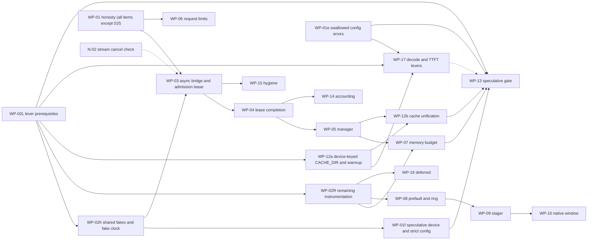

# MASTER PLAN v8 - arc-runner Native Layer: Finish, Harden, Prove, and Document Every Decision
### Base: Gemini's "10/10 Enterprise Architecture Master Plan" (conversation 700d4ff3) | Corrected by 17 skill-verified agent reviews | Orchestrated from `claude-global-library`

> **Plan file location (author machine):** `C:\Users\techd\.claude\plans\sunny-painting-pebble.md`
> **Gemini's original plan (kept as the base spec):** `C:\Users\techd\.gemini\antigravity-cli\brain\700d4ff3-bc4b-4c7a-88b8-a15dc6ba9d13\implementation_plan.md` (+ `transcript.jsonl`, stopped at step 443)
> **Status (2026-10-29, review pass 3, v8):** PLANNING ONLY, nothing implemented. Defects found in review passes 1-2 and their fixes are in Section 17, which also holds the executable slice plan and the environment split. Gemini's native-layer work is already committed on `main` (commit c7312e0), so that commit is the baseline.
> **Resume rule:** read Section 0, then Section 13 (state), then continue. Everything needed is in this file; chat history is not required.

---

## 00. ONE-PAGE SUMMARY AND PRECEDENCE (v8, read this first)

**Precedence:** Sections 21-23 are the latest and override everything else for the topics they cover (21: slice progress; 22: library access in cloud sessions, which supersedes 17.2 rule 3; 23: the performance programme, v8.5, whose design contract is 23.5.0); then Sections 20 (v8.2), 19 (v8.1), 18 (v8) and 17 (v7) override everything else (20 > 19 > 18 > 17); then Sections 14, 15, 16 (added later) override conflicting text in 5, 7, 8.6, 10, 11. Specifically: UML/drawio = FULL regeneration of all 13 types (15.2, not "selective 7"); roster = Section 5 plus 14.3 plus 16.1 (no `?` left, all verified); rules = 8.1 plus 16.2; execution track = LEAN (default) or FULL (14.7), your choice at approval.

**What gets done:** (1) Step 0 verification: CLOUD part now, LOCAL-only facts via `scripts/probe_hardware.py` (17.2); (2) issue + branch; (3) fix C-series bugs red-first (bounds, dtype, lifetime, ring buffer), Level Zero/Sysman honesty, engine telemetry honesty, benchmark protocol with no fabricated rows; (4) tests by an independent author; (5) docs, SRS, CLAUDE.md, CHANGELOG, VERSION 0.2.0; (6) all 13 UML + drawio regenerated from hand-built UDM and guarded by `scripts/check_docs_sync.py`; (7) CI, packaging, committed DLL with hash/ABI check; (8) every stage documented and versioned in `docs/delivery/` with a decision log. (9) v8: benchmarking program B1-B10 (Section 18) covering all domains of the existing suite, native micro-benchmarks and a v0.1.0-vs-v0.2.0 regression gate, with schema-validated JSON and generated doc tables.
**Gates needing your OK:** push, merge, tag/release (PyPI + GHCR publish).
**Known limits of this plan (honest):** hardware facts and real token cost are only settled by Step 0 and by running; per-agent skill lists are enumerated at each stage start, not here; FULL track is expensive (est. 4-6M tokens, unmeasured).

---

## 0. How to read this plan

| Part | Sections | Purpose |
|:--|:--|:--|
| Why | 1-3 | Problem, evidence, corrections to Gemini's maths |
| How (process) | 4-6 | Routing, agent/skill orchestration, token control |
| Traceability | 7-8 | Per-stage versioned docs, decision log, trace matrix |
| What (code) | 9-10 | Architecture, classes, methods, variables, tests |
| When | 11-12 | Waves, gates, git flow, risks, definition of done |
| State | 13 | Resume checkpoint, repo/hardware facts, open items |
| Review history | 14-16 | self-review v5, doc/UML sync plan, roster and rules audit (historical scores in 14.1 are v4/v5 and are superseded by 18.10) |
| Current execution plan | 17-18 | environment split, slices S-A..S-F, measurable gates, benchmarking program; these override everything else |
| Final fixes | 20 | CI naming, DLL-per-slice rule, platform support policy, local-gate slices, release rollback, approval batching |
| Wave-to-slice map | 19.1 | how W1-W3 of Section 11 map onto the slices of 17.4 |

---

## 1. Executive problem statement

Gemini built a native C/C++ layer (Win32 memory-mapped weight streaming + Level Zero USM bridge), changed the OpenVINO engine to use real `perf_metrics`, and started Sysman telemetry, then ran out of tokens right after the README edit (step 443). 26 tests pass, but 17 skill-verified reviews show:

1. **Memory-safety bugs** in the C layer (integer wrap in bounds checks, unchecked counts, views that outlive the mapping).
2. **Fabricated numbers still present**: Sysman power `22.0 W`, Sysman "free memory" from system RAM, engine fallbacks `len(text.split())`, `elapsed*200`, benchmark `REFERENCE_SWEEP` rows with hard-coded TTFT/TPS/power.
3. **Plan maths is wrong** (Theorems 1-4) and several README claims rest on it.
4. **Tests do not match the plan** (N3, N4, N5, N6, E3, E5, E7, E8 absent/renamed; P8, P9 missing).
5. **Not shipped**: no CI, no packaging of the DLL, no issue/commit/release, no SRS/CLAUDE.md/VERSION/CHANGELOG.

**Goal:** a correct, bounded, honestly-measured native layer, with every claim backed by a measurement, every decision recorded with its reason, and every stage documented so any future session can continue without re-discovery.

---

## 2. Evidence base (verdicts from the 17 skill-verified reviews)

Legend: **C**=confirmed, **P**=partly, **R**=refuted, **V**=must verify on disk/machine first.

### 2.1 Native C / Python bridge (`src/arc_runner/native/`, `engine/flash_stream/weight_streamer.py`)
| ID | Sev | Where | Finding | Verdict | Fix (design element) |
|:--|:--|:--|:--|:--|:--|
| C1 | CRIT | `arc_flash_stream_mmap.c` ~183/209/239 | `offset+size > file_size` wraps uint64, then `base_ptr+offset` OOB | C | `arc_range_ok()` helper: `size<=fsz && off<=fsz-size` |
| C2 | HIGH | `arc_mmap_register_layer` | `tensor_count>64` reads past `tensors[64]`; extents never validated at register | C (name-NUL overrun **R**: `strncmp` bounded) | validate count/dims/extents/name, copy-then-publish |
| C3 | HIGH | `bridge.py` register | ctypes silently wraps negative/huge ints; `min(len,64)` truncates; names cut at 127 | C | `_validate_u64`, raise on overflow, no truncation |
| C4 | HIGH | `weight_streamer.py:226` vs `173-193` | native path = float32 view for every tensor type; fallback differs; BF16 read as f16 | C | dtype from `tensor_type`; quantized -> raw `uint8` view |
| C5 | HIGH | views | arrays outlive `UnmapViewOfFile`; arrays writeable over `PAGE_READONLY` | C | keep-alive owner, `writeable=False`, deferred close |
| C6 | HIGH | slots | slot chosen under lock, loaded outside -> duplicates; `close()` nulls `_native_engine` under prefetch threads | C | `_RingSlot` state machine (EMPTY/PENDING/READY) + pin count + join threads |
| C7 | MED | lock/unlock | codes collide with `GetLastError`; single `is_locked` bool; VirtualLock quota 1453; never called | C | `ArcStatus` codes + `locked_bytes`; best-effort `try_pin` |
| C8 | MED | `CreateFileA` | UTF-8 path misread; MAX_PATH | C | `CreateFileW` + `\\?\` |
| C9 | LOW | 32-bit casts | `(SIZE_T)size` truncates | C | `size<=SIZE_MAX` guard |
| C10 | LOW | `build_native.py` | global `-mavx2` (15 ymm instrs in DLL, SIGILL risk) | C (`-static-libgcc` **P**: DLL imports only KERNEL32/UCRT) | drop `-mavx2` (no AVX2 code exists) |
| X1 | MED | LRU | `time.time()` ties (~15.6 ms); cyclic layer scan = 0% LRU hit | C | direct-mapped `layer % slots`, monotonic tick |
| X2 | MED | eviction | `gc.collect()` under lock; "O(1) RAM" claim false (page cache/working set); `get_active_memory_bytes` = virtual size | C | collect outside lock; add `get_resident_memory_bytes()` |
| X3 | V | reshape | GGUF `ne[0]` fastest -> `reshape(dims)` may need reversed dims | V | micro-test at Step 0 |
| X4 | LOW | layer lookup | linear scan <=256x64 is microseconds | **not a bottleneck** | no hash table |

### 2.2 Level Zero + Sysman (`arc_level_zero_bridge.c/.h`, `devices/sysman.py`)
| ID | Sev | Finding | Verdict | Fix |
|:--|:--|:--|:--|:--|
| L1 | HIGH | `query_package_power` returns constant `22.0`; `zesDeviceGetPowerProperties` does not exist; this iGPU has **0 power domains** | C | return `None` + reason; energy-counter path (`zesPowerGetEnergyCounter`) for platforms with domains |
| L2 | HIGH | memory "free" from `GlobalMemoryStatusEx` / `total//2`; iGPU has **0 memory modules** | C | `(total, None)` + reason (shared system memory) |
| L3 | MED | `stype` values look wrong (code 0x1-0x5, 0x11; recalled 0x7,0xd,0xe,0xf,0x15,0x16); driver does not validate; only 0x3 proven | V | read `ze_api.h` at Step 0, named constants |
| L4 | HIGH | `drivers[0]/devices[0]`; machine has driver0=Arc iGPU (type 1, id 0x7d55), driver1=NPU (type 5) | C | select `ZE_DEVICE_TYPE_GPU` |
| L5 | MED | create-call return codes ignored, leaks on failure | C | check every call, single cleanup path |
| L6 | LOW | queue priority 1 = LOW | C | NORMAL (0) |
| L7 | MED | `memcpy` fallback only if symbol missing, not on copy error | C | fallback on error (host/shared ptrs) |
| L8 | MED | 10 s sync > Windows TDR 2 s; reset after timeout unsafe; no fence/event overlap | C | polled wait < 2 s, mark context dead on timeout/device-lost |
| L9 | LOW | `arc_ze_destroy` leaks USM; fn pointers not nulled | C | track allocations |
| L10 | LOW | size guard; N4 verified live (`2**62` -> None) | C | explicit guard |
| L11 | MED | `zesInit` must be called **first** (after `zeInit` it returned uninitialized); only frequency telemetry works (2 domains) | C | init order fixed |
| L12 | MED | USM bridge is dead code (nothing calls `allocate_usm`/`dma_copy`) -> Theorem 5 overlap unrealised | C | keep, document, not wired in this release |

### 2.3 Engine + benchmark
| ID | Sev | Finding | Verdict | Fix |
|:--|:--|:--|:--|:--|
| E1 | HIGH | fabricated fallbacks in `openvino_engine.py` 207-231, 334 **and** benchmark 346-348 | C | `metrics_source` + validity flags, no invented values |
| E2 | HIGH | `ContextWindowExceededError` never raised (`KVCacheManager.check_headroom` exists, checks prompt only) | C | enforce prompt + `max_new_tokens` with real tokenizer count |
| E3 | LOW | `generate([p])` / `generate(p)` retry swallows real errors | C | one call form, narrow excepts |
| E4 | MED | `u8` KV default-on with no quality gate | C | gate on KL/PPL before default |
| E5 | V | `get_throughput()` definition (decode-only vs total) | V | read OpenVINO 2026.4.1 docs/source |
| E6 | LOW | stream path counts callback chunks as tokens; TPS defined differently from `generate()` | C | tokenizer counts; one definition |
| H1 | HIGH | benchmark `REFERENCE_SWEEP` rows (ttft 165.0, tps 54.2, power_w 22.0) beside real rows; README/results JSON may contain them | C | tag `projected` or remove; audit README + JSON |
| H2 | MED | Ollama TTFT ~503/502/524 ms suspiciously constant; CPU vs iGPU; Q4_K_M vs OV INT4 | hypothesis | fair protocol (Section 10.9) |

### 2.4 Tests (26 pass, coverage differs from plan)
P1 weak; P6 not skipped without GPU; P8 absent; P9 mislabelled (is Sysman); N3, N4, N5, N6, E3, E5, E7, E8 absent/renamed. Hardware marker = `@pytest.mark.hardware` + `require_intel_gpu` (tests/conftest.py).

---

## 3. Corrections to Gemini's maths (replace in README/docs; each becomes a Decision Log entry)

Notation: `N_L` layers, `d` hidden, `d_kv = H_kv*d_h`, `d_ff` FFN width, `L` prompt tokens, `S` context length, `W` weight bytes.

| Theorem | Gemini | Correct form | Effect |
|:--|:--|:--|:--|
| T1 prefill | `N_L(2L^2 d + 8 L d^2)` | `FLOPs = N_L * L * (4d^2 + 4 d d_kv + 6 d d_ff) + N_L * 2 L^2 d` (SwiGLU FFN = `6 d d_ff`) | 1.5B@512: 1.36e12 (plan 2.93e11) = **4.6x**; 32B 4.6x; 72B 3.2x. Measured TTFT 100-156 ms implies ~60-100-token prompt or a different peak -> recompute with real `L` |
| T2 roofline | `99.8% of roofline` using `eta=0.61` | `TPS_max = B_sustained / (W + KV_bytes)`; no extra `eta` when B is already "sustained" | real decode = **~61%** of 74.5 GB/s; peak depends on memory type (V: LPDDR5x-7467 ~119 GB/s vs CIM saw 2x8GB@5600 ~89.6 GB/s) |
| T3 KV | `+18-25%` from u8 | `KV_bytes/token = 2 N_L H_kv d_h b` (b=2 FP16, 1 u8); gain `= (KV_fp16*S/2) / (W + KV_fp16*S)` | 1.5B: 28,672 B/token; **~3.5% at S=2048**, 18% needs S~12k |
| T4 Python overhead | `+15%` | gain `= 1/(1 - f_python)`, `f_python` must be measured end-to-end; streaming is I/O bound (layer read 40-90 ms vs 0.18 ms) | probably **<1%**; 13 tok/s for 32B needs ~239 GB/s (> peak) |
| Xe-LPG | 1,792 lanes, 4.03 TFLOPs XMX, 256 KB SLM | 896 FP32 lanes; 4.03 TFLOPs is FP32 vector; no XMX on Meteor Lake (V); 256 KB SLM is Xe2 | text fixed |
| NT loads | `_mm_stream_load_si128` L3 bypass | ineffective on write-back mapped pages; **code has no CPU copy to bypass** | not built; measurement script only |
| NPU draft | 5 W, 2.5-3.2x energy | unsourced for NPU 3720 (FP16/INT8 only); ~1.0-1.15x or slower on 1.5B; shares LPDDR bus | no code change; claim marked unverified |

---

## 4. Routing (decision tree, recorded)

Human nodes (answered by you): D01 **Brownfield** | D02 **yes** RE whole repo | D03 **yes** Ph0 | D04 **yes** Ph1 | D05 no | D06 **yes** Ph2 | D07 no | D08 **yes** Ph4 | D09 **yes** Ph5 | D10 no | D11 **yes** Ph7 | D12 **yes** Ph8.
Auto nodes: D13 **Squad** | D14 **pattern:79** silicon-architecture (lead `heterogeneous-systems-engineer`, math `silicon-mathematics-expert`) | D15 **B1** F.1+F.2+F.6 (re-evaluate: GGUF parser = untrusted input) | D16 always C+E | D17 B1 context-eng + A.5 | D18 B2 (Ph1 runs) | D19 B1 orchestrator-agent | D21 **B1** (LLM stack -> A.6, A.6.1, H) | D22 B1 self-correct <=3 (SC.3 escalates) | D23 B2 unless RE marks DIRTY (then IV.1/IV.2).
Path string: `D01:Brownfield -> D02:B2 -> D03:B2 -> D04:B2 -> D06:B2 -> D08:B2 -> D09:B2 -> D11:B2 -> D12:B2 -> D13:B1 -> D14:B60(pattern:79) -> D15:B1 -> D16:B1 -> D17:B1 -> D18:B2 -> D19:B1 -> D21:B1 -> D22:B1 -> D23:B2 -> phase:execution-plan`

### 4.1 Phase timeline

```
 S00 intake/route
   |
 S01 RE (whole repo) ----> S02 Ph0 PRD/BRD ----> S03 Ph1 HLD + ADRs ----> S04 Ph2 joint validation
                                                                              |
 S05 Ph4 reconciliation <-----------------------------------------------------+
   |
 S06 Ph5 SRS + UML/drawio ----> S07 Ph7 task routing ----> S08 Ph8 pre-impl alignment
   |
 S09 A.5 context + A.6/A.6.1 harness setup
   |
 S10 Ph B implementation:  W1 (parallel A,B,C,D) -> gate -> W2 (ring buffer, tests) -> gate -> W3 (benchmark, docs, CI)
   |
 S11 Ph C anti-hallucination (NLI/FactScore >= 0.95) -> S12 Ph D QA -> S13 Ph F security (F.1,F.2,F.6)
   |
 S14 Ph H harness eval/regression -> S15 Ph E reliability (RS >= 0.95) -> S16 Ph G integration + release (user gates)
   |
 S17 retrospective + memory + RESUME.md
 (SC.1/SC.2 loop wraps any REJECT, max 3, SC.3 escalates to user)
```

---

## 5. Agent + skill orchestration matrix (all agents verified to exist, see 14.2)

Rule for EVERY row: agent reads its `agent.md` + **all** skills (frontmatter + Mandatory + Optional) in chunks, grouped <=150 KB per agent instance, returns quote-per-skill proof inside its own report file. `?` = existence not yet verified (run `ls agents/<name>/agent.md`; if absent, REPORT, do not invent; find substitutes with `knowledge-graph/_discovery/query_discovery.py`).

| Stage | Agents | Output doc(s) |
|:--|:--|:--|
| S01 RE | codebase-archaeology-agent, ast-graph-engineer, impact-analysis-agent, reverse-engineering-analyst, codebase-kg-engineer, as-built-doc-generator | S01 as-built, call graph, dead code, impact map (feeds UML UDM) |
| S02 Ph0 | business-analyst-agent, product-manager-agent, research-strategist, technology-scout-analyst, ba-pm-mathematics-expert | PRD/BRD (short: hardening scope) |
| S03 Ph1 | solution-architect, consensus-agent | HLD + ADR-0001..0009 |
| S04 Ph2 | business-analyst-agent, product-manager-agent, ba-pm-mathematics-expert | joint validation report |
| S05 Ph4 | context-faithfulness-engineer, business-analyst-agent, product-manager-agent | reconciliation report |
| S06 Ph5 | uml-from-code-engineer, uml-structural/behavioral/interaction-diagram-engineer, mermaid-diagram-engineer, drawio-diagram-architect, uml-diagram-mathematics-expert, harness-engineering-architect | SRS.md + 13 UML/drawio (Sections 8.6, 15) |
| S07 Ph7 | context-engineering-agent, prompt-generation-expert, context-faithfulness-engineer, security-testing-engineer, agile-business-mathematics-expert | task routing table (agent x work package x skills x files) |
| S08 Ph8 | scrum-master-agent, business-analyst-agent, product-manager-agent, context-engineering-agent, prompt-generation-expert | alignment checklist, go/no-go |
| S09 A.5/A.6/A.6.1 | context-engineering-agent, harness-engineering-architect, harness-mathematics-expert, loop-engineering-architect | stop conditions, budgets, model-switch policy |
| S10 Ph B | **lead** heterogeneous-systems-engineer; c-cpp-systems-engineer (x4 groups), gpu-driver-engineer, gpu-architecture-specialist, cpu-architecture-specialist, hardware-performance-engineer, accelerator-architect, llm-serving-engineer, llm-quantization-engineer; math: silicon-mathematics-expert (opus, via delegation, 13 skills in 4 parts); python/test engineers (discover) | code + wave reports |
| S11 Ph C | hallucination-detector, context-faithfulness-engineer | NLI/FactScore report on docs/claims |
| S12 Ph D | QA agents (discover); harness-engineering-architect (test-gap mapping) | QA report (coverage, DRE; targets stated honestly) |
| S13 Ph F | threat-modeling-specialist, sast-engineer, secrets-detection-specialist, dependency-vulnerability-analyst, security-lead-auditor (+ cyber-mathematics-expert if CVSS used) | STRIDE (GGUF parser, DLL loader), SAST of C, secrets scan, verdict |
| S14 Ph H | harness-evaluation-engineer, harness-mathematics-expert, testing-mathematics-expert | eval/regression gate report |
| S15 Ph E | reliability-auditor | RS computation |
| SC loop | root-cause-analysis-agent, context-faithfulness-engineer, prompt-generation-expert, context-engineering-agent | RCA + correction ADR per REJECT |
| Squad lead | orchestrator-agent | dispatch log |
| Already done (17 reviewers) | c-cpp A/B/C/D, hw-perf, cpu-arch, gpu-arch, gpu-driver, hetero+accel, llm-serving/quant, foundation+mlops, harness A/B, loop A/B, context, prompt | backfilled as S10 `review-digest` (reconstructed, flagged as such) |

**Skill-split sizes (already measured):** algorithm-design-complexity-core 189 KB (own agent), mlops-core 93 KB, bare-metal-architecture-core 66 KB, kernel-driver-development-core 59 KB, hardware-protocols-core 54 KB, cpu-microarchitecture-core 50 KB, embedded-linux-core 46 KB; all others 15-45 KB.

**Cost reality check (estimate, not measured):** the 17-agent review round consumed ~2.9M subagent tokens (+~0.4M wasted on three invalid reports). Running every roster agent through all its skills could be several million more. Controls: per-stage token budget (Section 6), stages with tiny scope (S02, S04, S05) produce one-page docs, and you may veto stages at plan approval.

---

## 6. Token-lean orchestration (rules)

1. **Agents write their own report file** and return only a <=150-word summary + path. (Saves ~1.5k tokens per agent in my context and gives the audit trail for free.)
2. **Main session does mechanical work** (pytest, gcc, git, packaging, CI YAML, JSON, version files, INDEX/TRACE updates) - no agent for that.
3. **Digest, not reports**: each agent receives only its slice (<=4k tokens: findings for its files, acceptance criteria, ownership list, doc path to write). No full plan/brief to anyone.
4. **Resume via SendMessage** while the conversation lives; in a new conversation, spawn fresh agents with the digest (they still read their skills, in chunks, with proof).
5. **Large output filtered**: `token-optimizer` MCP (`optimize_read_params`, `smart_read_analyze`, `context_budget_status`); pytest/benchmark logs trimmed to failures + tail.
6. **Gates before spend**: next wave starts only when the previous gate is green; each stage has a token budget in its `STAGE.md` (stop condition from A.6) and stops with a report if exceeded.
7. **Models**: sonnet implementers, opus only `silicon-mathematics-expert`; fallback chain on real rate limits only (sonnet -> opus -> fable -> ask you).
8. **Checkpoints**: after each gate -> local commit on feature branch + `session-mgr` `session_save` + update `docs/delivery/RESUME.md`.

---

## 7. Documentation and traceability system (`docs/delivery/`)

Purpose: every agent statement, decision, and change is a versioned file; a future session reads `RESUME.md` + `INDEX.md` and knows what was decided and why. Lives under `docs/` (exempt from the 5-root-files rule).

### 7.1 Layout
```
docs/delivery/
  RESUME.md                  current stage, last gate, next action, open questions (updated every gate)
  INDEX.md                   doc_id | title | version | status | stage | path | updated | commit
  DECISION_LOG.md            append-only DL-### entries (never edited; superseded by new entries)
  TRACEABILITY.md            finding -> requirement -> ADR -> code symbol -> test -> evidence doc
  adr/ADR-000N-<slug>.md     architecture decisions (versioned)
  stages/
    S00-intake-routing/      STAGE.md + agent-reports/
    S01-reverse-engineering/ ... S17-retrospective/
      STAGE.md               inputs, agents+skills, decisions made, outputs, gate result, token spend, version
      agent-reports/<agent>.v<N>.md   one file per agent invocation (immutable once approved)
  review-digest/             backfill of the 17 reviews (marked "reconstructed")
scripts/check_delivery_docs.py   CI check: front matter valid, INDEX parity, versions monotonic
```

### 7.2 Document front matter (every .md in docs/delivery)
```yaml
doc_id: DOC-S03-HLD           # stable, never reused
title: High-Level Design - native layer hardening
stage: S03
version: 1.2.0                # semver; see 7.3
status: draft | reviewed | approved | superseded
created: 2026-10-29
updated: 2026-10-30
authors: [solution-architect, consensus-agent]   # library agent names
reviewers: [user]
inputs: [DOC-S01-ASBUILT@1.0.0, DOC-S02-PRD@1.1.0]
supersedes: null
related_issue: "#N"
git_commit: <filled at commit>
```
Bottom of each doc: **Revision history** table (version | date | author | what changed | why | commit).

### 7.3 Version policy
- **patch** (x.y.Z): wording, typos, clarifications, no change of meaning.
- **minor** (x.Y.0): new content, new finding, new evidence; conclusions unchanged.
- **major** (X.0.0): a decision or conclusion changed. Requires a new `DL-###` that references the old one, and the old doc keeps `status: superseded` with a pointer.
- Never delete or overwrite history: edit = new version + revision-history row; INDEX + TRACEABILITY updated in the same commit; commit trailer `Doc-Version: DOC-S03-HLD@1.2.0`.
- `check_delivery_docs.py` fails CI if front matter is malformed, a doc is missing from INDEX, a version goes backwards, or a changed doc has no new revision row.

### 7.4 Agent report template (`agent-reports/<agent>.v<N>.md`)
1. Header: agent, persona, model, stage, task (digest id), date, tokens used.
2. **Skill proof table**: skill | size | lines read | verbatim quote | relevance (no quote = report invalid).
3. Findings: claim | verdict (confirmed/partly/refuted/unverified) | evidence | file:line.
4. Decisions proposed (-> become DL entries after review).
5. Files touched (must match ownership), tests added/changed, before/after numbers.
6. Unverified items and confidence; escalations; REQUEST-TO-OWNER items.

### 7.5 Decision Log entry template (`DECISION_LOG.md`, append-only)
`DL-### | date | stage | decision | WHY | alternatives rejected (and why) | evidence (doc_id@ver, file:line, measurement) | proposed by (agent) | approved by (user/gate) | affects (ADR, code, tests) | supersedes`

### 7.6 Seed decisions (already made; to be written into DECISION_LOG.md as DL-001..)
| DL | Decision | Why | Rejected alternative |
|:--|:--|:--|:--|
| 001 | Gemini plan stays the base spec | user instruction; most work already done and tests pass | restart from scratch (waste) |
| 002 | Route to `silicon-architecture`, pattern 79; math = `silicon-mathematics-expert` | discovery tool + domain-refs + CLAUDE.md math rule | `systems-programming` only; generic `mathematics-engineer` |
| 003 | Every agent reads ALL skills (frontmatter+mandatory+optional), grouped <=150 KB, quote proof | user rule; three first agents falsely reported reading | sampling skills; mandatory-only |
| 004 | Do NOT build MOVNTDQA L3-bypass | ineffective on WB pages; no CPU copy exists; page-fault cost dominates | implement as written in plan |
| 005 | Host USM default for streamed weights, confirmed by Step-0 timing | iGPU shares LPDDR; device USM adds a copy; shared USM migrates | device USM (plan), shared USM |
| 006 | Sysman returns `None` + reason, never fabricated values | machine reports 0 power domains / 0 memory modules | keep 22.0 W / RAM-as-VRAM |
| 007 | Sealed-after-registration flag (release/acquire), not rwlock | table immutable after load; zero reader cost | rwlock |
| 008 | Direct-mapped ring slots (`layer % slots`) | cyclic scan makes LRU hit rate 0%; no timestamps | LRU |
| 009 | Remove global `-mavx2`; no AVX2 code now | no intrinsics in sources; SIGILL risk; YAGNI | runtime-dispatched AVX2 TU |
| 010 | Commit prebuilt DLL with safeguards (ABI/hash check, Python fallback) | user decision (3 agents advised against) | gitignore + CI build |
| 011 | Release/tag only on your separate OK | release triggers PyPI + GHCR publish (irreversible) | auto-release |
| 012 | Keep tracked `uml/`+`drawio/` | repo precedent (26 files) despite rule 45 | untrack |
| 013 | Leave root `CONTRIBUTING.md` | pre-existing, out of scope; reported | move to docs/ |
| 014 | Keep float telemetry fields, add validity flags | avoids breaking consumers/tests | change to Optional |
| 015 | Tests authored by a different agent than implementers | avoids Goodhart on weak tests | implementers write tests |
| 016 | Agents write their own report files | token cost + audit trail | main session transcribes |
| 017 | Version 0.1.0 -> 0.2.0 | new feature + behaviour fixes | patch bump |
| 018 | Restate/remove T1-T4, 18-25%, 99.8%, NPU energy claims | math checked by 5 agents | keep |
| 019 | LEAN track skips Ph0/Ph2/Ph4/Ph7/Ph8, S11, S14, S15 (only if user picks LEAN) | proportionality (14.7) | FULL track |
| 020 | Full regeneration of all 13 UML/drawio types once | rule 45 s3.1: new package | selective regen |
| 021 | Rules 03,04,06-10,13-18,20-26,30-32,34,42-43 marked not applicable | languages/frameworks untouched | re-audit each session |

### 7.7 Trace matrix seed (`TRACEABILITY.md`)
| Finding | Requirement | ADR | Code symbol | Test | Evidence |
|:--|:--|:--|:--|:--|:--|
| C1 | FR-001, NFR-001 | ADR-0002 | `arc_range_ok`, `arc_mmap_get_tensor_ptr` | `test_arc_range_ok_uint64_wrap_rejected` | S10 W1 A report |
| C2/C3 | FR-001 | ADR-0002 | `arc_mmap_register_layer`, `NativeMemoryEngine.register_layer`, `_validate_u64` | N3 tests | S10 W1 A |
| C4 | FR-001 | ADR-0002 | `dtype_for_tensor_type` | `test_get_tensor_buffer_f16_dtype_matches_fallback` | S10 W1 A |
| C5 | FR-001 | ADR-0003 | `_MappingGuard`, `NativeMemoryEngine.close` | `test_close_with_live_view_defers_unmap` | S10 W1 A |
| C6/X1 | FR-001 | ADR-0004 | `_RingSlot`, `_reserve_slot` | `test_acquire_concurrent_same_layer_single_load` | S10 W2 A |
| L1/L2 | FR-003 | ADR-0009 | `LevelZeroSysman.query_*` | `test_query_package_power_none_without_domains` | S10 W1 B |
| E1/E2 | FR-002, FR-004 | ADR-0006 | `_telemetry_from_perf_metrics`, `_enforce_context_window` | E7 tests | S10 W1 C |
| H1 | FR-005 | ADR-0007 | `BenchSample`, `evaluate_speedup_gate` | `test_gate_rejects_projected_rows` | S10 W3 |

---

## 8. Rule compliance + tooling

### 8.1 CLAUDE.md / rules matrix
| Rule | Application |
|:--|:--|
| Plan mode | Active; scope change re-enters plan mode (done at each revision) |
| Library-only orchestration | Section 5; prompts start with library-path line; absent agents reported |
| Issue before fix | `github_create_issue` first; labels `native`, `correctness`, `fake-telemetry`, `docs-drift`, `not-implemented`; commits reference `#N` |
| MCP-first | Section 8.2 |
| 01 common standards | specific exceptions, no swallow (E3); structured logging via `arc_runner.core.logging.get_logger(name)` with key-value `extra`; no secrets; validate input; functions <20 lines target; tests `test_<function>_<scenario>_<expected>`; conventional commits; Python stays snake_case (surrounding code wins over camelCase line, DL) |
| 12 docstrings-only | Google-style docstring on every public/protected function; zero narrating inline comments (TODO/FIXME/noqa/algorithm notes allowed); Doxygen headers in C |
| ASCII-only new Python | cp1252 safe (old files already non-ASCII, untouched) |
| 11 doc governance | create SRS.md, CLAUDE.md, VERSION (`0.2.0`), CHANGELOG.md at root; everything else under `docs/`; CONTRIBUTING.md untouched (reported) |
| 44 SRS | SRS.md sections 1-6, append-only FR/NFR with Source=#N, AC per FR, Change Log row |
| 45 UML | FULL regen of all 13 types (Section 15.2 overrides 8.6), UDM `model_data` hand-built |
| 46 architecture docs | CLAUDE.md `## Architecture & Structure`, README `## Architecture`, `docs/architecture.md`, tag `<!-- Introduced in v0.2.0 -->` |
| Engine v2 hook-free | no hooks re-added; Stop hook may auto-open a PR on feature branches (accept/report) |
| Attribution | commits end `Co-Authored-By: Claude Sonnet 5.5 <noreply@anthropic.com>`; PR body ends with Claude Code line |

### 8.2 MCP usage
`standards-loader` (Step 0), `pre-tool-gate` `validate_agent_dispatch` before each wave, `post-tool-tracker` (`increment_progress`, `check_commit_readiness`), `policy-enforcement` `verify_compliance` (end), `github-api` (issue, labels, branch, PR, `github_validate_build`, merge, close), `git-ops` (status, diff, commit, push, log), `push-gate` `check_push_allowed` before push, `session-mgr` checkpoints, `token-optimizer`, `uml-diagram` + `drawio-diagram`. Not used: jira, jenkins, figma, GA4/GTM/GSC, vector-db, LLM provider MCPs, trends, dataforseo (and `dataforseo`, `google-search-console` failed to connect: irrelevant).

### 8.3 Step 0 - verify before any edit (read-only; the single authoritative list, 14.8 only gives commands; environment split in 17.2)
1 `ze_api.h`/`zes_api.h` struct types. 2 memory type/speed (CIM). 3 `PerfMetrics.get_throughput` definition. 4 GGUF dim order. 5 XMX absence / SLM size. 6 USM timing micro-benchmark (host/device/shared) in scratchpad. 7 ctypes array attribute assignment for keep-alive owner. 8 baseline pytest counts. 9 snapshot of `native/` (untracked) + hashes. 10 `ls` every `?` agent.

### 8.4 SRS content (SRS.md, append-only)
FR-001 bounded native tensor access; FR-002 truthful telemetry; FR-003 Sysman real-or-None; FR-004 context-window enforcement; FR-005 benchmark provenance + fair Ollama comparison. NFR-001 input validation/security; NFR-002 portable fallback when native lib missing/mismatched; NFR-003 reproducible measurements; NFR-004 documentation traceability (docs/delivery).

### 8.5 CLAUDE.md (new) required headings
`## Project Overview`, `## Architecture & Structure` (incl. native package tree, `docs/delivery/` pointer, `RESUME.md` as session entry point), `## Development Guidelines` (docstring rule, ASCII, hardware marker, how to build native lib, doc versioning rule).

### 8.6 UML/drawio content notes (SUPERSEDED scope: Section 15.2 requires FULL regeneration of all 13 types; this list only names the must-contain symbols)
Class: `NativeMemoryEngine`, `NativeLevelZeroBridge`, `_MappingGuard`, `FlashStreamWeightManager`, `_RingSlot`, `LevelZeroSysman`, `OpenVINOGenAIEngine`, `EngineTelemetry`, `KVCacheManager`, `BenchSample`. State: `_RingSlot` EMPTY->PENDING->READY->(pinned)->EMPTY. Deployment: Python process, `libarc_native_sys.dll` + sidecar, `ze_loader.dll`, GPU/NPU drivers, GitHub Actions windows runner. Output `uml/*.md`, `drawio/*.drawio`; failures logged, never block.

---

## 9. System architecture

```
+--------------------------------------------------------------------------------------+
|                 CLI / FastAPI / OpenAI + Ollama compatible API (unchanged)             |
+--------------------------------------------------------------------------------------+
        |                                    |                                |
        v                                    v                                v
+-----------------------+      +---------------------------+     +---------------------------+
| OpenVINOGenAIEngine   |      | FlashStreamWeightManager  |     | LevelZeroSysman           |
| engine/openvino_...py |      | engine/flash_stream/...   |     | devices/sysman.py         |
| - perf_metrics only   |      | - _RingSlot state machine |     | - GPU-only selection      |
| - context-window gate |      | - direct-mapped slots     |     | - None + reason           |
| - validity flags      |      | - pin counts, join on close|    | - zesInit first           |
+-----------------------+      +---------------------------+     +---------------------------+
        |                                    |
        |                                    v
        |                      +---------------------------------------------+
        |                      | native/bridge.py (ctypes)                   |
        |                      |  NativeMemoryEngine | NativeLevelZeroBridge  |
        |                      |  _MappingGuard keep-alive | python fallback   |
        |                      +---------------------------------------------+
        |                                    |  (ABI version + SHA-256 checked on load)
        |                                    v
        |                      +---------------------------------------------+
        |                      | libarc_native_sys.dll                       |
        |                      |  arc_flash_stream_mmap.c  (CreateFileW,     |
        |                      |   MapViewOfFile, VirtualLock best-effort)   |
        |                      |  arc_level_zero_bridge.c  (GPU select, USM,  |
        |                      |   polled sync < TDR, dead-context flag)     |
        |                      +---------------------------------------------+
        v                                    |
 openvino_genai (GPU/CPU/NPU)                v
                                  ze_loader.dll -> Intel Arc iGPU (type 1) | NPU (type 5, not used for USM)
```

---

## 10. Code-level specification (classes, files, methods, variables)

Convention: existing names kept where they work; **NEW** = new symbol; **CHG** = changed behaviour/signature. Python: ASCII, Google docstrings, no narrating comments, logger = `get_logger("<module>")`. C: C17, `-Wall -Wextra -Wpedantic -Werror`. Signatures marked (re-read) must be re-read from the file at execution; the target behaviour is binding.

### 10.1 `native/arc_flash_stream_mmap.h/.c` (owner A)
Constants (kept): `ARC_MAX_PATH 1024`, `ARC_MAX_TENSORS_PER_LAYER 64`, `ARC_MAX_LAYERS 256`, `ARC_MAX_NAME_LEN 128`. **NEW** `ARC_NATIVE_ABI_VERSION 2`.
Structs kept (layout frozen, guarded by `_Static_assert`): `ArcTensorDescriptor` {`char name[128]`, `uint32_t tensor_type`, `uint32_t n_dims`, `uint64_t dims[4]`, `uint64_t file_offset`, `uint64_t size_bytes`} = 184 B; `ArcLayerDescriptor` {`int32_t layer_idx`, `uint32_t tensor_count`, `uint64_t total_layer_bytes`, `ArcTensorDescriptor tensors[64]`} = 11,792 B.
**CHG** `ArcMmapContext` becomes opaque in the header (body in `.c`): fields `file_handle`, `map_handle`, `uint8_t* base_ptr`, `uint64_t file_size`, `uint32_t total_layers`, `ArcLayerDescriptor layers[256]` (~3 MB, heap), `uint64_t locked_bytes` (replaces `is_locked`), `atomic_bool sealed`, `int32_t last_status`, `uint32_t last_os_error`.
**NEW** `typedef enum ArcStatus { ARC_OK=0, ARC_ERR_INVALID_ARG=-1, ARC_ERR_RANGE=-2, ARC_ERR_TOO_MANY_TENSORS=-3, ARC_ERR_BAD_EXTENT=-4, ARC_ERR_SEALED=-5, ARC_ERR_NOT_SEALED=-6, ARC_ERR_LOCK_FAILED=-7, ARC_ERR_OPEN_FAILED=-8, ARC_ERR_CLOSED=-9 } ArcStatus;`
Functions:
| Function | Behaviour |
|:--|:--|
| `static inline bool arc_range_ok(uint64_t fsize, uint64_t off, uint64_t sz)` **NEW** | `return sz <= fsize && off <= fsize - sz;` used everywhere |
| `ArcMmapContext* arc_mmap_open(const char* utf8_path, int32_t* out_status)` **CHG** | UTF-8 -> `MultiByteToWideChar` -> `CreateFileW` (`\\?\` for long paths), `FILE_SHARE_READ|FILE_SHARE_DELETE`; reject `file_size > SIZE_MAX` on 32-bit; failure -> NULL + `out_status` + `last_os_error` |
| `int arc_mmap_register_layer(ctx, const ArcLayerDescriptor*)` **CHG** | copy to local; reject sealed (-5), `layer_idx<0 or >=256`, `tensor_count>64` (-3), `n_dims>4`, each extent via `arc_range_ok` (-4); force `name[127]=0`; recompute `total_layer_bytes` with overflow check; publish only on success |
| `int arc_mmap_seal(ctx)` **NEW** | release-store `sealed=true`; after this `register_layer` returns -5 |
| `const uint8_t* arc_mmap_get_tensor_ptr(ctx, layer_idx, name, uint64_t* out_size)` | requires sealed (-6 -> NULL); acquire-load; `arc_range_ok` re-check; NULL on any error and sets `last_status` |
| `int arc_mmap_lock_range(ctx, off, sz)` / `arc_mmap_unlock_range` **CHG** | `arc_range_ok`; reject `sz==0`; update `locked_bytes`; on Win32 error store `last_os_error`, return -7 (never a raw `GetLastError`) |
| `int32_t arc_mmap_last_status(ctx)`, `uint32_t arc_mmap_last_os_error(ctx)`, `uint64_t arc_mmap_file_size(ctx)`, `uint32_t arc_mmap_layer_count(ctx)` **NEW** | accessors for opaque ctx |
| `void arc_mmap_close(ctx)` | idempotent for NULL; clears locks; no double free |
| `uint32_t arc_native_abi_version(void)`, `const char* arc_native_build_info(void)` **NEW** | checked by `bridge.py` on load |

`build_native.py` (owner A) **CHG**: functions `find_compiler() -> str` (`shutil.which("gcc")`, clear error), `compile_library(output: Path) -> None` (flags `-O2 -std=c17 -Wall -Wextra -Wpedantic -Werror -shared -Wl,--no-undefined`, no `-mavx2`, build to temp then atomic rename), `write_build_info(dll: Path) -> Path` (sidecar `libarc_native_sys.build.json`: sha256, gcc version, flags, git SHA, ABI version), `main() -> int`.

### 10.2 `native/arc_level_zero_bridge.h/.c` (owner B)
Kept: `ArcUsmType {ARC_USM_HOST, ARC_USM_DEVICE, ARC_USM_SHARED}`, `ArcZeContext` fields `ze_driver, ze_device, ze_context, ze_command_queue, ze_command_list, is_initialized`. **NEW fields**: `uint32_t device_type`, `int32_t last_status`, `uint8_t is_dead`, `uint64_t sync_timeout_ms` (default 1500, hard max 1900 < TDR 2000), allocation table `{void* ptr; size_t size;}[ARC_MAX_TRACKED_ALLOCS]` (**NEW** const).
**NEW** private header `arc_ze_types.h`: named constants `ZE_STYPE_DEVICE_PROPERTIES`, `ZE_STYPE_DEVICE_MEMORY_PROPERTIES`, `ZE_STYPE_CONTEXT_DESC`, `ZE_STYPE_COMMAND_QUEUE_DESC`, `ZE_STYPE_COMMAND_LIST_DESC`, `ZE_STYPE_DEVICE_MEM_ALLOC_DESC`, `ZE_STYPE_HOST_MEM_ALLOC_DESC` (values from the real header after Step 0), `ZE_DEVICE_TYPE_GPU=1`.
| Function | Behaviour |
|:--|:--|
| `ArcZeContext* arc_ze_init(void)` **CHG** | `zeInit(GPU_ONLY)`; loop all drivers x devices, `zeDeviceGetProperties`, pick first `ZE_DEVICE_TYPE_GPU` (NPU type 5 never accepted); check every create call; queue priority NORMAL; single cleanup label; `is_initialized` only on full success |
| `void* arc_ze_alloc_usm(ctx, size_t size, ArcUsmType)` **CHG** | guard `0 < size <= ARC_MAX_USM_BYTES`; record in allocation table; NULL + `last_status` on failure |
| `int arc_ze_dma_copy_async(ctx, dst, src, size)` **CHG** | on `zeCommandListAppendMemoryCopy` error -> `memcpy` only for host/shared pointers, returns distinct code `ARC_ZE_FALLBACK_MEMCPY` |
| `int arc_ze_synchronize(ctx)` **CHG** | poll `zeCommandQueueSynchronize` in <=250 ms slices up to `sync_timeout_ms`; on timeout/`ZE_RESULT_ERROR_DEVICE_LOST` set `is_dead`, never reset a possibly in-flight list |
| `int arc_ze_is_dead(ctx)`, `int32_t arc_ze_last_status(ctx)`, `uint32_t arc_ze_device_type(ctx)` **NEW** | accessors |
| `void arc_ze_free_usm(ctx, ptr)` | NULL-safe; removes from table |
| `void arc_ze_destroy(ctx)` | frees outstanding USM, destroys list/queue/context in reverse order, nulls function pointers |

### 10.3 `native/bridge.py` + `core/exceptions.py` (owner A)
**NEW** in `core/exceptions.py` (verify base `ArcRunnerError` constructor first): `NativeLayerError(ArcRunnerError)`, `NativeBoundsError(NativeLayerError)`.
Module constants (**NEW**): `_U64_MAX = (1 << 64) - 1`, `_MAX_TENSORS_PER_LAYER = 64`, `_MAX_NAME_BYTES = 127`, `_MAX_DIMS = 4`, `_EXPECTED_ABI_VERSION = 2`, `_ENV_DISABLE_NATIVE = "ARC_NATIVE_DISABLE"`.
Kept: `ArcTensorDescriptor`, `ArcLayerDescriptor` (ctypes mirrors; add `assert ctypes.sizeof(...) == 184 / 11792` at import), `_load_native_library()`, `_configure_signatures(dll)`.
- `_load_native_library() -> Optional[ctypes.CDLL]` **CHG**: honour `ARC_NATIVE_DISABLE`; on `OSError`/missing symbol/ABI mismatch/sidecar sha256 mismatch -> log WARNING (structured: `reason`, `path`) and return None (fallback path, plan N5).
- `_validate_u64(value: int, field: str) -> int` **NEW**; `dtype_for_tensor_type(tensor_type) -> np.dtype` **NEW** (F32->float32, F16->float16, I8->int8, BF16/quantized -> uint8 raw); `_reshape_dims(dims) -> tuple` **NEW** (applies GGUF order result from Step 0).
- `class _MappingGuard` **NEW**: holds the engine reference and a view counter; released when the last numpy view is garbage-collected; `close()` defers `arc_mmap_close` until count is 0.
- `class NativeMemoryEngine` methods: `__init__(file_path=None)`; `is_available` (property); `is_open` (property); `open_model(file_path) -> bool` (raises `FileNotFoundError` if missing, `NativeLayerError` on native failure); `register_layer(layer_idx, tensors) -> bool` **CHG** (raises `NativeBoundsError` instead of truncating/False); `seal() -> None` **NEW**; `get_tensor_buffer(layer_idx, tensor_name, dtype, dims=None) -> Optional[np.ndarray]` **CHG** (read-only, keep-alive owner, rejects `out_size % itemsize != 0`); `lock_range`/`unlock_range` **CHG** (best-effort, returns bool, logs `os_error`); `last_error() -> Tuple[int,int]` **NEW**; `close()` idempotent; `__del__` guarded.
- `class NativeLevelZeroBridge` **CHG**: `allocate_usm(size_bytes, usm_type="host")` (default host, DL-005; rejects `<=0` and `>=2**63`), `dma_copy_async`, `synchronize() -> int`, `is_dead` property **NEW**, `free_usm`, `destroy`.

### 10.4 `engine/flash_stream/weight_streamer.py` (owner A, wave 2)
**NEW** `class SlotState(enum.Enum): EMPTY, PENDING, READY`.
**NEW** `@dataclass class _RingSlot`: `layer_idx: int = -1`, `state: SlotState = EMPTY`, `pin_count: int = 0`, `ready_event: threading.Event`, `arrays: Dict[str, np.ndarray]`, `load_error: Optional[BaseException] = None`.
`FlashStreamWeightManager` attrs: kept `_lock` (-> `threading.RLock`), `ring_buffer_slots`; **NEW** `_slots: List[_RingSlot]`, `_closing: threading.Event`, `_prefetch_threads: Set[threading.Thread]`, `_pointer_cache: Dict[Tuple[int,str], Tuple[int,int]]` (layer,name)->(address,size) built in `index_layers`, `_slot_wait_timeout_s: float = 30.0`.
Methods: `index_layers()` **CHG** (registers, validates every extent at load, seals, fills pointer cache); `_slot_index_for(layer_idx) -> int` **NEW** (`layer_idx % ring_buffer_slots`); `_reserve_slot(layer_idx) -> Tuple[_RingSlot, bool]` **NEW** (under lock: if READY same layer -> reuse; if PENDING same layer -> wait on event; if other layer pinned -> wait with timeout, then `TimeoutError`; else mark PENDING + set layer_idx); `_load_layer_into_slot(layer_idx, slot_idx)` **CHG** (local bind of native engine, dtype/shape fixed, load outside lock, set READY/`load_error`, set event); `acquire_layer_weights(layer_idx)` **CHG** (reserve -> wait -> `pin_count += 1`); `prefetch_layer_async(layer_idx, slot_idx)` **CHG** (skips if layer resident, registers thread); `release_layer_slot(slot_idx)` **CHG** (decrement pin; `gc.collect()` outside lock only when slot is recycled); `get_active_memory_bytes()` (documented as mapped/virtual); `get_resident_memory_bytes()` **NEW** (Win32 `GetProcessMemoryInfo` working set); `close()` **CHG** (set `_closing`, join prefetch threads, drop arrays, then close native); `_calculate_tensor_byte_size`: unknown quantized type raises instead of returning `max(n,1)`; `_read_tensor_array` fallback: BF16 not mapped to float16.

### 10.5 `devices/sysman.py` (owner B)
Remove `_MemoryStatusEx` and the `GlobalMemoryStatusEx` path; replace `_ZeDeviceMemProps` with correct struct + named stype. `LevelZeroSysman` attrs: kept `_dll`, device list; **NEW** `_gpu_handles: List[Any]`, `_unavailable_reasons: Dict[str, str]`. Methods: `_load_library()`, `_configure_signatures()`; `_init_devices()` **CHG** (`zesInit(0)` first, enumerate drivers/devices, keep only GPU); `is_available()`; `query_gpu_memory(device_index=0) -> Tuple[Optional[int], Optional[int]]` **CHG** (`(total, None)` unless `zesMemoryGetState` available, never RAM); `query_package_power(device_index=0) -> Optional[float]` **CHG** (energy-counter delta watts or `None`); `query_frequency_mhz(device_index=0) -> Optional[float]` **NEW**; `get_unavailable_reason(metric: str) -> Optional[str]` **NEW**.

### 10.6 `engine/openvino_engine.py` + `engine/models.py` (owner C)
`EngineTelemetry` (models.py) keeps all fields; **NEW** fields: `metrics_source: str = "unavailable"` ("ov_perf_metrics" | "wallclock_stream" | "unavailable"), `is_estimate: bool = False`, `is_ttft_valid: bool = False`, `is_tps_valid: bool = False`, `prompt_tokens: int = 0`, `tpot_ms: float = 0.0`, `decode_tokens_per_second: float = 0.0`, `kv_cache_precision: str = ""`, `has_fallback_been_used: bool = False`.
`OpenVINOGenAIEngine` new/changed methods: `_build_ov_properties(device) -> Dict[str, Any]` **NEW** (CACHE_DIR, KV_CACHE_PRECISION gated, PERFORMANCE_HINT, SDPA only for GPU); `_count_prompt_tokens(prompt) -> int` **NEW** (real tokenizer); `_enforce_context_window(prompt_tokens, max_new_tokens) -> None` **NEW** (uses `KVCacheManager.check_headroom` and also checks `prompt_tokens + max_new_tokens`; raises `ContextWindowExceededError`); `_invoke_pipeline(prompt, ov_config)` **NEW** (single call form, narrow `TypeError` handling only for return-type shape); `_telemetry_from_perf_metrics(raw_result, wall_sec) -> EngineTelemetry` **NEW**; `_telemetry_unavailable(wall_sec, reason) -> EngineTelemetry` **NEW** (zeros + `metrics_source="unavailable"`, flags False); `generate()` / `generate_stream()` **CHG** (no `len(split())`, no `elapsed*200/500`; stream TTFT only from real `first_token_time`, label `wallclock_stream`; empty prompt resets telemetry and returns immediately).

### 10.7 Benchmark (owner G): `src/arc_runner/benchmark/stats.py` **NEW** + `scratch/run_live_real_models_benchmark_and_compare.py` **CHG**
`stats.py`: `@dataclass(frozen=True) BenchSample {model_id, backend, iteration, ttft_ms, decode_tps, prompt_tokens, completion_tokens, source: Literal["measured","derived","projected"], is_warmup: bool, fallback_used: bool}`; `median(values)`, `coefficient_of_variation(values)`, `bootstrap_ci(values, alpha=0.05, n_resamples=2000, seed=0) -> Tuple[float,float]`, `warmup_converged(values, window=3, eps=0.05) -> bool`, `is_within_roofline(tps, weight_bytes, kv_bytes, bandwidth_gbs) -> bool`, `evaluate_speedup_gate(arc: List[BenchSample], ref: List[BenchSample]) -> ClaimGateResult` (passes only if bootstrap-ratio lower bound > 1.0, all samples `measured`, none `fallback_used`, CV <= 10%), `@dataclass ClaimGateResult {passed, reason, ratio_lo, ratio_hi, n_arc, n_ref, is_suspect}`.
Script: `LiveSequentialBenchmarkRunner.query_ollama` (keep; add `keep_alive`, `num_ctx`, `temperature=0`; TTFT from `prompt_eval_duration`, decode TPS from `eval_count/eval_duration`), `run_arc_runner_model` (uses telemetry validity flags; no fallbacks), **NEW** `warmup_backend(...)`, `measure_interleaved_ab(...)`, `write_results(raw_samples, provenance)` (JSON includes raw samples, OpenVINO/driver versions, git SHA, hardware, quantization labels), remove `REFERENCE_SWEEP`/hard-coded `power_w` (power `null` unless Sysman measured), `render_summary_table` shows `source` and CPU-vs-iGPU labels.

### 10.8 Tests (author != implementers)
Files: update `tests/test_native_system_layer.py`, `tests/conftest.py`; **NEW** `tests/test_flash_stream_ring.py`, `tests/test_sysman_honesty.py`, `tests/test_openvino_engine_telemetry.py`, `tests/test_benchmark_stats.py`. Naming `test_<function>_<scenario>_<expected>`; plan id in docstring.
| Plan id | Test (example name) | Kind |
|:--|:--|:--|
| P1 | `test_load_native_library_missing_symbol_returns_none` | unit |
| P6 | `test_arc_ze_init_selects_gpu_not_npu` | `@hardware`, `require_intel_gpu`; NOT_RUN without GPU |
| P8 | `test_generate_ttft_under_200ms_uses_perf_metrics` | `@hardware` |
| P9 | `test_kv_cache_u8_vs_f16_greedy_prefix_matches` | `@hardware` |
| P10 | `test_query_gpu_memory_total_only_labelled_shared` | unit/hardware |
| N3 | `test_arc_range_ok_uint64_wrap_rejected`, `test_register_layer_oob_extent_rejected`, `test_truncated_gguf_rejected_subprocess` | negative |
| N4 | `test_allocate_usm_oversize_returns_none` (host/device/shared) | negative/hardware |
| N5 | `test_native_disabled_falls_back_byte_identical` (env + OSError + stale ABI) | negative |
| N6 | `test_sysman_returns_none_without_driver` (patch `CDLL` -> OSError) | negative |
| N7/N8 | double close, free NULL | negative |
| E3 | `test_tensor_crossing_4k_64k_boundary_reads_exact_bytes` | edge |
| E4 | `test_concurrent_acquire_same_layer_loads_once` | edge |
| E5 | `test_register_80_layers_boundary_ok_and_256_plus_rejected` | edge |
| E6 | `test_generate_empty_prompt_returns_zero_tokens_and_resets_telemetry` | edge |
| E7 | `test_generate_over_context_raises_before_pipeline_call` | edge |
| E8 | `test_virtuallock_quota_failure_falls_back_unpinned` (mock 1453) | edge |
| new | `test_telemetry_never_contains_synthetic_values`, `test_close_with_live_view_defers_unmap`, `test_gate_rejects_projected_rows`, `test_bootstrap_ci_deterministic_with_seed` | regression |
Rule: every critical-fix test must FAIL on the pre-fix code (verified on the snapshot), pass after. Skipped hardware tests are logged NOT_RUN, never counted as pass.

### 10.9 Benchmark protocol (fair and gated)
Warmup >=3 discarded runs (until last 3 TTFT CV <= 5%, max 5), then >=10 timed (target 30, stop when 95% CI half-width <= 3%); interleaved A/B with Ollama; same prompts, `num_ctx`, `max_tokens`, `temperature=0`; decode TPS both sides = generated tokens / decode duration; report cold start separately; label CPU vs iGPU and Q4_K_M vs OV INT4; measure KV effect with an S-sweep (512/2k/8k/16k). Claim passes only if the CI bound clears; any failing model fails the claim; result above roofline ceiling -> SUSPECT (human). Quality gate for default-on `u8` KV: KL < 0.1 nats on a fixed sample set.

### 10.10 Packaging, CI, docs files
`pyproject.toml` (version 0.2.0; package-data `"arc_runner.native" = ["*.dll","*.so","*.h","*.c","*.json"]`), `src/arc_runner/__init__.py` (`__version__ = "0.2.0"`), `VERSION` (`0.2.0`), `CHANGELOG.md` (Keep a Changelog, `[UNRELEASED]` then `[0.2.0] - <date>`), `MANIFEST.in` (`recursive-include src/arc_runner/native *.dll *.so *.c *.h *.json`), `.gitignore` (`.cache/`), `.github/workflows/windows-native.yml` (renamed in v8.2: hosted windows-latest has no GPU, so it never runs hardware tests; windows-latest, MinGW via choco, `python src/arc_runner/native/build_native.py`, `pytest -q -m "not hardware"`, `python scripts/check_delivery_docs.py`, upload DLL artifact), `scripts/check_delivery_docs.py` (**NEW**, stdlib only). **DLL:** commit prebuilt DLL + sidecar (DL-010).

---

## 11. Waves, gates, loops

| Wave | Content | Gate (all must pass) |
|:--|:--|:--|
| Step 0 | verification list 8.3 + baseline | facts recorded in `S00`/`S10` docs |
| W1 (parallel, exclusive files) | A: 10.1+10.3; B: 10.2+10.5; C: 10.6; D: scratch measurement script only | `-Werror` build (single builder A), existing tests green, ownership check (`git status --porcelain` + hashes), each critical fix has failing-before test (drafted, finished W2) |
| W2 | A: 10.4; tests agent: 10.8 | native + new tests green; full `-m "not hardware"` green; hardware tests run on this iGPU or logged NOT_RUN |
| W3 | G: 10.7/10.9; docs; packaging/CI; UML/drawio; SRS/CLAUDE/CHANGELOG/VERSION | benchmark gate rules; docs checker green; README claims match JSON |
| Slice map | see 19.1: W1 = S-A, S-B, S-D; W2 = S-C; W3 = S-E1, S-E2, S-F | gates of Section 11 apply per slice |
| Quality phases | S11 C (NLI/FactScore >= 0.95), S12 D, S13 F, S14 H, S15 E (RS >= 0.95) | per template; report honestly if unreachable (e.g. DRE/coverage targets) |

**Loops:** fix-and-retest max 3 rounds per ownership slice; exit = all gates green; stall = same failing set twice or ping-pong -> stop, restore best snapshot, escalate; cap hit = "aborted", never "pass". Benchmark loop chained after fixes (warmup -> measure); runs that used a fallback are invalid. SC.1/SC.2 on any REJECT (RCA + correction ADR), SC.3 escalates after 3.

**Rollback:** per-wave local commits on the feature branch; revert to last green commit; `native/` snapshot in scratchpad; DLL reproducible from `build_native.py` (sidecar records flags/SHA).

---

## 12. Git / release flow and confirmation gates

1. Create the issue (labels) with `github_create_issue`, or `mcp__github__issue_write` in the cloud session; -> `github_create_issue_branch` -> per-wave commits via `git-ops` (`feat(native): ... (#N)` or `docs(delivery): ... (#N)` with `Doc-Version:` trailer and Co-Authored-By).
2. **Gate P - push:** `push-gate check_push_allowed` + your explicit OK.
3. PR (`github_create_pr`) -> `github_validate_build` -> review. **Gate M - merge:** your explicit OK.
4. **Gate R - tag/release:** separate explicit OK; a published release triggers `pypi-publish.yml` + `docker-build.yml` (irreversible PyPI/GHCR publish).
5. Close the issue after merge (`github_close_issue` or `mcp__github__issue_write`); memory notes saved (Section 13.5).

**Definition of done:** (1) every CONFIRMED finding fixed with a test that failed before; (2) native + full non-hardware pytest green; hardware tests pass or NOT_RUN with reason; (3) zero fabricated values anywhere (power, memory, TTFT, tokens, REFERENCE_SWEEP); README/JSON/theorem text match measurements; (4) native build clean under `-Werror`, ABI/hash check works, fallback tested; (5) docs governance satisfied (SRS, CLAUDE, VERSION, CHANGELOG, architecture docs, all 13 UML/drawio regenerated, `check_docs_sync.py` green); (6) every stage has `STAGE.md` + agent reports, INDEX/DECISION_LOG/TRACEABILITY current, `check_delivery_docs.py` green; (7) issue closed, CI valid, `git status` clean, `verify_compliance` run; (8) RESUME.md points at "released/next" state.

**Risks:** R1 token cost of all-agents-all-skills (several M tokens) -> stage budgets + you may veto stages; R2 agents skip skills -> proof table or reject; R3 unverified memory claims (stype, XMX, ctypes attribute) -> Step 0; R4 tracked DLL goes stale -> ABI/hash check + fallback; R5 engine Stop hook opens PRs on feature branch -> accept/report; R6 hardware tests unreachable off-machine -> NOT_RUN semantics; R7 doc overhead drifts -> checker script in CI.

---

## 13. STATE CHECKPOINT (read first on resume)

### 13.1 Done so far
Gemini plan located and read (author machine, not re-verifiable from the cloud session); repo gap-audited; library path and many agent files verified; 17 skill-verified reviews completed (verdicts in Section 2); decision-tree path recorded (Section 4); you chose phases (Section 4); you chose "commit the DLL"; repo docs-governance state inspected.

### 13.2 Facts to keep
- **Hardware:** Core Ultra 5 125H (Meteor Lake; 4P+8E+2LP-E; AVX2 only, no AVX-512); L3 18 MB; iGPU arch v12.71.4, 112 EUs, 7.3 GB shared "DDR"; driver0 = Arc iGPU (type 1, id 0x7d55), driver1 = NPU "Intel AI Boost" (type 5, id 0x7d1d, FP16/INT8 only); RAM 2x8 GB reported 5600 MT/s (V).
- **Repo (verified at 52ddbe4):** Gemini native layer is committed (c7312e0, incl. `libarc_native_sys.dll`); version 0.1.0; no SRS.md/CLAUDE.md/VERSION/CHANGELOG at root; `CONTRIBUTING.md` tracked at root; `uml/`+`drawio/` tracked (26 files); README headings OK, no mojibake; many old py files non-ASCII; `orchestrator/usm_bridge.py` = numpy zero-copy handoff (different concern, do not touch); workflows docker-build.yml + pypi-publish.yml; remote `techdeveloper-org/intel-arc-models-runner`; `EngineTelemetry` is in `engine/models.py`; `ContextWindowExceededError(prompt_tokens, max_context)` in `core/exceptions.py`; `KVCacheManager.check_headroom(prompt_tokens)` in `engine/kv_cache.py`; `GGUFTensorInfo(name, n_dimensions, dimensions, tensor_type, offset, size_bytes)` in `quant/models.py`; `conftest.py` fixtures `hardware_flag`, `live_topology`, `require_intel_gpu`, `require_intel_npu`.
- **Existing symbols (verified by grep):** bridge.py: `ArcTensorDescriptor`, `ArcLayerDescriptor`, `_load_native_library`, `_configure_signatures`, `NativeMemoryEngine{is_available,is_open,open_model,register_layer,get_tensor_buffer,lock_range,unlock_range,close}`, `NativeLevelZeroBridge{is_available,allocate_usm,dma_copy_async,synchronize,free_usm,destroy}`; weight_streamer.py: `FlashStreamWeightManager{index_layers,_calculate_tensor_byte_size,_read_tensor_array,_extract_short_tensor_name,_load_layer_into_slot,acquire_layer_weights,prefetch_layer_async,release_layer_slot,get_active_memory_bytes,close,__enter__,__exit__}`; sysman.py: `_ZeDeviceMemProps`, `_MemoryStatusEx`, `LevelZeroSysman{_load_library,_configure_signatures,_init_devices,is_available,query_gpu_memory,query_package_power}`; openvino_engine.py: `OpenVINOGenAIEngine{load_model,_build_ov_generation_config,generate,generate_stream,unload,get_telemetry}`; benchmark: `LiveSequentialBenchmarkRunner{query_ollama,download_model,reclaim_disk_storage,run_arc_runner_model,run_flash_stream_heavy_model,execute_all,render_summary_table}`.

### 13.3 To-do in order when resuming
1. Re-read Sections 00, 17, 18, 19 (they supersede earlier text). 2. DONE: all `?` agents verified present (14.2); QA/python/release agents found (14.3). 3. For each agent in Section 5 list skills + sizes, make <=150 KB groups. 4. Ask the user for any remaining choice (only if blocking), then ExitPlanMode. 5. On approval: Step 0, create issue/branch, scaffold `docs/delivery/` (RESUME, INDEX, DECISION_LOG with DL-001..021 plus DL-022.. from Section 17, TRACEABILITY, stage folders, review-digest backfill from Section 2 marked reconstructed), then waves.

### 13.4 Open items for you
Root `CONTRIBUTING.md` (left as is); tracked `uml/`+`drawio/` (kept); release/PyPI/Docker publish needs separate OK; token budget per stage (tell me if you want a cap).

### 13.5 Memory to save (author machine; save when memory tools are available)
feedback: every library agent reads ALL its skills (frontmatter+mandatory+optional), split <=150 KB, quote-per-skill proof, reject otherwise; feedback: never claim roster/orchestration without verifying on disk (I wrongly said domain-refs empty); feedback: user wants Gemini-style deep readable plans (ASCII architecture, class/method/variable specs, math, test matrix) and per-stage versioned docs + decision log; project: arc-runner native-layer continuation of Gemini conversation 700d4ff3, plan at the path above, fabricated benchmark rows must never ship, release needs separate OK. Also `session-mgr` `session_save`.

---

## 14. SELF-REVIEW OF THIS PLAN (v4 -> v5, 2026-10-29) - rubric, gaps found, fixes

### 14.1 Rubric (each 0-10) - honest scoring
| Criterion | v4 | Gap found | Fix in v5 |
|:--|:--|:--|:--|
| Evidence-based problem statement | 9 | none material | - |
| Agent roster verified on disk | 6 | ~25 agents marked `?` | **Verified now: all 25 exist** (14.2). Marker `?` removed everywhere |
| QA / Python / release coverage | 5 | "discover" placeholders | Found: `qa-testing-agent`, `unit-testing-specialist`, `integration-testing-engineer`, `performance-testing-engineer`, `test-management-agent`, `python-backend-engineer`, `release-engineering-specialist`, `devops-engineer` (14.3) |
| Class/method/variable detail | 8 | signatures of existing code partly "(re-read)" | Step 0 includes a 'signature freeze' read; acceptable |
| Per-file ownership / conflict-freedom | 6 | ownership only implied | Explicit table (14.4) |
| Acceptance criteria per work package | 6 | only global DoD | Per-WP criteria (14.5) |
| Test-first order | 5 | tests came after code | Red-first rule: failing test committed before each critical fix (14.6) |
| Token proportionality | 5 | 17 stages x every agent x all skills = several M tokens, no cheaper path | Two tracks: **LEAN** (default) vs **FULL** (14.7) - you choose at approval |
| Rollback / failure handling | 8 | ok | - |
| Traceability docs | 9 | heavy but requested | LEAN track keeps only essentials |
| Honesty about unmeasured claims | 9 | ok | - |
Overall v4 ~6.8; v5 target 9+. Remaining un-closable by planning: hardware facts (Step 0), real token cost.

### 14.2 Existence check (done today, read-only `ls agents/<n>/agent.md`)
OK: ba-pm-mathematics-expert, context-faithfulness-engineer, uml-from-code-engineer, uml-structural-diagram-engineer, uml-behavioral-diagram-engineer, uml-interaction-diagram-engineer, mermaid-diagram-engineer, drawio-diagram-architect, uml-diagram-mathematics-expert, security-testing-engineer, agile-business-mathematics-expert, scrum-master-agent, harness-mathematics-expert, hallucination-detector, threat-modeling-specialist, sast-engineer, secrets-detection-specialist, dependency-vulnerability-analyst, security-lead-auditor, cyber-mathematics-expert, harness-evaluation-engineer, testing-mathematics-expert, reliability-auditor, root-cause-analysis-agent, orchestrator-agent. MISSING: none. (Skills of each still to be listed/sized at stage start, <=150 KB groups.)

### 14.3 Gap-fill roster
| Role | Agent |
|:--|:--|
| Test author (independent of implementers) | `unit-testing-specialist` (+ `integration-testing-engineer` for ring buffer/threads) |
| QA gate S12 | `qa-testing-agent`, `test-management-agent` (traceability of tests to FRs), `performance-testing-engineer` (benchmark protocol review) |
| Python glue (stats.py, weight_streamer, engine) | `python-backend-engineer` (second reviewer of owner C/G code) |
| CI workflow + packaging + release mechanics | `devops-engineer`, `release-engineering-specialist` |
| Adversarial check of honesty claims | `adversarial-deception-tester` (try to find remaining fabricated values) |

### 14.4 File ownership (no two agents edit the same file)
| Owner | Files |
|:--|:--|
| A (c-cpp-systems-engineer) | `native/arc_flash_stream_mmap.{c,h}`, `native/bridge.py`, `native/build_native.py`, `core/exceptions.py`, `engine/flash_stream/weight_streamer.py` (W2) |
| B (gpu-driver-engineer) | `native/arc_level_zero_bridge.{c,h}`, `native/arc_ze_types.h`, `devices/sysman.py` |
| C (llm-serving-engineer) | `engine/openvino_engine.py`, `engine/models.py` |
| G (hardware-performance-engineer + performance-testing-engineer review) | `benchmark/stats.py`, `benchmark/runner.py`, `benchmark/multimodal_runner.py`, `scratch/run_live_*.py`, `scripts/bench_*.py`, `scripts/{validate_bench_json,render_bench_docs,probe_hardware}.py`, `docs/benchmarks/results/*`, `docs/benchmarks/schema/*` |
| T (unit-testing-specialist) | `tests/*` and `tests/native_c/*` only |
| Main session | packaging, CI yaml, SRS/CLAUDE/VERSION/CHANGELOG, docs/delivery, git |
| Rule | A is the only agent allowed to run `build_native.py`; ownership verified by `git status --porcelain` before/after each wave |

### 14.5 Acceptance criteria per work package
| WP | Pass when |
|:--|:--|
| A1 bounds | `arc_range_ok` fuzz (>=10k random off/size incl. 2^64-1 edges) never returns pointer outside map; truncated GGUF rejected without crash; `-Werror` clean |
| A2 dtype/lifetime | F16/F32/I8 round-trip byte-identical to fallback path; close with live view does not crash (subprocess test) |
| A3 ring | 8 threads x 1000 acquire/release on 3 slots: zero duplicate loads, zero deadlock, `close()` returns <5 s |
| B1 Level Zero | on this machine `arc_ze_init` picks type-1 device; oversize alloc -> NULL; sync never blocks >2 s |
| B2 Sysman | no code path returns a constant; without driver all queries return `None` + reason |
| C1 engine | no `len(split())`/`*200`/`*500` left (grep gate); over-context raises before pipeline call; telemetry flags correct |
| G1 benchmark | no `REFERENCE_SWEEP`; every row has `source`; gate rejects projected/fallback rows |
| D docs | `check_delivery_docs.py` green; README numbers == JSON numbers (script-checked) |

### 14.6 Red-first rule
For every CONFIRMED critical/high finding: (1) test written, committed, shown FAILING on current code; (2) fix; (3) test passes. Evidence (failing output tail) saved in the agent report.

### 14.7 Two tracks (choose at approval - default LEAN)
| | LEAN (recommended) | FULL |
|:--|:--|:--|
| Stages | S00 route, S01 RE (3 agents: codebase-archaeology-agent, ast-graph-engineer, impact-analysis-agent), S03 HLD/ADR (solution-architect), S06 SRS+full UML regen (15.2), S10 W1-W3, S12 QA, S13 security (sast-engineer, threat-modeling-specialist, secrets-detection-specialist), S16 release | all S00-S17 as in Section 5 |
| Skipped in LEAN | Ph0/Ph2/Ph4 BA/PM rounds, Ph7/Ph8 alignment, S11, S14, S15 (their purpose is covered by gates in S12 + DoD); recorded as DL-019 "skipped by user choice" | none |
| Agents still read ALL their skills with proof | yes | yes |
| Est. tokens | ~1-2M | ~4-6M (estimate, unmeasured) |
Both tracks keep: issue-first, docs/delivery traceability, red-first tests, all gates, no auto release.

### 14.8 Step 0 exact commands (commands for the list in 8.3; run split per 17.2)
`gcc --version`; `python -m pytest -q --co | tail -3` and `python -m pytest -q -m "not hardware" | tail -5`; hash+copy `src/arc_runner/native/` to scratchpad; grep `ze_api.h` (Level Zero SDK path or pip `intel-level-zero` headers) for `ZE_STRUCTURE_TYPE_` values; `python -c "import openvino_genai,inspect;..."` for `PerfMetrics.get_throughput`; GGUF 2-D tensor micro-test on a small model; USM host/device/shared 256 MB copy timing script in scratchpad. Output -> `S00` doc with raw numbers.

---

## 15. CODE <-> DOCS <-> UML <-> DRAWIO SYNC PLAN (v5, user request)

### 15.1 Facts (read-only check today)
uml/ has 13 .md, drawio/ has 13 .drawio (same stems), both tracked; last regenerated 2026-10-24 (commit 1b4b452, #29) so they know nothing of `native/`. Docs: `docs/architecture.md`, `docs/diagrams/README.md` (both reference diagrams), `docs/testing.md`, `docs/deployment.md`, `docs/roadmap.md`, `docs/benchmarks/{README,comparative_matrix,empirical_silicon,mathematical_proofs,ollama_showdown}.md`, `docs/research/07_bare_metal_flash_stream_heterogeneous_orchestration.md`, `README.md`.

### 15.2 Decision (DL-020): FULL regeneration of all 13 diagram types, once
Rule 45 s3.1 mandates full regeneration on a new package (`native/`). So v5 replaces the earlier "selective 7" plan: regenerate all 13 uml/*.md and all 13 drawio/*.drawio at the end of W3 (after code is final), with hand-built UDM `model_data` (never the AST fallback), then only selective regeneration in later changes.

### 15.3 Change -> where it must be updated (the sync map)
| Code change | Docs to update | Diagrams to regenerate |
|:--|:--|:--|
| New `native/` package (DLL, bridge, 2 C modules) | README Architecture, docs/architecture.md, docs/deployment.md (DLL, MinGW build, ARC_NATIVE_DISABLE), CLAUDE.md tree | package, component, deployment, class, call_graph |
| Ring buffer state machine (`_RingSlot`) | docs/architecture.md, docs/research/07 (replace LRU text) | state, class, sequence, activity |
| Sysman honesty (None + reason) | docs/architecture.md, docs/testing.md | class, sequence |
| Engine telemetry flags + context-window enforcement | README usage/telemetry, docs/architecture.md | class, sequence, object (telemetry example) |
| Benchmark protocol + stats.py, removed REFERENCE_SWEEP | docs/benchmarks/* (all 5 files), README numbers, docs/roadmap.md | component, activity, interaction |
| Corrected theorems T1-T4 | docs/benchmarks/mathematical_proofs.md, README, docs/research/07 | none |
| Tests (new files, hardware marker semantics, NOT_RUN) | docs/testing.md | usecase (if test actors listed), communication |
| Version 0.2.0, CI workflow | CHANGELOG, VERSION, SRS Change Log, docs/deployment.md | deployment |
| docs/delivery system | CLAUDE.md pointer, docs/diagrams/README.md | none |
Remaining types (composite, interaction, communication, object, usecase) are regenerated too for consistency (full run) even when content is unchanged.

### 15.4 Procedure (main session, after W3 code freeze; uses MCP)
1. Build one UDM JSON per type from the S01 as-built (symbols from the frozen code, not from memory), saved to `docs/delivery/stages/S06-.../udm/<type>.json` (versioned input = reproducible).
2. `mcp__uml-diagram__generate_all_diagrams(model_data=...)` -> `uml/`; `mcp__drawio-diagram__generate_all_drawio(model_data=...)` -> `drawio/`; same filenames (no suffixes).
3. Stamp header in each file: `<!-- Generated ... | VERSION 0.2.0 | git <short-sha> | udm <hash> -->`.
4. Edit docs per 15.3; every doc that mentions a diagram or number gets the same stamp line "Verified against code at v0.2.0 / <sha>".
5. Render check: Mermaid parses (<=50 nodes), drawio XML well-formed; a failing type is logged and retried once, never silently left stale.

### 15.5 Automated sync gate: `scripts/check_docs_sync.py` (stdlib only, runs in CI and in DoD)
Checks: (a) every `uml/<x>.md` has `drawio/<x>.drawio`; (b) all 13 names present; (c) header stamp version == `VERSION` and sha is an ancestor of HEAD; (d) every public class/function in `native/`, `engine/flash_stream/`, `devices/sysman.py`, `engine/models.py` (via `ast`) appears in `uml/class_diagram.md`; (e) every module of `src/arc_runner/*` appears in `package_diagram`; (f) every number quoted in README/docs/benchmarks tables exists in the benchmark results JSON (or is marked `projected`); (g) every relative link in README/docs resolves; (h) CHANGELOG top version == VERSION == pyproject == `__version__`; (i) `docs/delivery/INDEX.md` parity. CI fails on any mismatch; run before every push (Gate P).

### 15.6 Staying in sync afterwards
CLAUDE.md "Development Guidelines" gets a rule: any change under `src/arc_runner/**` must run `check_docs_sync.py`; failing output lists exactly which diagram/doc is stale. Rule-45 trigger table copied into `docs/diagrams/README.md`. Agent for the work: `uml-from-code-engineer` (UDM), `mermaid-diagram-engineer`, `drawio-diagram-architect`, reviewed by `as-built-doc-generator`; checks by `unit-testing-specialist` (tests for the checker script).

### 15.7 Acceptance
`python scripts/check_docs_sync.py` exits 0; opening any drawio/uml file shows classes that exist in code (spot-check list in QA report); no doc cites a number absent from the JSON; stale-detection test: deliberately rename a class in a temp copy -> checker fails.

---

## 16. LIBRARY-WIDE AGENT COVERAGE + FULL RULE COVERAGE (v6)

### 16.1 Agents that were missing from Sections 5/14 (all verified present on disk today)
| Added agent | Stage / job | Why it earns a place |
|:--|:--|:--|
| `tla-plus-specification-engineer` | S03/S10 W2 | model-check the `_RingSlot` EMPTY/PENDING/READY + pin + close protocol for deadlock/duplicate-load before coding it |
| `chaos-engineering-specialist` | S12 | fault injection: VirtualLock 1453, device-lost, truncated GGUF, DLL missing, kill during prefetch |
| `code-review-process-engineer` | after each wave | structured review checklist/gate on the diff (replaces ad-hoc review) |
| `refactoring-strategist` | S10 W1/W2 | keeps fixes small/behaviour-preserving, flags functions >20 lines (rule 01) |
| `technical-writer-agent` | W3 docs | README/docs/CHANGELOG wording, link/number accuracy |
| `llm-benchmark-analyst` + `model-capability-profiler` | W3 benchmark | validity of TTFT/TPS methodology, Ollama fairness, quality gate for u8 KV |
| `anti-hallucination-mathematician` | S11 | scoring (FactScore/NLI) of claims in README/docs/theorems |
| `security-compliance-auditor` | S13 | maps findings to NFR-001 / rule 05 checklist |
| `supply-chain-engineer` | S13/S16 | committed DLL provenance (sidecar hash, reproducible build), pip/GHCR publish chain, dependency pins |
| `kernel-driver-engineer` | S10 W1 B | second opinion on Level Zero/TDR/device-lost handling (with gpu-driver-engineer) |
| `incident-responder-live` / `postmortem-facilitator-agent` | S17 | blameless retrospective into DECISION_LOG lessons |
Considered and rejected (domain mismatch): all `*-compliance-*` industry agents, gdscript/haskell/zig/clojure/julia, sports/agri/ERP/crypto-India, `figma-*`.
Roster rule unchanged: each agent reads ALL its skills (<=150 KB groups, quote proof, report file), digest-only prompts. In LEAN track (14.7) the following stay: tla-plus (ring protocol), chaos-engineering (S12), code-review-process-engineer, technical-writer-agent, llm-benchmark-analyst, supply-chain-engineer; the rest are FULL only.

### 16.2 All rules in `~/.claude/rules/` (53 files) - applicability audit
| Rule | Verdict | How applied here |
|:--|:--|:--|
| 01 common | APPLY | see 8.1; plus: no swallowed exceptions (E3), structured logs, <20-line functions, conventional commits |
| 02 backend (Python) | APPLY (principles) | config via env (`ARC_NATIVE_DISABLE`, not hard-coded), validate input, error handling; DB/Flask parts N/A |
| 05 security | APPLY (relevant parts) | secrets scan (S13), input validation = GGUF/paths treated untrusted (C1-C9), least privilege, no sensitive logging; auth/CORS/CSRF/SQL N/A (no web surface touched) |
| 11 doc files | APPLY | root: SRS/README/CLAUDE/VERSION/CHANGELOG only; CONTRIBUTING.md reported |
| 12 docstrings-only | APPLY | hard gate on new/modified functions; CI script counts inline comments (flake8/pylint D-rules where configured) |
| 19 exception hierarchy | APPLY (Python analog) | `NativeLayerError`/`NativeBoundsError` under `ArcRunnerError`; no raw `Exception` raises; no internal paths in user-facing messages |
| 27 centralized logging | APPLY (principle) | `get_logger` + `set_request_context` correlation id on log records; never log secrets/tokens/full user prompts; Logback/MDC specifics N/A |
| 28 test coverage | APPLY (Python analog) | per-package coverage via `pytest --cov`: gate on NEW code (`native/`, `benchmark/stats.py`, new ring code): target >=90% line + 100% of branches in bounds-check helpers; JaCoCo itself N/A; report honestly if unreached |
| 29 container deployment | APPLY (check only) | Dockerfile unchanged except: Linux image has no Windows DLL -> must fall back and tests must pass there; non-root + healthcheck kept; verify in CI/docker build |
| 33 test-case roadmap | APPLY | layer-by-layer checklist used by test author `T` to find missing layers (entry, model, validation, data/IO, service, handler, errors) |
| 35/36/37 positive/negative/edge | APPLY (as structure) | every component gets all three kinds of tests (our test table 10.8 is tagged P/N/E accordingly); Spring-specific scenarios N/A |
| 38 mocking strategy | APPLY (principle) | per-layer isolation: mock ctypes DLL/OpenVINO/Level Zero at the boundary only; no mocks for pure logic (`arc_range_ok`, stats) |
| 39/40 cross-cutting + universal patterns | APPLY (relevant) | idempotent close/free, consistent error envelope for telemetry (`metrics_source`/flags), 122-scenario list used as gap finder |
| 41 python/fastapi testing | APPLY | shared `conftest.py` fixtures (existing), layer naming, pytest markers; FastAPI routes themselves unchanged |
| 44 SRS / 45 UML / 46 architecture docs | APPLY | Sections 8, 15 |
| 03 microservices, 04/06 frontend/TS, 07 go, 08 rust, 09 swift, 10 kotlin, 13-18, 20-26, 30-32, 34, 42-43, csharp, django, flask, java, spring-boot | NOT APPLICABLE | language/framework not touched (Spring/JPA/Maven/Go/Node/etc.); recorded once in DL-021 so a future session need not re-audit |
| TOOL-OPTIMIZATION-LEVEL2 | APPLY | token-optimizer MCP for large reads/greps; `context_budget_status` per stage |
| model-fallback | APPLY | Section 6 item 7 |
Step 0 addition: `standards-loader.detect_project_type/load_standards` output saved into S00 doc; any rule it adds beyond this table is appended here and applied.

### 16.3 Policies / CLAUDE.md items re-checked
Plan mode (yes, re-entered each revision); orchestration from library only (yes, absent agents none); engineering decisions table: context (D80 yes), prompt (yes), graph (yes: fan-out W1 / fan-in gate), loop (yes: fix-and-retest, benchmark), harness (yes: gates/budgets); issue-first (yes); MCP-first (yes; failed MCPs dataforseo/google-search-console irrelevant); hook-free engine v2 (no hooks added); Windows ASCII-only python (yes); Hinglish user, detailed phase-based plan (yes).

---

---

## 17. REVIEW PASS 2 (v7, 2026-10-29): defects fixed, executable slices, environment split, measurable gates

This section overrides all earlier text. It closes every defect listed by review pass 1 and adds what a re-check of checkout 52ddbe4 found.

### 17.1 Defects found and how they are closed
| # | Defect | Resolution |
|:--|:--|:--|
| D1 | Header pointed at a Section 17 that did not exist | this section |
| D2 | Section order 13 after 16; title v4 vs Section 00 v6 | 13 moved before 14; title and status now v7 |
| D3 | 8.6 and DoD(5) and LEAN row said "selective" UML, 15.2 says FULL | all three rewritten to FULL (8.6 kept only as a symbol checklist) |
| D4 | DL-001..018 vs DL-001..021 | 13.3 says 001..021; new DL-022..028 below |
| D5 | Step 0 duplicated in 8.3 and 14.8 | 8.3 is the single list, 14.8 only holds commands |
| D6 | Baseline commit worry: "main holds uncommitted Gemini work" | FALSE in the current repo. Gemini's work is committed as c7312e0 (verified: `git show --stat`), so red-first tests are shown failing against c7312e0 and no snapshot commit is needed |
| D7 | LEAN vs FULL undecided | default fixed to LEAN (DL-022); FULL only if you say so |
| D8 | Plan assumes the author's Windows machine, the `claude-global-library`, and custom MCPs; this cloud session is Linux with none of them | environment split 17.2 |
| D9 | Plan describes the C layer as Win32-only, but the sources also contain POSIX branches (`mmap`, `mlock`, `munmap`, `st_size`) with the same wrap bug | every C fix applies to both branches (17.3) |
| D10 | 60+ agent plan for a hardening fix; no hard budget | slice plan 17.4 with a token cap per slice |
| D11 | Acceptance criteria partly qualitative | 17.6 gives a command and a threshold per criterion |
| D12 | T1/T3 numbers not independently re-derived | re-derived 17.7 (T1 verified; T3 needs the weight-bytes assumption stated) |
| D13 | Committed DLL is built from pre-fix source; a Linux box cannot rebuild it with MinGW natively | 17.5 |

### 17.2 Environment split (what can run where)
| Env | Has | Cannot |
|:--|:--|:--|
| CLOUD (this session: Linux, gcc 13.3, Python 3.13, git/GitHub tools, built-in agents Explore/Plan/general-purpose) | build and test the C code on Linux/POSIX with ASan/UBSan; all pure-Python tests; benchmark statistics; docs, SRS, UML text, checkers, CI YAML | Windows API paths, DLL load, Level Zero, Sysman, OpenVINO on Arc iGPU, library agents, library MCPs (`standards-loader`, `push-gate`, `session-mgr`, ...) |
| LOCAL (author machine: Windows, Core Ultra 5 125H, Arc iGPU, library, MCPs) | everything incl. hardware tests and live benchmark | nothing |
Rules:
1. Step 0 items split: LOCAL-only = ze/zes headers values, memory speed, USM timing, XMX/SLM, `get_throughput` on real run, GGUF dim order on real GGUF with OpenVINO; CLOUD-ok = baseline pytest counts, native snapshot hashes, gcc version, ctypes keep-alive attribute test, `PerfMetrics` docs read.
2. LOCAL-only items are produced by ONE script `scripts/probe_hardware.py` (stdlib + optional imports, prints JSON of every fact with a `status` of ok/unavailable and the raw value). The user runs it once and commits/pastes the JSON; until then every dependent claim stays "unverified" and its code uses the safe default (host USM, GPU-only select, `None` telemetry).
3. Library agents and custom MCPs are used only when present. In CLOUD the same ownership table (14.4), digest-only prompts, and report-file rule apply with built-in agent types; the "all skills + quote proof" rule is applied to whichever skills exist and the absence is logged in the stage doc (DL-023). Never claim a library agent ran when it did not.
4. Anything not runnable in the current env is recorded NOT_RUN with the reason, never as pass.

### 17.3 POSIX parity and sanitizer proof (new, runnable in CLOUD)
- Findings C1, C2, C7, C9 apply to the POSIX branch too (`arc_mmap_lock_range` and `arc_mmap_unlock_range` use `offset + size` at lines 209/239; the POSIX open path uses `st_size`). C8 (`CreateFileW`) is Windows-only.
- Add `tests/native_c/` C harness (no Python) compiled with `gcc -std=c17 -Wall -Wextra -Wpedantic -Werror -fsanitize=address,undefined -fno-sanitize-recover=all` against `arc_flash_stream_mmap.c`: boundary table (0, 1, fsize-1, fsize, 2^63, 2^64-1 for offset and size), 1e6-iteration xorshift fuzz of `arc_range_ok` against a 128-bit reference (`unsigned __int128`), register/seal/get_ptr sequence tests, truncated and zero-length files, double close. Wrapped by `tests/test_native_c_harness.py` (skips with NOT_RUN if gcc missing).
- New Linux CI job `ubuntu-native` runs the harness plus `pytest -m "not hardware"`; the Windows job keeps the DLL build. This gives real memory-safety evidence without the iGPU.

### 17.4 Executable slices (each is its own branch/PR-sized unit, shippable alone)
Order is by harm: remove false claims and memory-unsafety first.
| Slice | Content | Findings | Token cap (est., unmeasured) | Exit gate |
|:--|:--|:--|:--|:--|
| S-A Honesty | remove fabricated values: Sysman 22.0 W and RAM-as-VRAM, engine `len(split())` / `*200` / `*500`, benchmark `REFERENCE_SWEEP` rows and hard-coded power; `EngineTelemetry` validity flags; README and results JSON audit | L1, L2, E1, E6, H1 | 400k | grep gates in 17.6 pass; tests for each fail on c7312e0 and pass after |
| S-B Memory safety | `arc_range_ok`, register validation, `_validate_u64`, seal, status codes, POSIX+Win32 parity, sanitizer harness, ABI version + sidecar hash | C1, C2, C3, C7, C8, C9, C10 | 600k | ASan/UBSan clean, fuzz 1e6 pass, `-Werror` clean |
| S-C Lifetime and ring | dtype fix, `_MappingGuard`, `_RingSlot` state machine (TLA+ model first), join-on-close, resident-memory metric | C4, C5, C6, X1, X2 | 600k | 8x1000 stress test, zero duplicate loads, close < 5 s |
| S-D Engine and Level Zero | context-window enforcement, single call form, GPU-only device pick, polled sync < TDR, USM tracking | E2, E3, E4, L3-L11 | 500k | per-WP criteria 14.5 B1/C1 |
| S-E1 Benchmark core | shared `stats.py` (runner.py delegates to it), protocol, LLM text matrix vs Ollama, native micro-benchmarks, provenance JSON, doc renderer | E5, H2, 18.2-18.4 | 450k | gate rejects projected/fallback rows; CLOUD micro-bench subset green |
| S-E2 Benchmark domains | embeddings/NPU, VLM, audio, image, video, heavy flash-stream, v0.1.0-vs-v0.2.0 regression, provenance audit of all existing docs tables | 18.2, 18.5-18.7 | 450k | audit table 18.6 all rows resolved; docs generated from JSON |
| S-F Docs and release prep | corrected theorems, SRS, CLAUDE.md, CHANGELOG, VERSION 0.2.0, 13 UML/drawio + `check_docs_sync.py`, CI, packaging, final DLL hash verification (rebuilds happen in S-B/S-D, rule 20.2) | all | 500k | `check_docs_sync.py` exit 0 |
A slice that exceeds its cap stops and reports; cap raise needs your OK. Total LEAN estimate ~3.5M (benchmarking added in v8), FULL not recommended.
Slice dependencies: S-A and S-B are independent (parallel); S-C needs S-B; S-D needs S-A for telemetry flags; S-E1 needs S-A; S-E2 needs S-E1 (and S-C/S-D for the regression run); S-F last.

### 17.5 Committed DLL handling (replaces risk R4 detail)
- The DLL in c7312e0 is built from pre-fix source. Policy: a source change under `native/*.c|h` and the matching rebuilt DLL + sidecar land in the SAME commit.
- Rebuild options: LOCAL MinGW (`build_native.py`) or CLOUD/CI cross-compile `x86_64-w64-mingw32-gcc` on ubuntu (reproducible, hash recorded). Choose cross-compile in CI as the canonical build; the local build must produce an identical sidecar hash or the difference is explained in the stage doc.
- Fail-safe: bridge refuses a DLL whose `arc_native_abi_version()` differs or whose sidecar sha256 does not match, and falls back to the Python path (N5 test). Until the rebuilt DLL is committed, new bridge code with an old DLL falls back instead of crashing.

### 17.6 Measurable acceptance (command + threshold)
| Criterion | Command | Pass |
|:--|:--|:--|
| No fabricated constants | `rg -n "return 22\.0|elapsed_sec \* (200|500)|elapsed\*(200|500)|REFERENCE_SWEEP|GlobalMemoryStatusEx" src scratch README.md docs --glob "!docs/plans/**"` | zero matches (docs may quote them only inside a "removed" changelog entry, listed in an allowlist file) |
| No `split()` token counts | `rg -n "len\(.*\.split\(\)\)" src/arc_runner/engine` | zero matches |
| Bounds helper | C harness, 1e6 fuzz vs `__int128` reference | 0 mismatches, 0 sanitizer reports |
| Native build | `gcc ... -Werror` Linux and mingw cross | exit 0 |
| Tests | `pytest -q -m "not hardware"` | all pass; test count >= baseline + number of new tests listed in 10.8 for the slice; hardware tests reported NOT_RUN with count |
| Red-first | CI job `redfirst` checks out c7312e0 source with the new tests | listed critical tests FAIL there, PASS on branch (log kept in stage doc) |
| New-code coverage | `pytest --cov=arc_runner.native --cov=arc_runner.benchmark.stats` | >= 90% lines; bounds helpers 100% branches; otherwise reported honestly |
| Docs sync | `python scripts/check_docs_sync.py` | exit 0 |
| Delivery docs | `python scripts/check_delivery_docs.py` | exit 0 |
| Versions | VERSION == pyproject == `__version__` == CHANGELOG top | equal (0.2.0 at release) |
| Docstring rule | lint script counts inline narrating comments in changed files | 0 |

### 17.7 Maths re-check
- T1 re-derived for Qwen2.5-1.5B-class shapes (N_L=28, d=1536, d_kv=256, d_ff=8960, L=512): per-layer-per-token FLOPs = 4d^2 + 4 d d_kv + 6 d d_ff = 9.36e7; times L and N_L = 1.342e12, plus causal attention 2 L^2 d N_L = 2.25e10, total 1.364e12. Matches the 1.36e12 in Section 3. Model dims must be read from the model config at doc time, not assumed.
- T3 gain formula needs the weight bytes W stated per model and quantization (INT4 vs FP16 differ by ~4x); the "~3.5% at S=2048" figure is only valid for W ~0.8 GB. The README text must carry W next to the percentage, or drop the number.
- T2 and T4 stay as in Section 3 and remain "unverified" until the LOCAL probe supplies the memory bandwidth.

### 17.8 Process slimming (docs/delivery)
LEAN keeps: `RESUME.md`, `DECISION_LOG.md`, `TRACEABILITY.md`, `INDEX.md`, one `STAGE.md` per slice (not per S-number), agent reports only where an agent actually ran. FULL stage folders S02/S04/S05/S07/S08/S11/S14/S15 are created only if those stages run. `check_delivery_docs.py` validates only what exists.

### 17.9 New decisions (append to DECISION_LOG when it is created)
| DL | Decision | Why | Rejected |
|:--|:--|:--|:--|
| 022 | LEAN is the track; FULL only on explicit request | token cost vs hardening scope | FULL by default |
| 023 | Library agents/MCPs optional; cloud uses built-in agents with identical ownership/digest rules, absence logged | cloud session has no library | pretending library agents ran; blocking all work |
| 024 | Work in six slices (17.4), honesty first | smallest harm-first shippable units | one big wave |
| 025 | POSIX branch fixed with the same helper; sanitizer C harness is the memory-safety proof | runnable in CI without Windows | trusting reviews only |
| 026 | One probe script for LOCAL-only facts; claims stay unverified until its JSON is committed | hardware not reachable from cloud | guessing values |
| 027 | Canonical DLL build = CI mingw cross-compile; DLL and source change in one commit | stale-binary risk | commit DLL separately |
| 028 | Baseline for red-first is c7312e0 (already committed) | Gemini work is committed | extra snapshot commit |

### 17.10 Honest scoring after v7 (superseded by 18.10)
| Criterion | v7 | Why not higher |
|:--|:--|:--|
| Problem and evidence | 9 | findings verified in checkout for L1, E1, H1, C1, C10, versions; others still rest on reviews until Step 0 |
| Executability in current env | 9 | CLOUD/LOCAL split and slices; hardware items blocked on the probe JSON |
| Internal consistency | 9 | all known conflicts fixed; re-run a consistency grep before approval |
| Measurability | 9 | commands per gate; token caps are estimates |
| Proportionality | 9 | LEAN + caps; real spend unknown until a slice runs |
| Overall | ~9 | 10/10 is not reachable by planning: hardware facts and real token cost are settled only by running the probe and the first slice |

### 17.11 Revision history
| Version | Date | What changed | Why |
|:--|:--|:--|:--|
| v4 | 2026-10-29 | base plan | Gemini plan + 17 reviews |
| v5-v6 | 2026-10-29 | sections 14-16 | roster, sync plan, rules audit |
| v7 | 2026-10-29 | section 17; reorder; consistency fixes | review pass 2 |

---

## 18. BENCHMARKING PROGRAM (v8): same coverage as the existing benchmark suite, but gated and provenance-checked

Why this section: the repo already benchmarks LLMs, NPU embeddings, VLM, audio, image, video and heavy flash-stream models against Ollama (scripts in `scratch/run_live_*`, results in `scratch/*.json`, tables in `docs/benchmarks/*.md`, `src/arc_runner/benchmark/{runner,multimodal_runner}.py` with Student-t 95% CI). The plan so far only fixed the LLM script. v8 extends the protocol to every domain and adds native-layer and regression benchmarks.

### 18.1 Audit of what already exists (verified in checkout 52ddbe4)
| Fact | Evidence | Consequence |
|:--|:--|:--|
| `live_real_models_benchmark_results.json` has 3 rows with `status: REFERENCE_SWEEP` (lines 19, 41, 63), 3 `PASS`, 6 `UNAVAILABLE` | grep | only the PASS rows may stay as `measured`; REFERENCE_SWEEP rows removed or tagged `projected` (H1) |
| README table shows Llama-3.2-3B at identical 54.2 tok/s / 165 ms for Low, Medium and Hard prompts | README lines 335-337 | identical across tiers is the REFERENCE_SWEEP row repeated; replaced by per-tier measured values or removed |
| README and `docs/benchmarks/comparative_matrix.md` list a "Discrete Arc A770 16GB" column (38 ms, 215.3 tok/s, 85 W, ...) | README 355+, matrix lines 23-82 | the documented testbed is a Core Ultra 5 125H iGPU; no A770 is owned, so these are not measurements. Tag `projected` with the model used, or move to the community-submission path (18.8) |
| Other JSONs (`full_catalog`, `live_physical_*`) have no `status` field | script above | provenance unknown per row; each row gets a `source` after re-run or is marked `legacy-unverified` |
| `BenchmarkRunner` (runner.py) already does warmup, TTFT/TPOT/TPS and Student-t CI | file read | reuse it; do not create a second CI implementation |
| `docs/benchmarks/README.md` claims every metric was physically measured | line 7 | false until the audit in 18.6 is complete; wording changed in the same slice |

### 18.2 Benchmark matrix (domains, metrics, baselines)
| ID | Domain | Systems compared | Metrics (all with 95% CI) | Existing script reused | Env |
|:--|:--|:--|:--|:--|:--|
| B1 | LLM text, 3 prompt tiers (Low/Medium/Hard, distinct prompts) | arc-runner on iGPU, NPU where supported, CPU (OpenVINO) vs Ollama CPU, plus Ollama GPU backend if present | TTFT, TPOT, decode TPS, prompt/completion tokens, peak working set, quality proxy (token entropy, greedy-prefix match), power `null` unless measured | `run_live_real_models_benchmark_and_compare.py`, `run_live_sequential_model_benchmarks.py` | LOCAL |
| B2 | Embeddings on NPU (5 W claim) | NPU vs CPU vs iGPU | latency, sentences/s, cosine similarity vs CPU reference (accuracy), power only if measured | `run_live_sequential_model_benchmarks.py` | LOCAL |
| B3 | VLM | arc-runner iGPU vs CPU | TTFT with image, TPS, memory | `run_full_catalog_benchmark_audit.py` | LOCAL |
| B4 | Audio (ASR/TTS) | iGPU/NPU vs CPU | real-time factor, WER on a fixed clip set | `run_live_audio_benchmarks.py` | LOCAL |
| B5 | Image generation | iGPU vs CPU | seconds/image at fixed steps and size, seed-fixed, peak memory | `run_live_image_benchmarks.py` | LOCAL |
| B6 | Video generation | iGPU vs CPU | seconds/clip, frames/s, peak memory | `run_live_video_benchmarks.py` | LOCAL |
| B7 | Heavy models (32B/72B) via flash-stream | flash-stream vs Ollama (expected OOM/slow, recorded as measured outcome) | per-layer read latency, TTFT, TPS, resident working set (not virtual size), page-fault rate | `run_live_real_models_benchmark_and_compare.py` (heavy section) | LOCAL |
| B8 | Native-layer micro-benchmarks (new) | native mmap path vs Python fallback read path | tensor access ns, sequential/random read GB/s cold and warm, `arc_range_ok` ns/call, ring `acquire/release` latency at 1/4/8 threads, prefetch overlap ratio | new `scripts/bench_native_micro.py` | Linux subset CLOUD; Windows/GPU parts LOCAL |
| B9 | Memory bandwidth and roofline inputs (new) | STREAM-style copy/triad, USM host/device/shared 256 MB copy | sustained GB/s; feeds T2/T3 | `scripts/probe_hardware.py` (17.2) + `scripts/bench_native_micro.py` | LOCAL |
| B10 | Regression v0.1.0 (c7312e0) vs v0.2.0 | same machine, same protocol, interleaved | per-metric ratio and CI | harness below | LOCAL (mmap/ring parts also CLOUD) |
Models for B1-B7 come from the existing 25-model catalog; the first run uses the subset already listed in the current JSON (3 PASS rows' models plus one per domain), the full catalog only after the protocol is green on the subset.

### 18.3 Common protocol (extends 10.9, applies to every row above)
1. Environment capture written into the JSON: OS build, CPU/GPU/NPU driver versions, OpenVINO/openvino_genai versions, Ollama version and backend actually used, Python version, git SHA, power plan, AC/battery, ambient/idle CPU temperature if readable, other heavy processes running.
2. Preconditions checked by the harness before measuring: AC power connected, no other benchmark process, idle CPU < 10% for 30 s; otherwise the run is flagged `noisy` and excluded from claims.
3. Order: randomized interleaving of systems per iteration with a fixed seed; cooldown 20 s between model switches; cold start (first load, file cache dropped where the OS allows) reported separately from warm.
4. Warmup and stopping rules exactly as 10.9 (>=3 warmups, converge CV <= 5%, >=10 timed, up to 30 until CI half-width <= 3%).
5. No outlier deletion. Report median, IQR, mean, bootstrap 95% CI and Student-t CI side by side; if they disagree by more than 5% the row is flagged `non-normal`.
6. Fairness block per comparison: same prompt text, same tokenizer-counted prompt length (+-2 tokens), same `max_new_tokens`, `temperature=0`, same context length, quantization labels (Q4_K_M vs OV INT4) and device labels (CPU vs iGPU) printed in every table row.
7. Metric definitions fixed once in `docs/benchmarks/METHOD.md` (new): TTFT, TPOT, decode TPS (generated tokens / decode time), end-to-end TPS, RTF, with the source of each number (`ov_perf_metrics`, `ollama_eval_duration`, `wallclock`).
8. Hypotheses and claim thresholds are written to `docs/benchmarks/METHOD.md` BEFORE the run (e.g. "arc iGPU decode TPS > Ollama CPU, ratio CI lower bound > 1.0"); a claim not met is published as not met.
9. A result above the roofline ceiling (17.7, 18.2 B9) is `SUSPECT` and needs a human decision; a result with `fallback_used` or `projected` can never support a claim.
10. Raw results are append-only JSON schema v1 (`docs/benchmarks/schema/bench_result.v1.json`), validated by `scripts/validate_bench_json.py`; nobody edits numbers by hand.

### 18.4 Implementation (files and symbols; owner G unless noted)
| File | Content |
|:--|:--|
| `src/arc_runner/benchmark/stats.py` (NEW; this list supersedes the shorter one in 10.7) | `BenchSample`, `ClaimGateResult`, `median`, `iqr`, `coefficient_of_variation`, `student_t_ci95`, `bootstrap_ci`, `warmup_converged`, `is_within_roofline`, `evaluate_speedup_gate`, `evaluate_noninferiority_gate(new, old, margin)` (B10) |
| `src/arc_runner/benchmark/runner.py` (CHG) | `_get_student_t_critical`/`_compute_confidence_interval_95` delegate to `stats.py` (one implementation); `BenchmarkRunResult` gains `source`, `fallback_used`, `metrics_valid` copied from `EngineTelemetry` flags |
| `src/arc_runner/benchmark/multimodal_runner.py` (CHG) | same delegation; domain metrics RTF/s-per-image/s-per-clip carry `source` |
| `scripts/bench_native_micro.py` (NEW) | B8/B9; runs with the native lib if loadable else reports `native_unavailable` and measures the fallback only |
| `scripts/bench_regression.py` (NEW) | B10: builds a checkout of c7312e0 into a temp dir (git worktree), runs both versions interleaved with the common protocol, applies `evaluate_noninferiority_gate` |
| `scripts/validate_bench_json.py`, `docs/benchmarks/schema/bench_result.v1.json` (NEW) | schema and validator |
| `scripts/render_bench_docs.py` (NEW) | regenerates the tables in `docs/benchmarks/*.md` and README between `<!-- bench:begin <id> -->` / `<!-- bench:end -->` markers from the JSON; each table footer shows JSON file, git SHA, date, `source` counts |
| `scratch/run_live_*.py` (CHG, owner G) | call the shared protocol, write schema v1, remove hard-coded rows and `power_w`; `scratch/` keeps them (precedent), results move to `docs/benchmarks/results/` |
| `docs/benchmarks/METHOD.md`, `docs/community_benchmarks.md` (CHG/NEW) | method, hypotheses, community submission flow (18.8) |
| `tests/test_benchmark_stats.py`, `tests/test_bench_schema.py`, `tests/test_render_bench_docs.py` (NEW, owner T) | CI math vs scipy-free reference values, gate decisions, schema rejects rows without `source`, renderer is idempotent and refuses numbers absent from JSON |

### 18.5 Regression gate (B10)
Non-inferiority margin 3% on decode TPS and TTFT for B1 models (v0.2.0 may not be slower than c7312e0 by more than the margin, 95% bootstrap bound). Allowed exceptions must be listed with a reason (e.g. bounds checking cost measured by B8, expected < 1%). Improvements are claimed only if the same CI rule clears 1.0. Memory: resident working set may not grow by more than 5% for the same model.

### 18.6 Provenance audit table (completed in S-E2; every row needs a verdict)
| Artifact | Required action |
|:--|:--|
| README benchmark highlights (LLM table lines ~333-340 and ~355-360) | regenerate from JSON markers; drop A770/NPU/projected cells or label them |
| `docs/benchmarks/comparative_matrix.md` Tables 1-7 | per row: `measured` (JSON row id), `derived` (formula shown) or `projected`; A770 rows -> `projected`/community |
| `docs/benchmarks/empirical_silicon.md` (30.8x TTFT, reclaim runs, flash-stream trace, DeltaM <= 1 MB claim) | re-measure or cite the exact JSON row; "DeltaM <= 1 MB" restated as resident-vs-virtual (X2) |
| `docs/benchmarks/ollama_showdown.md` (Silent CPU Fallback, 30-case audit, OOM collapse) | cite measured rows; the 30-case audit is quality/behaviour, kept but flagged non-throughput |
| `docs/benchmarks/mathematical_proofs.md` | theorem text per Section 3 and 17.7; numbers quoted from JSON or labelled analytical |
| `docs/benchmarks/README.md` line "Every metric ... physically measured" | reworded to the three-label scheme (measured / derived / projected) |
`check_docs_sync.py` check (f) enforces this for numbers in tables.

### 18.7 Acceptance for benchmarking
| Criterion | Command | Pass |
|:--|:--|:--|
| Schema valid | `python scripts/validate_bench_json.py docs/benchmarks/results/*.json` | exit 0, every row has `source` in {measured, derived, projected} |
| No claim from non-measured | `python -m pytest tests/test_benchmark_stats.py -q` | gate rejects projected/fallback/noisy rows |
| Docs match JSON | `python scripts/render_bench_docs.py --check` | no diff |
| Single CI implementation | `rg -n "t_critical|student" src/arc_runner/benchmark` | only in `stats.py` |
| B8 CLOUD subset | `python scripts/bench_native_micro.py --subset linux` | JSON produced, no sanitizer or assertion failure |
| Regression | `python scripts/bench_regression.py` on LOCAL | non-inferiority gate passes or each exception is documented |
| Every benchmark script from 18.2 | `rg -n "REFERENCE_SWEEP|power_w\s*[:=]\s*[0-9]" scratch src` | zero matches |

### 18.8 Community and other silicon (honest path for A770 / Battlemage / Lunar Lake)
`docs/community_benchmarks.md` defines how others run `python scripts/bench_submit.py` (wrapper over the common protocol) and open a PR with a schema-v1 JSON; CI validates the schema and recomputes CIs; accepted files are listed with submitter, hardware and driver. Until such files exist, A770 numbers are shown only as `projected` with the formula and assumptions, never as measured.

### 18.9 New decisions
| DL | Decision | Why | Rejected |
|:--|:--|:--|:--|
| 029 | Benchmark scope = all domains in the existing suite (B1-B7) plus native micro (B8), roofline inputs (B9), regression (B10) | user asked for benchmarking like the existing coverage; regression proves the hardening does not cost speed | LLM-only benchmark |
| 030 | One statistics implementation (`stats.py`), both runners delegate | avoid two CI codes drifting | keep duplicate `_compute_confidence_interval_95` |
| 031 | Results are schema-validated JSON; doc tables generated from it | removes hand-edited numbers (root cause of H1) | manual table edits |
| 032 | A770 and other unowned hardware = `projected` or community-submitted | no such hardware in testbed | leaving them as measured |
| 033 | Claim thresholds pre-registered in `METHOD.md` | prevents post-hoc claim tuning | decide after seeing data |
| 034 | Benchmark CPU-only/Linux subset runs in CI as smoke (no claims) | catches harness breakage early | LOCAL only |

### 18.10 Rescore (v8) and remaining limits
| Criterion | v8 | Note |
|:--|:--|:--|
| Problem and evidence | 9 | 19 findings verified in the checkout (19.2); the rest (hardware, Level Zero struct values, 17 reviews) rest on the author machine until the probe runs |
| Executability | 9 | env split, slices, caps, commands per gate, first actions below |
| Consistency | 10 | stale lines swept in v8.1: section map, plan-mode text, ownership, wave-to-slice map, precedence 19 > 18 > 17 > 14-16 > rest |
| Measurability | 9 | every gate has command + threshold; benchmark claims pre-registered |
| Proportionality | 9 | LEAN, caps, slices; token numbers are estimates until measured |
| Overall | 9.4 | plan-side is complete and consistent; the last 0.2 cannot be closed by planning: real hardware numbers, real bandwidth, and real token spend appear only after `probe_hardware.py` and the first slice run. No score above this will be claimed |

### 18.11 First actions after approval (ordered)
1. Create GitHub issue (labels per 8.1) and use branch `claude/nice-volta-bs7mnf`; add `docs/delivery/` skeleton (RESUME, DECISION_LOG with DL-001..034, TRACEABILITY, INDEX).
2. Write `scripts/probe_hardware.py`; user runs it LOCAL and commits the JSON.
3. Slice S-A (honesty) red-first against c7312e0; in the same slice run the 18.6 audit for README/JSON so no false claim remains while later slices run.
4. Slices S-B and S-E1 in parallel (independent files), then S-C, S-D, S-E2, S-F.
5. Gate P (push) and gate M (merge) need your OK per slice; release only on your separate OK.

### 18.12 Revision history
| Version | Date | What changed | Why |
|:--|:--|:--|:--|
| v8 | 2026-10-29 | Section 18; slices S-E1/S-E2; precedence; rescore | request: benchmarking like the existing suite, bring plan to 10/10 |

---

## 19. REVIEW PASS 3 (v8.1): final consistency sweep and extra verification

### 19.1 Wave-to-slice map (resolves Section 11 vs 17.4)
| Section 11 wave | Slices | Notes |
|:--|:--|:--|
| Step 0 | probe + CLOUD baseline | 17.2 |
| W1 (parallel, exclusive files) | S-A (honesty), S-B (memory safety), S-D (engine + Level Zero) | S-A and S-B independent; S-D after S-A flags exist |
| W2 | S-C (lifetime + ring, TLA+ model first) | needs S-B |
| W3 | S-E1, S-E2 (benchmarks), S-F (docs, UML, CI, release prep) | S-E2 needs S-C/S-D for the regression run |
Execution unit = slice (one `STAGE.md`, one PR-sized change, own gate); waves are only the ordering view.

### 19.2 Findings verified in checkout 52ddbe4 (file:line; others remain "reviews only")
| Finding | Evidence |
|:--|:--|
| C1 | `arc_flash_stream_mmap.c` 183, 209, 239: `offset + size > ctx->file_size` |
| C3 | `bridge.py:193`: `tensor_count = min(len(tensors), ARC_MAX_TENSORS_PER_LAYER)` truncates silently |
| C4 | `weight_streamer.py:226`: native call passes only `dims=`, no dtype; fallback at 174-193 picks dtype per type |
| C6 | `weight_streamer.py:343`: `_native_engine = None` in close; `gc.collect()` at 270/308/345 |
| C8 | `arc_flash_stream_mmap.c:38`: `CreateFileA` |
| C10 | `build_native.py:32`: `-mavx2` |
| X1 | `weight_streamer.py:235/251`: `time.time()` slot timestamps |
| L1 | `sysman.py:194`: `return 22.0` |
| L2 | `sysman.py:170` `GlobalMemoryStatusEx`, `:175` `total_mb // 2` |
| L4 | `arc_level_zero_bridge.c:173/185`: `drivers[0]`, `devices[0]` |
| L6 | `arc_level_zero_bridge.c:199`: `queueDesc.priority = 1` |
| L7 | `arc_level_zero_bridge.c:264`: memcpy in the symbol-missing branch only (confirm branch at execution) |
| L8 | `arc_level_zero_bridge.c:298`: sync timeout `10000000000ULL` ns (10 s) |
| E1 | `openvino_engine.py:208-227` (`len(split())`, `elapsed_sec * 200.0`), `:334` (`total_sec * 500.0`) |
| E2 | `check_headroom` is called only inside `kv_cache.py:98`; the OpenVINO engine never calls it, and the only `raise ContextWindowExceededError` sites are `kv_cache.py:46` and `kv_paged_buffer.py:78` |
| E4 | `openvino_engine.py:120`: `KV_CACHE_PRECISION` default `"u8"` |
| H1 | `scratch/live_real_models_benchmark_results.json` lines 19/41/63 `REFERENCE_SWEEP` |
| Versions | `pyproject.toml:7`, `__init__.py:71` = 0.1.0 |
| Baseline | Gemini work committed in c7312e0 |
Not yet verified (need the author machine or a run): L3 stype values, L5, L9-L12, X2-X3, E5, T2 bandwidth, hardware facts in 13.2, "17 reviews" and "53 rule files" (library absent here).

### 19.3 Sweep changes made in v8.1
Section map in Section 0 now lists 14-19; Section 00 summary item (1) points at the probe; 13.3/13.5 plan-mode wording removed; ownership table covers `runner.py`, `multimodal_runner.py`, `scripts/*`, results and schema dirs, and the C harness; Section 11 got the slice-map row; Section 12 names the cloud GitHub tools; Section 17/18 scoring made honest (evidence 9, executability 9, measurability 9, overall 9.4).

### 19.4 Verdict
The plan is internally consistent and executable, but not 10/10 and will not be scored 10/10: hardware numbers, Level Zero struct values, real bandwidth, and real token cost are only obtainable by running the probe and the first slice. No further planning pass raises the score; the next improvement comes from executing S-A.

### 19.5 Revision history
| Version | Date | What changed | Why |
|:--|:--|:--|:--|
| v8.1 | 2026-10-29 | Section 19; consistency sweep; 18 more verified findings; honest rescore | review pass 3 |

---

## 20. REVIEW PASS 4 (v8.2): remaining defects found and fixed

| # | Defect | Fix |
|:--|:--|:--|
| F1 | S-F listed "DLL rebuild" but 17.5 requires the DLL to change in the same commit as C source, which happens in S-B and S-D | rule 20.2; S-F only verifies the hash |
| F2 | CI workflow named `windows-gpu.yml` implies GPU; hosted runners have none, so hardware tests are always NOT_RUN there | renamed `windows-native.yml`; the hardware gate is the LOCAL run, recorded as a committed result JSON |
| F3 | S-D changes Level Zero C code that cannot execute in the cloud (no Windows, no GPU) | 20.3 |
| F4 | No stated support level for the POSIX branch of the native layer | DL-035 |
| F5 | No rollback if a bad release reaches PyPI/GHCR | 20.4 |
| F6 | Gates P and M per slice means up to 14 approvals | 20.5 |
| F7 | Python version matrix not stated (`requires-python >= 3.10`) | CI matrix 3.10 and 3.13 on ubuntu for non-hardware tests; local runs 3.13 |
| F8 | Baseline test count unknown | recorded in 20.6 (CLOUD, measured) |

### 20.1 Platform support policy (DL-035)
Windows x64 is the supported platform for the native DLL. The POSIX branches (`mmap`, `mlock`) get the same bounds fixes and are exercised by the sanitizer harness and Linux CI, but are best-effort: no performance claims, no hardware claims. Linux/Docker images run the Python fallback unless a POSIX `.so` is built, and the tests must pass there.

### 20.2 DLL-per-slice rule
Any slice that edits `native/*.c|h` (S-B, S-D) rebuilds the DLL and sidecar in the same commit using the canonical CI cross-compile (17.5) and records the sha256 in its `STAGE.md`. Until the rebuilt DLL is committed, the bridge's ABI check keeps the old DLL out (missing `arc_native_abi_version` is treated as mismatch, so the Python fallback is used).

### 20.3 Local-gate slices
Slices touching Windows or Level Zero behaviour (S-B Win32 parts, S-C native ring on Windows, S-D) have two gates: CLOUD gate (build, sanitizer harness, mocked tests) and LOCAL gate (`pytest -m hardware`, `scripts/probe_hardware.py`, B8-B10 on the iGPU). The slice is "done" only when the LOCAL result JSON is committed; before that its status is `cloud-green, local-pending` and nothing is released.

### 20.4 Release rollback
If a release is wrong: yank the PyPI version, delete or retag the GHCR tag only with your OK, ship a patch release from the last green commit, and add a DECISION_LOG entry. The release checklist is run on a pre-release tag first (`0.2.0rc1`), published to TestPyPI only if configured, never to PyPI, until you approve the final tag.

### 20.5 Approval batching
Gates P and M are asked once per slice group, not per slice: group 1 = S-A+S-B (+S-E1 if done), group 2 = S-C+S-D, group 3 = S-E2+S-F. Pushing to the feature branch after each local commit is allowed once you approve this plan; merge and release still need your explicit OK each time.

### 20.6 Baseline (CLOUD, measured)
Test baseline is recorded when the dev environment finishes installing (`pip install -e ".[dev]"`); the number and date are appended to `docs/delivery/stages/S00-*/STAGE.md` at Step 0. Until then the plan states "baseline unknown" and the 17.6 test-count gate compares against that file, not a number written here.

### 20.7 New decision
| DL | Decision | Why | Rejected |
|:--|:--|:--|:--|
| 035 | POSIX native branch best-effort; Windows x64 is the supported DLL platform | hardware and users are Windows; POSIX still must not be memory-unsafe | drop POSIX code; claim full POSIX support |

### 20.8 Verdict
All defects found by four review passes are fixed. Score stays 9.5/10 for the reasons in 19.4 (hardware facts, bandwidth, token spend need execution). I will not mark 10/10; the plan is ready to execute.

### 20.9 Revision history
| Version | Date | What changed | Why |
|:--|:--|:--|:--|
| v8.2 | 2026-10-29 | Section 20 | review pass 4 |

---

## 21. IMPLEMENTATION LOG

### 21.1 Slice S-A (honesty), CLOUD gate: green with 3 pre-existing failures
Status: `cloud-green`; no hardware gate applies (nothing here needs the iGPU), but the benchmark JSON/README must be regenerated by the LOCAL benchmark run (S-E1/S-E2) before arc-runner numbers return.

Done (red-first: 13 tests committed failing against c7312e0, then fixed):
| Finding | Change |
|:--|:--|
| L1 | `LevelZeroSysman.query_package_power` returns `None`; `get_unavailable_reason()` added |
| L2 | `query_gpu_memory` returns `(total_mb, None)`; `_MemoryStatusEx` and `GlobalMemoryStatusEx` removed |
| E1, E6 | new `engine/telemetry.py` (`telemetry_from_perf_metrics`, `telemetry_from_stream`, `telemetry_unavailable`); `EngineTelemetry` gained `metrics_source`, `is_estimate`, `is_ttft_valid`, `is_tps_valid`; `len(split())`, `*200`, `*500` removed |
| H1 | `REFERENCE_SWEEP` rows and hard-coded `power_w` removed from the benchmark script and results JSON (CRLF preserved); README arc-runner table rewritten from the JSON with a provenance notice; A770 table labelled unverified |
| tests | P9 no longer asserts a constant power value; `test_engine.py`, `test_speculative.py`, `test_flash_stream_triad.py` updated where they asserted invented values |
Result: 589 non-hardware tests collected, 3 failures, 6 skipped. The 3 failures also fail on the baseline in this Linux environment and are unrelated: Dockerfile health URL contract, Level Zero loader absent (P6), ffmpeg mux test. Native tests pass on Linux once `build_native.py` has produced a `.so`, which is git-ignored.

### 21.2 New findings discovered while implementing (not in Section 2; fixed in S-A unless noted)
| ID | Sev | Finding | Status |
|:--|:--|:--|:--|
| H3 | HIGH | `HybridSpeculativeEngine` invented telemetry: `ttft = elapsed*400`, draft tokens `= 0.8 * tokens`, accepted `= 0.72 * draft`, speedup `= 1 + 0.9 * acceptance`; docs quote acceptance alpha ~0.82 derived from this | fixed: zeros + `unavailable`; the docs claims (`docs/benchmarks/ollama_showdown.md`, `comparative_matrix.md`, `mathematical_proofs.md`) still need the S-E2 provenance audit |
| H4 | HIGH | Ollama-compat routes returned `eval_duration = 0.8 * total`, `prompt_eval_duration = 0.2 * total`, and word-count token counts | fixed: durations from measured TTFT only (0 when unmeasured), counts from telemetry |
| H5 | HIGH | Heavy-model results (32B/72B) come from a synthetic 8-layer, hidden-size-32 container, with hard-coded `full_scale_32b_ram_mb: 843.0`, `o1_invariant_satisfied: True`, and an Ollama "OOM crash" that was never run | fixed in script/JSON/README (labelled synthetic, constants removed, `o1_invariant_satisfied` replaced by measured ring-slot occupancy); README/docs prose about O(1) RAM still to audit in S-E2 |
| H6 | MED | README Ollama figures (18.0 tok/s, 1,129 ms ...) disagree with the stored JSON (14.69 tok/s, 2,237.79 ms) | fixed in README; other docs in S-E2 |
| H7 | MED | `routes_ollama.py` feeds `hash(word) % 32000` pseudo-tokens into `prefix_cache.match_prefix` | open: assign to S-D (needs real tokenizer ids) |
| X5 | LOW | Section 17.6 fabrication grep misses `*400`, `*0.8`, `*0.72` patterns | fixed in `tests/test_honesty_no_fabrication.py` pattern list |

### 21.3 Decisions
| DL | Decision | Why |
|:--|:--|:--|
| 036 | Speculative acceptance/speedup are reported as 0/1.0 (unmeasured) until the pipeline exposes real counters | no verified source for these numbers; inventing them is worse than reporting none |
| 037 | Shared telemetry builders live in `engine/telemetry.py` and every engine uses them | one place enforces "measured or unavailable" |
| 038 | Heavy-model benchmark rows carry `model_kind: synthetic_container_...` until real weights are run | the numbers describe a toy model |

### 21.4 Next
S-B (memory safety, POSIX + Win32, sanitizer harness) can start in the cloud now; S-E1 needs the stats module; LOCAL work still needed: `scripts/probe_hardware.py` run and a real benchmark run to repopulate arc-runner rows.

---

## 22. LIBRARY ACCESS IN CLOUD SESSIONS (supersedes the "library absent" assumption of 17.2 rule 3 and DL-023)

The library is the private repo `techdeveloper-org/claude-global-library`. It was attached to the session and cloned (depth 1, commit 872904a, 8,064 files: 529 agents, 1,035 skills).

How to use it in any new cloud session (permanent procedure):
1. Attach the repo with `add_repo` (read access), then run one shallow clone into `/home/user/claude-global-library` (see the clone command and the 10-minute timeout note returned by `add_repo`), then `register_repo_root`.
2. Agents live at `agents/<name>/agent.md`, skills at `skills/<name>/SKILL.md`; the agent file lists its mandatory and optional skills in frontmatter and body.
3. Before dispatching a work package, read the agent file and its mandatory skills in chunks (<=150 KB per group), then run the work with a built-in agent type whose prompt carries the agent's role, rules, and the skill content it needs; the report file records which skill files were actually read (quote proof, per 7.4). Skills not read are listed as not read.
4. Discovery of a substitute agent: `python knowledge-graph/_discovery/query_discovery.py` inside the library clone.
5. To avoid re-attaching every session, attach `claude-global-library` as an additional source in the cloud environment settings of this project.

Verified present in the library (agent.md exists): c-cpp-systems-engineer, sast-engineer, threat-modeling-specialist, tla-plus-specification-engineer, unit-testing-specialist, systems-languages-mathematics-expert, gpu-driver-engineer, kernel-driver-engineer, llm-serving-engineer, hardware-performance-engineer, performance-testing-engineer, llm-benchmark-analyst, technical-writer-agent, uml-from-code-engineer, mermaid-diagram-engineer, drawio-diagram-architect, devops-engineer, release-engineering-specialist, supply-chain-engineer, code-review-process-engineer, qa-testing-agent, chaos-engineering-specialist, secrets-detection-specialist, python-backend-engineer (24 of 24).
Skill sizes for the S-B/S-C agents: c-language-foundations-core 44 KB, embedded-c-core 48 KB, devsecops-core 76 KB, application-security-core 64 KB, security-testing-ci-core 76 KB, threat-modeling-core 48 KB, tla-plus-formal-methods-core 60 KB.
Not in the library: the machine rules in `~/.claude/rules/` (the clone only has `.claude/rules/kg-*.md`); those stay author-machine only, and conventions are taken from existing repo code.

Scope decisions for these agents on this project (DL-039): `india-cyber-regulatory-core` and `cyber-risk-quantification-core` skills are not applied (no Indian personal data, no RBI/SEBI scope); `integration-testing-engineer` is not used (Testcontainers/Pact focus does not fit); the threat-modeling agent is run only on the GGUF parser and DLL loader trust boundaries with a short `threat_list.json`; SAST for C uses clang-tidy, `gcc -fanalyzer`, ASan/UBSan and valgrind because Semgrep/CodeQL are not installed in the cloud image.

### 21.5 Slice S-B (memory safety), CLOUD gate: green; LOCAL gate pending
Full record in `docs/delivery/stages/S-B-memory-safety/STAGE.md`. Fixed: C1, C2, C3, C7, C8, C9, C10 (POSIX and Win32 branches), ABI + sidecar gating, `ARC_NATIVE_DISABLE`; sanitizer harness 1,000,078 checks clean; 640 non-hardware tests with the same 3 baseline failures. The Win32 branch compiles clean under `-Wpedantic -Werror` with mingw-w64 (installed in the cloud image via apt; compile check only).
New finding G1 (MED, fixed): the GGUF parser trusted declared lengths; a declared string length of 2^40 raised `MemoryError` and 2^63 raised an uncaught `OverflowError`, `n_dims = 2^31` raised `MemoryError`. DL-040..043 are in the stage document. Not done: rebuilding the Windows DLL (local, DL-040), `_MappingGuard` (S-C), Level Zero (S-D).

### 21.6 Progress snapshot (after S-B, 2026-10-29)
| Slice | State |
|:--|:--|
| S-A honesty | cloud-green; docs/benchmarks prose audit moves to S-E2 |
| S-B memory safety | cloud-green; LOCAL gate pending (Windows DLL rebuild) |
| S-C lifetime + ring | not started (needs TLA+ model first; `tla2tools.jar` download verified in the cloud) |
| S-D engine + Level Zero | not started |
| S-E1 / S-E2 benchmarks | not started |
| S-F docs, UML, CI, release prep | not started |
Findings (34 in Section 2): closed C1, C2, C3, C8, C9, C10, L1, L2, E1, H1; mostly closed C7 (lock is best-effort and status-coded, wiring `try_pin` into the streamer is open) and E6 (labelled estimate, tokenizer counts open); open C4, C5, C6, X1, X2, X3, L3-L12, E2, E3, E4, E5, H2; X4 needs no change. New findings: G1, H3, H4, H5 closed; H6 mostly closed; H7 open; X5 closed.
Cross-cutting not yet done: GitHub issue, `docs/delivery` skeleton (only one STAGE.md exists), `scripts/probe_hardware.py`, `check_docs_sync.py`, `check_delivery_docs.py`, Linux and Windows CI workflows, red-first CI job, VERSION/CHANGELOG/SRS/CLAUDE.md, UML/drawio regeneration, benchmark protocol and results, release steps.

### 21.7 Progress after S-C to S-F (2026-10-29, final cloud snapshot)
All six slices are implemented to the extent the cloud allows; per-slice records are in `docs/delivery/stages/` and the consolidated state is `docs/delivery/RESUME.md`. Tracking issue: #42. Non-hardware suite: 741 tests, 733 passed, 8 skipped, 0 failures (the three tests that failed on the Linux image at the start were stale or environment-dependent and are corrected or skip with a reason).
Additional findings made while implementing: B11 (Student-t table), H7 (hash pseudo-token prefix probes, closed), H8 (flash-stream engine emits canned tokens, now labelled), the Level Zero structure-type table (L3, verified against ze_api.h: five of six constants were wrong), and the circular import that forced `_version.py`.
Deviations from the plan, all recorded as decisions: no cloud rebuild of the Windows DLL (DL-040), TLC not run because the downloaded jar was blocked (explicit-state substitute, S-C record), additive diagram sections instead of full regeneration (DL-054), library skills read only for the C agent (stage records say so).
Remaining work is the maintainer's: DLL rebuild, hardware tests, probe, benchmark matrix, regression run, TLC, release decision (see RESUME.md).

### 21.8 Status after S-G (2026-10-29, current)
Supersedes the finding lists in 21.6 and 21.7. Non-hardware suite: all tests pass in a clean `pip install -e ".[dev]"` environment (see `docs/delivery/stages/S-G-remaining-items/STAGE.md`); 55 Mermaid blocks render with mermaid-cli 10.9.1.
- **Closed in code with tests** (fake loader or mocks, not real silicon): C1-C10, X1-X3, L1-L12 (power, frequency and free memory are measured when the driver exposes them; USM staging is opt-in), E1-E3, E5 (source read: `get_throughput` is decode-only), E6 (tokenizer count of emitted text; timing still a wall-clock estimate), H1, G1, B11, H3-H8, X5.
- **Harness done, not run:** E4 (u8 KV gate, `scripts/bench_kv_quality.py`, hypothesis H-D); benchmarks B1-B6 (schema-v1 runners for LLM, embeddings, VLM, audio, image, video).
- **Open, needs the maintainer's machine:** H2 (Ollama TTFT constancy), Windows DLL rebuild, `@hardware` tests, probe, benchmark matrix, regression run, TLC, real-driver check of Sysman, and a pull request so the three CI jobs (Linux 3.10, Windows, diagrams) run.
- **Removed as fabricated:** the fixture audit script, five legacy result JSONs, and invented constants in the image and video engines, studio pipeline and co-benchmark (details in S-G and DL-056..060).
- **Not done by choice:** release, tag, merge, publish (maintainer approval); default KV precision stays FP16-class.


---

## 23. PERFORMANCE BOTTLENECK PROGRAMME (plan only, no source changed)

Status (2026-10-29, revision v8.5 after two rounds of four independent reviews, G1 faithfulness, G2 architecture, G3 tests and G4 performance; round 1 scored 7, 6, 6, 6 of 10 and round 2 scored 8, 7, 7, 6 of 10; every defect and its resolution is in 23.9): PLANNING. Nothing in `src/`, `scripts/` or `tests/` was changed to produce this section. It turns five read-only discovery reports into a register, measurement requests, ordered work packages and architecture decisions (DL-061..DL-070 in `docs/delivery/DECISION_LOG.md`; DL-069 covers the decode and first-request levers WP-12a and WP-17, DL-070 the test infrastructure WP-02h). Section 22 already exists (library access), so this is 23.

Source reports (session scratchpad `perf/`, not committed): P1 LLM engine hot path, P2 native streamer, P3 what the committed result files prove, P4 server and orchestration, P5 non-LLM pipelines and memory. **The register in 23.3 is the durable copy of those findings**: a P-id (for example P4-10) in this plan or in DL-061..DL-070 names a finding of an uncommitted report, and a later session relies on the register row, not on the report. Roles used: solution-architect (decisions, ordering), hardware-performance-engineer (evidence classes, measurement design) and reliability-auditor (test plan, claim audit).

Reading order for a new session: 23.1 (what a tag means), 23.3.1 (honesty violations, fixed first), 23.5.0 (the cross-cutting design contract that WP-03..WP-07 and WP-13 all obey), 23.5.1 (why the order is what it is), then the work package you are about to do. WP-01 is ordered first because of the honesty rule, **not** because it is a performance lever; the packages that can change decode or first-request speed are WP-12a and WP-17 (both gated only by WP-02L, the lever prerequisites, not by all of WP-02).

### 23.1 Evidence classes and the limits that apply to every row

| Tag | Meaning | Rule for use |
|:--|:--|:--|
| PROVEN | Recomputed from a committed result file in `docs/benchmarks/results/` (3 files: LLM qwen-2.5-1.5b, VLM qwen2-vl-7b, STT whisper-tiny) or `probe.json`; all by P3 unless stated | May drive priorities. Cause may still be a HYPOTHESIS even when the effect is PROVEN |
| READ | Established by reading code (file:line in the reports); the mechanism is certain, the cost is not | May justify a correctness or honesty fix. Cost claims need a measurement |
| READ+replica | READ plus a measurement on a Linux VM (4 vCPU, Python 3.13, OpenVINO CPU only, no Arc, no NPU, no Level Zero); P4 scripts `p4_bench_*.py`, P2 `p2_replica.py`, in the scratchpad and not committed; a row also carries this tag when reviewer G1 or the v8.4 revision re-ran the measurement | Proves the mechanism and relative size. NOT a Windows/Arc number. WP-02R commits the scripts so the claim becomes reproducible |
| READ+venv | READ plus a check against the installed packages in the Linux VM venv (OpenVINO 2026.4.1, OpenVINO GenAI 2026.4.1.0, starlette 1.10.0, uvicorn 0.54.0): a live object, an attribute listing, the `SUPPORTED_PROPERTIES` of the CPU plugin or the strings of `libopenvino_genai.so.2641`. | Proves that an API, property name or message exists in that version. NOT that it helps, and NOT anything about the GPU or NPU plugins (absent on the VM) |
| DERIVED | Arithmetic on PROVEN or READ inputs, formula shown | Only as good as its inputs |
| HYPOTHESIS | Not measured; the report names a method | No work package may assume it; each has a measurement request in 23.4 |

Global caveats (P3): the three committed files were produced with 3 fixed warmups, sequential backend order, no cooldown and no preconditions; `package_power_w` is null in all 273 rows (117 LLM + 78 VLM + 78 STT); `driver_versions` is empty; `on_ac_power` is null. There is no result for load/compile time, speculative decoding, native streaming (B8/B9), image, video, embeddings, Ollama, regression or KV quality. Every statement below that needs one of those is a HYPOTHESIS until a result file exists.

### 23.2 What the committed data already settles (PROVEN, P3 unless stated)

| Id | Fact | Consequence for the programme |
|:--|:--|:--|
| P3-01 | Decode owns wall time **for prompts of at most 42 tokens**: TTFT is 0.52 % (medium tier) and 0.98 % (hard tier) of GPU latency at 200-300 tokens; the 18-token low tier is outside this claim (5.8 %, recomputed from the result file). For longer prompts prefill may dominate; TTFT beyond 42 tokens is unmeasured (M-04) | Per-token bridge cost matters only if it is comparable to a decode step. P4-12 measured 3.7 us per token (JSON plus timestamp, replica) against 24.9 ms per GPU token (DERIVED 1000/40.14, hard tier), i.e. 0.015 %. Micro-optimising the bridge is NOT a throughput lever (see WP-16). The levers that change bytes per token or tokens per step are not exercised by any committed measurement or default today (KV precision is an env var, `openvino_engine.py:42, 161-163`; a speculative engine exists but no route or CLI command reaches it and no result exists) and are scheduled as WP-17 (properties, weight format, prompt lookup, stateful chat) and WP-13 (speculative gate) |
| P3-02 | NPU TTFT is a flat 2233-2271 ms across 20/35/42-token prompts; NPU decode 14.4-15.4 tps vs CPU 13.1-13.7 vs GPU 40-52 | NPU is not a latency win on this model. Cause of the flat 2.2 s (static padded prefill) is a HYPOTHESIS; M-04/M-05 decide |
| P3-03 | No load/compile time exists in any file. First-call cost is visible in discarded warmup row 0 (the first `generate` after load, **not** compile time): CPU TTFT 9.0-14.2 s vs steady 0.07-0.36 s, GPU 134-221 ms vs 20-74 ms, NPU 2.5-4.9 s. Excess of row 0 over the tier's median timed TTFT (recomputed in v8.5 from the result file): CPU 8.86-13.87 s, GPU 0.06-0.20 s, NPU 0.25-2.65 s (NPU steady TTFT is already 2.23-2.27 s) | A real first user request pays this excess. That `CACHE_DIR` reduces it is a HYPOTHESIS (N-04 decides): a compile cache removes compile time at construction, not necessarily lazy kernel creation or allocation at the first inference; the opt-in `warmup_on_load` acts on the excess directly (WP-12a 12a-2). Load/compile seconds are UNMEASURED (WP-02a1, N-04) |
| P3-04, P3-05 | Warmup of 3 does not converge for CPU; CPU decode_tps CV is 11.1 / 27.2 / 12.4 % (hard / low / medium; TTFT CV 27.9 / 38.0 / 12.0 %; sample stdev / mean over the 10 timed rows); the speed-up gate fails in 6 of 6 GPU-vs-CPU cells (3 tiers x decode_tps and TTFT; the same gate passes 4 of 6 GPU-vs-NPU cells, re-run in v8.5 with `evaluate_document_claim`, so the statement concerns the CPU baseline only) | The GPU/CPU ratios are directionally safe, magnitudes are not. Re-baseline (M-01) before any "before/after" claim |
| P3-06 (with P1-12) | GPU low-tier decode falls from 53.35 to 45.38 tps across 10 timed rows (-14.9 %, Spearman -0.85); later tiers run at 0.79-0.81x of the low-tier mean | Order confound: cause (thermal/power) is a HYPOTHESIS. Frequency is null (zesInit 0x78000001). M-01/M-02/M-03 decide. Do not attribute any later tier effect to code |
| P3-07 | GPU TTFT 20.1 / 25.0 / 73.7 ms for 20/35/42 tokens is not monotone per token | Unexplained; M-04 |
| P3-08 | Output length differs by device at temperature 0 (GPU 18 vs CPU/NPU 20 tokens; VLM GPU hard chunks 95-172) | Compare per-token or per-chunk time, not raw latency |
| P3-09 | `probe.json` copy 30.6 GB/s and triad 15.75 GB/s are single-thread NumPy (`probe_hardware.py:36-54`); implied GPU decode traffic 37.7-49.0 GB/s (DERIVED: 0.94 GB spec constant, `scratch/run_live_sequential_model_benchmarks.py:40`, times the GPU decode medians 40.1 tps hard to 52.2 tps low) exceeds them | The probe cannot be a roofline ceiling. M-09 |
| P3-11 | CPU baseline is untuned: `CACHE_DIR`, hints and SDPA are set only for GPU (`openvino_engine.py:155-160`), and no core-type, thread-count or hyper-threading property appears anywhere in `src/`, `scripts/` or `scratch/` (grep for `ENABLE_CPU_PINNING`, `SCHEDULING_CORE_TYPE`, `INFERENCE_NUM_THREADS`, `ENABLE_HYPER_THREADING` finds none) | Ratios are "GPU vs OpenVINO-default CPU". M-10 sweep (L-04) |
| P3-12, P3-13, P3-14 | SD-1.5 failure is documented but has no result row; power, frequency, memory use are absent; legacy figures in `docs/benchmarks/empirical_silicon.md` (30.8x TTFT, 139.21 ms and 5,856.59 ms at line 31, 10.26 tok/s at line 140, and a 14.7x NPU/GPU prefill ratio at lines 138 and 159) contradict measured rows. The hub README row was already qualified (`docs/benchmarks/README.md:78`) and the file carries an UNVERIFIED banner (line 6) | No cause for CL_OUT_OF_RESOURCES may be published. Doc corrections are WP-01j |

### 23.3 (a) Consolidated bottleneck register

Original ids are kept; a row merges duplicates (the second id is the duplicate). Severity is the highest given by a source report. "WP" is the work package that closes or measures it (23.5).

#### 23.3.1 Honesty-rule violations and claim risks (listed separately; fixed first)

"WP" is the package that closes the row. WP-01 (23.5.3) closes H-01..H-06, H-09 and H-13..H-15; the other rows are closed where the column says so.

| Ref | WP | Source id | Violation | Where (from the report, line numbers re-verified in v8.4) | Class |
|:--|:--|:--|:--|:--|:--|
| H-01 | WP-01a | P4-16 | Invented `sqnr_db` 34.6 (Q4_0) / 99.0, a dataclass default `average_sqnr_db = 34.0`, and `average_sqnr_db=34.6`; the transpiler is a raw byte copy that computes no error. The CLI prints "SQNR Fidelity ... (>= 32.0 dB)" as a measurement and the UI route forwards the value. (The `return 99.0` at `transpiler.py:212` is the exact-reconstruction case of a function that does compute an SQNR; it is a sentinel, not a measurement, and becomes None plus reason `exact_match`) | quant/transpiler.py:74, 212, 341, 393; cli/main.py:598, 610; server/routes_ui.py:343, 356 (served by `/api/gguf/convert*` and SSE `final_sqnr_db`) | READ |
| H-02 | WP-01b | P4-16 | OpenAI `usage` and embedding counts are `len(text.split())`; Ollama non-stream `prompt_eval_count=0` with no validity flag and the stream path reports `chunk.prompt_tokens or 0`. Residual of S-A finding H4 (plan 21.2), which fixed only part of the Ollama routes | routes_openai.py:266-267; routes_embeddings.py:108, 165; routes_ollama.py:330, 351, 441, 461 | READ |
| H-03 | WP-01c | P5-08 | `warm_load_time_ms = max(compile_time_ms * 0.15, 12.0)` on exception, then used in `speedup_multiplier`; `cache_hit` is "directory non-empty"; "45-120 s JIT" docstring has no measurement (also P1-02) | engine/aot_cache.py:158, 79, 114, 4 | READ |
| H-04 | WP-01d | P5-10 | Constant telemetry in media paths: VAD-gated clip `latency_s=0.001` (reports 1000x real time); `compute_warp_error` returns 0.038 on any exception; frames padded by repetition while `num_frames=len(frames)`; stage telemetry 9.5, 0.22, 0.25, 4.5; `usm_zero_copy_latency_us` times an `ndarray.view()`; audio worker reports "Kokoro initialized on NPU" after a failed load; video `seed` computed but never passed; visual worker reads a missing attribute and renders synthetic slides | audio_engine.py:249-259; video_engine.py:391, 465-471, 484-487, 527; orchestrator/pipeline.py:161, 206, 280, 287, 397, 404; audio_worker.py:210-226; visual_worker.py:192-194, 228, 239 | READ |
| H-05 | WP-01e | P1-13, P5-12 | `except Exception: return None` in the generation-config builder drops temperature, stop strings, `max_new_tokens`, adapters; LoRA load failure is stored as loaded and `build_adapter_config` returns an empty config; adapter paths skip `ensure_path_allowed`. Violates "do not swallow errors" | openvino_engine.py:223-224; speculative_engine.py:270-271; lora_manager.py:333-335, 397-398, 295-296 | READ |
| H-06 | WP-01h | P1-09 | Benchmark `tok_per_sec = n / decode_ms` with the first token excluded from time but included in the count: overstates by n/(n-1) (18/17 = +5.9 % at the low tier, 200/199 = +0.5 %); `engine/telemetry.py:167` uses (n-1) so the two paths disagree; `benchmark/runner.py` uses temperature 0.7 (line 121) so it is not the producer of the committed LLM file (temperature 0.0 in its protocol block) | benchmark/runner.py:160-162, 121; engine/telemetry.py:167 | READ+DERIVED |
| H-07 | WP-14 | P1-04 (P1-09, P1-06) | Stream "tokens" are streamer callbacks (`generated_count += 1` per callback), and the end-of-stream count re-tokenizes the output (`is_estimate=True`); speculative stream telemetry has no token count. `perf_metrics.get_num_generated_tokens()` is already used on the non-stream path (`telemetry.py:112`) | openvino_engine.py:327, 371; telemetry.py:112, 178; speculative_engine.py:494-503 | READ (callback-vs-token equality is a HYPOTHESIS) |
| H-08 | WP-07 | P5-05 | Image, video and VLM engines catch any GPU load exception and rebuild on CPU with a logged warning; the embedding engine falls back NPU to GPU on exception; the audio engine falls back by a topology check ("Intel Arc GPU not detected"), not by an exception handler. `fallback_used` depends on the caller comparing devices. That CL_OUT_OF_RESOURCES arrives as a load exception rather than at generate time is a HYPOTHESIS | image_engine.py:176-185; video_engine.py:196-205; vision_engine.py:92-101; embedding_engine.py:102-115; audio_engine.py:177-182 | READ (CL_OUT_OF_RESOURCES path HYPOTHESIS) |
| H-09 | WP-01g | P5-06 | `text_encode_device`, `denoise_device`, `vae_device` are declared and never read | image_engine.py:55-57 | READ |
| H-10 | WP-06 | P5-15 | VLM `generate()` collects all chunks then yields, so API TTFT equals total latency while presented as streaming | vision_engine.py:208-228 | READ |
| H-11 | WP-06 | P5-09 | 24-bit WAV falls into the float32 `frombuffer` branch and yields garbage with no error | audio_engine.py:448-449 | READ |
| H-12 | WP-14 | P1-10 | KV footprint and admission use hard-coded model shape (28 layers, 8 heads, 128 head_dim, 2 bytes) and a constant 4096 window as if read from the model. For the committed model the constant is probably wrong by 4x: Qwen2.5-1.5B has 2 KV heads in its published configuration (**unverified until the downloaded `config.json` is read**, which a WP-14 test does), giving 2 x 28 x 2 x 128 x 2 B = 28,672 B per token of f16 KV against 114,688 B per token from the repo constants (DERIVED) | kv_cache.py:49-56, 75-82; core/constants.py:5 | READ + DERIVED |
| H-13 | WP-01i | P4-14 | `/api/batch/status` "prefix cache hit rate" counts the stats-only probe, not real KV reuse | server/batch_pipeline.py; prefix_probe.py | READ |
| H-14 | WP-01j | P3-14 (R08 F10) | `docs/benchmarks/empirical_silicon.md` body rows contradict measured rows: 30.8x TTFT, 139.21 ms and 5,856.59 ms (line 31), 10.26 tok/s (line 140), and a 14.7x NPU/GPU prefill ratio (lines 138 and 159; the measured NPU/GPU TTFT ratios of medians are 112x / 91x / 30x for the low / medium / hard tier, so this line contradicts the data more strongly than the CPU/GPU line does). The hub README row was already qualified (`docs/benchmarks/README.md:78`) and the file carries an UNVERIFIED banner (line 6), so R08 F10's hub finding is closed; the body rows are not. Measured CPU/GPU TTFT ratio: 17.7x / 2.9x / 2.3x as a ratio of medians (the statistic the generated table uses) or 20.1x / 2.8x / 2.3x as a ratio of 10-run means; the statistic must be stated wherever a ratio is quoted | docs/benchmarks/empirical_silicon.md:6, 31, 138, 140, 159; docs/benchmarks/README.md:78 | PROVEN |
| H-15 | WP-01j | P1-07 | Wording about speculative decoding and NPU-draft speed-up: `README.md:43` is already qualified (no speed-up measured) but says speculative decoding is "wired through OpenVINO GenAI's draft-model support", whereas no route or CLI command passes a draft model (`ModelManager.get_or_load_engine` builds `HybridSpeculativeEngine` only for a programmatic `draft_model_id`, `model_manager.py:149-158`); the unqualified rows "Hybrid Speculative (Arc iGPU + NPU Draft)" (1.79x-6.01x) are in `docs/benchmarks/comparative_matrix.md:25-38` (UNVERIFIED banner at line 6). Check both against the derived c = 2.82 (P1-07, DL-068) | README.md:43; docs/benchmarks/comparative_matrix.md:6, 25-38 | DERIVED |
| H-16 | WP-13 | P1-06 | Speculative TPS is chunk-based and may undercount when one step emits several tokens | speculative_engine.py:494-503 | HYPOTHESIS |

H-16 is a claim risk, not a proven violation, and stays in this table only because its class column says so.

#### 23.3.2 Performance and robustness bottlenecks

| Id (merged) | Title | Class | Sev | WP |
|:--|:--|:--|:--|:--|
| **Event loop and streaming bridge** | | | | |
| P4-01 (P1-01) | Blocking load, compile, generate, tokenize, embed, GGUF parse, pull, `/api/devices` inside `async def`. Replica: a probe that needs ~52 ms took 2077 ms while one 1 s load plus 1 s generate was in flight; only `routes_lora.py`, `routes_studio.py` and the SSE transpile worker (`routes_ui.py:323`) use `to_thread` | READ+replica | Critical | WP-03 |
| P4-03 (P1-03 bug) | `call_soon_threadsafe(queue.put_nowait)` never raises `QueueFull` in the worker; the `sleep(0.002)` branch is dead; sentinel can be dropped. Replica: 67 of 300 tokens lost with a 2 s loop stall; a burst producer hung the consumer | READ+replica | High | WP-03 |
| P4-04 | Client disconnect leaves the worker generating. Replica: 102 tokens produced 1 s after the consumer left at token 5, thread alive; `record_generation_metrics` never runs for aborted streams | READ+replica | High | WP-03 |
| P4-15 | Hub `pull(stream=False)` runs on the loop; streaming pull shares the P4-03 bridge bug | READ | Low | WP-03 |
| P4-12 (P1-03 overhead) | Per-token cost: 3 queues, 2 threads, per-token `is_disconnected()`, timestamp, `json.dumps`. Only JSON plus timestamp measured (3.7 us/token) | HYPOTHESIS (JSON part replica) | Low | WP-16 |
| P4-11 | `BaseHTTPMiddleware` x2 plus synchronous Rich/file logging on the loop; Egress is logged when response headers are ready (READ, `app.py:103-106`) and `clear_request_context()` runs in `finally` (`app.py:113`); that the request id is lost while a body streams is a HYPOTHESIS (check by logging inside a streaming generator). Replica us/request: bare 274-280, app 714, +ApiKey 967, INFO 2548 | READ+replica (request-id loss HYPOTHESIS) | Low-Med | WP-15 |
| P4-14 | `BatchExecutionPipeline` is unwired; if wired it runs `batcher.step()` on the loop and drops chunks on a full queue | READ | Latent | WP-15 (guard) |
| **Model manager and lifecycle** | | | | |
| P4-05 (P1-11) | No per-engine serialization; `_telemetry` is one mutable field per engine so concurrent requests read each other's numbers (certain from code); eviction sets `_pipeline=None` under an in-flight request. Thread-safety of concurrent `LLMPipeline.generate` is a HYPOTHESIS | READ | High | WP-04 |
| P4-02 (P1-02, P5-03) | `ModelManager._lock` held across resolve, evict, unload and compile; shared with `record_generation_metrics`, `get_telemetry`, `list_available_models`; no warmup after load. First-request cost is PROVEN (P3-03); compile duration is a HYPOTHESIS (P4-02 says O(10-100 s), unmeasured) | READ + PROVEN (first-request) | High | WP-05 |
| P4-06 | Cache key uses the raw request string (`qwen`, `qwen:latest`, path = 3 engines) and includes gamma; eviction happens before the new load succeeds; `unload_model` matches raw prefix | READ | Medium | WP-05 |
| P5-02 | `EmbeddingEngine` and `VisionEngine` have no `unload()`; eviction pops and drops; `unload_all` and `unload_model` touch only the LLM cache; an evicted in-flight LLM engine fails with "not loaded" | READ | High | WP-05 |
| P5-01 | Three LRU caches each capped at `max_loaded_models=2` by count, no byte accounting; worst case 6 resident engines against a 6976 MiB shared ceiling (probe). Whether the sum exceeds it is a HYPOTHESIS | READ + HYPOTHESIS | High | WP-07 |
| P5-17 | Context-lost handling exists only in the benchmark harness; the server has none; image/video wrap the error text in a generic error | READ | Medium | WP-07 |
| P5-16 | Gate uses on-disk bytes x 1.2; no peak RSS, shared-GPU memory or host-available field in any result; blocks calibration of P5-01/P5-04 | READ | Medium | WP-02R (02a2) |
| **Engine and LLM** | | | | |
| P1-05 (P5-13) | Speculative engine ignores the requested device (`load_model(..., device="GPU")` default; `ModelManager` passes `target_device=device` into `SpeculativeConfig`, which has no such field and silently drops it because pydantic ignores extras by default, `model_manager.py:153-158`, `engine/models.py:94-103`); draft silently falls back to CPU while the cache key still says NPU. **No route or CLI command passes `draft_model_id`**: the only callers of `get_or_load_engine` pass a model and a device (`routes_ollama.py:286, 385`, `routes_openai.py:167`, `audio_worker.py:211`, `benchmark/runner.py:117`, `cli/main.py:163`), so speculative decoding is reachable only programmatically and from tests | READ | High | WP-01 (01f) |
| P1-06 | `_adapt_gamma` has no caller in `src/` (only tests call it: `tests/test_speculative.py:199-202, 328-332, 385-388`, which WP-13 rewrites with it); gamma in cache key forces a full recompile on change; both `num_assistant_tokens` and confidence threshold set (whether OpenVINO accepts both is a HYPOTHESIS) | READ | Medium | WP-13 |
| P1-07 | NPU draft against GPU target. Committed same-model data (qwen-2.5-1.5b on both devices, medium tier medians 41.42 tps GPU and 14.67 tps NPU) gives a per-step time ratio **c = t_draft_step / t_target_step = (1000/14.67) / (1000/41.42) = 68.2 ms / 24.1 ms = 2.82** (DERIVED). c here is a ratio of times, not of tokens per second; 2.82 is for the *same* 1.5B model on both devices, so it says nothing about a real smaller draft, whose c is UNMEASURED, and it must not be used as evidence against NPU drafting in general. Model (a model, not a measurement): per round the draft takes g steps and the target verifies g+1 tokens in v >= 1 target steps, so S = (1 - a^(g+1)) / ((1 - a) * (g*c + v)) for acceptance a. The often-quoted (g+1)/(g*c+1) is the **upper bound at a = 1 and v = 1**; at c = 2.82, g = 4 it is 5/12.28 = 0.41. S > 1 at a = 1, v = 1 iff c < 1 (g+1 > g*c+1), and c < 1 is also necessary for any a (the geometric sum is at most g+1); it is necessary, **not sufficient**, because a < 1 and v > 1 only lower S. The sufficient condition is a measured speed-up whose lower confidence bound exceeds 1. No acceptance rate is ever invented. On a shared-DRAM iGPU a draft on NPU or CPU and a target on GPU contend for one memory bus, so c measured with the other device idle is optimistic. Prompt-lookup decoding (no second model, c close to 0) is the no-draft alternative and is not considered by the engine. In the installed GenAI 2026.4.1 it is **not** a per-request flag: `GenerationConfig(is_prompt_lookup=True, num_assistant_tokens=5).is_prompt_lookup()` returns False, because `is_prompt_lookup` is a read-only method and the keyword is silently ignored; it becomes True only after `max_ngram_size > 0` and `num_assistant_tokens > 0` are set, and the library also carries a `prompt_lookup` pipeline property, a continuous-batching prompt-lookup implementation and the message "Speculative decoding and prompt lookup decoding are mutually exclusive" (READ+venv). So it is a pipeline-construction mode on the paged-attention backend, and a plain SDPA `LLMPipeline` control would differ in attention backend from the lookup arm: M-26 and N-16 use a same-backend control. The same library says speculative decoding with the SDPA backend on non-NPU devices is supported only for Gemma4 MTP pairs and otherwise needs `ATTENTION_BACKEND="PA"` or NPU (READ+venv). Which target makes a speculative test worthwhile: for a 1.5B target and a draft of about a third of its bytes, bytes scaling suggests c of about 0.35-0.4 (DERIVED; assumptions: both bandwidth-bound on the same device, weight bytes proportional to parameters, a draft one third the size), and the model then needs a >= about 0.66 at g = 4, v = 1.1 for S >= 1 (S = 1.07 at a = 0.7, 0.89 at a = 0.6), so there is little upside; a 7B-class target (the VLM's LLM) is the informative one. The model also omits per-round fixed costs (cross-device hand-off, draft KV rollback of rejected tokens), so it is an upper bound even at measured c and v. No speculative result file exists | DERIVED from PROVEN (model) | High (claim risk) | WP-13 (N-16, M-26) |
| P1-08 (P5-07) | Compile cache set only for GPU and relative to CWD (`Path(".cache/ov_cache").resolve()`, `openvino_engine.py:155-158`); NPU/CPU/draft and all non-LLM pipelines get no properties; `AOTCompilationManager` writes `~/.arc-runner/cache/blobs/<DEV>/<model>`, a different directory, so "AOT compile" does not warm what engines read. Benefit is a HYPOTHESIS: the first-inference excess (CPU 8.86-13.87 s, NPU 0.25-2.65 s, GPU 0.06-0.20 s, P3-03) is PROVEN, but that `CACHE_DIR` reduces it is not (N-04 decides) and load/compile time is UNMEASURED; the NPU 2.2 s steady TTFT floor is PROVEN (P3-02), its cause is not | READ | High | WP-12a (engine), WP-12b (rest) |
| P1-04 | Prompt tokenized 2-3x per request plus a full re-tokenize of the output before the final chunk; cost is a HYPOTHESIS | READ (cost HYPOTHESIS) | Medium | WP-14 |
| P1-10 | KV: footprint from constants (H-12: for the committed model the constants are probably 4x too large), `reserve_allocation` has no caller, window constant 4096; u8 KV memory/quality effect unmeasured | READ | Low-Med | WP-14 |
| P1-12 (P3-06) | GPU decode decays 14.9 % within the low tier | PROVEN (cause HYPOTHESIS) | Medium | WP-02a1 (record), M-01/M-02/M-03, M-28 |
| **LoRA and media pipelines** | | | | |
| P5-12 (rest) | Adapters not registered at pipeline construction (HYPOTHESIS; verify A/B at temperature 0); LoRA on a static NPU graph probably unsupported (HYPOTHESIS) | READ + HYPOTHESIS | High | WP-16 (after A/B); errors and path in WP-01 |
| P5-04 | Image/video requests have no pixel/frame budget (width/height up to 2048, 4 images, 300 frames). DERIVED unfused-attention score-tensor bound for SD-1.5 (8 heads, batch 2): 512 = 0.54 GB, 768 = 2.72 GB (2592 MiB), 1024 = 8.59 GB (8192 MiB, above the 6976 MiB ceiling). 2.72 GB is below 6976 MiB on its own: R09 reaches "consistent with the recorded 768 failure" only by adding a second same-size softmax buffer, 1.6 GiB of weights and the VAE, and it depends on the plugin NOT fusing SDPA, which is unverified. The failure has no result row (P3-12), so no cause is established. Upper bounds only | READ + DERIVED | High | WP-06 |
| P5-15 | VLM: no pixel cap, unbounded image count, no `unload`; hard tier 12.75-23.58 s within one tier (PROVEN range, memory share unattributed) | READ + PROVEN range | Medium | WP-06 |
| P5-09 | Audio via Python float lists: 32 B/sample vs 4 B (DERIVED 8x; one hour at 16 kHz = 1.84 GB list); whole file read; no duration bound | READ + DERIVED | Medium | WP-06 |
| P5-14 | Embedding: unbounded batch, no NPU shape control, double normalisation in pure Python | READ | Medium | WP-06 |
| P5-11 | Video float temporaries and full-frame retention (studio 512x512, 960 frames = 755 MB DERIVED) | READ + DERIVED | Medium | WP-06 |
| P5-18 | Sysman: two snapshots per run outside the clock (good), handles re-enumerated per snapshot, whole-package power, no idle baseline; snapshot cost unmeasured | HYPOTHESIS | Low-Med | WP-02R / WP-16 |
| P5-19 | First-inference cost absent from schema (VLM GPU warmup0 17.53 s vs median 1.23 s; CPU 45.58 s vs 8.75 s; whisper 2.5x) | PROVEN (absence) | Low | WP-02a1 |
| P5-20 | Host memory behaviour of OpenVINO IR loading (mmap or read) | HYPOTHESIS | Low | measurement only |
| **Decode-throughput and first-request levers (added in v8.4 after G4: P3-01 says decode owns wall time, yet no earlier row targeted it)** | | | | |
| L-01 | Weight format never varied: INT4 symmetric vs asymmetric, group size 128 vs channel-wise, INT8 fallback of embeddings and lm_head. The committed model is `OpenVINO/Qwen2.5-1.5B-Instruct-int4-ov` (`run_live_sequential_model_benchmarks.py:37`); its exact recipe is not recorded. GPU decode moves an implied 37.7-49.0 GB/s of weights (DERIVED: 0.94 GB spec constant x GPU decode medians); whether that is near the memory ceiling is **unmeasured (M-09)**, so "bandwidth-bound" is a HYPOTHESIS and bytes per token is the candidate first-order lever. The most plausible single item is lm_head: 151,936 x 1,536 = 233.4 M parameters = 233 MB at INT8, about 25 % of the 0.94 GB read per token (DERIVED; vocabulary and hidden size from the model's published configuration, to be confirmed from the downloaded `config.json`) | HYPOTHESIS | High | WP-17 (M-18) |
| L-02 | GPU `DYNAMIC_QUANTIZATION_GROUP_SIZE`, `ATTENTION_BACKEND` (SDPA vs PagedAttention) and KV-cache precision are not varied as **speed** tests. KV precision is already settable through `ARC_KV_CACHE_PRECISION` (`openvino_engine.py:42, 161-163`; it applies to every device) but M-15 measures quality only. For the committed workload KV cannot move decode speed: Qwen2.5-1.5B f16 KV is 28,672 B per token (28 layers, 2 KV heads, head_dim 128, published configuration; verify the downloaded file), so at the longest committed context (42 + 300 = 342 tokens) it is 9.8 MB per decoded token against 0.94 GB of weights = 1.04 % of the traffic (DERIVED), and u8 would save about 0.5 %, below the GPU decode CV of 1.0-5.3 %; KV reaches 12 % of weight bytes only near 4k tokens (25 % near 8k, DERIVED). KV precision is therefore a long-context and memory lever. The engine already sets `PERFORMANCE_HINT=LATENCY` and `GPU_ENABLE_SDPA_OPTIMIZATION=True` on GPU (`openvino_engine.py:156-160`), so those are not arms. In GenAI 2026.4.1 the default backend tries paged attention first and falls back to SDPA (library message, READ+venv), so the control is "PA with SDPA fallback" until the effective backend is read back (WP-02a1) | HYPOTHESIS | Medium (KV precision), Medium-High (the other two) | WP-17 (M-17) |
| L-03 | NPU static-shape knobs (`MAX_PROMPT_LEN`, `MIN_RESPONSE_LEN`, `GENERATE_HINT`, `PREFILL_HINT`) are never varied. The GenAI library carries `NPUW_LLM_MAX_PROMPT_LEN`, `NPUW_LLM_MIN_RESPONSE_LEN`, `NPUW_LLM_GENERATE_HINT` and `NPUW_LLM_PREFILL_HINT` and raises "Invalid NPU KV-cache capacity: MAX_PROMPT_LEN + MIN_RESPONSE_LEN must be >= ..." and "Set the MAX_PROMPT_LEN config option to increase the limit" (READ+venv, strings of the library; the device-plugin spelling is verified only on the maintainer's machine by WP-02i). The flat 2.23-2.27 s TTFT across 20/35/42-token prompts is PROVEN (P3-02) and is the signature of a statically padded prefill; that this is the cause is a HYPOTHESIS | HYPOTHESIS (effect PROVEN) | High | WP-17 (M-19) |
| L-04 | CPU untuned: no core-type, thread-count, pinning or hyper-threading property (P3-11). CPU decode_tps CV is 11.1-27.2 % (TTFT CV 12.0-38.0 %; PROVEN, P3-05); on a hybrid part (4P+8E+2LP-E per plan section 13.2, a spec fact; `probe.json` records only `logical_cpus: 18`) thread placement on E-cores is the first suspect, a HYPOTHESIS | HYPOTHESIS (CV PROVEN) | Medium-High | WP-17 (M-10 sweep) |
| L-05 | Multi-turn chat re-prefills the whole history each request: the server is stateless over `LLMPipeline`, and the prefix probe is stats-only (H-13). `LLMPipeline.start_chat/finish_chat` and `SchedulerConfig(enable_prefix_caching, dynamic_split_fuse, cache_size)` exist in the installed GenAI 2026.4.1 (verified by attribute listing in v8.4); whether either helps here is a HYPOTHESIS. `SchedulerConfig` and continuous batching are a paged-attention (CPU/GPU) mechanism; on NPU only the `start_chat` arm applies. Most valuable where TTFT is largest (NPU 2.3 s, CPU 0.07-0.4 s steady) | READ + HYPOTHESIS | Medium-High | WP-17 (M-23) |
| L-06 | Prompt-lookup decoding (no second model) is not considered anywhere. In GenAI 2026.4.1 it needs `max_ngram_size > 0` and `num_assistant_tokens > 0` in the generation config (the keyword `is_prompt_lookup=True` is silently ignored) and is a pipeline mode of the paged-attention backend (`prompt_lookup` property), mutually exclusive with draft-model speculation (READ+venv) | HYPOTHESIS | Medium | WP-17 (M-26), WP-13 (N-16 arm) |
| L-07 | GPU `CACHE_MODE` (speed vs size of the compile cache) not set | HYPOTHESIS | Low | WP-17 (M-24) |
| L-08 | OpenVINO, GenAI and GPU/NPU driver versions are in no result file (`driver_versions` is empty, P3), although NPU compile and GPU kernels change with the driver | PROVEN (absence) | Medium | WP-02j |
| L-09 | Host memory pressure on a 15 GB machine with LLM, VLM and embedding resident (page-file and commit behaviour); N-10 only watches Shared Usage | HYPOTHESIS | Medium | WP-02a2 (record), M-25 |
| L-10 | NPU energy per token: Sysman is GPU-only by design, so the NPU's only plausible advantage has no measurement path | HYPOTHESIS | Medium | M-21 |
| L-11 | Shared-DRAM interference when GPU and NPU run at once. `studio` defaults to `HETEROGENEOUS_PARALLEL` (`orchestrator/models.py:102, 238`), and a draft on NPU plus target on GPU is the same situation | HYPOTHESIS | Medium | M-22, N-16 contention arm |
| L-12 | **No served model uses the flash-stream engine.** `ModelManager.get_or_load_engine` builds only `OpenVINOGenAIEngine` or `HybridSpeculativeEngine` (`model_manager.py:107-167`); `FlashStreamInferenceEngine` is created only by the `run-heavy` CLI command (`cli/main.py:1473, 1481`), and its `generate_stream` emits text from a fixed list of sample tokens over an all-ones input (`flash_stream/engine.py:156-178`), not model output. The committed LLM decode numbers come from `LLMPipeline` | READ | scoping fact | WP-08..WP-10 are measure-first (23.5.1) |
| L-13 | Aggregate throughput under concurrency is unmeasured: if single-stream decode is bandwidth-bound, N concurrent sequences on a `ContinuousBatchingPipeline` (`SchedulerConfig(max_num_seqs=N)`) should raise aggregate tokens/s sub-linearly. This is a measurement, not a feature: the non-goal in 23.7 forbids wiring continuous batching, not measuring it | HYPOTHESIS | Medium | M-27 (decision input for WP-04's serialization-by-default) |
| L-14 | GPU decode decay needs a long observation. The whole 10-row low-tier series lasts 3.57 s (sum of the row latencies) and its decay sits in the last three rows (49.0, 47.3 and 45.4 tps, iterations 10-12, against 52-53 tps before), which is short for a heat-sink effect and more consistent with a power-limit or DVFS state; interleaving also lowers the GPU duty cycle, so M-02 cannot separate thermal from order. PL1/PL2 are set by the OEM profile, not only by the Windows overlay | HYPOTHESIS | Medium | M-28, WP-02a1 (`power_mode`) |
| **Native streamer (P2, all READ-level unless stated; no native or flash-stream result exists)** | | | | |
| P2-03 | A synchronous-wait expiry (`ARC_ZE_DEFAULT_SYNC_TIMEOUT_MS`, max 1900; 1.5 s default, `arc_level_zero_bridge.h:33-34`) marks the context dead and disables staging for the manager's life (`device_stager.py:141-143`, `weight_streamer.py:408-411`) | READ | High | WP-08 |
| P2-03b | That cold source pages fault *inside* the timed copy is a HYPOTHESIS: it depends on whether the driver reads pageable mmap sources at Execute or at Append, or rejects them (P2-03, P2-06 say "unverified here"; N-07 decides) | HYPOTHESIS | High if true | WP-08 (measure first) |
| P2-02 | No madvise/readahead/pre-touch in the native path: "prefetch" does no I/O without stager or pin; Windows open uses `FILE_FLAG_RANDOM_ACCESS` | READ (impact HYPOTHESIS) | High | WP-08, WP-10 |
| P2-07 | No wrap-around prefetch (layer 0 of the next token is a sync miss); thread per prefetch; depth 1 of R-1; `_reserve_slot` can evict a READY slot the consumer holds while its USM buffer is queued for release | READ | Medium (hazard: correctness) | WP-08 |
| P2-01 | `_pin_lock` and the engine RLock held across `mlock`/`VirtualLock`; consumer load can wait behind a background pin; layer span pinned min..max including gaps. Active only with `ARC_PIN_RING=1` | READ | High (when pinning on) | WP-09 |
| P2-04 | USM allocate and free per staged layer; `StagingStats.seconds_total` lumps alloc, copy, sync, free | READ (magnitude HYPOTHESIS) | Medium | WP-02R (02e timers), WP-09 |
| P2-05 | One queue, ordinal 0, close/execute/sync/reset per layer; `_submit_lock` spans alloc plus copy plus sync; no copy-only queue group query | READ (HYPOTHESIS) | Medium | WP-09, WP-10 |
| P2-06 | CPU fallback copy cannot trigger for mmap sources (only USM-to-USM); memmove runs under a bare spinlock | READ | Medium | WP-09, WP-10 |
| P2-08 | Per-tensor Python/ctypes overhead 2.95 us (same sizes) to 11.09 us (all-distinct sizes), `re.sub` 0.72 us; C lookup is a linear scan | READ+replica (Python side only) | Low | WP-16 |
| P2-09 | Python fallback copies each tensor out of the mapping (`mmap[a:b]` returns bytes); replica 4.73 GB/s at 1 MB, 7.69 GB/s at 16 MB | READ+replica | Low-Med | WP-16 |
| P2-10 | 32 B GGUF source vs 64 B USM destination; no page/huge alignment | HYPOTHESIS | Low | WP-16 |
| **Server, CLI and storage hygiene** | | | | |
| P4-07 | `/api/devices` rebuilds `DeviceDetector`, `LevelZeroSysman`, `ov.Core()` per call; replica 15-18 ms on a CPU-only VM; Arc cost is a HYPOTHESIS | READ+replica | Medium | WP-15 (loop part WP-03) |
| P4-08 | GGUF header re-parsed repeatedly: 381-416 ms per summary for a synthetic 151,936-token vocabulary; transpile parses twice; N+1 manifest scans in `/api/ollama/local` | READ+replica | Medium | WP-15 |
| P4-09 | Transpiler reads whole tensors (peak RAM = largest tensor), single-thread read/write/SHA, no cancel hook | READ (throughput HYPOTHESIS) | Medium | WP-15 |
| P4-10 | `--version` pays 664 ms (median of 5, replica). `import arc_runner` alone costs about the same, because `arc_runner/__init__.py:10-40` eagerly re-exports benchmark, engine and device classes, so `fastapi`, `numpy`, `rich.table` and `pydantic` are all in `sys.modules` after it (v8.5 re-run, median of 5 each: `import arc_runner` 620 ms, `import arc_runner.cli.main` 615 ms; the two are indistinguishable, so no ordering is claimed; reviewer G1 replica 658 ms). Lazy imports inside CLI handlers alone cannot help | READ+replica | Medium | WP-15 |
| P4-13 | Template read per request; stats-only prefix probe tokenizes the whole prompt and keeps 32 ids; disk rescans (3.9 ms for 30 models, replica) | READ+replica | Low | WP-15 / WP-14 |

### 23.4 (b) Measurement requests for the Windows machine

Machine: Core Ultra 5 125H, Arc iGPU, AI Boost NPU, Windows 11. CPU, devices and OS come from `probe.json`; the 15 GB host RAM figure comes from R09 (`reviews/R09_gpu_driver_second_opinion.md:131`) and is **not** recorded in `probe.json` (`memory_modules` is `unavailable` there). Run from the repository root in PowerShell, nothing else running, models under `models/`. Results go to `docs/benchmarks/results/` (schema v1) and are committed; a number that is not in a committed file may not be quoted in docs.

Common procedure for every request below (G4):
- **AC power connected and the same Windows power mode for all runs**, recorded in the run notes (`powercfg /getactivescheme`) until WP-02a records `power_mode` in the protocol block. A power mode that differs between runs is itself a confound for the GPU decay (P3-06); use "Best performance" for all of M-01..M-12, not only M-10.
- **Never redirect with `>` in Windows PowerShell 5.1**: it writes UTF-16 LE, and `python scripts/probe_hardware.py > probe.json` would also overwrite the committed `probe.json`. Use `python scripts/probe_hardware.py --out probe_new.json` (option delivered by WP-02i; until then `cmd /c "python scripts\probe_hardware.py > probe_new.json"`), review the diff, then replace. For text capture use `| Out-File -Encoding utf8 <file>`.
- A raw external-tool file (HWiNFO CSV, `typeperf` CSV) is attached as an artifact referenced from the result file's protocol block (path, sha256, tool, version; field `external_artifacts` added by WP-02a); it is never typed into a document as a number.
- Run counts are DERIVED, wall time is not measured: M-01 is at least 297 generate calls (3 devices x 3 tiers x (30 timed + 3 warmups)) plus a 20 s cooldown between series; budget hours, keep the machine on AC, and record the actual wall time from the first run.

- **Every `scratch/run_live_*` command is run with `--keep`.** Each runner deletes `<models-root>/<alias>` in a `finally` unless `--keep` is given (`run_live_sequential_model_benchmarks.py:490-491`; the same pattern in the other runners: `run_live_vlm_benchmarks.py:184`, `run_live_audio_benchmarks.py:337-339`, `run_live_image_benchmarks.py:426`, `run_live_video_benchmarks.py:461`), and that directory is the one N-01, N-04, M-14 and M-15 name as `<model dir>`. Without `--keep` a 7-config sweep re-downloads about 0.94 GB per invocation, with different download time and cache state per arm. WP-02L adds a plan-lint test that fails when a `scratch/run_live_` command in this section lacks `--keep`.
- **Arms are never compared across separate process runs.** The proven GPU drift (P3-06: -14.9 % inside one 10-row series, 0.79-0.81x for later tiers, cause unresolved) is larger than any property effect a sweep hopes to detect. Either (a) **interleave**: load all arms of one device as separate pipelines in one process (`--arm NAME=BACKEND:KEY=VALUE[,KEY=VALUE]`, repeatable, WP-02i) and let the existing seeded `--interleave` alternate arms per iteration, gating on the paired per-iteration ratio; at most 3 arms resident per process (a policy; each holds about 0.94 GB of weights, DERIVED from the spec constant, on a shared pool), or (b) **bracket** when arms cannot coexist (cache cold/warm, NPU static shapes that recompile per value, different model directories): control, arm 1, control, arm 2, ..., control, and adopt an arm only if it passes against BOTH adjacent controls (`scripts/bench_sweep.py`, WP-02i). A sweep whose controls differ from each other by more than the arm effect is reported **inconclusive**, not adopted.
- **Scope every property to a backend.** `--backends arc-runner,npu,cpu-baseline` (a subset, default all) and `BACKEND:KEY=VALUE` for `--ov-prop` and `--gen-opt` (WP-02i). A key is validated only against the device of its backend and an unscoped key is an error, because the runner always plans arc-runner (GPU) and adds the NPU and CPU backends by default (`backend_plan`, `run_live_sequential_model_benchmarks.py:368-386`; the only existing switch is `--no-cpu-baseline`, line 461). `ARC_KV_CACHE_PRECISION` applies to every device (`openvino_engine.py:161-163`), so a sweep run refuses to start with it set.
- **Record the effective attention backend** (property read-back, else the captured library log line, else null plus reason) in the protocol block of every GPU run, including the re-baseline: GenAI 2026.4.1 tries paged attention first and falls back to SDPA, so "default" is not a known backend.
- **Before any sweep re-run M-01 once** as the drift reference, and record the OEM performance/thermal mode in `power_mode` as well as the Windows overlay (PL1/PL2 are set by the OEM profile).
Priority (P3 section 5 plus the new items, re-ordered by what can change a proven bottleneck): M-01, M-02 and M-04 (re-baseline and the long-context tiers; they need no code beyond WP-02L and may run in parallel with WP-01), then the decode and first-request levers M-17, M-18, M-19, the M-10 sweep and N-04 (GPU now; all devices before and after WP-12a), then M-28 and M-27, M-03/M-09 (power and bandwidth truth), M-07 (SD-1.5 evidence), N-01, N-02 (before WP-03 is merged), M-05, N-10, M-23, the rest. N-07, N-08 and N-09 are scheduled only when WP-08..WP-10 are (23.5.1).

#### 23.4.1 From P3 (ids kept; commands as given by P3, which verified them against the repository)

| Id | Resolves | Command |
|:--|:--|:--|
| M-01 | Re-baseline under the documented protocol (P3-04, P3-05, P3-06 order, P3-13) | `python scratch/run_live_sequential_model_benchmarks.py --model qwen-2.5-1.5b --runs 30 --warmups 3 --max-warmups 5 --interleave --cooldown-s 20 --seed 0 --keep` then `python scripts/validate_bench_json.py` and `python scripts/render_bench_docs.py`; repeat with `--seed 1`. Confirm `on_ac_power` is true and inspect `protocol.series_quality`. Quote ratios as ratios of medians and say so (H-14) |
| M-02 | Interleave vs sequential effect (P3-06 vs P3-10) | M-01 once without `--interleave` and once with, same `--seed`, both with `--keep`; compare the GPU low-tier slope |
| M-03 | Thermal or clock cause of GPU decay (P1-12, P3-06) | Sysman fails on this machine (`zesInit` 0x78000001 in `probe.json`), so `gpu_frequency_mhz` and `package_power_w` will be null; do not expect M-03 to produce them. Decide thermal vs order effect from a **back-to-back A/B of M-02** (same seed, interleaved vs sequential) instead. If HWiNFO is used for clock, temperature and power, its raw CSV is attached as an `external_artifacts` entry (WP-02a), never quoted by hand. NPU power cannot be read through Sysman at all (GPU-only by design); see M-21. `python scripts/probe_hardware.py --out probe_new.json` (not `>`) |
| M-04 | TTFT vs prompt length on GPU/CPU/NPU, and the long-context regime (P3-07, P3-02, L-02) | No repo script sweeps prompt length (WP-02f adds `--prompt-lengths`). Until then edit a copy of `MODEL_WORKLOAD_SPECS["qwen-2.5-1.5b"]` in `scratch/run_live_sequential_model_benchmarks.py` (`max_tokens` 1-4, prompts of about 1, 20, 35, 42, 100, 200, 400, 800, **2048 and 4096** tokens; the long prompts are built from a fixed text and their token count is **read from the tokenizer and recorded, never assumed**) and run the M-01 command with `--runs 30 --interleave --keep`. Add the 2048 and 4096 tiers with `max_tokens` 128 as the **long-context workload** that M-17 uses for the KV arm. **Read TTFT only from the `max_tokens` 1-4 runs**: they make `decode_tps` invalid by design |
| M-05 | NPU decode vs CPU, fixed prefill, compile (P3-02, P3-03) | As M-04 for `npu` (included by the LLM script; `--keep` as always); time `OpenVINOGenAIEngine.load_model` for NPU in a throwaway session until WP-02a1 records it. Include one prompt **longer than any cap** tried in M-19: a prompt over the NPU prompt cap is a failure mode to observe and record (it must raise a typed error, never truncate) |
| M-06 | Cold start and cache effect (P3-03, P1-08) | Superseded by N-04, which uses existing CLI flags |
| M-07 | SD-1.5 failure: which tier, allocation vs TDR (P3-12, P5-04) | `python scratch/run_live_image_benchmarks.py --model stable-diffusion-v1-5 --download --keep --tiers low,medium --runs 10` (exits 3 on CL_OUT_OF_RESOURCES; commit the written file); then `--keep --tiers hard` separately with Windows Event Viewer System "Display" event 4101 captured; then `--model stable-diffusion-v1-5-int8 --download --keep --tiers low,medium,hard` |
| M-08 | Memory ceiling and single-allocation limit (P3-09, P3-12) | `python scripts/probe_hardware.py --out probe_new.json`; watch `total_mb=6976` against Task Manager "Shared GPU memory" during M-07 (also N-10) |
| M-09 | True bandwidth ceiling (P3-09) | `python scripts/bench_native_micro.py` (native library built) plus a multi-thread STREAM-class tool built outside the repo (Intel MLC or stream.exe); memory speed with `Get-CimInstance Win32_PhysicalMemory \| Select Speed,ConfiguredClockSpeed,SMBIOSMemoryType`. Report measured / theoretical-peak, where theoretical peak = MT/s x 8 B x populated channels (DERIVED from that output), so the "is decode bandwidth-bound" question closes with a fraction instead of a guess. USM host/device/shared copy micro-benchmark is not scripted (WP-02R adds it) |
| M-10 | CPU baseline tuning and variance (P3-05, P3-11, L-04) | **Sweep, not a single run**: `python scratch/run_live_sequential_model_benchmarks.py --model qwen-2.5-1.5b --backends cpu-baseline --runs 30 --warmups 5 --fixed-warmups --interleave --keep` with arms (WP-02i `--arm`, loaded in one process and interleaved, at most 3 resident at a time; the rest in further processes bracketed by controls): control, `cpu-baseline:SCHEDULING_CORE_TYPE=PCORE_ONLY`, `cpu-baseline:ENABLE_HYPER_THREADING=false` and `=true`, `cpu-baseline:INFERENCE_NUM_THREADS=4`, `=8` and `=12`, the interaction `PCORE_ONLY` x `ENABLE_HYPER_THREADING=false` or `=true` (4 and 8 threads on P-cores; one-factor-at-a-time misses interactions) and, because the CPU plugin lists them, `KV_CACHE_PRECISION` and `DYNAMIC_QUANTIZATION_GROUP_SIZE` arms. `ENABLE_CPU_PINNING` is Linux-centric and is not counted on under Windows. Property names were verified against the installed OpenVINO 2026.4.1 CPU plugin's `SUPPORTED_PROPERTIES` in v8.4 (`CACHE_DIR` is a core-level property and is not in that list, see WP-02i). Same power mode. Metric: **decode_tps**; CV is `coefficient_of_variation` (sample stdev / mean) of the timed rows. Decision (rule pre-registered in a DL entry before the data is read): which CPU configuration becomes the documented CPU baseline = lower CI bound of decode_tps above the control's upper CI bound on the paired per-iteration ratio; report decode_tps CV per configuration and whether any falls below 10 % |
| M-11 | VLM vision-encode vs prefill vs decode (P3-08, P5-15) | `python scratch/run_live_vlm_benchmarks.py --model qwen2-vl-7b --runs 30 --interleave --cooldown-s 20 --keep`; until a fixed-length control exists use per-chunk latency |
| M-12 | STT fixed-window cost (P3-01 analogue) | `python scratch/run_live_audio_benchmarks.py --model whisper-tiny --runs 30 --warmups 3 --keep`; real speech clips for WER are not in the repo |
| M-13 | H-A/H-B vs Ollama | BLOCKED: the schema-v1 LLM script has no Ollama backend and `scratch/run_live_real_models_benchmark_and_compare.py` is unsafe (R08 F9). Needs a collector first; out of scope here |
| M-14 | H-C regression | `python scripts/bench_regression.py --baseline c7312e0 --workload llm --model-dir <qwen-2.5-1.5b dir> --device GPU --runs 30 --warmup 3` (cold process per sample; not a steady-state figure, R08 F4/F13). Verify first that the baseline commit exists (`git cat-file -t c7312e0`; it could not be checked in the cloud environment, which has no git) |
| M-15 | H-D u8 KV | `python scripts/bench_kv_quality.py --model-dir <qwen-2.5-1.5b dir> --device GPU --max-new-tokens 128` (8 prompts today) |
| M-16 | Pre-run record | `python scripts/probe_hardware.py --out probe_new.json`, `python scripts/validate_bench_json.py`, `python scripts/check_docs_sync.py` |
| M-17 | GPU property sweep: decode levers (L-02) | `python scratch/run_live_sequential_model_benchmarks.py --model qwen-2.5-1.5b --backends arc-runner --runs 30 --interleave --keep` with arms (WP-02i): control = engine defaults (which already set `PERFORMANCE_HINT=LATENCY` and `GPU_ENABLE_SDPA_OPTIMIZATION=True`, `openvino_engine.py:156-160`, so those are not arms), `arc-runner:KV_CACHE_PRECISION=u8`, `arc-runner:DYNAMIC_QUANTIZATION_GROUP_SIZE=0`, `=32`, `=64`, `=128`, `arc-runner:ATTENTION_BACKEND=SDPA` and `=PA`. An `f16` KV arm is run once only to confirm by read-back that it equals the control (f16 is the expected GPU KV default; confirm from the compiled model, WP-02i). **Two workloads**: the M-01 tiers and the long-context tiers of M-04 (prompt about 2048 and 4096 tokens, `max_tokens` 128). KV precision is judged **only on the long-context workload** (DERIVED in L-02: under 1 % of decode traffic on the M-01 tiers, below the noise, so it is neither adopted nor rejected from them); the other arms are judged on both workloads and reported separately. The effective attention backend is recorded for every arm. GPU property names are **not verifiable on the cloud VM** (no GPU plugin): WP-02i prints the device's `SUPPORTED_PROPERTIES` into the result protocol and refuses a key that is not listed. Decision (thresholds pre-registered in a DL entry): adopt a property as default only if its decode_tps lower CI bound (paired per-iteration ratio) exceeds the control's upper CI bound AND, for KV precision, `scripts/bench_kv_quality.py` shows no divergence |
| M-18 | Weight-format comparison (L-01) | Same model in INT4-sym-g128, INT4-asym-g128, INT8 and an lm_head INT8 vs INT4 variant (L-01 names lm_head, about 25 % of the per-token bytes, DERIVED, as the most plausible single lever), on GPU, M-01 harness (`--backends arc-runner --keep`, one model directory per arm, bracketed controls because the arms are different models). On **NPU restrict the matrix to symmetric INT4 (channel-wise and g128) and INT8**: NPU compilation is expected to need symmetric INT4, so an asymmetric NPU arm is likely invalid; confirm against the NPU documentation of the installed version before spending conversion time (UNVERIFIED here). The re-compression is done outside the repo with the OpenVINO/NNCF tooling the maintainer already used for the committed model; the exact commands and the model recipe are recorded in the result protocol block (this programme does not add a converter). Decision: the documented model-format default |
| M-19 | NPU static-shape sweep (L-03) | Construct the NPU pipeline with `MAX_PROMPT_LEN` in {128, 256, 512, 1024} and `MIN_RESPONSE_LEN` in {128, 256}, one fresh process per value (`--backends npu --ov-prop npu:MAX_PROMPT_LEN=... --keep`; bracketed controls, since every value recompiles). **Hold output length constant at `max_tokens` = 64 in every cell and run a cell only if `MAX_PROMPT_LEN + MIN_RESPONSE_LEN >= prompt tokens + 64`**: the library raises "Invalid NPU KV-cache capacity" otherwise, and an over-cap generation must not be timed as if it were valid (with 128 + 128 = 256 tokens of capacity, a 100-token prompt plus the harness's 200-300 `max_tokens` would overrun it). Record `completion_tokens` and mark a cell **invalid** if it differs from 64. Also vary `GENERATE_HINT` (`FAST_COMPILE` vs `BEST_PERF`) and the prefill hint `npu:PREFILL_HINT` (GenAI key `NPUW_LLM_PREFILL_HINT`, static vs dynamic/chunked; confirm the accepted spelling and values from the SUPPORTED_PROPERTIES printed by WP-02i) and, if the device lists one, the prefill chunk size; `NPU_TURBO` is a further candidate behind the listed-or-refused check (UNVERIFIED). Use `CACHE_DIR` (after WP-12a) so each value compiles once, and record `load_s` separately from first-request TTFT, steady TTFT for prompts of 20 and 100 tokens, and decode tps. Decision: if steady TTFT scales with `MAX_PROMPT_LEN`, the 2.2 s is padding and the NPU serving default becomes the smallest value covering the request context; a prompt longer than the cap raises the library's own error, which WP-17 wraps in a typed error (never truncates; also observed by M-05) |
| M-20 | Which served models use the flash-stream engine (L-12) | **Closed by reading code in v8.4**: none (`model_manager.py:107-167`; `FlashStreamInferenceEngine` only at `cli/main.py:1473`, tokens from a fixed list at `flash_stream/engine.py:156-178`). Re-open only if a route is ever wired to it. Consequence: WP-08..WP-10 change no served path and are measure-first |
| M-21 | NPU vs GPU energy per token (L-10) | External wall-power meter, or the Windows battery discharge rate on battery, over a fixed 300-token x 20-run job, same model on NPU and GPU, raw meter log attached as an `external_artifacts` entry. Decision: whether the NPU is documented as an efficiency device or removed from default routing |
| M-22 | Shared-DRAM interference (L-11) | `studio` with `--strategy HETEROGENEOUS_PARALLEL` vs `SEQUENTIAL_EXCLUSIVE`, 10 runs each (flag names from `orchestrator/models.py:26-27`; confirm the CLI spelling with `studio --help`). Decision: which strategy is the default (the default is currently HETEROGENEOUS_PARALLEL) |
| M-23 | Stateful chat and prefix caching (L-05) | 6-turn chat, per-turn TTFT on GPU, NPU and CPU: full re-prefill (today) vs `LLMPipeline.start_chat`/KV reuse vs a `SchedulerConfig(enable_prefix_caching=True)` pipeline, using `scripts/bench_chat_reuse.py` (delivered by WP-02k). **On NPU only the `start_chat` arm exists** (the NPU path is a static pipeline); on GPU the attention backend of each arm is recorded; arms alternate per conversation in one process in a seeded order, so the paired per-conversation difference is gated, not two separate runs. Decision: whether a conversation-scoped session is designed (its own DL entry) |
| M-24 | GPU `CACHE_MODE` (L-07) | M-17 harness with `CACHE_MODE=OPTIMIZE_SPEED` vs `OPTIMIZE_SIZE`, cold and warm as in N-04 (after WP-12a), bracketed by controls (each value owns its cache directory, so the arms cannot coexist in one process). Decision: whether the property is set |
| M-25 | Host memory pressure (L-09) | LLM + VLM + embedding loaded together on the 15 GB machine; record committed memory, page-file use and the first allocation failure with `typeperf` counters (`\Memory\Committed Bytes`, `\Paging File(_Total)\% Usage`) saved with `-o` and attached as an artifact. Decision input for WP-07's budget |
| M-26 | Prompt-lookup decoding A/B (L-06) | **Arm L**: `--backends arc-runner --ov-prop arc-runner:prompt_lookup=true --ov-prop arc-runner:ATTENTION_BACKEND=PA` and a generation config with `num_assistant_tokens=g` and `max_ngram_size=n` (both > 0; WP-02i asserts that `GenerationConfig.is_prompt_lookup()` is True and records it; never write `GenerationConfig(is_prompt_lookup=True)`, the keyword is silently ignored). **Control P**: the same PA backend with prompt lookup off. **Control S**: today's default. The gate compares L against P, not against S (a plain SDPA pipeline differs in attention backend). Prompts: the M-01 prompts and a copy-heavy prompt (summarise a pasted paragraph), through `--gen-opt` and `--ov-prop` (WP-02i, which refuses an option the engine would swallow, so it depends on WP-01e); acceptance is read from `perf_metrics`, never computed; the exact call form of the `prompt_lookup` pipeline property is confirmed by an `integration` test on the tiny CPU model before the run. Decision: whether prompt lookup is offered as the unmeasured-draft alternative in WP-13 |
| M-27 | Aggregate throughput under concurrency (L-13) | GPU, `scripts/bench_chat_reuse.py`-style harness (WP-02k) or a scratch script, `--keep`: aggregate tokens/s for N = 1, 2, 4, 8 concurrent requests on a `ContinuousBatchingPipeline` (`SchedulerConfig(max_num_seqs=N)`) against N sequential requests on the plain pipeline. Measurement only; nothing is wired. Decision input: whether WP-04's serialization-by-default leaves aggregate throughput on the table (a separate feature if it does) |
| M-28 | GPU soak (L-14) | GPU only, one tier, 300 consecutive runs (`--backends arc-runner --runs 300 --warmups 3 --cooldown-s 0 --keep`), with HWiNFO logging clock, package power and PL1/PL2 state to a CSV attached as an `external_artifacts` entry (WP-02a1); `power_mode` records the OEM performance mode and the Windows overlay. Decision: whether the decay is thermal (it continues or plateaus with temperature) or a power-limit state (it steps with PL1/PL2) |

#### 23.4.2 New requests from P1, P2, P4, P5

"Existing" means every flag below was found in the repository (`cli/main.py`, `app.py`, `scripts/`). "Delivered by WP-xx" means the command does not exist yet; the work package creates it, and the planned invocation is given so the request can be scheduled.

| Id | Resolves | Command | Status |
|:--|:--|:--|:--|
| N-01 | Loop stall with a real engine (P4-01, P1-01): p99 of `/api/version` idle vs during one non-stream generate | Terminal 1: `python -m arc_runner.cli.main serve --model-dir models --default-model qwen-2.5-1.5b`. Terminal 2 idle: `1..400 \| % { $s=[Diagnostics.Stopwatch]::StartNew(); Invoke-RestMethod http://localhost:11434/api/version \| Out-Null; $s.Elapsed.TotalMilliseconds; Start-Sleep -Milliseconds 50 } \| Out-File -Encoding utf8 probe_idle.txt`. Terminal 3: `Invoke-RestMethod -Method Post -Uri http://localhost:11434/api/generate -ContentType application/json -Body '{"model":"qwen-2.5-1.5b","prompt":"Write a long story.","stream":false,"options":{"num_predict":300}}'` while repeating the terminal-2 loop into `probe_busy.txt` (same `Out-File`). (`num_predict` is read at routes_ollama.py:163.) Report median and p99 of both files | Existing |
| N-02 | Does OpenVINO honour a streamer `True` return promptly, and how long until `generate` returns after it (P4-04 risk; prefill is not cancellable, CC-1) | `python -m pytest -m hardware -k stream_cancel`. **Run before WP-03 is merged**: the cancel design depends on the answer | Delivered by WP-03 (test written first, run before merge) |
| N-03 | Concurrent pipeline safety (P1-11, P4-05): 8 concurrent streams on one pipeline, outputs at temperature 0 diffed against sequential runs; telemetry per request vs client-side counts; **also `tokenize` during another request's `generate` on the same pipeline, and `get_telemetry` during generate** | `python -m pytest -m hardware -k concurrent_streams`. Serialization stays the default whatever the result; N-03 is run before anyone relaxes it | Delivered by WP-04 |
| N-04 | Cold vs warm load and first request per device (P1-02, P1-08, P5-07, P5-19, P3-03) | Per device D in GPU, NPU, CPU, in a fresh process each time: `Remove-Item -Recurse -Force .cache\ov_cache -ErrorAction SilentlyContinue; Measure-Command { python -m arc_runner.cli.main benchmark --model <model dir> --device D --iterations 1 --warmup 0 --tokens 8 --json }` then the identical command again (warm). Repeat 5 times each. Do not read the `aot-compile` warm-load figure until H-03 is fixed. **Before WP-12a, run it for GPU only**: the code sets `CACHE_DIR` for GPU only (`openvino_engine.py:155-160`), so NPU and CPU cold/warm differ by OS page cache only and must be labelled "page-cache only". `Measure-Command` wall time is interpreter import + model load + first request; split it by subtracting pass-1 TTFT and `total_time_ms` from the `--json` output, and note the interpreter/import share (N-12). The `benchmark` command uses temperature 0.7 and counts callbacks as tokens (H-06, H-07); TTFT is unaffected. WP-02a1 records `load_s` and `first_inference_s` in the schema (load time can also be read directly from `perf_metrics.get_load_time()`, an accessor listed in `probe.json` and present in the installed GenAI stubs, instead of by subtraction). The GPU "cold" run clears only `.cache\ov_cache`: the Intel driver compiler cache and the OS page cache survive, so "cold" means cold for the OpenVINO blob only (the driver cache location is unverified here). After WP-12a 12a-2 the run is repeated with and without `warmup_on_load` and the first-request TTFT is compared | Existing (timing outside the repo until WP-02a1) |
| N-05 | Tokenization cost vs prompt length and output re-encode (P1-04) | `python scripts/bench_engine_overhead.py --model-dir <dir> --prompt-tokens 20,1000,3500` | Delivered by WP-02R (02c) |
| N-06 | Bridge overhead end to end (P1-03, P4-12): 5,000 tokens from a fast fake engine through real uvicorn vs a direct generator, with and without middleware | `python scripts/bench_server_overhead.py --tokens 5000` (CPU only, runs on any OS) | Delivered by WP-02R (02b) |
| N-07 | Native cold-cache read, with and without advice/pre-touch (P2-02, P2-03, P2-03b) | `python scripts/bench_native_micro.py --cold` after emptying the standby list (Sysinternals `RAMMap64.exe -Es`; confirm the flag with `RAMMap64.exe /?`), runs >= 15 per series so `benchmark/stats.py` gives a 95 % interval. **Stop rule, fixed in a DL entry before the data is read**: pre-touch or advice is adopted only if the lower CI bound of cold-read GB/s with it exceeds the upper CI bound without it | Delivered by WP-02R (02d; run only when WP-08 is scheduled) |
| N-08 | `stage_layer` phase split on Arc: alloc, copy-append, sync, free (P2-04, P2-05); ordinal 0 vs copy-only ordinal later | `python scripts/bench_native_micro.py --stage` with the split timers. Gate thresholds (share of `stage_layer` time) are written into a DL entry before the result is read | Delivered by WP-02R (02d, 02e; run only when WP-09 is scheduled) |
| N-09 | Pin on/off consumer stall (P2-01), per-token miss count and layer-0 bubble (P2-07), lookup cost at 12 tensors x 80 layers (P2-08) | `$env:ARC_PIN_RING='1'; python scripts/bench_native_micro.py --ring` and the same without the variable. Gate: adopt only if the lower CI bound of the benefit exceeds 0 under `benchmark/stats.py`; magnitude threshold pre-registered | Delivered by WP-02R (02d; run only when WP-08 is scheduled) |
| N-10 | Peak shared GPU memory and host available memory (P5-01, P5-04, P5-15, P5-16, P5-20) during SD-1.5 sizes 512, 576, 640, 704, 768 in fresh processes, VLM 7B INT4 low/hard, LLM+VLM+embedding resident together (see also M-25) | In a second window: `typeperf "\GPU Adapter Memory(*)\Shared Usage" -si 1 -o shared_usage.csv` for the whole run, attached as an `external_artifacts` entry. Size sweep needs `--sizes` on `scratch/run_live_image_benchmarks.py` | Counter existing; sweep delivered by WP-02L (02f) |
| N-11 | Sysman snapshot cost (P5-18): 1000 consecutive `read_package_energy` calls, median and p99 | `python scripts/bench_engine_overhead.py --sysman-calls 1000` | Delivered by WP-02R (02c) |
| N-12 | CLI start cost on Windows (P4-10) | `python -X importtime -c "import arc_runner.cli.main" 2>&1 \| Out-File -Encoding utf8 imp.txt` and `1..5 \| % { (Measure-Command { python -m arc_runner.cli.main --version }).TotalMilliseconds }`; repeat with `python -c "import arc_runner"` to separate the package import from the CLI module | Existing |
| N-13 | `/api/devices` cost on Arc, first vs warm (P4-07) | with the server running: `1..20 \| % { (Measure-Command { Invoke-RestMethod http://localhost:11434/api/devices }).TotalMilliseconds }` | Existing |
| N-14 | GGUF parse cost on a real model (P4-08) | `1..3 \| % { (Measure-Command { python -m arc_runner.cli.main inspect-gguf <model.gguf> --json }).TotalMilliseconds }` | Existing |
| N-15 | Transpile time and peak RAM (P4-09) | `Measure-Command { python -m arc_runner.cli.main convert <model.gguf> -o <out dir> --precision int4 }`; peak working set via the WP-02R (02c) helper (`scripts/bench_engine_overhead.py --peak-rss -- <command>`) | Time existing, RSS delivered by WP-02R (02c) |
| N-16 | Speculative calibration (P1-07): target-only vs NPU draft vs CPU draft vs GPU draft with a real small draft model, **plus a prompt-lookup arm (M-26) and a contention arm (target and draft running while the other device is also loaded, L-11)**; derive c = t_draft_step / t_target_step, v and acceptance only from `perf_metrics` counters, never from a formula. **The plain-target control uses the same `ATTENTION_BACKEND` as the speculative pipeline** (PA for a GPU target: the library supports speculative decoding on the SDPA backend for non-NPU devices only for Gemma4 MTP pairs) and the effective backend is recorded. **Target selection** (P1-07): a 1.5B target with a small draft has little upside by the model, so run a 7B-class target (the VLM's LLM) first | `python scratch/run_live_speculative_benchmarks.py --target <dir> --draft <dir> --draft-device NPU --keep` | Delivered by WP-13 (depends on WP-01e, so that a swallowed generation option cannot make an arm silently plain) |
| N-17 | LoRA A/B at temperature 0 (P5-12): same prompt with and without an adapter must differ | needs an adapter; run after WP-01 | Delivered by WP-16 |
| N-18 | NPU embedding batch sweep 1/8/32 and padding behaviour (P5-14, P5-07) | `python scratch/run_live_embedding_benchmarks.py --device NPU --batches 1,8,32` | Delivered by WP-06 |

### 23.5 (c) Work packages, ordered by proven impact and dependency

#### 23.5.0 Cross-cutting design contract (CC-1..CC-14)

WP-03, WP-04, WP-05, WP-07, WP-08, WP-10, WP-13 and WP-14 all obey this contract; the work packages refer to it by number instead of repeating it. It adopts the corrected designs of reviewer G2 (round 1 B1-B11, round 2 R2-1..R2-11 and N1-N12), each re-checked against the code named in the item (and, for the ASGI behaviour, against the installed starlette 1.10.0 and uvicorn 0.54.0). Every numeric default in it (timeouts, executor sizes, TTLs) is a **policy constant chosen at implementation time and recorded as a policy, never as a measurement**; N-01 and N-03 revisit the sizes.

**CC-1 Cancellation, stop, bounded join and disconnect (G2 B1, R2-3, R2-9, R2-10; DL-061).** Verified in `openvino_engine.py`: `generate_stream` already starts its own inner thread that runs `pipeline.generate` (`worker_target`, lines 336-347), the streamer callback (the `put`s at lines 323 and 328) and the worker `finally` (line 344; its blocking `put(None)` is line 345) all do a *blocking* `chunk_queue.put` on a bounded queue (`queue.Queue(maxsize=STREAM_BUFFER_SIZE)`, line 299), and the private `cancel_event` (line 300) is read only inside the callback **and is also set by the engine's own stop-string path** (line 319; the same in `speculative_engine.py:426`). So the shared bridge adds exactly **one** thread per stream (the executor thread that iterates the generator); the engine's inner thread is the pipeline thread; the two are not folded. Contract:
- **Two events, not one (R2-9).** `cancel` is owned by the caller and set only by the bridge (disconnect, stall timeout, shutdown). `stop` is private to the engine and set by the stop-string path and by `max_new_tokens`. The streamer returns True when either is set. The engine always yields the final `TokenChunk` (with `finish_reason` and telemetry) unless `cancel` is set; the bridge never closes the generator because of `stop`, so a normal finish cannot look like a client cancel and cannot lose the tail (the B4 symptom).
- `BaseEngine.generate` and `generate_stream` take an optional `cancel: threading.Event | None = None` (additive). The engine checks it in the streamer callback (return True) and in the chunk wait loop. Non-stream `generate` is implemented on the same streamer-callback path so it is cancellable too, but **its returned text is `DecodedResults.texts[0]` exactly as today** (`openvino_engine.py:256`); the callback is used only for cancel and for counting, because rebuilding the text from chunks can differ at UTF-8 boundaries and with stop strings (G2 N3).
- Every `put` from the inner thread uses `put(timeout=0.05)` in a loop that re-checks `cancel`, or the chunk queue has no limit (growth bounded by `max_new_tokens`, whose `GenerationConfig` cap is `le=32768`, `engine/models.py:40`). A blocked `put` can no longer hold the engine forever.
- The generator's `finally` sets `cancel`, then **joins the inner thread** with a WARNING every 5 s (read from the injected `Clock`, CC-14). The join is **bounded by `generate_hang_timeout`** (a policy constant, default none until N-02 and N-03 measure the longest prefill, so the default is unchanged behaviour). The bridge worker releases the lease and the per-engine grant (CC-3, CC-4) only after `generator.close()` has returned, i.e. after the inner thread is dead; otherwise the next request would enter `LLMPipeline.generate` while the previous call is still inside it, the unsafe case N-03 tests.
- **Wedged engine (R2-3).** A GPU hang, a driver stall short of TDR or a plugin deadlock would make an unbounded join wait forever, pin the entry (never evictable), grow its admission queue and consume one `inference` thread per event until `/health` hangs too. On expiry of `generate_hang_timeout` the bridge worker (a) marks the lease `wedged`; the manager (CC-4, CC-6) removes the entry from the cache index so no new acquisition reaches it, fails every queued waiter with `EngineWedgedError` (503, `engine_wedged`) and reports `degraded` in the `/health` snapshot (WP-07); (b) hands `(inner_thread, lease)` to a single daemon `reaper` thread that keeps the lease and the reserved bytes until the inner thread dies, then releases; (c) returns, so the `inference` thread is freed. A wedged entry counts against the memory budget but not against `max_loaded_models`, so a replacement can load. A context-lost marker raised from the pipeline (WP-07) takes the same route and marks the device unhealthy. `InferenceTimeoutError` (`core/exceptions.py:123`) exists but nothing arms it today; this timeout is the arm.
- Prefill is not cancellable: a client that leaves during prefill keeps the engine until the first callback. Tests therefore assert "the worker exits **after** prefill completes", not "promptly"; N-02 measures the real time.
- The inner thread is started with `contextvars.copy_context().run` so request-id logging survives (G2 N5).
- A consumer that has not drained for `client_stall_timeout` while the buffer is above a high-water mark sets `cancel` (G2 N2): the safe half of P1-03 option 2, without blocking the producer. The argument in 23.6 against a blocking producer stays.
- **Disconnect detection is unconditional (R2-10).** A `DisconnectWatcher` task is created per request, for streaming **and** non-streaming handlers: it awaits `receive()` until `http.disconnect` and then sets `cancel`; it is cancelled in the response wrapper's `finally` (CC-4). Verified in the installed starlette 1.10.0: `StreamingResponse.__call__` listens for `http.disconnect` only when the ASGI `spec_version` is below 2.4 (a task-group branch); from 2.4 on it relies on `send` raising `OSError`; uvicorn 0.54.0 advertises `spec_version` "2.3" (`h11_impl.py:210`), so under today's uvicorn the listening branch is active, but that is a version coupling (`pyproject.toml` pins only `uvicorn[standard]>=0.28.0`, and starlette comes with fastapi), and a **non-stream handler is never cancelled by the framework at all**, so without the watcher an abandoned non-stream request runs to `max_new_tokens` and holds the engine. The test for the watcher runs against a real uvicorn server with a raw socket client that closes the connection (a `TestClient` transport does not model `http.disconnect` timing). A second cancel path (`try/finally` plus `CancelledError`) may be removed only by a new DL entry after that test passes on the pinned versions, which the stage record names.

**CC-2 One ordered channel for chunks, done and error (G2 B4; DL-061).** The worker never touches shared state directly: append-chunk, set-`done` and set-`error` are all `loop.call_soon_threadsafe(...)` calls, so their order is the call order (it is FIFO only among its own calls). Consumer: `while True: await event.wait(); drain buffer; if done and buffer empty: break`. The worker catches `RuntimeError` from `call_soon_threadsafe` (loop closed at shutdown) and exits. A flag written from the worker thread while appends are still queued would reintroduce the tail loss of P4-03 in a smaller form.

**CC-3 Async FIFO admission, one waiter mechanism and three executors (G2 B3, R2-4, N11; DL-061, DL-062).** A `threading.Lock` taken inside executor threads parks N-1 threads per hot engine, starves other models and tokenisers behind them, can deadlock when the holder needs another executor thread, is not FIFO, and cannot be cancelled while waiting. Instead: each engine entry has an **async FIFO admission queue** (a deque of waiter objects granted one at a time; a cancelled waiter removes itself and, if it had already been granted, passes the grant on). **There is one waiter mechanism with two wake-up forms**: all waiter lists (admission, capacity, load) are protected by `_state_lock` and woken **outside** it, async waiters through `loop.call_soon_threadsafe(fut.set_result, ...)` guarded by `try/except RuntimeError` (loop closed), synchronous (CLI) waiters through a per-waiter `threading.Event`; a release from a sync thread and a grant to an async waiter therefore never race on an unlocked deque. Executor threads are used only *after* the grant, so waiting never occupies one. **Three private executors**: `inference` (grant holders only: generate, stream iteration, embed, short tokenization; sized by counting every admission queue that can hold a grant at once, i.e. LLM, embedding, vision and each `register_external` consumer, not `max_loaded_models` of one cache kind, plus 2 spare), `load` (compiles; at most one per device, never used for waiting) and `bulk` (pull, transpile, GGUF parse, convert, file hashing; a fixed small size, configurable, with its own queue limit that returns 429 `queue_full`): minutes-long pulls and transpiles must not starve generation or `/health`. **`/health` and `/api/ps` never use an executor**: they read an in-memory snapshot refreshed by `_state_lock` holders, so a supervisor probe cannot time out behind bulk work. A plain lock is acceptable only if it is taken by the stream or generate thread itself *after* the grant, so it is never contended.

**CC-4 Lease and grant ownership, two-phase acquire, all-or-nothing multi-acquire (G2 B2, R2-1, R2-5, R2-6; DL-062).**
*Acquire is two-phase (R2-5).* Phase 1 (no lock; filesystem I/O is allowed here): resolve the path (`resolve_model_path`, `model_manager.py:73-105`, does `Path.resolve`, `is_dir` and symlink checks) and build the canonical key `(resolved_path, device, draft_path, draft_device, gamma)`. Phase 2 (one `_state_lock` section, no I/O): on a hit `entry.leases += 1`; on a miss create a `PendingEntry` with `leases = 1` published in `_loading`; on a pending hit `PendingEntry.leases += 1`. A waiter's lease is therefore taken **at registration, before the load completes**, converted to the real entry's count when the load succeeds and released when it fails or the waiter is cancelled; a pending entry is never a victim, so a finished load cannot be evicted between completion and the waiter's first use. If the resolved path changes between the two phases the stale key loads the old directory (documented; the model directory is operator-controlled). The count is taken before waiting on the engine's admission queue, so a queued request pins the engine.
*Single owner (R2-1).* A `Lease` and its admission `Grant` have exactly one owner at any time, a field `owner in {REQUEST, WORKER, RELEASED}` changed by compare-and-set; `release()` is idempotent (a double release never drives the count negative). `acquire()` returns it owned by REQUEST. The request code owns it until `executor.submit(job)` has returned a future; submit and the switch to WORKER are one synchronous sequence with no `await` between, and a failing `submit` leaves the owner REQUEST so the request code releases. The job body is `try: ... finally: lease.release()` (after `generator.close()` has returned, CC-1). The returned future gets `add_done_callback(lambda f: f.cancelled() and lease.release())`, which covers a job cancelled before it started (`executor.shutdown(cancel_futures=True)`, a saturated pool). An exception between `acquire` and `submit` (tokenizer failure, `ContextWindowExceededError`, the prefix probe) is owned by REQUEST and released by a `try/finally` in the route helper. A cancelled admission waiter releases its own lease in its `except CancelledError` block (owner still REQUEST). Every route that returns a stream uses `LeasedStreamingResponse(StreamingResponse)` whose `__call__` is `try: await super().__call__(...) finally: stream.aclose()`; `aclose` sets `cancel` and, if the worker was never started, releases lease and grant. This is needed because Starlette never calls `aclose()` on the body iterator (`stream_response` only does `async for chunk in self.body_iterator`) and an async generator that was never started has no `finally` to run, so a client that disconnects before the first chunk, or a response that fails before streaming begins, would otherwise leave `leases == 1` and the engine unevictable. Safety net: `weakref.finalize(lease, _leaked)` logs ERROR with the request id and appends to the lock-free credit queue of CC-7; it never takes a lock. The async wrapper shields the future that owns the lease (`asyncio.shield`) so request cancellation only sets `cancel`.
*Eviction and unload.* Eviction and `unload_model` consider only entries with `leases == 0`; `unload_model` on a leased entry marks it `draining` (no new leases except already-queued tickets; a **new** `acquire` on a draining key waits for the drain and then reloads by single flight, which keeps the Ollama `keep_alive=0` meaning, G2 N6), waits off the event loop up to `unload_timeout`, then raises `UnloadBusyError` (409). `unload_model(name)` resolves the name to the canonical key and matches the path component, not a string prefix (today `k.startswith(f"{model_id}:")`, `model_manager.py:315`).
*One lease per request, and all-or-nothing for more (R2-6).* A request **never calls `acquire` while holding a lease** (a `ContextVar` assertion in debug mode enforces it). A request that needs more than one engine (the orchestrator's audio worker plus the LLM) calls `acquire_many(keys)`: under one `_state_lock` section it computes the set of misses, checks that count and byte capacity can be met by idle victims plus free slots for the **whole set**, and only then takes all leases and publishes the pending entries; otherwise it takes none and waits on the capacity queue **holding nothing**. Sorted key order alone would not remove the capacity hold-and-wait (two requests each holding one lease and waiting for a slot with every entry leased), which is why the set is atomic.
*Call sites.* Verified call sites that use the unleased API and are migrated: `routes_openai.py:167`, `routes_ollama.py:286, 385`, `routes_embeddings.py:52, 92, 146`, `routes_ui.py:389`, `orchestrator/audio_worker.py:211`, `benchmark/runner.py:117`, `cli/main.py:163`; the old `get_or_load_*` methods remain for the CLI and log a DEBUG note. `AudioEngine` objects built directly (`audio_worker.py:219`, `cli/main.py:908, 964`) are outside the manager until WP-07's `register_external`. **The admission-time count and the evict-skip (an estimate of about 30 lines, not a measurement) ship in WP-03**: offloading non-stream generate makes eviction mid-generate newly possible, and an interim lock does not stop eviction (queued requests would call `generate` on an unloaded engine and return HTTP 400 for a valid request, and for the flash-stream engine close native mappings under a DMA). The rest of the lease work (draining, queue limit, `acquire_many`, tickets) is WP-04.

**CC-5 Single flight, shielded waiters, sorted compile slots, failure TTL (G2 B5, N4, N11; DL-062).** A load runs as a detached task on the `load` executor, independent of any request; the `PendingEntry` of CC-4 is its registration, and every waiter awaits `asyncio.shield(wrap_future(f))`, so one client disconnecting during a compile never cancels the load for the others. The synchronous CLI waits on a per-waiter `threading.Event` in the same waiter list (CC-3), so there is one mechanism, not two lock disciplines on `_loading`. Compile slots are acquired in **sorted device-name order** over `sorted({target_device, draft_device})` and released in reverse; a load never holds a slot while waiting for anything else (a speculative load that needs GPU and NPU can no longer AB/BA-deadlock with its mirror image). A failed load completes the shared future with its exception for all current waiters, is removed from `_loading` and from the cache, and is remembered for a short configurable `load_failure_ttl` **only when the failure is deterministic** (`ModelLoadError`, missing or malformed files); capacity, budget, `DeviceResourceError`, `EngineBusyError` and waiter-cancel outcomes are never memoised, so a transient out-of-memory cannot become a TTL-long outage. The TTL is a policy, not a measurement, and is read from the injected `Clock` (CC-14).

**CC-6 Capacity admission, tickets and the no-victim rule (G2 B6, R2-6, R2-7; DL-062, DL-063).** Fairness is by **global ticket**: every `acquire` and every pending load takes a monotonically increasing ticket under `_state_lock`, and pending loads queue FIFO by ticket. A load that needs a victim picks the LRU entry with `leases == 0`; if every entry is leased it waits on the capacity wait list holding nothing (CC-4 `acquire_many`). A pending load that has waited longer than `capacity_wait_timeout / 2` (a policy fraction) **forces** the LRU entry into `draining` even if that entry has queued waiters: running requests and tickets older than the load keep their grant and finish first; the not-yet-granted waiters of that entry with a ticket newer than the load's release their lease and re-run `acquire` (a new ticket, so they queue behind the load and reload the entry afterwards, bounded thrash, logged with both model keys). Without the forced drain, steady traffic to one hot model (there is always a queued ticket for it) would starve the loader until the timeout (R2-7). Waiting is by futures registered in the capacity wait list under `_state_lock` and resolved **outside** it by `Lease.release()` or eviction (async waiters through `call_soon_threadsafe`, CLI waiters through a per-waiter `threading.Event`, CC-3); a `threading.Condition` is not used, because it cannot be awaited from the loop and executor threads must not park. The wait is bounded by `capacity_wait_timeout`; on expiry `CapacityTimeoutError` (HTTP 503 with `Retry-After`, CC-11). The resident count may **never** exceed `max_loaded_models` (after WP-07, the byte budget): the limit is hard, not advisory. A `wedged` entry (CC-1) is out of the cache index and counts against the byte budget but not against `max_loaded_models`. **Interim rule for WP-03** (until WP-04 supplies the wait list): when no idle victim exists, `acquire` raises `CapacityTimeoutError` immediately (zero wait); it never evicts a leased engine and never exceeds `max_loaded_models`. Every switch is logged with both model keys so thrash is visible.

**CC-7 Lock hierarchy, lock-free credit queue, tokenizer and shutdown (G2 B7, R2-2, R2-8, N5; DL-062).** Acquire only downward: (1) single-flight bookkeeping and compile slots (async, sorted); (2) `_state_lock`, a **leaf** held only for dict, refcount, LRU, ticket and waiter-list operations (microseconds), never across I/O (path resolution included, CC-4), `engine.unload()`, `gc`, `await`, wake-ups, logging of large objects, or acquisition of any other lock; (3) the per-entry admission queue; (4) leaf locks below the queue that are never held across a pipeline call: the metrics lock and `tokenizer_lock`. `unload()` and native `close()` run after the entry is removed under `_state_lock`, outside it, and only when `leases == 0` (today `unload()` runs under `ModelManager._lock`, `model_manager.py:133-167`). `record_generation_metrics` (called from the loop thread, `routes_openai.py:245, 268`, `routes_ollama.py:322, 342, 430, 452`) uses its own lock or atomic counters, never `_state_lock`.
*Finalizers take no lock (R2-2).* `weakref.finalize` callbacks, the `Lease` safety net and anything else that can run during garbage collection append `(domain, bytes)` or `(key, 'leaked')` to a lock-free `collections.deque` named `_credit_queue` (`append` is atomic). `_state_lock` holders drain it as their first action, and reservation admission drains it before it computes free bytes. A weakref callback runs synchronously in the thread that drops the last reference, which for `del self._cache[key]` is the thread already inside `_state_lock`; a callback that took the lock would self-deadlock. The thread that evicts an entry calls, **after leaving `_state_lock`**: `unload()`, drop its own reference, `gc.collect()` (outside every lock; a compiled OpenVINO model is often in a reference cycle and nothing else would collect it), then a drain.
*Tokenizer (R2-8).* `tokenize()` is called by the prefix probe and the context check **before** the grant, i.e. while another request's `generate` is inside the same pipeline, and serialization per engine does not cover it. Each LLM engine therefore owns a second, separate `openvino_genai.Tokenizer` instance created at load from the model directory (the constructor takes a path, verified in the venv) and used only by `tokenize()`, guarded by `tokenizer_lock`. That this needs no state shared with the pipeline's own tokenizer is a HYPOTHESIS until N-03, which asserts no concurrent entry into `LLMPipeline.generate` (the tokenizer is not the thing under test). `get_telemetry()` is documented racy for one release; routes use `generate_ex` or the final chunk.
*Shutdown order (N5).* Stop admitting, set `cancel` on every active lease, join with `generate_hang_timeout` (CC-1), then `unload_all`, then `executor.shutdown(wait=False, cancel_futures=True)`: `unload_all` first would raise `UnloadBusyError` at shutdown and `shutdown(wait=True)` first would block exit on a wedged engine.
A debug-mode helper fails a test if `_state_lock` is held longer than a configured number of milliseconds (measured with the injected `Clock`), and a stress test runs 8 threads doing acquire/release/evict with a forced `gc.collect()` inside the critical section through a test hook.

**CC-8 Memory budget by memory domain, with reservation (G2 B8, R2-2; DL-063).** Scope is a **memory domain**, not a device string: `shared_host` for iGPU, NPU and CPU on this machine (probe `total_mb` 6976 MiB, `free_mb` null), `dedicated:<device>` for a discrete card. **The detector does not classify memory domains today**: `devices/models.py:43-44` has only `has_usm`, `total_memory_mb` and `free_memory_mb`, and nothing under `devices/` knows the concept. WP-07 adds a `memory_domain` field to `DeviceInfo`, set in `devices/detector.py` (`shared_host` when the GPU reports no on-board free memory, `dedicated:<device>` otherwise). The registry covers **every engine kind**, including `ImageEngine`, `VideoEngine`, `AudioEngine` and the studio pipeline (exactly the consumers behind the SD-1.5 case): they obtain engines through `manager.acquire_*` or, until migrated, report a footprint with `manager.register_external(kind, bytes, basis)`. Admission **reserves** `estimated_bytes` under `_state_lock` before compiling and converts or releases the reservation on completion or failure (a check alone has a time-of-check race between two devices of one domain). Bytes are credited back only when the engine's finalizer/weakref fires (resident-until-released), **not** at eviction, because an evicted engine whose frame is still inside `generate` frees nothing; the credit travels through the lock-free `_credit_queue` of CC-7 and a finalizer never takes `_state_lock`; `/api/ps` reports `pending_release` as reserved bytes not yet credited. Each number carries a `basis`: `measured` (Sysman total, host available before/after load from WP-02a2), `convention` (on-disk bytes x a configured factor) or `unaccounted` (KV, activations, plugin scratch, tokenizer, process). Failure semantics: a model larger than the whole budget raises the existing `VRAMExhaustedError` (reused, G1 note 2) with nothing evicted; one that fits only by evicting leased engines takes the CC-6 wait/timeout path; a runtime allocation failure after admission (CL_OUT_OF_RESOURCES at KV growth, which no load-time budget prevents) surfaces as `DeviceResourceError` (HTTP 503, `device_resource_exhausted`, CC-11) or, when the context-lost marker is present, `DeviceContextLostError`; it is never converted into a CPU fallback and a `DeviceResourceError` does not mark the device unhealthy. A `wedged` entry (CC-1) keeps its bytes reserved until the reaper's inner thread dies.

**CC-9 Ring slots by access sequence with holders (G2 B9, R2-11, G1 D1; DL-064; supersedes DL-008 and DL-045 for slot assignment).** See WP-08. The rule `slot = layer % R` (DL-008 "Direct-mapped ring slots (layer % slots)" and DL-045 "Slot is always layer % slots") is **replaced**: slot = `seq mod R` over the monotonically increasing count of layer visits, with a `layer_to_slot` table. What DL-008 and DL-045 protect, determinism with no timestamps and no LRU, is kept. The existing tests that pin the old rule are rewritten red-first in WP-08 with one line each in its stage record: `tests/test_flash_stream_ring.py:54-57` (`test_slot_index_for_layer_is_direct_mapped_modulo_slots`, asserts `[0, 1, 2, 0, 1, 2, 0]`), `tests/independent/test_ind_ring_buffer.py:4, 94-95, 144` (`resident[layer % slots]`, `prefetch_layer_async(layer, layer % slots)`) and `tests/test_streamer_review_fixes.py:114` (`release_layer_slot(layer % 3)`).
- **`seq` is supplied by the caller (R2-11).** `acquire_layer_weights(layer_idx, seq)` and `prefetch_layer_async(layer_idx, seq)` take `seq = step * N + layer_idx` from the engine loop, the single source of truth (today they take only a layer index, `engine.py:166-175`, and `prefetch_layer_async(layer, slot)` ignores its slot argument); a manager-side counter would break on a retried layer, a timeout, an aborted token or a second generation.
- Per-slot `state in {EMPTY, PENDING, READY}` plus `holders`. The consumer uses a context manager `with ring.hold(layer_idx, seq) as weights:` whose `__exit__` releases even when the dispatcher raises (otherwise `holders` never drops and `_reserve_slot` waits `SLOT_WAIT_TIMEOUT` on every later request: the ring is dead until restart); a bare acquire without a hold is removed from the engine path. `_reserve_slot` may overwrite only a slot with `holders == 0 and state != PENDING`.
- `close()` sets `closing`, wakes waiters with an error, waits for `holders == 0` on every slot with a bounded join (`PREFETCH_JOIN_TIMEOUT_SECONDS`), then force-clears and logs.
- `RingSlots.tla` gains `holders`, the actions `Hold`, `Release` and `ConsumerRaises` (the exception path is modelled), the invariants `SingleLoader`, `NoEvictWhileHeld` and `SeqSlotInjective` (any R consecutive seq values map to distinct slots; it replaces `DirectMapped`, `RingSlots.tla:7`), and liveness stated under weak fairness of `Release` and `ConsumerRaises`, so the liveness claim is not an unproven assumption about the consumer. `RingSlots.cfg` constants include one with N mod R != 0 and one with R = 1.

**CC-10 Gamma changes in exactly one work package (G2 B10; DL-068).** WP-05 keeps `gamma` in the cache key and changes only its format to resolved path + device + draft path + draft device + gamma. Removing gamma from the key and passing `num_assistant_tokens` per request ship **together in WP-13**, in one commit with the engine change and a test that two requests with gamma 2 and 6 hit one engine and the GenAI config received each value. (Dropping it earlier would silently serve gamma 4 to a request for gamma 6, because `speculative_engine.py:260` still bakes `_current_gamma` at load.)

**CC-11 Client-visible contract (G2 B11, G1 D3, D5; DL-061, DL-063, DL-067).**
- Usage: when tokenizer counts are unavailable, OpenAI responses (stream and non-stream) **omit the whole `usage` object** (never `null` members, which break strict SDKs); Ollama responses omit `prompt_eval_count` and `eval_count` rather than sending null and, for non-stream responses, add `X-Arc-Usage: unavailable`. Internal models and arc-runner extension fields use `Optional` / `None` plus a reason.
- `extra="forbid"` on `SpeculativeConfig` and the per-stage device check raise a new `ArcRunnerError` subclass `InvalidStageConfigError` (`status_code` 422), not `ValueError` (which becomes a 500). **`SpeculativeConfig` is reachable only programmatically today**: no route and no CLI command exposes it, and `ModelManager.get_or_load_engine` builds it itself (`model_manager.py:153-158`) with a `target_device=` keyword that pydantic currently drops, so 01f removes that keyword (otherwise `extra="forbid"` would break the manager's own call). The change therefore affects programmatic callers only (a CHANGELOG line, no client-visible HTTP change): its test constructs `SpeculativeConfig(..., unknown=1)` and asserts `InvalidStageConfigError`, and the HTTP 422 body is documented for the day a route exposes it, which is a new feature outside this programme (23.8 question 10). The per-stage device check (01g) returns 422 on whichever route builds an `ImageEngine` with per-stage devices (to be verified in 01g; if none does, it too is programmatic only). No `ARC_LENIENT_CONFIG` escape hatch by default (fail-loud is the honesty rule; maintainer may override, 23.8 question 6).
- Status map (`app.py:166-172` maps by `exc.status_code`, so every class below must set it; a class that does not would default to 500; `Retry-After` needs a `headers` attribute on `ArcRunnerError` that the handler copies, delivered in WP-04):

| Condition | Class | HTTP | Code |
|:--|:--|:--|:--|
| unload while leased, after `unload_timeout` | `UnloadBusyError` (subclass of `EngineBusyError`) | 409 | `engine_busy` |
| capacity wait timeout, or no idle victim in WP-03 | `CapacityTimeoutError` (`EngineBusyError`) | 503 + `Retry-After` | `capacity_timeout` |
| admission queue depth or bulk queue over the configured limit | `QueueFullError` (`EngineBusyError`) | 429 + `Retry-After` | `queue_full` |
| engine wedged (`generate_hang_timeout` expired) | `EngineWedgedError` (`EngineBusyError`) | 503 | `engine_wedged` |
| request over a size limit / malformed structure | `RequestLimitError` | 413 / 422 | `request_limit` |
| invalid per-stage or speculative config | `InvalidStageConfigError` | 422 | `invalid_stage_config` |
| model alone exceeds the budget | `VRAMExhaustedError` (existing, `core/exceptions.py:108-120`) | 507 (unchanged) | `VRAM_EXHAUSTED` (unchanged) |
| runtime allocation failure after admission (CL_OUT_OF_RESOURCES) | `DeviceResourceError` | 503 | `device_resource_exhausted` (does not mark the device unhealthy; never a CPU fallback) |
| device context lost | `DeviceContextLostError` | 503 | `device_unhealthy`; `GET /health` also 503 (recovery needs a process restart; documented) |
| unknown model | `ModelNotFoundError` | 404 (unchanged) | unchanged |

- Mid-stream failure (headers already sent, so the status cannot change): emit one SSE `data: {"error": {...}}` event (OpenAI routes) or one NDJSON object with an `error` key (Ollama routes), then terminate the stream (no `[DONE]` after an error) and log with the request id.

**CC-12 Native window and ABI policy (G2 ABI section, N7; DL-066).** Bump `ARC_NATIVE_ABI_VERSION` only for a change of an existing export's signature, of a struct layout (the 184/11792-byte descriptor check, `bridge.py:68-69`) or of its **documented behavioural contract**. The bridge requires `abi == _EXPECTED_ABI_VERSION` **exactly** (`bridge.py:241`), so every bump makes all older libraries fall back to the Python path wholesale (correct, not a crash). A new export with unchanged existing signatures is backward compatible when the bridge probes it individually with `getattr(dll, name, None)` and degrades to the Python path when it is absent; that is the **only** case in which a stale library keeps working. The memmove-out-of-`arc_table_lock` item alters when `arc_ze_free` may complete relative to an in-flight copy, which is a contract change of an existing export, so **building that item makes the bump to ABI 4 unconditional** (a stale ABI-3 library then falls back wholesale); dropping the item keeps ABI 3 and the per-symbol probes. There is **one version channel, the integer ABI**: the earlier idea of a `contract=<n>` build-info token is dropped (nothing in the bridge parses the build-info string today, and a second channel would duplicate the integer). Any change under `native/*.c|h` already needs the rebuilt `.so`, `.dll` and sidecars in the same commit (CLAUDE.md, DL-040), so internal-only and export work are **one native window** (WP-10), one commit set, one local DLL rebuild. The four ABI strings (header `arc_flash_stream_mmap.h:37`, `bridge.py:33`, `build_native.py:19`, and the hand-written C string at `arc_flash_stream_mmap.c:486`) are checked by one script test, because a missed place still compiles.

**CC-13 Rollback and compatibility (G2 N8, N10, backward-compatibility summary).** Per-WP revert is valid only **in reverse dependency order** (WP-03 cannot be reverted once WP-04, 05, 14 and 15 exist); each WP lands as one revertable commit series. Reverting WP-10 after a local DLL rebuild leaves an ABI-4 library under a reverted ABI-3 bridge: the bridge falls back to the Python path (correct, not a crash) until the DLL is rebuilt. Additive and safe: Optional schema fields, lease and queue internals, flags that default off (`ARC_PREFAULT`, budget enforcement, `warmup_on_load`, the 429 queue limit, `generate_hang_timeout`). Client-visible changes that need a CHANGELOG line and tests: latency under contention (requests now wait FIFO), `usage` absent when the tokenizer is unavailable, the 409/429/503 codes (including `engine_wedged` and `device_resource_exhausted`), the per-stage device 422, rejection of 24-bit WAV (which turns silent garbage transcripts into HTTP errors), and stricter stream error termination. Programmatic-only (a CHANGELOG line, no HTTP change): `extra="forbid"` on `SpeculativeConfig`, and the typed `AdapterConfigError`/`InvalidStageConfigError` where no route reaches them. WP-05's key format changes only in memory, but a log parser or `/api/ps` consumer that adopted the new key breaks on revert (no data risk).

**CC-14 Injectable time (G3 round 2 gap 1; DL-070).** Every timeout, TTL, join and periodic warning in CC-1..CC-8 (`unload_timeout`, `capacity_wait_timeout`, `admission_wait_timeout`, `client_stall_timeout`, `generate_hang_timeout`, `load_failure_ttl`, the `/api/devices` and listing TTLs, the 5 s join WARNING, `PREFETCH_JOIN_TIMEOUT_SECONDS`, the slot-acquire timeout) takes a `Clock` (`core/timing.py`: `monotonic()` and `wait(event, timeout) -> bool`; default `RealClock` over `time.monotonic` and `Event.wait`). Tests inject `FakeClock` (WP-02h, `tests/fakes/clock.py`; `advance(dt)` wakes registered waiters under gate control; the existing `FakeClock` in `tests/test_harness_protocol.py:17` moves there) so rule 4 (no wall-clock assertions) holds for every boundary, including the exact-boundary and just-below cases. A timeout that cannot be injected is a defect of the package that adds it.

#### 23.5.1 Rules for every package, and why the order is what it is

Rules for every package (DL-070):
1. **Red-first with an evidence slot.** The failing test is committed or shown failing before the fix. Each WP has a stage record `docs/delivery/stages/PERF-WPnn/STAGE.md` (created when the WP starts, front matter and an INDEX row as `scripts/check_delivery_docs.py` requires) with a table `test | failing output excerpt | red commit | green commit`. A WP is not done while its table has an empty row.
2. **Test names are concrete** and follow `test_<function>_<scenario>_<expected>`. The names listed under each WP are the **minimum set**; a name may move to another WP only with a line in the stage record.
3. **Markers and NOT RUN reporting.** `hardware` = needs Intel silicon (existing, `pyproject.toml:91-93`). `integration` (new, registered by WP-02i) = needs `openvino_genai` and a tiny local CPU model given by `ARC_TINY_MODEL_DIR`; it is **not** a hardware test and is skipped with a stated reason when the model is absent. The directory name `tests/integration/` does not decide the marker. `--strict-markers` is added to `addopts` by WP-02i (a deliverable of that package, **not changed by this planning revision**) with `test_unregistered_marker_fails_collection_ok`; until WP-02i has landed an unregistered marker would silently run, so **no test that uses `integration` may merge before WP-02i**. A skipped `hardware` or `integration` test is reported as **NOT RUN**, never as passed, and **so is any test skipped for a missing tool** (`gcc`, `libtsan`, a mingw cross-compiler, `java`): every such skip carries a reason string and the WP-02h terminal-summary hook lists them under NOT RUN with a count (`tests/README.md` holds the marker-to-report table, so a reviewer checks the rule mechanically from `pytest -rs`). Every WP acceptance carries that line.
4. **No wall-clock assertions.** Ordering and "exactly one" properties are asserted with `threading.Event` gates and barriers on the shared fakes (WP-02h), never with `sleep` thresholds; **every timeout and TTL is injectable (CC-14) and its boundary (just below, exact, just above) is asserted with `FakeClock`**; latency statements come only from hardware runs through `benchmark/stats.py`. Multi-process tests are gated with barrier files, not sleeps. Tests that need real socket timing (disconnect) use a real uvicorn server on a loopback port with a raw socket client, and need no marker because they need neither silicon nor `openvino_genai` (CLOUD).
5. **CLOUD / LOCAL.** CLOUD = needs neither Intel silicon nor Windows: unit tests with fakes, loopback-socket tests, the gcc `-Werror` build, the ASan/UBSan harnesses that already exist for both C harnesses (`tests/test_native_bounds.py:364-376`, `tests/test_level_zero_bridge.py:173-190`) and, new in WP-10, TSan builds of both, the fake Level Zero loader, and a mingw cross-**compile** (compile only; nothing is run under wine). A CLOUD test that needs a tool the environment lacks is skipped with a reason and reported NOT RUN (rule 3). LOCAL = anything that runs on the maintainer's machine: Windows runtime behaviour (including real MAX_PATH handling), the DLL rebuild and its sidecar, real Intel silicon, TLC (Java), HWiNFO, RAMMap and meters.
6. `python scripts/check_docs_sync.py` and `python scripts/check_delivery_docs.py` after each package; conventional commits referencing #42; one package (or one lettered item) per commit series; a native source change and its rebuilt library plus sidecar share a commit (DL-040); a client-visible change gets a CHANGELOG line; revert order per CC-13.

Why this order (re-justified by proven impact, G4):

| Tier | Packages | Basis |
|:--|:--|:--|
| A. Honesty (not a performance lever) | WP-01 | The project honesty rule. Ordered first because published fields are wrong, not because it speeds anything up |
| B. Instrumentation | **WP-02L** (lever prerequisites: 02a1, 02f, 02i with `--backends`, backend-scoped `--ov-prop`/`--gen-opt`, `--arm`, `bench_sweep.py`, the `integration` marker and `--strict-markers`; 02j), **WP-02h** (shared fakes and fake clock; gates only WP-01f and WP-03 and every later test), **WP-02R** (everything else: 02a2, 02b, 02c, 02d, 02e, 02g, 02k) | Every HYPOTHESIS needs a way to be measured; later tests need the fakes; the proven-impact levers wait only for WP-02L, not for low-impact items such as the server-overhead script (0.015 % of a token, P4-12) or the native-streamer timers (no served model uses the streamer, L-12) |
| C. Proven-impact levers | **WP-12a**, **WP-17** (after WP-02L; WP-17 also after WP-12a, because both edit `_build_ov_properties`, and after WP-01e, so that a swallowed generation option cannot make an arm silently plain) | WP-12a: the first-inference excess over steady TTFT is PROVEN (CPU 8.86-13.87 s, NPU 0.25-2.65 s, GPU 0.06-0.20 s, P3-03) and the engine sets a compile cache for GPU only (READ, `openvino_engine.py:155-158`); that `CACHE_DIR` reduces the excess is a **HYPOTHESIS** (N-04 decides) and load/compile time is UNMEASURED; the opt-in `warmup_on_load` (12a-2) acts on the excess directly. WP-17: decode owns wall time for prompts of at most 42 tokens (PROVEN, P3-01) and nothing in the code varies bytes per token or tokens per step (L-01..L-07); that decode is bandwidth-bound is a HYPOTHESIS until M-09. Both are gated by measurements (M-17..M-19, M-10, M-23, N-04) |
| D. Correctness and robustness (impact PROVEN only on a Linux replica, or READ) | WP-03 -> WP-04 -> WP-05 -> WP-07; WP-06; WP-14; WP-15; WP-12b; WP-13 (merge order of the packages that all edit `generate_stream`: WP-01e, WP-01f, WP-03, WP-04, WP-14, WP-13, one line per merge in each stage record) | WP-03 fixes token loss and a leak (replica) and is the precondition for the rest; it does **not** raise single-stream decode throughput on this machine. N-02 runs before WP-03 merges |
| E. Measure-first native work | WP-08, WP-09, WP-10 | All rows are READ with impact HYPOTHESIS, no native or flash-stream result exists, and **no served model uses the streamer** (L-12, M-20). They change only the `run-heavy` CLI path. Not scheduled until a committed N-07/N-08/N-09 result passes a gate whose threshold was recorded in a DL entry before the data was read |
| F. Deferred | WP-16 | Gated items, each with its own test plan inline |



(Mermaid block not rendered here: `mmdc` is absent in this environment and `scripts/check_mermaid.py` does not scan `docs/plans/`. It uses only plain flowchart syntax with quoted labels. Dotted edges are gates on a measurement result, not code dependencies. WP-01 closes in two commit series: every item except 01f first, 01f after WP-02h; WP-03 depends on WP-01 except 01f. WP-02 is three series (WP-02L, WP-02h, WP-02R); only WP-02L gates the lever packages, and M-01, M-02, M-04 and the M-10, M-17, M-19 sweeps need no code beyond WP-02L.)

#### 23.5.2 Work packages

In every list below `+` = positive, `-` = negative, `edge` = edge; each name is `test_<function>_<scenario>_<expected>` and carries the red-first slot of 23.5.1 rule 1 (`PERF-WPnn`). "Tests NOT RUN" means skipped `hardware`/`integration` tests are reported as not run.

#### WP-01 Honesty and fail-loud fixes (CLOUD, no ABI change; tier A, not a performance lever)
- Scope: closes H-01..H-06, H-09 and H-13..H-15; the other H-ids are closed by the package in the 23.3.1 WP column. Items are independent and each is its own commit: 01a H-01; 01b H-02; 01c H-03; 01d H-04; 01e H-05 (plus LoRA path through `ensure_path_allowed`; `AdapterConfigError` already exists, `engine/lora_manager.py:32`, under `LoRAError`, so 01e only raises it where a failure is stored as loaded today); 01f P1-05/P5-13 device pass-through (`load_model(..., device=device)`; the ignored `target_device=` keyword at `model_manager.py:153-158` is removed) and `extra="forbid"` on `SpeculativeConfig` (**depends on WP-02h** for the fake `ov_genai`; so WP-01 closes in two commit series, every other item first and 01f after WP-02h, and WP-03 depends on WP-01 **except 01f**); 01g H-09 (per-stage device differs from the main device raises `InvalidStageConfigError`, HTTP 422, CC-11); 01h H-06 benchmark formula `(n-1)/decode_s` with n<2 invalid, and relabelling of already-published figures (never silently changed); 01i H-13 counter relabelled "probes"; 01j H-14/H-15 doc corrections in `docs/benchmarks/` and README so no sentence contradicts a measured row (cite file and row; state whether a ratio is of medians or of means; `README.md:43` stops saying speculative decoding is "wired" when no route or CLI command reaches it).
- Files: quant/transpiler.py, quant/models.py, **cli/main.py** (598, 610), server/routes_ui.py, routes_openai.py, routes_embeddings.py, routes_ollama.py, engine/aot_cache.py, audio_engine.py, video_engine.py, orchestrator/{pipeline,audio_worker,visual_worker}.py, engine/{openvino_engine,speculative_engine,lora_manager,image_engine,models}.py, core/exceptions.py (`InvalidStageConfigError`), server/model_manager.py, benchmark/runner.py, tests/test_honesty_no_fabrication.py, docs/benchmarks/*.
- Design (DL-067; **supersedes DL-014 for these fields**): a fabricated constant becomes `None` plus a validity flag and a reason string. DL-014 kept float fields with a validity flag and rejected Optional fields; DL-067 reverses that for the fields listed here, because a constant such as 34.6 cannot be told from a measurement by a client that ignores the flag. Existing float-plus-flag fields (DL-014) stay unchanged. Model fields become Optional (additive, as DL-056; supersedes DL-014 per DL-067); on the OpenAI and Ollama wire, unavailable counts are **omitted**, not null (CC-11); `compute_sqnr`'s exact-match sentinel 99.0 becomes None plus reason `exact_match`; `except Exception: return None` becomes a typed `ArcRunnerError` subclass naming the field; an adapter that fails to load raises `AdapterConfigError`; short video output is flagged, not padded; unknown fields on `SpeculativeConfig` fail loudly (`InvalidStageConfigError`, `status_code` 422; no route reaches it today, CC-11); `load_model(..., device=device)` is passed through. **Grep guard:** the literals 0.038, 0.22, 0.25, 4.5, 9.5, 34.0, 34.6, 99.0, 0.15 and 12.0 are checked **in telemetry-construction context only**, with an explicit file:line allowlist for the verified legitimate uses (`hub/downloader.py:218` progress cap 99.0, `orchestrator/visual_worker.py:266` animation shift 12.0, `benchmark/multimodal_runner.py:80` duration 12.0, `orchestrator/audio_ducking.py:107` and `slide_compositor.py:390` 0.15) and a regex that also catches `len(text.split())` (the existing pattern misses `routes_openai.py:267`; `test_honesty_no_fabrication.py:212-238`).
- Tests:
  - `+`: `test_compute_sqnr_real_error_returns_formula_value_ok`; `test_transpile_progress_sqnr_none_when_not_computed_ok`; `test_usage_counts_from_tokenizer_equal_encode_len_ok`; `test_ollama_nonstream_prompt_eval_count_from_tokenizer_ok`; `test_ollama_stream_prompt_eval_count_not_zero_when_tokenizer_known_ok`; `test_speculative_load_cpu_device_reaches_fake_ov_genai_ok`; `test_benchmark_tps_uses_n_minus_one_over_decode_s_ok`; `test_aot_report_warm_load_none_on_exception_ok`.
  - `-`: `test_warp_error_exception_returns_none_never_0_038`; `test_load_adapter_missing_file_raises_adapter_config_error`; `test_load_adapter_path_traversal_rejected`; `test_speculative_config_unknown_field_raises_invalid_stage_config_error`; `test_invalid_stage_config_error_status_code_is_422`; `test_model_manager_speculative_load_passes_no_target_device_kwarg_ok`; `test_speculative_config_unicode_unknown_field_raises`; `test_tps_n0_invalid`; `test_tps_n1_invalid_not_number`; `test_tps_decode_s_zero_invalid`; `test_usage_tokenizer_raises_omits_usage_object_with_reason`; `test_stage_device_mismatch_raises_invalid_stage_config_422`; `test_literal_guard_injected_0_038_fails` (negative control); `test_literal_guard_allowlisted_constants_not_flagged`; `test_each_01_item_engine_raises_midway_surfaces_typed_error` (parametrised; the parameter set is one case per 01 item and is listed in the stage record so the test cannot pass with one).
  - edge: `test_tps_n2_valid`; `test_video_exact_requested_frame_count_not_padded`; `test_device_string_case_insensitive_cpu_gpu_ok`; `test_transpile_progress_without_sqnr_serialises_without_field_ok`; `test_model_name_unicode_in_usage_route_ok`; `test_empty_prompt_usage_prompt_tokens_zero_ok`; `test_zero_token_output_usage_zero_not_omitted_ok`.
  - regression (existing endpoints): `test_chat_response_schema_unchanged_except_omitted_usage_snapshot`; `test_ollama_response_schema_unchanged_except_omitted_counts_snapshot`; `test_cli_convert_json_report_has_no_fabricated_sqnr`.
- Acceptance (logical): no fabricated literal found by the extended guard (and the negative control proves the guard fires); every affected API field is a measured value, or omitted/None with a reason; non-hardware suite green; docs sync green; CHANGELOG lists each client-visible omission and the 422; Tests NOT RUN lines present.
- Rollback: per-item `git revert` in reverse order (CC-13); reverting reintroduces a fabricated value and is not recommended.

#### WP-02 Measurement instrumentation, shared fakes and baselines, in three series: WP-02L, WP-02h, WP-02R (CLOUD for code, LOCAL to produce data; no ABI change; tier B)
- Scope: make every HYPOTHESIS in 23.3 measurable, commit the replica scripts, and supply the test fixtures every later package needs. **Three series with different dependants** (G4 round 2: the proven-impact levers must not wait behind low-impact instrumentation):
  - **WP-02L (lever prerequisites)**: 02a1, 02f, 02i, 02j. Gates WP-12a, WP-17 and WP-13's measurements; M-01, M-02, M-04 and the M-10, M-17, M-19 sweeps need no code beyond it and may run in parallel with WP-01.
  - **WP-02h (shared fakes, fake clock, terminal summary)**: gates only WP-01f and WP-03 and every later test. Its two `integration` tests land after 02i registers the marker, so WP-02h follows WP-02L.
  - **WP-02R (the rest)**: 02a2, 02b, 02c, 02d, 02e, 02g, 02k. Gates WP-07 (02a2), WP-08..WP-10 (02d, 02e) and WP-16; never WP-12a or WP-17.
- Items:
  - **02a1 (L)** schema-v1 additive Optional fields: `load_s` (from `perf_metrics.get_load_time()` where the accessor exists, else a wall clock around `load_model`, with the basis recorded), `load_cache_state`, `first_inference_s`, `first_request_ttft_ms`, `power_mode` (the Windows overlay **and** the OEM performance mode), `attention_backend_effective` (property read-back, else the captured library log line, else null plus reason), `external_artifacts[{path, sha256, tool, version}]`; METHOD.md item 4 ("cold start is not reported", line 43) updated.
  - **02a2 (R)** `peak_working_set_mb`, `host_available_mb_before/after`, `committed_mb`, per-iteration `gpu_frequency_mhz`/temperature with null plus reason (P1-12, P5-16, P5-19, L-09).
  - **02b (R)** `scripts/bench_server_overhead.py` from p4_bench_mw/gguf/importtime and a loop/leak harness (prints JSON, no claims, like `bench_native_micro.py`). **02c (R)** `scripts/bench_engine_overhead.py` (tokenize cost, Sysman snapshot cost, `--peak-rss`). **02d (R)** extend `scripts/bench_native_micro.py` per the P2 appendix (`--cold`, `--stage`, `--ring`, pin on/off, per-token miss count, 12 tensors x 80 layers; today it has only `--smoke` and `--out`, lines 134-135) and **correct the plan text at line 859 instead of adding `--subset linux`** (the flag does not exist). **02e (R)** split timers in `StagingStats` (alloc, copy-append, sync, free). **02g (R)** make `scripts/` runnable without `rich` (importing the package imports `rich.table`).
  - **02f (L)** `--prompt-lengths` and `--sizes` in the scratch runners; the long-context tiers (about 2048 and 4096 tokens, `max_tokens` 128) are built from a fixed text and the **tokenizer-counted length is recorded in the result, never assumed**.
  - **02h (h) shared fakes** (new, tests only; details below).
  - **02i (L) option set and sweep driver**: (1) `--backends arc-runner,npu,cpu-baseline` (subset, default all) on the scratch LLM runners; (2) `--ov-prop BACKEND:KEY=VALUE` and `--gen-opt BACKEND:KEY=VALUE` (repeatable; values parsed as int, float, bool or string; an unscoped key is an error) and `--arm NAME=BACKEND:KEY=VALUE[,KEY=VALUE]` (repeatable; each arm is a separate resident pipeline in one process and the existing seeded `--interleave` alternates arms per iteration; at most 3 resident arms), also on the `benchmark` CLI; (3) **three-source key check**: a key is accepted only if it appears in (a) the compiled model's `SUPPORTED_PROPERTIES` for the device of its own backend, or (b) a documented **core-level allowlist** (`CACHE_DIR`: it is set on the Core and is **not** in the CPU plugin's `SUPPORTED_PROPERTIES`, verified in v8.5, so a check against that list alone would refuse it), or (c) a documented **GenAI-level allowlist** (`ATTENTION_BACKEND`, `prompt_lookup`, `scheduler_config`, `MAX_PROMPT_LEN`, `MIN_RESPONSE_LEN`, `GENERATE_HINT`, `PREFILL_HINT`; names confirmed in the installed library strings, READ+venv); otherwise the run is refused and all three lists are printed, and the result protocol records the three lists and which one matched each accepted key; (4) the effective attention backend read-back (02a1); (5) a sweep run refuses to start when `ARC_KV_CACHE_PRECISION` is set (it applies to every device); (6) `--gen-opt` builds the generation config through typed setters and fails loudly (it depends on WP-01e: today `_build_ov_generation_config` returns None on any exception, `openvino_engine.py:223-224`, which would turn a bad option into a plain run) and, for a prompt-lookup arm, asserts and records `GenerationConfig.is_prompt_lookup()`; (7) `scripts/bench_sweep.py` runs the bracket procedure of 23.4 (control, arm, control, ..., control), gates each arm against both adjacent controls through `benchmark/stats.py` and reports `inconclusive` when the controls differ by more than the arm effect; (8) `probe_hardware.py --out PATH` (UTF-8; it has no `--out` today); (9) register the `integration` marker and add `--strict-markers` to `addopts` in `pyproject.toml` (**a deliverable of this package; pyproject is not changed by the planning revision**); (10) a plan-lint test that every `scratch/run_live_` command in 23.4 carries `--keep`.
  - **02j (L)** record GPU and NPU driver versions and the OpenVINO, OpenVINO GenAI and tokenizers versions in `environment` (today `driver_versions` is empty, L-08).
  - **02k (R)** `scripts/bench_chat_reuse.py` for M-23 and `scripts/bench_concurrency.py` for M-27 (measurement only).
- 02h shared fakes (new, tests only; DL-070): `tests/fakes/engine.py` (`FakeEngine`: latency gates via `threading.Event`, `raise_on=` token index, `declared_bytes`, a `generate`/`generate_stream` that honours `cancel`, a close counter), `tests/fakes/ov_genai.py` (`FakeLLMPipeline` whose streamer returning True stops it, installed through `sys.modules` and **restored on teardown**), `tests/fakes/sysman.py` (injectable failure modes), `tests/fakes/ze_loader.py` (Python-level fake of the bridge calls with injectable append failure), **`tests/fakes/clock.py` (`FakeClock` for CC-14, moved from `tests/test_harness_protocol.py:17`, which then imports it)**, exposed as fixtures `fake_engine_factory`, `fake_ov_genai`, `fake_sysman`, `fake_ze_loader_py`, `fake_clock` in `tests/conftest.py` (which today holds only hardware fixtures: `hardware_flag`, `live_topology`, `require_intel_gpu`, `require_intel_npu`); a `pytest_terminal_summary` hook that lists skipped `hardware`, `integration` and tool-gated tests under NOT RUN with a count, and `tests/README.md` with the marker-to-report table. Existing fakes stay: `MagicMock` via `patch.dict("sys.modules")` (`test_audio_engine.py`), `TestClient` over a tmp model dir (`test_server.py`) and the C-side `tests/native_c/fake_ze_loader.c`. `MagicMock` cannot give deterministic interleavings, which is why the gates exist.
- Design: additive only; no field is populated unless measured; old files still validate; a new field populated with a default 0 is rejected by the validator.
- Tests:
  - WP-02L `+`: `test_validate_bench_json_three_committed_files_still_pass`; `test_ov_prop_cli_parse_int_float_bool_str_ok`; `test_ov_prop_backend_scoped_key_validated_against_own_device_only_ok`; `test_ov_prop_cache_dir_accepted_as_core_level_key_not_in_plugin_list_ok`; `test_ov_prop_genai_level_key_accepted_from_genai_allowlist_ok`; `test_backends_option_subset_plans_only_listed_backends_ok`; `test_arm_option_loads_arms_as_separate_pipelines_interleaved_in_one_process_ok`; `test_effective_attention_backend_recorded_in_protocol_ok`; `test_sweep_bracket_order_control_arm_control_ok`; `test_prompt_lengths_option_builds_prompt_with_tokenizer_counted_length_ok`; `test_driver_and_package_versions_recorded_in_environment_ok`; `test_probe_hardware_out_option_writes_utf8_ok`; `test_integration_marker_registered_and_skips_with_reason_without_model`.
  - WP-02L `-`: `test_validate_bench_json_new_field_default_zero_rejected`; `test_ov_prop_unknown_key_rejected_with_all_three_lists`; `test_ov_prop_unscoped_key_rejected`; `test_sweep_refuses_to_start_with_arc_kv_cache_precision_set`; `test_gen_opt_option_the_engine_would_swallow_raises_not_plain_run`; `test_gen_opt_prompt_lookup_arm_records_is_prompt_lookup_true_ok`; `test_sweep_arm_must_pass_against_both_adjacent_controls_ok`; `test_sweep_inconclusive_when_controls_differ_more_than_arm_effect_ok`; `test_arm_count_above_three_resident_refused_ok`; `test_unregistered_marker_fails_collection_ok`; `test_plan_run_live_commands_all_pass_keep_ok`.
  - WP-02L edge: `test_prompt_lengths_zero_and_single_token_ok`; `test_ov_prop_value_parse_negative_empty_and_unicode_ok`; `test_effective_backend_unreadable_null_with_reason_ok`.
  - WP-02h `+`: `test_fake_engine_generate_gate_blocks_until_released_ok`; `test_fake_engine_declared_bytes_reported_ok`; `test_fake_engine_generate_honours_cancel_event_ok`; `test_fake_engine_close_count_ok`; `test_fake_ov_genai_streamer_returning_true_stops_generation_ok`; `test_fake_clock_advance_wakes_waiter_ok`; `test_fake_clock_wait_returns_false_at_exact_deadline_ok`; `test_terminal_summary_lists_skipped_hardware_integration_and_tool_gated_tests_as_not_run_ok`.
  - WP-02h `-`: `test_fake_engine_raise_on_token_n_propagates_ok`; `test_fake_ze_loader_py_append_failure_injected_ok`; `test_fake_sysman_failure_modes_injectable_ok`; `test_fake_engine_signatures_match_base_engine_ok` (`inspect.signature` parity for `generate`, `generate_stream`, `unload` and the `cancel` keyword); `test_fake_llm_pipeline_surface_subset_of_real_ov_genai_integration` (marker `integration`, NOT RUN without `openvino_genai`); `test_fake_ov_genai_fixture_restores_sys_modules_ok` (no leak into other tests).
  - WP-02R `+`: `test_fake_reader_values_land_in_result_ok`; `test_staging_stats_split_timers_sum_not_exceed_total`; `test_bench_server_overhead_help_smoke_without_rich_ok`; `test_run_live_scripts_import_without_rich_ok`.
  - WP-02R `-`: `test_gpu_frequency_reader_raises_null_with_reason`; `test_sysman_absent_returns_null_with_reason`; `test_counter_permission_denied_returns_null_with_reason`.
  - WP-02R edge: `test_host_available_mb_counter_backwards_null_with_reason`; `test_host_available_mb_counter_u64_wrap_handled`; `test_bench_native_micro_zero_tensors_ok`; `test_bench_native_micro_documented_flags_match_argparse`.
- Acceptance (logical): validator accepts old and new files; no new field has a default numeric value; each scripted request in 23.4.2 marked "delivered by WP-02R" or "WP-02L" runs with `--help` and a smoke mode on a non-Intel machine; the fixtures' own tests pass; no `integration` test merged before 02i; Tests NOT RUN lines present.
- Rollback: revert; fields are optional, fixtures are test-only; the `--strict-markers` addition reverts with 02i.

#### WP-12a Device-keyed absolute compile cache and opt-in warmup for the engine (CLOUD code, LOCAL measurement; depends on WP-02L, not on WP-05; tier C)
- Scope: **12a-1** the one-line-class part of P1-08 for `OpenVINOGenAIEngine`, moved early because the first-inference excess it targets is PROVEN (P3-03: CPU 8.86-13.87 s, NPU 0.25-2.65 s, GPU 0.06-0.20 s over steady TTFT) and the engine sets a cache for GPU only; **12a-2** an opt-in `warmup_on_load` for `OpenVINOGenAIEngine` only, because the excess is first-inference cost and a compile cache is only a HYPOTHESIS for it (a compile cache removes compile time at construction, not necessarily lazy kernel creation or allocation); WP-05 later wires warmup into the manager's reservation and lease rules and **inherits** the engine method rather than introducing it.
- Files: engine/openvino_engine.py (`_build_ov_properties`, lines 155-160; `warmup`), core/constants.py (22, read only).
- Design (DL-065, DL-069): replace the GPU-only, CWD-relative `Path(".cache/ov_cache").resolve()` with one absolute root: env `ARC_CACHE_DIR` (made absolute; an empty value means the default), else `DEFAULT_CACHE_DIR / "ov_cache"` (`constants.py:22`), with a device-keyed subdirectory `<root>/<device_key>`, passed as `CACHE_DIR` for GPU, NPU and CPU; the existing `props.setdefault("CACHE_DIR", ...)` user override is kept; an unwritable or full directory, or a root that is a file, degrades to no cache with a logged reason. **`device_key` is a sanitised, case-insensitive name**: OpenVINO device strings include characters that are invalid in Windows paths (`AUTO:GPU,CPU`, `HETERO:GPU,CPU`, `GPU.0`, `MULTI:...`), so the device string is upper-cased, every character outside `[A-Za-z0-9._-]` becomes `_`, leading and trailing dots, spaces and underscores are stripped, a Windows reserved device name (`CON`, `PRN`, `AUX`, `NUL`, `COM1`-`COM9`, `LPT1`-`LPT9`) gets a `_` prefix, and a key longer than a policy length is truncated with a stable hash suffix; `gpu` and `GPU` therefore share one subdirectory. That the NPU and CPU plugins honour `CACHE_DIR` through `LLMPipeline` is a HYPOTHESIS that N-04 settles after this change. The root is logged at load; the status route that shows it arrives in WP-05 (`/api/ps`), so this package's acceptance uses the log line and the helper's return value. **Warmup (12a-2)**: `warmup()` runs one generate of a fixed short prompt with a small fixed `max_new_tokens` (policy constants), excluded from `_telemetry` and from served-request metrics; `ARC_WARMUP_ON_LOAD` (default off) makes `load_model` call it; a warmup that raises makes the load fail with `ModelLoadError` after unloading (no swallowed error).
- Tests:
  - `+`: `test_build_ov_properties_cache_dir_absolute_independent_of_cwd_ok`; `test_build_ov_properties_gpu_npu_cpu_each_get_device_keyed_subdir_ok`; `test_build_ov_properties_relative_env_made_absolute_ok`; `test_build_ov_properties_device_string_with_colon_comma_sanitised_to_valid_windows_path_ok` (asserts no character of `<>:"/\|?*`, no trailing dot or space and no reserved device name in the key; runs on Linux); `test_build_ov_properties_device_case_insensitive_one_subdir_ok`; `test_warmup_default_off_no_generate_at_load_ok`; `test_warmup_on_runs_one_fixed_generate_excluded_from_telemetry_ok`.
  - `-`: `test_build_ov_properties_user_cache_dir_wins_ok`; `test_build_ov_properties_user_cache_dir_respected_for_npu_and_cpu_ok`; `test_build_ov_properties_unwritable_dir_degrades_with_reason`; `test_build_ov_properties_disk_full_degrades_with_reason`; `test_build_ov_properties_env_points_to_file_not_dir_degrades_with_reason`; `test_warmup_generate_raises_load_fails_with_model_load_error_and_unloads_ok`.
  - edge: `test_build_ov_properties_empty_env_uses_default_ok`; `test_build_ov_properties_unicode_and_space_in_path_ok`; `test_build_ov_properties_key_over_policy_length_truncated_with_stable_hash_ok` (the real Windows MAX_PATH behaviour is LOCAL and NOT RUN in the cloud; the cloud test injects the length limit); `test_llm_pipeline_cpu_cache_dir_accepted_integration` (marker `integration`, NOT RUN without a tiny model).
- Acceptance (logical): every device gets an absolute device-keyed `CACHE_DIR` in the fake; N-04 is run **before and after**, with and without `warmup_on_load`, and all are committed; no "faster after cache" and no "warmup removes the first-request penalty" sentence appears in docs before the after-result exists; staleness after a driver or OpenVINO update is a HYPOTHESIS and is LOCAL (untestable in the cloud). Tests NOT RUN lines present.
- Rollback: revert; cache directories are disposable and warmup is off by default.

#### WP-17 Decode-throughput and first-request levers (CLOUD code, LOCAL measurement; tier C; depends on WP-02L, WP-12a and WP-01e; ahead of WP-08..WP-10)
- Scope: L-01..L-07, L-13, L-14, L-04 and the M-10 sweep. Nothing here is adopted before its result is committed; the package is the measurement programme plus the small amount of code that applies an adopted value. Bytes per token is the candidate first-order lever, a HYPOTHESIS until M-09 shows how close decode is to the memory ceiling.
- Design (DL-069): (17a) the measurements M-10 (CPU sweep), M-17 (GPU properties), M-18 (weight format), M-19 (NPU static-shape sweep), M-23 (stateful chat and prefix caching), M-24 (`CACHE_MODE`), M-26 (prompt lookup), M-27 (aggregate throughput) and M-28 (soak) are run with the options WP-02i adds, under the common procedure of 23.4 (arms interleaved or bracketed, scoped to a backend, `--keep`); (17b) a data file `core/ov_property_defaults.json` holds per-device, per-workload property defaults, each entry with a mandatory `source` naming the committed result file that justifies it; `_build_ov_properties` reads it and nothing else sets a default. **The defaults file is untrusted input**: it is parsed strictly, a malformed file or an entry of the wrong type raises a typed `EnginePropertyError` (never ignored), an entry applies only to its own device and workload, a `source` must resolve to an existing file inside `docs/benchmarks/results/` (no traversal), and a missing file means no defaults; (17c) **pre-registration**: before the data of a sweep is read, a DL entry records the decision rule (default: lower CI bound of decode_tps or the TTFT benefit above the control's upper CI bound under `benchmark/stats.py` on the paired per-iteration ratio, plus `bench_kv_quality` showing no divergence for KV precision) and any magnitude threshold; (17d) NPU: a prompt longer than the configured prompt cap is refused, never truncated: the library already raises its own error ("Set the MAX_PROMPT_LEN config option to increase the limit", READ+venv), so WP-17 **wraps that error in a typed one** rather than adding a new check; (17e) stateful chat (`LLMPipeline.start_chat`) or a `SchedulerConfig(enable_prefix_caching=True)` pipeline is a conversation-scoped session design and gets its own DL entry only if M-23 is positive. Property names: CPU names were verified against the installed OpenVINO 2026.4.1 CPU plugin, and GenAI-level names (`ATTENTION_BACKEND`, `NPUW_LLM_*`, `scheduler_config`, `prompt_lookup`) exist in the installed GenAI library (READ+venv); only the GPU and NPU **plugin-level** names are unverifiable on the cloud VM, so WP-02i prints each device's list on the maintainer's machine, and a wrong name must raise at compile, not be ignored.
- Tests:
  - `+`: `test_build_ov_properties_defaults_table_entry_applied_ok`; `test_build_ov_properties_user_prop_reaches_pipeline_ok`; `test_property_defaults_table_every_entry_cites_existing_result_file_ok`; `test_property_defaults_entry_applies_only_to_its_device_and_workload_ok`.
  - `-`: `test_build_ov_properties_unsupported_key_raises_typed_error_with_supported_list`; `test_property_defaults_entry_without_source_rejected`; `test_property_defaults_file_malformed_json_raises_typed_error_not_ignored`; `test_property_defaults_entry_wrong_type_value_rejected_ok`; `test_property_defaults_source_path_traversal_rejected_ok`; `test_npu_prompt_over_cap_wraps_library_error_in_typed_error_not_truncated`.
  - edge: `test_build_ov_properties_user_value_beats_defaults_table_ok`; `test_property_defaults_missing_file_means_no_defaults_ok`; `test_npu_prompt_exactly_at_cap_accepted_ok`.
- Acceptance (logical): no default changes without a committed result path; each sweep's decision is recorded as a DL entry that cites the file; unmeasured levers stay off; Tests NOT RUN lines present.
- Rollback: revert; the defaults file empty restores today's behaviour.

#### WP-03 Shared async bridge, event-loop offload and admission-time lease (CLOUD, no ABI change; depends on WP-01 except 01f, on WP-02h and on the WP-02L marker; N-02 runs before merge)
- Scope: P4-01, P4-03, P4-04, P4-15, loop part of P4-07, template read of P4-13, P1-01, bug part of P1-03, the admission-time lease and evict-skip (CC-4) with its owner state machine, the bounded join with the reaper (CC-1), the disconnect watcher (CC-1), the separate tokenizer instance (CC-7).
- Files: new server/_stream.py (`AsyncTokenStream`, `run_blocking`, `AdmissionQueue`, `DisconnectWatcher`), new server/_lease.py (`Lease`, `Grant`, `LeasedStreamingResponse`, the reaper thread), new core/timing.py (`Clock`, CC-14); routes_openai.py, routes_ollama.py (stream, chat, generate, pull), routes_embeddings.py, routes_ui.py, app.py (three executors, shutdown order); engine/base.py (`cancel` parameter), engine/openvino_engine.py (`cancel` and `stop` events, `tokenize` on a separate `Tokenizer` instance behind `tokenizer_lock`), engine/speculative_engine.py, engine/flash_stream/engine.py (accept `cancel`); server/model_manager.py (`acquire` two-phase, `Lease`, evict-skip and the interim no-victim rule only); tests/ (the existing `TestClient` tests).
- Design (DL-061, CC-1..CC-4, CC-7, CC-11, CC-14): three private named executors (`inference`, `load`, `bulk`, CC-3); `run_blocking(fn, *args)` runs `fn` inside `contextvars.copy_context().run`; every blocking call in the P4-01 list goes through it (load on `load`; generate, tokenize, embed on `inference`; GGUF parse, transpile, `hub.pull(stream=False)` on `bulk`; `/api/devices` on `bulk`). One `async_token_stream(...)` helper replaces the three bridge copies: one executor thread iterates the engine generator, chunk, done and error all travel through `call_soon_threadsafe` in order (CC-2), the consumer drains until `done and buffer empty`, the generator's `finally` sets `cancel` and joins the inner thread (bounded, CC-1) before the lease is released. Serialization per engine is the async FIFO admission queue (CC-3), **not** an interim `threading.Lock`. Every streaming route returns a `LeasedStreamingResponse` and runs a `DisconnectWatcher` (CC-1, CC-4); the per-token `is_disconnected()` poll is removed. **Interim state until WP-05**: WP-03 still runs on today's `ModelManager._lock`, which spans the compile (`model_manager.py:127-165`), so `acquire` runs on the `load` executor and a cache hit still waits behind a compile (up to the `load` pool size of parked threads); this is not a regression and WP-05 removes it. Until WP-04 the no-victim rule of CC-6 applies (503 `capacity_timeout`, no wait). Shutdown follows the order of CC-7. Mid-stream errors use the CC-11 format; the status map is wired for the classes that exist by then. The stage record names the starlette and uvicorn versions the disconnect tests ran on (v8.5 saw starlette 1.10.0 and uvicorn 0.54.0 in the verification venv and starlette 1.7.0 in the sandbox system Python).
- Tests (event-gated, no sleeps, clocks injected, CC-14):
  - `+`: `test_run_blocking_probe_completes_while_generate_gated_ok`; `test_async_token_stream_300_chunks_then_finish_all_delivered_under_loop_block_ok` (the loop is blocked on an event until the worker has produced everything); `test_async_token_stream_two_concurrent_streams_no_crosstalk_ok`; `test_run_blocking_request_id_isolated_between_concurrent_requests_ok`; `test_async_token_stream_inner_thread_logs_carry_request_id_ok`; `test_async_token_stream_client_close_worker_exits_and_produced_stops_ok`; `test_acquire_admission_count_taken_before_queue_wait_ok`; `test_evict_skips_engine_with_queued_ticket_ok`; `test_nonstream_text_equals_pipeline_return_ok`; `test_tokenize_uses_separate_tokenizer_instance_behind_leaf_lock_ok`; `test_bulk_executor_saturated_generate_and_health_snapshot_still_served_ok`; `test_each_blocking_route_does_not_block_event_loop_gated_parametrised` (one case per route of the P4-01 list: load, embed, tokenize, GGUF parse, transpile, pull, `/api/devices`, template read); `test_each_streaming_route_uses_shared_bridge_and_releases_lease_parametrised` (OpenAI chat and completions, Ollama generate and chat, streaming pull); `test_streaming_response_disconnect_cancels_generator_task_replica` (decides which cancel path remains for the installed Starlette, CC-1).
  - `-`: `test_async_token_stream_engine_raises_midway_emits_error_event_then_terminates_ok`; `test_async_token_stream_engine_raises_oom_maps_to_error_event_ok`; `test_openai_stream_midstream_error_emits_sse_error_event_then_terminates_without_done_ok`; `test_ollama_stream_midstream_error_emits_ndjson_error_object_then_terminates_ok`; `test_run_blocking_load_raises_propagates_typed_error_ok`; `test_model_not_found_still_404_ok`; `test_normal_completion_does_not_cancel_and_records_metrics_ok`; `test_lease_released_by_worker_not_by_cancelled_coroutine_ok`; `test_cancelled_waiter_in_admission_queue_passes_grant_on_ok`; `test_chunk_put_blocked_inner_thread_exits_on_cancel_ok`; **lease owner paths (R2-1)**: `test_leased_streaming_response_disconnect_before_first_chunk_releases_lease_ok`; `test_handler_raises_after_acquire_releases_lease_ok`; `test_submit_fails_lease_released_by_request_owner_ok`; `test_executor_shutdown_cancel_futures_queued_job_releases_lease_via_done_callback_ok`; `test_lease_garbage_collected_without_release_logs_error_and_counter_returns_to_zero_ok` (the leak is counted in `leaked_leases`); **failed admission leaves no lease**: `test_acquire_unknown_model_leaves_no_lease_ok`; `test_acquire_load_failure_leaves_lease_count_zero_ok`; **stop versus cancel (R2-9)**: `test_stop_string_does_not_set_caller_cancel_event_final_chunk_delivered_ok`; **bounded join (R2-3)**: `test_join_expiry_marks_lease_wedged_and_frees_executor_thread_ok` (`fake_clock`); `test_reaper_releases_lease_when_wedged_inner_thread_finally_dies_ok`.
  - edge: `test_async_token_stream_cancel_races_finish_finish_flag_kept_ok`; `test_async_token_stream_disconnect_during_prefill_worker_exits_after_prefill_ok` (asserts "after", CC-1); `test_async_token_stream_disconnect_while_engine_blocked_worker_exits_ok`; `test_async_token_stream_double_close_ok`; `test_async_token_stream_max_new_tokens_one_emits_chunk_and_finish_ok`; `test_async_token_stream_max_new_tokens_cap_32768_buffer_bounded_ok` (the cap in `models.py:40`; the per-stream worst-case buffer is stated in the stage record as a value computed with `sys.getsizeof` on the replica, not guessed); `test_inference_executor_saturated_queues_instead_of_failing_ok`; `test_app_shutdown_inflight_executor_job_joins_or_cancels_ok`; `test_app_shutdown_order_cancel_then_bounded_join_then_unload_then_executor_ok`; `test_call_soon_threadsafe_loop_closed_worker_exits_ok`; `test_nonstream_generate_cancel_event_stops_engine_ok`; `test_disconnect_watcher_sets_cancel_for_nonstream_request_ok`; `test_client_stall_timeout_sets_cancel_when_buffer_above_high_water_ok` and `test_client_stall_timeout_exact_boundary_cancels_ok` and `test_client_stall_timeout_below_high_water_does_not_cancel_ok` (`fake_clock`, both sides of the boundary); `test_async_token_stream_random_cancel_points_never_leak_lease_or_thread_stress` (seeded random cancel points, the seed is printed so a failure is replayable; CC-1 and CC-4 are the riskiest invariants in the plan).
  - real uvicorn (CLOUD, no marker; a real server on a loopback port, a raw socket client, `FakeEngine`; a `TestClient` does not model `http.disconnect` timing; one test per CC item that depends on it, N12): `test_raw_socket_disconnect_before_first_chunk_releases_lease_uvicorn_ok`; `test_raw_socket_disconnect_during_nonstream_generate_sets_cancel_uvicorn_ok`; `test_raw_socket_disconnect_while_queued_for_admission_removes_waiter_uvicorn_ok`.
  - regression: `test_openai_stream_wire_format_unchanged_golden`; `test_ollama_stream_wire_format_unchanged_golden` (NDJSON and SSE framing, `[DONE]`).
  - hardware (marker `hardware`, NOT RUN when skipped): `test_stream_cancel_openvino_stops_after_true_return_hardware` (N-02).
- Acceptance (logical; thresholds come from the pre-change replica baseline recorded by WP-02R, none assumed here): the three replica scenarios (loop stall, token loss, leak) fail on the current code and pass after; the three real-uvicorn tests pass on the versions named in the stage record; N-02 is run **before merge** and its result decides the cancel wording; N-01 p99 during generate is compared with idle through the stats module and quoted as measured; Tests NOT RUN lines present.
- Rollback: revert in reverse dependency order (CC-13); the helper is additive and the executors are private.

#### WP-04 Lease completion, serialization, and request-scoped telemetry (CLOUD; depends on WP-03)
- Scope: P4-05, P1-11, lease half of P5-02 (draining, unload semantics, queue limit, migration of callers), `acquire_many`, global tickets and the forced drain (CC-6), the manager side of a wedged entry (CC-1), the `EngineBusyError` family and its `Retry-After` header (CC-11).
- Files: server/model_manager.py, engine/openvino_engine.py, engine/telemetry.py, engine/models.py, core/exceptions.py (`EngineBusyError` and its subclasses `UnloadBusyError`, `CapacityTimeoutError`, `QueueFullError`, `EngineWedgedError`, plus a `headers` attribute on `ArcRunnerError`), server/app.py (the `ArcRunnerError` handler at lines 166-172 copies `exc.headers`), routes_ollama.py (`_eval_timing_ns`), routes_openai.py, orchestrator/audio_worker.py, benchmark/runner.py.
- Design (DL-062, CC-4, CC-6, CC-11): `unload_model` and `unload_all` on a leased entry mark it `draining` and wait up to `unload_timeout` (off the loop), then raise `UnloadBusyError` (409); a new `acquire` on a draining key waits for the drain and then reloads (single flight); the optional queue-depth limit gives 429 with `Retry-After` (default off); `acquire_many` is all-or-nothing and a `ContextVar` assertion forbids `acquire` while holding a lease; the capacity wait list, global tickets and the forced drain of CC-6 replace the WP-03 interim no-victim rule; a wedged lease (CC-1) removes its entry from the cache index, fails queued waiters with `EngineWedgedError` and lets a replacement load; all listed callers migrate to `acquire` (code needing more than one engine calls `acquire_many`); telemetry stays additive: `generate()` keeps returning `str`, a new `generate_ex() -> GenerationResult(text, telemetry)` returns it, a stream puts telemetry on the final `TokenChunk` (additive field), and `get_telemetry()` is kept as last-value only, documented as racy, for one release (G2 N6).
- Tests (`fake_clock` for every timeout):
  - `+`: `test_request_telemetry_concurrent_each_matches_own_token_count`; `test_lease_all_engines_leased_new_load_waits_not_evicts_ok`; `test_unload_all_with_active_lease_defers_until_release`; `test_generate_ex_returns_text_and_telemetry_ok`; `test_final_token_chunk_carries_telemetry_ok`; `test_get_telemetry_last_value_still_works_one_release_ok`; `test_acquire_many_takes_all_leases_or_none_ok`; `test_hot_model_traffic_does_not_starve_pending_load_via_forced_drain_ok`; `test_new_acquire_on_draining_key_waits_for_drain_then_reloads_ok`; `test_unload_model_name_resolves_to_canonical_key_not_string_prefix_ok`.
  - `-`: `test_unload_model_lease_held_timeout_raises_engine_busy_409`; `test_unload_timeout_exact_boundary_raises_engine_busy_ok` (`fake_clock`); `test_lease_queue_depth_over_limit_returns_429_with_retry_after`; `test_lease_queue_limit_default_off_never_429`; `test_lease_released_when_generate_raises_oom`; `test_manager_no_path_sets_pipeline_none_while_leased` (property/stress, seeded random interleavings); `test_leaked_lease_reported_in_stats_ok`; `test_acquire_while_holding_lease_asserts_in_debug_mode_ok`; `test_acquire_many_two_requests_overlapping_sets_max_loaded_models_two_none_holds_partial_set_ok`; `test_wedged_entry_removed_from_index_waiters_get_engine_wedged_503_ok`; `test_wedged_entry_does_not_count_against_max_loaded_models_replacement_loads_ok`; `test_engine_busy_error_subclasses_carry_409_503_429_and_retry_after_header_ok`.
  - edge: `test_lease_double_release_counter_not_negative`; `test_two_engine_request_uses_acquire_many_no_deadlock_ok`; `test_max_loaded_models_one_two_models_concurrent_queue_no_deadlock_ok`; `test_cancel_while_waiting_for_lease_removes_waiter_ok`; `test_draining_entry_serves_only_earlier_tickets_ok`; `test_forced_drain_requeues_newer_ungranted_tickets_behind_the_load_ok`.
  - hardware (NOT RUN when skipped): `test_concurrent_streams_outputs_equal_sequential_hardware` (N-03 incl. tokenize during generate and `get_telemetry` during generate).
- Acceptance (logical): no code path can set `_pipeline=None` while a lease is held (stress test, many interleavings); N-03 outputs at temperature 0 equal the sequential outputs, or the result is recorded as "concurrent calls not safe, serialization mandatory" and kept (serialization stays the default either way); Tests NOT RUN lines present.
- Rollback: reverse dependency order (CC-13); callers can fall back to the direct get.

#### WP-05 Model manager concurrency, canonical key, lifecycle (CLOUD; depends on WP-04)
- Scope: P4-02, P1-02, P5-03, P4-06, unload half of P5-02, lock-free listing (P4-02, P4-13), `/api/ps`, the lock-free credit queue and the `PendingEntry` waiters (CC-4, CC-5, CC-7).
- Files: server/model_manager.py, engine/embedding_engine.py and engine/vision_engine.py (**add `unload()`**; audio, image and video engines already define it, `audio_engine.py:620`, `image_engine.py:335`, `video_engine.py:564`), server/app.py or routes (new read-only `GET /api/ps` and the in-memory snapshot it and `/health` read: resident engines, leases, root of the compile cache; **no `/api/ps` exists today**, the server defines no such route), cli/main.py (sync API kept).
- Design (DL-062, CC-3, CC-5, CC-6, CC-7, CC-10): `_state_lock` is the leaf lock of CC-7 and finalizers append to the lock-free `_credit_queue`; single flight with `PendingEntry` waiters, shielded waits, sorted compile slots and a failure TTL that memoises deterministic failures only (CC-5); capacity admission with tickets (CC-6); cache key is the resolved path + device + draft path + draft device + **gamma** (CC-10: the key format changes, gamma stays until WP-13); load-before-evict when the resident count is below `max_loaded_models` (after WP-07: when the byte budget allows), otherwise per CC-6; eviction and `unload_all` cover all three caches and call `unload()` and `gc.collect()` outside `_state_lock`; `list_available_models` copies `_model_dirs` under the lock and scans outside it with a short TTL cache; `aacquire()` for the server, the sync call remains for the CLI; the manager-side `warmup()` after load **inherits the engine method of WP-12a 12a-2**, is off by default, runs inside the same budget reservation (CC-8) per workload shape and holds the lease, and its call is excluded from served-request metrics.
- Tests (`fake_clock` for every TTL):
  - `+`: `test_cache_hit_for_model_b_returns_while_model_a_compiles_ok`; `test_single_flight_two_concurrent_cold_requests_one_load_model_ok`; `test_canonical_key_name_latest_and_absolute_path_one_engine_ok`; `test_eviction_calls_unload_once_and_object_released_weakref_ok`; `test_aget_or_load_engine_sync_cli_path_regression_ok`; `test_api_ps_lists_residents_leases_and_cache_root_ok`; `test_api_ps_unicode_model_name_and_empty_residents_ok`; `test_lock_hierarchy_state_lock_never_held_across_unload_ok`; `test_waiter_lease_taken_at_registration_pending_entry_never_victim_ok`; `test_resolve_path_io_runs_before_state_lock_is_taken_ok`; `test_embedding_engine_unload_releases_pipeline_and_is_idempotent_ok`; `test_vision_engine_unload_releases_pipeline_and_is_idempotent_ok`; `test_list_available_models_ttl_expiry_rescans_ok` (`fake_clock`).
  - `-`: `test_single_flight_one_waiter_cancelled_load_continues_for_others_ok`; `test_single_flight_failed_load_all_waiters_get_exception_then_retry_succeeds_ok`; `test_failed_load_within_ttl_returns_same_error_without_recompile_ok`; `test_failed_load_after_ttl_expiry_retries_compile_ok` (`fake_clock`); `test_failed_load_ttl_zero_disables_memo_ok`; `test_capacity_error_not_memoised_by_failure_ttl_ok`; `test_device_resource_error_not_memoised_by_failure_ttl_ok`; `test_waiter_cancel_not_memoised_by_failure_ttl_ok`; `test_failed_load_keeps_previous_engine_and_leaves_no_half_registered_key`; `test_device_compile_slot_released_when_load_raises`; `test_two_loads_on_one_device_never_overlap_ok`; `test_speculative_loads_mirrored_devices_no_deadlock_sorted_slots_ok`; `test_unload_all_embedding_unload_raises_other_caches_still_cleared`; `test_load_partial_model_dir_raises_typed_error_no_registration`; `test_capacity_wait_timeout_raises_engine_busy_503_with_retry_after` (`fake_clock`); `test_canonical_key_traversal_name_rejected`; `test_canonical_key_empty_name_rejected`; `test_embedding_vision_generate_after_unload_raises_typed_error_ok`; **finalizer safety (R2-2)**: `test_finalizer_appends_to_credit_queue_and_never_takes_state_lock_ok`; `test_evict_idle_engine_with_forced_gc_inside_critical_section_no_deadlock_ok`; `test_eviction_gc_collect_runs_outside_every_lock_ok`.
  - edge: `test_canonical_key_unicode_and_space_names_stable_ok`; `test_manager_max_loaded_models_zero_rejected_at_config`; `test_list_available_models_dir_mutated_during_scan_no_crash`; `test_unload_model_during_a_load_ok`; `test_eviction_racing_a_hit_ok`; `test_symlinked_and_case_insensitive_paths_one_engine_ok`; `test_exception_inside_unload_leaves_no_half_cleared_cache`; `test_resident_count_never_exceeds_max_loaded_models_under_stress_ok`; `test_switch_between_models_is_logged_with_both_keys_ok`; `test_warmup_runs_inside_budget_reservation_and_is_excluded_from_metrics_ok`.
- Acceptance (logical): the ordering assertions hold under the deterministic fake engine; N-04 shows the first-request penalty with and without `warmup_on_load`, and the default is flipped only if the committed N-04 result shows first-request user-visible latency **including any wait on warmup** within the steady-state distribution (compared through `benchmark/stats.py`, not a point value), otherwise it stays off; Tests NOT RUN lines present.
- Rollback: reverse dependency order (CC-13); keys and caches are in-memory only (a log parser or `/api/ps` consumer that adopted the new key breaks on revert, no data risk).

#### WP-06 Request limits and fail-closed media validation (CLOUD; depends on WP-01)
- Scope: P5-04, P5-15, P5-09, P5-14, P5-11 option A, H-10 and H-11.
- Files: new core/request_limits.py (config or `ARC_LIMITS_FILE`), `RequestLimitError` (an `ArcRunnerError` subclass, mapped per CC-11: 413 for size, 422 for structure; its home is core/exceptions.py), engine/{image,video,vision,audio,embedding}_engine.py, orchestrator/visual_worker.py.
- Design (DL-063): limits are data, not code: max pixels x images for image, max frames x pixels for video, `max_image_pixels` and `max_images` for VLM, `max_audio_seconds`, an embedding batch cap with order-preserving chunking and a single normalisation (verified by a norm check at load); validation runs before any device call and counts `num_images_per_prompt` multiplicatively; audio keeps numpy arrays end to end and rejects `sampwidth` 3 with `InvalidAudioFormatError` unconditionally (a correctness fix, not a tuning limit; it turns silent bad transcripts into HTTP errors, CC-13); video float-to-uint8 conversion in chunks; no auto-downscale, no silent truncation. **Structural checks** (multiple of 8, multiplicative counting, decompression-bomb guard) are not tuning limits and ship enforced. Numeric defaults for image/video/VLM are NOT shipped until a committed result from M-07/N-10 exists; until then an unset limit logs one warning per process and does not reject (DL-063; provisional answer to question 1). The first rejection message prints the configured limit and the request value so operators can tune.
- Tests:
  - `+`: `test_validate_limit_minus_one_exact_plus_one_per_limit_kind` (one parametrised family over the engine and its limit, asserting accepted at limit minus 1 and at the exact limit and rejected at plus 1: `image`, `video_frames_x_pixels`, `vlm_images`, `vlm_pixels`, `audio_seconds`, `embedding_batch`); `test_audio_16bit_mono_wav_transcribes_identically_before_after_ok`; `test_embedding_chunked_equals_unchunked_for_100_inputs_ok` (exact `np.array_equal` on the deterministic fake; on a real model `np.allclose` with `rtol = hidden_size * np.finfo(dtype).eps`, a formula recorded in the stage record, not a constant); `test_vlm_empty_images_list_ok`; `test_unset_limit_warns_once_per_process_and_does_not_reject`.
  - `-`: `test_over_limit_request_raises_before_pipeline_called_fake_asserts_not_called`; `test_validation_before_device_call_all_five_engines` (parametrised); `test_audio_24bit_wav_raises_invalid_audio_format`; `test_audio_truncated_wav_header_raises_invalid_audio_format`; `test_decompression_bomb_image_maps_to_invalid_image_format`; `test_non_multiple_of_8_still_rejected_first`; `test_limits_file_malformed_json_raises_config_error`; `test_limits_file_negative_value_rejected`; `test_limits_value_zero_semantics_documented_and_enforced`; `test_embedding_empty_input_list_rejected`; `test_request_limit_error_maps_http_413_vs_422_by_class`.
  - edge: `test_num_images_per_prompt_4_counts_4x_ok`; `test_embedding_batch_size_not_dividing_n_ok`; `test_zero_length_and_nan_audio_rejected_ok`; `test_tracemalloc_peak_on_33x256x256_fake_bounded_ok` (the bound is **computed inside the test**, never a constant: `peak <= input_bytes + 2 * chunk_bytes + baseline_peak`, where `baseline_peak` is the `tracemalloc` peak of a no-op call measured in the same test, and the formula is written in the stage record); `test_unicode_filename_upload_ok`; `test_client_disconnect_mid_upload_no_device_call_ok`; `test_limit_value_beyond_int64_in_config_rejected`.
  - regression: `test_existing_endpoints_unchanged_when_no_limits_configured_ok`.
- Acceptance (logical): no request violating a configured limit reaches a device call; limit values in any shipped config cite a result file path; the SD-1.5 sweep (N-10) is committed before any numeric default is added; N-18 (NPU embedding batch sweep) is delivered here; Tests NOT RUN lines present.
- Rollback: revert; limits are config.

#### WP-07 Device memory budget, typed device errors, fallback policy, `/health` (CLOUD code, LOCAL calibration; depends on WP-05 and WP-02R)
- Scope: P5-01, P5-05, P5-17, strict-draft half of P5-13, P5-16 consumption, H-08, the memory-domain classification of CC-8 and the device-error classifier.
- Files: server/model_manager.py, engine/*_engine.py, **devices/models.py (new `memory_domain` field on `DeviceInfo`) and devices/detector.py (sets it)**, core/exceptions.py (`DeviceContextLostError`, `DeviceResourceError` for runtime allocation failures; the budget case **reuses** `VRAMExhaustedError`, `core/exceptions.py:108`; note `engine/paged_attention.py:22` defines an unrelated class of the same name that stays out of scope), new engine/device_errors.py (`classify_device_error(exc)` returning `resource`, `context_lost`, `unsupported` or `other`; used here, by the image/video/VLM fallbacks and by WP-13), benchmark/harness_common.py (reuse `GPU_CONTEXT_LOST_MARKER`, line 92), server/app.py (**new `GET /health`**: none exists today, the only probe is `/` at `routes_ollama.py:77`; the `/api/devices` handler already returns a constant `"status": "healthy"` at `app.py:192`, which becomes truthful or is dropped; `/health` reads the in-memory snapshot of CC-3 and never an executor).
- Design (DL-063, CC-8, CC-11): the memory-domain budget with reservation, `register_external`, finalizer credit-back through the lock-free `_credit_queue` and `basis` fields (CC-8); the detector gains the `memory_domain` classification (`shared_host` when the GPU reports no on-board free memory, `dedicated:<device>` otherwise), which the detector does not have today; `GET /health` returns 200 with per-device state (and `degraded` with the wedged keys of CC-1), 503 `device_unhealthy` when a GPU or NPU context is marked dead (the supervisor restarts the process; recovery needs a restart, documented); `GET /api/ps` (WP-05) gains `resident`, `pending_release`, `reserved`. A `budget_basis` of `on_disk_bytes_x_convention` stays until a calibration table from WP-02a2 data replaces it; when no budget is available the count limit applies and is logged; enforcement flag is off at first. **Error classes**: `DeviceContextLostError` is raised when the marker (and the other CL strings in R09) appears and the manager marks the device unhealthy, refuses further loads on **that** device (CPU loads still work) and keeps the dead engines; `DeviceResourceError` (HTTP 503, `device_resource_exhausted`, CC-11) is a runtime allocation failure such as CL_OUT_OF_RESOURCES at KV growth and **does not** mark the device unhealthy; neither is ever converted into a CPU fallback; fallback for "device unsupported" classes always sets `fallback_used` and logs (image/video/VLM exception-driven, embedding NPU to GPU, audio topology check, H-08). Making fallback opt-in by default is a product decision (provisional answer to question 2).
- Tests:
  - `+`: `test_budget_model_size_equals_budget_loads_ok`; `test_third_model_evicts_lru_across_caches_total_under_budget_ok`; `test_budget_unknown_uses_sysman_total_then_count_limit_ok`; `test_reservation_prevents_two_loads_in_one_domain_exceeding_budget_ok`; `test_credit_back_only_when_finalizer_fires_not_at_eviction_ok`; `test_register_external_footprint_counted_in_domain_ok`; `test_register_external_unregister_credits_back_ok`; `test_budget_enforcement_off_by_default_loads_over_budget_ok`; `test_detector_sets_shared_host_when_gpu_reports_no_free_memory_ok`; `test_detector_sets_dedicated_domain_for_discrete_card_ok`; `test_health_endpoint_reports_unhealthy_device_shape`; `test_health_returns_503_when_context_dead_and_200_otherwise_ok`; `test_health_served_from_snapshot_not_executor_ok`; `test_api_ps_reports_resident_pending_release_reserved_with_basis_ok`; `test_unhealthy_gpu_cpu_load_still_allowed_ok`; `test_fallback_unsupported_device_sets_fallback_used_and_logs`; `test_classify_device_error_maps_markers_to_classes_ok`.
  - `-`: `test_budget_model_size_one_byte_over_raises_vram_exhausted_nothing_evicted`; `test_vram_exhausted_still_http_507_code_vram_exhausted_ok` (CC-11 says "unchanged", so it is pinned at the wire); `test_budget_factor_nonpositive_or_nan_rejected`; `test_budget_zero_or_negative_config_rejected_ok`; `test_reservation_released_when_load_raises_ok`; `test_reservation_released_when_load_cancelled_ok`; `test_register_external_negative_or_zero_bytes_rejected_ok`; `test_cl_out_of_resources_never_falls_back_to_cpu`; `test_device_resource_error_returns_503_device_resource_exhausted_and_does_not_mark_unhealthy_ok`; `test_device_unhealthy_load_request_returns_503_code_device_unhealthy_ok`; `test_ordinary_value_error_does_not_mark_device_unhealthy`; `test_device_lost_mid_stream_emits_error_event_and_marks_unhealthy`; `test_dead_context_blocks_new_gpu_loads_ok`; `test_model_dir_size_zero_bytes_budget_basis_flagged`; `test_strict_mode_draft_device_not_requested_raises_ok`.
  - edge: `test_concurrent_loads_from_two_threads_same_domain_serialised_by_reservation_ok`; `test_in_flight_requests_after_unhealthy_mark_finish_or_fail_typed_ok`; `test_dead_engine_objects_retained_weakref_alive_ok`; `test_model_fits_only_by_evicting_leased_engine_takes_capacity_wait_path_ok`; `test_unhealthy_flag_reset_policy_documented_requires_restart_ok`; `test_wedged_entry_keeps_reserved_bytes_until_reaper_releases_ok`.
- Acceptance (logical): total resident declared bytes never exceed the configured budget in the fake, including `register_external` consumers; a dead-context mark blocks new loads on that device; the calibration factor table, when added, cites the result file; Tests NOT RUN lines present.
- Rollback: flag off restores the count-only behaviour; reverse dependency order (CC-13).

#### WP-08 Pre-fault, prefetch and ring behaviour without ABI change (CLOUD logic, LOCAL measurement; depends on WP-02R; measure-first, tier E)
- Scheduling gate: not scheduled until a committed N-07 (cold read) or N-09 (miss count per token) result shows the cold-read or miss cost is a measurable share of a layer step, with the threshold recorded in a DL entry first. **No served model uses this path** (L-12, M-20): it changes only the `run-heavy` CLI command, whose generate loop emits sample tokens from a fixed list.
- Scope: P2-03 (the verified timeout path), P2-03b (the cold-fault location, a HYPOTHESIS), P2-02 (stage 1), P2-07.
- Files: engine/flash_stream/weight_streamer.py, engine/flash_stream/device_stager.py, engine/flash_stream/engine.py (consumer loop 150-195; `acquire_layer_weights`/`prefetch_layer_async` gain `seq`), docs/formal/RingSlots.tla and `RingSlots.cfg`; **tests that pin the superseded rule**: tests/test_flash_stream_ring.py, tests/independent/test_ind_ring_buffer.py, tests/test_streamer_review_fixes.py (CC-9).
- Design (DL-064, CC-9; **supersedes DL-008 and DL-045 for slot assignment**): (a) `prefault_layer(L)` in the prefetch worker touches one byte per page over the registered tensor ranges (not the min..max span) before `_submit_lock` and before DMA, so the timed region of the 1.5 s sync is a pure copy, behind `ARC_PREFAULT` (default off until N-07 passes its pre-registered stop rule: lower CI bound with pre-touch above the upper CI bound without); optional Linux `os.posix_fadvise(WILLNEED)` as an A/B knob; an invalid `ARC_PREFAULT` value defaults to off and is logged (valid values: on, off, empty). (b) One persistent prefetch worker with a bounded queue replaces a thread per call; `close()` joins it within `PREFETCH_JOIN_TIMEOUT_SECONDS`; the worker dying makes the consumer fall back to synchronous staging. (c) **Ring slots by access sequence (G2 B9, R2-11, verified)**: today `_slot_index_for = layer_idx % ring_buffer_slots` (`weight_streamer.py:324`), so with N layers and R slots a cyclic window across the wrap has two layers in one slot whenever N mod R != 0 (N=32, R=3: while layer 31 is in use, prefetching layer 1 targets the same slot); `release_layer_slot` has **no caller in the engine** (only tests call it) and today it evicts rather than unpins; `RingSlots.tla:7` states "there are no pin counts". New rule (CC-9): slot = `seq mod R` where `seq = step * N + layer_idx` is **supplied by the engine loop** to `acquire_layer_weights(layer_idx, seq)` and `prefetch_layer_async(layer_idx, seq)`; a `layer_to_slot` table records the occupant; each slot has `state in {EMPTY, PENDING, READY}` and `holders`; the consumer uses `with ring.hold(layer_idx, seq) as weights:` (released on exception too); `_reserve_slot` overwrites only a slot with `holders == 0 and state != PENDING`; prefetch depth is capped at `R - 1 - (slots with holders > 0 beyond the current layer)` so a prefetch never blocks on the consumer's own slot; R=1 disables prefetch; wrap-around prefetch `(L+k) mod N` runs for `k` in `1..depth` and stops only after the last token. The existing `release_layer_slot(slot_idx)` keeps its evict meaning for unheld slots and refuses a held one with a typed error. `close()` waits for `holders == 0` within the bounded join, then force-clears and logs. A cyclic scan over N>R misses every layer under any replacement policy (P2-07, DL-008); "misses fall" therefore means "acquire finds the layer already loaded by prefetch". The 1.5 s timeout is not raised (clamped below the TDR on purpose, DL-051). (d) `RingSlots.tla` per CC-9 (holders, `Hold`, `Release`, `ConsumerRaises`, `SingleLoader`, `NoEvictWhileHeld`, `SeqSlotInjective`, liveness under weak fairness); `RingSlots.cfg` constants with N mod R != 0 and one with R = 1; `scripts/check_ring_model.py` passes in the cloud, **TLC is a LOCAL step and is reported NOT RUN in the cloud**.
- Tests:
  - `+`: `test_prefetch_wraparound_next_layer_modulo_n_ok`; `test_acquire_finds_layer_already_loaded_by_prefetch_when_n_mod_r_nonzero_ok`; `test_layer_zero_of_next_token_ready_or_pending_when_consumer_arrives_ok`; `test_cold_stage_succeeds_with_zero_fallback_copies_when_prefault_on_ok`; `test_prefault_range_exact_page_boundary_touches_each_page_once`; `test_prefault_one_byte_range_touches_one_page`; `test_ring_slot_invariants_of_tla_hold_in_python_stress_ok`; `test_slot_for_seq_is_seq_mod_r_and_layer_to_slot_table_consistent_ok` (replaces the direct-mapped test of `tests/test_flash_stream_ring.py:54-57`); `test_seq_slot_injective_any_r_consecutive_visits_distinct_slots_ok`; `test_hold_context_manager_releases_on_exception_ok`; `test_acquire_seq_from_caller_retried_layer_does_not_desync_ok`; `test_prefetch_depth_capped_at_r_minus_1_minus_held_slots_ok`; `test_arc_prefault_valid_values_on_off_and_empty_ok`.
  - `-`: `test_reserve_slot_never_evicts_ready_slot_with_holders`; `test_no_acquire_of_a_held_slot_occurs_ok`; `test_release_layer_slot_refuses_held_slot_typed_error_ok`; `test_release_double_release_holders_not_negative_ok`; `test_prefetch_beyond_last_layer_on_final_token_does_nothing`; `test_simulated_sync_timeout_still_marks_context_dead_and_retains_buffers`; `test_close_during_prefetch_joins_in_time` (`fake_clock`); `test_close_with_holders_waits_bounded_then_force_clears_and_logs_ok` (`fake_clock`); `test_arc_prefault_invalid_value_defaults_off_logged`; `test_prefetch_worker_dies_consumer_falls_back_to_sync_stage_ok`; `test_prefetch_queue_full_policy_documented_no_deadlock`; `test_layer_larger_than_ram_raises_typed_error_no_truncation`; `test_dispatcher_raises_between_acquire_and_release_ring_still_usable_ok`.
  - edge: `test_ring_size_one_prefetch_disabled_ok`; `test_n_equal_or_below_r_ok`; `test_n_equal_one_ok`; `test_sync_timeout_env_at_1_and_1900_ok`; `test_prefetch_failure_logged_not_raised_ok`; `test_acquire_30s_timeout_path_ok` (`fake_clock`); `test_prefault_zero_tensors_noop`; `test_close_idempotent_double_close_ok`; `test_concurrent_prefetch_worker_and_consumer_race_stress_ok`; `test_ring_cfg_has_n_mod_r_nonzero_and_r_equals_one_cases_ok` (via `scripts/check_ring_model.py`).
  - rewritten, each with a line in the stage record (red-first: the new-rule tests above fail on the current code first, then the old assertions are replaced in the same commit as the code change): `tests/test_flash_stream_ring.py:54-57`, `tests/independent/test_ind_ring_buffer.py:4, 94-95, 144`, `tests/test_streamer_review_fixes.py:114`. The `independent/` file records that its author's assertion was changed by decision DL-064, not by the implementer's convenience.
- Acceptance (logical): the eviction rule is reflected in the TLA+ model and `scripts/check_ring_model.py` passes; TLC is a LOCAL step (RESUME item 5), reported NOT RUN in the cloud; measured effect (miss count per token, cold touch time) is recorded in a result file, not asserted; the tests that pinned the old rule are listed as rewritten; Tests NOT RUN lines present.
- Rollback: flag off; the prefetch worker change reverts as one commit (CC-13).

#### WP-09 Stager restructuring in Python (CLOUD logic, LOCAL measurement; ABI no; depends on WP-08; measure-first, tier E)
- Scheduling gate: the slot pool only if a committed N-08 result shows alloc plus free is a material share of `stage_layer` time (threshold recorded in a DL entry before the data is read); same scoping fact as WP-08 (L-12).
- Scope: P2-01, P2-04, P2-05 option 1, P2-06 option 1.
- Files: engine/flash_stream/{weight_streamer,device_stager}.py, native/bridge.py (lock use only).
- Design (DL-064): a dedicated background pin worker, per-tensor page-aligned ranges instead of the min..max span, and the consumer never takes `_pin_lock`; `_submit_lock` narrowed to appends plus synchronize, with allocation and pre-fault outside it; a pool of R USM slot buffers sized to the largest layer span, reused by slot generation, with a layer larger than its slot buffer raising `NativeLayerError` (never truncated) and retained buffers after a timeout never reused after a dead context; on a staging failure for a tensor, a Python-side host copy (numpy `copyto` into a view over the host-USM destination, host/shared USM only) replaces the C fallback that cannot trigger for mmap sources.
- Tests:
  - `+`: `test_allocation_count_over_n_layers_t_tokens_equals_r_ok` (`arc_ze_alloc_count` export exists); `test_fake_loader_append_failure_stages_mmap_tensor_into_host_usm_byte_for_byte_ok`; `test_consumer_never_acquires_pin_lock_instrumented_ok` (a lock-acquisition assertion in CLOUD; it replaces the timing comparison "within noise over 30+ runs", which is a LOCAL timing test); `test_stage_zero_byte_tensor_ok`; `test_stage_misaligned_range_rounds_inside_ok`.
  - `-`: `test_stage_layer_larger_than_slot_raises_native_layer_error_no_truncation`; `test_stage_after_timeout_retained_buffer_not_reused_ok`; `test_tiny_memlock_limit_disables_pinning_exactly_once`; `test_dst_in_device_usm_refuses_fallback`; `test_out_of_range_dst_writes_nothing`; `test_pin_worker_raises_logged_consumer_unaffected_ok`.
  - edge: `test_ring_size_one_ok`; `test_evict_while_staged_does_not_free_newer_buffer`; `test_close_frees_slot_buffers_once`; `test_close_racing_in_flight_lock_range_ok`; `test_close_execute_sync_reset_order_preserved_per_layer_in_fake_ok`; `test_stage_tensor_offsets_above_2_gib_ok`; `test_stage_unicode_tensor_names_ok`; `test_concurrent_pin_worker_and_consumer_no_data_race_stress_ok`.
  - LOCAL: `test_consumer_acquire_latency_with_concurrent_pin_within_ci_of_no_pin_hardware` (30+ runs through the stats module; NOT RUN in the cloud).
- Acceptance (logical): staged bytes unchanged; no consumer path acquires `_pin_lock`; every change either keeps the fake-loader call order or is justified in the stage record; Tests NOT RUN lines present.
- Rollback: revert; the C library is untouched.

#### WP-10 Native window: internal C changes, gated exports, one rebuild (merged from the former WP-10 and WP-11; depends on WP-09 and committed hardware numbers; tier E)
- Why merged (G2): any change under `native/*.c|h` already needs the rebuilt `.so`, `.dll` and sidecars in the same commit (DL-040), so internal-only work and exports are not two cheap steps but two local DLL rebuilds; they ship as **one native window**, one commit set, one rebuild. The former id WP-11 is **retired** (DL-066 and all references now say WP-10).
- Scheduling gate: no item is built before its own committed result passes a gate whose threshold is in a DL entry first: copy-only ordinal only if N-08 shows copy time dominant with compute idle; layer-index table only if N-09 shows lookup above the threshold P2-08 proposes (about 1 % of layer time, confirmed at review); `arc_mmap_advise` only if N-07 shows pre-touch (WP-08) does not recover the cold-cache cost on Windows; batch exports only if N-09 shows per-call overhead in layer time; immediate lists only if N-08 shows copy dominant and compute idle. An export with no supporting measurement is not added. Same scoping fact as WP-08 (L-12).
- Scope: internal: P2-06 option 3 (memmove out of `arc_table_lock` behind a refcount or shared lock), P2-08 option 2 (layer index built at seal time), P2-05 option 2 (copy-only queue ordinal through `zeDeviceGetCommandQueueGroupProperties`, one more bound symbol, ordinal-0 fallback). Exports (each gated): P2-02 option 2 `arc_mmap_advise(ctx, offset, size, mode)` (madvise on POSIX, `PrefetchVirtualMemory` on Windows, and `FILE_FLAG_SEQUENTIAL_SCAN` or no hint instead of `FILE_FLAG_RANDOM_ACCESS`, `arc_flash_stream_mmap.c:168`), optionally `arc_mmap_get_layer_ptrs`, `arc_ze_dma_copy_batch`, `arc_ze_host_copy`, immediate-list submit/wait.
- Files: native/arc_level_zero_bridge.c, arc_flash_stream_mmap.c, arc_flash_stream_mmap.h, arc_ze_types.h, native/bridge.py, native/build_native.py, tests/native_c harnesses (including the fake Level Zero loader), tests/test_native_bounds.py and tests/test_level_zero_bridge.py (the TSan wrappers).
- Design (DL-066, CC-12): ABI policy as in CC-12: bump to 4 only if an item in the window changes a signature, a struct layout or a documented behavioural contract of an existing export; the memmove change is such a contract change, so building it makes the bump unconditional (a stale ABI-3 library then falls back wholesale, because the bridge requires an exact ABI match, `bridge.py:241`) and dropping it keeps ABI 3; new exports are probed with `getattr` and degrade to the Python path when absent (the only case in which a stale library keeps working); there is one version channel, the integer ABI (CC-12; no `contract=` token); the four ABI strings change in one commit and a script test asserts they agree; both libraries and sidecars are rebuilt in the same commit. **A TSan build of both harnesses is added**: both already build under ASan and UBSan (`tests/test_native_bounds.py:364-376` for `mmap_harness.c`, `tests/test_level_zero_bridge.py:173-190` for `ze_harness.c`, with `-fsanitize=address,undefined -fno-sanitize-recover=all` and `-Werror`), but no TSan build exists, and the memmove change is the main race risk. A missing `gcc`, `libtsan` or mingw cross-compiler skips with a reason and is reported NOT RUN (23.5.1 rule 3), never as passed.
- Tests (C check ids with a pytest wrapper `test_c_harness_<check>_passes`):
  - `+`: `test_c_harness_ze_table_memmove_concurrent_free_no_uaf_passes` (ASan + TSan builds, CLOUD); `test_c_harness_layer_index_lookup_matches_linear_scan_passes`; `test_c_harness_fake_loader_no_copy_group_falls_back_to_ordinal_zero_passes`; `test_c_harness_repeated_advice_of_resident_range_does_not_regress_warm_path_passes`; `test_native_build_sidecar_hash_matches_after_rebuild` (LOCAL after the rebuild); `test_tsan_toolchain_probe_reports_not_run_when_unavailable_ok`; `test_c_harness_fake_loader_copy_group_query_error_falls_back_to_ordinal_zero_passes`.
  - `-`: `test_c_harness_refcount_underflow_rejected_passes`; `test_c_harness_device_lost_during_copy_does_not_free_buffer_passes` (memmove outside the lock plus an injected error); `test_c_harness_unknown_tensor_still_not_found_passes`; `test_c_harness_unsealed_table_lookup_rejected_passes`; `test_c_harness_closed_context_advice_invalid_argument_passes`; `test_c_harness_advise_offset_beyond_file_range_error_without_os_call_passes`; `test_c_harness_advise_offset_plus_size_overflow_returns_range_passes`; `test_c_harness_layer_256_rejected_passes`; `test_c_harness_65_tensors_in_layer_rejected_passes`; `test_c_harness_copy_ordinal_huge_value_bounds_checked_passes`; `test_bridge_abi4_expected_abi3_library_falls_back_python`; `test_old_bridge_with_abi4_library_falls_back_python`; `test_abi_strings_agree_in_four_places` (script/grep test).
  - edge: `test_c_harness_layer_0_with_zero_tensors_ok_passes`; `test_c_harness_64_tensors_in_layer_ok_passes`; `test_c_harness_duplicate_tensor_names_ok_passes`; `test_c_harness_empty_name_and_4096_char_name_ok_passes`; `test_c_harness_concurrent_alloc_free_lookup_stress_passes`; `test_c_harness_lookup_while_table_sealed_concurrently_ok_passes`; `test_c_harness_advise_size_zero_ok_passes`; `test_c_harness_advise_size_greater_than_file_clamped_or_range_documented_passes`; `test_c_harness_advise_file_smaller_than_a_page_ok_passes`; `test_c_harness_advise_not_page_aligned_rounds_inside_passes`; `test_c_harness_advise_concurrent_with_close_no_crash_passes` (sanitizer); `test_c_harness_advise_api_absent_is_noop_passes` (fake loader / compile-time stub); `test_mingw_cross_compile_with_werror_builds_ok` (compile only).
  - LOCAL only: the DLL rebuild, the real `PrefetchVirtualMemory` behaviour, TLC.
- Acceptance (logical): `-Werror` build clean; harness check count not lower than the S-B baseline (1,000,078 checks, `STAGE.md:50`); `.so`, `.dll` and both sidecars rebuilt in the same commit (the DLL rebuild is LOCAL); ABI strings agree; stale-library fallback tests pass in both directions; tool-gated skips (`gcc`, `libtsan`, mingw) carry reasons and are reported NOT RUN; Tests NOT RUN lines present (Windows runtime and TLC).
- Rollback: revert the commit including library and sidecars; the bridge falls back to the Python path on a stale or mismatched library until the DLL is rebuilt (CC-13).

#### WP-12b Cache unification across all pipelines (CLOUD code, LOCAL measurement; depends on WP-05 and WP-12a; tier D)
- Scope: P5-07, residual of H-03, P1-02 cache part, P1-08 for every non-engine consumer.
- Files: new core/cache.py (`resolve_cache_dir(device)`, generalising WP-12a's helper), core/constants.py (22), engine/{speculative_engine,audio_engine,embedding_engine,vision_engine,image_engine,video_engine,aot_cache}.py.
- Design (DL-065): the one absolute, device-keyed root of WP-12a is passed as `CACHE_DIR` to every pipeline type and to the speculative target and draft; `AOTCompilationManager` uses the same root; `cache_hit` is derived from a before/after listing (a concurrent writer can race that listing, so the test below pins the behaviour); the user-supplied `CACHE_DIR` `setdefault` is kept; purge goes through the manager and is refused while any engine holds a lease (G2 N11), and device-keyed subdirectories are kept because OpenVINO's behaviour when two processes share one cache directory is a HYPOTHESIS. NPU static-shape knobs moved to WP-17 (M-19).
- Tests:
  - `+`: `test_every_engine_resolves_same_absolute_path_independent_of_cwd_ok`; `test_second_load_of_same_model_finds_non_empty_cache_file_presence_ok`; `test_aot_manager_uses_same_root_as_engines_ok`; `test_api_ps_shows_one_cache_root_ok`; `test_resolve_cache_dir_unicode_device_name_ok`.
  - `-`: `test_cache_corrupt_entry_recompiles_not_crash` (fake); `test_cache_hit_concurrent_writer_not_misreported`; `test_purge_refused_while_engine_holds_lease_ok`; `test_user_cache_dir_wins_ok`; `test_unwritable_dir_degrades_with_reason`.
  - edge: `test_cache_path_longer_than_policy_length_handled_ok` (the cloud test injects the length limit; the real Windows MAX_PATH behaviour is LOCAL and NOT RUN in the cloud); `test_two_processes_sharing_directory_replica_ok` (replica gated with barrier files, not sleeps; no OpenVINO behaviour claimed); `test_purge_while_engine_loaded_no_crash_ok`.
  - LOCAL: cold vs warm per device (N-04) and cache-key staleness after a driver or OpenVINO update (HYPOTHESIS, untestable in the cloud); NOT RUN when skipped.
- Acceptance (logical): one cache root visible in the new `/api/ps` (WP-05) or in the load log; N-04 results committed before any "faster after cache" sentence appears in docs; Tests NOT RUN lines present.
- Rollback: reverse dependency order (CC-13); cache directories are disposable.

#### WP-13 Speculative decoding claim gate (CLOUD code, LOCAL calibration; depends on WP-01e, WP-01f, WP-02L, WP-07 (error classifier) and WP-12b; WP-17 informs the prompt-lookup arm)
- Scope: P1-06, P1-07, H-15, H-16, P5-13 recording, L-06.
- Files: engine/speculative_engine.py, server/model_manager.py, engine/models.py, benchmark workloads (new `llm_speculative`), scratch runner `run_live_speculative_benchmarks.py`, tests/test_speculative.py (the `_adapt_gamma` tests), docs.
- Design (DL-068, CC-10): **gamma leaves the cache key and `num_assistant_tokens` is passed per request in this package and nowhere else**, in one commit with the engine change; `dynamic_gamma`, `_adapt_gamma` (no caller in `src/`) and the min/max fields are deleted unless the pipeline exposes acceptance counters (no acceptance rate is ever invented), **together with the tests that call `_adapt_gamma`** (`tests/test_speculative.py:199-202, 328-332, 385-388`), which are rewritten red-first with a line each in the stage record; only one of the two draft-length knobs is set per config after verifying the installed GenAI's rule; stream telemetry carries a token count like the plain engine. **Gate** (model in P1-07): c is a ratio of times, t_draft_step / t_target_step, measured per draft step with the target's verification cost v (in target steps, v >= 1) measured as well; c < 1 is **necessary but not sufficient** (a < 1 and v > 1 only lower the speed-up), so the binding condition is a committed calibration for that target, draft and device whose measured speed-up has a **lower confidence bound above 1** under the stats module, with c < 1 as a sanity precondition. **The plain-target control of the calibration uses the same attention backend as the speculative pipeline** (PA for a GPU target; the installed GenAI supports speculative decoding on SDPA for non-NPU devices only for Gemma4 MTP pairs) and the effective backend is recorded in the calibration and in the telemetry. Without a calibration speculative decoding is refused: the request falls back to the plain target with a clear log and telemetry fields `draft_device` and `speculative_calibrated=false`. **Which draft errors may fall back (never a resource error)**: only an error that `classify_device_error` (WP-07) calls `unsupported` at draft load (device absent, plugin missing, operation or property unsupported) may fall back, to the plain target or to a CPU draft with `draft_device` recording what actually ran; CL_OUT_OF_RESOURCES, `DeviceResourceError`, `DeviceContextLostError`, `VRAMExhaustedError` and `MemoryError` always propagate (CC-8: a fallback after an out-of-memory hides a device fault and doubles memory use), and a lost context marks the device unhealthy. Provisional split (23.8 question 3): refuse when speculative decoding is enabled implicitly or by config default; honour an **explicit per-model operator request**, which is an argument of `ModelManager.get_or_load_engine`/`acquire` (`draft_model_id`, already the only way in today), with a warning and `speculative_calibrated=false`. **No route exposes a draft model today (D3 in 23.9.3), so a per-request opt-in is a new route feature outside this programme (23.8 question 10), not part of this package.** Prompt-lookup decoding (no second model) is evaluated in N-16 and M-26 as the alternative whose c is close to 0 by construction; it is a pipeline mode of the paged-attention backend with its own control (L-06).
- Tests:
  - `+`: `test_one_engine_serves_gamma_2_and_6_and_genai_config_received_each_value_ok`; `test_gate_c_just_below_one_with_lcb_above_one_enables`; `test_gate_flips_at_measured_break_even_ok`; `test_speculative_concurrent_gamma_2_and_6_isolated_ok`; `test_explicit_operator_request_honoured_with_warning_and_uncalibrated_flag_ok`; `test_stream_telemetry_carries_token_count_ok`; `test_calibration_records_effective_attention_backend_of_control_and_speculative_arm_ok`.
  - `-`: `test_gate_missing_calibration_disables_never_guesses`; `test_gate_c_equal_one_refuses` (strict inequality); `test_gate_c_nan_or_nonpositive_refuses`; `test_gate_ci_lower_bound_equal_one_refuses`; `test_gate_calibration_other_target_draft_device_ignored`; `test_gate_calibration_file_truncated_refuses_logged`; `test_speculative_gamma_zero_rejected`; `test_speculative_gamma_huge_clamped_or_rejected`; `test_draft_cl_out_of_resources_never_falls_back_to_cpu_ok`; `test_draft_device_context_lost_marks_unhealthy_and_does_not_fall_back_ok`; `test_draft_memory_error_and_vram_exhausted_propagate_not_fallback_ok`; `test_both_draft_length_knobs_per_documented_rule_integration` (marker `integration`, real tiny CPU model, NOT RUN without it).
  - edge: `test_speculative_draft_raises_falls_back_to_plain_target_telemetry_draft_device` (parametrised by exception class: only the `unsupported` class falls back, every other class propagates); `test_draft_falls_back_to_cpu_telemetry_shows_draft_device_cpu_ok` (unsupported class only); `test_stream_cancel_mid_speculation_releases_lease_ok`; `test_dead_gamma_code_removed_ok`; `test_cache_key_has_no_gamma_after_this_package_ok`.
- Acceptance (logical): no speculative claim in docs without a result file; README NPU-draft wording matches the data (H-15: the 2.82 is a same-model ratio, and "wired" no longer overstates reachability); N-16 (with the prompt-lookup and contention arms and the same-backend control) committed or the feature stays gated; Tests NOT RUN lines present.
- Rollback: reverse dependency order (CC-13); the gate is a pre-check on enabling.

#### WP-14 Engine-side accounting: tokenize once, measured token counts, config-derived limits (CLOUD, no ABI; depends on WP-04)
- Scope: P1-04, token half of P1-09, P1-10, probe half of P4-13, stop-string boundary gap noted in P1-03, H-07, H-12.
- Files: engine/{openvino_engine,context_budget,kv_cache,telemetry}.py, core/exceptions.py (`ModelConfigError`), server/prefix_probe.py, routes.
- Design: tokenize once per request, on the engine's dedicated tokenizer instance (CC-7), and reuse the ids for the probe, the context check and the count; drop the end-of-stream re-tokenization (`openvino_engine.py:371`) and take `perf_metrics.get_num_generated_tokens()` from the result that `generate(..., streamer=cb)` already returns (the non-stream path already does, `telemetry.py:112`), so streaming telemetry is measured (`is_estimate` false, `telemetry.py:178`) and chunks and tokens are labelled separately; an absent `perf_metrics` (older GenAI) stays `is_estimate=true` with a reason; context window and KV footprint derived from the model's `config.json` with `window_source` reported, and a typed `ModelConfigError` where a footprint is requested but the shape cannot be derived (no silent default); the prefix probe runs only when the prefix cache is consulted; stop strings matched across chunk boundaries (current code matches within one chunk, `openvino_engine.py:316-325`), including at a UTF-8 boundary.
- Tests:
  - `+`: `test_exactly_one_encode_call_per_request_mock_count_ok`; `test_stream_total_tokens_equals_nonstream_count_for_same_greedy_prompt_ok`; `test_kv_footprint_for_known_config_json_matches_hand_calculation_ok`; `test_u8_halves_dtype_bytes_ok`; `test_stream_cancelled_midway_reports_partial_measured_count`; `test_stop_string_overlapping_prefix_aab_ok`; `test_multiple_stops_earliest_wins_ok`.
  - `-`: `test_missing_config_json_raises_model_config_error_where_required`; `test_kv_footprint_config_zero_heads_raises_model_config_error`; `test_kv_footprint_hidden_not_divisible_raises_model_config_error`; `test_context_check_prompt_window_plus_one_rejected`; `test_tokenizer_failure_logged_and_surfaced_per_stage_record_ok`; `test_stream_tokens_perf_metrics_missing_is_estimate_true_with_reason`; `test_prefix_probe_not_run_when_cache_not_consulted`.
  - edge: `test_empty_prompt_ok`; `test_prompt_exactly_at_window_ok`; `test_gqa_vs_attention_heads_footprint_ok`; `test_stop_string_split_across_two_chunks_ok`; `test_stop_string_split_across_chunks_multibyte_boundary_ok`; `test_max_new_tokens_zero_rejected_by_config_ok`; `test_max_new_tokens_32768_accepted_32769_rejected_ok` (the cap at `models.py:40`); `test_stop_string_empty_string_rejected_by_config_ok` (`"" in chunk_text` is always true, so an empty stop string would stop generation at the first token); `test_stop_string_longer_than_total_output_never_matches_ok`; `test_tokenizer_returns_zero_tokens_ok`; `test_huge_context_1m_config_footprint_no_overflow_ok`.
  - integration (NOT RUN without the downloaded model): `test_committed_model_config_json_kv_heads_read_not_assumed_integration` (H-12: reads the downloaded `config.json` and compares the repo constants with it).
  - hardware (NOT RUN when skipped): `test_callback_count_vs_perf_metrics_token_count_recorded_hardware` (the H-07 HYPOTHESIS, one run).
- Acceptance (logical): the callback-count vs `perf_metrics` comparison is recorded from one hardware run; any figure computed by the old formula stays labelled as such; N-05 is run before any "faster tokenisation" claim; Tests NOT RUN lines present.
- Rollback: reverse dependency order (CC-13).

#### WP-15 Server, CLI and storage hygiene (CLOUD; depends on WP-03; the lazy `arc_runner/__init__.py` item has no dependency and may land earlier)
- Scope: P4-07, P4-08, P4-09, P4-10, P4-11, P4-13 (template, listing TTL), P4-14 guard.
- Files: server/app.py, core/logging.py, quant/{gguf_parser,transpiler}.py, hub/ollama_importer.py, routes_ui.py, **arc_runner/__init__.py**, cli/main.py, server/batch_pipeline.py.
- Design: `/api/devices` topology cached on `app.state` with a TTL or `?refresh=1` and a short TTL on failure, a single flight so a first-call stampede constructs one Sysman; GGUF summary cached by `(path, st_size, st_mtime_ns)`, the duplicate `parse_all()` in the transpiler removed, one manifest index per `/api/ollama/local` call; chunked copy through a reusable buffer with per-chunk hashing and a `cancel_event` set on SSE disconnect; **import time (redesigned, G1 B7)**: first make `arc_runner/__init__.py` lazy, because lines 10-40 eagerly import `benchmark.runner` (rich.table, pydantic, server.model_manager), `devices.detector` and `engine.*`, which is why `import arc_runner` alone costs about as much as `--version` (median of 5 each in the v8.5 re-run: `import arc_runner` 620 ms, `import arc_runner.cli.main` 615 ms; G1 replica 658 ms; fastapi, numpy, rich.table and pydantic all in `sys.modules`); use a module-level `__getattr__` (PEP 562) so every name currently re-exported stays importable (`from arc_runner import X` keeps working; it is a public-API surface, so a test pins the full `__all__`), and only then move the `cli/main.py` imports into handlers; pure ASGI middleware logging Egress when the final body frame is sent, a `QueueHandler` in front of the Rich and file handlers over a bounded queue whose overflow policy is **drop the oldest record and count it** (`dropped_records`, logged at shutdown) and a flush on shutdown, Ingress demoted to DEBUG; template read once; a test that fails if `BatchExecutionPipeline` is wired in without a scheduler thread. (Template read is owned by WP-03 for the loop part and by this package for the cache; WP-03 does not cache.)
- Tests:
  - `+`: `test_devices_endpoint_second_call_does_not_construct_sysman_ok`; `test_devices_endpoint_concurrent_first_calls_construct_sysman_once`; `test_devices_endpoint_ttl_expiry_refreshes_ok` (`fake_clock`); `test_gguf_summary_equals_before_and_after_on_existing_fixtures_ok`; `test_transpiled_bin_byte_identical_to_current_output_ok`; `test_help_for_every_subcommand_still_works_ok`; `test_import_arc_runner_does_not_import_fastapi_numpy_rich_table_fresh_interpreter`; `test_cli_import_guard_each_subcommand_no_fastapi_numpy_rich_table` (parametrised, fresh interpreter); `test_arc_runner_public_names_still_importable_via_getattr_ok`; `test_egress_reports_duration_at_completion_and_keeps_request_id_ok`; `test_queue_handler_flushes_on_shutdown_no_lost_records`.
  - `-`: `test_hostile_gguf_inputs_still_rejected_ok`; `test_401_and_options_bypass_unchanged_ok`; `test_truncated_source_raises_transpilation_error_with_tensor_name`; `test_copy_cancel_removes_partial_output_ok`; `test_copy_disk_full_removes_partial_output`; `test_devices_endpoint_failure_short_ttl_retries_ok` (`fake_clock`); `test_batch_execution_pipeline_wired_without_scheduler_thread_fails_guard`; `test_egress_logged_when_handler_raises`.
  - edge: `test_gguf_summary_cache_same_size_new_mtime_ns_reparsed`; `test_gguf_summary_cache_same_mtime_new_size_reparsed`; `test_file_replaced_between_calls_ok`; `test_one_million_token_vocabulary_synthetic_header_ok` (a synthetic GGUF header, no real vocabulary); `test_tensor_larger_than_2_gib_declared_in_header_with_sparse_file_ok` (a header declaring more than 2 GiB over a sparse file, no real allocation); `test_zero_byte_tensor_ok`; `test_hash_of_zero_byte_file_ok`; `test_unicode_path_ok`; `test_client_disconnect_mid_stream_still_logs_abort_line_ok`; `test_head_and_options_requests_logged_ok`; `test_queue_handler_overflow_drops_oldest_and_counts_dropped_ok`; `test_no_test_patches_removed_cli_main_attribute_ok` (a grep guard over `tests/` for `arc_runner.cli.main.<name>` patch targets that no longer exist after the imports move into handlers).
- Acceptance (logical): the import guard (fresh interpreter, both `arc_runner` and `arc_runner.cli.main`) passes; the Egress line for a stream reports duration at completion and keeps the request id; N-12, N-13, N-14, N-15 are recorded before any "faster" claim; Tests NOT RUN lines present.
- Rollback: per-item revert in reverse order (CC-13).

#### WP-16 Deferred, measure-first optimisations (gated; ABI none unless stated)
Nothing here is scheduled until a committed result passes its gate, and none has a numeric target in this plan. Each adopted item gets its own DL entry **before coding**, and carries the test plan inline below (these are the committed test plans; the P-report test plans in the scratchpad are not relied on).

| Item | Gate | Tests (`+` / `-` / edge) |
|:--|:--|:--|
| P1-03 option 1, P4-12 option 2: one-thread bridge, chunk coalescing | N-06 shows consumer-side overhead | `+ test_one_thread_bridge_delivers_same_chunks_as_two_thread_ok`; `- test_coalesced_chunks_preserve_text_and_finish_reason_ok`; edges `test_coalescing_never_delays_first_chunk_ok`, `test_coalescing_flushes_pending_on_cancel_ok`, `test_coalescing_flushes_pending_on_engine_error_ok` |
| P2-08 option 1 per-layer load plan; P2-09 option 1 zero-copy fallback view with a deferred-close guard; P2-10 alignment sweep (64 B / 4 KB / 2 MB) | N-09 and a B9-style copy sweep | `+ test_load_plan_equals_per_tensor_lookup_bytes_ok`; `- test_zero_copy_view_close_deferred_while_view_alive_ok`; edge `test_alignment_sweep_all_values_stage_identical_bytes_ok` |
| P4-09 option 2 reader and hasher overlap | N-15 shows disk is fast enough to matter | `+ test_overlapped_copy_hash_equals_sequential_hash_ok`; `- test_overlap_reader_error_propagates_and_no_partial_output_ok`; edge `test_overlap_zero_byte_and_exact_chunk_boundary_ok` |
| P5-18 handle caching and idle-baseline energy | N-11 and a working Sysman (M-03) | `+ test_cached_handles_return_same_readings_as_fresh_ok`; `- test_cached_handle_after_device_reset_reenumerates_ok`; edge `test_idle_baseline_null_with_reason_when_sysman_unavailable_ok` |
| P5-12 adapter registration at construction | N-17 shows adapters are ignored | `+ test_adapter_changes_output_at_temperature_zero_integration`; `- test_adapter_on_static_npu_graph_raises_typed_error_ok`; edge `test_adapter_key_collision_and_count_bounded_cache_ok` |
| P5-06 option A per-stage placement experiment; P5-01 option B calibrated table | N-10 and M-07 | `+ test_calibrated_factor_entry_cites_existing_result_file_ok`; `- test_placement_experiment_rejected_without_flag_ok`; edge `test_table_missing_model_class_falls_back_to_convention_basis_ok` |
| P5-11 option B stream frames to the encoder | studio durations grow | `+ test_streamed_frames_encode_identical_output_ok`; `- test_encoder_error_mid_stream_releases_frames_ok`; edge `test_zero_and_single_frame_ok` |

### 23.6 Where the work packages overlap, and what was resolved

| Overlap | Resolution |
|:--|:--|
| P1-03 option 2 (blocking `run_coroutine_threadsafe(...).result()`) vs P4-03 option 2 (unbounded buffer) | Different answers to the same defect. DL-061 chooses a buffer with no queue limit whose growth is bounded by `max_new_tokens` (`le=32768`), fed through one ordered channel (CC-2), plus a `client_stall_timeout` that cancels a stalled consumer (CC-1): blocking the producer would hold the single engine for as long as a slow client stalls and turn a loop stall into a device stall |
| P1-01 recommends `to_thread` plus a lock; P4-01 recommends a dedicated executor plus semaphores | Merged in WP-03: three private executors plus an async FIFO admission queue (CC-3). A blocking lock inside executor threads is **not** used, not even as an interim: it starves other models and cannot be cancelled while waiting |
| P1-08 and P5-07 (CWD-relative cache) and P5-08 (AOT cache directory) | One cache root; the engine part is WP-12a (early), the rest WP-12b, DL-065 |
| P1-05 and P5-13 (speculative device) | One fix in WP-01f; strictness and recording in WP-07 and WP-13 |
| P1-13 and P5-12 (the same `except Exception: return None`) | One fix in WP-01e |
| P4-01 non-stream offload vs P1-11 thread safety | Offload may not ship without serialization **and** an admission-time lease: both are in WP-03 (CC-3, CC-4) |
| Gamma in the cache key (P4-06 key format in WP-05, P1-06 per-request gamma in WP-13) | WP-05 keeps gamma in the key; WP-13 removes it together with the engine change (CC-10) |
| Former WP-10 (internal C) and WP-11 (ABI 4 exports) | Merged into one native window, WP-10; id WP-11 retired (CC-12, DL-066) |
| Template read (P4-13): WP-03 and WP-15 | WP-03 moves it off the loop; WP-15 caches it |
| Ring slot rule: DL-008 and DL-045 (`layer % R`) vs DL-064 (`seq mod R` with holders) | DL-064 **supersedes** DL-008 and DL-045 for slot assignment (CC-9); the tests that pin the old rule are rewritten red-first in WP-08 and listed there |
| Round-2 G2 R2-1..R2-11 vs the round-1 designs of CC-1..CC-9 | The round-2 designs replace the round-1 wording in place (CC-1, CC-3..CC-9); 23.9.3 maps every item |
| P1-03 option 1 (one-thread bridge) vs the engine's inner thread | The bridge adds exactly one thread per stream and the engine's inner pipeline thread stays (CC-1); collapsing them is WP-16 and gated by N-06 |

### 23.7 (d) Explicit non-goals, and what cannot be decided without hardware numbers

Non-goals of this programme:
- No source, script or test is changed by this section; it creates no benchmark result.
- No numeric speed-up, latency, throughput or memory target is set anywhere. Acceptance is logical (ordering, equality, absence of a literal, a gate passing) or compares a committed before and after through `benchmark/stats.py`. Timeouts, TTLs and executor sizes in CC-1..CC-8 are policy constants, recorded as policy.
- No default numeric request limit (image, video, VLM), no calibrated memory factor and no property default (WP-17) until a result file exists (DL-063, WP-17).
- No ABI change before a measurement justifies the export (DL-066); `ARC_NATIVE_ABI_VERSION` changes only inside the WP-10 window and only per CC-12.
- No release, tag, merge or publish, and no Windows DLL rebuild in the cloud (DL-011, DL-040).
- No process isolation for GPU work (R09 F8; a larger design item), no wiring of `BatchExecutionPipeline` or continuous batching as the route to concurrency (separate feature; M-27 measures aggregate throughput only), no route that exposes speculative decoding (23.8 question 10), no `orjson`, no Ollama comparison (M-13 is blocked on a collector), no power or energy claim until Sysman reads work (M-03) or an external meter result exists (M-21), no converter for alternative weight formats (M-18 uses external tooling).

Cannot be decided without hardware numbers (thresholds are fixed in a DL entry **before** the data is read):

| Decision | Deciding measurement | Reports |
|:--|:--|:--|
| Whether concurrent `LLMPipeline.generate` calls are safe or serialization is mandatory (serialization stays the default either way) | N-03 | P1-11, P4-05 |
| How long OpenVINO takes to return after a streamer `True`; what the cancel wording says | N-02 (before WP-03 merges) | P4-04 |
| Executor size and whether bridge hops matter at all | N-01, N-06 | P4-01, P4-12 |
| Whether warmup-on-load becomes the default; how long a compile takes | N-04 | P1-02, P4-02 |
| Whether `CACHE_DIR`, or the opt-in `warmup_on_load`, removes the CPU/NPU/GPU first-inference excess | N-04 before and after WP-12a, with and without warmup | P1-08, P5-07 |
| Whether pre-touch helps, whether native advice is needed on Windows | N-07 | P2-02, P2-03, P2-03b |
| Whether the USM slot pool, narrowed lock, copy-only ordinal or immediate lists pay | N-08 | P2-04, P2-05 |
| Whether pinning hurts the consumer; whether the layer index pays | N-09 | P2-01, P2-08 |
| Numeric image/video/VLM limits and the memory budget factor | M-07, N-10, M-08, M-25 | P5-01, P5-04, P5-15 |
| Whether NPU static-shape knobs remove the flat 2.2 s TTFT | M-19 | P3-02, L-03 |
| Which GPU properties, KV precision or weight format raise decode throughput | M-17, M-18 (and `bench_kv_quality`) | L-01, L-02 |
| Which CPU configuration is the documented CPU baseline | M-10 sweep | P3-05, P3-11, L-04 |
| Whether stateful chat or prefix caching cuts multi-turn TTFT | M-23 | L-05 |
| Whether any speculative configuration, or prompt lookup, speeds up | N-16, M-26 | P1-07, L-06 |
| Whether concurrency leaves aggregate throughput on the table (decode bandwidth-bound or not) | M-27, M-09 | L-13, L-01 |
| Whether the GPU decay is thermal or a power-limit state | M-28 (soak with HWiNFO) | L-14 |
| Whether the NPU is an efficiency device | M-21 | L-10 |
| Which studio scheduling strategy is the default | M-22 | L-11 |
| Cause of GPU decay and of the 42-token TTFT anomaly | M-01, M-02, M-03 (A/B), M-04 | P1-12, P3-06, P3-07 |
| Whether the SDPA is fused (so whether the derived attention bounds apply) | M-07, N-10 | P5-04 |
| Whether adapters are ignored by the pipeline | N-17 | P5-12 |
| Whether the KV u8 trade-off is acceptable (speed and quality) | M-15, M-17, N-10 | P1-10 |

### 23.8 Open questions for the maintainer (with PROVISIONAL defaults; the maintainer may override any of them)

The defaults below are the recommendations of reviewers G2 and G4, adopted so work is not blocked. They are **provisional**: each is recorded in the DL entry named and is changed by a new DL entry that supersedes it.

1. Ship WP-06 with no default numeric limits for image/video/VLM, or ship the R09-derived 768x768 bound as a hard cap now? **Provisional default: warn once, no numeric default, no rejection** (the 2.72 GB figure is an upper bound under an unverified unfused-attention assumption, so a cap would reject requests that may work and would be the first guessed number in the repository). Structural checks (multiple of 8, multiplicative counting, decompression-bomb guard) ship enforced. The first rejection message prints the configured limit and the request value. DL-063.
2. Make CPU fallback opt-in by default? **Provisional default: keep today's default for this release, always set `fallback_used` and log it, and never fall back on `CL_OUT_OF_RESOURCES` or context loss** (a fallback after an OOM hides a device fault and doubles memory use); opt-in in a later minor release with a CHANGELOG line once N-10/M-07 show how often fallback happens. DL-063.
3. Refuse speculative decoding without a committed calibration? **Provisional default: split.** Refuse (fall back to the plain target with `draft_device` and `speculative_calibrated=false` in telemetry) when speculative decoding is enabled implicitly or by config default; honour an explicit **per-model** operator request (a `get_or_load_engine`/`acquire` argument; no route exposes a draft model today, so a per-request opt-in is a new feature, question 10) with a warning and `speculative_calibrated=false`. The gate prevents unmeasured defaults and claims, not an operator's explicit choice. DL-068.
4. `warmup_on_load`: **Provisional default: acceptable with two amendments.** (a) The flip criterion is the first real request's user-visible latency including any wait on warmup (warmup after load holds the lease, so it moves cost rather than removing it), compared as a distribution through `benchmark/stats.py`; (b) warmup allocates KV and activation memory on the shared pool, so it runs inside the same budget reservation and per workload shape (NPU static shapes) and is excluded from request metrics. DL-062.
5. Measurement priority before WP-07, WP-09 and later: **Provisional default: agree**, with two sequencing points: run N-02 before WP-03 merges (CC-1 depends on it) and N-03 before anyone relaxes serialization (serialization stays the default regardless). WP-01, WP-02, WP-04..WP-06, WP-12a, WP-14, WP-15 need no hardware numbers; WP-07 (calibration), WP-17 and WP-08..WP-10 do. DL-061, DL-062.
6. `extra="forbid"` on `SpeculativeConfig` (programmatic callers only: no route or CLI command reaches it) and the 422 for a bad per-stage config (a request-level change) break previously accepted input: **Provisional default: ship with a CHANGELOG line and no `ARC_LENIENT_CONFIG` escape hatch** (fail-loud is the honesty rule). DL-067.
7. Commit the five discovery reports P1..P5? **Provisional default: no.** The register in 23.3 and the ADR entries are the durable copy, and each ADR says so; the per-WP test plans are inline in 23.5.2 and WP-16.
8. Budget-exceeded status code: **Provisional default: keep the existing `VRAMExhaustedError` with HTTP 507 and code `VRAM_EXHAUSTED`**, not a new 503, because it is the existing contract (`core/exceptions.py:108-120`) and the condition is not retryable. DL-063.
9. Should WP-08..WP-10 (flash-stream native work) be scheduled at all while no served model uses the streamer (L-12)? **Provisional default: not scheduled until a committed N-07/N-08/N-09 result passes a pre-registered gate**, or a route is wired to the streamer. DL-064, DL-066.
10. Expose speculative decoding on a route (a draft model per request or per model entry)? **Provisional default: no; outside this programme.** No route or CLI command reaches `HybridSpeculativeEngine` today (only a programmatic `draft_model_id`, `model_manager.py:149-158`), so there is no client-visible behaviour to protect and none to gate beyond the programmatic operator argument. Exposing it is a feature with its own DL entry, the WP-13 gate and a documented 422 body for bad speculative fields. DL-068.

### 23.9 Review resolution log and revision history

#### 23.9.1 Review resolution log

Four independent reviews of the first version of this section and of DL-061..DL-068 scored it 7/10 (G1 faithfulness, 17 blocking), 6/10 (G2 architecture, B1-B11), 6/10 (G3 tests, 18 gaps plus 5 labelling errors) and 6/10 (G4 performance, 7 blocking). Every blocking defect was re-verified against the code before it was accepted. "Fixed" means the text now says what the reviewer's corrected wording says, or an equivalent that was re-checked; "rejected-with-evidence" is used for a reviewer statement that is wrong, with file:line evidence. No whole defect was rejected; **three sub-points** of accepted defects were wrong and are recorded as such below. Source reports: `/tmp/.../perf/G1..G4` (session scratchpad, not committed; this log is the durable record).

| Reviewer | Defect | Resolution | Where |
|:--|:--|:--|:--|
| G1 | B1 telemetry line numbers | fixed (re-verified: `telemetry.py` 182 lines; rate at 167, `is_estimate=True` at 178, `get_num_generated_tokens` at 112) | 23.3.1 H-06, H-07; WP-14 |
| G1 | B2 off-by-one citations | fixed (verified 351/461, 404, 280/287, 160-162, 121); also found `routes_ollama.py:330, 441` (`chunk.prompt_tokens or 0`) which the plan had missed | 23.3.1 H-02, H-04, H-06 |
| G1 | B3 row count 270 vs 273 | fixed (117 + 78 + 78 recomputed from the three result files = 273, all null) | 23.1 |
| G1 | B4 implied bandwidth 48.9 vs 49.0 | fixed (0.94 GB x 52.175 tps = 49.04) | 23.2 P3-09 |
| G1 | B5 stale H-14, mixed statistics | fixed (verified `docs/benchmarks/README.md:78` already qualified, `empirical_silicon.md:6, 31, 140`; statistic stated) | 23.3.1 H-14, WP-01j |
| G1 | B6 DL-067 and WP-01 cite DL-014 as precedent for the opposite | fixed: DL-067 supersedes DL-014 explicitly for the listed fields (DL-014 row at `DECISION_LOG.md:32` rejected Optional fields) | DL-067, WP-01 Design |
| G1 | B7 WP-15 lazy import cannot work on the eager `__init__.py` | fixed (verified `arc_runner/__init__.py:10-40`; v8.4 re-run: `import arc_runner` 422-686 ms in 5 runs with fastapi, numpy, rich.table, pydantic loaded; `import arc_runner.cli.main` 396-514 ms in 3 runs); redesigned: lazy `__init__` first via PEP 562, guard imports `arc_runner` and `arc_runner.cli.main` in a fresh interpreter | P4-10, WP-15 |
| G1 | B8 P2-03 mechanism tagged READ | fixed: timeout-kills-staging is READ, cold-fault location is HYPOTHESIS (row P2-03b) | 23.3.2 P2-03/P2-03b, DL-064 |
| G1 | B9 request-id loss tagged READ+replica | fixed (HYPOTHESIS in the report). **Sub-point rejected-with-evidence:** the reviewer's line cites `app.py:98-100, 112` are off; the Egress log is at `app.py:103-106` and `clear_request_context()` at `app.py:113` | 23.3.2 P4-11 |
| G1 | B10 "matches the recorded failure" overstates a derived bound | fixed (2.72 GB is below 6976 MiB on its own; R09 adds buffers, weights and VAE and depends on unfused SDPA; no result row) | 23.3.2 P5-04, DL-063 |
| G1 | B11 H-08 merges two mechanisms | fixed (verified: image/video/VLM exception-driven with logged warning; embedding NPU to GPU; audio topology check at `audio_engine.py:177-182`) | 23.3.1 H-08 |
| G1 | B12 "only routes_lora and routes_studio use to_thread" | fixed (verified `routes_ui.py:323`) | 23.3.2 P4-01 |
| G1 | B13 add `unload()` to audio_engine | fixed (verified `audio_engine.py:620`, image 335, video 564; embedding and vision have none) | WP-05 Files |
| G1 | B14 `/health` and `/api/ps` do not exist | fixed (verified: no such route; `/` probe at `routes_ollama.py:77`, `/api/devices` returns a constant `"status": "healthy"` at `app.py:192`); defined as deliverables: `/api/ps` in WP-05, `/health` in WP-07 | WP-05, WP-07, WP-12a/b |
| G1 | B15 honesty table lacks a WP column, WP-01 over-claims | fixed | 23.3.1, WP-01 Scope |
| G1 | B16 severity rule broken for P1-08 | fixed (P5-07 is HIGH, verified in P5 report header) | 23.3.2 P1-08 |
| G1 | B17 "15 GB" attributed to probe.json | fixed (verified `memory_modules: unavailable`; figure is from R09) | 23.4 intro |
| G1 | notes 1-12 | adopted: 1 (cli/main.py and literal 34.0 added; guard regex fixed), 2 (reuse `VRAMExhaustedError`; the second same-named class in `paged_attention.py:22` is out of scope), 3 (mermaid edges added), 4 (template read ownership stated), 5 (two threads stated, CC-1), 6 (N-04 text), 8 (heading renamed), 9 (register is the durable copy; stated in the intro and in each ADR), 10 (wording), 11 (precedence line); 7 and 12 are minor source-report slips, partly folded into WP-16 tests and WP-05 loader slots, otherwise not scheduled | various |
| G2 | B1 cancellation does not reach or wait for the blocking call | fixed (verified: inner thread, blocking puts, flag read only in the callback). **Sub-point rejected-with-evidence:** the reviewer's line cites (336-365, 311) are off; actual `openvino_engine.py:299, 323, 328, 334-347` | CC-1, WP-03, DL-061 |
| G2 | B2 lease at admission, released by the finishing thread, regression window | fixed (verified unleased callers; `audio_worker.py:219` builds `AudioEngine` directly); minimal lease moved into WP-03 | CC-4, WP-03, WP-04, DL-062 |
| G2 | B3 interim lock plus bounded executor deadlocks | fixed: async FIFO admission, two executors | CC-3, WP-03, DL-061 |
| G2 | B4 finish flag outside the ordered channel | fixed | CC-2, WP-03 |
| G2 | B5 single-flight cancellation and AB/BA slots | fixed | CC-5, WP-05, DL-062 |
| G2 | B6 all-leased policy, starvation | fixed | CC-6, WP-05 |
| G2 | B7 lock order | fixed (verified `unload()` runs under `_lock`, `model_manager.py:133-167`) | CC-7, WP-05 |
| G2 | B8 budget scope, coverage, TOCTOU, eviction frees nothing | fixed | CC-8, WP-07, DL-063 |
| G2 | B9 ring wrap-around, holders, TLA | fixed (verified `_slot_index_for = layer % R` at `weight_streamer.py:324`, no engine caller of `release_layer_slot`, `RingSlots.tla:7` "no pin counts") | CC-9, WP-08, DL-064 |
| G2 | B10 gamma removal in one WP | fixed (verified `speculative_engine.py:260`) | CC-10, WP-05, WP-13, DL-068 |
| G2 | B11 client-visible contract | fixed. **Sub-point rejected-with-evidence:** a new 503 for "budget exceeded" is not adopted; the existing `VRAMExhaustedError` already carries HTTP 507 and code `VRAM_EXHAUSTED` (`core/exceptions.py:108-120`) and the condition is not retryable; the maintainer may override (23.8 question 8) | CC-11, WP-01, WP-07, DL-063 |
| G2 | N1-N12 and ABI policy | adopted: N1 (WP-03 test at the 32768 cap; buffer size computed not guessed), N2-N5 (CC-1), N6 (WP-04), N7 (graph), N8 (CC-13), N9 (CC-11, question 6), N10 (WP-06), N11 (WP-12b), N12 (N-03); ABI policy in CC-12, DL-066, WP-10 | various |
| G2 | recommended answers to 23.8 | adopted as provisional defaults | 23.8 |
| G3 | 1 naming convention, red-first slot, NOT RUN line | fixed: concrete names in every WP; slot `PERF-WPnn`; NOT RUN line in every acceptance | 23.5.1, 23.5.2 |
| G3 | 2 shared fixtures | fixed: WP-02h (`fake_engine_factory`, `fake_ov_genai`, `fake_sysman`, `fake_ze_loader_py`) | WP-02 |
| G3 | 3-17 per-WP missing classes (WP-01 .. WP-15) | fixed: every listed name adopted or adapted (usage tests assert an omitted usage object per CC-11 instead of null) | WP-01..WP-15 |
| G3 | 3 literal guard brittleness | fixed (verified: 12.0, 99.0, 0.15 occur legitimately at `visual_worker.py:266`, `multimodal_runner.py:80`, `downloader.py:218`, `audio_ducking.py:107`, `slide_compositor.py:390`; 12.0 at `aot_cache.py:158`, 9.5 and 4.5 at `pipeline.py:161, 404` are fabricated); scoped guard, allowlist, negative control | WP-01 |
| G3 | 18 WP-16 test plans dangling | fixed: inline table | WP-16 |
| G3 | labelling errors (WP-09 timing, WP-10 and WP-11 wholly LOCAL, WP-12/13 `hardware` vs `integration`) | fixed (verified: sanitizer harness runs in the cloud, `mmap_harness.c`; no TSan exists, added in WP-10); CLOUD/LOCAL defined in 23.5.1 rule 5; `integration` marker added | 23.5.1, WP-09, WP-10, WP-12a, WP-13 |
| G3 | non-blocking (property/stress layer, red-first evidence, guard literal confirmation, merge-order risk) | adopted | WP-04, WP-05, WP-09, 23.5.1 |
| G4 | 1 no WP targets decode throughput | fixed: L-01..L-07, M-17, M-18, M-26, WP-17 (verified by grep: none of the property names exist in `src/`, `scripts/`, `scratch/`; CPU property names verified against the installed plugin, GPU/NPU names flagged unverified) | 23.3.2, 23.4.1, WP-17 |
| G4 | 2 NPU static-shape sweep missing | fixed: M-19, M-05 cap failure mode, WP-17 | M-19, WP-17 |
| G4 | 3 CPU core-type, thread, SMT sweep; power mode for all runs | fixed: M-10 replaced by a sweep, common procedure | 23.4 |
| G4 | 4 ordering not justified by proven impact; which models use the streamer | fixed (verified: no served model uses the streamer, `model_manager.py:107-167`, `cli/main.py:1473`, tokens from a fixed list at `flash_stream/engine.py:156-178`); WP-12a split and moved early; WP-08..WP-10 measure-first | 23.5.1, L-12, M-20, WP-12a, WP-08..WP-10 |
| G4 | 5 speculative text (c is a time ratio, formula is an acceptance-1 bound, c<1 necessary, 2.82 is same-model) | fixed (recomputed: 1000/14.665 = 68.2 ms, 1000/41.42 = 24.1 ms, ratio 2.82) | P1-07, DL-068, WP-13 |
| G4 | 6 M-03, N-04, M-04 ambiguities, N-07 stop rule, NPU energy, interference | fixed: M-03, N-04, M-04, M-05, N-07..N-09 pre-registered gates, M-21, M-22 | 23.4 |
| G4 | 7 missing levers (stateful chat, `CACHE_MODE`, memory pressure, driver versions) | fixed (verified: `start_chat`, `SchedulerConfig.enable_prefix_caching`, `GenerationConfig.is_prompt_lookup` exist in the installed GenAI 2026.4.1) | L-05..L-09, M-23..M-25, WP-02j, WP-17 |
| G4 | non-blocking (PowerShell UTF-16, honesty label of WP-01, M-01 wall time, M-09 peak) | adopted (verified: `probe_hardware.py` has no argument parser, so `--out` is a WP-02i deliverable) | 23.4 common procedure, 23.5.1 tier A |

Counts: blocking defects G1 17, G2 11, G3 18 (+5 labelling), G4 7 = 53 plus 5 labelling items; **all fixed; 0 rejected as a whole; 3 sub-points rejected with evidence** (G1 B9 line cites, G2 B1 line cites, G2 B11 status code).

#### 23.9.2 Revision history

| Version | Date | Section | Change |
|:--|:--|:--|:--|
| v8.3 | 2026-10-29 | Section 23 | performance bottleneck programme from reports P1-P5; DL-061..DL-068 |
| v8.4 | 2026-10-29 | Section 23 | after reviews G1-G4 (7, 6, 6, 6 of 10): corrected citations and evidence classes; cross-cutting design contract CC-1..CC-13; WP-02h fakes, WP-12a, WP-17 added; WP-10 and WP-11 merged; per-WP test names and red-first slots; decode-throughput levers and measurement requests M-17..M-26; speculative gate rewritten; provisional answers to 23.8; DL-061..DL-068 updated and DL-069 (levers, WP-12a/WP-17) and DL-070 (test infrastructure, WP-02h) added; resolution log 23.9.1 |
| v8.5 | 2026-10-29 | Section 23 | after the round-2 reviews G1-G4 (8, 7, 7, 6 of 10): contract CC-1..CC-14 (lease/grant owner state machine and `LeasedStreamingResponse`, lock-free credit queue, bounded join with wedged state and reaper, three executors and `/health` from a snapshot, two-phase acquire with `PendingEntry`, `acquire_many`, global tickets and forced drain, separate tokenizer, cancel versus stop events, unconditional `DisconnectWatcher`, ring `seq`/`hold()`/close, injectable clock); WP-02 split into WP-02L, WP-02h and WP-02R; WP-12a gains `warmup_on_load` and device-key sanitising; `--keep`, `--backends`, backend-scoped properties and interleaved or bracketed arms in the measurement procedure; M-17, M-18, M-19, M-26 corrected for GenAI 2026.4.1; M-27, M-28 and a long-context tier added; tier C wording and the CV mix-up corrected; DL-008/DL-045 superseded by name; WP-03..WP-17 test plans extended; DL-061..DL-070 updated; resolution log 23.9.3 |

#### 23.9.3 Round-2 resolution log (v8.5)

The first revision (v8.4) was re-reviewed independently and scored 8 / 10 (G1 faithfulness, D1-D8 and 14 notes), 7 / 10 (G2 architecture, R2-1..R2-11 and N1-N12), 7 / 10 (G3 tests, 14 blocking gaps and 8 notes) and 6 / 10 (G4 performance, 9 blocking defects and notes a-m). Every claim was re-verified against the tree, the three result files and the venv (OpenVINO and GenAI 2026.4.1, starlette 1.10.0, uvicorn 0.54.0) before it was accepted. "Fixed" means the text now says what the reviewer's corrected wording says or an equivalent that was re-checked. **No defect was rejected as a whole**; the reviewer statements that were wrong in part, with evidence, are listed after the tables. Source reports: `perf/G1_r2.md`, `G2_r2.md`, `G3_r2.md`, `G4_r2.md` (session scratchpad, not committed; this log is the durable record).

| Reviewer | Defect | Verification | Resolution | Where |
|:--|:--|:--|:--|:--|
| G1 | D1 DL-064/CC-9/WP-08 silently replace DL-008 and DL-045 | confirmed: `weight_streamer.py:324`; tests `test_flash_stream_ring.py:54-57`, `tests/independent/test_ind_ring_buffer.py:4, 94-95, 144`, `test_streamer_review_fixes.py:114` | fixed: supersession named in CC-9, WP-08 Files and Design, 23.6 and DL-064; the pinning tests are listed as rewritten red-first | CC-9, WP-08, DL-064 |
| G1 | D2 "`ze_harness.c` has no sanitizer flags" is false | confirmed: `test_level_zero_bridge.py:173-190` builds it with ASan+UBSan and `-Werror`; `test_native_bounds.py:364-376` for the mmap harness | fixed: both build under ASan+UBSan, only TSan is new | 23.5.1 rule 5, WP-10, DL-070 |
| G1 | D3 no request path reaches `SpeculativeConfig`; `target_device=` kwarg vs `extra="forbid"` | confirmed by grep: only `model_manager.py:149-158` builds it, no caller passes `draft_model_id`; pydantic drops `target_device` | fixed: test renamed to `InvalidStageConfigError`, kwarg removed in 01f, "speculative" out of the client-visible list, operator opt-in is a per-model argument, new question 10 | CC-11, CC-13, WP-01, WP-13, 23.8, P1-05 |
| G1 | D4 DL-069/070 not cited; status line and v8.4 row stop at DL-068 | confirmed | fixed: status line, v8.4 row, WP-02h, WP-12a, WP-17 cite them | status, 23.9.2, WP-02, WP-17 |
| G1 | D5 `DeviceResourceError` has no status row | confirmed: `app.py:166-172` maps by `exc.status_code` | fixed: row 503 `device_resource_exhausted`, does not mark the device unhealthy | CC-8, CC-11, WP-07 |
| G1 | D6 "the detector classifies it" is not true | confirmed: `devices/models.py:43-44` | fixed: `memory_domain` added to `DeviceInfo` by WP-07 | CC-8, WP-07 |
| G1 | D7 "bandwidth-bound" presented as DERIVED | confirmed: only the traffic is derived | fixed: HYPOTHESIS until M-09 in L-01, DL-069, tier C, WP-17 | L-01, 23.5.1, DL-069 |
| G1 | D8 P3-01 contradicts L-02 | confirmed: `ARC_KV_CACHE_PRECISION` exists, a speculative engine exists | fixed: "not exercised by any committed measurement or default" | P3-01 |
| G1 | notes 1, 2, 3, 5, 6, 7, 8, 9, 10, 11, 12 | each re-checked | fixed: note 1 "6 of 6 GPU-vs-CPU cells" (GPU-vs-NPU passes 4 of 6, re-run); 2 three-source key check with `CACHE_DIR` core-level (verified absent from the CPU plugin list); 3 `_adapt_gamma` tests listed; 5 14.7x at lines 138/159 and the NPU/GPU contradiction; 6 H-15 cites `README.md:43` and `comparative_matrix.md:25-38`; 7 RESUME probe redirect; 8 "estimate"; 9 one median of 5 each (620 and 615 ms); 10 `finally` is line 344, `put(None)` 345; 11 N-04 priority wording; 12 4P+8E+2LP-E cited to plan 13.2 | various |
| G1 | notes 4, 13, 14 | note 4: `AdapterConfigError` already exists (`lora_manager.py:32`, under `LoRAError`); `InvalidStageConfigError`, `EngineBusyError` family, `ModelConfigError` need `core/exceptions.py`; notes 13 and 14 need no change | note 4 fixed in WP-01/04/14 Files; 13 and 14 no action (the plan already extends the regex; the source slips were not inherited) | WP-01, WP-04, WP-14 |
| G2 | R2-1 lease/grant has no single owner on four exit paths | confirmed in the Starlette source: `stream_response` only does `async for chunk in self.body_iterator`, no `aclose()` | fixed: owner state machine, `LeasedStreamingResponse`, done-callback release, waiter release, safety net | CC-4, WP-03 |
| G2 | R2-2 finalizer credit-back re-enters `_state_lock` | confirmed: weakref callbacks run synchronously in the dropping thread | fixed: lock-free `_credit_queue`, drain by lock holders, `gc.collect()` outside every lock | CC-7, CC-8, WP-05 |
| G2 | R2-3 unbounded join | confirmed: no timeout; `InferenceTimeoutError` is armed nowhere | fixed: `generate_hang_timeout`, wedged state, reaper thread, `engine_wedged` 503, `/health` degraded | CC-1, CC-6, WP-03, WP-04 |
| G2 | R2-4 bulk work shares the `inference` pool; `/health` behind it | confirmed by the design | fixed: third `bulk` executor, `/health` and `/api/ps` from a snapshot, pool size counts every admission queue | CC-3, WP-03, WP-05, WP-07 |
| G2 | R2-5 acquire does I/O under `_state_lock`; waiter-to-lease gap; two waiter mechanisms | confirmed: `resolve_model_path` does `resolve`/`is_dir`, `model_manager.py:73-105` | fixed: two-phase acquire, `PendingEntry` pre-counting waiter leases, one waiter list with two wake-up forms | CC-3, CC-4, CC-5 |
| G2 | R2-6 "one lease" vs sorted acquire; capacity hold-and-wait | confirmed by the design | fixed: all-or-nothing `acquire_many`, `ContextVar` assertion | CC-4, WP-04 |
| G2 | R2-7 loader starved by a hot model; `Condition` cannot be awaited | confirmed by the design | fixed: global tickets, forced drain at half the timeout, futures in a wait list, interim no-victim rule for WP-03 | CC-6, WP-03, WP-04 |
| G2 | R2-8 tokenize and telemetry race with generate outside the queue | confirmed: `tokenize` uses `self._pipeline.get_tokenizer()`; `openvino_genai.Tokenizer(path)` is constructible (venv) | fixed: separate tokenizer instance and leaf `tokenizer_lock` (HYPOTHESIS until N-03); `get_telemetry` documented racy | CC-7, WP-03, WP-14 |
| G2 | R2-9 stop path sets the caller's cancel event | confirmed: `openvino_engine.py:319`, `speculative_engine.py:426` | fixed: separate `cancel` and `stop` events | CC-1, WP-03 |
| G2 | R2-10 nothing cancels non-stream requests; watcher question answered the wrong way round | non-stream half confirmed; **premise partly wrong**, see below | fixed: unconditional `DisconnectWatcher` tested over a raw socket against real uvicorn | CC-1, WP-03 |
| G2 | R2-11 ring `seq` has no source; holders leak on exception; `close()` vs holders; TLA | confirmed: `engine.py:166-175`, `RingSlots.tla:7` | fixed: caller-supplied `seq`, `hold()` context manager, bounded close, `ConsumerRaises`, `SeqSlotInjective`, cfg with N mod R != 0 and R = 1 | CC-9, WP-08 |
| G2 | N1-N12 | each re-checked | N1 WP-03 interim stated; N2 versions recorded in the stage record; N3 text from `DecodedResults.texts[0]`; N4 TTL memoises deterministic failures only; N5 shutdown order; N6 draining acquire waits and reloads; N7 option (b): the bump is unconditional if the memmove item is built, one version channel, `contract=` dropped (bridge requires an exact ABI, `bridge.py:241`; nothing parses the build info); N8 `EngineBusyError` subclasses and a headers test; N9 edge WP-12a to WP-17, WP-01 two series, merge order of `generate_stream` editors; N10 revert note; N11 one waiter mechanism; N12 real-uvicorn raw-socket test per CC item | CC-1..CC-13, WP-03, WP-04, 23.5.1 |
| G3 | 1 no injectable clock | confirmed: only `FakeClock` in `test_harness_protocol.py:17` | fixed: CC-14, `fake_clock` fixture, boundary tests in WP-03, 04, 05, 08, 15, rule 4 | CC-14, WP-02h |
| G3 | 2 fake drift | confirmed | fixed: signature parity, `sys.modules` restore, injectable sysman failures, integration parity test | WP-02h |
| G3 | 3 embedding/vision `unload()` tests; failed acquire leaves no lease | confirmed: neither engine has `unload()` | fixed | WP-05, WP-03 |
| G3 | 4 WP-07 reservation, credit-back, flag-off, HTTP 507 and 503 wire tests | confirmed | fixed (including `DeviceResourceError` versus context loss) | WP-07 |
| G3 | 5 WP-06 boundaries for all media; tracemalloc bound; embedding comparison | confirmed | fixed: one parametrised family, bound computed in the test, tolerance by formula | WP-06 |
| G3 | 6 WP-12a device-string sanitising; MAX_PATH on Linux | confirmed: device strings contain `:` and `,` | fixed: `device_key` rules, Linux-runnable tests, injected length limit, Windows runtime LOCAL | WP-12a, WP-12b |
| G3 | 7 WP-13 which draft errors may fall back | confirmed | fixed: only the `unsupported` class falls back, classifier in WP-07, tests parametrised by class | WP-13, WP-07 |
| G3 | 8 WP-10 tool-gated skips; contract token parse test; extra harness cases | confirmed | fixed: skips reported NOT RUN; the token parse test is **moot** because the `contract=` token is dropped (one version channel, CC-12); the two harness cases added | 23.5.1 rule 3, WP-10 |
| G3 | 9 WP-08 depth cap, held slot, double release, `ARC_PREFAULT` valid values | confirmed | fixed | WP-08 |
| G3 | 10 WP-03 per-route offload, both wire shapes, seeded random cancel points | confirmed | fixed | WP-03 |
| G3 | 11 WP-14 boundaries 32768/32769, stop strings | confirmed: `models.py:40`; `"" in text` is always true | fixed (empty stop string rejected by config) | WP-14 |
| G3 | 12 WP-17 hostile defaults file | confirmed | fixed: strict parse, typed error, per-device scope, `source` inside `docs/benchmarks/results/` | WP-17 |
| G3 | 13 WP-15 names that assert nothing | confirmed | fixed: overflow policy defined (drop oldest, count), grep guard test, synthetic header and sparse file | WP-15 |
| G3 | 14 `--strict-markers` | confirmed: `pyproject.toml:87` has no such flag | fixed as a WP-02i deliverable with its test; **`pyproject.toml` is not changed by this revision** | WP-02i, 23.5.1 rule 3 |
| G3 | notes (WP-01 parameter set, multiprocess barrier files, WP-16 coalescing edges, `/api/ps` unicode, tests/README marker table, labelling) | each re-checked | fixed | WP-01, WP-12b, WP-16, WP-05, WP-02h |
| G4 | 1 missing `--keep` deletes the model | confirmed: `run_live_sequential_model_benchmarks.py:490-491`; the same in the vlm, audio, image and video runners | fixed: common procedure, every command, plan-lint test | 23.4, WP-02L |
| G4 | 2 "restricted to the CPU backend" does not exist; `--ov-prop` has no device scope | confirmed: `backend_plan` lines 368-386, only `--no-cpu-baseline` | fixed: `--backends`, `BACKEND:KEY=VALUE`, three-source key check, M-10, M-17, M-19 rewritten, `ARC_KV_CACHE_PRECISION` refused | 23.4, WP-02i |
| G4 | 3 arms compared across process runs under proven drift | confirmed by P3-06 | fixed: interleaved arms in one process or bracketed controls, `inconclusive` rule, `bench_sweep.py` | 23.4, WP-02i |
| G4 | 4 prompt-lookup call is silently inert in GenAI 2026.4.1 | **verified in the venv**: `is_prompt_lookup=True` keyword leaves `is_prompt_lookup()` False; True after `max_ngram_size` and `num_assistant_tokens` are set; library strings give `prompt_lookup`, the mutual-exclusion and SDPA-speculation messages | fixed: M-26 and N-16 rewritten with a same-backend control, L-06, P1-07 and DL-068 corrected, edges WP-01e to WP-17 and WP-13 | M-26, N-16, L-06, P1-07, DL-068, mermaid |
| G4 | 5 levers gated behind all of WP-02 | confirmed by the item list | fixed: WP-02L / WP-02h / WP-02R, graph and tier table | 23.5.1, WP-02 |
| G4 | 6 KV arm cannot move the metric on the stated workload | recomputed: 28,672 B/token, 9.8 MB at 342 tokens = 1.04 % of 0.94 GB (head count from the published configuration, to be confirmed from the downloaded file); `kv_cache.py:49-56` uses 8 heads | fixed: long-context tiers 2048/4096 in M-04, KV judged only there, L-02 severity Medium, H-12 extended | M-04, M-17, L-02, H-12 |
| G4 | 7 M-19 incomplete, can time overrun cells | **verified**: library strings "Invalid NPU KV-cache capacity", `NPUW_LLM_PREFILL_HINT` | fixed: constant `max_tokens` 64, run only if capacity covers prompt + 64, invalid-cell rule, prefill hint, `NPU_TURBO` candidate, library error wrapped in WP-17 | M-19, L-03, WP-17 |
| G4 | 8 tier C "PROVEN" overclaims; direct lever scheduled late | recomputed excess over steady TTFT | fixed: proven = first-inference excess, hypothesis = `CACHE_DIR` effect; `warmup_on_load` moved into WP-12a (12a-2), WP-05 inherits | P3-03, P1-08, 23.5.1, WP-12a |
| G4 | 9 CV mix-up (11.1-38.0 % mixes two metrics) | recomputed: CPU decode_tps CV 11.1 / 27.2 / 12.4 %, TTFT CV 27.9 / 38.0 / 12.0 % | fixed in P3-05, L-04, DL-069; M-10 names the metric | 23.2, L-04, M-10 |
| G4 | notes a-m | each re-checked | a speculative target selection and the same-backend control (N-16, P1-07); b GenAI-level names are verifiable here and the default backend is "PA with SDPA fallback" (READ+venv), effective backend recorded; c NPU `start_chat` arm only (M-23, L-05); d NPU sym INT4 only, lm_head explicit (M-18, L-01); e soak M-28 and OEM `power_mode` (L-14); f `get_load_time()` and "cold for the OpenVINO blob only" (N-04); g PCORE x SMT interaction, CPU KV and DQ arms, pinning not on Windows (M-10); h `NPU_TURBO` and chunk size behind listed-or-refused (M-19); i M-27 aggregate throughput (L-13); j WP-01 parallel with the levers, DL-069 wording; k M-01 re-run before any sweep; l baseline commit verified first (M-14); m `PERFORMANCE_HINT` and SDPA optimisation already set, f16 arm only a read-back | 23.4, register |

Counts: G1 8 + 14, G2 11 + 12, G3 14 + 8 (notes), G4 9 + 13 = 89 items, **all fixed; 0 rejected as a whole; 6 statements corrected with evidence** (below).

Reviewer statements that were wrong in part (rejected-with-evidence):
1. G2 R2-10, premise: "for ASGI >= 2.4 `StreamingResponse` no longer listens for `http.disconnect`, and the plan assumes the framework cancels." The Starlette 1.10.0 code is as described (`__call__` listens only for `spec_version` < 2.4), but uvicorn 0.54.0 advertises `spec_version` "2.3" (`uvicorn/protocols/http/h11_impl.py:210`, `httptools_impl.py:228`), so under today's server the listening branch **is** active and a streaming disconnect cancels `stream_response`. The fix is adopted anyway (unconditional watcher) for two reasons that hold regardless: the behaviour is version-coupled (`pyproject.toml` pins only `uvicorn[standard]>=0.28.0`) and non-stream handlers are never cancelled by the framework. CC-1 states both facts.
2. G4 defect 8, numbers: excess of warmup row 0 over the tier's median timed TTFT was quoted as CPU 8.7-13.9 s, GPU 0.11-0.20 s, NPU 0.25-2.65 s. Recomputed from the result file: CPU 8.86-13.87 s, GPU 0.06-0.20 s, NPU 0.25-2.65 s (hard-tier GPU excess is 60.5 ms). The recomputed values are in P3-03.
3. G4 note e: "the whole decay (rows 7-9) occurs in under 4 s at 0.35 s per row." Recomputed: the 10-row series lasts 3.57 s in total and the decay is in iterations 10-12 (timed rows 8-10: 49.0, 47.3, 45.4 tps against 52-53 before). The conclusion (short for a heat-sink effect, more like a power-limit state) is kept as a HYPOTHESIS (L-14).
4. G1 note 4: "`AdapterConfigError` has no stated home." It already exists (`engine/lora_manager.py:32`) and `routes_lora.py:17, 119, 169` catches it; only the three new classes need `core/exceptions.py`.
5. G4 note a, the 0.35-0.4 range for c: adopted, but it is a derived estimate that rests on stated assumptions (a draft of one third of the target's bytes, both bandwidth-bound on one device), not a measurement, and the plan says so in P1-07.
6. G3 gap 8, `test_build_info_contract_token_parsed_by_key_ok`: not added, because the `contract=<n>` token it would test is dropped (G2 N7's alternative); nothing in the bridge parses the build-info string today (grep of `native/bridge.py`), and the integer ABI is the single version channel.
