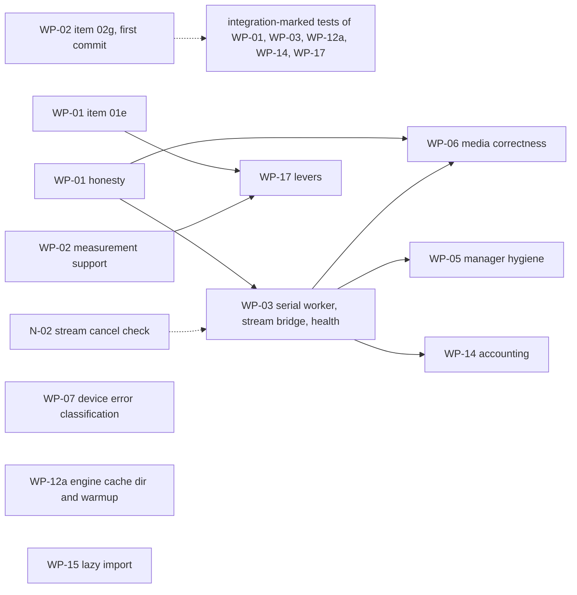

# MASTER PLAN v8 - arc-runner Native Layer: Finish, Harden, Prove, and Document Every Decision
### Base: Gemini's "10/10 Enterprise Architecture Master Plan" (conversation 700d4ff3) | Corrected by 17 skill-verified agent reviews | Orchestrated from `claude-global-library`

> **Plan file location (author machine):** `C:\Users\techd\.claude\plans\sunny-painting-pebble.md`
> **Gemini's original plan (kept as the base spec):** `C:\Users\techd\.gemini\antigravity-cli\brain\700d4ff3-bc4b-4c7a-88b8-a15dc6ba9d13\implementation_plan.md` (+ `transcript.jsonl`, stopped at step 443)
> **Status (2026-10-29, review pass 3, v8):** PLANNING ONLY, nothing implemented. Defects found in review passes 1-2 and their fixes are in Section 17, which also holds the executable slice plan and the environment split. Gemini's native-layer work is already committed on `main` (commit c7312e0), so that commit is the baseline.
> **Resume rule:** read Section 0, then Section 13 (state), then continue. Everything needed is in this file; chat history is not required.

---

## 00. ONE-PAGE SUMMARY AND PRECEDENCE (v8, read this first)

**Precedence:** Sections 21-23 are the latest and override everything else for the topics they cover (21: slice progress; 22: library access in cloud sessions, which supersedes 17.2 rule 3; 23: the performance programme, v9.0 (simplified after the round-3 reviews), whose design contract is 23.5.0 (CC-1..CC-4)); then Sections 20 (v8.2), 19 (v8.1), 18 (v8) and 17 (v7) override everything else (20 > 19 > 18 > 17); then Sections 14, 15, 16 (added later) override conflicting text in 5, 7, 8.6, 10, 11. Specifically: UML/drawio = FULL regeneration of all 13 types (15.2, not "selective 7"); roster = Section 5 plus 14.3 plus 16.1 (no `?` left, all verified); rules = 8.1 plus 16.2; execution track = LEAN (default) or FULL (14.7), your choice at approval.

**What gets done:** (1) Step 0 verification: CLOUD part now, LOCAL-only facts via `scripts/probe_hardware.py` (17.2); (2) issue + branch; (3) fix C-series bugs red-first (bounds, dtype, lifetime, ring buffer), Level Zero/Sysman honesty, engine telemetry honesty, benchmark protocol with no fabricated rows; (4) tests by an independent author; (5) docs, SRS, CLAUDE.md, CHANGELOG, VERSION 0.2.0; (6) all 13 UML + drawio regenerated from hand-built UDM and guarded by `scripts/check_docs_sync.py`; (7) CI, packaging, committed DLL with hash/ABI check; (8) every stage documented and versioned in `docs/delivery/` with a decision log. (9) v8: benchmarking program B1-B10 (Section 18) covering all domains of the existing suite, native micro-benchmarks and a v0.1.0-vs-v0.2.0 regression gate, with schema-validated JSON and generated doc tables.
**Gates needing your OK:** push, merge, tag/release (PyPI + GHCR publish).
**Known limits of this plan (honest):** hardware facts and real token cost are only settled by Step 0 and by running; per-agent skill lists are enumerated at each stage start, not here; FULL track is expensive (est. 4-6M tokens, unmeasured).

---

## 0. How to read this plan

| Part | Sections | Purpose |
|:--|:--|:--|
| Why | 1-3 | Problem, evidence, corrections to Gemini's maths |
| How (process) | 4-6 | Routing, agent/skill orchestration, token control |
| Traceability | 7-8 | Per-stage versioned docs, decision log, trace matrix |
| What (code) | 9-10 | Architecture, classes, methods, variables, tests |
| When | 11-12 | Waves, gates, git flow, risks, definition of done |
| State | 13 | Resume checkpoint, repo/hardware facts, open items |
| Review history | 14-16 | self-review v5, doc/UML sync plan, roster and rules audit (historical scores in 14.1 are v4/v5 and are superseded by 18.10) |
| Current execution plan | 17-18 | environment split, slices S-A..S-F, measurable gates, benchmarking program; these override everything else |
| Final fixes | 20 | CI naming, DLL-per-slice rule, platform support policy, local-gate slices, release rollback, approval batching |
| Wave-to-slice map | 19.1 | how W1-W3 of Section 11 map onto the slices of 17.4 |

---

## 1. Executive problem statement

Gemini built a native C/C++ layer (Win32 memory-mapped weight streaming + Level Zero USM bridge), changed the OpenVINO engine to use real `perf_metrics`, and started Sysman telemetry, then ran out of tokens right after the README edit (step 443). 26 tests pass, but 17 skill-verified reviews show:

1. **Memory-safety bugs** in the C layer (integer wrap in bounds checks, unchecked counts, views that outlive the mapping).
2. **Fabricated numbers still present**: Sysman power `22.0 W`, Sysman "free memory" from system RAM, engine fallbacks `len(text.split())`, `elapsed*200`, benchmark `REFERENCE_SWEEP` rows with hard-coded TTFT/TPS/power.
3. **Plan maths is wrong** (Theorems 1-4) and several README claims rest on it.
4. **Tests do not match the plan** (N3, N4, N5, N6, E3, E5, E7, E8 absent/renamed; P8, P9 missing).
5. **Not shipped**: no CI, no packaging of the DLL, no issue/commit/release, no SRS/CLAUDE.md/VERSION/CHANGELOG.

**Goal:** a correct, bounded, honestly-measured native layer, with every claim backed by a measurement, every decision recorded with its reason, and every stage documented so any future session can continue without re-discovery.

---

## 2. Evidence base (verdicts from the 17 skill-verified reviews)

Legend: **C**=confirmed, **P**=partly, **R**=refuted, **V**=must verify on disk/machine first.

### 2.1 Native C / Python bridge (`src/arc_runner/native/`, `engine/flash_stream/weight_streamer.py`)
| ID | Sev | Where | Finding | Verdict | Fix (design element) |
|:--|:--|:--|:--|:--|:--|
| C1 | CRIT | `arc_flash_stream_mmap.c` ~183/209/239 | `offset+size > file_size` wraps uint64, then `base_ptr+offset` OOB | C | `arc_range_ok()` helper: `size<=fsz && off<=fsz-size` |
| C2 | HIGH | `arc_mmap_register_layer` | `tensor_count>64` reads past `tensors[64]`; extents never validated at register | C (name-NUL overrun **R**: `strncmp` bounded) | validate count/dims/extents/name, copy-then-publish |
| C3 | HIGH | `bridge.py` register | ctypes silently wraps negative/huge ints; `min(len,64)` truncates; names cut at 127 | C | `_validate_u64`, raise on overflow, no truncation |
| C4 | HIGH | `weight_streamer.py:226` vs `173-193` | native path = float32 view for every tensor type; fallback differs; BF16 read as f16 | C | dtype from `tensor_type`; quantized -> raw `uint8` view |
| C5 | HIGH | views | arrays outlive `UnmapViewOfFile`; arrays writeable over `PAGE_READONLY` | C | keep-alive owner, `writeable=False`, deferred close |
| C6 | HIGH | slots | slot chosen under lock, loaded outside -> duplicates; `close()` nulls `_native_engine` under prefetch threads | C | `_RingSlot` state machine (EMPTY/PENDING/READY) + pin count + join threads |
| C7 | MED | lock/unlock | codes collide with `GetLastError`; single `is_locked` bool; VirtualLock quota 1453; never called | C | `ArcStatus` codes + `locked_bytes`; best-effort `try_pin` |
| C8 | MED | `CreateFileA` | UTF-8 path misread; MAX_PATH | C | `CreateFileW` + `\\?\` |
| C9 | LOW | 32-bit casts | `(SIZE_T)size` truncates | C | `size<=SIZE_MAX` guard |
| C10 | LOW | `build_native.py` | global `-mavx2` (15 ymm instrs in DLL, SIGILL risk) | C (`-static-libgcc` **P**: DLL imports only KERNEL32/UCRT) | drop `-mavx2` (no AVX2 code exists) |
| X1 | MED | LRU | `time.time()` ties (~15.6 ms); cyclic layer scan = 0% LRU hit | C | direct-mapped `layer % slots`, monotonic tick |
| X2 | MED | eviction | `gc.collect()` under lock; "O(1) RAM" claim false (page cache/working set); `get_active_memory_bytes` = virtual size | C | collect outside lock; add `get_resident_memory_bytes()` |
| X3 | V | reshape | GGUF `ne[0]` fastest -> `reshape(dims)` may need reversed dims | V | micro-test at Step 0 |
| X4 | LOW | layer lookup | linear scan <=256x64 is microseconds | **not a bottleneck** | no hash table |

### 2.2 Level Zero + Sysman (`arc_level_zero_bridge.c/.h`, `devices/sysman.py`)
| ID | Sev | Finding | Verdict | Fix |
|:--|:--|:--|:--|:--|
| L1 | HIGH | `query_package_power` returns constant `22.0`; `zesDeviceGetPowerProperties` does not exist; this iGPU has **0 power domains** | C | return `None` + reason; energy-counter path (`zesPowerGetEnergyCounter`) for platforms with domains |
| L2 | HIGH | memory "free" from `GlobalMemoryStatusEx` / `total//2`; iGPU has **0 memory modules** | C | `(total, None)` + reason (shared system memory) |
| L3 | MED | `stype` values look wrong (code 0x1-0x5, 0x11; recalled 0x7,0xd,0xe,0xf,0x15,0x16); driver does not validate; only 0x3 proven | V | read `ze_api.h` at Step 0, named constants |
| L4 | HIGH | `drivers[0]/devices[0]`; machine has driver0=Arc iGPU (type 1, id 0x7d55), driver1=NPU (type 5) | C | select `ZE_DEVICE_TYPE_GPU` |
| L5 | MED | create-call return codes ignored, leaks on failure | C | check every call, single cleanup path |
| L6 | LOW | queue priority 1 = LOW | C | NORMAL (0) |
| L7 | MED | `memcpy` fallback only if symbol missing, not on copy error | C | fallback on error (host/shared ptrs) |
| L8 | MED | 10 s sync > Windows TDR 2 s; reset after timeout unsafe; no fence/event overlap | C | polled wait < 2 s, mark context dead on timeout/device-lost |
| L9 | LOW | `arc_ze_destroy` leaks USM; fn pointers not nulled | C | track allocations |
| L10 | LOW | size guard; N4 verified live (`2**62` -> None) | C | explicit guard |
| L11 | MED | `zesInit` must be called **first** (after `zeInit` it returned uninitialized); only frequency telemetry works (2 domains) | C | init order fixed |
| L12 | MED | USM bridge is dead code (nothing calls `allocate_usm`/`dma_copy`) -> Theorem 5 overlap unrealised | C | keep, document, not wired in this release |

### 2.3 Engine + benchmark
| ID | Sev | Finding | Verdict | Fix |
|:--|:--|:--|:--|:--|
| E1 | HIGH | fabricated fallbacks in `openvino_engine.py` 207-231, 334 **and** benchmark 346-348 | C | `metrics_source` + validity flags, no invented values |
| E2 | HIGH | `ContextWindowExceededError` never raised (`KVCacheManager.check_headroom` exists, checks prompt only) | C | enforce prompt + `max_new_tokens` with real tokenizer count |
| E3 | LOW | `generate([p])` / `generate(p)` retry swallows real errors | C | one call form, narrow excepts |
| E4 | MED | `u8` KV default-on with no quality gate | C | gate on KL/PPL before default |
| E5 | V | `get_throughput()` definition (decode-only vs total) | V | read OpenVINO 2026.4.1 docs/source |
| E6 | LOW | stream path counts callback chunks as tokens; TPS defined differently from `generate()` | C | tokenizer counts; one definition |
| H1 | HIGH | benchmark `REFERENCE_SWEEP` rows (ttft 165.0, tps 54.2, power_w 22.0) beside real rows; README/results JSON may contain them | C | tag `projected` or remove; audit README + JSON |
| H2 | MED | Ollama TTFT ~503/502/524 ms suspiciously constant; CPU vs iGPU; Q4_K_M vs OV INT4 | hypothesis | fair protocol (Section 10.9) |

### 2.4 Tests (26 pass, coverage differs from plan)
P1 weak; P6 not skipped without GPU; P8 absent; P9 mislabelled (is Sysman); N3, N4, N5, N6, E3, E5, E7, E8 absent/renamed. Hardware marker = `@pytest.mark.hardware` + `require_intel_gpu` (tests/conftest.py).

---

## 3. Corrections to Gemini's maths (replace in README/docs; each becomes a Decision Log entry)

Notation: `N_L` layers, `d` hidden, `d_kv = H_kv*d_h`, `d_ff` FFN width, `L` prompt tokens, `S` context length, `W` weight bytes.

| Theorem | Gemini | Correct form | Effect |
|:--|:--|:--|:--|
| T1 prefill | `N_L(2L^2 d + 8 L d^2)` | `FLOPs = N_L * L * (4d^2 + 4 d d_kv + 6 d d_ff) + N_L * 2 L^2 d` (SwiGLU FFN = `6 d d_ff`) | 1.5B@512: 1.36e12 (plan 2.93e11) = **4.6x**; 32B 4.6x; 72B 3.2x. Measured TTFT 100-156 ms implies ~60-100-token prompt or a different peak -> recompute with real `L` |
| T2 roofline | `99.8% of roofline` using `eta=0.61` | `TPS_max = B_sustained / (W + KV_bytes)`; no extra `eta` when B is already "sustained" | real decode = **~61%** of 74.5 GB/s; peak depends on memory type (V: LPDDR5x-7467 ~119 GB/s vs CIM saw 2x8GB@5600 ~89.6 GB/s) |
| T3 KV | `+18-25%` from u8 | `KV_bytes/token = 2 N_L H_kv d_h b` (b=2 FP16, 1 u8); gain `= (KV_fp16*S/2) / (W + KV_fp16*S)` | 1.5B: 28,672 B/token; **~3.5% at S=2048**, 18% needs S~12k |
| T4 Python overhead | `+15%` | gain `= 1/(1 - f_python)`, `f_python` must be measured end-to-end; streaming is I/O bound (layer read 40-90 ms vs 0.18 ms) | probably **<1%**; 13 tok/s for 32B needs ~239 GB/s (> peak) |
| Xe-LPG | 1,792 lanes, 4.03 TFLOPs XMX, 256 KB SLM | 896 FP32 lanes; 4.03 TFLOPs is FP32 vector; no XMX on Meteor Lake (V); 256 KB SLM is Xe2 | text fixed |
| NT loads | `_mm_stream_load_si128` L3 bypass | ineffective on write-back mapped pages; **code has no CPU copy to bypass** | not built; measurement script only |
| NPU draft | 5 W, 2.5-3.2x energy | unsourced for NPU 3720 (FP16/INT8 only); ~1.0-1.15x or slower on 1.5B; shares LPDDR bus | no code change; claim marked unverified |

---

## 4. Routing (decision tree, recorded)

Human nodes (answered by you): D01 **Brownfield** | D02 **yes** RE whole repo | D03 **yes** Ph0 | D04 **yes** Ph1 | D05 no | D06 **yes** Ph2 | D07 no | D08 **yes** Ph4 | D09 **yes** Ph5 | D10 no | D11 **yes** Ph7 | D12 **yes** Ph8.
Auto nodes: D13 **Squad** | D14 **pattern:79** silicon-architecture (lead `heterogeneous-systems-engineer`, math `silicon-mathematics-expert`) | D15 **B1** F.1+F.2+F.6 (re-evaluate: GGUF parser = untrusted input) | D16 always C+E | D17 B1 context-eng + A.5 | D18 B2 (Ph1 runs) | D19 B1 orchestrator-agent | D21 **B1** (LLM stack -> A.6, A.6.1, H) | D22 B1 self-correct <=3 (SC.3 escalates) | D23 B2 unless RE marks DIRTY (then IV.1/IV.2).
Path string: `D01:Brownfield -> D02:B2 -> D03:B2 -> D04:B2 -> D06:B2 -> D08:B2 -> D09:B2 -> D11:B2 -> D12:B2 -> D13:B1 -> D14:B60(pattern:79) -> D15:B1 -> D16:B1 -> D17:B1 -> D18:B2 -> D19:B1 -> D21:B1 -> D22:B1 -> D23:B2 -> phase:execution-plan`

### 4.1 Phase timeline

```
 S00 intake/route
   |
 S01 RE (whole repo) ----> S02 Ph0 PRD/BRD ----> S03 Ph1 HLD + ADRs ----> S04 Ph2 joint validation
                                                                              |
 S05 Ph4 reconciliation <-----------------------------------------------------+
   |
 S06 Ph5 SRS + UML/drawio ----> S07 Ph7 task routing ----> S08 Ph8 pre-impl alignment
   |
 S09 A.5 context + A.6/A.6.1 harness setup
   |
 S10 Ph B implementation:  W1 (parallel A,B,C,D) -> gate -> W2 (ring buffer, tests) -> gate -> W3 (benchmark, docs, CI)
   |
 S11 Ph C anti-hallucination (NLI/FactScore >= 0.95) -> S12 Ph D QA -> S13 Ph F security (F.1,F.2,F.6)
   |
 S14 Ph H harness eval/regression -> S15 Ph E reliability (RS >= 0.95) -> S16 Ph G integration + release (user gates)
   |
 S17 retrospective + memory + RESUME.md
 (SC.1/SC.2 loop wraps any REJECT, max 3, SC.3 escalates to user)
```

---

## 5. Agent + skill orchestration matrix (all agents verified to exist, see 14.2)

Rule for EVERY row: agent reads its `agent.md` + **all** skills (frontmatter + Mandatory + Optional) in chunks, grouped <=150 KB per agent instance, returns quote-per-skill proof inside its own report file. `?` = existence not yet verified (run `ls agents/<name>/agent.md`; if absent, REPORT, do not invent; find substitutes with `knowledge-graph/_discovery/query_discovery.py`).

| Stage | Agents | Output doc(s) |
|:--|:--|:--|
| S01 RE | codebase-archaeology-agent, ast-graph-engineer, impact-analysis-agent, reverse-engineering-analyst, codebase-kg-engineer, as-built-doc-generator | S01 as-built, call graph, dead code, impact map (feeds UML UDM) |
| S02 Ph0 | business-analyst-agent, product-manager-agent, research-strategist, technology-scout-analyst, ba-pm-mathematics-expert | PRD/BRD (short: hardening scope) |
| S03 Ph1 | solution-architect, consensus-agent | HLD + ADR-0001..0009 |
| S04 Ph2 | business-analyst-agent, product-manager-agent, ba-pm-mathematics-expert | joint validation report |
| S05 Ph4 | context-faithfulness-engineer, business-analyst-agent, product-manager-agent | reconciliation report |
| S06 Ph5 | uml-from-code-engineer, uml-structural/behavioral/interaction-diagram-engineer, mermaid-diagram-engineer, drawio-diagram-architect, uml-diagram-mathematics-expert, harness-engineering-architect | SRS.md + 13 UML/drawio (Sections 8.6, 15) |
| S07 Ph7 | context-engineering-agent, prompt-generation-expert, context-faithfulness-engineer, security-testing-engineer, agile-business-mathematics-expert | task routing table (agent x work package x skills x files) |
| S08 Ph8 | scrum-master-agent, business-analyst-agent, product-manager-agent, context-engineering-agent, prompt-generation-expert | alignment checklist, go/no-go |
| S09 A.5/A.6/A.6.1 | context-engineering-agent, harness-engineering-architect, harness-mathematics-expert, loop-engineering-architect | stop conditions, budgets, model-switch policy |
| S10 Ph B | **lead** heterogeneous-systems-engineer; c-cpp-systems-engineer (x4 groups), gpu-driver-engineer, gpu-architecture-specialist, cpu-architecture-specialist, hardware-performance-engineer, accelerator-architect, llm-serving-engineer, llm-quantization-engineer; math: silicon-mathematics-expert (opus, via delegation, 13 skills in 4 parts); python/test engineers (discover) | code + wave reports |
| S11 Ph C | hallucination-detector, context-faithfulness-engineer | NLI/FactScore report on docs/claims |
| S12 Ph D | QA agents (discover); harness-engineering-architect (test-gap mapping) | QA report (coverage, DRE; targets stated honestly) |
| S13 Ph F | threat-modeling-specialist, sast-engineer, secrets-detection-specialist, dependency-vulnerability-analyst, security-lead-auditor (+ cyber-mathematics-expert if CVSS used) | STRIDE (GGUF parser, DLL loader), SAST of C, secrets scan, verdict |
| S14 Ph H | harness-evaluation-engineer, harness-mathematics-expert, testing-mathematics-expert | eval/regression gate report |
| S15 Ph E | reliability-auditor | RS computation |
| SC loop | root-cause-analysis-agent, context-faithfulness-engineer, prompt-generation-expert, context-engineering-agent | RCA + correction ADR per REJECT |
| Squad lead | orchestrator-agent | dispatch log |
| Already done (17 reviewers) | c-cpp A/B/C/D, hw-perf, cpu-arch, gpu-arch, gpu-driver, hetero+accel, llm-serving/quant, foundation+mlops, harness A/B, loop A/B, context, prompt | backfilled as S10 `review-digest` (reconstructed, flagged as such) |

**Skill-split sizes (already measured):** algorithm-design-complexity-core 189 KB (own agent), mlops-core 93 KB, bare-metal-architecture-core 66 KB, kernel-driver-development-core 59 KB, hardware-protocols-core 54 KB, cpu-microarchitecture-core 50 KB, embedded-linux-core 46 KB; all others 15-45 KB.

**Cost reality check (estimate, not measured):** the 17-agent review round consumed ~2.9M subagent tokens (+~0.4M wasted on three invalid reports). Running every roster agent through all its skills could be several million more. Controls: per-stage token budget (Section 6), stages with tiny scope (S02, S04, S05) produce one-page docs, and you may veto stages at plan approval.

---

## 6. Token-lean orchestration (rules)

1. **Agents write their own report file** and return only a <=150-word summary + path. (Saves ~1.5k tokens per agent in my context and gives the audit trail for free.)
2. **Main session does mechanical work** (pytest, gcc, git, packaging, CI YAML, JSON, version files, INDEX/TRACE updates) - no agent for that.
3. **Digest, not reports**: each agent receives only its slice (<=4k tokens: findings for its files, acceptance criteria, ownership list, doc path to write). No full plan/brief to anyone.
4. **Resume via SendMessage** while the conversation lives; in a new conversation, spawn fresh agents with the digest (they still read their skills, in chunks, with proof).
5. **Large output filtered**: `token-optimizer` MCP (`optimize_read_params`, `smart_read_analyze`, `context_budget_status`); pytest/benchmark logs trimmed to failures + tail.
6. **Gates before spend**: next wave starts only when the previous gate is green; each stage has a token budget in its `STAGE.md` (stop condition from A.6) and stops with a report if exceeded.
7. **Models**: sonnet implementers, opus only `silicon-mathematics-expert`; fallback chain on real rate limits only (sonnet -> opus -> fable -> ask you).
8. **Checkpoints**: after each gate -> local commit on feature branch + `session-mgr` `session_save` + update `docs/delivery/RESUME.md`.

---

## 7. Documentation and traceability system (`docs/delivery/`)

Purpose: every agent statement, decision, and change is a versioned file; a future session reads `RESUME.md` + `INDEX.md` and knows what was decided and why. Lives under `docs/` (exempt from the 5-root-files rule).

### 7.1 Layout
```
docs/delivery/
  RESUME.md                  current stage, last gate, next action, open questions (updated every gate)
  INDEX.md                   doc_id | title | version | status | stage | path | updated | commit
  DECISION_LOG.md            append-only DL-### entries (never edited; superseded by new entries)
  TRACEABILITY.md            finding -> requirement -> ADR -> code symbol -> test -> evidence doc
  adr/ADR-000N-<slug>.md     architecture decisions (versioned)
  stages/
    S00-intake-routing/      STAGE.md + agent-reports/
    S01-reverse-engineering/ ... S17-retrospective/
      STAGE.md               inputs, agents+skills, decisions made, outputs, gate result, token spend, version
      agent-reports/<agent>.v<N>.md   one file per agent invocation (immutable once approved)
  review-digest/             backfill of the 17 reviews (marked "reconstructed")
scripts/check_delivery_docs.py   CI check: front matter valid, INDEX parity, versions monotonic
```

### 7.2 Document front matter (every .md in docs/delivery)
```yaml
doc_id: DOC-S03-HLD           # stable, never reused
title: High-Level Design - native layer hardening
stage: S03
version: 1.2.0                # semver; see 7.3
status: draft | reviewed | approved | superseded
created: 2026-10-29
updated: 2026-10-30
authors: [solution-architect, consensus-agent]   # library agent names
reviewers: [user]
inputs: [DOC-S01-ASBUILT@1.0.0, DOC-S02-PRD@1.1.0]
supersedes: null
related_issue: "#N"
git_commit: <filled at commit>
```
Bottom of each doc: **Revision history** table (version | date | author | what changed | why | commit).

### 7.3 Version policy
- **patch** (x.y.Z): wording, typos, clarifications, no change of meaning.
- **minor** (x.Y.0): new content, new finding, new evidence; conclusions unchanged.
- **major** (X.0.0): a decision or conclusion changed. Requires a new `DL-###` that references the old one, and the old doc keeps `status: superseded` with a pointer.
- Never delete or overwrite history: edit = new version + revision-history row; INDEX + TRACEABILITY updated in the same commit; commit trailer `Doc-Version: DOC-S03-HLD@1.2.0`.
- `check_delivery_docs.py` fails CI if front matter is malformed, a doc is missing from INDEX, a version goes backwards, or a changed doc has no new revision row.

### 7.4 Agent report template (`agent-reports/<agent>.v<N>.md`)
1. Header: agent, persona, model, stage, task (digest id), date, tokens used.
2. **Skill proof table**: skill | size | lines read | verbatim quote | relevance (no quote = report invalid).
3. Findings: claim | verdict (confirmed/partly/refuted/unverified) | evidence | file:line.
4. Decisions proposed (-> become DL entries after review).
5. Files touched (must match ownership), tests added/changed, before/after numbers.
6. Unverified items and confidence; escalations; REQUEST-TO-OWNER items.

### 7.5 Decision Log entry template (`DECISION_LOG.md`, append-only)
`DL-### | date | stage | decision | WHY | alternatives rejected (and why) | evidence (doc_id@ver, file:line, measurement) | proposed by (agent) | approved by (user/gate) | affects (ADR, code, tests) | supersedes`

### 7.6 Seed decisions (already made; to be written into DECISION_LOG.md as DL-001..)
| DL | Decision | Why | Rejected alternative |
|:--|:--|:--|:--|
| 001 | Gemini plan stays the base spec | user instruction; most work already done and tests pass | restart from scratch (waste) |
| 002 | Route to `silicon-architecture`, pattern 79; math = `silicon-mathematics-expert` | discovery tool + domain-refs + CLAUDE.md math rule | `systems-programming` only; generic `mathematics-engineer` |
| 003 | Every agent reads ALL skills (frontmatter+mandatory+optional), grouped <=150 KB, quote proof | user rule; three first agents falsely reported reading | sampling skills; mandatory-only |
| 004 | Do NOT build MOVNTDQA L3-bypass | ineffective on WB pages; no CPU copy exists; page-fault cost dominates | implement as written in plan |
| 005 | Host USM default for streamed weights, confirmed by Step-0 timing | iGPU shares LPDDR; device USM adds a copy; shared USM migrates | device USM (plan), shared USM |
| 006 | Sysman returns `None` + reason, never fabricated values | machine reports 0 power domains / 0 memory modules | keep 22.0 W / RAM-as-VRAM |
| 007 | Sealed-after-registration flag (release/acquire), not rwlock | table immutable after load; zero reader cost | rwlock |
| 008 | Direct-mapped ring slots (`layer % slots`) | cyclic scan makes LRU hit rate 0%; no timestamps | LRU |
| 009 | Remove global `-mavx2`; no AVX2 code now | no intrinsics in sources; SIGILL risk; YAGNI | runtime-dispatched AVX2 TU |
| 010 | Commit prebuilt DLL with safeguards (ABI/hash check, Python fallback) | user decision (3 agents advised against) | gitignore + CI build |
| 011 | Release/tag only on your separate OK | release triggers PyPI + GHCR publish (irreversible) | auto-release |
| 012 | Keep tracked `uml/`+`drawio/` | repo precedent (26 files) despite rule 45 | untrack |
| 013 | Leave root `CONTRIBUTING.md` | pre-existing, out of scope; reported | move to docs/ |
| 014 | Keep float telemetry fields, add validity flags | avoids breaking consumers/tests | change to Optional |
| 015 | Tests authored by a different agent than implementers | avoids Goodhart on weak tests | implementers write tests |
| 016 | Agents write their own report files | token cost + audit trail | main session transcribes |
| 017 | Version 0.1.0 -> 0.2.0 | new feature + behaviour fixes | patch bump |
| 018 | Restate/remove T1-T4, 18-25%, 99.8%, NPU energy claims | math checked by 5 agents | keep |
| 019 | LEAN track skips Ph0/Ph2/Ph4/Ph7/Ph8, S11, S14, S15 (only if user picks LEAN) | proportionality (14.7) | FULL track |
| 020 | Full regeneration of all 13 UML/drawio types once | rule 45 s3.1: new package | selective regen |
| 021 | Rules 03,04,06-10,13-18,20-26,30-32,34,42-43 marked not applicable | languages/frameworks untouched | re-audit each session |

### 7.7 Trace matrix seed (`TRACEABILITY.md`)
| Finding | Requirement | ADR | Code symbol | Test | Evidence |
|:--|:--|:--|:--|:--|:--|
| C1 | FR-001, NFR-001 | ADR-0002 | `arc_range_ok`, `arc_mmap_get_tensor_ptr` | `test_arc_range_ok_uint64_wrap_rejected` | S10 W1 A report |
| C2/C3 | FR-001 | ADR-0002 | `arc_mmap_register_layer`, `NativeMemoryEngine.register_layer`, `_validate_u64` | N3 tests | S10 W1 A |
| C4 | FR-001 | ADR-0002 | `dtype_for_tensor_type` | `test_get_tensor_buffer_f16_dtype_matches_fallback` | S10 W1 A |
| C5 | FR-001 | ADR-0003 | `_MappingGuard`, `NativeMemoryEngine.close` | `test_close_with_live_view_defers_unmap` | S10 W1 A |
| C6/X1 | FR-001 | ADR-0004 | `_RingSlot`, `_reserve_slot` | `test_acquire_concurrent_same_layer_single_load` | S10 W2 A |
| L1/L2 | FR-003 | ADR-0009 | `LevelZeroSysman.query_*` | `test_query_package_power_none_without_domains` | S10 W1 B |
| E1/E2 | FR-002, FR-004 | ADR-0006 | `_telemetry_from_perf_metrics`, `_enforce_context_window` | E7 tests | S10 W1 C |
| H1 | FR-005 | ADR-0007 | `BenchSample`, `evaluate_speedup_gate` | `test_gate_rejects_projected_rows` | S10 W3 |

---

## 8. Rule compliance + tooling

### 8.1 CLAUDE.md / rules matrix
| Rule | Application |
|:--|:--|
| Plan mode | Active; scope change re-enters plan mode (done at each revision) |
| Library-only orchestration | Section 5; prompts start with library-path line; absent agents reported |
| Issue before fix | `github_create_issue` first; labels `native`, `correctness`, `fake-telemetry`, `docs-drift`, `not-implemented`; commits reference `#N` |
| MCP-first | Section 8.2 |
| 01 common standards | specific exceptions, no swallow (E3); structured logging via `arc_runner.core.logging.get_logger(name)` with key-value `extra`; no secrets; validate input; functions <20 lines target; tests `test_<function>_<scenario>_<expected>`; conventional commits; Python stays snake_case (surrounding code wins over camelCase line, DL) |
| 12 docstrings-only | Google-style docstring on every public/protected function; zero narrating inline comments (TODO/FIXME/noqa/algorithm notes allowed); Doxygen headers in C |
| ASCII-only new Python | cp1252 safe (old files already non-ASCII, untouched) |
| 11 doc governance | create SRS.md, CLAUDE.md, VERSION (`0.2.0`), CHANGELOG.md at root; everything else under `docs/`; CONTRIBUTING.md untouched (reported) |
| 44 SRS | SRS.md sections 1-6, append-only FR/NFR with Source=#N, AC per FR, Change Log row |
| 45 UML | FULL regen of all 13 types (Section 15.2 overrides 8.6), UDM `model_data` hand-built |
| 46 architecture docs | CLAUDE.md `## Architecture & Structure`, README `## Architecture`, `docs/architecture.md`, tag `<!-- Introduced in v0.2.0 -->` |
| Engine v2 hook-free | no hooks re-added; Stop hook may auto-open a PR on feature branches (accept/report) |
| Attribution | commits end `Co-Authored-By: Claude Sonnet 5.5 <noreply@anthropic.com>`; PR body ends with Claude Code line |

### 8.2 MCP usage
`standards-loader` (Step 0), `pre-tool-gate` `validate_agent_dispatch` before each wave, `post-tool-tracker` (`increment_progress`, `check_commit_readiness`), `policy-enforcement` `verify_compliance` (end), `github-api` (issue, labels, branch, PR, `github_validate_build`, merge, close), `git-ops` (status, diff, commit, push, log), `push-gate` `check_push_allowed` before push, `session-mgr` checkpoints, `token-optimizer`, `uml-diagram` + `drawio-diagram`. Not used: jira, jenkins, figma, GA4/GTM/GSC, vector-db, LLM provider MCPs, trends, dataforseo (and `dataforseo`, `google-search-console` failed to connect: irrelevant).

### 8.3 Step 0 - verify before any edit (read-only; the single authoritative list, 14.8 only gives commands; environment split in 17.2)
1 `ze_api.h`/`zes_api.h` struct types. 2 memory type/speed (CIM). 3 `PerfMetrics.get_throughput` definition. 4 GGUF dim order. 5 XMX absence / SLM size. 6 USM timing micro-benchmark (host/device/shared) in scratchpad. 7 ctypes array attribute assignment for keep-alive owner. 8 baseline pytest counts. 9 snapshot of `native/` (untracked) + hashes. 10 `ls` every `?` agent.

### 8.4 SRS content (SRS.md, append-only)
FR-001 bounded native tensor access; FR-002 truthful telemetry; FR-003 Sysman real-or-None; FR-004 context-window enforcement; FR-005 benchmark provenance + fair Ollama comparison. NFR-001 input validation/security; NFR-002 portable fallback when native lib missing/mismatched; NFR-003 reproducible measurements; NFR-004 documentation traceability (docs/delivery).

### 8.5 CLAUDE.md (new) required headings
`## Project Overview`, `## Architecture & Structure` (incl. native package tree, `docs/delivery/` pointer, `RESUME.md` as session entry point), `## Development Guidelines` (docstring rule, ASCII, hardware marker, how to build native lib, doc versioning rule).

### 8.6 UML/drawio content notes (SUPERSEDED scope: Section 15.2 requires FULL regeneration of all 13 types; this list only names the must-contain symbols)
Class: `NativeMemoryEngine`, `NativeLevelZeroBridge`, `_MappingGuard`, `FlashStreamWeightManager`, `_RingSlot`, `LevelZeroSysman`, `OpenVINOGenAIEngine`, `EngineTelemetry`, `KVCacheManager`, `BenchSample`. State: `_RingSlot` EMPTY->PENDING->READY->(pinned)->EMPTY. Deployment: Python process, `libarc_native_sys.dll` + sidecar, `ze_loader.dll`, GPU/NPU drivers, GitHub Actions windows runner. Output `uml/*.md`, `drawio/*.drawio`; failures logged, never block.

---

## 9. System architecture

```
+--------------------------------------------------------------------------------------+
|                 CLI / FastAPI / OpenAI + Ollama compatible API (unchanged)             |
+--------------------------------------------------------------------------------------+
        |                                    |                                |
        v                                    v                                v
+-----------------------+      +---------------------------+     +---------------------------+
| OpenVINOGenAIEngine   |      | FlashStreamWeightManager  |     | LevelZeroSysman           |
| engine/openvino_...py |      | engine/flash_stream/...   |     | devices/sysman.py         |
| - perf_metrics only   |      | - _RingSlot state machine |     | - GPU-only selection      |
| - context-window gate |      | - direct-mapped slots     |     | - None + reason           |
| - validity flags      |      | - pin counts, join on close|    | - zesInit first           |
+-----------------------+      +---------------------------+     +---------------------------+
        |                                    |
        |                                    v
        |                      +---------------------------------------------+
        |                      | native/bridge.py (ctypes)                   |
        |                      |  NativeMemoryEngine | NativeLevelZeroBridge  |
        |                      |  _MappingGuard keep-alive | python fallback   |
        |                      +---------------------------------------------+
        |                                    |  (ABI version + SHA-256 checked on load)
        |                                    v
        |                      +---------------------------------------------+
        |                      | libarc_native_sys.dll                       |
        |                      |  arc_flash_stream_mmap.c  (CreateFileW,     |
        |                      |   MapViewOfFile, VirtualLock best-effort)   |
        |                      |  arc_level_zero_bridge.c  (GPU select, USM,  |
        |                      |   polled sync < TDR, dead-context flag)     |
        |                      +---------------------------------------------+
        v                                    |
 openvino_genai (GPU/CPU/NPU)                v
                                  ze_loader.dll -> Intel Arc iGPU (type 1) | NPU (type 5, not used for USM)
```

---

## 10. Code-level specification (classes, files, methods, variables)

Convention: existing names kept where they work; **NEW** = new symbol; **CHG** = changed behaviour/signature. Python: ASCII, Google docstrings, no narrating comments, logger = `get_logger("<module>")`. C: C17, `-Wall -Wextra -Wpedantic -Werror`. Signatures marked (re-read) must be re-read from the file at execution; the target behaviour is binding.

### 10.1 `native/arc_flash_stream_mmap.h/.c` (owner A)
Constants (kept): `ARC_MAX_PATH 1024`, `ARC_MAX_TENSORS_PER_LAYER 64`, `ARC_MAX_LAYERS 256`, `ARC_MAX_NAME_LEN 128`. **NEW** `ARC_NATIVE_ABI_VERSION 2`.
Structs kept (layout frozen, guarded by `_Static_assert`): `ArcTensorDescriptor` {`char name[128]`, `uint32_t tensor_type`, `uint32_t n_dims`, `uint64_t dims[4]`, `uint64_t file_offset`, `uint64_t size_bytes`} = 184 B; `ArcLayerDescriptor` {`int32_t layer_idx`, `uint32_t tensor_count`, `uint64_t total_layer_bytes`, `ArcTensorDescriptor tensors[64]`} = 11,792 B.
**CHG** `ArcMmapContext` becomes opaque in the header (body in `.c`): fields `file_handle`, `map_handle`, `uint8_t* base_ptr`, `uint64_t file_size`, `uint32_t total_layers`, `ArcLayerDescriptor layers[256]` (~3 MB, heap), `uint64_t locked_bytes` (replaces `is_locked`), `atomic_bool sealed`, `int32_t last_status`, `uint32_t last_os_error`.
**NEW** `typedef enum ArcStatus { ARC_OK=0, ARC_ERR_INVALID_ARG=-1, ARC_ERR_RANGE=-2, ARC_ERR_TOO_MANY_TENSORS=-3, ARC_ERR_BAD_EXTENT=-4, ARC_ERR_SEALED=-5, ARC_ERR_NOT_SEALED=-6, ARC_ERR_LOCK_FAILED=-7, ARC_ERR_OPEN_FAILED=-8, ARC_ERR_CLOSED=-9 } ArcStatus;`
Functions:
| Function | Behaviour |
|:--|:--|
| `static inline bool arc_range_ok(uint64_t fsize, uint64_t off, uint64_t sz)` **NEW** | `return sz <= fsize && off <= fsize - sz;` used everywhere |
| `ArcMmapContext* arc_mmap_open(const char* utf8_path, int32_t* out_status)` **CHG** | UTF-8 -> `MultiByteToWideChar` -> `CreateFileW` (`\\?\` for long paths), `FILE_SHARE_READ|FILE_SHARE_DELETE`; reject `file_size > SIZE_MAX` on 32-bit; failure -> NULL + `out_status` + `last_os_error` |
| `int arc_mmap_register_layer(ctx, const ArcLayerDescriptor*)` **CHG** | copy to local; reject sealed (-5), `layer_idx<0 or >=256`, `tensor_count>64` (-3), `n_dims>4`, each extent via `arc_range_ok` (-4); force `name[127]=0`; recompute `total_layer_bytes` with overflow check; publish only on success |
| `int arc_mmap_seal(ctx)` **NEW** | release-store `sealed=true`; after this `register_layer` returns -5 |
| `const uint8_t* arc_mmap_get_tensor_ptr(ctx, layer_idx, name, uint64_t* out_size)` | requires sealed (-6 -> NULL); acquire-load; `arc_range_ok` re-check; NULL on any error and sets `last_status` |
| `int arc_mmap_lock_range(ctx, off, sz)` / `arc_mmap_unlock_range` **CHG** | `arc_range_ok`; reject `sz==0`; update `locked_bytes`; on Win32 error store `last_os_error`, return -7 (never a raw `GetLastError`) |
| `int32_t arc_mmap_last_status(ctx)`, `uint32_t arc_mmap_last_os_error(ctx)`, `uint64_t arc_mmap_file_size(ctx)`, `uint32_t arc_mmap_layer_count(ctx)` **NEW** | accessors for opaque ctx |
| `void arc_mmap_close(ctx)` | idempotent for NULL; clears locks; no double free |
| `uint32_t arc_native_abi_version(void)`, `const char* arc_native_build_info(void)` **NEW** | checked by `bridge.py` on load |

`build_native.py` (owner A) **CHG**: functions `find_compiler() -> str` (`shutil.which("gcc")`, clear error), `compile_library(output: Path) -> None` (flags `-O2 -std=c17 -Wall -Wextra -Wpedantic -Werror -shared -Wl,--no-undefined`, no `-mavx2`, build to temp then atomic rename), `write_build_info(dll: Path) -> Path` (sidecar `libarc_native_sys.build.json`: sha256, gcc version, flags, git SHA, ABI version), `main() -> int`.

### 10.2 `native/arc_level_zero_bridge.h/.c` (owner B)
Kept: `ArcUsmType {ARC_USM_HOST, ARC_USM_DEVICE, ARC_USM_SHARED}`, `ArcZeContext` fields `ze_driver, ze_device, ze_context, ze_command_queue, ze_command_list, is_initialized`. **NEW fields**: `uint32_t device_type`, `int32_t last_status`, `uint8_t is_dead`, `uint64_t sync_timeout_ms` (default 1500, hard max 1900 < TDR 2000), allocation table `{void* ptr; size_t size;}[ARC_MAX_TRACKED_ALLOCS]` (**NEW** const).
**NEW** private header `arc_ze_types.h`: named constants `ZE_STYPE_DEVICE_PROPERTIES`, `ZE_STYPE_DEVICE_MEMORY_PROPERTIES`, `ZE_STYPE_CONTEXT_DESC`, `ZE_STYPE_COMMAND_QUEUE_DESC`, `ZE_STYPE_COMMAND_LIST_DESC`, `ZE_STYPE_DEVICE_MEM_ALLOC_DESC`, `ZE_STYPE_HOST_MEM_ALLOC_DESC` (values from the real header after Step 0), `ZE_DEVICE_TYPE_GPU=1`.
| Function | Behaviour |
|:--|:--|
| `ArcZeContext* arc_ze_init(void)` **CHG** | `zeInit(GPU_ONLY)`; loop all drivers x devices, `zeDeviceGetProperties`, pick first `ZE_DEVICE_TYPE_GPU` (NPU type 5 never accepted); check every create call; queue priority NORMAL; single cleanup label; `is_initialized` only on full success |
| `void* arc_ze_alloc_usm(ctx, size_t size, ArcUsmType)` **CHG** | guard `0 < size <= ARC_MAX_USM_BYTES`; record in allocation table; NULL + `last_status` on failure |
| `int arc_ze_dma_copy_async(ctx, dst, src, size)` **CHG** | on `zeCommandListAppendMemoryCopy` error -> `memcpy` only for host/shared pointers, returns distinct code `ARC_ZE_FALLBACK_MEMCPY` |
| `int arc_ze_synchronize(ctx)` **CHG** | poll `zeCommandQueueSynchronize` in <=250 ms slices up to `sync_timeout_ms`; on timeout/`ZE_RESULT_ERROR_DEVICE_LOST` set `is_dead`, never reset a possibly in-flight list |
| `int arc_ze_is_dead(ctx)`, `int32_t arc_ze_last_status(ctx)`, `uint32_t arc_ze_device_type(ctx)` **NEW** | accessors |
| `void arc_ze_free_usm(ctx, ptr)` | NULL-safe; removes from table |
| `void arc_ze_destroy(ctx)` | frees outstanding USM, destroys list/queue/context in reverse order, nulls function pointers |

### 10.3 `native/bridge.py` + `core/exceptions.py` (owner A)
**NEW** in `core/exceptions.py` (verify base `ArcRunnerError` constructor first): `NativeLayerError(ArcRunnerError)`, `NativeBoundsError(NativeLayerError)`.
Module constants (**NEW**): `_U64_MAX = (1 << 64) - 1`, `_MAX_TENSORS_PER_LAYER = 64`, `_MAX_NAME_BYTES = 127`, `_MAX_DIMS = 4`, `_EXPECTED_ABI_VERSION = 2`, `_ENV_DISABLE_NATIVE = "ARC_NATIVE_DISABLE"`.
Kept: `ArcTensorDescriptor`, `ArcLayerDescriptor` (ctypes mirrors; add `assert ctypes.sizeof(...) == 184 / 11792` at import), `_load_native_library()`, `_configure_signatures(dll)`.
- `_load_native_library() -> Optional[ctypes.CDLL]` **CHG**: honour `ARC_NATIVE_DISABLE`; on `OSError`/missing symbol/ABI mismatch/sidecar sha256 mismatch -> log WARNING (structured: `reason`, `path`) and return None (fallback path, plan N5).
- `_validate_u64(value: int, field: str) -> int` **NEW**; `dtype_for_tensor_type(tensor_type) -> np.dtype` **NEW** (F32->float32, F16->float16, I8->int8, BF16/quantized -> uint8 raw); `_reshape_dims(dims) -> tuple` **NEW** (applies GGUF order result from Step 0).
- `class _MappingGuard` **NEW**: holds the engine reference and a view counter; released when the last numpy view is garbage-collected; `close()` defers `arc_mmap_close` until count is 0.
- `class NativeMemoryEngine` methods: `__init__(file_path=None)`; `is_available` (property); `is_open` (property); `open_model(file_path) -> bool` (raises `FileNotFoundError` if missing, `NativeLayerError` on native failure); `register_layer(layer_idx, tensors) -> bool` **CHG** (raises `NativeBoundsError` instead of truncating/False); `seal() -> None` **NEW**; `get_tensor_buffer(layer_idx, tensor_name, dtype, dims=None) -> Optional[np.ndarray]` **CHG** (read-only, keep-alive owner, rejects `out_size % itemsize != 0`); `lock_range`/`unlock_range` **CHG** (best-effort, returns bool, logs `os_error`); `last_error() -> Tuple[int,int]` **NEW**; `close()` idempotent; `__del__` guarded.
- `class NativeLevelZeroBridge` **CHG**: `allocate_usm(size_bytes, usm_type="host")` (default host, DL-005; rejects `<=0` and `>=2**63`), `dma_copy_async`, `synchronize() -> int`, `is_dead` property **NEW**, `free_usm`, `destroy`.

### 10.4 `engine/flash_stream/weight_streamer.py` (owner A, wave 2)
**NEW** `class SlotState(enum.Enum): EMPTY, PENDING, READY`.
**NEW** `@dataclass class _RingSlot`: `layer_idx: int = -1`, `state: SlotState = EMPTY`, `pin_count: int = 0`, `ready_event: threading.Event`, `arrays: Dict[str, np.ndarray]`, `load_error: Optional[BaseException] = None`.
`FlashStreamWeightManager` attrs: kept `_lock` (-> `threading.RLock`), `ring_buffer_slots`; **NEW** `_slots: List[_RingSlot]`, `_closing: threading.Event`, `_prefetch_threads: Set[threading.Thread]`, `_pointer_cache: Dict[Tuple[int,str], Tuple[int,int]]` (layer,name)->(address,size) built in `index_layers`, `_slot_wait_timeout_s: float = 30.0`.
Methods: `index_layers()` **CHG** (registers, validates every extent at load, seals, fills pointer cache); `_slot_index_for(layer_idx) -> int` **NEW** (`layer_idx % ring_buffer_slots`); `_reserve_slot(layer_idx) -> Tuple[_RingSlot, bool]` **NEW** (under lock: if READY same layer -> reuse; if PENDING same layer -> wait on event; if other layer pinned -> wait with timeout, then `TimeoutError`; else mark PENDING + set layer_idx); `_load_layer_into_slot(layer_idx, slot_idx)` **CHG** (local bind of native engine, dtype/shape fixed, load outside lock, set READY/`load_error`, set event); `acquire_layer_weights(layer_idx)` **CHG** (reserve -> wait -> `pin_count += 1`); `prefetch_layer_async(layer_idx, slot_idx)` **CHG** (skips if layer resident, registers thread); `release_layer_slot(slot_idx)` **CHG** (decrement pin; `gc.collect()` outside lock only when slot is recycled); `get_active_memory_bytes()` (documented as mapped/virtual); `get_resident_memory_bytes()` **NEW** (Win32 `GetProcessMemoryInfo` working set); `close()` **CHG** (set `_closing`, join prefetch threads, drop arrays, then close native); `_calculate_tensor_byte_size`: unknown quantized type raises instead of returning `max(n,1)`; `_read_tensor_array` fallback: BF16 not mapped to float16.

### 10.5 `devices/sysman.py` (owner B)
Remove `_MemoryStatusEx` and the `GlobalMemoryStatusEx` path; replace `_ZeDeviceMemProps` with correct struct + named stype. `LevelZeroSysman` attrs: kept `_dll`, device list; **NEW** `_gpu_handles: List[Any]`, `_unavailable_reasons: Dict[str, str]`. Methods: `_load_library()`, `_configure_signatures()`; `_init_devices()` **CHG** (`zesInit(0)` first, enumerate drivers/devices, keep only GPU); `is_available()`; `query_gpu_memory(device_index=0) -> Tuple[Optional[int], Optional[int]]` **CHG** (`(total, None)` unless `zesMemoryGetState` available, never RAM); `query_package_power(device_index=0) -> Optional[float]` **CHG** (energy-counter delta watts or `None`); `query_frequency_mhz(device_index=0) -> Optional[float]` **NEW**; `get_unavailable_reason(metric: str) -> Optional[str]` **NEW**.

### 10.6 `engine/openvino_engine.py` + `engine/models.py` (owner C)
`EngineTelemetry` (models.py) keeps all fields; **NEW** fields: `metrics_source: str = "unavailable"` ("ov_perf_metrics" | "wallclock_stream" | "unavailable"), `is_estimate: bool = False`, `is_ttft_valid: bool = False`, `is_tps_valid: bool = False`, `prompt_tokens: int = 0`, `tpot_ms: float = 0.0`, `decode_tokens_per_second: float = 0.0`, `kv_cache_precision: str = ""`, `has_fallback_been_used: bool = False`.
`OpenVINOGenAIEngine` new/changed methods: `_build_ov_properties(device) -> Dict[str, Any]` **NEW** (CACHE_DIR, KV_CACHE_PRECISION gated, PERFORMANCE_HINT, SDPA only for GPU); `_count_prompt_tokens(prompt) -> int` **NEW** (real tokenizer); `_enforce_context_window(prompt_tokens, max_new_tokens) -> None` **NEW** (uses `KVCacheManager.check_headroom` and also checks `prompt_tokens + max_new_tokens`; raises `ContextWindowExceededError`); `_invoke_pipeline(prompt, ov_config)` **NEW** (single call form, narrow `TypeError` handling only for return-type shape); `_telemetry_from_perf_metrics(raw_result, wall_sec) -> EngineTelemetry` **NEW**; `_telemetry_unavailable(wall_sec, reason) -> EngineTelemetry` **NEW** (zeros + `metrics_source="unavailable"`, flags False); `generate()` / `generate_stream()` **CHG** (no `len(split())`, no `elapsed*200/500`; stream TTFT only from real `first_token_time`, label `wallclock_stream`; empty prompt resets telemetry and returns immediately).

### 10.7 Benchmark (owner G): `src/arc_runner/benchmark/stats.py` **NEW** + `scratch/run_live_real_models_benchmark_and_compare.py` **CHG**
`stats.py`: `@dataclass(frozen=True) BenchSample {model_id, backend, iteration, ttft_ms, decode_tps, prompt_tokens, completion_tokens, source: Literal["measured","derived","projected"], is_warmup: bool, fallback_used: bool}`; `median(values)`, `coefficient_of_variation(values)`, `bootstrap_ci(values, alpha=0.05, n_resamples=2000, seed=0) -> Tuple[float,float]`, `warmup_converged(values, window=3, eps=0.05) -> bool`, `is_within_roofline(tps, weight_bytes, kv_bytes, bandwidth_gbs) -> bool`, `evaluate_speedup_gate(arc: List[BenchSample], ref: List[BenchSample]) -> ClaimGateResult` (passes only if bootstrap-ratio lower bound > 1.0, all samples `measured`, none `fallback_used`, CV <= 10%), `@dataclass ClaimGateResult {passed, reason, ratio_lo, ratio_hi, n_arc, n_ref, is_suspect}`.
Script: `LiveSequentialBenchmarkRunner.query_ollama` (keep; add `keep_alive`, `num_ctx`, `temperature=0`; TTFT from `prompt_eval_duration`, decode TPS from `eval_count/eval_duration`), `run_arc_runner_model` (uses telemetry validity flags; no fallbacks), **NEW** `warmup_backend(...)`, `measure_interleaved_ab(...)`, `write_results(raw_samples, provenance)` (JSON includes raw samples, OpenVINO/driver versions, git SHA, hardware, quantization labels), remove `REFERENCE_SWEEP`/hard-coded `power_w` (power `null` unless Sysman measured), `render_summary_table` shows `source` and CPU-vs-iGPU labels.

### 10.8 Tests (author != implementers)
Files: update `tests/test_native_system_layer.py`, `tests/conftest.py`; **NEW** `tests/test_flash_stream_ring.py`, `tests/test_sysman_honesty.py`, `tests/test_openvino_engine_telemetry.py`, `tests/test_benchmark_stats.py`. Naming `test_<function>_<scenario>_<expected>`; plan id in docstring.
| Plan id | Test (example name) | Kind |
|:--|:--|:--|
| P1 | `test_load_native_library_missing_symbol_returns_none` | unit |
| P6 | `test_arc_ze_init_selects_gpu_not_npu` | `@hardware`, `require_intel_gpu`; NOT_RUN without GPU |
| P8 | `test_generate_ttft_under_200ms_uses_perf_metrics` | `@hardware` |
| P9 | `test_kv_cache_u8_vs_f16_greedy_prefix_matches` | `@hardware` |
| P10 | `test_query_gpu_memory_total_only_labelled_shared` | unit/hardware |
| N3 | `test_arc_range_ok_uint64_wrap_rejected`, `test_register_layer_oob_extent_rejected`, `test_truncated_gguf_rejected_subprocess` | negative |
| N4 | `test_allocate_usm_oversize_returns_none` (host/device/shared) | negative/hardware |
| N5 | `test_native_disabled_falls_back_byte_identical` (env + OSError + stale ABI) | negative |
| N6 | `test_sysman_returns_none_without_driver` (patch `CDLL` -> OSError) | negative |
| N7/N8 | double close, free NULL | negative |
| E3 | `test_tensor_crossing_4k_64k_boundary_reads_exact_bytes` | edge |
| E4 | `test_concurrent_acquire_same_layer_loads_once` | edge |
| E5 | `test_register_80_layers_boundary_ok_and_256_plus_rejected` | edge |
| E6 | `test_generate_empty_prompt_returns_zero_tokens_and_resets_telemetry` | edge |
| E7 | `test_generate_over_context_raises_before_pipeline_call` | edge |
| E8 | `test_virtuallock_quota_failure_falls_back_unpinned` (mock 1453) | edge |
| new | `test_telemetry_never_contains_synthetic_values`, `test_close_with_live_view_defers_unmap`, `test_gate_rejects_projected_rows`, `test_bootstrap_ci_deterministic_with_seed` | regression |
Rule: every critical-fix test must FAIL on the pre-fix code (verified on the snapshot), pass after. Skipped hardware tests are logged NOT_RUN, never counted as pass.

### 10.9 Benchmark protocol (fair and gated)
Warmup >=3 discarded runs (until last 3 TTFT CV <= 5%, max 5), then >=10 timed (target 30, stop when 95% CI half-width <= 3%); interleaved A/B with Ollama; same prompts, `num_ctx`, `max_tokens`, `temperature=0`; decode TPS both sides = generated tokens / decode duration; report cold start separately; label CPU vs iGPU and Q4_K_M vs OV INT4; measure KV effect with an S-sweep (512/2k/8k/16k). Claim passes only if the CI bound clears; any failing model fails the claim; result above roofline ceiling -> SUSPECT (human). Quality gate for default-on `u8` KV: KL < 0.1 nats on a fixed sample set.

### 10.10 Packaging, CI, docs files
`pyproject.toml` (version 0.2.0; package-data `"arc_runner.native" = ["*.dll","*.so","*.h","*.c","*.json"]`), `src/arc_runner/__init__.py` (`__version__ = "0.2.0"`), `VERSION` (`0.2.0`), `CHANGELOG.md` (Keep a Changelog, `[UNRELEASED]` then `[0.2.0] - <date>`), `MANIFEST.in` (`recursive-include src/arc_runner/native *.dll *.so *.c *.h *.json`), `.gitignore` (`.cache/`), `.github/workflows/windows-native.yml` (renamed in v8.2: hosted windows-latest has no GPU, so it never runs hardware tests; windows-latest, MinGW via choco, `python src/arc_runner/native/build_native.py`, `pytest -q -m "not hardware"`, `python scripts/check_delivery_docs.py`, upload DLL artifact), `scripts/check_delivery_docs.py` (**NEW**, stdlib only). **DLL:** commit prebuilt DLL + sidecar (DL-010).

---

## 11. Waves, gates, loops

| Wave | Content | Gate (all must pass) |
|:--|:--|:--|
| Step 0 | verification list 8.3 + baseline | facts recorded in `S00`/`S10` docs |
| W1 (parallel, exclusive files) | A: 10.1+10.3; B: 10.2+10.5; C: 10.6; D: scratch measurement script only | `-Werror` build (single builder A), existing tests green, ownership check (`git status --porcelain` + hashes), each critical fix has failing-before test (drafted, finished W2) |
| W2 | A: 10.4; tests agent: 10.8 | native + new tests green; full `-m "not hardware"` green; hardware tests run on this iGPU or logged NOT_RUN |
| W3 | G: 10.7/10.9; docs; packaging/CI; UML/drawio; SRS/CLAUDE/CHANGELOG/VERSION | benchmark gate rules; docs checker green; README claims match JSON |
| Slice map | see 19.1: W1 = S-A, S-B, S-D; W2 = S-C; W3 = S-E1, S-E2, S-F | gates of Section 11 apply per slice |
| Quality phases | S11 C (NLI/FactScore >= 0.95), S12 D, S13 F, S14 H, S15 E (RS >= 0.95) | per template; report honestly if unreachable (e.g. DRE/coverage targets) |

**Loops:** fix-and-retest max 3 rounds per ownership slice; exit = all gates green; stall = same failing set twice or ping-pong -> stop, restore best snapshot, escalate; cap hit = "aborted", never "pass". Benchmark loop chained after fixes (warmup -> measure); runs that used a fallback are invalid. SC.1/SC.2 on any REJECT (RCA + correction ADR), SC.3 escalates after 3.

**Rollback:** per-wave local commits on the feature branch; revert to last green commit; `native/` snapshot in scratchpad; DLL reproducible from `build_native.py` (sidecar records flags/SHA).

---

## 12. Git / release flow and confirmation gates

1. Create the issue (labels) with `github_create_issue`, or `mcp__github__issue_write` in the cloud session; -> `github_create_issue_branch` -> per-wave commits via `git-ops` (`feat(native): ... (#N)` or `docs(delivery): ... (#N)` with `Doc-Version:` trailer and Co-Authored-By).
2. **Gate P - push:** `push-gate check_push_allowed` + your explicit OK.
3. PR (`github_create_pr`) -> `github_validate_build` -> review. **Gate M - merge:** your explicit OK.
4. **Gate R - tag/release:** separate explicit OK; a published release triggers `pypi-publish.yml` + `docker-build.yml` (irreversible PyPI/GHCR publish).
5. Close the issue after merge (`github_close_issue` or `mcp__github__issue_write`); memory notes saved (Section 13.5).

**Definition of done:** (1) every CONFIRMED finding fixed with a test that failed before; (2) native + full non-hardware pytest green; hardware tests pass or NOT_RUN with reason; (3) zero fabricated values anywhere (power, memory, TTFT, tokens, REFERENCE_SWEEP); README/JSON/theorem text match measurements; (4) native build clean under `-Werror`, ABI/hash check works, fallback tested; (5) docs governance satisfied (SRS, CLAUDE, VERSION, CHANGELOG, architecture docs, all 13 UML/drawio regenerated, `check_docs_sync.py` green); (6) every stage has `STAGE.md` + agent reports, INDEX/DECISION_LOG/TRACEABILITY current, `check_delivery_docs.py` green; (7) issue closed, CI valid, `git status` clean, `verify_compliance` run; (8) RESUME.md points at "released/next" state.

**Risks:** R1 token cost of all-agents-all-skills (several M tokens) -> stage budgets + you may veto stages; R2 agents skip skills -> proof table or reject; R3 unverified memory claims (stype, XMX, ctypes attribute) -> Step 0; R4 tracked DLL goes stale -> ABI/hash check + fallback; R5 engine Stop hook opens PRs on feature branch -> accept/report; R6 hardware tests unreachable off-machine -> NOT_RUN semantics; R7 doc overhead drifts -> checker script in CI.

---

## 13. STATE CHECKPOINT (read first on resume)

### 13.1 Done so far
Gemini plan located and read (author machine, not re-verifiable from the cloud session); repo gap-audited; library path and many agent files verified; 17 skill-verified reviews completed (verdicts in Section 2); decision-tree path recorded (Section 4); you chose phases (Section 4); you chose "commit the DLL"; repo docs-governance state inspected.

### 13.2 Facts to keep
- **Hardware:** Core Ultra 5 125H (Meteor Lake; 4P+8E+2LP-E; AVX2 only, no AVX-512); L3 18 MB; iGPU arch v12.71.4, 112 EUs, 7.3 GB shared "DDR"; driver0 = Arc iGPU (type 1, id 0x7d55), driver1 = NPU "Intel AI Boost" (type 5, id 0x7d1d, FP16/INT8 only); RAM 2x8 GB reported 5600 MT/s (V).
- **Repo (verified at 52ddbe4):** Gemini native layer is committed (c7312e0, incl. `libarc_native_sys.dll`); version 0.1.0; no SRS.md/CLAUDE.md/VERSION/CHANGELOG at root; `CONTRIBUTING.md` tracked at root; `uml/`+`drawio/` tracked (26 files); README headings OK, no mojibake; many old py files non-ASCII; `orchestrator/usm_bridge.py` = numpy zero-copy handoff (different concern, do not touch); workflows docker-build.yml + pypi-publish.yml; remote `techdeveloper-org/intel-arc-models-runner`; `EngineTelemetry` is in `engine/models.py`; `ContextWindowExceededError(prompt_tokens, max_context)` in `core/exceptions.py`; `KVCacheManager.check_headroom(prompt_tokens)` in `engine/kv_cache.py`; `GGUFTensorInfo(name, n_dimensions, dimensions, tensor_type, offset, size_bytes)` in `quant/models.py`; `conftest.py` fixtures `hardware_flag`, `live_topology`, `require_intel_gpu`, `require_intel_npu`.
- **Existing symbols (verified by grep):** bridge.py: `ArcTensorDescriptor`, `ArcLayerDescriptor`, `_load_native_library`, `_configure_signatures`, `NativeMemoryEngine{is_available,is_open,open_model,register_layer,get_tensor_buffer,lock_range,unlock_range,close}`, `NativeLevelZeroBridge{is_available,allocate_usm,dma_copy_async,synchronize,free_usm,destroy}`; weight_streamer.py: `FlashStreamWeightManager{index_layers,_calculate_tensor_byte_size,_read_tensor_array,_extract_short_tensor_name,_load_layer_into_slot,acquire_layer_weights,prefetch_layer_async,release_layer_slot,get_active_memory_bytes,close,__enter__,__exit__}`; sysman.py: `_ZeDeviceMemProps`, `_MemoryStatusEx`, `LevelZeroSysman{_load_library,_configure_signatures,_init_devices,is_available,query_gpu_memory,query_package_power}`; openvino_engine.py: `OpenVINOGenAIEngine{load_model,_build_ov_generation_config,generate,generate_stream,unload,get_telemetry}`; benchmark: `LiveSequentialBenchmarkRunner{query_ollama,download_model,reclaim_disk_storage,run_arc_runner_model,run_flash_stream_heavy_model,execute_all,render_summary_table}`.

### 13.3 To-do in order when resuming
1. Re-read Sections 00, 17, 18, 19 (they supersede earlier text). 2. DONE: all `?` agents verified present (14.2); QA/python/release agents found (14.3). 3. For each agent in Section 5 list skills + sizes, make <=150 KB groups. 4. Ask the user for any remaining choice (only if blocking), then ExitPlanMode. 5. On approval: Step 0, create issue/branch, scaffold `docs/delivery/` (RESUME, INDEX, DECISION_LOG with DL-001..021 plus DL-022.. from Section 17, TRACEABILITY, stage folders, review-digest backfill from Section 2 marked reconstructed), then waves.

### 13.4 Open items for you
Root `CONTRIBUTING.md` (left as is); tracked `uml/`+`drawio/` (kept); release/PyPI/Docker publish needs separate OK; token budget per stage (tell me if you want a cap).

### 13.5 Memory to save (author machine; save when memory tools are available)
feedback: every library agent reads ALL its skills (frontmatter+mandatory+optional), split <=150 KB, quote-per-skill proof, reject otherwise; feedback: never claim roster/orchestration without verifying on disk (I wrongly said domain-refs empty); feedback: user wants Gemini-style deep readable plans (ASCII architecture, class/method/variable specs, math, test matrix) and per-stage versioned docs + decision log; project: arc-runner native-layer continuation of Gemini conversation 700d4ff3, plan at the path above, fabricated benchmark rows must never ship, release needs separate OK. Also `session-mgr` `session_save`.

---

## 14. SELF-REVIEW OF THIS PLAN (v4 -> v5, 2026-10-29) - rubric, gaps found, fixes

### 14.1 Rubric (each 0-10) - honest scoring
| Criterion | v4 | Gap found | Fix in v5 |
|:--|:--|:--|:--|
| Evidence-based problem statement | 9 | none material | - |
| Agent roster verified on disk | 6 | ~25 agents marked `?` | **Verified now: all 25 exist** (14.2). Marker `?` removed everywhere |
| QA / Python / release coverage | 5 | "discover" placeholders | Found: `qa-testing-agent`, `unit-testing-specialist`, `integration-testing-engineer`, `performance-testing-engineer`, `test-management-agent`, `python-backend-engineer`, `release-engineering-specialist`, `devops-engineer` (14.3) |
| Class/method/variable detail | 8 | signatures of existing code partly "(re-read)" | Step 0 includes a 'signature freeze' read; acceptable |
| Per-file ownership / conflict-freedom | 6 | ownership only implied | Explicit table (14.4) |
| Acceptance criteria per work package | 6 | only global DoD | Per-WP criteria (14.5) |
| Test-first order | 5 | tests came after code | Red-first rule: failing test committed before each critical fix (14.6) |
| Token proportionality | 5 | 17 stages x every agent x all skills = several M tokens, no cheaper path | Two tracks: **LEAN** (default) vs **FULL** (14.7) - you choose at approval |
| Rollback / failure handling | 8 | ok | - |
| Traceability docs | 9 | heavy but requested | LEAN track keeps only essentials |
| Honesty about unmeasured claims | 9 | ok | - |
Overall v4 ~6.8; v5 target 9+. Remaining un-closable by planning: hardware facts (Step 0), real token cost.

### 14.2 Existence check (done today, read-only `ls agents/<n>/agent.md`)
OK: ba-pm-mathematics-expert, context-faithfulness-engineer, uml-from-code-engineer, uml-structural-diagram-engineer, uml-behavioral-diagram-engineer, uml-interaction-diagram-engineer, mermaid-diagram-engineer, drawio-diagram-architect, uml-diagram-mathematics-expert, security-testing-engineer, agile-business-mathematics-expert, scrum-master-agent, harness-mathematics-expert, hallucination-detector, threat-modeling-specialist, sast-engineer, secrets-detection-specialist, dependency-vulnerability-analyst, security-lead-auditor, cyber-mathematics-expert, harness-evaluation-engineer, testing-mathematics-expert, reliability-auditor, root-cause-analysis-agent, orchestrator-agent. MISSING: none. (Skills of each still to be listed/sized at stage start, <=150 KB groups.)

### 14.3 Gap-fill roster
| Role | Agent |
|:--|:--|
| Test author (independent of implementers) | `unit-testing-specialist` (+ `integration-testing-engineer` for ring buffer/threads) |
| QA gate S12 | `qa-testing-agent`, `test-management-agent` (traceability of tests to FRs), `performance-testing-engineer` (benchmark protocol review) |
| Python glue (stats.py, weight_streamer, engine) | `python-backend-engineer` (second reviewer of owner C/G code) |
| CI workflow + packaging + release mechanics | `devops-engineer`, `release-engineering-specialist` |
| Adversarial check of honesty claims | `adversarial-deception-tester` (try to find remaining fabricated values) |

### 14.4 File ownership (no two agents edit the same file)
| Owner | Files |
|:--|:--|
| A (c-cpp-systems-engineer) | `native/arc_flash_stream_mmap.{c,h}`, `native/bridge.py`, `native/build_native.py`, `core/exceptions.py`, `engine/flash_stream/weight_streamer.py` (W2) |
| B (gpu-driver-engineer) | `native/arc_level_zero_bridge.{c,h}`, `native/arc_ze_types.h`, `devices/sysman.py` |
| C (llm-serving-engineer) | `engine/openvino_engine.py`, `engine/models.py` |
| G (hardware-performance-engineer + performance-testing-engineer review) | `benchmark/stats.py`, `benchmark/runner.py`, `benchmark/multimodal_runner.py`, `scratch/run_live_*.py`, `scripts/bench_*.py`, `scripts/{validate_bench_json,render_bench_docs,probe_hardware}.py`, `docs/benchmarks/results/*`, `docs/benchmarks/schema/*` |
| T (unit-testing-specialist) | `tests/*` and `tests/native_c/*` only |
| Main session | packaging, CI yaml, SRS/CLAUDE/VERSION/CHANGELOG, docs/delivery, git |
| Rule | A is the only agent allowed to run `build_native.py`; ownership verified by `git status --porcelain` before/after each wave |

### 14.5 Acceptance criteria per work package
| WP | Pass when |
|:--|:--|
| A1 bounds | `arc_range_ok` fuzz (>=10k random off/size incl. 2^64-1 edges) never returns pointer outside map; truncated GGUF rejected without crash; `-Werror` clean |
| A2 dtype/lifetime | F16/F32/I8 round-trip byte-identical to fallback path; close with live view does not crash (subprocess test) |
| A3 ring | 8 threads x 1000 acquire/release on 3 slots: zero duplicate loads, zero deadlock, `close()` returns <5 s |
| B1 Level Zero | on this machine `arc_ze_init` picks type-1 device; oversize alloc -> NULL; sync never blocks >2 s |
| B2 Sysman | no code path returns a constant; without driver all queries return `None` + reason |
| C1 engine | no `len(split())`/`*200`/`*500` left (grep gate); over-context raises before pipeline call; telemetry flags correct |
| G1 benchmark | no `REFERENCE_SWEEP`; every row has `source`; gate rejects projected/fallback rows |
| D docs | `check_delivery_docs.py` green; README numbers == JSON numbers (script-checked) |

### 14.6 Red-first rule
For every CONFIRMED critical/high finding: (1) test written, committed, shown FAILING on current code; (2) fix; (3) test passes. Evidence (failing output tail) saved in the agent report.

### 14.7 Two tracks (choose at approval - default LEAN)
| | LEAN (recommended) | FULL |
|:--|:--|:--|
| Stages | S00 route, S01 RE (3 agents: codebase-archaeology-agent, ast-graph-engineer, impact-analysis-agent), S03 HLD/ADR (solution-architect), S06 SRS+full UML regen (15.2), S10 W1-W3, S12 QA, S13 security (sast-engineer, threat-modeling-specialist, secrets-detection-specialist), S16 release | all S00-S17 as in Section 5 |
| Skipped in LEAN | Ph0/Ph2/Ph4 BA/PM rounds, Ph7/Ph8 alignment, S11, S14, S15 (their purpose is covered by gates in S12 + DoD); recorded as DL-019 "skipped by user choice" | none |
| Agents still read ALL their skills with proof | yes | yes |
| Est. tokens | ~1-2M | ~4-6M (estimate, unmeasured) |
Both tracks keep: issue-first, docs/delivery traceability, red-first tests, all gates, no auto release.

### 14.8 Step 0 exact commands (commands for the list in 8.3; run split per 17.2)
`gcc --version`; `python -m pytest -q --co | tail -3` and `python -m pytest -q -m "not hardware" | tail -5`; hash+copy `src/arc_runner/native/` to scratchpad; grep `ze_api.h` (Level Zero SDK path or pip `intel-level-zero` headers) for `ZE_STRUCTURE_TYPE_` values; `python -c "import openvino_genai,inspect;..."` for `PerfMetrics.get_throughput`; GGUF 2-D tensor micro-test on a small model; USM host/device/shared 256 MB copy timing script in scratchpad. Output -> `S00` doc with raw numbers.

---

## 15. CODE <-> DOCS <-> UML <-> DRAWIO SYNC PLAN (v5, user request)

### 15.1 Facts (read-only check today)
uml/ has 13 .md, drawio/ has 13 .drawio (same stems), both tracked; last regenerated 2026-10-24 (commit 1b4b452, #29) so they know nothing of `native/`. Docs: `docs/architecture.md`, `docs/diagrams/README.md` (both reference diagrams), `docs/testing.md`, `docs/deployment.md`, `docs/roadmap.md`, `docs/benchmarks/{README,comparative_matrix,empirical_silicon,mathematical_proofs,ollama_showdown}.md`, `docs/research/07_bare_metal_flash_stream_heterogeneous_orchestration.md`, `README.md`.

### 15.2 Decision (DL-020): FULL regeneration of all 13 diagram types, once
Rule 45 s3.1 mandates full regeneration on a new package (`native/`). So v5 replaces the earlier "selective 7" plan: regenerate all 13 uml/*.md and all 13 drawio/*.drawio at the end of W3 (after code is final), with hand-built UDM `model_data` (never the AST fallback), then only selective regeneration in later changes.

### 15.3 Change -> where it must be updated (the sync map)
| Code change | Docs to update | Diagrams to regenerate |
|:--|:--|:--|
| New `native/` package (DLL, bridge, 2 C modules) | README Architecture, docs/architecture.md, docs/deployment.md (DLL, MinGW build, ARC_NATIVE_DISABLE), CLAUDE.md tree | package, component, deployment, class, call_graph |
| Ring buffer state machine (`_RingSlot`) | docs/architecture.md, docs/research/07 (replace LRU text) | state, class, sequence, activity |
| Sysman honesty (None + reason) | docs/architecture.md, docs/testing.md | class, sequence |
| Engine telemetry flags + context-window enforcement | README usage/telemetry, docs/architecture.md | class, sequence, object (telemetry example) |
| Benchmark protocol + stats.py, removed REFERENCE_SWEEP | docs/benchmarks/* (all 5 files), README numbers, docs/roadmap.md | component, activity, interaction |
| Corrected theorems T1-T4 | docs/benchmarks/mathematical_proofs.md, README, docs/research/07 | none |
| Tests (new files, hardware marker semantics, NOT_RUN) | docs/testing.md | usecase (if test actors listed), communication |
| Version 0.2.0, CI workflow | CHANGELOG, VERSION, SRS Change Log, docs/deployment.md | deployment |
| docs/delivery system | CLAUDE.md pointer, docs/diagrams/README.md | none |
Remaining types (composite, interaction, communication, object, usecase) are regenerated too for consistency (full run) even when content is unchanged.

### 15.4 Procedure (main session, after W3 code freeze; uses MCP)
1. Build one UDM JSON per type from the S01 as-built (symbols from the frozen code, not from memory), saved to `docs/delivery/stages/S06-.../udm/<type>.json` (versioned input = reproducible).
2. `mcp__uml-diagram__generate_all_diagrams(model_data=...)` -> `uml/`; `mcp__drawio-diagram__generate_all_drawio(model_data=...)` -> `drawio/`; same filenames (no suffixes).
3. Stamp header in each file: `<!-- Generated ... | VERSION 0.2.0 | git <short-sha> | udm <hash> -->`.
4. Edit docs per 15.3; every doc that mentions a diagram or number gets the same stamp line "Verified against code at v0.2.0 / <sha>".
5. Render check: Mermaid parses (<=50 nodes), drawio XML well-formed; a failing type is logged and retried once, never silently left stale.

### 15.5 Automated sync gate: `scripts/check_docs_sync.py` (stdlib only, runs in CI and in DoD)
Checks: (a) every `uml/<x>.md` has `drawio/<x>.drawio`; (b) all 13 names present; (c) header stamp version == `VERSION` and sha is an ancestor of HEAD; (d) every public class/function in `native/`, `engine/flash_stream/`, `devices/sysman.py`, `engine/models.py` (via `ast`) appears in `uml/class_diagram.md`; (e) every module of `src/arc_runner/*` appears in `package_diagram`; (f) every number quoted in README/docs/benchmarks tables exists in the benchmark results JSON (or is marked `projected`); (g) every relative link in README/docs resolves; (h) CHANGELOG top version == VERSION == pyproject == `__version__`; (i) `docs/delivery/INDEX.md` parity. CI fails on any mismatch; run before every push (Gate P).

### 15.6 Staying in sync afterwards
CLAUDE.md "Development Guidelines" gets a rule: any change under `src/arc_runner/**` must run `check_docs_sync.py`; failing output lists exactly which diagram/doc is stale. Rule-45 trigger table copied into `docs/diagrams/README.md`. Agent for the work: `uml-from-code-engineer` (UDM), `mermaid-diagram-engineer`, `drawio-diagram-architect`, reviewed by `as-built-doc-generator`; checks by `unit-testing-specialist` (tests for the checker script).

### 15.7 Acceptance
`python scripts/check_docs_sync.py` exits 0; opening any drawio/uml file shows classes that exist in code (spot-check list in QA report); no doc cites a number absent from the JSON; stale-detection test: deliberately rename a class in a temp copy -> checker fails.

---

## 16. LIBRARY-WIDE AGENT COVERAGE + FULL RULE COVERAGE (v6)

### 16.1 Agents that were missing from Sections 5/14 (all verified present on disk today)
| Added agent | Stage / job | Why it earns a place |
|:--|:--|:--|
| `tla-plus-specification-engineer` | S03/S10 W2 | model-check the `_RingSlot` EMPTY/PENDING/READY + pin + close protocol for deadlock/duplicate-load before coding it |
| `chaos-engineering-specialist` | S12 | fault injection: VirtualLock 1453, device-lost, truncated GGUF, DLL missing, kill during prefetch |
| `code-review-process-engineer` | after each wave | structured review checklist/gate on the diff (replaces ad-hoc review) |
| `refactoring-strategist` | S10 W1/W2 | keeps fixes small/behaviour-preserving, flags functions >20 lines (rule 01) |
| `technical-writer-agent` | W3 docs | README/docs/CHANGELOG wording, link/number accuracy |
| `llm-benchmark-analyst` + `model-capability-profiler` | W3 benchmark | validity of TTFT/TPS methodology, Ollama fairness, quality gate for u8 KV |
| `anti-hallucination-mathematician` | S11 | scoring (FactScore/NLI) of claims in README/docs/theorems |
| `security-compliance-auditor` | S13 | maps findings to NFR-001 / rule 05 checklist |
| `supply-chain-engineer` | S13/S16 | committed DLL provenance (sidecar hash, reproducible build), pip/GHCR publish chain, dependency pins |
| `kernel-driver-engineer` | S10 W1 B | second opinion on Level Zero/TDR/device-lost handling (with gpu-driver-engineer) |
| `incident-responder-live` / `postmortem-facilitator-agent` | S17 | blameless retrospective into DECISION_LOG lessons |
Considered and rejected (domain mismatch): all `*-compliance-*` industry agents, gdscript/haskell/zig/clojure/julia, sports/agri/ERP/crypto-India, `figma-*`.
Roster rule unchanged: each agent reads ALL its skills (<=150 KB groups, quote proof, report file), digest-only prompts. In LEAN track (14.7) the following stay: tla-plus (ring protocol), chaos-engineering (S12), code-review-process-engineer, technical-writer-agent, llm-benchmark-analyst, supply-chain-engineer; the rest are FULL only.

### 16.2 All rules in `~/.claude/rules/` (53 files) - applicability audit
| Rule | Verdict | How applied here |
|:--|:--|:--|
| 01 common | APPLY | see 8.1; plus: no swallowed exceptions (E3), structured logs, <20-line functions, conventional commits |
| 02 backend (Python) | APPLY (principles) | config via env (`ARC_NATIVE_DISABLE`, not hard-coded), validate input, error handling; DB/Flask parts N/A |
| 05 security | APPLY (relevant parts) | secrets scan (S13), input validation = GGUF/paths treated untrusted (C1-C9), least privilege, no sensitive logging; auth/CORS/CSRF/SQL N/A (no web surface touched) |
| 11 doc files | APPLY | root: SRS/README/CLAUDE/VERSION/CHANGELOG only; CONTRIBUTING.md reported |
| 12 docstrings-only | APPLY | hard gate on new/modified functions; CI script counts inline comments (flake8/pylint D-rules where configured) |
| 19 exception hierarchy | APPLY (Python analog) | `NativeLayerError`/`NativeBoundsError` under `ArcRunnerError`; no raw `Exception` raises; no internal paths in user-facing messages |
| 27 centralized logging | APPLY (principle) | `get_logger` + `set_request_context` correlation id on log records; never log secrets/tokens/full user prompts; Logback/MDC specifics N/A |
| 28 test coverage | APPLY (Python analog) | per-package coverage via `pytest --cov`: gate on NEW code (`native/`, `benchmark/stats.py`, new ring code): target >=90% line + 100% of branches in bounds-check helpers; JaCoCo itself N/A; report honestly if unreached |
| 29 container deployment | APPLY (check only) | Dockerfile unchanged except: Linux image has no Windows DLL -> must fall back and tests must pass there; non-root + healthcheck kept; verify in CI/docker build |
| 33 test-case roadmap | APPLY | layer-by-layer checklist used by test author `T` to find missing layers (entry, model, validation, data/IO, service, handler, errors) |
| 35/36/37 positive/negative/edge | APPLY (as structure) | every component gets all three kinds of tests (our test table 10.8 is tagged P/N/E accordingly); Spring-specific scenarios N/A |
| 38 mocking strategy | APPLY (principle) | per-layer isolation: mock ctypes DLL/OpenVINO/Level Zero at the boundary only; no mocks for pure logic (`arc_range_ok`, stats) |
| 39/40 cross-cutting + universal patterns | APPLY (relevant) | idempotent close/free, consistent error envelope for telemetry (`metrics_source`/flags), 122-scenario list used as gap finder |
| 41 python/fastapi testing | APPLY | shared `conftest.py` fixtures (existing), layer naming, pytest markers; FastAPI routes themselves unchanged |
| 44 SRS / 45 UML / 46 architecture docs | APPLY | Sections 8, 15 |
| 03 microservices, 04/06 frontend/TS, 07 go, 08 rust, 09 swift, 10 kotlin, 13-18, 20-26, 30-32, 34, 42-43, csharp, django, flask, java, spring-boot | NOT APPLICABLE | language/framework not touched (Spring/JPA/Maven/Go/Node/etc.); recorded once in DL-021 so a future session need not re-audit |
| TOOL-OPTIMIZATION-LEVEL2 | APPLY | token-optimizer MCP for large reads/greps; `context_budget_status` per stage |
| model-fallback | APPLY | Section 6 item 7 |
Step 0 addition: `standards-loader.detect_project_type/load_standards` output saved into S00 doc; any rule it adds beyond this table is appended here and applied.

### 16.3 Policies / CLAUDE.md items re-checked
Plan mode (yes, re-entered each revision); orchestration from library only (yes, absent agents none); engineering decisions table: context (D80 yes), prompt (yes), graph (yes: fan-out W1 / fan-in gate), loop (yes: fix-and-retest, benchmark), harness (yes: gates/budgets); issue-first (yes); MCP-first (yes; failed MCPs dataforseo/google-search-console irrelevant); hook-free engine v2 (no hooks added); Windows ASCII-only python (yes); Hinglish user, detailed phase-based plan (yes).

---

---

## 17. REVIEW PASS 2 (v7, 2026-10-29): defects fixed, executable slices, environment split, measurable gates

This section overrides all earlier text. It closes every defect listed by review pass 1 and adds what a re-check of checkout 52ddbe4 found.

### 17.1 Defects found and how they are closed
| # | Defect | Resolution |
|:--|:--|:--|
| D1 | Header pointed at a Section 17 that did not exist | this section |
| D2 | Section order 13 after 16; title v4 vs Section 00 v6 | 13 moved before 14; title and status now v7 |
| D3 | 8.6 and DoD(5) and LEAN row said "selective" UML, 15.2 says FULL | all three rewritten to FULL (8.6 kept only as a symbol checklist) |
| D4 | DL-001..018 vs DL-001..021 | 13.3 says 001..021; new DL-022..028 below |
| D5 | Step 0 duplicated in 8.3 and 14.8 | 8.3 is the single list, 14.8 only holds commands |
| D6 | Baseline commit worry: "main holds uncommitted Gemini work" | FALSE in the current repo. Gemini's work is committed as c7312e0 (verified: `git show --stat`), so red-first tests are shown failing against c7312e0 and no snapshot commit is needed |
| D7 | LEAN vs FULL undecided | default fixed to LEAN (DL-022); FULL only if you say so |
| D8 | Plan assumes the author's Windows machine, the `claude-global-library`, and custom MCPs; this cloud session is Linux with none of them | environment split 17.2 |
| D9 | Plan describes the C layer as Win32-only, but the sources also contain POSIX branches (`mmap`, `mlock`, `munmap`, `st_size`) with the same wrap bug | every C fix applies to both branches (17.3) |
| D10 | 60+ agent plan for a hardening fix; no hard budget | slice plan 17.4 with a token cap per slice |
| D11 | Acceptance criteria partly qualitative | 17.6 gives a command and a threshold per criterion |
| D12 | T1/T3 numbers not independently re-derived | re-derived 17.7 (T1 verified; T3 needs the weight-bytes assumption stated) |
| D13 | Committed DLL is built from pre-fix source; a Linux box cannot rebuild it with MinGW natively | 17.5 |

### 17.2 Environment split (what can run where)
| Env | Has | Cannot |
|:--|:--|:--|
| CLOUD (this session: Linux, gcc 13.3, Python 3.13, git/GitHub tools, built-in agents Explore/Plan/general-purpose) | build and test the C code on Linux/POSIX with ASan/UBSan; all pure-Python tests; benchmark statistics; docs, SRS, UML text, checkers, CI YAML | Windows API paths, DLL load, Level Zero, Sysman, OpenVINO on Arc iGPU, library agents, library MCPs (`standards-loader`, `push-gate`, `session-mgr`, ...) |
| LOCAL (author machine: Windows, Core Ultra 5 125H, Arc iGPU, library, MCPs) | everything incl. hardware tests and live benchmark | nothing |
Rules:
1. Step 0 items split: LOCAL-only = ze/zes headers values, memory speed, USM timing, XMX/SLM, `get_throughput` on real run, GGUF dim order on real GGUF with OpenVINO; CLOUD-ok = baseline pytest counts, native snapshot hashes, gcc version, ctypes keep-alive attribute test, `PerfMetrics` docs read.
2. LOCAL-only items are produced by ONE script `scripts/probe_hardware.py` (stdlib + optional imports, prints JSON of every fact with a `status` of ok/unavailable and the raw value). The user runs it once and commits/pastes the JSON; until then every dependent claim stays "unverified" and its code uses the safe default (host USM, GPU-only select, `None` telemetry).
3. Library agents and custom MCPs are used only when present. In CLOUD the same ownership table (14.4), digest-only prompts, and report-file rule apply with built-in agent types; the "all skills + quote proof" rule is applied to whichever skills exist and the absence is logged in the stage doc (DL-023). Never claim a library agent ran when it did not.
4. Anything not runnable in the current env is recorded NOT_RUN with the reason, never as pass.

### 17.3 POSIX parity and sanitizer proof (new, runnable in CLOUD)
- Findings C1, C2, C7, C9 apply to the POSIX branch too (`arc_mmap_lock_range` and `arc_mmap_unlock_range` use `offset + size` at lines 209/239; the POSIX open path uses `st_size`). C8 (`CreateFileW`) is Windows-only.
- Add `tests/native_c/` C harness (no Python) compiled with `gcc -std=c17 -Wall -Wextra -Wpedantic -Werror -fsanitize=address,undefined -fno-sanitize-recover=all` against `arc_flash_stream_mmap.c`: boundary table (0, 1, fsize-1, fsize, 2^63, 2^64-1 for offset and size), 1e6-iteration xorshift fuzz of `arc_range_ok` against a 128-bit reference (`unsigned __int128`), register/seal/get_ptr sequence tests, truncated and zero-length files, double close. Wrapped by `tests/test_native_c_harness.py` (skips with NOT_RUN if gcc missing).
- New Linux CI job `ubuntu-native` runs the harness plus `pytest -m "not hardware"`; the Windows job keeps the DLL build. This gives real memory-safety evidence without the iGPU.

### 17.4 Executable slices (each is its own branch/PR-sized unit, shippable alone)
Order is by harm: remove false claims and memory-unsafety first.
| Slice | Content | Findings | Token cap (est., unmeasured) | Exit gate |
|:--|:--|:--|:--|:--|
| S-A Honesty | remove fabricated values: Sysman 22.0 W and RAM-as-VRAM, engine `len(split())` / `*200` / `*500`, benchmark `REFERENCE_SWEEP` rows and hard-coded power; `EngineTelemetry` validity flags; README and results JSON audit | L1, L2, E1, E6, H1 | 400k | grep gates in 17.6 pass; tests for each fail on c7312e0 and pass after |
| S-B Memory safety | `arc_range_ok`, register validation, `_validate_u64`, seal, status codes, POSIX+Win32 parity, sanitizer harness, ABI version + sidecar hash | C1, C2, C3, C7, C8, C9, C10 | 600k | ASan/UBSan clean, fuzz 1e6 pass, `-Werror` clean |
| S-C Lifetime and ring | dtype fix, `_MappingGuard`, `_RingSlot` state machine (TLA+ model first), join-on-close, resident-memory metric | C4, C5, C6, X1, X2 | 600k | 8x1000 stress test, zero duplicate loads, close < 5 s |
| S-D Engine and Level Zero | context-window enforcement, single call form, GPU-only device pick, polled sync < TDR, USM tracking | E2, E3, E4, L3-L11 | 500k | per-WP criteria 14.5 B1/C1 |
| S-E1 Benchmark core | shared `stats.py` (runner.py delegates to it), protocol, LLM text matrix vs Ollama, native micro-benchmarks, provenance JSON, doc renderer | E5, H2, 18.2-18.4 | 450k | gate rejects projected/fallback rows; CLOUD micro-bench subset green |
| S-E2 Benchmark domains | embeddings/NPU, VLM, audio, image, video, heavy flash-stream, v0.1.0-vs-v0.2.0 regression, provenance audit of all existing docs tables | 18.2, 18.5-18.7 | 450k | audit table 18.6 all rows resolved; docs generated from JSON |
| S-F Docs and release prep | corrected theorems, SRS, CLAUDE.md, CHANGELOG, VERSION 0.2.0, 13 UML/drawio + `check_docs_sync.py`, CI, packaging, final DLL hash verification (rebuilds happen in S-B/S-D, rule 20.2) | all | 500k | `check_docs_sync.py` exit 0 |
A slice that exceeds its cap stops and reports; cap raise needs your OK. Total LEAN estimate ~3.5M (benchmarking added in v8), FULL not recommended.
Slice dependencies: S-A and S-B are independent (parallel); S-C needs S-B; S-D needs S-A for telemetry flags; S-E1 needs S-A; S-E2 needs S-E1 (and S-C/S-D for the regression run); S-F last.

### 17.5 Committed DLL handling (replaces risk R4 detail)
- The DLL in c7312e0 is built from pre-fix source. Policy: a source change under `native/*.c|h` and the matching rebuilt DLL + sidecar land in the SAME commit.
- Rebuild options: LOCAL MinGW (`build_native.py`) or CLOUD/CI cross-compile `x86_64-w64-mingw32-gcc` on ubuntu (reproducible, hash recorded). Choose cross-compile in CI as the canonical build; the local build must produce an identical sidecar hash or the difference is explained in the stage doc.
- Fail-safe: bridge refuses a DLL whose `arc_native_abi_version()` differs or whose sidecar sha256 does not match, and falls back to the Python path (N5 test). Until the rebuilt DLL is committed, new bridge code with an old DLL falls back instead of crashing.

### 17.6 Measurable acceptance (command + threshold)
| Criterion | Command | Pass |
|:--|:--|:--|
| No fabricated constants | `rg -n "return 22\.0|elapsed_sec \* (200|500)|elapsed\*(200|500)|REFERENCE_SWEEP|GlobalMemoryStatusEx" src scratch README.md docs --glob "!docs/plans/**"` | zero matches (docs may quote them only inside a "removed" changelog entry, listed in an allowlist file) |
| No `split()` token counts | `rg -n "len\(.*\.split\(\)\)" src/arc_runner/engine` | zero matches |
| Bounds helper | C harness, 1e6 fuzz vs `__int128` reference | 0 mismatches, 0 sanitizer reports |
| Native build | `gcc ... -Werror` Linux and mingw cross | exit 0 |
| Tests | `pytest -q -m "not hardware"` | all pass; test count >= baseline + number of new tests listed in 10.8 for the slice; hardware tests reported NOT_RUN with count |
| Red-first | CI job `redfirst` checks out c7312e0 source with the new tests | listed critical tests FAIL there, PASS on branch (log kept in stage doc) |
| New-code coverage | `pytest --cov=arc_runner.native --cov=arc_runner.benchmark.stats` | >= 90% lines; bounds helpers 100% branches; otherwise reported honestly |
| Docs sync | `python scripts/check_docs_sync.py` | exit 0 |
| Delivery docs | `python scripts/check_delivery_docs.py` | exit 0 |
| Versions | VERSION == pyproject == `__version__` == CHANGELOG top | equal (0.2.0 at release) |
| Docstring rule | lint script counts inline narrating comments in changed files | 0 |

### 17.7 Maths re-check
- T1 re-derived for Qwen2.5-1.5B-class shapes (N_L=28, d=1536, d_kv=256, d_ff=8960, L=512): per-layer-per-token FLOPs = 4d^2 + 4 d d_kv + 6 d d_ff = 9.36e7; times L and N_L = 1.342e12, plus causal attention 2 L^2 d N_L = 2.25e10, total 1.364e12. Matches the 1.36e12 in Section 3. Model dims must be read from the model config at doc time, not assumed.
- T3 gain formula needs the weight bytes W stated per model and quantization (INT4 vs FP16 differ by ~4x); the "~3.5% at S=2048" figure is only valid for W ~0.8 GB. The README text must carry W next to the percentage, or drop the number.
- T2 and T4 stay as in Section 3 and remain "unverified" until the LOCAL probe supplies the memory bandwidth.

### 17.8 Process slimming (docs/delivery)
LEAN keeps: `RESUME.md`, `DECISION_LOG.md`, `TRACEABILITY.md`, `INDEX.md`, one `STAGE.md` per slice (not per S-number), agent reports only where an agent actually ran. FULL stage folders S02/S04/S05/S07/S08/S11/S14/S15 are created only if those stages run. `check_delivery_docs.py` validates only what exists.

### 17.9 New decisions (append to DECISION_LOG when it is created)
| DL | Decision | Why | Rejected |
|:--|:--|:--|:--|
| 022 | LEAN is the track; FULL only on explicit request | token cost vs hardening scope | FULL by default |
| 023 | Library agents/MCPs optional; cloud uses built-in agents with identical ownership/digest rules, absence logged | cloud session has no library | pretending library agents ran; blocking all work |
| 024 | Work in six slices (17.4), honesty first | smallest harm-first shippable units | one big wave |
| 025 | POSIX branch fixed with the same helper; sanitizer C harness is the memory-safety proof | runnable in CI without Windows | trusting reviews only |
| 026 | One probe script for LOCAL-only facts; claims stay unverified until its JSON is committed | hardware not reachable from cloud | guessing values |
| 027 | Canonical DLL build = CI mingw cross-compile; DLL and source change in one commit | stale-binary risk | commit DLL separately |
| 028 | Baseline for red-first is c7312e0 (already committed) | Gemini work is committed | extra snapshot commit |

### 17.10 Honest scoring after v7 (superseded by 18.10)
| Criterion | v7 | Why not higher |
|:--|:--|:--|
| Problem and evidence | 9 | findings verified in checkout for L1, E1, H1, C1, C10, versions; others still rest on reviews until Step 0 |
| Executability in current env | 9 | CLOUD/LOCAL split and slices; hardware items blocked on the probe JSON |
| Internal consistency | 9 | all known conflicts fixed; re-run a consistency grep before approval |
| Measurability | 9 | commands per gate; token caps are estimates |
| Proportionality | 9 | LEAN + caps; real spend unknown until a slice runs |
| Overall | ~9 | 10/10 is not reachable by planning: hardware facts and real token cost are settled only by running the probe and the first slice |

### 17.11 Revision history
| Version | Date | What changed | Why |
|:--|:--|:--|:--|
| v4 | 2026-10-29 | base plan | Gemini plan + 17 reviews |
| v5-v6 | 2026-10-29 | sections 14-16 | roster, sync plan, rules audit |
| v7 | 2026-10-29 | section 17; reorder; consistency fixes | review pass 2 |

---

## 18. BENCHMARKING PROGRAM (v8): same coverage as the existing benchmark suite, but gated and provenance-checked

Why this section: the repo already benchmarks LLMs, NPU embeddings, VLM, audio, image, video and heavy flash-stream models against Ollama (scripts in `scratch/run_live_*`, results in `scratch/*.json`, tables in `docs/benchmarks/*.md`, `src/arc_runner/benchmark/{runner,multimodal_runner}.py` with Student-t 95% CI). The plan so far only fixed the LLM script. v8 extends the protocol to every domain and adds native-layer and regression benchmarks.

### 18.1 Audit of what already exists (verified in checkout 52ddbe4)
| Fact | Evidence | Consequence |
|:--|:--|:--|
| `live_real_models_benchmark_results.json` has 3 rows with `status: REFERENCE_SWEEP` (lines 19, 41, 63), 3 `PASS`, 6 `UNAVAILABLE` | grep | only the PASS rows may stay as `measured`; REFERENCE_SWEEP rows removed or tagged `projected` (H1) |
| README table shows Llama-3.2-3B at identical 54.2 tok/s / 165 ms for Low, Medium and Hard prompts | README lines 335-337 | identical across tiers is the REFERENCE_SWEEP row repeated; replaced by per-tier measured values or removed |
| README and `docs/benchmarks/comparative_matrix.md` list a "Discrete Arc A770 16GB" column (38 ms, 215.3 tok/s, 85 W, ...) | README 355+, matrix lines 23-82 | the documented testbed is a Core Ultra 5 125H iGPU; no A770 is owned, so these are not measurements. Tag `projected` with the model used, or move to the community-submission path (18.8) |
| Other JSONs (`full_catalog`, `live_physical_*`) have no `status` field | script above | provenance unknown per row; each row gets a `source` after re-run or is marked `legacy-unverified` |
| `BenchmarkRunner` (runner.py) already does warmup, TTFT/TPOT/TPS and Student-t CI | file read | reuse it; do not create a second CI implementation |
| `docs/benchmarks/README.md` claims every metric was physically measured | line 7 | false until the audit in 18.6 is complete; wording changed in the same slice |

### 18.2 Benchmark matrix (domains, metrics, baselines)
| ID | Domain | Systems compared | Metrics (all with 95% CI) | Existing script reused | Env |
|:--|:--|:--|:--|:--|:--|
| B1 | LLM text, 3 prompt tiers (Low/Medium/Hard, distinct prompts) | arc-runner on iGPU, NPU where supported, CPU (OpenVINO) vs Ollama CPU, plus Ollama GPU backend if present | TTFT, TPOT, decode TPS, prompt/completion tokens, peak working set, quality proxy (token entropy, greedy-prefix match), power `null` unless measured | `run_live_real_models_benchmark_and_compare.py`, `run_live_sequential_model_benchmarks.py` | LOCAL |
| B2 | Embeddings on NPU (5 W claim) | NPU vs CPU vs iGPU | latency, sentences/s, cosine similarity vs CPU reference (accuracy), power only if measured | `run_live_sequential_model_benchmarks.py` | LOCAL |
| B3 | VLM | arc-runner iGPU vs CPU | TTFT with image, TPS, memory | `run_full_catalog_benchmark_audit.py` | LOCAL |
| B4 | Audio (ASR/TTS) | iGPU/NPU vs CPU | real-time factor, WER on a fixed clip set | `run_live_audio_benchmarks.py` | LOCAL |
| B5 | Image generation | iGPU vs CPU | seconds/image at fixed steps and size, seed-fixed, peak memory | `run_live_image_benchmarks.py` | LOCAL |
| B6 | Video generation | iGPU vs CPU | seconds/clip, frames/s, peak memory | `run_live_video_benchmarks.py` | LOCAL |
| B7 | Heavy models (32B/72B) via flash-stream | flash-stream vs Ollama (expected OOM/slow, recorded as measured outcome) | per-layer read latency, TTFT, TPS, resident working set (not virtual size), page-fault rate | `run_live_real_models_benchmark_and_compare.py` (heavy section) | LOCAL |
| B8 | Native-layer micro-benchmarks (new) | native mmap path vs Python fallback read path | tensor access ns, sequential/random read GB/s cold and warm, `arc_range_ok` ns/call, ring `acquire/release` latency at 1/4/8 threads, prefetch overlap ratio | new `scripts/bench_native_micro.py` | Linux subset CLOUD; Windows/GPU parts LOCAL |
| B9 | Memory bandwidth and roofline inputs (new) | STREAM-style copy/triad, USM host/device/shared 256 MB copy | sustained GB/s; feeds T2/T3 | `scripts/probe_hardware.py` (17.2) + `scripts/bench_native_micro.py` | LOCAL |
| B10 | Regression v0.1.0 (c7312e0) vs v0.2.0 | same machine, same protocol, interleaved | per-metric ratio and CI | harness below | LOCAL (mmap/ring parts also CLOUD) |
Models for B1-B7 come from the existing 25-model catalog; the first run uses the subset already listed in the current JSON (3 PASS rows' models plus one per domain), the full catalog only after the protocol is green on the subset.

### 18.3 Common protocol (extends 10.9, applies to every row above)
1. Environment capture written into the JSON: OS build, CPU/GPU/NPU driver versions, OpenVINO/openvino_genai versions, Ollama version and backend actually used, Python version, git SHA, power plan, AC/battery, ambient/idle CPU temperature if readable, other heavy processes running.
2. Preconditions checked by the harness before measuring: AC power connected, no other benchmark process, idle CPU < 10% for 30 s; otherwise the run is flagged `noisy` and excluded from claims.
3. Order: randomized interleaving of systems per iteration with a fixed seed; cooldown 20 s between model switches; cold start (first load, file cache dropped where the OS allows) reported separately from warm.
4. Warmup and stopping rules exactly as 10.9 (>=3 warmups, converge CV <= 5%, >=10 timed, up to 30 until CI half-width <= 3%).
5. No outlier deletion. Report median, IQR, mean, bootstrap 95% CI and Student-t CI side by side; if they disagree by more than 5% the row is flagged `non-normal`.
6. Fairness block per comparison: same prompt text, same tokenizer-counted prompt length (+-2 tokens), same `max_new_tokens`, `temperature=0`, same context length, quantization labels (Q4_K_M vs OV INT4) and device labels (CPU vs iGPU) printed in every table row.
7. Metric definitions fixed once in `docs/benchmarks/METHOD.md` (new): TTFT, TPOT, decode TPS (generated tokens / decode time), end-to-end TPS, RTF, with the source of each number (`ov_perf_metrics`, `ollama_eval_duration`, `wallclock`).
8. Hypotheses and claim thresholds are written to `docs/benchmarks/METHOD.md` BEFORE the run (e.g. "arc iGPU decode TPS > Ollama CPU, ratio CI lower bound > 1.0"); a claim not met is published as not met.
9. A result above the roofline ceiling (17.7, 18.2 B9) is `SUSPECT` and needs a human decision; a result with `fallback_used` or `projected` can never support a claim.
10. Raw results are append-only JSON schema v1 (`docs/benchmarks/schema/bench_result.v1.json`), validated by `scripts/validate_bench_json.py`; nobody edits numbers by hand.

### 18.4 Implementation (files and symbols; owner G unless noted)
| File | Content |
|:--|:--|
| `src/arc_runner/benchmark/stats.py` (NEW; this list supersedes the shorter one in 10.7) | `BenchSample`, `ClaimGateResult`, `median`, `iqr`, `coefficient_of_variation`, `student_t_ci95`, `bootstrap_ci`, `warmup_converged`, `is_within_roofline`, `evaluate_speedup_gate`, `evaluate_noninferiority_gate(new, old, margin)` (B10) |
| `src/arc_runner/benchmark/runner.py` (CHG) | `_get_student_t_critical`/`_compute_confidence_interval_95` delegate to `stats.py` (one implementation); `BenchmarkRunResult` gains `source`, `fallback_used`, `metrics_valid` copied from `EngineTelemetry` flags |
| `src/arc_runner/benchmark/multimodal_runner.py` (CHG) | same delegation; domain metrics RTF/s-per-image/s-per-clip carry `source` |
| `scripts/bench_native_micro.py` (NEW) | B8/B9; runs with the native lib if loadable else reports `native_unavailable` and measures the fallback only |
| `scripts/bench_regression.py` (NEW) | B10: builds a checkout of c7312e0 into a temp dir (git worktree), runs both versions interleaved with the common protocol, applies `evaluate_noninferiority_gate` |
| `scripts/validate_bench_json.py`, `docs/benchmarks/schema/bench_result.v1.json` (NEW) | schema and validator |
| `scripts/render_bench_docs.py` (NEW) | regenerates the tables in `docs/benchmarks/*.md` and README between `<!-- bench:begin <id> -->` / `<!-- bench:end -->` markers from the JSON; each table footer shows JSON file, git SHA, date, `source` counts |
| `scratch/run_live_*.py` (CHG, owner G) | call the shared protocol, write schema v1, remove hard-coded rows and `power_w`; `scratch/` keeps them (precedent), results move to `docs/benchmarks/results/` |
| `docs/benchmarks/METHOD.md`, `docs/community_benchmarks.md` (CHG/NEW) | method, hypotheses, community submission flow (18.8) |
| `tests/test_benchmark_stats.py`, `tests/test_bench_schema.py`, `tests/test_render_bench_docs.py` (NEW, owner T) | CI math vs scipy-free reference values, gate decisions, schema rejects rows without `source`, renderer is idempotent and refuses numbers absent from JSON |

### 18.5 Regression gate (B10)
Non-inferiority margin 3% on decode TPS and TTFT for B1 models (v0.2.0 may not be slower than c7312e0 by more than the margin, 95% bootstrap bound). Allowed exceptions must be listed with a reason (e.g. bounds checking cost measured by B8, expected < 1%). Improvements are claimed only if the same CI rule clears 1.0. Memory: resident working set may not grow by more than 5% for the same model.

### 18.6 Provenance audit table (completed in S-E2; every row needs a verdict)
| Artifact | Required action |
|:--|:--|
| README benchmark highlights (LLM table lines ~333-340 and ~355-360) | regenerate from JSON markers; drop A770/NPU/projected cells or label them |
| `docs/benchmarks/comparative_matrix.md` Tables 1-7 | per row: `measured` (JSON row id), `derived` (formula shown) or `projected`; A770 rows -> `projected`/community |
| `docs/benchmarks/empirical_silicon.md` (30.8x TTFT, reclaim runs, flash-stream trace, DeltaM <= 1 MB claim) | re-measure or cite the exact JSON row; "DeltaM <= 1 MB" restated as resident-vs-virtual (X2) |
| `docs/benchmarks/ollama_showdown.md` (Silent CPU Fallback, 30-case audit, OOM collapse) | cite measured rows; the 30-case audit is quality/behaviour, kept but flagged non-throughput |
| `docs/benchmarks/mathematical_proofs.md` | theorem text per Section 3 and 17.7; numbers quoted from JSON or labelled analytical |
| `docs/benchmarks/README.md` line "Every metric ... physically measured" | reworded to the three-label scheme (measured / derived / projected) |
`check_docs_sync.py` check (f) enforces this for numbers in tables.

### 18.7 Acceptance for benchmarking
| Criterion | Command | Pass |
|:--|:--|:--|
| Schema valid | `python scripts/validate_bench_json.py docs/benchmarks/results/*.json` | exit 0, every row has `source` in {measured, derived, projected} |
| No claim from non-measured | `python -m pytest tests/test_benchmark_stats.py -q` | gate rejects projected/fallback/noisy rows |
| Docs match JSON | `python scripts/render_bench_docs.py --check` | no diff |
| Single CI implementation | `rg -n "t_critical|student" src/arc_runner/benchmark` | only in `stats.py` |
| B8 CLOUD subset | `python scripts/bench_native_micro.py --subset linux` | JSON produced, no sanitizer or assertion failure |
| Regression | `python scripts/bench_regression.py` on LOCAL | non-inferiority gate passes or each exception is documented |
| Every benchmark script from 18.2 | `rg -n "REFERENCE_SWEEP|power_w\s*[:=]\s*[0-9]" scratch src` | zero matches |

### 18.8 Community and other silicon (honest path for A770 / Battlemage / Lunar Lake)
`docs/community_benchmarks.md` defines how others run `python scripts/bench_submit.py` (wrapper over the common protocol) and open a PR with a schema-v1 JSON; CI validates the schema and recomputes CIs; accepted files are listed with submitter, hardware and driver. Until such files exist, A770 numbers are shown only as `projected` with the formula and assumptions, never as measured.

### 18.9 New decisions
| DL | Decision | Why | Rejected |
|:--|:--|:--|:--|
| 029 | Benchmark scope = all domains in the existing suite (B1-B7) plus native micro (B8), roofline inputs (B9), regression (B10) | user asked for benchmarking like the existing coverage; regression proves the hardening does not cost speed | LLM-only benchmark |
| 030 | One statistics implementation (`stats.py`), both runners delegate | avoid two CI codes drifting | keep duplicate `_compute_confidence_interval_95` |
| 031 | Results are schema-validated JSON; doc tables generated from it | removes hand-edited numbers (root cause of H1) | manual table edits |
| 032 | A770 and other unowned hardware = `projected` or community-submitted | no such hardware in testbed | leaving them as measured |
| 033 | Claim thresholds pre-registered in `METHOD.md` | prevents post-hoc claim tuning | decide after seeing data |
| 034 | Benchmark CPU-only/Linux subset runs in CI as smoke (no claims) | catches harness breakage early | LOCAL only |

### 18.10 Rescore (v8) and remaining limits
| Criterion | v8 | Note |
|:--|:--|:--|
| Problem and evidence | 9 | 19 findings verified in the checkout (19.2); the rest (hardware, Level Zero struct values, 17 reviews) rest on the author machine until the probe runs |
| Executability | 9 | env split, slices, caps, commands per gate, first actions below |
| Consistency | 10 | stale lines swept in v8.1: section map, plan-mode text, ownership, wave-to-slice map, precedence 19 > 18 > 17 > 14-16 > rest |
| Measurability | 9 | every gate has command + threshold; benchmark claims pre-registered |
| Proportionality | 9 | LEAN, caps, slices; token numbers are estimates until measured |
| Overall | 9.4 | plan-side is complete and consistent; the last 0.2 cannot be closed by planning: real hardware numbers, real bandwidth, and real token spend appear only after `probe_hardware.py` and the first slice run. No score above this will be claimed |

### 18.11 First actions after approval (ordered)
1. Create GitHub issue (labels per 8.1) and use branch `claude/nice-volta-bs7mnf`; add `docs/delivery/` skeleton (RESUME, DECISION_LOG with DL-001..034, TRACEABILITY, INDEX).
2. Write `scripts/probe_hardware.py`; user runs it LOCAL and commits the JSON.
3. Slice S-A (honesty) red-first against c7312e0; in the same slice run the 18.6 audit for README/JSON so no false claim remains while later slices run.
4. Slices S-B and S-E1 in parallel (independent files), then S-C, S-D, S-E2, S-F.
5. Gate P (push) and gate M (merge) need your OK per slice; release only on your separate OK.

### 18.12 Revision history
| Version | Date | What changed | Why |
|:--|:--|:--|:--|
| v8 | 2026-10-29 | Section 18; slices S-E1/S-E2; precedence; rescore | request: benchmarking like the existing suite, bring plan to 10/10 |

---

## 19. REVIEW PASS 3 (v8.1): final consistency sweep and extra verification

### 19.1 Wave-to-slice map (resolves Section 11 vs 17.4)
| Section 11 wave | Slices | Notes |
|:--|:--|:--|
| Step 0 | probe + CLOUD baseline | 17.2 |
| W1 (parallel, exclusive files) | S-A (honesty), S-B (memory safety), S-D (engine + Level Zero) | S-A and S-B independent; S-D after S-A flags exist |
| W2 | S-C (lifetime + ring, TLA+ model first) | needs S-B |
| W3 | S-E1, S-E2 (benchmarks), S-F (docs, UML, CI, release prep) | S-E2 needs S-C/S-D for the regression run |
Execution unit = slice (one `STAGE.md`, one PR-sized change, own gate); waves are only the ordering view.

### 19.2 Findings verified in checkout 52ddbe4 (file:line; others remain "reviews only")
| Finding | Evidence |
|:--|:--|
| C1 | `arc_flash_stream_mmap.c` 183, 209, 239: `offset + size > ctx->file_size` |
| C3 | `bridge.py:193`: `tensor_count = min(len(tensors), ARC_MAX_TENSORS_PER_LAYER)` truncates silently |
| C4 | `weight_streamer.py:226`: native call passes only `dims=`, no dtype; fallback at 174-193 picks dtype per type |
| C6 | `weight_streamer.py:343`: `_native_engine = None` in close; `gc.collect()` at 270/308/345 |
| C8 | `arc_flash_stream_mmap.c:38`: `CreateFileA` |
| C10 | `build_native.py:32`: `-mavx2` |
| X1 | `weight_streamer.py:235/251`: `time.time()` slot timestamps |
| L1 | `sysman.py:194`: `return 22.0` |
| L2 | `sysman.py:170` `GlobalMemoryStatusEx`, `:175` `total_mb // 2` |
| L4 | `arc_level_zero_bridge.c:173/185`: `drivers[0]`, `devices[0]` |
| L6 | `arc_level_zero_bridge.c:199`: `queueDesc.priority = 1` |
| L7 | `arc_level_zero_bridge.c:264`: memcpy in the symbol-missing branch only (confirm branch at execution) |
| L8 | `arc_level_zero_bridge.c:298`: sync timeout `10000000000ULL` ns (10 s) |
| E1 | `openvino_engine.py:208-227` (`len(split())`, `elapsed_sec * 200.0`), `:334` (`total_sec * 500.0`) |
| E2 | `check_headroom` is called only inside `kv_cache.py:98`; the OpenVINO engine never calls it, and the only `raise ContextWindowExceededError` sites are `kv_cache.py:46` and `kv_paged_buffer.py:78` |
| E4 | `openvino_engine.py:120`: `KV_CACHE_PRECISION` default `"u8"` |
| H1 | `scratch/live_real_models_benchmark_results.json` lines 19/41/63 `REFERENCE_SWEEP` |
| Versions | `pyproject.toml:7`, `__init__.py:71` = 0.1.0 |
| Baseline | Gemini work committed in c7312e0 |
Not yet verified (need the author machine or a run): L3 stype values, L5, L9-L12, X2-X3, E5, T2 bandwidth, hardware facts in 13.2, "17 reviews" and "53 rule files" (library absent here).

### 19.3 Sweep changes made in v8.1
Section map in Section 0 now lists 14-19; Section 00 summary item (1) points at the probe; 13.3/13.5 plan-mode wording removed; ownership table covers `runner.py`, `multimodal_runner.py`, `scripts/*`, results and schema dirs, and the C harness; Section 11 got the slice-map row; Section 12 names the cloud GitHub tools; Section 17/18 scoring made honest (evidence 9, executability 9, measurability 9, overall 9.4).

### 19.4 Verdict
The plan is internally consistent and executable, but not 10/10 and will not be scored 10/10: hardware numbers, Level Zero struct values, real bandwidth, and real token cost are only obtainable by running the probe and the first slice. No further planning pass raises the score; the next improvement comes from executing S-A.

### 19.5 Revision history
| Version | Date | What changed | Why |
|:--|:--|:--|:--|
| v8.1 | 2026-10-29 | Section 19; consistency sweep; 18 more verified findings; honest rescore | review pass 3 |

---

## 20. REVIEW PASS 4 (v8.2): remaining defects found and fixed

| # | Defect | Fix |
|:--|:--|:--|
| F1 | S-F listed "DLL rebuild" but 17.5 requires the DLL to change in the same commit as C source, which happens in S-B and S-D | rule 20.2; S-F only verifies the hash |
| F2 | CI workflow named `windows-gpu.yml` implies GPU; hosted runners have none, so hardware tests are always NOT_RUN there | renamed `windows-native.yml`; the hardware gate is the LOCAL run, recorded as a committed result JSON |
| F3 | S-D changes Level Zero C code that cannot execute in the cloud (no Windows, no GPU) | 20.3 |
| F4 | No stated support level for the POSIX branch of the native layer | DL-035 |
| F5 | No rollback if a bad release reaches PyPI/GHCR | 20.4 |
| F6 | Gates P and M per slice means up to 14 approvals | 20.5 |
| F7 | Python version matrix not stated (`requires-python >= 3.10`) | CI matrix 3.10 and 3.13 on ubuntu for non-hardware tests; local runs 3.13 |
| F8 | Baseline test count unknown | recorded in 20.6 (CLOUD, measured) |

### 20.1 Platform support policy (DL-035)
Windows x64 is the supported platform for the native DLL. The POSIX branches (`mmap`, `mlock`) get the same bounds fixes and are exercised by the sanitizer harness and Linux CI, but are best-effort: no performance claims, no hardware claims. Linux/Docker images run the Python fallback unless a POSIX `.so` is built, and the tests must pass there.

### 20.2 DLL-per-slice rule
Any slice that edits `native/*.c|h` (S-B, S-D) rebuilds the DLL and sidecar in the same commit using the canonical CI cross-compile (17.5) and records the sha256 in its `STAGE.md`. Until the rebuilt DLL is committed, the bridge's ABI check keeps the old DLL out (missing `arc_native_abi_version` is treated as mismatch, so the Python fallback is used).

### 20.3 Local-gate slices
Slices touching Windows or Level Zero behaviour (S-B Win32 parts, S-C native ring on Windows, S-D) have two gates: CLOUD gate (build, sanitizer harness, mocked tests) and LOCAL gate (`pytest -m hardware`, `scripts/probe_hardware.py`, B8-B10 on the iGPU). The slice is "done" only when the LOCAL result JSON is committed; before that its status is `cloud-green, local-pending` and nothing is released.

### 20.4 Release rollback
If a release is wrong: yank the PyPI version, delete or retag the GHCR tag only with your OK, ship a patch release from the last green commit, and add a DECISION_LOG entry. The release checklist is run on a pre-release tag first (`0.2.0rc1`), published to TestPyPI only if configured, never to PyPI, until you approve the final tag.

### 20.5 Approval batching
Gates P and M are asked once per slice group, not per slice: group 1 = S-A+S-B (+S-E1 if done), group 2 = S-C+S-D, group 3 = S-E2+S-F. Pushing to the feature branch after each local commit is allowed once you approve this plan; merge and release still need your explicit OK each time.

### 20.6 Baseline (CLOUD, measured)
Test baseline is recorded when the dev environment finishes installing (`pip install -e ".[dev]"`); the number and date are appended to `docs/delivery/stages/S00-*/STAGE.md` at Step 0. Until then the plan states "baseline unknown" and the 17.6 test-count gate compares against that file, not a number written here.

### 20.7 New decision
| DL | Decision | Why | Rejected |
|:--|:--|:--|:--|
| 035 | POSIX native branch best-effort; Windows x64 is the supported DLL platform | hardware and users are Windows; POSIX still must not be memory-unsafe | drop POSIX code; claim full POSIX support |

### 20.8 Verdict
All defects found by four review passes are fixed. Score stays 9.5/10 for the reasons in 19.4 (hardware facts, bandwidth, token spend need execution). I will not mark 10/10; the plan is ready to execute.

### 20.9 Revision history
| Version | Date | What changed | Why |
|:--|:--|:--|:--|
| v8.2 | 2026-10-29 | Section 20 | review pass 4 |

---

## 21. IMPLEMENTATION LOG

### 21.1 Slice S-A (honesty), CLOUD gate: green with 3 pre-existing failures
Status: `cloud-green`; no hardware gate applies (nothing here needs the iGPU), but the benchmark JSON/README must be regenerated by the LOCAL benchmark run (S-E1/S-E2) before arc-runner numbers return.

Done (red-first: 13 tests committed failing against c7312e0, then fixed):
| Finding | Change |
|:--|:--|
| L1 | `LevelZeroSysman.query_package_power` returns `None`; `get_unavailable_reason()` added |
| L2 | `query_gpu_memory` returns `(total_mb, None)`; `_MemoryStatusEx` and `GlobalMemoryStatusEx` removed |
| E1, E6 | new `engine/telemetry.py` (`telemetry_from_perf_metrics`, `telemetry_from_stream`, `telemetry_unavailable`); `EngineTelemetry` gained `metrics_source`, `is_estimate`, `is_ttft_valid`, `is_tps_valid`; `len(split())`, `*200`, `*500` removed |
| H1 | `REFERENCE_SWEEP` rows and hard-coded `power_w` removed from the benchmark script and results JSON (CRLF preserved); README arc-runner table rewritten from the JSON with a provenance notice; A770 table labelled unverified |
| tests | P9 no longer asserts a constant power value; `test_engine.py`, `test_speculative.py`, `test_flash_stream_triad.py` updated where they asserted invented values |
Result: 589 non-hardware tests collected, 3 failures, 6 skipped. The 3 failures also fail on the baseline in this Linux environment and are unrelated: Dockerfile health URL contract, Level Zero loader absent (P6), ffmpeg mux test. Native tests pass on Linux once `build_native.py` has produced a `.so`, which is git-ignored.

### 21.2 New findings discovered while implementing (not in Section 2; fixed in S-A unless noted)
| ID | Sev | Finding | Status |
|:--|:--|:--|:--|
| H3 | HIGH | `HybridSpeculativeEngine` invented telemetry: `ttft = elapsed*400`, draft tokens `= 0.8 * tokens`, accepted `= 0.72 * draft`, speedup `= 1 + 0.9 * acceptance`; docs quote acceptance alpha ~0.82 derived from this | fixed: zeros + `unavailable`; the docs claims (`docs/benchmarks/ollama_showdown.md`, `comparative_matrix.md`, `mathematical_proofs.md`) still need the S-E2 provenance audit |
| H4 | HIGH | Ollama-compat routes returned `eval_duration = 0.8 * total`, `prompt_eval_duration = 0.2 * total`, and word-count token counts | fixed: durations from measured TTFT only (0 when unmeasured), counts from telemetry |
| H5 | HIGH | Heavy-model results (32B/72B) come from a synthetic 8-layer, hidden-size-32 container, with hard-coded `full_scale_32b_ram_mb: 843.0`, `o1_invariant_satisfied: True`, and an Ollama "OOM crash" that was never run | fixed in script/JSON/README (labelled synthetic, constants removed, `o1_invariant_satisfied` replaced by measured ring-slot occupancy); README/docs prose about O(1) RAM still to audit in S-E2 |
| H6 | MED | README Ollama figures (18.0 tok/s, 1,129 ms ...) disagree with the stored JSON (14.69 tok/s, 2,237.79 ms) | fixed in README; other docs in S-E2 |
| H7 | MED | `routes_ollama.py` feeds `hash(word) % 32000` pseudo-tokens into `prefix_cache.match_prefix` | open: assign to S-D (needs real tokenizer ids) |
| X5 | LOW | Section 17.6 fabrication grep misses `*400`, `*0.8`, `*0.72` patterns | fixed in `tests/test_honesty_no_fabrication.py` pattern list |

### 21.3 Decisions
| DL | Decision | Why |
|:--|:--|:--|
| 036 | Speculative acceptance/speedup are reported as 0/1.0 (unmeasured) until the pipeline exposes real counters | no verified source for these numbers; inventing them is worse than reporting none |
| 037 | Shared telemetry builders live in `engine/telemetry.py` and every engine uses them | one place enforces "measured or unavailable" |
| 038 | Heavy-model benchmark rows carry `model_kind: synthetic_container_...` until real weights are run | the numbers describe a toy model |

### 21.4 Next
S-B (memory safety, POSIX + Win32, sanitizer harness) can start in the cloud now; S-E1 needs the stats module; LOCAL work still needed: `scripts/probe_hardware.py` run and a real benchmark run to repopulate arc-runner rows.

---

## 22. LIBRARY ACCESS IN CLOUD SESSIONS (supersedes the "library absent" assumption of 17.2 rule 3 and DL-023)

The library is the private repo `techdeveloper-org/claude-global-library`. It was attached to the session and cloned (depth 1, commit 872904a, 8,064 files: 529 agents, 1,035 skills).

How to use it in any new cloud session (permanent procedure):
1. Attach the repo with `add_repo` (read access), then run one shallow clone into `/home/user/claude-global-library` (see the clone command and the 10-minute timeout note returned by `add_repo`), then `register_repo_root`.
2. Agents live at `agents/<name>/agent.md`, skills at `skills/<name>/SKILL.md`; the agent file lists its mandatory and optional skills in frontmatter and body.
3. Before dispatching a work package, read the agent file and its mandatory skills in chunks (<=150 KB per group), then run the work with a built-in agent type whose prompt carries the agent's role, rules, and the skill content it needs; the report file records which skill files were actually read (quote proof, per 7.4). Skills not read are listed as not read.
4. Discovery of a substitute agent: `python knowledge-graph/_discovery/query_discovery.py` inside the library clone.
5. To avoid re-attaching every session, attach `claude-global-library` as an additional source in the cloud environment settings of this project.

Verified present in the library (agent.md exists): c-cpp-systems-engineer, sast-engineer, threat-modeling-specialist, tla-plus-specification-engineer, unit-testing-specialist, systems-languages-mathematics-expert, gpu-driver-engineer, kernel-driver-engineer, llm-serving-engineer, hardware-performance-engineer, performance-testing-engineer, llm-benchmark-analyst, technical-writer-agent, uml-from-code-engineer, mermaid-diagram-engineer, drawio-diagram-architect, devops-engineer, release-engineering-specialist, supply-chain-engineer, code-review-process-engineer, qa-testing-agent, chaos-engineering-specialist, secrets-detection-specialist, python-backend-engineer (24 of 24).
Skill sizes for the S-B/S-C agents: c-language-foundations-core 44 KB, embedded-c-core 48 KB, devsecops-core 76 KB, application-security-core 64 KB, security-testing-ci-core 76 KB, threat-modeling-core 48 KB, tla-plus-formal-methods-core 60 KB.
Not in the library: the machine rules in `~/.claude/rules/` (the clone only has `.claude/rules/kg-*.md`); those stay author-machine only, and conventions are taken from existing repo code.

Scope decisions for these agents on this project (DL-039): `india-cyber-regulatory-core` and `cyber-risk-quantification-core` skills are not applied (no Indian personal data, no RBI/SEBI scope); `integration-testing-engineer` is not used (Testcontainers/Pact focus does not fit); the threat-modeling agent is run only on the GGUF parser and DLL loader trust boundaries with a short `threat_list.json`; SAST for C uses clang-tidy, `gcc -fanalyzer`, ASan/UBSan and valgrind because Semgrep/CodeQL are not installed in the cloud image.

### 21.5 Slice S-B (memory safety), CLOUD gate: green; LOCAL gate pending
Full record in `docs/delivery/stages/S-B-memory-safety/STAGE.md`. Fixed: C1, C2, C3, C7, C8, C9, C10 (POSIX and Win32 branches), ABI + sidecar gating, `ARC_NATIVE_DISABLE`; sanitizer harness 1,000,078 checks clean; 640 non-hardware tests with the same 3 baseline failures. The Win32 branch compiles clean under `-Wpedantic -Werror` with mingw-w64 (installed in the cloud image via apt; compile check only).
New finding G1 (MED, fixed): the GGUF parser trusted declared lengths; a declared string length of 2^40 raised `MemoryError` and 2^63 raised an uncaught `OverflowError`, `n_dims = 2^31` raised `MemoryError`. DL-040..043 are in the stage document. Not done: rebuilding the Windows DLL (local, DL-040), `_MappingGuard` (S-C), Level Zero (S-D).

### 21.6 Progress snapshot (after S-B, 2026-10-29)
| Slice | State |
|:--|:--|
| S-A honesty | cloud-green; docs/benchmarks prose audit moves to S-E2 |
| S-B memory safety | cloud-green; LOCAL gate pending (Windows DLL rebuild) |
| S-C lifetime + ring | not started (needs TLA+ model first; `tla2tools.jar` download verified in the cloud) |
| S-D engine + Level Zero | not started |
| S-E1 / S-E2 benchmarks | not started |
| S-F docs, UML, CI, release prep | not started |
Findings (34 in Section 2): closed C1, C2, C3, C8, C9, C10, L1, L2, E1, H1; mostly closed C7 (lock is best-effort and status-coded, wiring `try_pin` into the streamer is open) and E6 (labelled estimate, tokenizer counts open); open C4, C5, C6, X1, X2, X3, L3-L12, E2, E3, E4, E5, H2; X4 needs no change. New findings: G1, H3, H4, H5 closed; H6 mostly closed; H7 open; X5 closed.
Cross-cutting not yet done: GitHub issue, `docs/delivery` skeleton (only one STAGE.md exists), `scripts/probe_hardware.py`, `check_docs_sync.py`, `check_delivery_docs.py`, Linux and Windows CI workflows, red-first CI job, VERSION/CHANGELOG/SRS/CLAUDE.md, UML/drawio regeneration, benchmark protocol and results, release steps.

### 21.7 Progress after S-C to S-F (2026-10-29, final cloud snapshot)
All six slices are implemented to the extent the cloud allows; per-slice records are in `docs/delivery/stages/` and the consolidated state is `docs/delivery/RESUME.md`. Tracking issue: #42. Non-hardware suite: 741 tests, 733 passed, 8 skipped, 0 failures (the three tests that failed on the Linux image at the start were stale or environment-dependent and are corrected or skip with a reason).
Additional findings made while implementing: B11 (Student-t table), H7 (hash pseudo-token prefix probes, closed), H8 (flash-stream engine emits canned tokens, now labelled), the Level Zero structure-type table (L3, verified against ze_api.h: five of six constants were wrong), and the circular import that forced `_version.py`.
Deviations from the plan, all recorded as decisions: no cloud rebuild of the Windows DLL (DL-040), TLC not run because the downloaded jar was blocked (explicit-state substitute, S-C record), additive diagram sections instead of full regeneration (DL-054), library skills read only for the C agent (stage records say so).
Remaining work is the maintainer's: DLL rebuild, hardware tests, probe, benchmark matrix, regression run, TLC, release decision (see RESUME.md).

### 21.8 Status after S-G (2026-10-29, current)
Supersedes the finding lists in 21.6 and 21.7. Non-hardware suite: all tests pass in a clean `pip install -e ".[dev]"` environment (see `docs/delivery/stages/S-G-remaining-items/STAGE.md`); 55 Mermaid blocks render with mermaid-cli 10.9.1.
- **Closed in code with tests** (fake loader or mocks, not real silicon): C1-C10, X1-X3, L1-L12 (power, frequency and free memory are measured when the driver exposes them; USM staging is opt-in), E1-E3, E5 (source read: `get_throughput` is decode-only), E6 (tokenizer count of emitted text; timing still a wall-clock estimate), H1, G1, B11, H3-H8, X5.
- **Harness done, not run:** E4 (u8 KV gate, `scripts/bench_kv_quality.py`, hypothesis H-D); benchmarks B1-B6 (schema-v1 runners for LLM, embeddings, VLM, audio, image, video).
- **Open, needs the maintainer's machine:** H2 (Ollama TTFT constancy), Windows DLL rebuild, `@hardware` tests, probe, benchmark matrix, regression run, TLC, real-driver check of Sysman, and a pull request so the three CI jobs (Linux 3.10, Windows, diagrams) run.
- **Removed as fabricated:** the fixture audit script, five legacy result JSONs, and invented constants in the image and video engines, studio pipeline and co-benchmark (details in S-G and DL-056..060).
- **Not done by choice:** release, tag, merge, publish (maintainer approval); default KV precision stays FP16-class.


---

## 23. PERFORMANCE BOTTLENECK PROGRAMME (plan only, no source changed)

Status (2026-10-30, revision v9.8, **fix only** after the round-10 reviews G1 faithfulness, G2 architecture, G3 tests and G4 performance (9, 9, 9 and 8 of 10) and the round-11 final checks of v9.7 (G1 9, G4 8; DL-096); earlier rounds scored 7, 6, 6, 6 / 8, 7, 7, 6 / 8, 7, 8, 7 / 7, 7, 8, 6 / 8, 8, 9, 8 / 8, 7, 8, 7 / 8, 8, 8, 8 / 9, 9, 9, 8 (round 8) / 9, 9, 9, 8 (round 9); every defect and its resolution is in 23.9): PLANNING. Nothing in `src/`, `scripts/` or `tests/` was changed to produce this section. v9.3 kept only mechanisms whose evidence is PROVEN-impact, that is a committed result file or a replica that fails on today's code: the single serial worker with `to_thread` offload of the engine-free blocking routes (event-loop stall, P4-01), the ordered stream bridge (token loss, P4-03), cancel on disconnect with a bounded join (P4-04), the first-request items of WP-12a, the honesty fixes of WP-01 and typed-error mapping by phase tagging (CC-4); stall limits, `/ready`, exit codes and earlier stop (DF-10), on-disk atomicity (DF-11) and process-global device health (DF-12) are deferred with their gates. v9.1 to v9.8 add **no work package** (ten remain) and v9.6 to v9.8 add no mechanism beyond what a blocker strictly required (v9.6: an `_admit` lock with an ordering contract for the existing worker, an `engine_key` seam for the existing cache key, a SPEC syntax for `--evaluate`, and `core/constants.py` homes for two constants; v9.7: `unload_path`, the four-number `ir_weight_bytes` output, N-19; v9.8: the adoption procedure AD-1..AD-6 as one pure function `decide_adoption` with its tests): it corrects text, tests and the run list. Decisions: DL-071..DL-079 are superseded in part, explicitly, by DL-080..DL-096 in `docs/delivery/DECISION_LOG.md` (no committed row is rewritten, only leading markers). Section 22 already exists (library access), so this is 23.

**Code and data baseline (v9.8, DL-096).** Every `file:line` citation of `src/`, `scripts/`, `scratch/` and `tests/` in this section, and every statement about what those files contain, refers to commit 1a4ccfe (`git show 1a4ccfe:<path>`), the revision the reviewers read; a citation script over this section and DL-088..DL-096 against 1a4ccfe finds none missing or out of range. HEAD is later and these commits already implemented parts of the plan, so a work package is re-based on HEAD and its citations re-extracted before it is coded: **c3b69cb** (the five `scratch/run_live_*` runners keep the model by default, `--delete-after` opts in, `--keep` is a no-op alias and both together is an argparse error, `reclaim_model_dir` refuses the models root and paths outside it; `ConfigurationError` and a WARNING for a bad generation config in both engines instead of `return None`; usage counts come from engine telemetry and are omitted when unmeasured; Ollama `prompt_eval_count` is omitted when unmeasured; embeddings omit usage; it moved the lines of the five runners, `harness_common.py`, `openvino_engine.py`, `speculative_engine.py`, `models.py`, `routes_ollama.py`, `routes_openai.py`, `routes_embeddings.py`, `schemas.py`, `embedding_engine.py`, `exceptions.py` and `tests/test_server.py`, so about three quarters of the cites into those files read differently at HEAD), **2185129** (the core of WP-12a: an absolute device-keyed `CACHE_DIR` for GPU, NPU and CPU, `device_key` sanitising, `ARC_WARMUP_ON_LOAD` opt-in, the `warmup_on_load=on` WARNING line; 17 test names of the work-package lists already exist at HEAD), **4cf5913** (Anthropic `/v1/messages`, `count_tokens`, `/api/hello`, `x-api-key` auth), **b260757** (context window from `ARC_CONTEXT_WINDOW` or `config.json`), **d397869** and **f6d8bf0** (Windows-correct native tests; Sysman reports why the Level Zero library did not load), **ebd5b6c** and **1d0eb64** (the KV gate records a runtime rejection as a result). Items marked done below: H-02, H-05 (generation-config part), WP-01 items 01b and 01e (in part), the `--keep` rule and WP-02 item 02e's `rmtree` guard, WP-12a-1 and 12a-2. **Measured finding (1d0eb64):** the Arc GPU rejects `KV_CACHE_PRECISION=u8` with default settings for qwen-2.5-1.5b: `docs/benchmarks/quality/kv_u8_qwen-2.5-1.5b.json` has `passed` false, `prompts` empty and `candidate_error` 'Incorrect block size for Paged Attention operation for key cache quant mode BY_CHANNEL. Expected 20, but got 12', so the u8 KV arm of M-17 cannot run here and M-15's u8 quality gate cannot pass here (M-15, M-17: arm `m17_e` is BLOCKED; no KV default can be adopted). **New result files** (owner, Core Ultra 5 125H, code 2185129, numbers recomputed from the files): `llm_qwen-2.5-1.5b_20261030T070037Z.v1.json` holds 315 samples (3 backends x 3 tiers x (5 warm-up + 30 timed), all `source` measured); timed median decode_tps low / medium / hard: GPU 46.24 / 41.39 / 36.33, CPU 18.20 / 13.32 / 13.10, NPU 15.02 / 14.68 / 13.52; decode_tps CV (sample stdev over mean of the 30 timed rows) GPU 17.6 / 16.0 / 12.3 %, CPU 25.0 / 20.9 / 22.7 %, NPU 6.2 / 8.2 / 15.9 %. `image_stable-diffusion-v1-5_20261030T082445Z.v1.json`: the SD-1.5 **low tier ran on the GPU**, 7 samples (4 warm-up, 3 timed, all measured, none failed), timed latency 10.64 / 11.26 / 11.98 s (median 11.26 s, CV 5.96 %); it holds no medium or hard tier, so M-07 still decides those. The PROVEN rows of 23.2 keep citing the three files they name (the LLM file `llm_qwen-2.5-1.5b_20261029T111424Z`); the new LLM file is not mixed into them, and 'no result for image' in 23.1 means no result for the medium and hard SD-1.5 tiers and no other image model.

Source reports (session scratchpad `perf/`, not committed): P1 LLM engine hot path, P2 native streamer, P3 what the committed result files prove, P4 server and orchestration, P5 non-LLM pipelines and memory. **The register in 23.3 is the durable copy of those findings**: a P-id (for example P4-10) in this plan or in DL-061..DL-070 names a finding of an uncommitted report, and a later session relies on the register row, not on the report.

Reading order for a new session: 23.4.0 (the ordered minimal run list for the one Windows laptop; the only part you need to start measuring), 23.1 (what a tag means), 23.3.1 (honesty violations, fixed first), 23.5.0 (the four-item design contract that WP-03, WP-05 and WP-14 obey), 23.5.1 (why the order is what it is and the rules every package follows), then the work package you are about to do.

### 23.1 Evidence classes and the limits that apply to every row

| Tag | Meaning | Rule for use |
|:--|:--|:--|
| PROVEN | Recomputed from a committed result file in `docs/benchmarks/results/` (3 files: LLM qwen-2.5-1.5b, VLM qwen2-vl-7b, STT whisper-tiny) or `probe.json`; all by P3 unless stated | May drive priorities. Cause may still be a HYPOTHESIS even when the effect is PROVEN |
| READ | Established by reading code (file:line in the reports); the mechanism is certain, the cost is not | May justify a correctness or honesty fix. Cost claims need a measurement |
| READ+replica | READ plus a measurement on a Linux VM (4 vCPU, Python 3.13, OpenVINO CPU only, no Arc, no NPU, no Level Zero); P4 scripts `p4_bench_*.py`, P2 `p2_replica.py`, in the scratchpad and not committed; a row also carries this tag when reviewer G1 or the v8.4 revision re-ran the measurement | Proves the mechanism and relative size. NOT a Windows/Arc number. the scripts stay uncommitted unless a deferred item needs them (23.5.3); the register row is the durable record |
| READ+venv | READ plus a check against the installed packages in the Linux VM venv (OpenVINO 2026.4.1, OpenVINO GenAI 2026.4.1.0, starlette 1.10.0, uvicorn 0.54.0): a live object, an attribute listing, the `SUPPORTED_PROPERTIES` of the CPU plugin or the strings of `libopenvino_genai.so.2641`. | Proves that an API, property name or message exists in that version. NOT that it helps, and NOT anything about the GPU or NPU plugins (absent on the VM) |
| DERIVED | Arithmetic on PROVEN or READ inputs, formula shown | Only as good as its inputs |
| HYPOTHESIS | Not measured; the report names a method | No work package may assume it; each has a measurement request in 23.4 |

Global caveats (P3): the three committed files were produced with 3 fixed warmups, sequential backend order, no cooldown and no preconditions (inferred: the committed `protocol` block of the LLM file has only `warmup_runs`, `timed_runs`, `max_new_tokens`, `temperature` and `labels`); `package_power_w` is null in all 273 rows (117 LLM + 78 VLM + 78 STT); `driver_versions` is empty; `on_ac_power` is null. There is no result for load/compile time, speculative decoding, native streaming (B8/B9), image, video, embeddings, Ollama, regression or KV quality. Every statement below that needs one of those is a HYPOTHESIS until a result file exists.

### 23.2 What the committed data already settles (PROVEN, P3 unless stated)

| Id | Fact | Consequence for the programme |
|:--|:--|:--|
| P3-01 | Decode owns wall time **for prompts of at most 42 tokens**: TTFT is 0.52 % (medium tier) and 0.98 % (hard tier) of GPU latency at 200-300 tokens (median TTFT over median latency); the 18-token low tier is outside this claim (5.8 %, recomputed from the result file). For longer prompts prefill may dominate; TTFT beyond 42 tokens is unmeasured (M-04) | Per-token bridge cost matters only if it is comparable to a decode step. P4-12 measured 3.7 us per token (JSON plus timestamp, replica) against 24.9 ms per GPU token (DERIVED 1000/40.135, hard tier), i.e. 0.015 %. Micro-optimising the bridge is NOT a throughput lever (see DF-09). The levers that change bytes per token or tokens per step are not exercised by any committed measurement or default today (KV precision is an env var, `openvino_engine.py:42, 161-163`; a speculative engine exists but no route or CLI command reaches it and no result exists) and are measured under WP-17 (properties, weight format, NPU static shapes, CPU placement; prompt lookup, stateful chat and the speculative gate are deferred, 23.5.3) |
| P3-02 | NPU TTFT is a flat 2233-2271 ms across 20/35/42-token prompts; NPU decode 14.4-15.4 tps vs CPU 13.1-13.7 vs GPU 40-52 | NPU is not a latency win on this model. Cause of the flat 2.2 s (static padded prefill) is a HYPOTHESIS; M-04/M-05 decide |
| P3-03 | No load/compile time exists in any file. First-call cost is visible in discarded warmup row 0 (the first `generate` after load, **not** compile time): CPU TTFT 9.0-14.2 s vs steady 0.07-0.36 s, GPU 134-221 ms vs 20-74 ms, NPU 2.5-4.9 s. Excess of row 0 over the tier's median timed TTFT (recomputed in v8.5 from the result file): CPU 8.86-13.87 s, GPU 0.06-0.20 s, NPU 0.25-2.65 s (NPU steady TTFT is already 2.23-2.27 s) | A real first user request pays this excess. That `CACHE_DIR` reduces it is a HYPOTHESIS (N-04 decides): a compile cache removes compile time at construction, not necessarily lazy kernel creation or allocation at the first inference; the opt-in `warmup_on_load` acts on the excess directly (WP-12a 12a-2). Load/compile seconds are UNMEASURED (WP-02 item 02a, N-04) |
| P3-04, P3-05 | Warmup of 3 does not converge for CPU; CPU decode_tps CV is 11.1 / 27.2 / 12.4 % (hard / low / medium; TTFT CV 27.9 / 38.0 / 12.0 %; sample stdev / mean over the 10 timed rows); the speed-up gate fails in 6 of 6 GPU-vs-CPU cells (3 tiers x decode_tps and TTFT; the same gate passes 4 of 6 GPU-vs-NPU cells, re-run in v8.5 with `evaluate_document_claim`, so the statement concerns the CPU baseline only) | The GPU/CPU ratios are directionally safe, magnitudes are not. Re-baseline (M-01) before any "before/after" claim |
| P3-06 (with P1-12) | GPU low-tier decode falls from 53.35 to 45.38 tps across 10 timed rows (-14.9 %, Spearman -0.85); later tiers run at 0.79-0.81x of the low-tier mean | Order confound: cause (thermal, power limit or clock state) is a HYPOTHESIS. Frequency is null (zesInit 0x78000001). The control soaks of the WP-17 bracket (the M-28 command and Q1/Q4 rule) describe it whenever a GPU winner exists; M-02 was removed in v9.1 (it cannot separate the causes, 23.4.1) and the standalone M-28 step in v9.3. Do not attribute any later tier effect to code |
| P3-07 | GPU TTFT 20.1 / 25.0 / 73.7 ms for 20/35/42 tokens is not monotone per token | Unexplained; M-04 |
| P3-08 | Output length differs by device at temperature 0 (GPU 18 vs CPU/NPU 20 tokens; VLM GPU hard chunks 95-172) | Compare per-token or per-chunk time, not raw latency |
| P3-09 | `probe.json` copy 30.6 GB/s and triad 15.75 GB/s are single-thread NumPy (`probe_hardware.py:36-54`); implied GPU decode traffic 37.7-49.0 GB/s (DERIVED: 0.94 GB spec constant, `scratch/run_live_sequential_model_benchmarks.py:40`, times the GPU decode medians 40.1 tps hard to 52.2 tps low) exceeds them | The probe cannot be a roofline ceiling. M-09 |
| P3-11 | CPU baseline is untuned: `CACHE_DIR`, hints and SDPA are set only for GPU (`openvino_engine.py:155-160`), and no core-type, thread-count or hyper-threading property appears anywhere in `src/`, `scripts/` or `scratch/` (grep for `ENABLE_CPU_PINNING`, `SCHEDULING_CORE_TYPE`, `INFERENCE_NUM_THREADS`, `ENABLE_HYPER_THREADING` finds none) | Ratios are "GPU vs OpenVINO-default CPU". M-10 sweep (L-04) |
| P3-12, P3-13, P3-14 | SD-1.5 failure is documented but has no result row; power, frequency and memory use are absent; the legacy figures of `docs/benchmarks/empirical_silicon.md` contradict measured rows (H-14) | No cause for CL_OUT_OF_RESOURCES may be published. Doc corrections are WP-01j |

### 23.3 (a) Consolidated bottleneck register

Original ids are kept; a row merges duplicates (the second id is the duplicate). Severity is the highest given by a source report. "WP" is the work package that closes or measures it (23.5).

#### 23.3.1 Honesty-rule violations and claim risks (listed separately; fixed first)

"WP" is the package that closes the row. WP-01 (23.5.2) closes H-01..H-06, H-09, H-13..H-15 and H-17; the other rows are closed where the column says so.

| Ref | WP | Source id | Violation | Where (from the report, line numbers re-verified in v8.4) | Class |
|:--|:--|:--|:--|:--|:--|
| H-01 | WP-01a | P4-16 | Invented `sqnr_db` 34.6 (Q4_0) / 99.0, a dataclass default `average_sqnr_db = 34.0`, and `average_sqnr_db=34.6`; the transpiler is a raw byte copy that computes no error. The CLI prints "SQNR Fidelity ... (>= 32.0 dB)" as a measurement and the UI route forwards the value. (The `return 99.0` at `transpiler.py:212` is the exact-reconstruction case of a function that does compute an SQNR; it is a sentinel, not a measurement, and becomes None plus reason `exact_match`) | quant/transpiler.py:74, 212, 341, 393; cli/main.py:598, 610; server/routes_ui.py:343, 356 (served by `/api/gguf/convert*` and SSE `final_sqnr_db`) | READ |
| H-02 | WP-01b | P4-16 | OpenAI `usage` and embedding counts are `len(text.split())`; Ollama non-stream `prompt_eval_count=0` with no validity flag and the stream path reports `chunk.prompt_tokens or 0`. Residual of S-A finding H4 (plan 21.2), which fixed only part of the Ollama routes. **Status v9.8: largely done by c3b69cb** (usage from engine telemetry, omitted when unmeasured; embeddings omit usage; Ollama `prompt_eval_count` omitted; the lines cited are those of 1a4ccfe); the design differs from item 01b (telemetry, not a tokenizer re-encode); open: Ollama non-stream `eval_count` can still be 0 when unmeasured, no OpenAI stream usage chunk, no `X-Arc-Usage` header | routes_openai.py:266-267; routes_embeddings.py:108, 165; routes_ollama.py:330, 351, 441, 461 | READ |
| H-03 | WP-01c | P5-08 | `warm_load_time_ms = max(compile_time_ms * 0.15, 12.0)` on exception, then used in `speedup_multiplier`; `cache_hit` is "directory non-empty"; "45-120 s JIT" docstring has no measurement (also P1-02) | engine/aot_cache.py:158, 79, 114, 4 | READ |
| H-04 | WP-01d | P5-10 | Constant telemetry in media paths: VAD-gated clip `latency_s=0.001` (reports 1000x real time); `compute_warp_error` returns 0.038 on any exception; frames padded by repetition while `num_frames=len(frames)`; stage telemetry 9.5, 0.22, 0.25, 4.5; `usm_zero_copy_latency_us` times an `ndarray.view()`; audio worker reports "Kokoro initialized on NPU" after a failed load; video `seed` computed but never passed; visual worker reads a missing attribute and renders synthetic slides | audio_engine.py:249-259; video_engine.py:391, 465-471, 484-487, 527 (fps from the requested frame count), 546 (`num_frames=len(frames)`); orchestrator/pipeline.py:161, 206, 280, 287, 397, 404; audio_worker.py:210-226; visual_worker.py:192-194, 228, 239 | READ |
| H-05 | WP-01e | P1-13, P5-12 | `except Exception: return None` in the generation-config builder drops temperature, stop strings, `max_new_tokens`, adapters; LoRA load failure is stored as loaded and `build_adapter_config` returns an empty config; adapter paths skip `ensure_path_allowed`. Violates "do not swallow errors". **Status v9.8: the generation-config part is done by c3b69cb** (both engines catch only the library's specific exceptions, log a WARNING and raise `ConfigurationError`; `validate_generation_config`); open in 01e: the LoRA typed errors where a failure is stored as loaded and `ensure_path_allowed` for adapter paths | openvino_engine.py:223-224; speculative_engine.py:270-271; lora_manager.py:333-335, 397-398, 295-296 | READ |
| H-06 | WP-01h | P1-09 | Benchmark `tok_per_sec = n / decode_ms` with the first token excluded from time but included in the count: overstates by n/(n-1) (18/17 = +5.9 % at the low tier, 200/199 = +0.5 %); `engine/telemetry.py:167` uses (n-1) so the two paths disagree; `benchmark/runner.py` uses temperature 0.7 (line 121) so it is not the producer of the committed LLM file (temperature 0.0 in its protocol block) | benchmark/runner.py:160-162, 121; engine/telemetry.py:167 | READ+DERIVED |
| H-07 | WP-14 | P1-04 (P1-09, P1-06) | Stream "tokens" are streamer callbacks (`generated_count += 1` per callback), and the end-of-stream count re-tokenizes the output (`is_estimate=True`); speculative stream telemetry has no token count. `perf_metrics.get_num_generated_tokens()` is already used on the non-stream path (`telemetry.py:112`) | openvino_engine.py:327, 371; telemetry.py:112, 178; speculative_engine.py:494-503 | READ (callback-vs-token equality is a HYPOTHESIS) |
| H-08 | WP-07 | P5-05 | Image, video and VLM engines catch any GPU load exception and rebuild on CPU with a logged warning; the embedding engine falls back NPU to GPU on exception; the audio engine falls back by a topology check ("Intel Arc GPU not detected"), not by an exception handler. `fallback_used` depends on the caller comparing devices. That CL_OUT_OF_RESOURCES arrives as a load exception rather than at generate time is a HYPOTHESIS | image_engine.py:176-185; video_engine.py:196-205; vision_engine.py:92-101; embedding_engine.py:102-115; audio_engine.py:177-182 | READ (CL_OUT_OF_RESOURCES path HYPOTHESIS) |
| H-09 | WP-01g | P5-06 | Image `text_encode_device`, `denoise_device`, `vae_device` and video `text_encode_device`, `transformer_device`, `vae_device` are declared and never read (no per-stage device is set by any CLI command or route either: `cli/main.py:1037, 1136` build the configs with `device` only) | image_engine.py:55-57; video_engine.py:54-56 | READ |
| H-10 | WP-06 | P5-15 | VLM `generate()` collects all chunks then yields, so the first chunk of `VisionEngine.generate` arrives only when the whole generation is done while the method is presented as a stream. No server route builds a `VisionEngine` (`get_or_load_vision_engine`, `model_manager.py:206`, has no caller), so this is an engine and library fact, not an HTTP behaviour | vision_engine.py:208-228 | READ |
| H-11 | WP-06 | P5-09 | 24-bit WAV falls into the float32 `frombuffer` branch and yields garbage with no error (reached from `AudioEngine` callers, `cli/main.py:908, 964`; no HTTP route accepts audio) | audio_engine.py:448-449 | READ |
| H-12 | WP-14 | P1-10 | KV footprint and admission use hard-coded model shape (28 layers, 8 heads, 128 head_dim, 2 bytes) and a constant 4096 window as if read from the model. For the committed model the constant is probably wrong by 4x: Qwen2.5-1.5B has 2 KV heads in its published configuration (**unverified until the downloaded `config.json` is read**, which a WP-14 test does), giving 2 x 28 x 2 x 128 x 2 B = 28,672 B per token of f16 KV against 114,688 B per token from the repo constants (DERIVED) | kv_cache.py:49-56, 75-82; core/constants.py:5 | READ + DERIVED |
| H-13 | WP-01i | P4-14 | `/api/batch/status` "prefix cache hit rate" counts the stats-only probe, not real KV reuse | server/batch_pipeline.py; prefix_probe.py | READ |
| H-14 | WP-01j | P3-14 (R08 F10) | `docs/benchmarks/empirical_silicon.md` body rows contradict measured rows: 30.8x TTFT, 139.21 ms and 5,856.59 ms (line 31), 10.26 tok/s (line 140) and a 14.7x NPU/GPU prefill ratio (lines 138, 159; the measured NPU/GPU TTFT ratios of medians are 112x / 91x / 30x for the low / medium / hard tier). The hub README row is already qualified (`docs/benchmarks/README.md:78`) and the file carries an UNVERIFIED banner (line 6), so R08 F10's hub finding is closed and the body rows are not. Measured CPU/GPU TTFT ratio: 17.7x / 2.9x / 2.3x as a ratio of medians (the generated table's statistic) or 20.1x / 2.8x / 2.3x as a ratio of 10-run means; the statistic must be stated wherever a ratio is quoted | docs/benchmarks/empirical_silicon.md:6, 31, 138, 140, 159; docs/benchmarks/README.md:78 | PROVEN |
| H-15 | WP-01j | P1-07 | Speculative decoding wording: `README.md:43` is already qualified (no speed-up measured) but says it is "wired through OpenVINO GenAI's draft-model support", whereas no route or CLI command passes a draft model (`ModelManager.get_or_load_engine` builds `HybridSpeculativeEngine` only for a programmatic `draft_model_id`, `model_manager.py:149-158`); the unqualified rows "Hybrid Speculative (Arc iGPU + NPU Draft)" (3.48x-6.01x against each model's Ollama baseline row and 1.79x-1.80x against the iGPU row: two different statistics) are in `docs/benchmarks/comparative_matrix.md:25-38` (UNVERIFIED banner at line 6). Check both against the derived c = 2.82 (P1-07, DL-068) | README.md:43; docs/benchmarks/comparative_matrix.md:6, 25-38 | DERIVED |
| H-16 | DF-03 | P1-06 | Speculative TPS is chunk-based and may undercount when one step emits several tokens | speculative_engine.py:494-503 | HYPOTHESIS |
| H-17 | WP-01k | G2 round 6 N9 | `GET /api/devices` answers the constant `"status": "healthy"` whatever the detector found or whether it raised: a constant presented as a measurement | server/app.py:192 | READ |

H-16 is a claim risk, not a proven violation, and stays in this table only because its class column says so.

#### 23.3.2 Performance and robustness bottlenecks

| Id (merged) | Title | Class | Sev | WP |
|:--|:--|:--|:--|:--|
| **Event loop and streaming bridge** | | | | |
| P4-01 (P1-01) | Blocking load, compile, generate, tokenize, embed, GGUF parse, pull, `/api/devices` inside `async def`. Replica: a probe that needs ~52 ms took 2077 ms while one 1 s load plus 1 s generate was in flight; only `routes_lora.py`, the SSE branch of `routes_studio.py` (`:71`) and the SSE transpile worker (`routes_ui.py:323`) use `to_thread` | READ+replica | Critical | WP-03 |
| P4-03 (P1-03 bug) | `call_soon_threadsafe(queue.put_nowait)` never raises `QueueFull` in the worker; the `sleep(0.002)` branch is dead; sentinel can be dropped. Replica: 67 of 300 tokens lost with a 2 s loop stall; a burst producer hung the consumer | READ+replica | High | WP-03 |
| P4-04 | Client disconnect leaves the worker generating. Replica: 102 tokens produced 1 s after the consumer left at token 5, thread alive; `record_generation_metrics` never runs for aborted streams. The replica is a stream; today's non-stream `engine.generate` runs inline on the loop and nothing cancels it either, so a disconnect during a non-stream request is not a regression (DF-06) | READ+replica | High | WP-03 |
| P4-15 | Hub `pull(stream=False)` runs on the loop; streaming pull shares the P4-03 bridge bug | READ | Low | WP-03 |
| P4-12 (P1-03 overhead) | Per-token cost: 3 queues, 2 threads, per-token `is_disconnected()`, timestamp, `json.dumps`. Only JSON plus timestamp measured (3.7 us/token) | HYPOTHESIS (JSON part replica) | Low | DF-09 |
| P4-11 | `BaseHTTPMiddleware` x2 when `ARC_API_KEY` is set (x1 otherwise: `ApiKeyMiddleware` is mounted only for a non-empty key, `app.py:144-146`) plus synchronous Rich/file logging on the loop; Egress is logged when response headers are ready (READ, `app.py:103-106`) and `clear_request_context()` runs in `finally` (`app.py:113`); that the request id is lost while a body streams is a HYPOTHESIS (check by logging inside a streaming generator). Replica us/request: bare 274-280, app 714, +ApiKey 967, INFO 2548 | READ+replica (request-id loss HYPOTHESIS) | Low-Med | DF-09 |
| P4-14 | `BatchExecutionPipeline` is constructed at `app.py:141` and used by `/api/batch/status` and the prefix probe, but its scheduler loop is never started (`start()`, `batch_pipeline.py:87`, is called only inside `enqueue_request`, line 202, which nothing calls); if started it runs `batcher.step()` on the loop and drops chunks on a full queue | READ | Latent | DF-09 |
| **Model manager and lifecycle** | | | | |
| P4-05 (P1-11) | No per-engine serialization; `_telemetry` is one mutable field per engine so concurrent requests read each other's numbers (certain from code); eviction sets `_pipeline=None` under an in-flight request. Thread-safety of concurrent `LLMPipeline.generate` is a HYPOTHESIS | READ | High | WP-03 |
| P4-02 (P1-02, P5-03) | `ModelManager._lock` held across resolve, evict, unload and compile; shared with `record_generation_metrics`, `get_telemetry`, `list_available_models`; no warmup after load. First-request cost is PROVEN (P3-03); compile duration is a HYPOTHESIS (P4-02 says O(10-100 s), unmeasured) | READ + PROVEN (first-request) | High | WP-03 (compile off the loop, `_meta_lock`), WP-05 |
| P4-06 | Cache key uses the raw request string (`qwen`, `qwen:latest`, path = 3 engines) and includes gamma; eviction happens before the new load succeeds; `unload_model` matches raw prefix | READ | Medium | WP-05 |
| P5-02 | `EmbeddingEngine` and `VisionEngine` have no `unload()`; eviction pops and drops; `unload_all` and `unload_model` touch only the LLM cache; an evicted in-flight LLM engine fails with "not loaded" | READ | High | WP-05 |
| P5-01 | Three LRU caches each capped at `max_loaded_models=2` by count, no byte accounting; worst case 6 resident engines against a 6976 MiB shared ceiling (probe). Whether the sum exceeds it is a HYPOTHESIS | READ + HYPOTHESIS | High | DF-04 |
| P5-17 | Context-lost handling exists only in the benchmark harness; the server has none; image/video wrap the error text in a generic error | READ | Medium | WP-07 (classifier and no CPU rebuild only), DF-12 (health, quarantine) |
| P5-16 | Gate uses on-disk bytes x 1.2; no peak RSS, shared-GPU memory or host-available field in any result; blocks calibration of P5-01/P5-04 | READ | Medium | DF-04 |
| **Engine and LLM** | | | | |
| P1-05 (P5-13) | Speculative engine ignores the requested device (`load_model(..., device="GPU")` default; `ModelManager` passes `target_device=device` into `SpeculativeConfig`, which has no such field and silently drops it because pydantic ignores extras by default, `model_manager.py:153-158`, `engine/models.py:94-103`); draft silently falls back to CPU while the cache key still says NPU. **No route or CLI command passes `draft_model_id`**: the only callers of `get_or_load_engine` pass a model and a device (`routes_ollama.py:286, 385`, `routes_openai.py:167`, `audio_worker.py:211`, `benchmark/runner.py:117`, `cli/main.py:163`), so speculative decoding is reachable only programmatically and from tests | READ | High | WP-01 (01f) |
| P1-06 | `_adapt_gamma` has no caller in `src/` (only tests call it: `tests/test_speculative.py:199-202, 328-332, 385-388`); gamma in the cache key forces a full recompile on change; **both `num_assistant_tokens` and `assistant_confidence_threshold` are set** (`speculative_engine.py:260-262`; defaults 4 and 0.5, `engine/models.py:99-100`) and `GenerationConfig.validate()` in GenAI 2026.4.1 rejects that pair (READ+venv, re-run in v9.0: with both set it fails the check `assistant_confidence_threshold == 0.0f \|\| !num_assistant_tokens.has_value() \|\| num_assistant_tokens.value() == 0`; each alone passes; the failure appears wherever the generate path calls `validate()`, which the 01f integration test will confirm) | READ+venv | High | WP-01 (01f) |
| P1-07 | NPU draft against GPU target. Committed same-model data (qwen-2.5-1.5b on both devices, medium tier medians 41.42 tps GPU and 14.67 tps NPU) gives a per-step time ratio **c = t_draft_step / t_target_step = 68.2 ms / 24.1 ms = 2.82** (DERIVED); it is for the *same* 1.5B model on both devices, so it says nothing about a real smaller draft (UNMEASURED). Model (not a measurement): per round the draft takes g steps and the target verifies g+1 tokens in v >= 1 target steps, so S = (1 - a^(g+1)) / ((1 - a) * (g*c + v)) for acceptance a; the often-quoted (g+1)/(g*c+1) is the **upper bound at a = 1, v = 1** (5/12.28 = 0.41 at c = 2.82, g = 4). c < 1 is necessary for S > 1 but not sufficient; the sufficient condition is a measured speed-up whose lower confidence bound exceeds 1. No acceptance rate is invented. For an assumed c = 0.375 (one third of the bytes plus overhead; bandwidth-bound and proportional-weights assumptions) the model needs a >= about 0.67 at g = 4, v = 1.1 (v assumed; S = 1.00 at a = 0.6655, 1.07 at 0.7, 0.89 at 0.6), so a 1.5B target has little upside and a 7B-class target is the informative one. On a shared-DRAM iGPU the draft and target contend for one bus, so c measured with the other device idle is optimistic, and the model omits hand-off and KV-rollback costs. Prompt lookup (no second model) is L-06 and DF-03; with the SDPA backend speculative decoding on non-NPU devices is supported only for Gemma4 MTP pairs, otherwise it needs `ATTENTION_BACKEND="PA"` or NPU (READ+venv). No speculative result file exists | DERIVED from PROVEN (model) | High (claim risk) | DF-03 (N-16, M-26) |
| P1-08 (P5-07) | Compile cache set only for GPU and relative to CWD (`Path(".cache/ov_cache").resolve()`, `openvino_engine.py:155-158`); NPU/CPU/draft and all non-LLM pipelines get no properties; `AOTCompilationManager` writes `~/.arc-runner/cache/blobs/<DEV>/<model>`, a different directory, so "AOT compile" does not warm what engines read. Benefit is a HYPOTHESIS: the first-inference excess (CPU 8.86-13.87 s, NPU 0.25-2.65 s, GPU 0.06-0.20 s, P3-03) is PROVEN, but that `CACHE_DIR` reduces it is not (N-04 decides) and load/compile time is UNMEASURED; the NPU 2.2 s steady TTFT floor is PROVEN (P3-02), its cause is not | READ | High | WP-12a (engine); DF-07 (rest) |
| P1-04 | Prompt tokenized 2-3x per request plus a full re-tokenize of the output before the final chunk; cost is a HYPOTHESIS | READ (cost HYPOTHESIS) | Medium | WP-14 |
| P1-10 | KV: footprint from constants (H-12: for the committed model the constants are probably 4x too large), `reserve_allocation` has no caller, window constant 4096; u8 KV memory/quality effect unmeasured | READ | Low-Med | WP-14 |
| P1-12 (P3-06) | GPU decode decays 14.9 % within the low tier | PROVEN (cause HYPOTHESIS) | Medium | WP-02 (02a), M-01, M-28 |
| **LoRA and media pipelines** | | | | |
| P5-12 (rest) | Adapters not registered at pipeline construction (HYPOTHESIS; verify A/B at temperature 0); LoRA on a static NPU graph probably unsupported (HYPOTHESIS) | READ + HYPOTHESIS | High | DF-09 (after A/B); errors and path in WP-01 |
| P5-04 | Image/video requests have no pixel/frame budget (width/height up to 2048, 4 images, 300 frames). DERIVED unfused-attention score-tensor bound for SD-1.5 (8 heads, batch 2): 512 = 0.54 GB, 768 = 2.72 GB (2592 MiB), 1024 = 8.59 GB (8192 MiB, above the 6976 MiB ceiling). 2.72 GB is below 6976 MiB on its own: R09 reaches "consistent with the 768 failure" only by adding a second softmax buffer, weights and the VAE, and only if the plugin does not fuse SDPA (unverified). The failure has no result row (P3-12), so no cause is established. Upper bounds only | READ + DERIVED | High | DF-05 |
| P5-15 | VLM: no pixel cap, unbounded image count, no `unload`; hard tier 12.75-23.58 s within one tier (PROVEN range, memory share unattributed) | READ + PROVEN range | Medium | WP-05 (VLM `unload`), WP-06 (H-10), DF-05 (limits) |
| P5-09 | Audio via Python float lists: 32 B/sample vs 4 B (DERIVED 8x; one hour at 16 kHz = 1.84 GB list); whole file read; no duration bound | READ + DERIVED | Medium | WP-06 (H-11 only), DF-05 (arrays, duration bound) |
| P5-14 | Embedding: unbounded batch, no NPU shape control, double normalisation in pure Python | READ | Medium | DF-05 |
| P5-11 | Video float temporaries and full-frame retention (studio 512x512, 960 frames = 755 MB DERIVED) | READ + DERIVED | Medium | DF-09 |
| P5-18 | Sysman: two snapshots per run outside the clock (good), handles re-enumerated per snapshot, whole-package power, no idle baseline; snapshot cost unmeasured | HYPOTHESIS | Low-Med | DF-09 |
| P5-19 | First-inference cost has no summary field, but the discarded warmup rows (`is_warmup` true, iteration 0) are in the committed files and carry it: VLM GPU warmup0 17.53 s vs median 1.23 s, CPU 45.58 s vs 8.75 s, whisper 2.5x (recomputed; these are low-tier rows, other tiers of the same files differ and are not summarised here, so quote file, row and tier). No schema field is added; docs cite file and row (H-14 rule) | PROVEN | Low | closed (see row) |
| P5-20 | Host memory behaviour of OpenVINO IR loading (mmap or read) | HYPOTHESIS | Low | measurement only |
| **Decode-throughput and first-request levers (added in v8.4 after G4: P3-01 says decode owns wall time, yet no earlier row targeted it)** | | | | |
| L-01 | Weight format never varied: INT4 symmetric vs asymmetric, group size 128 vs channel-wise, INT8 fallback of embeddings and lm_head. The committed model is `OpenVINO/Qwen2.5-1.5B-Instruct-int4-ov` (`run_live_sequential_model_benchmarks.py:37`); its recipe is not recorded. GPU decode moves an implied 37.7-49.0 GB/s of weights (DERIVED: 0.94 GB spec constant x GPU decode medians); whether that is near the memory ceiling is **unmeasured (M-09)**, so 'bandwidth-bound' is a HYPOTHESIS and bytes per token the candidate first-order lever. The likeliest single item is lm_head: 151,936 x 1,536 = 233.4 M parameters = 233 MB at INT8, about 25 % of the 0.94 GB read per token (DERIVED; shape from the published configuration, to be confirmed from the downloaded `config.json`) | HYPOTHESIS | High | WP-17 (M-18, gated by M-09) |
| L-02 | GPU `DYNAMIC_QUANTIZATION_GROUP_SIZE`, `ATTENTION_BACKEND` (SDPA vs PagedAttention) and KV-cache precision are not varied as **speed** tests. KV precision is settable through `ARC_KV_CACHE_PRECISION` (`openvino_engine.py:42, 161-163`, every device) but M-15 measures quality only. For the committed workload KV cannot move decode speed: f16 KV is 28,672 B per token (28 layers, 2 KV heads, head_dim 128, published configuration; verify the downloaded file), so at the longest committed context (42 + 300 = 342 tokens) it is 9.8 MB per decoded token against 0.94 GB of weights = 1.04 % of the traffic (DERIVED); u8 would save about 0.5 %, below the GPU decode CV of 1.0-5.3 %; KV reaches 12 % of weight bytes near 4k tokens and 25 % near 8k. KV precision is a long-context and memory lever. The engine already sets `PERFORMANCE_HINT=LATENCY` and `GPU_ENABLE_SDPA_OPTIMIZATION=True` on GPU (`openvino_engine.py:156-160`); in GenAI 2026.4.1 the default backend tries paged attention first and falls back to SDPA (library message, READ+venv), so the control is 'PA with SDPA fallback' until the effective backend is read back (02a) | HYPOTHESIS | Medium (KV precision), Medium-High (the others) | WP-17 (M-17) |
| L-03 | NPU static-shape knobs (`MAX_PROMPT_LEN`, `MIN_RESPONSE_LEN`, `GENERATE_HINT`, `PREFILL_HINT`) are never varied. The GenAI library carries the `NPUW_LLM_*` forms and raises "Invalid NPU KV-cache capacity: MAX_PROMPT_LEN + MIN_RESPONSE_LEN must be >= ..." and `Set the "MAX_PROMPT_LEN" config option to increase the limit.` (READ+venv, verbatim). **The bare `GENERATE_HINT` and `PREFILL_HINT` occur nowhere in the library strings (re-checked in v9.0 and round 5) and in the NPU plugin only inside messages (`Unsupported "GENERATE_HINT" provided`)**, so M-19 uses the `NPUW_LLM_*` forms and the plugin-string allowlist of 23.4.0 (`STATIC` is UNVERIFIED as a value and as a default). If the library default prefill is already chunked, a `MAX_PROMPT_LEN` sweep alone is null by construction, so M-19 tests the hint and chunk arms first. The flat 2.23-2.27 s TTFT across 20/35/42-token prompts is PROVEN (P3-02) and is the signature of a statically padded prefill; that this is the cause is a HYPOTHESIS | HYPOTHESIS (effect PROVEN) | High | WP-17 (M-19) |
| L-04 | CPU untuned: no core-type, thread-count, pinning or hyper-threading property (P3-11). CPU decode_tps CV is 11.1-27.2 % (TTFT CV 12.0-38.0 %; PROVEN, P3-05); on a hybrid part (4P+8E+2LP-E per plan section 13.2, a spec fact; `probe.json` records only `logical_cpus: 18`) thread placement on E-cores is the first suspect, a HYPOTHESIS | HYPOTHESIS (CV PROVEN) | Medium-High | WP-17 (M-10 sweep) |
| L-05 | Multi-turn chat re-prefills the whole history each request: the server is stateless over `LLMPipeline`, and the prefix probe is stats-only (H-13). `LLMPipeline.start_chat/finish_chat` and `SchedulerConfig(enable_prefix_caching, dynamic_split_fuse, cache_size)` exist in GenAI 2026.4.1 (attribute listing, v8.4); whether either helps here is a HYPOTHESIS. `SchedulerConfig` is a paged-attention (CPU/GPU) mechanism; on NPU only `start_chat` is expected to apply (UNVERIFIED). Most valuable where TTFT is largest (NPU 2.3 s, CPU 0.07-0.4 s steady) | READ + HYPOTHESIS | Medium-High | DF-02 (M-23) |
| L-06 | Prompt-lookup decoding (no second model) is not considered anywhere. In GenAI 2026.4.1 it needs `max_ngram_size > 0` and `num_assistant_tokens > 0` in the generation config (the keyword `is_prompt_lookup=True` is silently ignored) and is a pipeline mode of the paged-attention backend (`prompt_lookup` property), mutually exclusive with draft-model speculation (READ+venv) | HYPOTHESIS | Medium | DF-03 (M-26) |
| L-07 | GPU `CACHE_MODE` (speed vs size of the compile cache) not set | HYPOTHESIS | Low | DF-02 (M-24, Low) |
| L-08 | OpenVINO, GenAI and GPU/NPU driver versions are in no result file (`driver_versions` is empty, P3), although NPU compile and GPU kernels change with the driver | PROVEN (absence) | Medium | WP-02 (02a) |
| L-09 | Host memory pressure on a 15 GB machine with LLM, VLM and embedding resident (page-file and commit behaviour); N-10 only watches Shared Usage | HYPOTHESIS | Medium | M-25 (optional and risky), DF-04 |
| L-10 | NPU energy per token: Sysman is GPU-only by design, so the NPU's only plausible advantage has no measurement path | HYPOTHESIS | Medium | M-21 (deferred, DF-02) |
| L-11 | Shared-DRAM interference when GPU and NPU run at once. `studio` defaults to `HETEROGENEOUS_PARALLEL` (`orchestrator/models.py:102, 238`), and a draft on NPU plus target on GPU is the same situation | HYPOTHESIS | Medium | M-22 (deferred, DF-02), DF-03 |
| L-12 | **No served model uses the flash-stream engine.** `ModelManager.get_or_load_engine` builds only `OpenVINOGenAIEngine` or `HybridSpeculativeEngine` (`model_manager.py:107-167`); `FlashStreamInferenceEngine` is created only by the `run-heavy` CLI command (`cli/main.py:1473, 1481`) and emits text from a fixed list of sample tokens over an all-ones input (`flash_stream/engine.py:156-178`), not model output. The committed LLM decode numbers come from `LLMPipeline` | READ | scoping fact | WP-08..WP-10 are DF-01 |
| L-13 | Aggregate throughput under concurrency is unmeasured: if single-stream decode is bandwidth-bound, N concurrent sequences on a `ContinuousBatchingPipeline` (`SchedulerConfig(max_num_seqs=N)`) should raise aggregate tokens/s sub-linearly. A measurement, not a feature: the non-goal in 23.7 forbids wiring continuous batching, not measuring it | HYPOTHESIS | Medium | M-27 (deferred), the gate for relaxing CC-1 (DF-02) |
| L-14 | GPU decode decay needs a long observation. The 10-row low-tier series lasts 3.57 s and its decay sits in the last three rows (49.0, 47.3, 45.4 tps; iteration 9 is 51.25, the earlier rows 52-53), short for a heat-sink effect and more consistent with a power-limit or DVFS state; interleaving lowers the GPU duty cycle to about a third, so an interleaved-versus-sequential comparison (M-02, removed in v9.1) cannot separate an order effect from a thermal or power cause. Only a GPU-only soak with a clock and power log can describe it (the M-28 command, run as the bracket soaks of WP-17). PL1/PL2 are set by the OEM profile, not only by the Windows overlay | HYPOTHESIS | Medium | M-28, WP-02 (02a `power_mode`) |
| **Native streamer (P2, all READ-level unless stated; no native or flash-stream result exists)** | | | | |
| P2-03, P2-03b | A synchronous-wait expiry (`ARC_ZE_DEFAULT_SYNC_TIMEOUT_MS`, max 1900; 1.5 s default, `arc_level_zero_bridge.h:33-34`) marks the context dead and disables staging for the manager's life (`device_stager.py:141-143`, `weight_streamer.py:408-411`); that cold source pages fault *inside* the timed copy is a HYPOTHESIS (it depends on whether the driver reads pageable mmap sources at Execute or at Append, or rejects them; N-07 decides) | READ + HYPOTHESIS | High | DF-01 |
| P2-01, P2-02, P2-04, P2-05, P2-06, P2-07 | Native streamer, all READ with impact HYPOTHESIS and no native or flash-stream result: `_pin_lock` and the engine RLock held across `mlock`/`VirtualLock` (only with `ARC_PIN_RING=1`); no madvise, readahead or pre-touch (`prefetch` does no I/O without stager or pin; Windows open uses `FILE_FLAG_RANDOM_ACCESS`); USM allocate and free per staged layer with `StagingStats.seconds_total` lumping alloc, copy, sync and free; one queue, ordinal 0, per-layer reset under `_submit_lock`; no wrap-around prefetch, a thread per prefetch, depth 1 of R-1, and `_reserve_slot` can evict a READY slot the consumer holds while its USM buffer is queued for release (a correctness hazard reachable only with `ring_buffer_slots == 1`) | READ (impact HYPOTHESIS) | High | DF-01 |
| P2-08 | Per-tensor Python/ctypes overhead 2.4-2.95 us (same sizes) to 9.2-19.5 us (all-distinct sizes) over five single runs on a VM, `re.sub` 0.72 us; C lookup is a linear scan | READ+replica (Python side only) | Low | DF-09 |
| P2-09 | Python fallback copies each tensor out of the mapping (`mmap[a:b]` returns bytes); replica, five single runs on a VM: 4.7-18.4 GB/s at 1 MB, 6.8-10.1 GB/s at 16 MB (large run-to-run variance: a mechanism, not a number) | READ+replica | Low-Med | DF-09 |
| P2-10 | 32 B GGUF source vs 64 B USM destination; no page/huge alignment | HYPOTHESIS | Low | DF-09 |
| **Server, CLI and storage hygiene** | | | | |
| P4-07 | `/api/devices` rebuilds `DeviceDetector`, `LevelZeroSysman`, `ov.Core()` per call; replica 15-18 ms on a CPU-only VM; Arc cost is a HYPOTHESIS | READ+replica | Medium | DF-09 (N-13); the loop part is WP-03 |
| P4-08 | GGUF header re-parsed repeatedly: 381-416 ms per summary for a synthetic 151,936-token vocabulary; transpile parses twice; N+1 manifest scans in `/api/ollama/local` | READ+replica | Medium | DF-09 |
| P4-09 | Transpiler reads whole tensors (peak RAM = largest tensor), single-thread read/write/SHA, no cancel hook | READ (throughput HYPOTHESIS) | Medium | DF-09 |
| P4-10 | `--version` pays 664 ms (median of 5, replica). `import arc_runner` alone costs about the same, because `arc_runner/__init__.py:10-40` eagerly re-exports benchmark, engine and device classes, so `fastapi`, `numpy`, `rich.table` and `pydantic` are all in `sys.modules` after it (v8.5 re-run, median of 5 each: `import arc_runner` 620 ms, `import arc_runner.cli.main` 615 ms; the two are indistinguishable, so no ordering is claimed; reviewer G1 replica 658 ms). Lazy imports inside CLI handlers alone cannot help | READ+replica | Medium | WP-15 |
| P4-13 | Template read per request; stats-only prefix probe tokenizes the whole prompt and keeps 32 ids; disk rescans (3.9 ms for 30 models, replica) | READ+replica | Low | WP-03 (template read off the loop), WP-14 (probe), DF-09 (cache) |

### 23.4 (b) Measurement requests for the Windows machine

Machine: Core Ultra 5 125H, Arc iGPU, AI Boost NPU, Windows 11 (CPU, devices and OS from `probe.json`; the 15 GB host RAM figure comes from R09, `reviews/R09_gpu_driver_second_opinion.md:131`, and is **not** in `probe.json`, where `memory_modules` is `unavailable`). Run from the repository root in PowerShell with the project's virtual environment active (`pip install -e .` done, so `python -m arc_runner.cli.main` works from any directory), nothing else running, models under `models/`. Every PowerShell, `powercfg`, `clpeak`, `Win32_PhysicalMemory`, RAMMap and `typeperf` line in this section is UNVERIFIED here (Windows; the cloud checkout cannot run it): run each by hand once before relying on it. Windows PowerShell 5.1 is assumed: `>` writes UTF-16, `Out-File -Encoding utf8` writes a BOM, and native stderr lines become error records. Every URL uses `127.0.0.1`, not `localhost`: the server binds 127.0.0.1 only (`core/constants.py:14`) and in PowerShell 5.1 `localhost` can try `::1` first and add up to about a second per new connection (UNVERIFIED, Windows), which is the quantity N-01 counts and N-13 times.

#### 23.4.0 Minimal ordered run list (one laptop, safe first, risky last)

**Time basis.** Every estimate below is DERIVED from the committed LLM file `docs/benchmarks/results/llm_qwen-2.5-1.5b_20261029T111424Z.v1.json` (recomputed in v9.0): the 10 timed runs of the 9 (backend, tier) series add up to 962.1 s (GPU 127.5 s, CPU 402.9 s, NPU 431.8 s); the 3 discarded warmups of each series add up to 377.7 s; mean timed run on GPU is 0.357 s (low tier), 4.871 s (medium) and 7.518 s (hard); on CPU medium 16.095 s; NPU decode median 14.4 tps (the hard-tier median; the three tiers are 14.42-15.44) and TTFT about 2.25 s, used only for M-19's arithmetic. Warm-up allowances use the timed mean for the 3 fixed warmups of M-17 (GPU) and M-19 (NPU) (44 s, 120 s, 80 s) and the warmup mean for M-01 and M-10; the GPU warmup mean (5.153 s) would give 825 s (0.229 h) for M-17, immaterial to every total. **Model load and compile time is UNMEASURED (no file has it) and is excluded from every estimate**; record the actual wall time of each step in the run notes. "Budget" means a policy allowance, not a measurement. Disk: `models/qwen-2.5-1.5b` is about 0.94 GB (`scratch/run_live_sequential_model_benchmarks.py:40`); N-04 cache directories, HWiNFO logs and M-18 conversions are UNMEASURED sizes (policy: at least 10 GB free before step 0, 15 GB if M-18 will run).

**Step 0, before anything (10 min, no code).** AC power connected; Windows power mode "Best performance" for the whole session; sleep and display timeout disabled for the session. Note the current values first so you can restore them:

```powershell
powercfg /getactivescheme
powercfg /query SCHEME_CURRENT SUB_SLEEP STANDBYIDLE
powercfg /query SCHEME_CURRENT SUB_VIDEO VIDEOIDLE
powercfg /query SCHEME_CURRENT SUB_BUTTONS LIDACTION
powercfg /change standby-timeout-ac 0
powercfg /change monitor-timeout-ac 0
cmd /c "python scripts\probe_hardware.py > probe_new.json"
python scripts/validate_bench_json.py
```

Restore afterwards with the values you noted; `powercfg /query` prints the timeouts as hexadecimal seconds and `/change` takes minutes, so convert first (for example `powercfg /change standby-timeout-ac 30`; the lid action is only read, never changed: keep the lid open). Pause Windows Update, close browsers and anything else that uses the GPU, and record whether the Defender real-time scan was on (a background scan is a CPU and shared-power confound; pausing it is a security-relevant change, so only if policy allows, and re-enable it afterwards). After WP-02 item 02f use `python scripts/probe_hardware.py --out probe_new.json` instead of the `cmd /c` form; review the diff against `probe.json` before replacing it.

The order (DL-093, kept in round 10): the **pre-merge block** below first, because it is the 'before' reading of WP-03 and WP-12a and needs the code those packages replace (build steps 3 and 4 of 23.5.1); the ordered run list starts after WP-02 items 02a-02d are built (item 02f for steps 1 and 4, item 01e for steps 3, 5 and 8, item 17b only for step 7). In it M-09 comes first because its tool measurements need no repository code (they run while WP-02 is built) and its gate decides whether step 4 (M-18) exists; then the drift reference (M-01, which also reports the CPU CV, P3-05); then the GPU levers, which act on the served device where decode owns 94-99 % of wall time for prompts of at most 42 tokens (P3-01): M-17, then M-18 if M-09 passed (convert between measurement steps, never while a sweep, soak or hardware test is running: a conversion uses DRAM bandwidth, package power and memory that the measurement shares; if another machine is available, convert there and copy the two variant directories, recording the toolchain versions in the protocol); then the NPU sweep M-19 (flat 2.2 s TTFT, P3-02, 0.70 h) and the CPU sweep M-10 (not a served path, so it follows the shorter NPU sweep; CV P3-05, 1.26 h); risky runs last. The GPU decay (P3-06) has no step of its own: it is read from the bracket control soaks `c1` and `c4`, which exist only when a GPU winner needs the bracket. v9.3 dropped the standalone 0.41 h soak (M-28): it decided nothing that the control soaks of the bracket do not already give (round-6 G4 note 3).

**Pre-merge measurements (on current main, before WP-03 and WP-12a merge: build steps 3 and 4 of 23.5.1).** They need no repository code beyond 02g (the first commit, which defines `hw_model_dir`) and WP-03's own N-02 test: **N-02** on the WP-03 branch before it merges (required by WP-03's acceptance, because it sets `CANCEL_JOIN_TIMEOUT_S`; run on every served device, 23.4.2); **N-01 part 1** (before WP-03); **N-04 on GPU**, the 'before' reading (descriptive; the WP-12a gate is evaluated after WP-12a, on NPU and CPU); **N-12** and **N-13** (descriptive baselines). Times are UNMEASURED (N-04: run one cold and one warm pair first, then extrapolate before the 5 repeats; the others take minutes) and outside every total below. Skipping one loses only its 'before' reading, which is descriptive, except N-02, which is required. N-04 after WP-12a and N-01 after WP-03 are rows of the optional table; N-04 after WP-12a needs only that package (build step 4) and is safe (risk none), so it may run any time after build step 4 and before the risky rows, which keeps the PROVEN CPU first-request excess (8.86-13.87 s) from being read last by default; WP-12a's acceptance requires its readings, so that package is not done without them (23.5.1 rule 1).

| # | Run | Needs | Time (DERIVED, loads excluded) | Risk | What it decides |
|:--|:--|:--|:--|:--|:--|
| 1 | **M-09** bandwidth ceiling and bytes per token (interim numerator: the committed GPU decode medians 52.175 / 41.42 / 40.135 tps; the step 2 medians replace them) | no repo code (external tools); item 02f for the IR script | budget 30 min | none | whether decode is bandwidth-bound; **its gate decides whether step 4 (M-18) exists** |
| 2 | **M-01** drift reference, GPU and CPU only, seed 0 | item 02d (`--backends`) | timed 3 x (127.5 + 402.9) = 1591 s, warmups 239 s (up to 398 s with the 5-warmup cap), cooldown 2 x 20 s (interleaved mode cools only between tiers, `scratch/run_live_sequential_model_benchmarks.py:417-419`): 1870 s = 0.52 h (up to 0.56 h). The NPU is excluded: no gate reads an NPU M-01 number (M-19 carries its own control). A `--seed 1` repeat runs only if the M-01 gate asks for it (another 0.52 h); it is more likely than not, because the hard-tier band is tighter than the 3.1 % between the last two committed tiers and the run is interleaved at one third duty cycle against a sequential file, so the total below carries both cases | none (sustained load) | the drift reference and the CPU CV per tier |
| 3 | **M-17** GPU property screening: decode on the medium tier (control + 2 arms, a second process control + 2 arms, and `m17_f` control + `aa_control`) and TTFT at 800 tokens (3 processes: `m17_c`, `m17_d` and the A/A process `m17_g`); the KV process (`m17_e`) is **BLOCKED** (the u8 arm is rejected by the GPU runtime with default settings, 1d0eb64, baseline paragraph) | items 02a-02d and 01e (`--force-length`) | decode part: per 3-arm process 18 rounds x 3 arms x 4.871 s = 263 s plus 3 fixed warmups per arm (44 s), 2 processes 614 s, plus `m17_f` (18 x 2 x 4.871 s = 175 s plus 29 s) 205 s: 818 s = 0.23 h; the 800-token processes and the long-context KV process are UNMEASURED; each confirmation of a winner on the decode tiers 2 arms x 30 rounds x 12.746 s (3 tiers) = 765 s plus 80 s of warmups = 0.23 h | none | which GPU property, if any, becomes a default |
| 4 | **M-18 reduced**: INT4-sym-g128 versus lm_head INT8-to-INT4, GPU | M-09 gate passed; WP-02 `bench_arms.py` and the `--variant-model-dir` option of item 02f; the conversions done and the machine idle before this step starts | conversions outside the repo and outside the measurement runs, plus the same arithmetic as step 3 for `m18_a` (18 x 3 x 4.871 s + 3 x 3 x 4.871 s = 307 s, 0.085 h, DERIVED) and for the A/A process `m18_b` (205 s, 0.057 h, DERIVED); fp16 source about 3 GB (1.5 B parameters x 2 bytes, DERIVED from the model name) | none | the documented weight format |
| 5 | **M-19** NPU static-shape sweep (control + prefill-hint, decode-hint, chunk and cap arms and an A/A arm, 3 processes plus a conditional fourth; each arm compiles once and runs prompts of 20 and 100 tokens) | items 02a-02d and 01e | per process 2 x 18 x 3 x (64/14.4 + 2.25) s = 723 s plus 120 s of warmups; 3 processes 2530 s = 0.70 h, plus **NPU compile per arm (UNMEASURED, possibly minutes: time one compile first and stop if one exceeds 10 minutes (policy); Ctrl+C is safe, nothing is deleted)**; a winner's confirmation 2 arms x 30 rounds x 2 lengths x 6.69 s = 803 s plus 80 s of warmups = 0.25 h | none | whether the flat 2.2 s TTFT is padding, and whether NPU decode (85-86 % of NPU medium-tier latency, DERIVED) has a lever |
| 6 | **M-10** CPU screening (control + 6 arms + an A/A arm, 4 processes) | items 02a-02d | per process 18 x 3 x 16.095 s = 869 s plus 5 fixed warmups per arm (CPU medium warmup about 24 s each, about 366 s); three such processes and one with two arms (823 s): 4528 s = 1.26 h; the CPU confirmation (medium tier only) 2 x 30 x 16.095 s = 966 s plus 5 warmups per arm (244 s) = 1210 s = 0.34 h | none | the documented CPU baseline configuration |
| 7 | **M-05** NPU over-cap behaviour: `python -m pytest -m hardware -k npu_over_cap` (with `ARC_MODEL_DIR_QWEN15B` set, 23.4.0) | WP-17 item 17b | budget 3 min (0.05 h) plus one NPU compile | none | whether the real library raises, and never truncates, above `MAX_PROMPT_LEN`; fixes the exception text WP-17b pins |
| 8 | **M-04 reduced (optional, descriptive)**: GPU TTFT to 800 tokens | items 02d and 01e | per-run time of long prompts UNMEASURED: start with 3 runs at 800 tokens and extrapolate | none | nothing (descriptive; the CPU half was dropped because nothing reads it) |

**Optional, risky or code-dependent, always last and each only if an earlier decision needs it.**

| Run | Needs | Risk and what to do | What it decides |
|:--|:--|:--|:--|
| **N-01 part 1 after WP-03 and part 2 (abandoned non-stream request, abandoned queued stream, queue wait)**, **N-04 after WP-12a** (with `ARC_CACHE_DIR`, with and without `ARC_WARMUP_ON_LOAD`) | the packages named | none | whether WP-03 and WP-12a worked; whether DF-06's items are scheduled |
| **M-14** regression (`git cat-file -t c7312e0` first), **M-15** KV quality (`bench_kv_quality.py`, only for a KV winner; u8 already rejected by the GPU runtime, 1d0eb64) | the baseline commit; step 3 results | none | the H-C regression claim; WP-17 KV adoption (blocked) |
| **GPU bracket** (A-B-B-A, four 300-round soaks, the M-28 command) | a GPU winner of step 3 or step 4 | none (sustained load, heat) | whether a GPU winner is adopted (WP-17 acceptance) |
| **M-07** SD-1.5 with `--no-cpu-baseline`: `--tiers low,medium` first, then `--tiers hard` alone, with **N-10** `typeperf` running | none | **RISK: a GPU driver reset (screen flicker, other GPU applications lose their context) or an out-of-memory and page-file stall can end the session. Save your work, close other applications, run it last.** The runner exits 3 on CL_OUT_OF_RESOURCES and does not unload the engine | the SD-1.5 failure evidence (P3-12); DF-05 limits |
| **M-25** host memory pressure (two LLMs and an embedding model loaded together through `serve`, `typeperf` counters) | none | **RISK: as M-07 (commit and page-file exhaustion).** Run last | DF-04 budget |
**Not scheduled**: M-21, M-22, M-23, M-24, M-26, M-27, N-03, N-07..N-09 and N-14..N-19 are gated by a DF item in 23.5.3; M-11 and M-12 are descriptive with no decision (their rows say so); N-05, N-06 (DF-09) and N-11 (DF-09) are named only in the deferred paragraph below and have no rows; M-13 is BLOCKED; M-02 was removed, M-03 folded into M-28 and **M-28 is no longer a standalone step: its command is the bracket soak of WP-17's acceptance**; M-06 is superseded by N-04 and M-20 is closed.

**Total of the DERIVED and budgeted parts of steps 1 to 7** (recomputed in v9.6 by script from the committed LLM file): M-09 0.5 h (budget) + M-01 0.52 h + M-17 decode 0.23 h + M-18 0.085 h (`m18_a`) + 0.057 h (`m18_b`) + M-19 0.70 h + M-10 1.26 h + M-05 0.05 h = 3.40 h (3.399 h unrounded; 3.26 h if M-09 fails and step 4 is dropped), plus per winner a GPU confirmation 0.23 h (all three M-01 tiers), a CPU confirmation 0.34 h (medium tier only: at the low tier's CV of 27 % a true +10 % is adopted only 25 % of the time in 30 rounds, K = 1, simulation) and an NPU confirmation 0.25 h, and for a GPU winner the A-B-B-A bracket of WP-17, four soaks of 300 rounds, 4 x (1461 s + 15 s of warmups) plus three 20 s pauses = 1.66 h. So **about 3.4 h before confirmations and about 5.9 h with one confirmed winner on each device** (3.399 h + 0.816 h + 1.657 h = 5.87 h; 3.3 h and 5.7 h without step 4). Outside these totals: a 30-round repeat of an `inconclusive` arm (AD-2; one confirmation of its device), a second GPU bracket for a winner on another key (1.66 h, AD-5), `m17_e` (blocked) and the A/A repeats. **If the M-01 `--seed 1` repeat (0.52 h) is needed, 3.9 h and 6.4 h** (3.8 h and 6.25 h without step 4). Outside these figures: the pre-merge block, the unmeasured loads, compiles, N-04 (after WP-12a up to 6 configurations x 5 pairs x 2 children, NPU compile unmeasured), the 800-token and long-context processes (`m17_c` to `m17_e`, `m17_g`, steps 3 and 8), repeats of a missed A/A (about 8 % of sweeps) and the conversions (step 4). With the standalone M-28 soak (0.41 h) the v9.3 total would have been about 6.1 h (before step 4 was counted). Earlier totals (4.2, 4.6 and 5.4 h) omitted confirmations, warmups and the NPU confirmation or used a single soak as the re-run; the round-3 estimate for the old M-01..M-28 list was 30 to 35 h. Record the actual time of every step; if one exceeds twice its estimate (*policy*), stop and tell the maintainer.

If a run is interrupted (sleep, update restart, Ctrl+C), the LLM and VLM runners keep what they finished: WP-02 item 02d writes a partial schema-v1 file to `docs/benchmarks/results/partial/` after each tier **and after every `--partial-every` timed rows (default 25)**, and records a failed tier in `protocol`/`failures` instead of aborting; re-run only the missing tiers with `--tiers`. A partial soak with fewer than 300 rows is read descriptively only (no Q1/Q4 reading, no bracket pass). `bench_arms.py` atomically rewrites `partial/<out-stem>.partial.v1.json` after every completed round (02c), and a partial sweep with fewer than `min_n` rounds can only be reported `inconclusive`; `bench_arms.py` has no resume, so after an interruption the process is re-run with a new `--out` stem (for example `m17_a_r2`; the old partial file makes the same `--out` refuse to start) and the re-run is evaluated in place of the interrupted file (a cell supplied by two files exits 2). `partial/` and `sweeps/` are not read by the non-recursive globs of `render_bench_docs.py:61` and `validate_bench_json.py:27`, so they never reach the docs tables (validate one with `python scripts/validate_bench_json.py <file>`). Every diagnostic or repeat run takes an explicit `--out ...\sweeps\...` (`bench_kv_quality.py`: `--out ...\quality\...`): a run without `--out` lands in `docs/benchmarks/results/`, where `render_bench_docs.py` would publish it, or overwrites an earlier quality verdict. A confirmation is the same command with `--rounds 30 --seed 1`, only the winning arm beside `control` and a new `--out ...\sweeps\<name>_conf.v1.json` (`<name>_conf_<tier>.v1.json` with that `--tier` for each tier of a GPU decode confirmation; the overwrite guard refuses the screening name). A confirmation has no A/A arm: the A/A of the screening process is a gross-bias check on the session only (a different process, with its own arm positions and another seed), not a calibration of the confirmation (a third arm would cost 50 % more, the GPU confirmation 0.235 h to about 0.35 h).

#### Common procedure for every request below

- **AC power, one Windows power mode** for all runs of a comparison, recorded with `powercfg /getactivescheme` until WP-02 item 02a records `power_mode` (the Windows overlay and the OEM performance mode, because PL1/PL2 are set by the OEM profile). A different mode between runs is itself a confound for the GPU decay (P3-06).
- A raw external-tool file (HWiNFO CSV, `typeperf` CSV, power-meter log) is attached as a protocol `external_artifacts` entry (path, sha256, tool, version; WP-02 item 02a) and never typed into a document.
- **Every `scratch/run_live_*` command carries `--keep`.** Since c3b69cb the five runners keep `<models-root>/<alias>` by default: `--delete-after` opts in to deleting it, `--keep` is accepted as a compatible no-op alias and both together is an argparse error (`harness_common.add_keep_args` and `reclaim_model_dir`, which refuses the models root and paths outside it); at 1a4ccfe the runners deleted the directory unless `--keep` was given (`run_live_sequential_model_benchmarks.py:490-491`; likewise `run_live_vlm_benchmarks.py:184`, `run_live_audio_benchmarks.py:337-339`, `run_live_image_benchmarks.py:426`, `run_live_video_benchmarks.py:461`). The commands of this plan keep carrying `--keep` (explicit, harmless) and none carries `--delete-after`. WP-02 item 02e keeps a plan lint that fails on a span without `--keep` or `--out` or with `--delete-after`, a pre-flight that refuses to start when a model directory exists but misses a required file, and a rule that a runner deletes only a directory its own process created (`existed_before`); its `rmtree` guard is **done** (`reclaim_model_dir`, c3b69cb). `scripts/bench_arms.py` never deletes anything. No command in this plan runs `Remove-Item` on a path it did not create in the same script.
- **Hardware tests need the model location.** Before any `pytest -m hardware` command (N-02, M-05, N-03) set `$env:ARC_MODEL_DIR_QWEN15B = (Resolve-Path models\qwen-2.5-1.5b).Path` once in the session: defined by item 02g, read only by the `hw_model_dir` fixture, it touches no benchmark run; without it the test is skipped and reported NOT RUN, never passed.
- **Property sweeps use `scripts/bench_arms.py`** (WP-02 item 02c): the control and at most two other arms are loaded as separate resident pipelines in one process and run once per round in the seeded order (`interleaved_order`), so every arm sees the same drift; **arms are never compared across separate processes**, every process contains the control, so K candidate arms take ceil(K / 2) processes; a screening winner (seed 0) must pass again in a confirmation with seed 1 (seed 2 after the one 30-round repeat of an `inconclusive` arm, AD-2 of the adoption rule below). Different model directories can be arms (`--arm NAME=model_dir=PATH`). The only property route outside it is `--ov-prop BACKEND:KEY=VALUE` on the LLM and VLM scratch runners (02d). `ARC_KV_CACHE_PRECISION` applies to every device (`openvino_engine.py:161-163`), so a sweep refuses to start with it set. **Before any model loads it prints, for every swept key the device lists, its `get_property(device, key)` default next to the requested value, normalised (`u8` = `uint8_t` = `U8`); `get_property` raises `RuntimeError` for GenAI-level and NPUW keys (verified on the CPU plugin), so the step prints `default: not readable`. An arm whose value equals a readable default must be named `aa_<name>` and is excluded from K; an arm on an unreadable key is never labelled `aa_` automatically and is recognised afterwards by an interval that contains 1.**

- **Evaluation (round 8; selector, round 9).** After each sweep run **one** call `python scripts/bench_arms.py --evaluate FILE:METRIC[@LEN[,LEN]][:MARGIN[:ARM[,ARM]]] ...` (02c) with one SPEC per file and gate, and paste the printed decisions into the run notes. In the calls below each `FILE` is written as its stem, shorthand for `docs\benchmarks\results\sweeps\<stem>.v1.json`: the command takes the full path (02c resolves no stem). K is counted over the SPECs of one call, so evaluating one file of a sweep alone is a protocol error (it applies 0.05 instead of 0.05 / K). **M-10** (K = 6): `m10_a:decode_tps m10_b:decode_tps m10_c:decode_tps m10_d:decode_tps::aa_control`. **M-17** decode and TTFT (K = 6): `m17_a:decode_tps m17_b:decode_tps::sdpa,aa_pa m17_f:decode_tps::aa_control m17_c:ttft_ms@800 m17_d:ttft_ms@800::sdpa,aa_pa m17_g:ttft_ms@800::aa_control`, and the long-tier KV file alone (K = 1): `m17_e:decode_tps::kv,aa_control`. **M-18** (K = 2): `m18_a:decode_tps m18_b:decode_tps::aa_control`. **M-19** (K = 9 without `m19_d`: four TTFT arms at two lengths and `gen_bestperf` decode at the 100-token length only, a policy choice that keeps one decode cell; the 20-token decode is not gated): `m19_a:ttft_ms@20,100:0.20 m19_b:ttft_ms@20,100:0.20:chunk256 m19_b:decode_tps@100::gen_bestperf m19_c:ttft_ms@20,100:0.20:cap256,aa_control m19_c:decode_tps@100::aa_control` (`m19_d`, if it ran, gets its own SPECs and K is recounted). **Confirmation calls** (30 rounds, seed 1, each call prints its K): GPU decode, one call per tier file, K = 1 each: `<stem>_conf_<tier>:decode_tps::ARM`; GPU TTFT: `<stem>_conf:ttft_ms@800::ARM` (K = 1); KV: `<stem>_conf:decode_tps::ARM` (K = 1); CPU, medium tier: `<stem>_conf:decode_tps::ARM` (K = 1); NPU, **K = 3** (two TTFT cells and one decode cell in one call): for a TTFT arm `<stem>_conf:ttft_ms@20,100:0.20:ARM <stem>_conf:decode_tps@100::ARM`, for `gen_bestperf` `<stem>_conf:decode_tps@100::gen_bestperf <stem>_conf:ttft_ms@20,100:0.03:gen_bestperf`. **A/A repeat** after a missed A/A: `<stem>_s1:METRIC[@LEN]::aa_control` is accepted with K = 0 (printed `K=0: A/A only`; no gate is run and the interval is the 0.025-tail one, 02c).
- **Adoption across tiers and lengths (round 10, DL-095; one decision procedure AD-1..AD-6 since round 11, DL-096; pre-registered, fixed before any data; code: the pure function `decide_adoption` of 02b, whose exhaustive test enumerates every outcome pattern).** A default is per device and per property key, so the procedure runs over the arms of one device and the arms of different devices never interact; there is no per-tier or per-length default, and nothing is decided by choosing a tier or length afterwards. A *cell* is one (file, metric, length) that a SPEC names for the arm; `harmful` is the 02b flag (upper bound below 1 - margin of the SPEC that names the cell) and implies `reject`; 'not harmful' means 'no proven harm', not 'no harm'. The *confirmed ratio* of an arm is the smallest point ratio (02b returns it; TTFT is control over arm) over the confirmation cells that decide it (below). `aa_` arms are not candidates.
  - **AD-1 harmful.** An arm with a `harmful` cell in screening, in a repeat or in any confirmation, on any tier or length, is not adopted, whatever its other cells say.
  - **AD-2 screening and one repeat.** A metric is *in force* for an arm if the arm screened `adopt` on it (NPU TTFT: at either length). An arm with no metric in force, at least one `inconclusive` screened cell and no `harmful` cell is re-screened **exactly once**: 30 rounds, seed 1, a DL entry written before the data, K counted over that call; the 18-round outcome is dropped, not pooled; the repeat decides: `adopt` earns the confirmation of AD-3 with seed 2 (an arm that was `adopt` in the first screening is confirmed with seed 1), anything else is final and the arm is not adopted. An arm whose screened cells are all `reject` is not adopted. There is no second repeat, and an `inconclusive` arm is never adopted.
  - **AD-3 confirmed (30 rounds).** An arm is confirmed only if every metric in force is confirmed; an arm in force on two metrics needs both, so one rule can never adopt what the other rejects. *GPU decode arm* (an M-17 property or an M-18 variant; an M-18 variant also needs its quality gate): `adopt` on the medium tier; the low and hard tiers are confirmed in the same step and are subject to AD-1 only. *GPU TTFT arm*: `adopt` at 800 tokens; its screened decode cell is subject to AD-1 only. *KV arm*: `adopt` on the long tier and M-15 passed. *CPU arm* (medium tier only; a CPU `kv` arm also needs M-15 run with `--device CPU`): `adopt`. *NPU TTFT arm*: `adopt` at 20 **and** at 100 tokens (this is what 'padding-driven' means; a per-length adoption does not exist); its `decode_tps` cell at 100 tokens (margin 3 %) of the same K = 3 call is subject to AD-1 only. *`gen_bestperf`*: `adopt` on `decode_tps` at 100 tokens; its TTFT cells at both lengths (margin 3 %) are subject to AD-1 only.
  - **AD-4 one adoption per key.** Confirmed arms are ordered by confirmed ratio, highest first (an exact tie by arm name); walking that order, an arm that shares a property key with an arm already taken is *lost key* and is not adopted, whether or not the arm it lost to later fails its bracket. (`dq0` and `dq64` share `DYNAMIC_QUANTIZATION_GROUP_SIZE`; `prefill_static`, `prefill_dynamic` and `chunk256` share `NPUW_LLM_PREFILL_HINT`; every M-18 variant has the key `model_dir`.) The arms taken have pairwise disjoint keys.
  - **AD-5 bracket, or one per device.** GPU: the arms taken are bracketed in order (the A-B-B-A bracket of WP-17), the control of each bracket being the control plus the arms adopted before it, so a second winner on another key is bracketed against the first and the stacked combination that ships is the one that was measured; a pass adopts, a failure does not (a quality-gated KV or M-18 arm is gated alone and its DL entry says it was not re-gated stacked). CPU and NPU: no bracket exists in this programme, so the first arm taken is adopted on its confirmation and every other arm taken is not adopted (*one per device*); stacking a second CPU or NPU arm is a later sweep whose control already carries the first adoption (the adopted constant is in `_build_ov_properties`) under its own DL entry.
  - **AD-6 outcome.** Every arm ends in exactly one outcome code: `adopted`, `rescreen` (once, AD-2), or not adopted with one reason: `harmful`, `no_adopt_cell`, `unconfirmed`, `quality`, `lost_key`, `bracket_failed`, `one_per_device`. With no arm adopted the control stays. The DL entry names the deciding cells and pastes the printed outcome. No power figure is stated for this rule (no simulation was run for it); K of each call is printed. Enumeration (4,192 arm-level cell patterns, each in exactly one clause, and 35.5 million device-level patterns over seven device and size cases, each arm with exactly one outcome and the result independent of listing order) is in DL-096.
- **A/A rule (v9.3).** An A/A arm (`aa_control`, or an arm at its printed default) is excluded from K and calibrates the sweep: its paired ratio interval is computed at the **0.025 tail** (`bootstrap_paired_ratio_ci` with `alpha` 0.025) and must contain 1. With no bias that interval misses 1 in about 7-9 % of runs at 18 rounds and 5-8 % at 30, at every CV from 5 to 27 % (own simulation: 3000 repetitions per cell, lognormal noise, 5 % common drift; the round-8 and round-9 reviewers' runs gave 6.8-9.1 % at 18 rounds and 5.6-7.3 % at 30; round 10: 8.2 / 7.7 / 8.9 % at 18 rounds and CV 5 / 12 / 27 % and 6.5 % at 30 rounds and CV 5 % in 2000 repetitions per cell, reviewers 7.9 / 7.8 % and 6.6 / 6.3 %), so **a miss is repeated once with `--seed 1` on fresh rounds (the call `<stem>_s1:METRIC[@LEN]::aa_control`, K = 0, above) and only two consecutive misses (about 0.6 % with no bias) void the sweep**, which is then repeated, never read. The 0.05 tail that K = 1 uses misses in 12-15 % of null runs (12.7-14.6 % in the reviewers' runs, 12.0-14.7 % in two of 600 repetitions here), so it cannot be the criterion: v9.2's rule voided a sound M-19 TTFT decision 13-14 % of the time per metric. v9.2's '2 % order-bias flag' is **deleted**: it fired in 94-100 % of null runs (it measured the detection limit, not bias). Each sweep needs an A/A arm in one process of its device, tier and metric: M-10 process d, M-19 process c, M-17 `m17_f` (decode), `m17_e` (long tier) and `m17_g` (TTFT at 800 tokens), M-18 `m18_b` (decode, medium tier); `m17_g` and `m18_b` hold `control` and `aa_control` only, because the processes with the variants already hold three arms. `aa_pa` is reported only: a miss of its interval is printed and never counts toward the void rule. A void of `m17_f`, `m17_g`, `m17_e`, `m10_d` or `m18_b` applies to the decisions of that sweep's own device, metric and tier only (M-19 is per cell, below). Where one A/A process carries several decisions (`m19_c`: TTFT at 20 and at 100 tokens, and decode), the rule is per (metric, length) cell: a void needs two consecutive misses of the same cell; were the three cells independent, the chance that some cell misses in one process would be about 21 % (1 - 0.925^3, DERIVED), and that case is repeated once, not voided. **What a passed A/A shows:** only a bias of the order of the interval half-width: at 18 rounds and 5 % common drift an order bias of 3 % is detected 44 / 15 / 10 % of the time and one of 5 % 83 / 28 / 12 % at CV 5 / 12 / 27 % (own simulation, 1000 repetitions; the bias is a constant multiplicative factor on the second arm and 'detected' means that the 0.025-tail interval excludes 1; independent re-runs agreed within about 3 points), so at CPU CVs it is a gross-bias check, not a calibration of the 3 % margin. An A/A repeat re-runs the whole process of its arm set: for `m19_c` that is three NPU arms and a compile per arm (UNMEASURED, M-19), for `m10_d` two CPU arms; its time is outside the totals.
- **Key check.** A property key is accepted only if it is in `ov.Core().get_property(device, "SUPPORTED_PROPERTIES")` for its own device, or in the core-level allowlist (`CACHE_DIR`), or in the GenAI-level allowlist (library strings of GenAI 2026.4.1: `ATTENTION_BACKEND`, `prompt_lookup`, `scheduler_config`, `NPUW_LLM_MAX_PROMPT_LEN`, `NPUW_LLM_MIN_RESPONSE_LEN`, `NPUW_LLM_GENERATE_HINT`, `NPUW_LLM_PREFILL_HINT`, `MAX_PROMPT_LEN`, `MIN_RESPONSE_LEN`; the last two occur only inside library messages and as the tail of `NPUW_LLM_*`, never as a standalone string, so they are accepted on the message wording alone and are UNVERIFIED until the first M-19 load), or in the NPU plugin-string allowlist (**re-verify on the Windows install before the first M-19**: `NPUW_LLM_PREFILL_HINT` in {DYNAMIC, STATIC (a value string only in the library; UNVERIFIED as a value and a default until the first M-19 load succeeds)}, `NPUW_LLM_GENERATE_HINT` in {FAST_COMPILE, BEST_PERF}, `NPUW_LLM_PREFILL_CHUNK_SIZE` (power-of-2 int), `NPU_TURBO` (bool); `SUPPORTED_PROPERTIES` lists names only and may omit `NPUW_*`); otherwise the run is refused and the lists are printed. The bare `GENERATE_HINT` and `PREFILL_HINT` are refused as keys.
- **Effective attention backend** is recorded when it can be observed (GenAI 2026.4.1 tries paged attention first and falls back to SDPA, so "default" is not a known backend); `LLMPipeline` exposes no property read-back, so the field is `null` plus a reason unless the library's log line is captured. An arm that sets `ATTENTION_BACKEND` records the requested value.
- **The paired gate** (named deliverable `benchmark/stats.py: bootstrap_paired_ratio_ci` and `evaluate_paired_gate`, WP-02 item 02b; today `stats.py:207` has only `bootstrap_ratio_ci` with independent resampling and a two-sided interval, and its gates refuse any series with CV above `MAX_CV_FOR_CLAIMS = 0.10`, so the CPU cells fail on CV): for rounds that every arm completed (a round with an invalid cell, for example `completion_tokens` differing from the forced length, is dropped for all arms), resample round indices jointly (seeded) and form the ratio of the arm's mean to the control's mean on the resampled rounds (TTFT, lower is better: control over arm). The lower bound is the 0.05 / K quantile and the upper bound the 1 - 0.05 / K quantile (Bonferroni; K is the number of candidate arms times metrics screened and is recorded; `aa_` arms are excluded). It returns **`adopt`** (lower bound above 1 + margin), **`reject`** (upper bound below 1 + margin) or **`inconclusive`**, plus the interval half-width as the smallest effect the run could detect and a boolean **`harmful`** (upper bound below 1 - margin) and the **point ratio** (ratio of the means over the rounds used; TTFT control over arm), which AD-4 orders by; only `adopt` and `reject` are decisions. `margin` is `DEFAULT_NONINFERIORITY_MARGIN` (3 %, `stats.py:17`) unless a DL entry names another **before the data is read**; `n_resamples` is at least 20,000 whenever K > 2; `min_n` is 18 rounds for screening and 30 for confirmation, counted after invalid rounds are dropped, and a smaller count is refused (all *policy*). There is no CV precondition (pairing removes the common drift); each arm's CV is reported. **Power, stated honestly** (Monte Carlo of this rule with 5 % common drift and independent per-arm noise, scripts uncommitted; a simulation, not a measurement; several runs of 500-1000 repetitions per cell: the v9.3 figures and G4's round-6 re-runs used 6,000 resamples, the re-runs of rounds 7 to 10 (seven seeds of 1000 repetitions and two of 600 here, and the reviewers' own) 20,000, and all agree within the standard error of 2-3 points): at 18 rounds and K = 6 a true +10 % effect is `adopt`ed 91-95 % of the time at a GPU-like CV of 5 %, 25-31 % at a CPU CV of 12 % and 5-9 % at 27 %; a true +20 % 90-94 % at CV 12 % and 27-32 % at CV 27 %; with no effect `adopt` is reached 0-1.5 % of the time and `reject` 28-36 %, 6-10 % and 2-5 % at those CVs, so `inconclusive` is the usual CPU outcome; P(adopt | true +3 %) measured 1-3 % at K = 6 against 0.83 % nominal. A screening in which nothing is adopted therefore says 'no effect above the smallest detectable one', never 'no effect', and an arm that ends `inconclusive` in screening is not adopted: it gets exactly one 30-round repeat with seed 1 (a new DL entry before the data) and the repeat decides (AD-2; the repeat costs one confirmation of its device and is outside the totals). Screening is 18 timed rounds on one tier; **confirmation is 30 rounds with seed 1** on each M-01 tier for the GPU, on the **medium tier only** for the CPU (at the low tier's CV of 27 % a true +10 % is adopted only 25 % of the time in 30 rounds, K = 1, simulation, so that tier cannot confirm anything) and on the prompt lengths of the screening for the NPU.
- Run counts are DERIVED and wall time is not measured; the step table above has the arithmetic.

#### 23.4.1 Measurement requests M-xx

"Gate" is the pre-registered decision rule. **These gates are the pre-registration (DL-077, DL-083, DL-090): they are fixed here before any data is read; changing one after the data exists needs a new DL entry and labels the result post hoc.** Gates that are arithmetic on files (the M-01 drift rule, the N-04 five-pair rule, N-01's 5 x idle median, M-28's Q1/Q4 rule and its clock comparison) are hand procedures (23.5.1 rule 3): the run notes carry a worksheet with inputs, formula and result. Thresholds marked *policy* have no measured basis; they are the line drawn before looking. A gate "descriptive" means no decision depends on the number; it is reported, never turned into a claim.

| Id | Question | Command | Gate | Time and disk |
|:--|:--|:--|:--|:--|
| M-01 | Drift reference for the gates; GPU and CPU only (P3-04, P3-05, P3-06, P3-13) | `python scratch/run_live_sequential_model_benchmarks.py --model qwen-2.5-1.5b --backends arc-runner,cpu-baseline --runs 30 --warmups 3 --max-warmups 5 --interleave --cooldown-s 20 --seed 0 --keep --out docs\benchmarks\results\sweeps\m01_gpu_cpu_seed0.v1.json`, then `python scripts/validate_bench_json.py <that file>`. Confirm `on_ac_power` is true and inspect `protocol.series_quality`. It omits the NPU, so it is a drift reference and not a publishable baseline (a three-backend re-baseline for the docs is a later run no gate depends on); before item 02d the same command without `--backends` (keep `--out`, which the runner already has, `scratch/run_live_sequential_model_benchmarks.py:463`: without it the file lands in `docs/benchmarks/results/`) runs all three backends (about 1 h). Quote ratios as ratios of medians (H-14). `--max-warmups 5` and `--cooldown-s 20` are policy values (the cooldown equals the code default `COOLDOWN_S`, `harness_common.py:23`) | Report the decode_tps and TTFT CV of every CPU tier (the proven problem, P3-05). GPU pass (*policy*): on every tier the GPU decode median is within 2 x the committed CV of the committed median (CV 5.27 / 2.94 / 1.02 % and median 52.175 / 41.42 / 40.135 tps for the low / medium / hard tier). Otherwise run the same command once more with `--seed 1` and `--out ...m01_gpu_cpu_seed1.v1.json`: if the two GPU medians of any tier differ by more than the seed-0 CV times the seed-0 median, the platform is unstable and no sweep starts. The repeat is a drift check, never pooled. The GPU pass is **reference only**: it compares a 30-run interleaved series with the committed sequential 10-run series (different duty cycle, session and n; the hard-tier tolerance, 40.135 tps +/- 0.82, is tighter than the 20.6-23.1 % GPU decode difference between the low tier and the other two in that file), so the seed-1 comparison is the stability test. The CPU half is kept to re-establish the low- and hard-tier CPU CV (27 % and 11 %), which M-10 does not re-measure | about 0.52 h; 0.94 GB |
| M-02, M-03, M-06, M-08, M-11, M-12, M-13, M-20 to M-24, M-26, M-27 | **Deferred, descriptive, closed or removed requests**: no decision depends on them now and each deferred one is gated by its DF item (23.5.3); the script of a gated one may be written before its DF item is scheduled, as a gate-measurement script with no `src/` change; run times UNMEASURED. **M-02** removed in v9.1 (the interleaved run lowers the GPU duty cycle to about a third, so a thermal or power cause predicts the same two slopes as an order effect). **M-03** is the descriptive reading of M-28 (Sysman fails here, `zesInit` 0x78000001 in `probe.json`, so `gpu_frequency_mhz` and `package_power_w` stay null; the HWiNFO raw CSV is an `external_artifacts` entry). **M-06** superseded by N-04. **M-08** memory ceiling: `total_mb` 6976 from `probe_hardware.py` against Task Manager 'Shared GPU memory' during M-07 (N-10), descriptive. **M-11** VLM stage split and **M-12** STT fixed-window cost (`scratch/run_live_vlm_benchmarks.py` and `run_live_audio_benchmarks.py`, each with `--keep`), descriptive. **M-13** BLOCKED: the schema-v1 LLM script has no Ollama backend and `scratch/run_live_real_models_benchmark_and_compare.py` is unsafe (R08 F9). **M-20** closed by reading code in v8.4 (`model_manager.py:107-167`, `cli/main.py:1473`, `flash_stream/engine.py:156-178`). Gated (DF-02, DF-03), each defined by its register row and with its rule recorded when scheduled: **M-21** NPU versus GPU energy per token (L-10; an external wall-power meter, both on battery in the same session, the one deliberate exception to the AC rule); **M-22** shared-DRAM interference (L-11; `bench-multimodal --strategy HETEROGENEOUS_PARALLEL` against `SEQUENTIAL_EXCLUSIVE`, `cli/main.py:1719-1727`); **M-23** stateful chat and prefix caching (L-05; 6-turn TTFT, paired gate, margin 3 %); **M-24** GPU `CACHE_MODE` (L-07; descriptive); **M-26** prompt-lookup A/B (L-06; needs item 01e; never `GenerationConfig(is_prompt_lookup=True)`, which is silently ignored); **M-27** aggregate throughput (L-13; `scripts/bench_concurrency.py`, N = 1, 2, 4, 8 concurrent requests on a `ContinuousBatchingPipeline` against N sequential ones; the lower bound of tps(2)/tps(1) above 1.2 (*policy*) is one of two conditions for relaxing CC-1, the other being N-03) | none | none | UNMEASURED |
| M-04 | TTFT versus prompt length on GPU/CPU, and decode at long context (P3-07, L-02) | after WP-02 item 02d: `python scratch/run_live_sequential_model_benchmarks.py --model qwen-2.5-1.5b --backends arc-runner --prompt-lengths 1,20,35,42,100,200,400,800 --max-tokens 4 --runs 10 --warmups 3 --fixed-warmups --keep --out docs\benchmarks\results\sweeps\m04_ttft.v1.json`. With `--prompt-lengths` only the `len<L>` tiers run. The engine enforces prompt plus `max_new_tokens` within the 4096-token window (`kv_cache.py:45-47`, `context_budget.py`), so a 4096-token prompt is refused with `ContextWindowExceededError`; the prompt is built from a fixed text and its token count is read from the tokenizer and recorded, never assumed (the lengths are *policy*). **Read TTFT only from these `max_tokens` 4 runs** (they make `decode_tps` invalid by design) | Descriptive for TTFT versus length; it decides nothing. v9.1's 'KV unlock' (decode_tps of the 3968-token tier at least 10 % below the 35-token tier) is removed: the committed GPU decode medians are 52.175 / 41.42 / 40.135 tps (20.6 % and 23.1 % below the low tier, 3.1 % between the last two) at negligible KV sizes (38, 235 and 342 tokens x 28,672 B / 0.94 GB = 0.12 %, 0.72 % and 1.04 % of the weight traffic, DERIVED), so the drop is not a KV effect. The KV decision is M-17's paired gate (`m17_e`); DERIVED expectation there: 28,672 B x 3968 = 113.8 MB = 12.1 % of the weights | per-run time of long prompts UNMEASURED |
| M-05 | NPU over-cap behaviour (L-03, P3-02) | With `ARC_MODEL_DIR_QWEN15B` set (23.4.0): `python -m pytest -m hardware -k npu_over_cap` (the hardware test of WP-17 item 17b: one NPU pipeline with `MAX_PROMPT_LEN=128`, one prompt of 129 and one of 300 tokens through `engine.generate`, tokenizer-counted; `bench_arms.py` refuses over-cap cells before loading, so M-19 never reaches this case). The NPU decode-versus-CPU comparison at fixed prefill is M-19's control, and the 2048-token and longer tiers never run on the NPU | Pass: both prompts raise and neither returns text; the exception class and first line are recorded and pinned by the 17b test | NPU compile UNMEASURED |
| M-07 | SD-1.5 failure: which tier, allocation or TDR (P3-12, P5-04) | (1) `python scratch/run_live_image_benchmarks.py --model stable-diffusion-v1-5 --download --keep --no-cpu-baseline --tiers low,medium --runs 10 --out docs\benchmarks\results\sweeps\m07_low_medium.v1.json` (exits 3 on CL_OUT_OF_RESOURCES; the runner has `--out`, `scratch/run_live_image_benchmarks.py:398`, and without it the file lands in `docs/benchmarks/results/` (line 428), where `render_bench_docs.py` publishes a schema file per run, so each of the three commands carries an explicit `sweeps` `--out`: a file written here is failure evidence, never a published result; commit them only if the maintainer chooses to publish the failure evidence; `--runs 10` is the runner's default, line 393); then (2) `python scratch/run_live_image_benchmarks.py --model stable-diffusion-v1-5 --keep --no-cpu-baseline --tiers hard --runs 10 --out docs\benchmarks\results\sweeps\m07_hard.v1.json` separately with Windows Event Viewer System "Display" event 4101 captured; then (3) `python scratch/run_live_image_benchmarks.py --model stable-diffusion-v1-5-int8 --download --keep --no-cpu-baseline --tiers low,medium,hard --runs 10 --out docs\benchmarks\results\sweeps\m07_int8.v1.json`. **RISK: see 23.4.0** | Descriptive: which tier first fails and whether event 4101 appears; a numeric limit is derived only from the largest passing size with a margin named in a DL entry (DF-05) | SD-1.5 download size UNMEASURED |
| M-09 | Is decode bandwidth-bound, and how many bytes does one token read (P3-09, L-01) | (a) GPU-side attainable bandwidth: `clpeak --global-bandwidth -p <platform> -d <Arc device>` (so the CPU OpenCL device is not the one measured), 5 runs, median; (b) CPU-side multi-thread STREAM or Intel MLC, median of 5 (third-party binaries: official release, unelevated, version and sha256 recorded as `external_artifacts`); (c) memory type and speed: `Get-CimInstance Win32_PhysicalMemory \| Select Speed,ConfiguredClockSpeed,SMBIOSMemoryType,DataWidth` and the populated channel count (peak MT/s x channel width in bytes x channels, the width read from `DataWidth`, never assumed: DIMM and LPDDR5X channels differ); (d) bytes read per decoded token from the IR with `scripts/ir_weight_bytes.py` (WP-02 item 02f), which prints four numbers: `matmul_bytes`, the sum of the sizes of the weight constants whose downstream path (through Convert, Reshape, Transpose, Subtract and Multiply) reaches a MatMul, **including a constant that also feeds a Gather** (the MatMul reads the whole table every token); `gather_only_bytes` (constants that reach only a Gather: the embedding lookup reads one row per token); `ambiguous_bytes` (constants whose consumers cannot be traced) and `unclassified_bytes`, which are reported and never guessed. **Bytes per token is the interval [`matmul_bytes`, `matmul_bytes` + `ambiguous_bytes` + `unclassified_bytes`]**; **not the 0.94 GB spec constant**. Why the shared case is fixed here (round 10, DL-095): Qwen2.5-1.5B is understood to tie its output projection to the embedding table (`tie_word_embeddings` true in its published configuration; **UNVERIFIED here**: no file of the repository states it, the model directory is git-ignored and huggingface.co is not reachable from the cloud session; the `config.json` of the model directory settles it and WP-14's integration test records it), so one 233.4 M-parameter constant (24.8 % of the 0.94 GB, DERIVED, L-01) would feed both the embedding Gather and the lm_head MatMul that M-18 targets, and labelling it ambiguous or gather-only would take 25 % of the bytes out of the numerator and could drop M-18 because of a label, not because of the machine. Until 02f lands, report the same kind of interval: the `openvino_model.bin` size as the upper bound and, as the lower bound, that size minus the embedding table (vocab_size x hidden_size x bytes per element, from `config.json`) **only if `config.json` says `tie_word_embeddings` is false**; with the value true or unreadable the lower bound is the `.bin` size too (a tied table is read by the lm_head every token). Implied GB/s = bytes per token x GPU decode median (M-01); implied / (a). `bench_native_micro.py` is **not** part of M-09 (it measures page-cache memcpy, not a DRAM or GPU ceiling) | Tier and interval, fixed before the data (*policy*, recorded in the DL entry first): the ratio uses the **medium-tier** GPU decode median (the tier M-17 and M-18 screen on; interim 41.42 tps, replaced by the step 2 median) and the bytes per token of 02f; **before and after 02f it is computed at both ends of the bytes interval**. Implied / (a) at least 0.7 at the lower end means bandwidth-bound and M-18 proceeds; below 0.7 at the **upper** end of the interval means decode is not shown to be bandwidth-bound and M-18 is dropped from the run list; a ratio below 0.7 at the lower end only, which is what a gap of ambiguous or unclassified bytes produces, leaves M-18 in (its A/A guard and quality gate protect against a false gain), so **M-18 is never dropped because bytes could not be labelled**, and a constant that feeds both a Gather and a MatMul is in the lower end already; the 0.7 is *policy*. The low tier (it decays inside the tier, P3-06) and the hard tier are reported, not gated: at a hypothetical 70 GB/s and the 0.94 GB spec constant the three committed tiers give 0.70 / 0.56 / 0.54 (DERIVED), so the tier decides. The KV process of M-17 does not depend on this gate | budget 30 min |
| M-10 | CPU baseline tuning and variance (P3-05, P3-11, L-04) | Process a: `python scripts/bench_arms.py --model-dir models\qwen-2.5-1.5b --device CPU --tier medium --rounds 18 --warmups 5 --fixed-warmups --seed 0 --out docs\benchmarks\results\sweeps\m10_a.v1.json --arm control --arm pcore=SCHEDULING_CORE_TYPE=PCORE_ONLY --arm pcore_ht_off=SCHEDULING_CORE_TYPE=PCORE_ONLY,ENABLE_HYPER_THREADING=false`; three more processes, each with `--arm control` and its own `--out` (`m10_b`, `m10_c`, `m10_d`): b `ht_off=ENABLE_HYPER_THREADING=false` and `threads4=INFERENCE_NUM_THREADS=4`; c `threads8=INFERENCE_NUM_THREADS=8` and `kv=KV_CACHE_PRECISION=<f16 if the printed default is u8, else u8>`; d `aa_control` alone. K = 6 candidate arms; `aa_control` is the A/A calibration and is not in K. An arm equal to its printed default becomes `aa_*` (23.4.0). `pcore_ht_off_8` was removed in v9.1 (a 4-CPU VM clamped 8 threads to 4, READ+venv); `ENABLE_CPU_PINNING` is Linux-centric and not counted on under Windows. Metric decode_tps | Paired gate (23.4.0) per arm, K = 6, margin 3 %, evaluated by `bench_arms.py --evaluate` over `m10_a` to `m10_d` in one call (Evaluation, 23.4.0), outcomes `adopt`, `reject`, `inconclusive`; the documented CPU baseline is the `adopt`ed arm with the highest ratio, confirmed at 30 rounds with seed 1 **on the medium tier only** (23.4.0), at most one arm adopted (AD-4, AD-5); an `inconclusive` arm gets exactly one 30-round repeat with seed 1 and the repeat decides (AD-2), otherwise it is not adopted; a `kv` arm also needs M-15 with `--device CPU`. Report each arm's decode_tps CV, whether any falls below 10 %, and the smallest detectable effect: at 18 rounds the screening detects about 20 % at a CPU CV of 12 % and more at 27 % (23.4.0), so 'nothing adopted' means 'no effect above that', not 'no lever'. Instrument check (pre-registered, the A/A rule of 23.4.0): the interval of process d's `aa_control` at the 0.025 tail must contain 1; a miss is repeated once with `--seed 1` and two consecutive misses void M-10, which is then repeated | about 1.26 h (1.6 h with the CPU confirmation) |
| M-14 | H-C regression | `python scripts/bench_regression.py --baseline c7312e0 --workload llm --model-dir <qwen-2.5-1.5b dir> --device GPU --runs 30 --warmup 3 --out docs\benchmarks\results\sweeps\m14_regression.v1.json` (cold process per sample in a temporary git worktree, so it cannot touch your working tree; `git cat-file -t c7312e0` prints `commit` in the cloud checkout and stays as a guard on your clone; run `git worktree list` first and `git worktree prune` afterwards if the run was killed: prune also drops the metadata of any other worktree whose directory is unavailable) | Existing `evaluate_noninferiority_gate`: lower bound of new/old above 0.97 (margin 3 %); a series with CV above 10 % is reported ineligible, not passed | UNMEASURED |
| M-15 | H-D u8 KV quality | `python scripts/bench_kv_quality.py --model-dir <qwen-2.5-1.5b dir> --device GPU --max-new-tokens 128 --out docs\benchmarks\quality\m15_kv_u8_qwen-2.5-1.5b.v1.json` (8 prompts today; the explicit `--out` keeps this verdict from being overwritten by the M-18 quality runs, `scripts/bench_kv_quality.py:77-78`) | Pass: the script's own gate (`benchmark/kv_quality.py:1-7, 17-18`: the two outputs agree for at least 32 tokens on at least 90 % of the 8 prompts of `scripts/bench_kv_quality.py:20-29`, which **means all 8: 90 % of 8 is 7.2 and 7 of 8 is 87.5 %** (`kv_quality.py:143`); a prompt whose reference output is shorter than 32 tokens passes when the outputs agree throughout; prefix agreement only, no logits); a failed gate blocks KV u8 adoption, and a KV adoption is short-context quality (these 8 prompts) and long-context speed (`m17_e`), which its DL entry says. **Result (1d0eb64, committed `docs/benchmarks/quality/kv_u8_qwen-2.5-1.5b.json`):** `passed` false, no prompt compared, because the candidate engine raised `Incorrect block size for Paged Attention operation for key cache quant mode BY_CHANNEL. Expected 20, but got 12` on the GPU with default settings; this is a runtime rejection recorded as a result, not a quality failure, and it blocks KV u8 adoption here | minutes (done for u8, rejected) |
| M-17 | GPU property screening: decode levers (L-02) | Decode (decode_tps): `python scripts/bench_arms.py --model-dir models\qwen-2.5-1.5b --device GPU --tier medium --rounds 18 --warmups 3 --fixed-warmups --seed 0 --out docs\benchmarks\results\sweeps\m17_a.v1.json --arm control --arm dq0=DYNAMIC_QUANTIZATION_GROUP_SIZE=0 --arm dq64=DYNAMIC_QUANTIZATION_GROUP_SIZE=64`; `m17_b` with `--arm control --arm sdpa=ATTENTION_BACKEND=SDPA --arm aa_pa=ATTENTION_BACKEND=PA`; **`m17_f` with `--arm control --arm aa_control`** (the decode A/A; `aa_pa` is an A/A arm only if PA equals the default, probable but unreadable, so it is reported, never relied on). Prefill (ttft_ms): the same two processes with `--prompt-tokens 800 --max-tokens 4` instead of `--tier medium`, `--out ...m17_c`, `m17_d`, and **`m17_g`**, the TTFT A/A (`m17_f` with those two options; UNMEASURED); DQ and the backend act on prefill and long-KV attention, not on batch-1 decode, and each arm is gated on both metrics (K = 3 arms x 2 metrics = 6); the prompt is identical every round, so record each arm's round-1 TTFT against rounds 2-18 and flag a drop (prefix caching would collapse TTFT after round 1; `SchedulerConfig().enable_prefix_caching` is False in the installed GenAI). **`m17_e` (KV) is BLOCKED on this GPU since the measured finding of 1d0eb64 (baseline paragraph of section 23): `KV_CACHE_PRECISION=u8` is rejected with default settings, so the u8 arm cannot load; `m17_e` is not scheduled, K = 6 of the other six files is unchanged, no KV default can be adopted (AD-3 needs the arm to run), and it is run only if a setting the runtime accepts is found under a new DL entry. If it is ever run, it runs as follows.** KV runs on the tier where KV bytes matter, whatever M-09 decides (only M-18 depends on it): `python scripts/bench_arms.py --model-dir models\qwen-2.5-1.5b --device GPU --prompt-tokens 3968 --max-tokens 128 --force-length --rounds 18 --warmups 3 --fixed-warmups --seed 0 --out docs\benchmarks\results\sweeps\m17_e.v1.json --arm control --arm kv=KV_CACHE_PRECISION=<u8, or f16 if the printed default is u8> --arm aa_control`, decode_tps, K = 1, then `bench_kv_quality.py` (M-15); 3968 + 128 = 4096 is the longest tier the engine accepts, and KV is not screened on the medium tier (about 1 % of its traffic, DERIVED, L-02). `PERFORMANCE_HINT=LATENCY` and `GPU_ENABLE_SDPA_OPTIMIZATION=True` are already set (`openvino_engine.py:156-160`), so they are not arms | Paired gate per arm and metric (K = 6; KV K = 1), margin 3 %, the A/A rule of 23.4.0, `--evaluate` over the six files of the sweep in one call and over `m17_e` alone (Evaluation, 23.4.0), then confirmation at 30 rounds with seed 1 on each M-01 tier for a decode arm, **on the 800-token prompt (TTFT, K = 1) for a TTFT arm** (the M-01 tiers are 20-40-token prompts) and on the long tier for KV; adoption follows the procedure AD-1..AD-6 of 23.4.0 (DL-095, DL-096: the medium tier decides a decode arm, a `harmful` cell on any tier or length blocks, `dq0` and `dq64` share a key so one at most is adopted, there is no per-tier default); KV also needs M-15; a GPU winner passes the A-B-B-A bracket of WP-17 (for a TTFT or KV winner the medium-tier bracket is a no-harm decode check, not a confirmation of the gain) | decode part about 0.23 h; the TTFT and KV processes UNMEASURED; 0.23 h per decode confirmation; 1.66 h for the bracket |
| M-18 | Weight format (L-01), **only if M-09 passed its gate** | `python scripts/bench_arms.py --model-dir models\qwen-2.5-1.5b --device GPU --tier medium --rounds 18 --warmups 3 --fixed-warmups --seed 0 --out docs\benchmarks\results\sweeps\m18_a.v1.json --arm control --arm int4g128=model_dir=<variants>\int4-sym-g128 --arm lmhead_int4=model_dir=<variants>\lmhead-int4`, where each variant directory already contains `openvino_model.xml`, `openvino_model.bin`, `openvino_tokenizer.xml`, `openvino_detokenizer.xml` and `config.json` (UNVERIFIED file list: the first run confirms it against the committed model directory); the pre-flight of 02e refuses a directory that misses one, so a variant never mixes with the stock snapshot (`harness_common.py:71-88`). **A/A process `m18_b`** (`m18_a` has no free arm slot): the same command with `--out ...m18_b.v1.json --arm control --arm aa_control`. Conversions use the maintainer's OpenVINO/NNCF tooling, each variant into a new, empty directory (a re-run never writes into an existing variant); commands and recipe go in the result protocol (no converter is added). Qwen2.5-1.5B is understood to tie the lm_head to the embedding table (M-09, UNVERIFIED), so the `lmhead-int4` recipe must say what happens to the embedding lookup (UNVERIFIED conversion detail; the quality gate below catches a damaged lookup). On NPU restrict the matrix to symmetric INT4 and INT8 (asymmetric INT4 on NPU is expected to be invalid; UNVERIFIED, check the documentation of the installed version before converting) | Paired gate against the control, K = number of variants, margin 3 %, the A/A rule of 23.4.0 (`m18_b`), `--evaluate` over `m18_a` and `m18_b` in one call (Evaluation, 23.4.0), **and** a quality gate per variant with its own output file (`bench_kv_quality.py` overwrites its default `docs/benchmarks/quality/kv_u8_<control>.json` silently, `scripts/bench_kv_quality.py:77-78`, `kv_quality.py:169-170`): `python scripts/bench_kv_quality.py --model-dir models\qwen-2.5-1.5b --variant-model-dir <variants>\int4-sym-g128 --max-new-tokens 128 --out docs\benchmarks\quality\m18_int4g128.v1.json` and the same with `lmhead-int4` and `--out ...\m18_lmhead_int4.v1.json` (02f: the M-15 prefix-agreement gate, 32 tokens on all 8 prompts, comparing two model directories); a variant that is faster but fails it is recorded as 'rejected on quality' (lm_head is 24.8 % of the weight bytes, L-01, and quantizing it trades quality for speed). **An M-18 variant is a GPU decode arm of the adoption procedure (23.4.0, AD-3 to AD-5):** medium-tier screening, 30-round confirmation on each M-01 tier, this quality gate and the A-B-B-A bracket; the variants share the key `model_dir`, so at most one is adopted. This gate compares model directories at the default KV precision, so the u8 rejection of 1d0eb64 does not apply to it (UNVERIFIED until the first run) | conversions UNMEASURED |
| M-19 | NPU static-shape sweep (L-03) | First print the NPU property list (`python -c "import openvino as ov; print(ov.Core().get_property('NPU','SUPPORTED_PROPERTIES'))"`; names only, `NPUW_*` keys may be absent, so the key check falls back to the plugin-string allowlist). Process a: `python scripts/bench_arms.py --model-dir models\qwen-2.5-1.5b --device NPU --prompt-tokens 20,100 --max-tokens 64 --force-length --rounds 18 --warmups 3 --fixed-warmups --seed 0 --out docs\benchmarks\results\sweeps\m19_a.v1.json --arm control --arm prefill_static=NPUW_LLM_PREFILL_HINT=STATIC --arm prefill_dynamic=NPUW_LLM_PREFILL_HINT=DYNAMIC`; `m19_b`: `--arm control --arm gen_bestperf=NPUW_LLM_GENERATE_HINT=BEST_PERF --arm chunk256=NPUW_LLM_PREFILL_HINT=DYNAMIC,NPUW_LLM_PREFILL_CHUNK_SIZE=256` (a chunk arm sets **both** keys: if the default prefill is STATIC a chunk size alone does nothing); `m19_c`: `--arm control --arm cap256=MAX_PROMPT_LEN=256,MIN_RESPONSE_LEN=128 --arm aa_control`; `m19_d` only if chunk256 or cap256 moved TTFT: `chunk128` and `chunk512` (both keys) or `cap512`. Each arm compiles once and runs both lengths; a cell whose `completion_tokens` differs from 64 is **invalid** and dropped from all arms of its round. `bench_arms.py` refuses a cell with `MAX_PROMPT_LEN + MIN_RESPONSE_LEN < prompt tokens + 64` (the library raises "Invalid NPU KV-cache capacity") **for an arm that sets both caps; an arm that sets neither skips the pre-check, because the library's default caps are unread (1024 and 128 are an UNVERIFIED reading of the plugin strings) and its own error is recorded as an invalid round**. **The control may already be STATIC or chunked** (`STATIC` follows the key name, UNVERIFIED as a default; the plugin logs 'Enabled prefill chunking' with a default chunk size of 1024, the condition unknown): no NPUW key is readable, so no arm is labelled `aa_` in advance, and `prefill_static` or `prefill_dynamic` is recognised as A/A only by an interval that contains 1. `protocol.arms` keeps the plugin log lines about prefill chunking and attention mode when `ov.set_property('NPU', {'LOG_LEVEL': 'LOG_INFO'})` exposes them (UNVERIFIED), else `null` plus a reason. Time one compile first and stop if one exceeds 10 minutes (policy) | A TTFT arm earns a confirmation if the smallest valid cap, or the hint or chunk arm that moved TTFT, is `adopt`ed at either length in screening by the paired TTFT gate **run per prompt length** (a pooled round mean would mix a 20- and a 100-token prefill) with margin 20 % (*policy*; K counts every (arm, metric, length) triple gated: 9 in processes a to c, that is four TTFT arms at two lengths and `gen_bestperf` decode at the 100-token length only) and the A/A rule of 23.4.0 holds for `aa_control` (per cell; `--evaluate` over `m19_a` to `m19_c`, and `m19_d` if it ran, in one call); a winning arm is **confirmed** against the control for 30 rounds with seed 1 on the same two lengths (0.25 h); Steady TTFT is 'padding-driven' (defined once, AD-3 of 23.4.0) only if the confirmation is `adopt` at **both** lengths, and the confirmation call also names a decode cell (K = 3, 23.4.0) that must not be `harmful` (the decode no-harm check of the adoption rule, 23.4.0; an arm that is `adopt` at one length only is not adopted); a dose-response (larger cap, larger TTFT) is descriptive only. `gen_bestperf` is gated separately on decode_tps (higher is better, margin 3 %, *policy*) and may be adopted with a DL entry: NPU decode is 85-86 % of NPU medium-tier latency (DERIVED from the committed file), so it is the only arm aimed at the dominant part. Other NPU decode candidates (`NPUW_LLM_GENERATE_PYRAMID`, `NPUW_LLM_GENERATE_ATTENTION_HINT`, `NPUW_LLM_PREFILL_ATTENTION_HINT`, `NPU_TURBO`) exist only as names in the 2026.4.1 plugin binary (values unknown, HYPOTHESIS) and are not arms, because each adds to K; a second M-19 round if `gen_bestperf` is adopted or documentation names a value. Then the NPU serving default becomes the smallest value covering the request context, applied as a code constant with a DL entry (DL-079); a prompt over the cap raises the library's own error wrapped in a typed one (WP-17) | NPU compile UNMEASURED |
| M-25 | Host memory pressure (L-09) | `python -m arc_runner.cli.main serve --model-dir models` with `typeperf "\Memory\Committed Bytes" "\Paging File(_Total)\% Usage" -si 1 -o mem.csv` in a second window (attached as an artifact); then one request each, in this order: `/api/generate` for two local LLMs, `/v1/embeddings` for one embedding model; record the first non-2xx response or the peak. A VLM cannot be loaded over HTTP (no route builds a `VisionEngine`), so the six-engine worst case of P5-01 is not reachable by this request and DF-04's trigger is read as 'LLM and embedding engines'. **RISK: see 23.4.0** | Descriptive: records the first allocation failure; input for DF-04 | UNMEASURED |
| M-28 | GPU soak command (L-14; replaces M-02). **Not a standalone step since v9.3: it is the bracket soak of WP-17's acceptance** | after WP-02 items 02a (`started_utc` per row) and 02d (`--partial-every`): `python scratch/run_live_sequential_model_benchmarks.py --model qwen-2.5-1.5b --backends arc-runner --tiers medium --runs 300 --warmups 3 --fixed-warmups --cooldown-s 0 --partial-every 25 --keep --out docs\benchmarks\results\sweeps\<soak>.v1.json` with `<soak>` = `c1`, `w1`, `w2`, `c4` run in this order in **one PowerShell session, back to back, with `Start-Sleep -Seconds 20` between the soaks** (a single-tier process never calls the runner's cooldown, `harness_common.py:420-423`, `scratch/run_live_sequential_model_benchmarks.py:417-419, 431-432`, and the flag is 0 here anyway; a property winner adds `--ov-prop arc-runner:KEY=VALUE`, a `model_dir=` winner uses `--models-root`, WP-17), with HWiNFO logging GPU clock, package power, temperature and PL1/PL2 state to a CSV every second (an `external_artifacts` entry joined on wall-clock time through `started_utc`; HWiNFO writes local time, so convert with the UTC offset recorded in the run notes; a spreadsheet step, no script). GPU-only keeps the duty cycle at 100 % | Bracket pass rule: WP-17 acceptance. Descriptive only, fixed before the data (*policy*), on the control soaks `c1` and `c4`: Q1 = timed rounds 1-75, Q4 = rounds 226-300; 'decay' if the lower bound of the existing `bootstrap_ratio_ci` (`stats.py:207`, two-sided 95 %) of mean decode_tps(Q1) / mean decode_tps(Q4) is above 1.05; given decay, 'clock-tracking' if the median GPU clock of Q4 is below that of Q1 by at least the decode_tps drop in percent minus 2 points; thermal versus power limit stays **undecided** (any monotone decay correlates with any monotone temperature rise; PL1/PL2 are reported descriptively; no slope or rank statistic). Standalone (v9.2, 0.41 h) it decided nothing that any later step reads; with a GPU winner `c1` and `c4` give the data free, without one no soak runs and the decay stays a described HYPOTHESIS (round-6 G4 note 3) | 0.41 h per soak (300 x 4.871 s) |

#### 23.4.2 New requests N-xx

"Existing" means every flag below was found in the repository. "Delivered by WP-xx" means the package creates it.

| Id | Question | Command | Gate | Status and time |
|:--|:--|:--|:--|:--|
| N-01 | Loop stall with a real engine (P4-01): probe latency idle versus during generate (part 1); after WP-03 only, abandoned requests and queue wait (part 2, the gate of DF-06) | **Part 1.** Terminal 1: `python -m arc_runner.cli.main serve --model-dir models --default-model qwen-2.5-1.5b`. Terminal 2 idle, then busy: four parallel probe jobs for the whole duration (collect them with `Wait-Job` and `Receive-Job`), `Start-Job { 1..1000 \| % { $s=[Diagnostics.Stopwatch]::StartNew(); Invoke-RestMethod http://127.0.0.1:11434/api/version \| Out-Null; $s.Elapsed.TotalMilliseconds; Start-Sleep -Milliseconds 50 } }` (1000 probes last about 55 s, longer than the five generates, about 40 s), output with `Out-File -Encoding utf8`. Terminal 3: the same non-stream generate repeated 5 times back to back: `Invoke-RestMethod -Method Post -Uri http://127.0.0.1:11434/api/generate -ContentType application/json -Body '{"model":"qwen-2.5-1.5b","prompt":"Write a long story.","stream":false,"options":{"num_predict":300}}'` (`num_predict` is read at `routes_ollama.py:163`). Report max, the count of probes above 100 ms and the full series. **Part 2 (after WP-03).** Write `body_stream.json` = `{"model":"qwen-2.5-1.5b","prompt":"Write a long story.","stream":true,"options":{"num_predict":300}}` and `body_nonstream.json` (the same with `"stream":false`) and `body_stream_800.json` (the stream body whose prompt is `'The quick brown fox jumps over the lazy dog. ' * 80`, about 800 tokens, built with `ConvertTo-Json`; the token count is read from `prompt_eval_count` of one 1-token generate and recorded) with `Set-Content -Encoding ascii`, and take the median of 3 idle 8-token non-stream generates first (the reference wall time W0). (a1) Abandoned non-stream request: `curl.exe -s --max-time 1 -X POST http://127.0.0.1:11434/api/generate -H "Content-Type: application/json" --data-binary "@body_nonstream.json"` (the client leaves after 1 s and the server keeps generating, CC-2) and at once time one non-stream 8-token generate with `Measure-Command`; wasted device time = that wall time minus W0. It is about 6.5 s by construction (300 tokens x about 25 ms = 7.5 s of generation minus the 1 s the client waited, DERIVED: CC-2 never cancels a non-stream request), so (a1) reports a known cost and decides nothing by itself. (a2) Abandoned queued stream: A is the non-stream 300-token generate started with `Start-Process -FilePath curl.exe -ArgumentList '-s','-X','POST','http://127.0.0.1:11434/api/generate','-H','"Content-Type: application/json"','--data-binary','@body_nonstream.json' -NoNewWindow -RedirectStandardOutput a.txt -PassThru` (a process start of milliseconds, not a PowerShell start-up; Windows PowerShell 5.1 joins the array with spaces and adds no quotes, so the header carries its own, UNVERIFIED); B is `curl.exe -sN --max-time 1 -X POST http://127.0.0.1:11434/api/generate -H "Content-Type: application/json" --data-binary "@body_stream.json"` (queued behind A, the client leaves after 1 s) or the same with `@body_stream_800.json`; C is one timed 8-token generate. Each repetition is **one of four fixed sequences, every one starting C 3.5 s after A**: (i) A, `Start-Sleep -Seconds 2`, B with the short prompt, `Start-Sleep -Milliseconds 500`, C; (ii) the same with `@body_stream_800.json` as B; (iii) and (iv) A, `Start-Sleep -Milliseconds 3500`, C, with no B (the controls of (i) and (ii)). The common C start offset removes the bias of about 1 s (the `--max-time 1` of B) that a no-B sequence without a pause would add to its own wall time, and the two prompts are never in one sequence. Run (i), (iii), (ii), (iv) in that order 3 times; wasted time of B for a prompt = median wall(C) of its B sequence minus median wall(C) of the no-B sequences, reported per prompt (prefill grows with the prompt, P3-07). (a3) Abandoned running stream: the same `curl.exe` with no A, then the timed 8-token generate; it checks WP-03's cancel latency (CC-2, expected below 1 s) and decides nothing. (b) Queue wait: two non-stream 300-token generates started with `Start-Job`; each job is a new `powershell.exe`, so the start-up skew is of the order of a second and a 100 ms offset is not achievable: the queue wait measured is the remaining duration of the first request (about 7.5 s at 300 tokens and 40 tps, DERIVED: 300 x 25 ms), read against the maintainer's stated tolerance. All are UNVERIFIED on Windows | Part 1, before WP-03: descriptive (expected: probes stall for the generate duration). After WP-03: pass if no probe exceeds 5 x the idle median (*policy*). Part 2 rule, recorded in a DL entry before the data (*policy*): DF-06's non-stream disconnect watcher is scheduled when (a1)'s wasted time (about 6.5 s by construction) exceeds the maintainer's stated tolerance, as for (b), and `still_wanted` when the (a2) median difference exceeds 1 s for a prompt; its queue limit, header and token cap when (b) exceeds the maintainer's stated tolerance; (a3) decides nothing | Existing; minutes |
| N-02 | How long until `generate` returns after a streamer `True`, in prefill and in decode (P4-04 risk, CC-3) | With `ARC_MODEL_DIR_QWEN15B` set (23.4.0): `python -m pytest -m hardware -k stream_cancel -s -rA` (the test is parametrised over GPU, CPU and NPU; for each device and each phase it makes 5 attempts, cancelling during prefill with an 800-token prompt and after 20 callbacks during decode (policy), asserts only that `generate` returned, and prints one line per attempt, `N02 device=<D> phase=<prefill|decode> return_s=<x>`, with `return_s` the seconds from the cancel request to the return of `generate`, and records it through `record_property`; a device the machine does not list is skipped with the reason `N02 device=<D> NOT RUN`; an attempt whose prompt the library refuses as over the NPU prompt cap, the 800-token prefill prompt against a default `MAX_PROMPT_LEN` that is an UNVERIFIED reading (1024 in the plugin strings), prints `N02 device=NPU phase=prefill NOT RUN (prompt over cap)` and does not count) | Sets `CANCEL_JOIN_TIMEOUT_S` to 3 x the measured maximum, the largest `return_s` over all attempts, phases and devices that ran (*policy factor*; one slow device must not wedge the server for good on a false positive); until it runs the default is 30 s (*policy*) | Delivered by WP-03; **run before WP-03 merges (pre-merge block, 23.4.0)** |
| N-03 | Is concurrent `LLMPipeline.generate` safe (P4-05) | With `ARC_MODEL_DIR_QWEN15B` set (23.4.0): `python -m pytest -m hardware -k concurrent_streams_equal_sequential` (`test_concurrent_streams_equal_sequential_outputs_hardware`, written with the gate measurement, 23.5.3): 8 concurrent streams on one pipeline against sequential outputs at temperature 0, plus `tokenize` during another request's generate | Relaxing CC-1 needs **both** all 8 outputs equal to the sequential ones and M-27's gate | Optional, deferred (DF-02) |
| N-04 | Cold versus warm load and first request per device (P1-02, P1-08, P5-07, P3-03) | See below | WP-12a-1 is kept only if, on NPU **and** on CPU separately (no best-of-two) and reading only the **without-warmup** pairs (`ARC_WARMUP_ON_LOAD=off`) of that device (the with-warmup pairs feed only the second rule and never count toward these 5 pairs; a without-warmup child with `warm_line=1` voids its pair), the warm child wall time is below the cold one in every one of 5 pairs and the median cold/warm ratio exceeds 1.10 (*policy*; the interpreter import share is in both, so the ratio is conservative); `warmup_on_load` becomes default **per device** (a per-device default, not a global one, with a DL entry; WP-12a builds only the global `ARC_WARMUP_ON_LOAD`, so a per-device default is a later change with its own DL entry) only if both hold on that device's valid pairs, taken over the **warm** children (cold children are reported, not gated): the median `ttft1` of the with-warmup children is at most 1.10 x their median `ttft_med2_6`, **and** the median `ttft1` of the without-warmup children is above 1.10 x their median `ttft_med2_6` (a first-request penalty existed to remove) (*policy*; `Run-Child` prints them as `ttft1` and `ttft_med2_6`); the added wall time is reported as median(`$t` with warmup) minus median(`$t` without) over the warm children. No bootstrap: 5 pairs are too few for one | Existing; UNMEASURED; run one pair by hand first. A pair is **valid only if** both children exited 0 (`rc.txt`, read by `Run-Child` right after each child, before the next child overwrites it) and the `run.json` read at that moment parses as JSON with 6 `run_results` entries; the cache size is a result, not a validity condition (below). A failed benchmark prints `Benchmark failed: ...` to **stdout** and returns 1 (`cli/main.py:320-322`), so a non-empty `run.json` proves nothing (reproduced in round 6: exit code 1 and 225 bytes of failure text in `run.json`) |
| N-10 | Peak shared GPU memory (P5-01, P5-04, P5-15) during SD-1.5 sizes and with M-25 | `typeperf "\GPU Adapter Memory(*)\Shared Usage" -si 1 -o shared_usage.csv` in a second window for the whole run, attached as an artifact | Descriptive | Counter existing |
| N-12 | CLI start cost on Windows (P4-10) | `cmd /c "python -X importtime -c ""import arc_runner.cli.main"" 2> imp.txt"` (the redirection stays in `cmd`: Windows PowerShell 5.1 wraps native stderr lines in error records) and `1..5 \| % { (Measure-Command { python -m arc_runner.cli.main --version }).TotalMilliseconds }`; repeat with `python -c "import arc_runner"` | Descriptive before WP-15; after it the import guard test is the gate | Existing; minutes |
| N-13 | `/api/devices` cost on Arc, first versus warm (P4-07) | with the server running: `1..20 \| % { (Measure-Command { Invoke-RestMethod http://127.0.0.1:11434/api/devices }).TotalMilliseconds }` | Descriptive (decides DF-09's `/api/devices` item) | Existing; minutes |

**N-04 command.** Cold means a fresh, empty cache directory per run, never a deletion. Before WP-12a the engine writes `.cache/ov_cache` under the **working directory** (`openvino_engine.py:156`), so a new temporary directory as the working directory is a cold OpenVINO blob cache and a second run from the same directory is warm; after WP-12a, `ARC_CACHE_DIR` set to a fresh directory does the same. Each run is a **child PowerShell process**, so no environment variable can leak into the session or into the M-17, M-10 or M-19 runs that follow. `--iterations 6 --warmup 0` makes run 1 the first request after load and runs 2-6 the steady requests; the `benchmark` command writes a per-run `ttft_ms` into its JSON. `Measure-Command` discards output, so the JSON goes to a file inside the child:

```powershell
$model = (Resolve-Path models\qwen-2.5-1.5b).Path
function Run-Child($dir, $c) {
  foreach ($f in 'rc.txt','run.json','err.txt') { Set-Content -Path (Join-Path $dir $f) -Value '' -Encoding ascii }
  $t = (Measure-Command { powershell -NoProfile -Command $c }).TotalSeconds
  $j = try { Get-Content "$dir\run.json" -Raw | ConvertFrom-Json } catch { $null }
  $r = if ($j) { @($j.run_results) } else { @() }
  $n = if ($j) { $r.Count } else { -1 }
  $t1 = if ($n -ge 1) { $r[0].ttft_ms } else { -1 }
  $med = if ($n -eq 6) { ($r[1..5] | % { $_.ttft_ms } | Sort-Object)[2] } else { -1 }
  $rc = try { [int]("$(Get-Content "$dir\rc.txt" -Raw)".Trim() -replace '^$','-1') } catch { -1 }
  $w = if (Select-String -Path "$dir\err.txt" -Pattern 'warmup_on_load=on' -Quiet -ErrorAction SilentlyContinue) { 1 } else { 0 }
  "$t runs=$n rc=$rc ttft1=$t1 ttft_med2_6=$med warm_line=$w"
}
1..5 | % {
  $dir = Join-Path $env:TEMP ('ovc_' + [guid]::NewGuid()); New-Item -ItemType Directory $dir | Out-Null
  $c = "`$env:ARC_ALLOWED_PATHS='$(Split-Path $model)'; Set-Location '$dir'; python -m arc_runner.cli.main benchmark --model '$model' --device GPU --iterations 6 --warmup 0 --tokens 8 --json 2> err.txt | Out-File -Encoding ascii run.json; `$LASTEXITCODE | Out-File -Encoding ascii rc.txt"
  $cold = Run-Child $dir $c
  $warm = Run-Child $dir $c
  $size = [int64](Get-ChildItem "$dir\.cache\ov_cache" -Recurse -File -ErrorAction SilentlyContinue | Measure-Object Length -Sum).Sum
  "cold: $cold | warm: $warm | cache_bytes=$size | $dir" | Out-File -Append -Encoding ascii "$env:TEMP\n04_gpu.txt"
}
```

A line of `n04_gpu.txt` is a **valid pair** only if both `runs=6` and both `rc=0` (`warm_line` is 0 for every GPU pair before WP-12a; after WP-12a the same block runs with `--device NPU` and `--device CPU` and the output file name is changed to match); any other line is discarded and not counted among the 5 pairs (`Run-Child` empties `rc.txt`, `run.json` and `err.txt` before each child, so a child that fails to start leaves empty files, read as `rc=-1`, `runs=-1` and `warm_line=0`, and never the previous child's results; the child writes the `python` exit code to `rc.txt` itself, because `$LASTEXITCODE` does not reliably leave a `Measure-Command` script block; every PowerShell line here is UNVERIFIED). **`cache_bytes` is a result, not a validity condition.** Before WP-12a on GPU the engine already writes `.cache\ov_cache`, so `cache_bytes` 0 invalidates a GPU pair. After WP-12a on NPU and CPU, a valid pair with `cache_bytes` 0 is evidence that the plugin wrote no cache through `LLMPipeline`: if all 5 valid pairs of a device have `cache_bytes` 0, WP-12a-1 is dropped for that device and a DL entry records 'plugin did not write CACHE_DIR through LLMPipeline'; otherwise the 5-pair rule above applies to the valid pairs with `cache_bytes` above 0: run pairs until 5 qualify, at most 8, and if fewer qualify while not all valid pairs have 0 the device is 'inconclusive' and 12a-1 stays off. The `ovc_*` directories are yours to delete afterwards. `ARC_ALLOWED_PATHS` exists only in the child and is required: the child's working directory is the fresh cache directory, and the manager trusts only `.\models` of that directory plus `ARC_ALLOWED_PATHS` (`core/path_policy.py:61-74`, `model_manager.py:88-93`; reproduced with the real `ModelManager`: without it the path is refused with `ModelNotFoundError` and the benchmark exits 1). **After WP-12a** the loop runs for GPU, NPU and CPU, each with and without warmup, with the child command prefixed by statements that set `ARC_CACHE_DIR` to `$dir\cache` (fresh) and `ARC_WARMUP_ON_LOAD` (`off` or `on`, the only valid values, WP-12a; an invalid value is logged and means off, so a with-warmup pair is valid only if both with-warmup children print `warm_line=1`: WP-12a logs `warmup_on_load=on` at WARNING level, because the `benchmark` command configures no logging (`setup_logging` is called only on the `serve` path, `cli/main.py:144`) and an INFO line is invisible there (run: an INFO call prints nothing, a WARNING call reaches stderr), and `2> err.txt` captures it, UNVERIFIED on Windows; the first-request rule reads `ttft1` and `ttft_med2_6` of the warm children with and without warmup, and the added wall time is the difference of the median `$t` values of the with-warmup and without-warmup warm children, as in the gate above) (escape the dollar signs with a backtick; the `ARC_ALLOWED_PATHS` statement stays first), and **`$size` reads `$dir\cache`**, not `.cache\ov_cache`, which WP-12a no longer writes: the old path would report zero, an invalid pair, for every healthy NPU and CPU run. A child's wall time includes interpreter import and PowerShell start-up in both children, so the ratio is conservative (N-12 gives the import share); the driver's compile cache and the OS page cache survive either way, so 'cold' means cold for the OpenVINO blob only. The `benchmark` command uses temperature 0.7 and counts callbacks as tokens (H-06, H-07); TTFT is unaffected. NPU and CPU are not run before WP-12a (page cache only); do not read the `aot-compile` warm-load figure until H-03 is fixed.


**Deferred measurement requests** (their commands are not listed because no script exists; none is written until its gate is to be evaluated, and writing it is a gate-measurement script with no `src/` change that does not schedule the DF item, 23.5.3): N-05 tokenization cost (P1-04; WP-14's cost question), N-06 bridge overhead (0.015 % of a token, P4-12) and N-11 Sysman snapshot cost (P5-18) (N-06 and N-11 belong to DF-09; none of the three has a gate until DF-09 or WP-14 records one), N-07 native cold read, N-08 `stage_layer` phase split, N-09 pin and miss count (DF-01), N-14 GGUF parse, N-15 transpile time and RSS (DF-09), N-16 speculative calibration (DF-03), N-17 LoRA A/B (DF-09), N-18 NPU embedding batch sweep (DF-05), N-19 delete behind a copy (DF-11: `curl.exe` starts a `POST /api/copy` of one model directory while one `DELETE /api/delete` for another model is timed with `Measure-Command`, 3 times; the wait is the delete's wall time minus its idle wall time; UNVERIFIED on Windows). Gate of each: "descriptive until its DF item is scheduled; the DF item states the pre-registered rule" (23.5.3).


### 23.5 (c) Work packages, ordered by proven impact and dependency

#### 23.5.0 Design contract (CC-1..CC-4)

WP-03, WP-05 and WP-14 obey this contract; the packages refer to it by number. It replaces the 14-item contract of v8.5 and the stall, exit, on-disk and device-health additions of v9.1 and v9.2 (their defect classes are listed in 23.9.4, 23.9.5 and 23.9.7, and the evidence that would bring each back is in DF-08 and DF-10..DF-12). Every numeric default (timeouts, limits) is a **policy constant**, recorded as policy, never as a measurement.

**CC-1 One inference worker, one request = one job (DL-071, DL-080, DL-085).** Every server-path call that touches an engine or compiles for a device runs inside a *job* on one `SerialWorker`: a single **daemon** thread (`arc-inference`) that runs jobs in submission order from a `queue.SimpleQueue`. **A request is exactly one job, and no route holds an engine object**; apart from the studio fork-join below, no engine is touched outside the worker thread. A route builds a plain-data function `fn(ctx) -> result` that, on the worker, loads or fetches the engine through `ctx.load(...)` (the phase tag of CC-4; it passes the **raw request string** to `get_or_load_*` until WP-05, because `unload_model` matches that string, `model_manager.py:316`, and an absolute-path key would stop `HubManager.delete` unloading before `rmtree`), runs the prefix probe and the context check (WP-14's single tokenization), generates (a stream iterates `generate_stream` inside the same job and pushes chunks, CC-2), reads the telemetry of that run and returns plain data (text, `TokenChunk` objects, a telemetry copy, token counts); a load error, `ModelNotFoundError` or `ContextWindowExceededError` is the first event. No route module binds the return value of `get_or_load_engine`, `get_or_load_embedding_engine` or `get_or_load_vision_engine`, and none calls `generate`, `generate_stream`, `embed*`, `tokenize`, `get_telemetry` or `unload` on an engine. (Separate load and generate jobs let a second request's load evict the first request's engine: reproduced with the real `ModelManager`, `max_loaded_models=1`, P4-05.) Request validation and one `resolve_model_path` call (stat calls, validation only: its result is not passed on) run before queueing, so an unknown model answers 404 without waiting behind a generation; the route maps that `ModelNotFoundError` to the 404 body it returns today (`{"detail": str(exc)}` for chat and generate, the route's own string for the embeddings routes), because the app handler would answer `{"error", "code"}`.
- **Inventory** of entry points, one job each (the engine-free blocking routes are the second inventory below): OpenAI chat completions (`routes_openai.py:167, 265`; `/v1/chat/completions` is the only generation route there); Ollama generate and chat, both modes (`routes_ollama.py:286, 339, 385, 449`); the three embeddings routes (`routes_embeddings.py:52, 92, 146`) and the UI embeddings test (`routes_ui.py:389`); `POST /api/aot/compile` (`routes_ui.py:220`, a device compile that runs inline on the loop today); studio generate, **both** the SSE branch (`routes_studio.py:71`) and the non-stream branch (`:101`, inline on the loop today), and `POST /benchmark` (`:129`, `run_co_benchmark`, minutes of engine work inline today); `DELETE /api/delete` (`HubManager.delete`, `hub/manager.py:156-157`, unloads the model and then removes the directory: one job, so it cannot interleave with a load or a running generation); and the shutdown unload. Guard: `test_every_engine_touching_entry_point_is_a_worker_job_ast_ok` walks `server/` and `hub/` and fails on any call to those names (and to `_PIPELINE.execute`, `run_co_benchmark`, `compile_model`) outside a function handed to the worker, with a short file:line allowlist and a negative control. `server/_worker.py` is imported only by `server/` (the same test asserts it), because `in_worker()` is a thread-identity check and a job that spawns threads that submit jobs is not covered (none exists: the studio pool, `pipeline.py:321`, submits nothing). The allowlist also carries `cli/main.py:160-166` (the `--default-model` load before uvicorn starts) and the import-time `_PIPELINE = StudioPipeline()` (`routes_studio.py:33`), whose `auto_load_npu_kokoro()` (`pipeline.py:82-83`) loads an NPU engine at import; WP-03 makes that load lazy (first use inside the studio job).
- **Second inventory, engine-free: never a job and never on the loop.** `POST /api/copy` (`routes_ollama.py:558-581`, `copytree`), `POST /api/gguf/convert` (`routes_ui.py:240`, `transpile` inline), `POST /api/ollama/inspect` (`:135`, `GGUFParser` on an untrusted file), `GET /api/ollama/local` (`:111`), the resolution step of `POST /api/aot/compile` (`HubManager.list_local`, an `rglob`, `:195-204`), `GET /api/tags`, `GET /v1/models`, `/api/devices` and non-stream `/api/pull` run through `asyncio.to_thread` (the SSE and LoRA routes already do, `routes_lora.py:93-165`; the LoRA routes are engine-free by decision and their concurrency with a running job is not examined, P5-12, DF-09). `/ui` is **not** allowlisted: its template read (`routes_ui.py:104-107`) moves to `to_thread` in WP-03 (P4-13). Constant-time routes may stay inline and form the allowlist of the loop-liveness test, each with its reason: `/` (a constant string, `routes_ollama.py:77`), `/health` (plain attributes), `/api/version`, `/api/show` and `GET /v1/models/{model}` (stat calls), `/api/batch/status` and `/api/batch/preempt` (in-memory scheduler), `/api/adapters/*` (already `to_thread`), `/v1/studio/projects/*` (dictionary reads). `/api/devices` is engine-free, not device-free: every call builds a `DeviceDetector`, hence a Level Zero Sysman client, and `detect_topology()` a second `ov.Core()` (`app.py:189-190`, `devices/detector.py:33, 93-94`) while a worker job may be compiling or generating on the same GPU; that concurrency is Intel-hardware-only and untested here (UNVERIFIED, LOCAL; N-13 times the call, not the interference). **What is on disk is not changed by this programme (v9.3, DL-088).** `HubManager` keeps its lock, its in-place `copytree`, `rmtree` and pull, and `list_local` keeps requiring `verify_integrity` (`hub/manager.py`); the consequences are stated: a delete job on the worker waits for a concurrent copy to release `HubManager._lock` (2.8 s in the round-5 simulation), and a pull, copy, delete or conversion killed half-way leaves what it leaves today; the corrected atomicity design is DF-11. Guard: the loop-liveness test is parametrised from `iter_api_routes(app)` (every route except the allowlist, with a negative control and a check that every entry still names a route; the helper is described after this paragraph), and the AST guard's name list gains `copy`, `copytree`, `rmtree`, `transpile`, `GGUFParser`, `get_summary`, `discover_models`, `list_local`, `detect_topology` and `pull`, which may appear only inside `asyncio.to_thread` or a worker job.
- **Route enumeration (round 7, DL-092).** Routes are enumerated by `tests/helpers/routes.py::iter_api_routes(app)`, which recurses: `for r in routes: if isinstance(r, APIRoute): yield r; else: inner = getattr(r, 'original_router', None) or getattr(r, 'router', None); if inner is not None: yield from iter_api_routes(inner.routes)`. `pyproject.toml:48` allows `fastapi>=0.110.0`; on the installed 0.162.0 `app.routes` has 10 entries of which one is an `APIRoute` and seven are `_IncludedRouter` wrappers without `.path` (run: the naive filter finds 1 route, the recursion 33, equal to the 33 openapi operations once `{model:path}` converters are stripped). On 0.110.0, the other end of the range, `include_router` copies the routes into `app.routes` (run on a nested synthetic app: the naive filter and the recursion both find the 2 routes), so the helper is correct at both ends (versions between are not run) and the supported range is the whole range; its negative control therefore feeds the helper a stub wrapper that holds an `original_router`, instead of relying on the installed FastAPI to nest. Every guard built on it asserts non-vacuity: the (path, method) count equals the number of openapi operations, is not below the inventory size in the stage record (33 at v9.3; `test_iter_api_routes_count_not_below_stage_record_floor_ok` owns the floor) and every allowlist and inventory entry is a member.
- *No two requests use engines at the same time*, so there is nothing to lease, grant, queue per engine or protect from eviction: a job that loads a model may evict a victim only while no other job runs, and a request holds its engine for its whole job, so `_pipeline = None` under an in-flight request (P4-05, P5-02) cannot happen on the server path. **The one exception is inside a studio job:** its fork-join (`_execute_parallel_dag`, `pipeline.py:302-340`; the default `HETEROGENEOUS_PARALLEL`, `orchestrator/models.py:102, 238`, L-11) submits `synthesize_all_scenes` (`audio_worker.py:111-135`, which uses the already-loaded `self._audio_engine.synthesize`, `:76-78`) and `render_all_scenes` to two pool threads (`pipeline.py:321-336`), so an NPU audio engine and a GPU visual engine run at the same time on **pool threads, not on the worker thread**. The NPU engine itself is loaded earlier, at pipeline construction (`auto_load_npu_kokoro`, `audio_worker.py:192`; its `get_or_load_engine` call is line 211), which WP-03 makes lazy. Both engines belong to the one job, share no engine with any other request, submit no job and are not covered by `in_worker()`. The rule is between requests, not inside a studio job.
- The studio pipeline keeps its private `ModelManager` (`pipeline.py:74`, built by `_PIPELINE = StudioPipeline()`, `routes_studio.py:33`), which is acceptable only because the whole pipeline is one job; its engines are outside the app manager's `max_loaded_models` count and `unload_all` (the WP-03 stage record says so; a follow-up for DF-04, not hidden). Keep the SSE branch's task (`routes_studio.py:88`, an unreferenced `create_task`) in a module set while it runs.
- FIFO order and single flight come from the queue: two cold requests for one model run one after the other and the second finds a cache hit; compiles never overlap, so there is no compile-slot ordering and no AB/BA between devices.
- A job is submitted as a pair `(run, fail)`: `run(ctx)` executes on the worker; `fail(exc)` is what the worker calls, through `loop.call_soon_threadsafe` and instead of `run`, when it refuses a popped job (`ENGINE_WEDGED`, `SERVER_STOPPING`), and the worker also completes the awaiter future, if any, through the set-if-pending helper. A non-stream job's `fail` is that helper; an `AsyncTokenStream` job's `fail` pushes `('error', exc)` as the **first event** of its channel, so the route's first-event await (CC-2) raises `EngineUnavailableError` before any header is built and the route answers the typed 503. A stream request awaits a channel, not a future, so without the hook a refused queued stream would hang (run on the real app with the worker flagged wedged: the queued non-stream request got 503 `ENGINE_WEDGED`, the queued stream 0 bytes until the client's timeout; with the hook both got the 503). `submit` raises the same error synchronously when the worker is already refusing. A non-stream job that has not started is dropped if its awaiter is cancelled: the awaiter is an asyncio future that the worker checks with `cancelled()` before it starts the job, and it is completed through the set-if-pending helper, because completing one that the route already cancelled raises `InvalidStateError` inside the loop.
- **Ordering contract (round 9, DL-094).** `SerialWorker` has one `threading.Lock`, `_admit`, held only for the statements named here and never across a job, a join, a callback or I/O; `/health` never takes it. `submit` does its refuse-check and `queue.put(job)` under `_admit`; `stop` sets `stopping` and puts the stop sentinel under `_admit` and then, outside it, reads `current` and sets its cancel event, so after the sentinel nothing is enqueued and every job is ahead of it. The worker, for each popped job (an awaiter cancelled before the start drops the job: neither `run` nor `fail` is called), **publishes** `current` first (one immutable tuple of request id, start time and cancel event, which `stop` and `/health` each read once into a local, so a clear between two reads cannot raise) and **then** reads `stopping` and `wedged`, and it clears `current` when the job ends and when it refuses or drops a popped job; a refusal calls `fail(exc)` and completes the awaiter, otherwise the job runs. The stopper writes the flag before it reads `current` and the worker publishes before it reads the flag, so at least one of them sees the other (with the GIL: plain attribute stores in a free-threaded build give no such guarantee): a job that starts after the flag is refused and one that started before it is cancelled. Run on a prototype written from this text, with the worker paused after the pop and after the publish while `stop` ran, and a `submit` paused between its check and its put: the job paused after the pop was refused, the one paused after the publish was refused with its cancel set and `unload_all` ran; the late `submit` is nondeterministic by construction, because its job is enqueued ahead of the sentinel and either runs to completion or is answered `SERVER_STOPPING`, depending on whether the worker pops it before `stop` writes `stopping` (over repeated 15-run batches of the prototype the split varied, 10 ran and 5 were refused in the first, 7 and 8, 4 and 11 and 11 and 4 in re-runs, and the queue was empty after the join in every run, so nothing is stranded and no fixed split is claimed; with the worker also paused after the pop it is always refused); the earlier order (refuse-check, then publish) left a running stream uncancelled for the whole `SHUTDOWN_JOIN_S` with `unload_all` skipped, and stranded the late job behind the sentinel with its awaiter pending for ever. `stop(join_timeout_s) -> bool` (True if the thread ended) is the only stop method (CC-3, WP-03 and the tests; there is no `fail_queued`: the worker fails each popped job in FIFO order and the sentinel is last). `fail` closes over the channel only, never over the stream handle, and every completion that the worker or a job makes through `loop.call_soon_threadsafe` (the result, `fail`, the awaiter) catches the `RuntimeError` of a closed loop, so a closed loop ends that job and never the worker thread.
- Jobs run inside `contextvars.copy_context().run`, so the request id reaches log lines from the worker thread.
- Rules: code running on the worker calls the **synchronous** manager API only and never submits another job and waits for it (`SerialWorker.in_worker()` is checked and raises `RuntimeError`, because the alternative is a silent deadlock). Blocking work that touches no engine (the second inventory, plus the template read) uses `asyncio.to_thread`, the pattern already used at `routes_lora.py:93-165` and `routes_ui.py:323`.
- **Daemon thread, not a pool thread (R3-1; every `R3-n` in this section is a row of the round-3 defect table in git, ae428e4):** a `ThreadPoolExecutor` thread blocked in a native call is joined at interpreter exit even after `shutdown(wait=False, cancel_futures=True)` (reproduced in v9.0: `timeout 8` exits 124; a daemon thread exits 0), so a hung GPU call would make the process unkillable by a normal stop. A studio job is the exception: its fork-join runs on a `ThreadPoolExecutor` (`pipeline.py:321`) whose threads hold interpreter exit even though the worker is a daemon (run: two 8 s pool tasks, wall 8.0 s), so a hung studio job still delays exit; today's SSE branch has the same property, so it is not a regression. The engine's inner thread is already a daemon (`openvino_engine.py:347`; `speculative_engine.py:469`). An abnormal exit code from a daemon thread torn down inside a native call is a HYPOTHESIS, preferred over a hang.
- Manager locks: `ModelManager._lock` (`model_manager.py:45`, a plain `threading.Lock`) keeps protecting the three caches and loads; it is uncontended on the server path and still serves the CLI. A new leaf `_meta_lock` protects only the request and token counters and `_model_dirs` (`add_model_dir` takes it instead of `_lock`, `model_manager.py:71-74`); lock order is `_lock` then `_meta_lock`, and `_meta_lock` is never held across I/O, a load or an engine call. `get_telemetry()` and the loaded-model listing read an immutable tuple `self._loaded_keys` reassigned after every cache change, so no reader takes `_lock`. `list_available_models` copies `_model_dirs` under `_meta_lock` and scans outside any lock (today it scans under `_lock`, `model_manager.py:252`).
- Cost, stated honestly: requests wait FIFO behind a long generate or a studio run, and an embedding waits behind a chat (an NPU embedding used to overlap a GPU chat with the loop stalled: a regression for cross-device work, listed in the CHANGELOG). Admission is unbounded (no queue limit, no `max_new_tokens` cap per request, DF-06): one client can hold the device for about 13.6 minutes (32768 tokens at about 25 ms, DERIVED); a deployment that exposes the port relies on `ARC_API_KEY` and a reverse-proxy limit until DF-06 (CHANGELOG line). An unbounded FIFO, abandoned non-stream jobs that still run (about 6.5 s of device time each, 23.4.2 (a1)) and a client that retries after its own timeout multiply the queued work while the device is busy (DF-06). Whether one engine at a time costs aggregate throughput here is unmeasured (HYPOTHESIS, L-13; gate DF-02). `max_loaded_models` stays **per cache kind** as today (`model_manager.py:141, 197, 234`; DF-04). The default `to_thread` executor (min(32, cpu + 4) threads) is shared by every engine-free route and the SSE routes, so a handful of hours-long pulls or conversions could starve `/api/tags` (DF-09 class).

**CC-2 Stream bridge and cancellation (DL-072).** `AsyncTokenStream` replaces the three copies of the bridge. Its producer is a parameter: the serial worker for engine jobs, `asyncio.to_thread` for the streaming pull (`routes_ollama.py:487-519`: hours of download must not hold the worker) and the SSE transpile worker; a pull is not cancelled when its client leaves (as today). The job iterates `engine.generate_stream(prompt, config)` on the worker thread and delivers chunk, `done` (with the telemetry captured **inside the job**, so a later request cannot overwrite it, P4-05) and `error` through one ordered channel: every item is a `loop.call_soon_threadsafe(channel.push, item)` call, so order is call order (a flag written from the thread while appends are queued is the tail-loss bug of P4-03); `RuntimeError` from a closed loop is caught and ends the job. The consumer drains until `done` and the buffer is empty. Details, each verified:
- *No engine API change.* The caller owns a `cancel` `threading.Event` that only the bridge sets; the job loop checks it between chunks and, when set, closes the generator, whose existing `finally` sets the engine's **private** stop event (`openvino_engine.py:364-365`, the same event the stop-string path sets at line 319), so the callback returns True. The bridge never touches the engine's private event, so a stop string cannot look like a client cancel.
- *Two engine edits in `generate_stream` of the OpenVINO and speculative engines.* The chunk queue becomes unbounded (`queue.Queue()`; growth is bounded by `max_new_tokens`, `le=32768` at `engine/models.py:40`), which removes the blocked-`put` hang (today a callback blocked on a full queue of `STREAM_BUFFER_SIZE = 64`, `constants.py:11`, can never see the cancel flag); and the generator's `finally` sets the private event, then **joins the inner thread**, bounded by `CANCEL_JOIN_TIMEOUT_S` (CC-3). Today `finally` only sets the event (`openvino_engine.py:364-365`; the speculative engine's at `speculative_engine.py:486-487`), so the next job could enter `LLMPipeline.generate` while the previous call is still inside it, the unsafe case N-03 tests.
- *Errors before headers.* The route awaits the stream's first event before it builds the `StreamingResponse`: a load error, `ModelNotFoundError` or `ContextWindowExceededError` (raised inside the generator before the first chunk) becomes the usual HTTP status instead of a mid-stream error (`_check_request_fits_context` runs inside the generator today, `openvino_engine.py:332`, so without this a 400 would arrive after the 200). A job that the worker refuses (wedged, stopping) reaches that first event through its `fail` hook (CC-1).
- *Cleanup is synchronous (R3-5).* Starlette and `BaseHTTPMiddleware` run the endpoint in anyio task groups, where cancellation is level-triggered: an awaited cleanup in a `finally` is interrupted (reproduced in v9.0). The only cleanup is `stream.cancel()`, a plain method that sets an event, in the route's `try/finally`; no `await` in any `finally` (an AST test enforces it). Every exit path of the job loop (cancel, error, closed loop, `BaseException`) calls `gen.close()` before the job returns and the job keeps no exception or traceback object that references the generator frame: a stored traceback keeps the generator alive and delays the engine's bounded join past the next job's start, the unsafe case N-03 tests. The route also keeps today's per-chunk `raw_request.is_disconnected()` poll, and on `break` its `finally` cancels the job (today a `break` leaves the worker generating, P4-04).
- *Safety net without a lock.* The job holds only a `channel` (buffer, wake-up event) and the `cancel` event, and its `fail` closes over the channel only; the route-facing `AsyncTokenStream` handle holds the channel and registers `weakref.finalize(self, cancel.set)` with the **event**, not the handle, as the argument (if the job held the handle, the handle could never be collected while the job runs, which is exactly the case to cover): a finalizer that only sets an event takes no lock of its own and logs nothing, so it cannot deadlock a collecting thread. It covers a response whose body iterator was never started (disconnect between the first event and the first send).
- Prefill is not cancellable: a client that leaves during prefill keeps the worker until the first callback. Tests assert "the job ends after prefill", never "promptly"; N-02 measures the real time. A client that leaves while its job is still **queued** is not noticed until the job has started and run its prefill and first chunk (reproduced in round 4, about 1 s there); skipping an abandoned job that has not started is DF-06 (`still_wanted`), gated by N-01 part 2.
- Non-stream requests are **not** cancelled on disconnect (starlette never cancels a non-stream handler; verified by reviewer G1 in round 3 with real uvicorn 0.54.0 and `BaseHTTPMiddleware`). That is not a regression (today's non-stream `generate` runs inline on the loop and nothing cancels it either); a disconnect watcher is DF-06 and waits for N-01 part 2 evidence.

**CC-3 Wedge, health, shutdown and a bounded stop: three plain attributes, one probe and one uvicorn argument (DL-072, DL-081, DL-088, DL-092, DL-093, DL-094).** `CANCEL_JOIN_TIMEOUT_S` (policy; default 30 s until N-02 measures how long a cancelled generate takes to return on every served device, then 3 x the measured maximum) bounds the join in CC-2. `CANCEL_JOIN_TIMEOUT_S` and `SHUTDOWN_JOIN_S` (`= CANCEL_JOIN_TIMEOUT_S`) live in `core/constants.py` beside `GRACEFUL_SHUTDOWN_S` (N-02 edits only the first literal): `engine/openvino_engine.py` and `engine/speculative_engine.py` import `CANCEL_JOIN_TIMEOUT_S` from there and take it as a constructor parameter (`cancel_join_timeout_s`), `server/_worker.py` imports `SHUTDOWN_JOIN_S` and takes `shutdown_join_s` as a constructor parameter, and nothing under `engine/`, `hub/`, `cli/` or `core/` imports `server/_worker.py` (a constant defined in `_worker.py` and imported by `openvino_engine.py` fails with a circular `ImportError`, run: importing `server/_worker.py` executes `server/__init__.py`, which imports `server.app` and the engines). On expiry the engine logs ERROR with the request id and sets its private flag, exposed as the read-only property `wedged` (new on `BaseEngine`, default False); the job wrapper copies it to `worker.wedged` after the generator closes: `JobContext.load` appends every engine it returns to `ctx.engines` and the wrapper's `finally` reads `getattr(e, 'wedged', False) is True` for each, for every job kind (a `MagicMock` engine's missing attribute is truthy, run). A wedged worker is **fail-closed**: `submit` refuses new jobs with `EngineUnavailableError` (503 `ENGINE_WEDGED`) and the worker fails every job it pops, queued ones included, so no job enters the pipeline while the abandoned call may still be inside it (the unsafe case N-03 tests) and queued clients get a 503 instead of an open connection. Nothing recovers in process. **Probe.** `GET /health` is added to `_OPEN_PATHS` (`app.py:47`; today's `/` at `routes_ollama.py:77` is 200 even when wedged), reads the published `current` tuple once and the `wedged` flag (never a lock, never the worker) and returns `{"status": "ok" | "wedged", "busy": bool, "busy_for_s": float | null}`, HTTP 503 only for `wedged`, with no model name, path or request id. It has no `stopping` state: uvicorn closes its listeners first (`uvicorn/server.py:282-288`). `Dockerfile:107-108` and `docker-compose.yml:24-26` probe `/`, which can never fail on a wedged server; both switch to `/health`. The recipe in `docs/` and the CHANGELOG says what `/health` does not do: **`wedged` appears only after a bounded join expires**, which needs the stream job to reach `generator.close()` (the job loop checks `cancel` between chunks, so a chunk must arrive after the cancel); **a native call that stops calling back is neither a join expiry nor detected**: the job stays blocked in `next(gen)` (`openvino_engine.py:350-361` polls the chunk queue and `is_alive()` only), `/health` answers `ok` with a growing `busy_for_s`, later jobs wait with open connections (round-7 prototype: `busy_for_s` 21.9 s) and a stop is still bounded by `GRACEFUL_SHUTDOWN_S + SHUTDOWN_JOIN_S`, after which the process exits with the daemon thread abandoned, the models not unloaded and CRITICAL logged (run, real uvicorn 0.54.0, a job blocked for ever, limits 2 s and 3 s, SIGTERM to exit 5.1-5.2 s in 3 runs; Windows UNVERIFIED, LOCAL; DF-10 is the gate for detecting it earlier); cancel is not observed during prefill, which would risk a false wedge on a long prefill; `GET /` stays 200 while wedged, so an Ollama client probing `/` does not see it; Docker's `restart: unless-stopped` acts on process exit, not on health (documented, not run here), and on Windows nothing restarts the process (`cli/main.py:168-176`). There are **no stall limits, no `ARC_STALL_EXIT`, no exit codes, no `/ready` and no `handle_exit` override** (no served-path hang has been observed, DF-10). **Time sources (round 8):** `busy_for_s` uses `time.monotonic` (seconds), imported into `server/_worker.py` as the module-level name `_now`; the Ollama timing contract (CC-4) uses nanosecond durations: the routes call `time.time_ns()` today (`routes_ollama.py:302, 321, 340, 407, 429, 450`; all six are the start or the end of a duration and `created_at` is a separate `datetime` call), and that moves to a second module-level name `_now_ns`, which is `time.perf_counter_ns`, in `server/_worker.py`, read by the routes and the job at call time (`_worker._now_ns()`): a wall clock can step, so a duration taken from it can be negative, and `perf_counter_ns` is chosen over `monotonic_ns` because CPython before 3.13 reads `monotonic` from `GetTickCount64` on Windows, a tick of about 15.6 ms (CPython documentation, UNVERIFIED here, LOCAL), which would let a cache hit report a 15.6 ms `load_duration`; the benchmark runner already times with `perf_counter_ns` (`benchmark/runner.py:133-147`); tests monkeypatch each name separately (no injectable clock, DF-08). **Shutdown.** The lifespan shutdown runs after uvicorn has drained its connections: it sets `stopping` (new jobs raise `EngineUnavailableError` `SERVER_STOPPING`, queued jobs fail with it, a running stream job's `cancel` is set), puts the stop sentinel (in the order of the CC-1 ordering contract), joins the worker thread off the loop (`await loop.run_in_executor(private, worker.stop, ...)` on a private one-thread executor created at startup, so the join neither holds the loop that the stream routes' cancel callbacks need nor queues behind long `to_thread` jobs in the shared default executor) for `SHUTDOWN_JOIN_S` (policy, equal to `CANCEL_JOIN_TIMEOUT_S`) and calls `unload_all()` only if it joined **and the worker is not wedged**; otherwise it logs CRITICAL 'worker busy or wedged at shutdown; models not unloaded' (unloading beneath an abandoned native call sets `_pipeline = None` under it). **Bounded stop (round 7, DL-092).** uvicorn drains connections before the lifespan and has no default limit, so one serial worker makes a stop take the sum of the queue where K concurrent requests took the maximum (real `uvicorn.Server`: a 20 s stream plus two queued 3 s jobs, SIGTERM to exit **25.1 s**). `run_server` parses `graceful_shutdown_s()` first, before the manager, `create_app()` and the `--default-model` load, prints a `ServerConfigError` message to stderr and returns 2 (`main()` returns that code and has no `ArcRunnerError` handler, so an unhandled error would be a traceback after a model load of minutes), and passes the value as `timeout_graceful_shutdown` to `uvicorn.Config` (`cli/main.py:168`; `graceful_shutdown_s()` is in `core/constants.py` and reads env `ARC_GRACEFUL_SHUTDOWN_S`: unset or empty is the policy default `GRACEFUL_SHUTDOWN_S` = 8 s, below Docker's 10 s stop grace, otherwise 1 to 9 ASCII digits with a value of at least 1, with no sign, space, underscore, exponent, fraction or non-ASCII digit, else `ServerConfigError`; nine digits is policy: `asyncio.wait_for` takes 10**18 and raises `OverflowError` for 10**400, run; `cli/` does not import `server/_worker.py`, CC-1): on expiry uvicorn cancels the in-flight request tasks, each stream route's synchronous `finally: stream.cancel()` ends its job at the next chunk, queued non-stream jobs are dropped before they start by their cancelled awaiter (CC-1) and queued stream jobs by `stopping`, which the lifespan sets (a stream job has no awaiter future). The same scenario with a 2 s limit: stop **2.2 s**, queued jobs never started, `unload_all` ran. **What a client sees at the limit** (run, real uvicorn 0.54.0, raw-socket clients): a cut running stream ends in EOF in mid-stream, with no chunk terminator, no `[DONE]` and no error event; a queued stream or non-stream request gets uvicorn's plain-text `500 Internal Server Error`; `SERVER_STOPPING` therefore cannot reach an HTTP client on the real server (uvicorn cancels the request tasks before the lifespan sets `stopping`) and is observable only in-process (tests, a `submit` racing the lifespan); a terminal frame would need an `await` in a cleanup path, which R3-5 forbids, so none is attempted. **The real bound:** on SIGTERM a stop takes at most `GRACEFUL_SHUTDOWN_S` plus `SHUTDOWN_JOIN_S` (8 + 30 = 38 s by default) plus `unload_all`, which runs after a successful join and is not bounded, above Docker's 10 s stop grace, so Docker's SIGKILL ends a stop that has a running non-stream job (run with 2 s and 3 s: exit 5.2 s after SIGTERM with the 10 s job still running in the daemon thread, `unload_all` skipped and CRITICAL logged; harmless on Linux, nothing is deleted; Windows UNVERIFIED, LOCAL); SIGTERM did not wait for other threads in these runs (rc -15 in about 0.2-0.3 s with a studio-like pool running, 2.2 s with a `to_thread` job held to the 2 s limit, run); on Ctrl-C (SIGINT) exit also waits for any `to_thread` job and non-daemon pool (29.1 s for a 30 s job and 19.1 s for a 20 s pool, run; a second Ctrl-C ended the pool case at 4.1 s; Windows UNVERIFIED, LOCAL). A native call is never interrupted and the stop does not wait for it beyond `SHUTDOWN_JOIN_S`; a second Ctrl-C still forces the exit (`force_exit`), which skips the lifespan, so `stop` and `unload_all` do not run (today nothing unloads either). `begin_stop()` stays in DF-10 only as a latency shortcut.

**CC-4 Client-visible contract (DL-067, DL-071).**
- Usage: when tokenizer counts are unavailable, OpenAI responses (stream and non-stream) **omit the whole `usage` object** (never `null` members, which break strict SDKs); Ollama responses omit `prompt_eval_count` and `eval_count` and, for non-stream, add `X-Arc-Usage: unavailable`. Internal models and extension fields use `Optional`/`None` plus a reason.
- `extra="forbid"` on `SpeculativeConfig` and the per-stage device check raise `InvalidStageConfigError` (an `ArcRunnerError`, `status_code` 422), not `ValueError` (a 500). `extra="forbid"` alone raises pydantic's `ValidationError`, which is a `ValueError`, so 01f adds a `model_validator(mode="before")` that raises the typed error (verified in the venv). Neither check is reachable over HTTP today: `ModelManager.get_or_load_engine` builds `SpeculativeConfig` (`model_manager.py:153-158`) with a `target_device=` keyword that pydantic currently drops (reproduced: `hasattr(c, "target_device")` is False), so 01f removes that keyword first, and no route passes a draft model; no CLI command or route sets a per-stage device (`cli/main.py:1037, 1136`). So the 422 is a change for library callers (a CHANGELOG line), not an HTTP change. No `ARC_LENIENT_CONFIG` escape hatch (23.8 question 6).
- Status map (`app.py:166-172` maps by `exc.status_code` and answers `{"error", "code"}`, so each class must set both). Codes are UPPER_SNAKE like every existing `error_code` (`MODEL_LOAD_FAILED`, `CONTEXT_WINDOW_EXCEEDED`, `VRAM_EXHAUSTED`, `ENGINE_NOT_LOADED`, ...), so a client keying on `code` sees one convention:

| Condition | Class | HTTP | Code |
|:--|:--|:--|:--|
| worker wedged, or server stopping | `EngineUnavailableError` (new, WP-03) | 503 | `ENGINE_WEDGED` or `SERVER_STOPPING` |
| request over a size limit (DF-05) | `RequestLimitError` (when DF-05 is built) | 413 / 422 | `REQUEST_LIMIT` |
| invalid per-stage or speculative config | `InvalidStageConfigError` (new, WP-01) | 422 | `INVALID_STAGE_CONFIG` |
| NPU prompt over the configured cap | `PromptCapExceededError` (new, WP-17) | 400 | `PROMPT_CAP_EXCEEDED` |
| model alone exceeds a budget (DF-04) | `VRAMExhaustedError` (existing, `core/exceptions.py:108-120`) | 507 (unchanged) | `VRAM_EXHAUSTED` (unchanged) |
| unknown model | `ModelNotFoundError` | 404 (unchanged) | unchanged |

  The typed 503 classes for a lost device context and for host memory exhaustion (`DeviceContextLostError`, `DeviceResourceError`) moved to DF-12 with the process-global device health. Removed with the lease machinery: `UnloadBusyError` (409), `CapacityTimeoutError`, `QueueFullError` (429), `EngineBusyError`, and the `Retry-After` `headers` attribute on `ArcRunnerError` (the handler at `app.py:166-172` stays as it is).
- **Route error mapping: the phase is kept (round 6, DL-089; whole-call routes, round 7, DL-092).** Today only the **load** call is wrapped by the chat and generate routes (`routes_openai.py:166-171`, `routes_ollama.py:285-290, 384-389`): `ModelNotFoundError` becomes `HTTPException(404, detail=str(exc))` and anything else `HTTPException(500, detail="Failed to load engine: ...")`; `engine.generate(...)` is outside any `try` (`routes_openai.py:265`, `routes_ollama.py:339, 449`), so a generate-phase `ArcRunnerError` reaches the app handler (`app.py:166-172`) and answers `{"error", "code"}` with its own status, and any other exception the framework's plain 500. One job per request erases that boundary, and v9.2's allow-list (`PASS_THROUGH`) turned every typed generate-phase error not on it into `500 {"detail": "Failed to load engine: ..."}` (reproduced on the real app: `NativeLayerError` and `VRAMExhaustedError` **507** both became 500). The mapping now carries the phase: `server/_worker.py` defines a private `class LoadPhaseError(Exception)` whose `__init__(self, cause)` stores the cause and whose `__str__` returns `str(cause)` (so no handler can format an empty message), and `JobContext.load(fn)`, which runs the `get_or_load_*` call and raises `LoadPhaseError(exc) from exc`. A route with a load-only handler handles exactly what it handles today around `await worker.run(...)`: `except LoadPhaseError as exc:` applies the existing load handler to `exc.__cause__` (`ModelNotFoundError` -> 404 `{"detail"}`; anything else, `ModelLoadError` and a load-phase `VRAMExhaustedError` included -> 500 `{"detail": "Failed to load engine: ..."}`, as today). Everything raised after the load (probe, context check, `generate`, stream iteration, embed, telemetry read) is not caught by the route and reaches the app handler as today: an `ArcRunnerError` answers `{"error", "code"}` with its own status (507 included), anything else the framework 500. `EngineUnavailableError` comes from `submit` or the fail-closed check, outside the tagged phase, so it reaches the app handler too, **except where a broad handler sits above it**. **Whole-call routes** (one handler wraps load and work together today) keep that handler and gain two kinds of clause **above** it, in this order. (a) `except EngineUnavailableError: raise` on every one: the three embeddings routes (`routes_embeddings.py:51-66, 91-121, 145-187`), the UI embeddings test (`routes_ui.py:388-407`), `POST /api/aot/compile` (`routes_ui.py:235`), studio non-stream and `/benchmark` (`routes_studio.py:104, 136`) and `DELETE /api/delete` (`routes_ollama.py:549-555`, whose `except Exception` would flatten the typed 503 to 500). (b) For the routes whose job calls `ctx.load` (the three embeddings routes and the UI embeddings test; not delete, `compile_aot`, studio or `/benchmark`, whose jobs have no tagged load): `except LoadPhaseError as exc:` followed by the route's own two existing branches evaluated on `cause = exc.__cause__` (`isinstance(cause, ModelNotFoundError)` gives that route's existing 404 `detail` string, anything else that route's existing 500 string formatted with `cause`; the UI embeddings test has no 404 branch: 500 `detail=str(cause)`). **Verified** (rounds 6 and 7, real `create_app` handlers, DL-092): without (b) the embeddings routes answered 500 with an empty message instead of 404 or a message-carrying 500 and delete answered 500 for the typed 503; with (a) and (b) all 24 embeddings rows equal today's status and body and delete answers 503; the chat, generate and OpenAI rows equal today's. A typed error raised in the load phase is flattened to the load-phase 500, as every one is today (DF-12); a route never wraps a worker exception in a second `HTTPException`.
- **Timing contract (round 5).** FIFO queueing puts queue wait inside the route's `start_ns` (`routes_ollama.py:302, 407`), and `_eval_timing_ns` derives `eval_duration = duration_ns - prompt_ns` (`:242-256`): a request that waited 60 s and decoded for 2 s would report `eval_duration` of about 61.9 s, and `load_duration` is the literal 0 at `:329, 350, 440, 460` although the job now loads the model. The job stamps `load_ns` (time inside `get_or_load_*`, 0 on a cache hit), reading `_worker._now_ns` (CC-3) like the route's `start_ns`, and returns the engine's own telemetry. Ollama fields: `total_duration` = job end minus request receipt (queue wait and load included, what a client observes); `load_duration` = `load_ns`; `prompt_eval_duration` = the engine's measured TTFT; `eval_duration` = the engine's own `total_latency_ms - ttft_ms` (both measured inside the engine's generate call, `telemetry.py:95-135`; `_eval_timing_ns` is replaced), and 0 under the existing validity rule when TTFT is not measured. Queue wait is logged with the request id; it is not returned to the client (an `X-Arc-Queue-Wait-Ms` header was part of v9.2 and is DF-06's, because nothing reads it yet).
- Mid-stream failure (headers already sent): one SSE `data: {"error": {...}}` event (OpenAI routes), or one NDJSON object `{"error": "<message>"}` with a **string** value (Ollama routes, matching Ollama's own wire format; the nested object is for OpenAI SSE only), then the stream ends (no `[DONE]` after an error), logged with the request id.
- Behaviour changes that need a CHANGELOG line and a test: requests wait FIFO behind a running generate or studio job (an embedding no longer overlaps a chat) and admission is unbounded (CC-1); `/health` is new and open without the API key, and detects only a join expiry (CC-3); `GET /api/devices` keeps `"status": "healthy"` when a device was detected and answers `"unavailable"` with a `reason` otherwise (WP-01 item 01k; the old constant `healthy` after a failed detection is the fabricated value); `run_server` bounds a stop with `ARC_GRACEFUL_SHUTDOWN_S` (CC-3), and a stream or request cut by that limit ends with a closed connection (a stream: no terminator, no `[DONE]`) or uvicorn's plain 500, not the typed 503 or a terminal frame; a prompt over the context window on a stream request answers 400 before headers instead of failing after a 200 (CC-2), and the 200 and the headers of every stream now wait for its first event (queue wait, load and prefill; today only the load precedes the response), which a client or proxy with a header-read timeout can see; a bad `ARC_GRACEFUL_SHUTDOWN_S` makes `serve` exit 2 before it loads anything; Ollama `load_duration` and `eval_duration` change meaning to measured values; `usage` is absent when counts are unavailable; the `ENGINE_WEDGED` and `SERVER_STOPPING` 503 codes. Library and CLI only, not HTTP: the per-stage device 422, and rejection of a 24-bit WAV by `AudioEngine` (silent garbage becomes `InvalidAudioFormatError`).

#### 23.5.1 Rules for every package, and why the order is what it is

Rules (DL-078):
1. **Red-first with an evidence slot.** The failing test is committed or shown failing before the fix. Each WP has a stage record `docs/delivery/stages/PERF-WPnn/STAGE.md` (created when the WP starts, with front matter and an INDEX row as `scripts/check_delivery_docs.py` requires) holding `test | failing output excerpt | red commit | green commit`. A WP is not done while a row is empty.
2. **Test names are concrete**, `test_<function>_<scenario>_<expected>`; the names listed under a WP are the **minimum set**, and every mechanism that survives has at least one positive, one negative and one edge test; tests of removed mechanisms are not written. A name may move to another WP only with a line in the stage record.
3. **Markers and NOT RUN.** `hardware` = needs Intel silicon (existing, `pyproject.toml:91-93`). `integration` (new, WP-02 item 02g) = needs `openvino_genai` and a tiny local CPU model in `ARC_TINY_MODEL_DIR`; it is not a hardware test and skips with a stated reason when the model is absent. One test that only reads files of the committed model (WP-14's `config.json` test) also carries `integration` and finds the directory through `ARC_MODEL_DIR_QWEN15B`; its NOT RUN reason names the missing model. A `hardware` test that needs the committed model finds it through `ARC_MODEL_DIR_QWEN15B` (the session fixture `hw_model_dir`, 02g) and skips with that reason when it is unset or not a directory. `--strict-markers` is added by 02g. **02g is the first commit of the programme** (a few dozen lines): it merges before any package that lists an `integration` test (WP-01, WP-03, WP-12a, WP-14, WP-17; the dotted edge in the graph below), so no `integration` test merges before 02g and no package waits for the rest of WP-02. **Every test that cannot run in the cloud carries `hardware` or `integration`; a LOCAL step with no pytest test is a procedure, not a test.** A skipped test of any kind (`hardware`, `integration`, a missing tool such as `gcc` or `java`, an unsupported platform or filesystem, an `importorskip` of a missing package) is reported **NOT RUN**, never as passed: every skip has a reason string and the 02g terminal-summary hook lists them under NOT RUN with a count (`tests/README.md`, created by 02g, holds the marker-to-report table). Every WP acceptance carries that line.
4. **No wall-clock assertions.** Ordering and "exactly one" properties use `threading.Event` gates and barriers on `FakeEngine` (WP-03), never `sleep` thresholds. A timeout (`CANCEL_JOIN_TIMEOUT_S`, `SHUTDOWN_JOIN_S`) is a constructor parameter or instance attribute; its expiry is tested with a gate that never opens and a small value, and the assertion is the resulting state (wedged, not unloaded), not a duration. Latency statements come only from hardware runs through `benchmark/stats.py`. Multi-process tests use barrier files. Tests that need real socket behaviour (disconnect) run a real uvicorn server on a loopback port with a raw socket client against `create_app()` with `ARC_API_KEY` set in the test environment (`app.py:44, 144-146`) so that both `BaseHTTPMiddleware` classes are mounted (the tests send the `Authorization: Bearer` or `X-API-Key` header that `ApiKeyMiddleware` expects; without a key only `LoggingMiddleware` is one), and need no marker (CLOUD).
5. **CLOUD / LOCAL.** CLOUD = needs neither Intel silicon nor Windows: unit tests with fakes, loopback-socket tests, schema and script tests. LOCAL = anything on the maintainer's machine: real silicon, Windows runtime behaviour (MAX_PATH), HWiNFO, meters, external tools (23.4.0).
6. `python scripts/check_docs_sync.py` and `python scripts/check_delivery_docs.py` after each package; conventional commits referencing #42; one package (or one lettered item) per commit series; a client-visible change gets a CHANGELOG line. **Revert order is reverse dependency order, soft edges included**: WP-15 (it moves the `cli/main.py` imports that WP-03's `run_server` tests patch), WP-14, WP-17 (its real-class stream-400 test, owned by the later merge of WP-03 and WP-17, needs WP-03's first-event rule), WP-06, WP-05, then WP-03, then WP-01, and WP-02 last (WP-07 and WP-12a have no dependent and revert at any point; each revert carries its own test edits: WP-05's seed migration and its `hub/manager.py` delete call, WP-03's Dockerfile healthcheck-contract test edit); WP-03 touches the same route files as WP-01, so WP-01 merges first, and WP-15, which has no edge, merges after WP-03 because it moves the `cli/main.py` imports (`ModelManager`, `create_app`, `cli/main.py:39-40`) that WP-03's `run_server` tests patch as `arc_runner.cli.main.<name>`; its guard `test_no_test_patches_removed_cli_main_attribute_ok` finds them. Merge order of the packages that edit `generate_stream` of the OpenVINO engine (the build order below): WP-01 (01e), WP-03, WP-17 (17b), WP-14, one line per merge in each stage record; a package that is ready out of order rebases and says so in its stage record.

Why this order (re-justified by proven impact):

| Tier | Packages | Basis |
|:--|:--|:--|
| A. Honesty (not a performance lever) | WP-01 | The honesty rule: published fields are wrong; ordered first for that, not for speed |
| B. Measurement support | WP-02 | Every lever and gate needs `bench_arms.py`, the paired gate, the runner options and the model-directory safety; parallel with WP-01, gates only WP-17 (02g is the first commit of all, rule 3) |
| C. Levers | WP-17 | Decode owns wall time for prompts of at most 42 tokens (PROVEN, P3-01) and nothing varies bytes per token or tokens per step (L-01..L-07); that decode is bandwidth-bound is a HYPOTHESIS until M-09. Depends on WP-02 and item 01e; shares `_build_ov_properties` with WP-12a (merge order only) |
| D. Correctness and robustness | WP-03 first (P4-01, P4-03, P4-04, P4-05), then WP-12a, WP-05, WP-14; WP-06; WP-07; WP-15 (a list, not an order: the build order is below) | WP-03 fixes the event-loop stall, token loss, the leaked generation and the telemetry crosstalk (replica-proven on a Linux VM) and does **not** raise single-stream decode throughput; N-02 runs before it merges. WP-12a is small and N-04 decides it cheaply, but its remedy is not proven (the default GPU's proven first-inference excess is 0.06-0.20 s with a cache already set; the CPU (8.86-13.87 s) and NPU (0.25-2.65 s) excess is proven, that `CACHE_DIR` or `warmup_on_load` reduces it is a HYPOTHESIS); it has no dependency and may be built in parallel with WP-03. WP-07 is a fail-loud fix at four fallback handlers (READ evidence) with no dependency |
| E. Deferred, measure-first | DF-01..DF-12 (23.5.3) | Impact is READ or HYPOTHESIS only, nothing is served through it (L-12), or the mechanism produced new defects in rounds 5 and 6 without an observed incident (DF-10..DF-12); each has its exact measurement or incident gate |

**What 'ordered by proven impact' means here, and the one build order (round 7, DL-092).** The tiers order the hardware programme and the code dependencies, not a priority among the proven items: by proven impact WP-03 (replica-proven) and the CPU first-request excess behind WP-12a (effect PROVEN, remedy HYPOTHESIS) outrank WP-17, whose levers are all HYPOTHESIS and whose cost is measurement time; WP-17 has no merge-order link to WP-03 (its only shared file edits are `_build_ov_properties` with WP-12a and `generate_stream` in rule 6). Build order, used by RESUME.md and DL-092: **1** 02g; **2** WP-01; **3** WP-03 (the pre-merge block of 23.4.0 runs first: N-02, N-01 part 1, N-04 GPU 'before', N-12, N-13); **4** WP-12a; **5** WP-02 items 02a-02f (may start in parallel with 2 to 4; the run list needs 02d from its step 2 and 02a-02d from its step 3); **6** WP-17 (needs WP-02 and item 01e); **7** WP-05, WP-07 and WP-06 (all three edit `vision_engine.py`, text only), then WP-14, then WP-15 last (rule 6).



(Not rendered here: `mmdc` is absent and `scripts/check_mermaid.py` does not scan `docs/plans/`; plain flowchart syntax with quoted labels. The dotted edges are a gate on a measurement (N-02) and a commit-order rule for the `integration` marker (02g), not code dependencies; the `--force-length` sub-item of 02d follows item 01e like the edge to WP-17. WP-06 and WP-05 follow WP-03 (H-10's bounded join uses `CANCEL_JOIN_TIMEOUT_S` and the `wedged` convention; the eviction tests run against the worker). **WP-07, WP-12a and WP-15 have no edge**: WP-07 acts at the four fallback handlers only, WP-12a raises `ModelLoadError` for a failing warmup, and WP-17 appends nothing to a shared error list (CC-4). WP-12a and WP-17 share `_build_ov_properties`, and WP-03 and WP-15 `cli/main.py` (merge order only); WP-05 also edits `hub/manager.py` (`HubManager.delete`), which no other package changes. Edge count: 7 solid, 2 dotted; 10 active packages.)

#### 23.5.2 Work packages

In every list below `+` = positive, `-` = negative, edge = edge case; each name is `test_<function>_<scenario>_<expected>` and carries the red-first slot of 23.5.1 rule 1 (`PERF-WPnn`). "Tests NOT RUN" means skipped `hardware` and `integration` tests (and tool-gated skips) are reported as not run. Active packages: WP-01, WP-02, WP-12a, WP-17, WP-03, WP-05, WP-06, WP-07, WP-14, WP-15 (ten). Retired ids (WP-02L, WP-02h, WP-02R, WP-04, WP-08, WP-09, WP-10, WP-11, WP-12b, WP-13, WP-16) are in 23.5.3 or in 23.9.4.

#### WP-01 Honesty and fail-loud fixes (CLOUD, no ABI change; tier A, not a performance lever; one commit series, no dependency)
- Scope: closes H-01..H-06, H-09, H-13..H-15 and H-17; the other H-ids are closed by the package in the 23.3.1 WP column. Items are independent and each is its own commit: 01a H-01; 01b H-02 (mostly done by c3b69cb, see H-02); 01c H-03; 01d H-04; 01e H-05 (the generation-config part done by c3b69cb; plus LoRA path through `ensure_path_allowed`; `AdapterNotFoundError` (`lora_manager.py:28`, a missing path) and `AdapterConfigError` (line 32, a missing or corrupted `adapter_config.json`) already exist under `LoRAError`, so 01e only raises them where a failure is stored as loaded today); 01f P1-05/P5-13 device pass-through (`load_model(..., device=device)`; the ignored `target_device=` keyword at `model_manager.py:153-158` is removed), `extra="forbid"` on `SpeculativeConfig` and **P1-06, one draft-length knob** (its tests use the existing `patch.dict("sys.modules")` pattern of `test_audio_engine.py`, so no shared fake is needed and WP-01 is one series); 01g H-09 (a per-stage device that differs from the main device raises `InvalidStageConfigError`, status_code 422, for library callers only, CC-4; the dead per-stage fields exist in both the image and the video config); 01h H-06 benchmark formula `(n-1)/decode_s` with n<2 invalid (`telemetry.py:167` already uses n-1 and `telemetry.py:180` already sets `is_tps_valid=tokens > 1`, but `tokens_per_second` stays the number 0.0 for n=1 next to a False flag, so 01h makes it None with a reason whenever the flag is False), and relabelling of already-published figures (never silently changed); 01i H-13 counter relabelled "probes" (a public rename of the `/api/batch/status` fields `prefix_cache_hit_rate` and `prefix_cache_hits`, `server/schemas.py:404-405`, `batch_pipeline.py:259-260`, `routes_batch.py:38-39`: a CHANGELOG line); 01j H-14/H-15 doc corrections in `docs/benchmarks/` and README so no sentence contradicts a measured row (cite file and row; state whether a ratio is of medians or of means; `README.md:43` stops saying speculative decoding is "wired" when no route or CLI command reaches it); 01k H-17 (round 6, G2 N9) `GET /api/devices` stops answering `"status": "healthy"` unconditionally (`app.py:192`): `status` stays `healthy` when `detect_topology()` returned at least one device (`tests/test_server.py:485` asserts that value, and a renamed value would be a client-visible change that nothing needs) and becomes `unavailable`, with a `reason` field, when it returned none or raised (a CHANGELOG line, CC-4).
- Files: quant/transpiler.py, quant/models.py, **cli/main.py** (598, 610), server/routes_ui.py, routes_openai.py, routes_embeddings.py, routes_ollama.py, engine/aot_cache.py, audio_engine.py, video_engine.py, orchestrator/{pipeline,audio_worker,visual_worker}.py, engine/{openvino_engine,speculative_engine,lora_manager,image_engine,models}.py, core/exceptions.py (`InvalidStageConfigError`), server/model_manager.py, benchmark/runner.py, engine/telemetry.py (01h), server/schemas.py, server/batch_pipeline.py, server/routes_batch.py (01i), server/app.py (01k), README.md (01j), tests/test_honesty_no_fabrication.py, docs/benchmarks/*.
- Design (DL-067; **supersedes DL-014 for these fields**): a fabricated constant becomes `None` plus a validity flag and a reason string. DL-067 reverses DL-014's float-plus-flag rule for the fields listed here, because a constant such as 34.6 cannot be told from a measurement by a client that ignores the flag; other float-plus-flag fields stay; model fields become Optional (additive, as DL-056); on the OpenAI and Ollama wire, unavailable counts are **omitted**, not null (CC-4); `compute_sqnr`'s exact-match sentinel 99.0 becomes None plus reason `exact_match`; `except Exception: return None` becomes a typed `ArcRunnerError` subclass naming the field; an adapter that fails to load raises `AdapterConfigError`; short video output is flagged, not padded and `fps_throughput` is computed from the frames actually produced, None when there are none (`video_engine.py:527`); unknown fields on `SpeculativeConfig` fail loudly (`InvalidStageConfigError`, `status_code` 422, raised by a `model_validator(mode="before")` because `extra="forbid"` alone raises pydantic's `ValidationError`, a `ValueError`; no route reaches it today, CC-4); `load_model(..., device=device)` is passed through. **P1-06 (01f):** `GenerationConfig.validate()` in GenAI 2026.4.1 rejects `num_assistant_tokens` together with a non-zero `assistant_confidence_threshold` (READ+venv, re-run in v9.0), and `speculative_engine.py:260-262` sets both with defaults 4 and 0.5 (`engine/models.py:99-100`), so every default `SpeculativeConfig` yields an invalid config; the engine sets `num_assistant_tokens` and never the threshold, the `assistant_confidence_threshold` default becomes 0.0 and a non-zero value raises `InvalidStageConfigError` (the rule is "exactly one of the two"; gamma is always set). **Grep guard:** the literals 0.038, 0.22, 0.25, 4.5, 9.5, 34.0, 34.6, 99.0, 0.15 and 12.0 are checked **in telemetry-construction context only**, with an explicit file:line allowlist for the verified legitimate uses (`hub/downloader.py:218` progress cap 99.0, `orchestrator/visual_worker.py:266` animation shift 12.0, `benchmark/multimodal_runner.py:80` duration 12.0, `orchestrator/audio_ducking.py:107` and `slide_compositor.py:390` 0.15) and a regex that also catches `len(text.split())` (the existing pattern misses `routes_openai.py:267`; `test_honesty_no_fabrication.py:212-238`).
- Tests:
  - `+`: `test_compute_sqnr_real_error_returns_formula_value_ok`; `test_transpile_progress_sqnr_none_when_not_computed_ok`; `test_usage_counts_from_tokenizer_equal_encode_len_ok`; `test_ollama_prompt_eval_count_from_tokenizer_nonstream_and_stream_ok`; `test_speculative_load_cpu_device_reaches_fake_ov_genai_ok`; `test_benchmark_tps_uses_n_minus_one_over_decode_s_ok`; `test_aot_report_warm_load_none_on_exception_ok`; `test_build_generation_config_applies_temperature_stop_strings_max_new_tokens_ok`; `test_speculative_config_valid_fields_and_equal_stage_device_accepted_ok`; `test_warp_error_normal_returns_computed_value_ok`.
  - `-` (typed errors, no fabricated value): `test_warp_error_exception_returns_none_never_0_038_ok`; `test_compute_sqnr_exact_match_and_degenerate_signals_return_none_with_reason_parametrised_ok`; `test_tps_invalid_cases_parametrised_ok` (n 0 and 1, decode_s zero, nan or negative; the telemetry one-token rate is None with `is_tps_valid` False, not 0.0); `test_usage_omitted_with_reason_when_tokenizer_unavailable_parametrised_ok` (OpenAI stream and non-stream, embeddings, Ollama stream final object; Ollama non-stream sets `X-Arc-Usage: unavailable`); `test_load_adapter_failures_raise_typed_errors_parametrised_ok` (missing path `AdapterNotFoundError`, missing `adapter_config.json` `AdapterConfigError`, traversal rejected, a failed load not registered as loaded, a failed `build_adapter_config` raises instead of returning an empty config); `test_build_generation_config_setter_failure_raises_typed_error_naming_field_ok`; `test_speculative_build_generation_config_setter_failure_raises_typed_error_naming_field_ok`; `test_load_adapter_path_outside_allowed_paths_rejected_typed_error_ok`; `test_video_fps_derived_from_actual_frame_count_or_none_when_short_output_ok`; `test_invalid_stage_config_error_code_and_status_in_error_table_ok`; `test_speculative_config_invalid_input_raises_invalid_stage_config_error_422_parametrised_ok` (unknown field including a unicode one, non-mapping input, gamma zero or negative, a non-zero confidence threshold; status_code 422); `test_stage_device_mismatch_raises_invalid_stage_config_422_parametrised_image_video_ok`; `test_model_manager_speculative_load_passes_no_target_device_kwarg_ok`; `test_speculative_generation_config_never_sets_both_draft_length_knobs_ok`; `test_each_01_item_engine_raises_midway_surfaces_typed_error_ok` (parametrised, one case per 01 item, listed in the stage record so it cannot pass with one); `test_video_short_output_flagged_not_padded_num_frames_equals_len_ok`; `test_video_seed_passed_to_pipeline_ok`; `test_visual_worker_missing_attribute_raises_typed_error_not_synthetic_slides_ok`; `test_audio_worker_failed_load_does_not_log_initialized_on_npu_ok`; `test_vad_gated_clip_latency_reported_none_not_0_001_ok`; `test_usm_zero_copy_latency_none_when_not_measured_ok`; `test_aot_cache_hit_false_when_directory_empty_or_unchanged_listing_ok`.
  - guards and docs: `test_literal_guard_injected_0_038_fails_ok` (negative control); `test_literal_guard_allowlisted_constants_not_flagged_ok`; `test_stage_telemetry_constants_9_5_0_22_0_25_4_5_absent_ok`; `test_aot_docstring_jit_seconds_claim_removed_ok`; `test_cli_convert_text_output_and_json_report_have_no_sqnr_fidelity_claim_when_not_computed_ok`; `test_ui_convert_sse_final_sqnr_db_absent_or_null_with_reason_ok`; `test_probes_counter_label_not_hits_ok`; `test_docs_have_no_sentence_contradicting_measured_row_lint_ok` (greps `docs/benchmarks/empirical_silicon.md` for the superseded figures) with `test_published_figures_from_old_tps_formula_carry_relabel_note_lint_ok` and `test_docs_lint_flags_injected_contradicting_sentence_negative_control_ok` (the control of the contradicting-sentence lint), `test_relabel_note_lint_flags_old_formula_figure_without_note_negative_control_ok` and `test_aot_docstring_lint_flags_reinjected_jit_seconds_claim_negative_control_ok`; `test_both_draft_length_knobs_per_documented_rule_integration` (marker `integration`, a real tiny CPU model, NOT RUN without `ARC_TINY_MODEL_DIR`).
  - edge and regression: `test_video_exact_requested_frame_count_not_padded_ok`; `test_device_string_case_insensitive_cpu_gpu_ok`; `test_transpile_progress_without_sqnr_serialises_without_field_ok`; `test_usage_edge_cases_empty_prompt_zero_token_output_and_unicode_model_name_parametrised_ok` (zero counts are 0, not omitted); `test_openai_stream_wire_format_golden_with_usage_omitted_ok`; `test_chat_and_ollama_response_schemas_unchanged_except_omitted_usage_snapshot_ok`. No `/v1/completions` usage test: that route does not exist (`routes_openai.py:144`).
  - 01k (round 6, G2 N9): `test_api_devices_status_stays_healthy_when_detection_returns_devices_ok`; `test_api_devices_status_unavailable_with_reason_when_detection_raises_ok`; `test_api_devices_status_unavailable_when_no_device_found_ok`; `test_api_devices_healthy_literal_only_inside_a_conditional_on_the_detection_result_guard_ok` (a guard on `server/app.py` in telemetry-construction context, with the file:line allowlist of the literal guard); `test_devices_healthy_literal_guard_flags_unconditional_healthy_literal_negative_control_ok`.
- Acceptance (logical): no fabricated literal found by the extended guard (and the negative control proves the guard fires); every affected API field is a measured value, or omitted/None with a reason; non-hardware suite green; docs sync green; CHANGELOG lists each client-visible omission, the renamed `/api/batch/status` fields and the library-level 422; Tests NOT RUN lines present.


#### WP-02 Measurement support (CLOUD code, LOCAL to produce data; no ABI change; tier B; may run in parallel with WP-01; gates only WP-17)
- Scope: only what the minimal run list (23.4.0) and the pre-registered gates need. The earlier WP-02L/02h/02R split, `bench_sweep.py`, `--arm` inside the sequential runner, `--gen-opt`, the injectable clock, the server and engine overhead scripts, the native-streamer timers and `scripts/` without `rich` are **removed** (DL-077, DL-078; DF-08). Items are independent and each is its own commit; **02g is the first commit of the programme** (23.5.1 rule 3).
- Files: benchmark/stats.py, benchmark/results.py, benchmark/nonllm.py (`llm_samples_interleaved`), benchmark/workloads.py (`on_timed_row`), benchmark/harness_common.py, benchmark/kv_quality.py (no change: reused), new benchmark/model_workloads.py (02c: `MODEL_WORKLOAD_SPECS` moves here from the scratch runner), engine/models.py and engine/openvino_engine.py (`ignore_eos`), scripts/bench_arms.py (new), scripts/bench_kv_quality.py (02f), scripts/ir_weight_bytes.py (new), scripts/probe_hardware.py, scratch/run_live_{sequential_model,vlm}_benchmarks.py, pyproject.toml, tests/conftest.py, tests/README.md, tests/fakes/bench_engine.py (`BenchFakeEngine`: `load_model(model_dir, device, **props)` records the properties and can raise per arm, telemetry with settable `completion_tokens` and `ttft_ms`; the package `tests/fakes/__init__.py` is created by whichever of WP-02 and WP-03 merges first, so WP-02 does not depend on WP-03).
- Items:
  - **02a** schema-v1 additive Optional fields, each with a validator rule (a new field populated with a default 0 is rejected): `environment.package_versions` (OpenVINO, OpenVINO GenAI, openvino-tokenizers, from `importlib.metadata`) and `environment.driver_versions` (today `{}`, `results.py:79`; read from the device properties that name a driver or version, else null plus a reason, L-08); `protocol.power_mode` (Windows overlay and OEM mode, null plus reason if unreadable); `protocol.load_seconds` (`{"<model_id>|<backend>": {"seconds", "basis"}}`, basis `perf_metrics` when `perf_metrics.get_load_time()` is available, else `wall_clock` around `load_model`); `protocol.attention_backend_effective` (`null` plus reason unless observed, 23.4.0); `protocol.external_artifacts[{path, sha256, tool, version}]`; `protocol.arms` (arm name to the properties it set); `protocol.environment_overrides` (the `ARC_*` variables present); `samples[].started_utc` (UTC start of each timed round, so an external CSV such as the HWiNFO log can be joined, M-28). METHOD.md item 4 ("cold start is not reported", line 43) is updated. No first-inference field is added: the warmup rows already carry it (P5-19).
  - **02b** `benchmark/stats.py`: `bootstrap_paired_ratio_ci(arm, control, alpha, n_resamples, seed)` (resamples round indices jointly; lower bound the alpha quantile, upper bound the 1 - alpha quantile) and `evaluate_paired_gate(arm_samples, control_samples, metric, margin, k_comparisons, min_n, n_resamples, seed)` as defined in 23.4.0: `adopt`, `reject` or `inconclusive` plus the interval half-width and `harmful`; it refuses fewer than `min_n` rounds (counted after dropping invalid rounds) and `n_resamples` below 20,000 when K > 2; the existing gates are untouched. It also returns the point ratio (ratio of the means over the rounds used; TTFT control over arm). The A/A interval of 23.4.0 is the same function at `alpha` 0.025. `decide_adoption(device, arms)` (same file, round 11, DL-096) is the pure function of the adoption procedure AD-1..AD-6 of 23.4.0: each arm carries its property keys, the state of every cell (`adopt`, `reject`, `inconclusive`, `harmful` or not run), its quality-gate result, its confirmed ratio and its bracket result; it returns exactly one outcome code per arm (`adopted`, `rescreen`, `harmful`, `no_adopt_cell`, `unconfirmed`, `quality`, `lost_key`, `bracket_failed`, `one_per_device`) and the adopted set; a missing cell or an unknown state raises `ConfigurationError`, never a guess.
  - **02c** `scripts/bench_arms.py`: `--model-dir PATH --device D (--tier NAME [--model-alias A] | --prompt-tokens N[,N...] --max-tokens M [--force-length]) --rounds R --warmups W [--fixed-warmups] --seed S --out FILE [--skip-preconditions] --arm NAME[=KEY=VALUE[,KEY=VALUE]]` (repeatable; `--arm NAME=model_dir=PATH` for another model directory); the run flags are required unless `--evaluate` is given. The first arm is `control`; at most three arms per process, each a separate resident engine (`OpenVINOGenAIEngine.load_model(model_dir, device, **props)`, `openvino_engine.py:98-139`); rounds run through `llm_samples_interleaved` (seeded order, `workloads.py:66`), which gains an optional `config: Optional[GenerationConfig] = None` (default today's `GenerationConfig(max_new_tokens, temperature=0.0)`, `nonllm.py:373`; `--force-length` passes `ignore_eos=True`); the output is a schema-v1 file whose backend names are the arm names, under `docs/benchmarks/results/sweeps/`. **`--tier NAME` has one named source**: `MODEL_WORKLOAD_SPECS[alias]['workloads']` (prompt and `max_tokens` 30 / 200 / 300 for `low` / `medium` / `hard`; `alias` defaults to the base name of `--model-dir`), moved from `scratch/run_live_sequential_model_benchmarks.py:33-60` to `benchmark/model_workloads.py` (`scratch/` has no `__init__.py`; the runner re-exports the name, which `tests/test_live_benchmark_scripts.py` reads as `seq.MODEL_WORKLOAD_SPECS`); an unknown alias or tier exits 2 listing the valid names. Before any model loads it runs the key check, print-defaults step and A/A naming rule of 23.4.0, the `begin_run(HarnessConfig)` preconditions (it refuses on battery unless `--skip-preconditions`, recorded) and an overwrite guard on `--out`, and records the `ARC_*` environment in `protocol.environment_overrides`. After every completed round it atomically rewrites `docs/benchmarks/results/partial/<out-stem>.partial.v1.json` (a round is the paired gate's unit; an NPU cell list is one round per prompt length), refuses to start when that file exists unless `--out` differs, and writes `--out` only on a complete run. It refuses `ARC_KV_CACHE_PRECISION` set, a cell whose prompt plus `max_tokens` exceeds the context window, and an NPU cell with `MAX_PROMPT_LEN + MIN_RESPONSE_LEN < prompt tokens + max tokens` for an arm that sets both caps (an arm that sets neither skips the pre-check, the library's default caps being unread, and the library's own error is recorded as an invalid round). With `--force-length` a cell whose `completion_tokens` differs from `--max-tokens` is invalid and its round is dropped for all arms. It never deletes anything. `begin_run` receives the resident-arm count times the on-disk size (three resident NPU pipelines on a 15 GB shared-memory machine is the case that matters). The print-defaults normaliser strips an enum class prefix (`SchedulingCoreType.ANY_CORE` is `ANY_CORE`) and compares bools and ints by value besides the `u8` family. **`--evaluate SPEC [SPEC ...]`** (no run flag is needed with it) reads schema-v1 sweep files and prints, per arm, metric and prompt length, the `evaluate_paired_gate` result (the gate is not a hand REPL). `SPEC` is `FILE:METRIC[@LEN[,LEN]][:MARGIN[:ARM[,ARM]]]`: METRIC is `decode_tps` (higher is better) or `ttft_ms` (lower is better) and is required; `@LEN` names prompt lengths in tokens (omitted: every length in the file); an empty or omitted MARGIN is `DEFAULT_NONINFERIORITY_MARGIN` (0.03); ARM lists the arms to gate (omitted: every arm that is neither `control` nor `aa_`; an `aa_` arm is evaluated only when named, as an A/A cell at `alpha` 0.025, and is never counted in K); a `FILE` may appear in several SPECs and may carry a drive colon (the SPEC is split at the first `:decode_tps` or `:ttft_ms`). Rounds are aligned by round index and a round invalid in any arm is dropped for all arms; K is the number of (non-`aa_` arm, metric, length) triples named over **all** SPECs given and is printed and recorded; each SPEC applies its own margin; an `aa_` arm's miss is flagged and never reported `adopt`; fewer than `min_n` rounds reports `inconclusive`. Each arm is paired with the control of its own file (arms are never compared across processes). It exits 2 and prints no decision for: no SPEC, a missing file, a file that is not schema v1, a file without a `control` arm, a file that holds only `control`, an arm, length or metric named in a SPEC that is absent from the file, a metric whose samples are invalid in the file (`decode_tps` at `max_tokens` 4), an unknown metric, a margin outside (0, 1), a malformed SPEC (no METRIC, a LEN that is not a positive integer or is repeated, an empty ARM element, `control` named as an ARM, a trailing colon), an (arm, metric, length) cell that two SPECs or two files supply (it would be counted twice in K) and a non-control arm name that occurs twice in one file (the same arm name in several files is allowed when the SPECs gate it on different metrics or lengths, as `dq0` in `m17_a` for decode and in `m17_c` for TTFT at 800 tokens); a call whose SPECs name only `aa_` arms is **accepted**: it prints each A/A interval and `K=0: A/A only` and runs no gate (the A/A cell is `bootstrap_paired_ratio_ci` at `alpha` 0.025 and never passes through `evaluate_paired_gate`, whose K check is therefore not met); files whose round counts differ use the common rounds and print the count; the `harmful` flag prints beside the decision, and a `harmful` arm is `reject`, never `adopt`.
  - **02d** options on the LLM and VLM scratch runners: `--tiers` (the existing `select_tiers`, `harness_common.py:108`); `--backends arc-runner,npu,cpu-baseline` (default all; only `--no-cpu-baseline` exists, line 461); `--ov-prop BACKEND:KEY=VALUE` (repeatable; int, float, bool or string; validated against its backend's device; an unscoped key is an error; the factory passes no properties today, `run_live_sequential_model_benchmarks.py:480-484`); `--prompt-lengths L1,L2,...` (a tier `len<L>` per length, a prompt of exactly L tokens as counted by the tokenizer, recorded and shared with `bench_arms.py --prompt-tokens`; `max_tokens` from `--max-tokens`, default 4; `L + max_tokens` above the window is refused before any load, `kv_cache.py:45-47`); `--max-tokens N` and `--force-length` (a new additive `GenerationConfig.ignore_eos: bool = False` through the typed setter in `_build_ov_generation_config`, after item 01e so a bad option cannot silently run plain); per-tier failure records through `collect_tiers(..., failures)` (`harness_common.py:145-180`) instead of aborting; and a partial schema-v1 file in `docs/benchmarks/results/partial/` after every tier **and after every `--partial-every N` timed rows (default 25)**: a soak is one tier of 300 rounds whose rows stay in memory until the tier ends (`run_live_sequential_model_benchmarks.py:412-427`), so a per-tier file protects nothing; the row boundary is a new optional `on_timed_row(rows_done)` callback of `measure_workload` and `measure_interleaved`, threaded through `llm_samples` and `llm_samples_interleaved`; files are written atomically (temp file, then replace); a partial soak with fewer than 300 rows is read descriptively only.
  - **02e** model-directory safety: a plan lint that fails on a fenced block or inline code span of this plan containing `python` and `scratch/run_live_<name>.py` without `--keep` or without `--out`, or with `--delete-after` (prose citations, table cells without `python`, test names and the resolution logs are excluded; a self-test feeds one span of each kind), one that checks every `python scripts/bench_arms.py` run span for `--model-dir --device --rounds --warmups --seed --out` (a span that contains `--evaluate` is checked for at least one SPEC, a token `:decode_tps` or `:ttft_ms` or the literal `FILE:METRIC`, instead of the six flags, and a span that ends at the script name with no flag is ignored) and every `bench_kv_quality.py` span for `--out`, and one that scans every fenced block of 23.4 for a deletion command (`Remove-Item`, `rmdir`, `rd`, `del`, `erase`, `rm`, `shutil.rmtree`, `git clean`, whole words, so `$model` does not match `del`) and asserts the N-04 block contains `New-Item -ItemType Directory`, `[guid]::NewGuid()`, `ARC_ALLOWED_PATHS`, `-Encoding ascii`, `run_results`, `rc.txt`, `ttft_ms` and `err.txt`; a pre-flight that refuses to start when a model directory exists but misses a required file (it never downloads into an existing directory: `download_snapshot` skips the download when either marker file exists, `harness_common.py:71-88`, so a variant directory missing the other file would silently become a mix with the stock snapshot); a guard so no runner `rmtree`s a directory outside `models/` (**done** in c3b69cb: `reclaim_model_dir`); and a rule that a runner deletes a model directory only if its own process created it (an `existed_before` flag recorded at start).
  - **02f** `probe_hardware.py --out PATH` (UTF-8; no argument parser today: `main()` takes no arguments and prints to stdout at line 238, `probe_hardware.py:219-243`); `scripts/ir_weight_bytes.py` (the M-09 (d) IR reader; CPU only; deterministic; a missing or corrupt file raises a typed error with no partial report, it prints `matmul_bytes`, `gather_only_bytes`, `ambiguous_bytes` and `unclassified_bytes` (M-09 (d)); a constant reaching both a Gather and a MatMul is counted in `matmul_bytes`, because the MatMul reads the whole table per token; a constant whose consumers cannot be traced is `ambiguous_bytes`, never guessed; an IR with no constants reports zero with a reason); and `scripts/bench_kv_quality.py --variant-model-dir PATH` (the M-18 quality gate: `compare_kv_precision` with a factory returning the control directory's engine for "" and the variant's otherwise; exit 2 before writing when the variant directory is missing a required file, equals the control or has different tokenizer files, because token-id prefix agreement is meaningless across tokenizers). The script **refuses an existing `--out` or default file (exit 2, nothing written)**, because `write_report` overwrites silently (`scripts/bench_kv_quality.py:77-78`, `kv_quality.py:169-170`: M-15 and both M-18 runs would share one default file), and with `--variant-model-dir` its default name is `weights_<control>_vs_<variant>.json`, not `kv_u8_*`, which would label a weight comparison as a KV result.
  - **02g** (the first commit of the programme) register the `integration` marker and add `--strict-markers` to `addopts` (`pyproject.toml:87` has none today); a `pytest_terminal_summary` hook in `tests/conftest.py` that lists **every** skipped test (marked, tool-gated, platform- or filesystem-gated, `importorskip`) with its reason under NOT RUN with a count; `tests/README.md` with the marker-to-report table and a note that the `integration` marker is not the `tests/integration/` directory, which already holds `hardware` tests; and a session fixture `hw_model_dir` in `tests/conftest.py` that returns `Path(os.environ['ARC_MODEL_DIR_QWEN15B'])` (the `models/qwen-2.5-1.5b` directory of the committed results, which is git-ignored and itself not committed; the variable is defined here, where it is first used, and documented in `tests/README.md`) and skips with that reason when the variable is unset or not a directory: the existing `hardware` tests use synthetic graphs and no model (`tests/integration/test_real_hardware.py`), so N-02, M-05 and the hardware tests of WP-14 and WP-17 need it.
- Tests (grouped; a `parametrised` name is one test with the cases listed):
  - 02a `+`: `test_result_schema_new_optional_fields_validate_ok`; `test_validate_bench_json_three_committed_files_still_pass_ok`; `test_package_versions_recorded_in_environment_ok`; `test_load_seconds_basis_perf_metrics_when_accessor_present_else_wall_clock_ok`; `test_external_artifacts_sha256_recorded_ok`; `test_sample_started_utc_recorded_and_validates_ok`. `-`: `test_result_new_field_default_zero_rejected_ok`; `test_power_mode_unreadable_null_with_reason_ok`; `test_attention_backend_effective_null_with_reason_when_unobserved_ok`; `test_driver_versions_device_lists_none_null_with_reason_ok`; `test_package_versions_distribution_not_installed_null_with_reason_ok`; `test_external_artifacts_missing_file_raises_typed_error_ok`; `test_external_artifacts_sha256_not_64_hex_rejected_by_validator_ok`.
  - 02b: `test_bootstrap_paired_ratio_ci_known_ratio_recovered_ok`; `test_paired_gate_adopt_reject_inconclusive_by_interval_position_parametrised_ok` (lower bound above, at or below 1 + margin; upper bound below it; straddling); `test_paired_gate_bonferroni_k_widens_interval_ok`; `test_paired_gate_ttft_uses_control_over_arm_ok`; `test_paired_gate_harmful_when_upper_bound_below_one_minus_margin_ok`; `test_paired_gate_reports_half_width_cv_and_min_n_used_ok`; `test_paired_gate_refuses_bad_input_parametrised_ok` (fewer than `min_n`, nan or inf sample, None never coerced to zero, control mean not positive, TTFT value zero, empty list, unknown metric, margin nan, negative or inf, alpha out of range, K not positive); `test_paired_gate_min_n_boundaries_counted_after_invalid_rounds_dropped_parametrised_ok` (exactly `min_n` accepted, one below refused, 18 screening and 30 confirmation defaults); `test_paired_gate_n_resamples_floor_boundaries_for_k_two_and_above_parametrised_ok` (20,000 accepted for K > 2, below refused for K > 2, below accepted for K = 2); `test_paired_gate_round_invalid_in_one_arm_dropped_from_all_arms_ok`; `test_paired_gate_mismatched_round_counts_uses_common_rounds_only_ok`; `test_paired_gate_identical_arms_zero_variance_rejects_with_ratio_one_ok`; `test_paired_gate_zero_variance_ratio_above_margin_adopts_with_zero_half_width_ok`; `test_paired_gate_same_seed_same_decision_ok`; `test_paired_ci_narrower_than_independent_ci_when_common_drift_ok`; `test_paired_gate_common_drift_no_true_effect_adopts_at_most_the_stated_bound_over_seeded_repetitions_ok` (300 seeded repetitions at K = 6, bound 5 %, the plan states 0-1 %; the repetition count and bound are recorded); `test_paired_aa_interval_at_tail_0025_miss_rate_below_twelve_percent_seeded_null_simulation_ok` (18 rounds, lognormal noise, 300 repetitions; the expected rate is 7-8 %).
  - 02b (adoption, round 11, DL-096): `test_decide_adoption_every_outcome_pattern_maps_to_exactly_one_decision_exhaustive_ok` (enumerates every combination of cell states per arm type, the quality and bracket results, one repeat or none, and for up to four arms every key-sharing pattern and ratio order with ties; asserts one outcome per arm, one adoption per key, one adoption per CPU or NPU device, and the same result for every listing order); `test_decide_adoption_two_winners_on_one_key_higher_confirmed_ratio_adopted_other_lost_key_ok` (`dq0` and `dq64`; the NPU prefill hints); `test_decide_adoption_key_loser_not_adopted_even_when_key_winner_fails_bracket_ok`; `test_decide_adoption_gpu_second_winner_on_other_key_needs_its_own_bracket_cpu_npu_second_not_adopted_parametrised_ok`; `test_decide_adoption_harmful_cell_on_any_tier_or_length_blocks_under_every_rule_parametrised_ok`; `test_decide_adoption_arm_screened_adopt_on_two_metrics_needs_both_confirmed_ok`; `test_decide_adoption_m18_variant_follows_gpu_decode_rule_and_needs_quality_gate_ok`; `test_decide_adoption_inconclusive_gets_one_30_round_repeat_with_seed_2_confirmation_then_final_ok`; `test_decide_adoption_result_independent_of_arm_listing_order_ok`; `test_decide_adoption_equal_confirmed_ratio_broken_by_arm_name_ok`; `test_decide_adoption_unknown_cell_state_or_missing_cell_raises_typed_error_ok`; `test_paired_gate_returns_point_ratio_of_means_and_ttft_inverts_it_ok`; `test_plan_adoption_rule_outcome_codes_match_decide_adoption_codes_lint_ok` (the codes of AD-6 in this plan equal the codes of the function).
  - 02c: `test_bench_arms_runs_every_arm_once_per_round_ok` (`BenchFakeEngine` factory); `test_bench_arms_writes_schema_v1_file_validated_ok`; `test_bench_arms_model_dir_arm_uses_its_own_directory_ok`; `test_bench_arms_tier_resolves_prompt_and_max_tokens_from_workload_spec_ok`; `test_bench_arms_unknown_alias_or_tier_exits_2_listing_names_ok`; `test_scratch_runner_model_workload_specs_is_the_benchmark_package_object_ok`; `test_llm_samples_interleaved_default_config_unchanged_ok`; key check: `test_bench_arms_key_check_accepts_supported_core_genai_and_plugin_string_keys_parametrised_ok`; `test_bench_arms_refuses_unknown_wrong_device_or_bare_hint_key_with_lists_ok`; `test_bench_arms_npuw_values_outside_allowlist_refused_parametrised_ok`; arguments: `test_bench_arms_bad_arguments_refused_parametrised_ok` (control not first, more than three arms, duplicate arm name, malformed arm spec, `--tier` and `--prompt-tokens` both or neither, bad prompt tokens, `--max-tokens` not positive, negative warmups, rounds below `min_n`); `test_bench_arms_arm_value_with_windows_path_colon_and_equals_parsed_ok`; limits: `test_bench_arms_window_and_npu_cap_boundaries_parametrised_ok` (3968 + 128 accepted, one over refused before load; NPU exact sum accepted, one over refused, for an arm that sets both caps); `test_bench_arms_npu_arm_setting_neither_cap_skips_cap_pre_check_ok`; `test_bench_arms_refuses_when_arc_kv_cache_precision_set_ok`; `test_bench_arms_force_length_wrong_completion_tokens_marks_cell_invalid_ok`; safety: `test_bench_arms_never_deletes_model_dir_and_refuses_incomplete_model_dir_ok`; `test_bench_arms_out_unwritable_or_existing_refuses_before_any_model_loads_ok`; `test_bench_arms_refuses_battery_or_busy_host_unless_skip_preconditions_recorded_and_records_arc_env_ok`; failures: `test_bench_arms_failure_modes_parametrised_ok` (a second arm's load raises: abort naming the arm, no result file; one cell's generate raises: that round is invalid; a device error is never retried on CPU; a result write failure raises a typed error and prints the report); defaults and A/A: `test_bench_arms_prints_default_next_to_requested_value_normalised_u8_uint8_t_and_not_readable_without_crash_parametrised_ok`; `test_bench_arms_aa_naming_rules_parametrised_ok` (an arm equal to a printed default not named `aa_` is refused, an arm on an unreadable key is never auto-labelled `aa_`, an `aa_` arm is excluded from K); partial files: `test_bench_arms_partial_file_rewritten_atomically_after_every_round_and_existing_partial_refuses_start_ok`; `test_bench_arms_final_out_written_only_on_complete_run_ok`; fakes: `test_bench_arms_help_smoke_without_rich_ok`; `test_fake_bench_engine_load_model_records_props_and_can_raise_per_arm_ok`; `test_bench_fake_engine_signatures_match_openvino_engine_load_model_and_generate_ok` (parity; the WP-03 parity test covers `FakeEngine` only); `test_bench_arms_resident_arm_count_reaches_begin_run_ok`; `test_bench_arms_default_normaliser_strips_enum_prefix_and_compares_bool_and_int_by_value_ok`. `--evaluate`: `test_evaluate_sweep_rounds_aligned_invalid_round_dropped_for_all_arms_ok`; `test_evaluate_spec_k_counts_named_non_aa_arm_metric_length_triples_only_and_is_recorded_ok`; `test_evaluate_spec_per_spec_margin_applied_ok`; `test_evaluate_spec_file_with_drive_colon_split_at_the_metric_ok`; `test_evaluate_spec_aa_arm_evaluated_only_when_named_and_never_counted_in_k_ok`; `test_evaluate_spec_same_arm_name_in_two_files_on_different_metrics_or_lengths_accepted_and_counted_once_per_triple_ok`; `test_evaluate_spec_same_arm_metric_length_cell_from_two_specs_or_files_refused_exit_2_ok`; `test_evaluate_spec_aa_only_call_k_zero_prints_interval_without_gate_ok`; `test_evaluate_spec_omitted_len_arm_and_empty_margin_use_every_length_every_non_control_non_aa_arm_and_default_margin_parametrised_ok` (`F:decode_tps`, `F:ttft_ms@128`, `F:ttft_ms@128::ARM`, `F:ttft_ms@20,100:0.20`); `test_evaluate_spec_malformed_fields_exit_2_parametrised_ok` (no metric, `F` alone, a LEN non-integer, zero, negative or repeated, a margin non-numeric, nan, exactly 0 or exactly 1, `control` named as ARM, an empty ARM element `a,,b`, a path whose own text contains `:ttft_ms` split at the first occurrence only, a trailing colon); `test_evaluate_plan_calls_reproduce_k_of_every_sweep_and_confirmation_call_and_the_margins_ok` (each stem of the calls of the Evaluation paragraph, parsed from the plan text, expanded to a fake sweep file whose arms are exactly those of 23.4.1, M-17 included: K = 6, 6 and 1, 2, 9 for the sweeps, 1 for each GPU, KV and CPU confirmation call, 3 for each NPU confirmation call and 0 for the A/A repeat); `test_bench_arms_evaluate_needs_no_run_flags_ok`; `test_evaluate_sweep_aa_arm_interval_computed_at_alpha_0025_and_miss_flagged_ok`; `test_evaluate_sweep_aa_miss_reported_inconclusive_never_adopt_ok`; `test_evaluate_sweep_partial_file_below_min_n_reports_inconclusive_ok`; `test_evaluate_sweep_k_counts_over_all_files_given_ok`; `test_evaluate_sweep_bad_input_refused_parametrised_ok` (no SPEC, a missing file, not schema v1, a file without `control`, a file with only `control`, an arm, length or metric named in a SPEC and absent from the file, `decode_tps` on a file with `max_tokens` 4, an unknown metric, a margin outside (0, 1), the same (arm, metric, length) cell from two SPECs or two files, a non-control arm name twice in one file); `test_evaluate_sweep_mismatched_round_counts_use_common_rounds_and_report_the_count_ok`; `test_evaluate_sweep_harmful_arm_reported_harmful_never_adopt_ok` (the `harmful` flag of 02b reaching the printed decision).
  - 02d: `test_runner_tiers_option_restricts_tiers_unknown_or_empty_rejected_parametrised_ok`; `test_runner_backends_subset_plans_only_listed_rejects_unknown_empty_duplicate_and_cpu_conflict_parametrised_ok`; `test_runner_ov_prop_backend_scoped_reaches_load_model_of_that_backend_only_ok`; `test_runner_ov_prop_rejections_parametrised_ok`; `test_ov_prop_value_parse_types_and_colon_split_at_first_only_ok`; `test_runner_prompt_lengths_builds_prompt_with_tokenizer_counted_length_ok`; `test_runner_prompt_lengths_invalid_items_and_window_overflow_refused_before_load_parametrised_ok`; `test_runner_force_length_sets_ignore_eos_and_max_new_tokens_ok`; `test_generation_config_ignore_eos_default_false_ok`; `test_runner_max_tokens_zero_or_negative_rejected_ok`; `test_runner_tier_failure_recorded_validates_against_schema_v1_and_next_tier_runs_ok` (an NPU prompt over the cap is such a failure, never truncated); `test_runner_interrupt_leaves_partial_file_valid_ok`; `test_runner_partial_file_written_atomically_after_each_tier_and_every_n_rows_within_one_tier_ok`; `test_partial_write_interrupted_before_replace_leaves_previous_file_intact_ok`; `test_runner_on_timed_row_callback_fires_per_timed_row_not_per_warmup_ok`; `test_runner_partial_every_invalid_or_write_failure_typed_error_parametrised_ok`; `test_partial_and_sweeps_dirs_not_read_by_render_and_validate_globs_ok`.
  - 02e: `test_plan_lint_flags_run_live_command_with_delete_after_negative_control_ok` (round 11); `test_plan_run_live_commands_in_every_section_pass_keep_and_out_ok`; `test_plan_lint_flags_run_live_command_without_keep_negative_control_ok`; `test_plan_lint_run_live_span_without_out_flagged_negative_control_ok`; `test_plan_lint_ignores_file_line_citations_and_test_names_ok`; `test_plan_lint_handles_powershell_backtick_continuation_ok`; `test_plan_bench_arms_and_kv_quality_commands_carry_required_flags_and_out_lint_ok` with `test_plan_flag_lint_flags_bench_arms_command_without_out_negative_control_ok`; `test_plan_flag_lint_evaluate_span_needs_a_spec_and_bare_script_name_is_ignored_ok` (a run span without `--out` and an `--evaluate` span without a SPEC are both flagged); `test_plan_lint_flags_deletion_token_in_code_block_negative_control_ok`; `test_plan_lint_deletion_words_matched_whole_word_not_inside_model_ok`; `test_plan_n04_block_has_guid_directory_allowed_paths_ascii_encoding_run_results_and_rc_ok` with `test_plan_n04_block_check_flags_block_missing_each_required_token_parametrised_ok` (all eight tokens, one injected removal each: `New-Item -ItemType Directory`, `[guid]::NewGuid()`, `ARC_ALLOWED_PATHS`, `-Encoding ascii`, `run_results`, `rc.txt`, `ttft_ms`, `err.txt`); `test_plan_n04_block_validity_check_reads_run_results_and_exit_code_not_file_size_ok`; `test_plan_n04_block_records_first_request_ttft_and_warm_line_ok`; `test_preflight_missing_required_file_refuses_without_download_ok`; `test_rmtree_guard_refuses_path_outside_models_ok`; `test_runner_without_keep_removes_only_alias_dir_it_created_under_models_root_ok`; `test_runner_never_deletes_model_dir_that_existed_at_start_ok`; `test_runner_with_keep_leaves_model_dir_ok`.
  - 02f: `test_probe_hardware_out_option_writes_utf8_ok`; `test_probe_hardware_out_unwritable_or_missing_parent_typed_error_ok`; `test_ir_weight_bytes_separates_gather_and_matmul_constants_ok` (an IR built in the test with `openvino` opset: a constant into a Gather and a Convert-Multiply-MatMul chain; `pytest.importorskip("openvino")`, so a missing package is reported NOT RUN and does not fail); `test_ir_weight_bytes_constant_feeding_gather_and_matmul_counted_in_matmul_bytes_not_ambiguous_ok`; `test_ir_weight_bytes_untraceable_and_unclassified_constants_reported_in_their_fields_not_guessed_ok`; `test_ir_weight_bytes_interval_upper_end_adds_ambiguous_and_unclassified_bytes_ok`; `test_ir_weight_bytes_missing_corrupt_or_constant_free_input_typed_error_or_zero_with_reason_parametrised_ok`; `test_ir_weight_bytes_output_deterministic_across_two_runs_ok`; `test_kv_quality_variant_model_dir_compares_two_directories_ok`; `test_bench_kv_quality_without_variant_option_unchanged_ok`; `test_kv_quality_variant_dir_invalid_exits_2_without_writing_parametrised_ok` (missing, missing required file, equal to control, tokenizer differs); `test_bench_kv_quality_refuses_existing_out_file_exit_2_nothing_written_ok`; `test_bench_kv_quality_variant_default_name_not_kv_u8_ok`; `test_every_script_named_in_a_23_4_command_runs_help_exit_0_without_rich_parametrised_ok` (runs after 02f; the scripts are found by the plan lint's regex over 23.4, except `validate_bench_json.py`, which takes file arguments and reads `--help` as one (exit 1 today), and `bench_concurrency.py` and `run_live_real_models_benchmark_and_compare.py`, named only as deferred or blocked; today `probe_hardware.py --help` runs the probe, which 02f's argument parser changes) with `test_help_smoke_flags_script_that_exits_nonzero_negative_control_ok`.
  - 02g: `test_unregistered_marker_fails_collection_ok`; `test_tests_named_hardware_or_integration_carry_that_marker_ok` with `test_marker_lint_flags_injected_hardware_named_test_without_marker_negative_control_ok`; `test_integration_marker_registered_and_skips_with_reason_without_model_ok`; `test_integration_marked_tests_exist_only_when_marker_registered_ok`; `test_terminal_summary_lists_skipped_hardware_integration_and_tool_gated_tests_as_not_run_ok`; `test_terminal_summary_does_not_list_executed_hardware_tests_as_not_run_ok`; `test_terminal_summary_not_run_count_equals_number_of_skipped_tests_ok`; `test_terminal_summary_lists_unmarked_platform_gated_and_importorskip_skips_as_not_run_ok`; `test_hw_model_dir_fixture_skips_with_reason_when_env_unset_or_not_a_directory_ok` (also the owner of the `ARC_MODEL_DIR_QWEN15B` skip of WP-14's integration test).
- Acceptance (logical): the validator accepts old and new files and no new field has a default numeric value; `bench_arms.py --help` and a fake-engine smoke run work on a non-Intel machine; every script named in a 23.4 command runs with `--help` (exit 0) except `validate_bench_json.py`, `bench_concurrency.py` and `run_live_real_models_benchmark_and_compare.py` (02f's test); the paired gate has its tests; no `integration` test merged before 02g; Tests NOT RUN lines present.

#### WP-12a Device-keyed absolute compile cache and opt-in warmup for the engine (CLOUD code, LOCAL measurement; no dependency; tier D, step 4 of the build order, may run in parallel with WP-03)
- Scope: **12a-1** the one-line-class part of P1-08 for `OpenVINOGenAIEngine`; **12a-2** an opt-in `warmup_on_load`. Why it is small and what is proven: the tier D row of 23.5.1 (small and cheaply decided by N-04, **not** a proven-impact lever). Gate (N-04, 23.4.2, the only statement of the rule): 12a-1 is kept only if, on NPU and on CPU separately (no best-of-two) and reading only the without-warmup pairs, the warm child wall time is below the cold one in every one of 5 pairs and the median cold/warm ratio exceeds 1.10 (*policy*); `warmup_on_load` becomes default only by N-04's second rule. The manager gets no special wiring: a warmup runs inside the load job on the worker (CC-1).
- Files: engine/openvino_engine.py (`_build_ov_properties`, lines 155-160; a **new** `warmup` method, none exists today), core/constants.py (22, read only).
- Design (DL-065): replace the GPU-only, CWD-relative `Path(".cache/ov_cache").resolve()` (`openvino_engine.py:156`) with one absolute root: env `ARC_CACHE_DIR` (made absolute; empty means the default), else `DEFAULT_CACHE_DIR / "ov_cache"` (`constants.py:22`), with a device-keyed subdirectory `<root>/<device_key>`, passed as `CACHE_DIR` for GPU, NPU and CPU; the existing `props.setdefault("CACHE_DIR", ...)` user override is kept; an unwritable or full directory, or a root that is a file, degrades to no cache with a logged reason; the root is logged at load. **`device_key`** is the device string upper-cased with every character outside `[A-Za-z0-9._-]` replaced by `_` (strings such as `AUTO:GPU,CPU`, `HETERO:GPU,CPU` and `GPU.0` contain characters invalid in Windows paths), leading and trailing dots, spaces and underscores stripped, a Windows reserved device name (`CON`, `PRN`, `AUX`, `NUL`, `COM1`-`COM9`, `LPT1`-`LPT9`) prefixed with `_`, an all-invalid input mapped to a stable non-empty key and a key longer than `DEVICE_KEY_MAX_LEN` (*policy*, 64) truncated with a stable hash suffix; `gpu` and `GPU` share a subdirectory, `GPU.0` and `GPU.1` do not; two distinct strings that sanitise to the same key share one (accepted: none is known to collide, and a hash is added only if N-04 shows a problem). That the NPU and CPU plugins honour `CACHE_DIR` through `LLMPipeline` is a HYPOTHESIS that N-04 settles: a valid pair whose cache directory stays empty is the answer 'no' for that device (N-04 drops 12a-1 for it). **Warmup (12a-2):** `warmup()` runs one generate of a fixed short prompt with a small fixed `max_new_tokens` (policy constants), excluded from `_telemetry` and from served-request metrics; `ARC_WARMUP_ON_LOAD` (valid values `on`, `off` and empty, case-insensitive; default off; an invalid value defaults to off and is logged at WARNING with a message that never contains `warmup_on_load=on` in any letter case, because `Select-String` is case-insensitive and would read it as a warm-up) makes `load_model` call it and log `warmup_on_load=on` at **WARNING** level when the effective setting is on, the message text itself starting with the literal `warmup_on_load=on` (a long message could wrap a PowerShell 5.1 error record, UNVERIFIED, and split the literal) and not only the key-value `extra` of the logging rule (an operator-visible non-default; the `benchmark` command configures no logging, so an INFO line is invisible there, and the last-resort handler prints the message only: run, a call with the value only in `extra` printed no `warmup_on_load`, which would discard every with-warmup pair of N-04) and nothing for `off`, which N-04 reads from the child's stderr to show that a with-warmup child really warmed up; a warmup that raises, including a warmup prompt longer than a user-set NPU `MAX_PROMPT_LEN` (the library's own error), makes the load fail with `ModelLoadError` carrying the library's message after unloading, never swallowed; `PromptCapExceededError` (WP-17) is raised only for a request's own prompt, so WP-12a needs nothing from WP-17. `ARC_CACHE_DIR` is operator-trusted: a path the operator sets, made absolute and normalised, not a path-validation surface.
- Tests:
  - `+`: `test_build_ov_properties_cache_dir_absolute_independent_of_cwd_ok`; `test_build_ov_properties_gpu_npu_cpu_each_get_device_keyed_subdir_ok`; `test_build_ov_properties_relative_env_made_absolute_ok`; `test_device_key_windows_reserved_names_prefixed_parametrised_ok` (CON, nul, COM1, LPT9, `CON.0`; `COM10` is not reserved); `test_device_key_sanitising_parametrised_ok` (colon and comma strings have no invalid Windows character, case-insensitive one subdirectory, `GPU.0` and `GPU.1` distinct, trailing dot and space stripped, all-invalid input gives a non-empty stable key, unicode and empty device string, the documented collision behaviour); `test_device_key_length_boundary_truncated_with_stable_hash_and_limit_is_named_constant_ok` (at `DEVICE_KEY_MAX_LEN` not truncated, one over truncated; the cloud test injects the limit, real Windows MAX_PATH behaviour is a LOCAL procedure, NOT RUN in the cloud); `test_warmup_default_off_no_generate_at_load_ok`; `test_warmup_on_runs_one_fixed_generate_excluded_from_telemetry_and_manager_counters_ok`; `test_arc_warmup_on_load_values_case_insensitive_on_off_empty_valid_other_defaults_off_logged_ok` (the invalid-value log is asserted at WARNING and its text does not contain `warmup_on_load=on` in any letter case); `test_warmup_prompt_and_token_count_are_policy_constants_ok`; `test_load_logs_warmup_on_load_on_at_warning_level_visible_without_setup_logging_ok` (`caplog.messages` holds a string starting with `warmup_on_load=on` at WARNING and no `setup_logging` call; `off` logs no such string).
  - `-`: `test_build_ov_properties_user_cache_dir_wins_for_every_device_ok`; `test_build_ov_properties_unwritable_full_or_file_root_degrades_with_reason_parametrised_ok`; `test_warmup_generate_raises_load_fails_with_model_load_error_and_unloads_ok`; `test_warmup_prompt_over_user_set_npu_prompt_cap_raises_model_load_error_with_library_message_not_swallowed_ok`; `test_load_with_corrupt_cache_blob_raises_typed_model_load_error_naming_cache_dir_no_silent_retry_ok` (a fake pipeline raising on the cache path); `test_load_pipeline_raises_oserror_enospc_surfaces_model_load_error_with_cache_dir_named_ok`.
  - edge: `test_build_ov_properties_empty_env_unicode_space_and_dot_dot_normalised_parametrised_ok`; `test_build_ov_properties_cache_dir_creation_race_two_loads_same_device_ok`; `test_llm_pipeline_cpu_cache_dir_accepted_integration` (marker `integration`, NOT RUN without a tiny model).
- Acceptance (logical): every device gets an absolute device-keyed `CACHE_DIR` in the fake; N-04 is run on GPU before and after and on NPU and CPU after only (no cache exists before), with and without warmup, and committed; no "faster after cache" sentence and no "warmup removes the first-request penalty" sentence in docs before the after-result exists; staleness after a driver or OpenVINO update is a HYPOTHESIS and a LOCAL procedure, and so is the Windows MAX_PATH behaviour (recorded in the stage record, not a test). Tests NOT RUN lines present.

#### WP-17 Decode and first-request levers: a measurement programme with almost no code (CLOUD code, LOCAL measurement; tier C, step 6 of the build order; depends on WP-02 and item 01e; WP-12a is merge order only)
- Scope: L-01..L-04 through M-10 (CPU), M-17 (GPU properties, KV precision), M-18 (weight format, only if M-09 passed) and M-19 (NPU static shapes), run with `bench_arms.py` under the common procedure of 23.4.0. Nothing is adopted before its result file is committed. The deferred levers (stateful chat, `CACHE_MODE`, prompt lookup, concurrency) are DF-02 and DF-03.
- Files: engine/openvino_engine.py (`_build_ov_properties`, the `PromptCapExceededError` wrap), core/exceptions.py (`PromptCapExceededError`), docs/delivery/DECISION_LOG.md (one DL entry per adopted constant), tests.
- Code (small, each its own commit): (17a) **applying a winner**: a property that passed its pre-registered gate is added as a **code constant** to `_build_ov_properties` for its device, in one commit whose body names the committed result file and a DL entry (DL-079); there is **no data file, no parser and no loader** (the earlier `core/ov_property_defaults.json` with its strict-parse tests is removed: it was an untrusted-input surface built before any result existed); (17b) **NPU prompt over the cap** raises a typed `PromptCapExceededError` (400, `PROMPT_CAP_EXCEEDED`, CC-4; raised from `generate` or `generate_stream` by a request's own prompt, so it reaches the app handler like every typed generate-phase error and needs no list, no `server/_worker.py` change and no edge to WP-03) that wraps the library's own error (`Set the "MAX_PROMPT_LEN" config option to increase the limit.`, verified verbatim in the library strings of GenAI 2026.4.1) and never truncates, in `generate` and in `generate_stream` (a separate code path: the library error is raised in the engine's inner thread and arrives through the chunk queue, so the wrap is applied before the first chunk is yielded; merge order on `generate_stream` is rule 6 of 23.5.1, and the stream-path 400 exists only once WP-03's first-event rule has merged, so WP-17's own acceptance covers the non-stream 400); the match is on that message, so the test pins the wording and a library change shows up as a failing test, not as a silent 500.
- Tests:
  - `+`: `test_build_ov_properties_adopted_default_applied_for_its_device_ok` (written when the first winner exists); `test_build_ov_properties_user_value_beats_adopted_default_ok`; `test_npu_prompt_exactly_at_cap_accepted_ok`. `-`: `test_build_ov_properties_adopted_default_not_applied_to_other_device_ok`; `test_npu_prompt_over_cap_wraps_library_error_in_prompt_cap_exceeded_not_truncated_ok` (non-stream `generate`: cap + 1 tokens, fake pipeline raising the verbatim message); `test_generate_stream_npu_prompt_over_cap_raises_prompt_cap_exceeded_before_first_chunk_not_truncated_ok`; `test_generate_stream_other_runtime_error_not_wrapped_as_prompt_cap_ok`; `test_stream_npu_prompt_over_cap_real_error_class_returns_400_before_headers_openai_and_ollama_ok` (owned by whichever of WP-03 and WP-17 merges later, one line in the stage record); `test_npu_other_runtime_error_not_wrapped_as_prompt_cap_ok`; `test_npu_invalid_kv_cache_capacity_message_not_wrapped_as_prompt_cap_ok` (the verbatim "Invalid NPU KV-cache capacity: MAX_PROMPT_LEN + MIN_RESPONSE_LEN must be >= ...", which also names MAX_PROMPT_LEN); `test_adopted_default_rejected_by_device_load_surfaces_typed_error_no_retry_without_it_ok`. edge: `test_prompt_cap_exceeded_error_maps_http_400_code_ok`; `test_npu_prompt_one_below_cap_accepted_ok`; `test_openai_and_ollama_nonstream_routes_prompt_cap_exceeded_400_parametrised_ok` (the stream case, a 400 before headers, follows from the generic first-event rule that WP-03 owns and tests with a stand-in 400 error, so it needs no WP-17 test and no edge); `test_prompt_cap_exceeded_400_body_shape_golden_ok`. hardware (marker `hardware`, NOT RUN when skipped; this is M-05): `test_npu_over_cap_prompt_raises_never_truncates_hardware`. Round 5 (G3): `test_every_adopted_property_constant_cites_result_file_and_dl_entry_lint_ok`; `test_adopted_constant_lint_flags_constant_without_dl_reference_negative_control_ok`; `test_prompt_cap_exceeded_error_chains_library_error_as_cause_ok`; `test_prompt_cap_message_present_in_installed_genai_library_strings_integration` (marker `integration`, NOT RUN without the library: the cloud tests pin a hard-coded message and cannot see a library wording change).
- Acceptance (logical): no default changes without a committed result path and a DL entry; each sweep's decision is a DL entry that cites the file; each adoption follows the procedure AD-1..AD-6 of 23.4.0 (DL-095, DL-096) and its DL entry names the cells that decided and pastes the printed `decide_adoption` outcome; **a GPU winner passes an A-B-B-A bracket** (AD-5 of 23.4.0: arms in order of confirmed ratio, one per property key; a second winner on another key gets its own bracket whose control carries the first adopted arm's properties through repeated `--ov-prop` or the junction, 1.66 h more, outside the totals; on CPU and NPU a second winner is not adopted), run in one PowerShell session back to back with `Start-Sleep -Seconds 20` between soaks (the runner's own cooldown never runs in a single-tier process): control soak `c1`, winner `w1`, winner `w2`, control `c4`, each the M-28 command (`--tiers medium --runs 300 --partial-every 25`, a distinct `--out`; a property winner through `--ov-prop arc-runner:KEY=VALUE`; a `model_dir=` winner, which `--ov-prop` cannot select, through `--models-root <dir>` where `<dir>\qwen-2.5-1.5b` is a directory junction to the variant made with `New-Item -ItemType Junction`, UNVERIFIED on Windows, nothing copied or deleted), 4 x 0.41 h plus warmups and three 20 s pauses = 1.66 h. **Rule, fixed before the data (*policy*):** pass iff the mean of the two winner medians of decode_tps is at least 0.97 x the mean of the two control medians (margin 3 %); no void rule; the run reports `(c4 - c1) / mean(c)` and flags an order effect above 6 % (2 x margin), descriptively. **Why not A-B-A** (own simulations, 200,000 trials, 1 % session noise per soak median): v9.2's rule voided the bracket when the controls differed by more than 3 % (the margin) in 24 / 78 / 99 % of no-effect runs at a drift of 1 / 2 / 3 % per soak, and a repeat does not help because drift is systematic. A-B-B-A cancels a **linear** drift exactly: a no-effect winner passes 99.9 % of runs at 0-3 % drift per soak, a true -5 % winner 1.8 % and a true -3 % winner 50 %. **Limits:** a curved drift lowers the no-effect pass rate (96 % at 1 % noise, 81 % at 2 %) and raises a harmful winner's (-5 % under back-loaded decay: 21 %, 34 %); the figures are illustrative: they use the author's soak-mean shapes 1, .97, .955, .95 (front-loaded) and 1, .995, .98, .95 (back-loaded), and an independent convex shape gave 100 % and 97 % (no effect) and 8 % and 24 % (harmful), so a pass is a sanity check, not a significance test. `c1` and `c4` also give the descriptive Q1/Q4 reading of M-28. A control from an earlier session is not a valid comparator (order effect, P3-06); unmeasured levers stay off; Tests NOT RUN lines present.

#### WP-03 Serial inference worker, stream bridge, event-loop offload, `/health` (CLOUD, no ABI change; depends on WP-01 for merge order; N-02 runs before merge; tier D, the PROVEN-impact package)
- Scope: P4-01, P4-03, P4-04, P4-05, P4-15, the loop part of P4-02 and P4-07, the template-read part of P4-13, P1-01, the bug part of P1-03, CC-1..CC-4 (worker, bridge, fail-closed wedge, `/health`, route error mapping, timing contract). Evidence: the three replica scenarios of the register (P4-01, P4-03, P4-04: single runs on a VM, re-run by round-4 G1) fail on the current code; the scripts are uncommitted, so the acceptance is the three named tests, not the scripts. **Not in this package (v9.3, DL-088):** stall limits, `/ready`, exit codes, `handle_exit`, process-global device health and any change to what is on disk (DF-10, DF-11, DF-12).
- Files: new server/_worker.py (`SerialWorker` with the lock `_admit`, `stop` (the one stop method: no `fail_queued`, no `stop_and_join`), `busy_for_s`, `wedged` and a test-only `hook(point)` constructor parameter (default none), called by the worker loop (`after_pop`, `after_publish`) and by `submit` (`after_refuse_check`), that the ordering tests use to pause either side; jobs submitted as `(run, fail)` pairs; `JobContext` with `load` and `engines`; the private `LoadPhaseError`; `AsyncTokenStream`; the clock names `_now` and `_now_ns`), tests/fakes/engine.py (the package `tests/fakes/__init__.py` is created by whichever of WP-02 and WP-03 merges first, existing tests import helpers as `from tests.x import ...`; WP-02 owns `tests/fakes/bench_engine.py`; `FakeEngine`: latency gates via `threading.Event`, `raise_on=` chunk index, `declared_bytes`, a `generate_stream` that honours generator close, `block_forever`, a close counter, a `wedged` property), tests/conftest.py (the `uvicorn_server` fixture shared by the real-uvicorn tests: loopback port, `ARC_API_KEY` set, raw-socket helper; every fixture that calls `create_app()` stops the daemon `arc-inference` thread that each call starts, the `uvicorn_server` fixture through the lifespan), core/exceptions.py (`EngineUnavailableError`, 503, codes `ENGINE_WEDGED` and `SERVER_STOPPING`; `ServerConfigError`, an `ArcRunnerError` for a bad `ARC_GRACEFUL_SHUTDOWN_S`: status 500, code `SERVER_CONFIG`, raised only at start so no HTTP client sees it), routes_openai.py, routes_ollama.py (stream, chat, generate, delete, `copy`, tags), routes_embeddings.py, routes_ui.py (embeddings test, `compile_aot`; `to_thread` for gguf convert, inspect, local and the `/ui` template read), routes_studio.py (SSE, non-stream and `/benchmark`; the SSE branch calls `submit` before it builds its `StreamingResponse`, so a wedged worker answers 503 before headers), app.py (worker creation, `stop` in the lifespan, `GET /health`, `_OPEN_PATHS`), engine/base.py (`wedged` property), engine/openvino_engine.py and engine/speculative_engine.py (unbounded chunk queue, bounded join, `wedged`; `generate_stream` and the `cancel_join_timeout_s` constructor parameter, CC-3), server/model_manager.py (`_meta_lock`, `_loaded_keys`, listing and metrics off `_lock`, `add_model_dir` under `_meta_lock`), Dockerfile and docker-compose.yml (healthcheck `/health`), orchestrator/pipeline.py (lazy `auto_load_npu_kokoro`), docs/ and CHANGELOG (health recipe and its stated limits); the existing `TestClient` tests; `tests/test_docker_container_triad.py:54` (the Dockerfile healthcheck-contract test at line 49 asserts the probe `http://localhost:8000/ `, which becomes `http://localhost:8000/health `: run on a patched copy, that test fails when the Dockerfile probe is switched and passes once its assertion moves, and no test asserts the compose probe). `hub/manager.py` is **not** changed; `core/constants.py` gains `CANCEL_JOIN_TIMEOUT_S` (30.0), `SHUTDOWN_JOIN_S` (`= CANCEL_JOIN_TIMEOUT_S`), `GRACEFUL_SHUTDOWN_S` (8) and `graceful_shutdown_s()`, which reads `ARC_GRACEFUL_SHUTDOWN_S` (CC-3: unset or empty is the default, otherwise 1 to 9 ASCII digits with a value of at least 1, else `ServerConfigError`), and `cli/main.py` parses it first in `run_server` (a `ServerConfigError` is printed to stderr and `run_server` returns 2 before the manager, `create_app()`, the default-model load or `uvicorn` exist) and passes one keyword argument, `timeout_graceful_shutdown=limit` (`cli/` never imports `server/_worker.py`, CC-1); the new `tests/helpers/routes.py` holds `iter_api_routes` (CC-1).
- Design (DL-071, DL-072, DL-080, DL-081, DL-088, DL-089, DL-092, DL-094; CC-1..CC-4): the worker, bridge, wedge, `/health`, shutdown and bounded stop, error mapping and timing contract are CC-1..CC-4; **a request is one job and no route holds an engine object**; engine-free blocking work uses `asyncio.to_thread`; the three copies of the bridge become one `AsyncTokenStream`; non-stream routes `await worker.run(...)` and take the telemetry from the job result (`routes_ollama.py:252, 341, 451` read `engine.get_telemetry()` on the loop after generate today); `unload_model` and `unload_all` are jobs, and the only server route that unloads is `DELETE /api/delete` through `HubManager.delete`, one job (today's unload-then-`rmtree` under the hub lock, unchanged); the Ollama `keep_alive` field is parsed and never read (`schemas.py:254, 270`) and honouring it is not in this programme; the studio route submits its pipeline as one job (all three entry points). The stage record names the starlette and uvicorn versions the disconnect tests ran on (the venv has starlette 1.10.0 and uvicorn 0.54.0, the system Python starlette 1.7.0), states that `RadixPrefixCache` counters are written on the worker and read by `/api/batch/status` on the loop (acceptable for monotone counters), that the studio pipeline's private manager is outside the count limit and that a delete job waits behind a concurrent copy (CC-1). A real SIGTERM against a busy `serve` process and a re-run of the real-uvicorn tests on Windows are LOCAL procedures (the Proactor loop delivers disconnects and Ctrl-C differently, UNVERIFIED), recorded in the stage record. The stage record also lists the existing tests that pin what the lazy studio load and the health probe touch: `routes_studio._PIPELINE` as a module attribute (`tests/test_studio_ui_triad.py:218, 321, 369, 381, 393, 406, 418, 430, 520`), `TestClient(create_app())` built at import (`tests/test_studio_routes.py:12`) and the root route answering 200 (`tests/test_server.py:148`, `tests/test_ui_endpoints.py:89`).
- Tests (event-gated, no sleeps; two clocks, `server._worker._now` (monotonic seconds, `busy_for_s`) and `server._worker._now_ns` (`time.perf_counter_ns`, the Ollama timing contract), each monkeypatched separately where a test needs time, CC-3):
  - `+` worker: `test_serial_worker_runs_jobs_in_submission_order_one_at_a_time_ok`; `test_serial_worker_result_and_exception_propagate_to_awaiter_ok`; `test_serial_worker_job_sees_request_id_context_ok`; `test_serial_worker_thread_is_daemon_ok`; `test_serial_worker_queued_job_cancelled_before_start_never_runs_one_and_many_parametrised_ok`; `test_cancelled_route_task_cancels_queued_job_ok`; `test_set_if_pending_helper_ignores_cancelled_awaiter_ok`; `(run, fail)` pair invariants (CC-1): `test_job_pair_fail_called_exactly_once_when_refused_by_wedge_then_stop_parametrised_ok`; `test_job_pair_run_and_fail_mutually_exclusive_per_job_parametrised_ok`; `test_job_pair_fail_after_awaiter_completed_and_awaiter_completed_after_fail_no_invalid_state_error_ok`; `test_job_pair_closed_loop_on_result_awaiter_or_fail_ends_quietly_and_worker_continues_parametrised_ok`; `test_job_pair_fail_raising_exception_keeps_worker_alive_ok`; `test_job_pair_nonstream_cancelled_before_start_calls_neither_run_nor_fail_ok`.
  - `-` worker: `test_serial_worker_async_submit_from_worker_thread_raises_runtime_error_not_deadlock_ok`; `test_blocked_job_does_not_block_interpreter_exit_subprocess_ok` (a subprocess whose worker job blocks on an event and whose main returns; the assertion is exit code 0, a hung child is killed by the subprocess timeout); `test_submit_after_stop_raises_engine_unavailable_server_stopping_ok`; `test_shutdown_idle_worker_unloads_all_models_ok`; `test_shutdown_unloads_only_when_worker_joins_before_timeout_parametrised_ok` (a gate that never opens with a small `SHUTDOWN_JOIN_S`, and a job that finishes first); `test_serial_worker_job_raising_base_exception_keeps_worker_alive_ok`; `test_stop_and_shutdown_twice_idempotent_unload_once_ok`; `test_stop_fails_queued_jobs_with_server_stopping_ok`; `test_stop_cancels_running_stream_job_ok`; ordering (CC-1; the `hook` pauses the worker, no sleeps): `test_stop_racing_worker_publish_refuses_or_cancels_the_job_never_runs_it_uncancelled_parametrised_ok` (paused after the pop and after the publish); `test_submit_racing_stop_is_refused_or_run_never_stranded_behind_the_sentinel_ok` (the `hook` pauses `submit` after its check; the awaiter completes with a result or `SERVER_STOPPING` and the queue is empty; a second case with the worker also paused after the pop asserts `SERVER_STOPPING`); `test_admit_lock_not_held_while_run_fail_and_result_callbacks_execute_ok` (`worker._admit.locked()` is False inside `run`, inside `fail` and inside the completion callback); `test_fail_callback_that_submits_or_stops_reentrantly_does_not_deadlock_ok`; `test_cancel_join_timeout_and_shutdown_join_s_defaults_equal_overridable_and_non_positive_rejected_ok` (importable from `core.constants`); `test_no_module_outside_server_imports_server_worker_or_defines_the_join_constants_ast_ok` (the constants are found in `core/constants.py` and nowhere else); `test_engine_cli_and_worker_modules_import_in_a_fresh_interpreter_without_circular_import_ok` (`arc_runner.engine.openvino_engine`, `arc_runner.cli.main` and `arc_runner.server._worker`, each in its own interpreter; a check that `arc_runner.server` stays out of `sys.modules` after importing `core.constants` waits for WP-15, because `arc_runner/__init__.py` imports it eagerly today, run); app-level shutdown (`TestClient` as a context manager, a small `SHUTDOWN_JOIN_S`): `test_app_lifespan_shutdown_stops_worker_and_unloads_models_when_idle_ok`; `test_app_lifespan_shutdown_busy_worker_logs_critical_and_skips_unload_ok`; `test_app_lifespan_shutdown_wedged_worker_skips_unload_and_logs_critical_ok`; `test_lifespan_join_runs_on_private_executor_not_the_default_one_when_default_executor_is_saturated_ok`; bounded stop (CC-3, round 7): `test_graceful_shutdown_s_valid_values_parametrised_ok` (unset and empty give 8, `1`, `8`, `086`, `999999999`); `test_graceful_shutdown_s_invalid_values_raise_server_config_error_naming_the_variable_parametrised_ok` (`0`, `00`, `000000000`, `-1`, `+8`, `1.5`, `1e3`, `1_0`, `abc`, whitespace only, `8 ` and ` 8`, `8` followed by a newline, an Arabic-Indic digit, a fullwidth digit, ten digits); `test_run_server_invalid_graceful_shutdown_env_returns_2_before_manager_app_model_load_and_uvicorn_are_built_ok`; `test_server_config_error_is_arc_runner_error_status_500_code_server_config_and_run_server_reports_without_traceback_ok`; `test_run_server_passes_graceful_shutdown_limit_to_uvicorn_config_ok` (patches `uvicorn.Config`, the object that carries the argument, to record its keyword arguments, and `uvicorn.Server`, so that `run()` does not start); `test_stop_with_running_stream_and_queued_jobs_exits_within_limit_uvicorn_ok` (the `uvicorn_server` fixture with a small limit and an event-gated `FakeEngine`; the assertions are states, not a duration: the stream job cancelled, the queued jobs, a stream and a non-stream request, never started, `unload_all` called once); client-visible behaviour at the limit (CC-3, CC-4; raw-socket clients on the same fixture, small injected limits): `test_stop_limit_cut_running_stream_client_sees_eof_without_terminator_done_or_error_event_uvicorn_ok`; `test_stop_limit_queued_stream_and_queued_nonstream_clients_get_plain_500_and_never_start_parametrised_uvicorn_ok`; `test_stop_limit_with_running_nonstream_job_skips_unload_and_logs_critical_uvicorn_ok` (the `GRACEFUL_SHUTDOWN_S` plus `SHUTDOWN_JOIN_S` path).
  - wedge and `/health`: `test_job_wrapper_sets_worker_wedged_when_engine_wedged_after_generator_close_ok`; `test_job_wrapper_wedge_copy_parametrised_over_stream_nonstream_embedding_and_studio_job_kinds_ok`; `test_job_wrapper_wedge_copy_any_of_two_engines_wedged_sets_flag_ok` (a studio job whose second engine is the wedged one); `test_job_wrapper_engine_without_wedged_attribute_treated_not_wedged_no_error_ok` (cases: attribute absent, a `MagicMock` engine, a `MagicMock(spec=...)` of a class without `wedged`); `test_job_wrapper_wedge_copied_even_when_job_body_raises_ok`; `test_root_stays_200_while_worker_wedged_documented_limit_ok`; `test_wedged_worker_refuses_new_jobs_with_503_engine_wedged_ok`; `test_wedged_worker_fails_queued_jobs_with_503_ok`; `test_wedge_fails_queued_stream_request_awaiting_first_event_with_503_before_headers_ok`; `test_stream_job_refused_by_worker_pushes_error_first_event_not_hang_ok` (parametrised over wedged and stopping, under a hard `asyncio.wait_for` so that a hang fails instead of stalling the suite); `test_studio_sse_wedged_worker_answers_503_before_headers_ok`; `test_health_503_only_when_wedged_200_for_ok_and_busy_parametrised_ok`; `test_health_body_exact_keys_and_types_golden_ok`; `test_health_busy_for_s_null_when_idle_and_grows_during_job_with_monkeypatched_now_ok`; `test_health_body_has_no_model_name_path_or_request_id_when_idle_busy_and_wedged_ok`; `test_health_auth_matrix_exact_path_open_with_or_without_key_subpaths_and_other_routes_401_parametrised_ok`; `test_health_answers_while_manager_lock_held_by_gated_load_ok` (CC-3: it never takes a lock); `test_health_answers_while_admit_lock_is_held_by_the_test_thread_ok`; `test_health_reads_published_job_tuple_once_so_a_clear_between_reads_cannot_raise_ok`; `test_dockerfile_and_compose_healthcheck_probe_health_not_root_lint_ok` with `test_healthcheck_lint_flags_root_probe_negative_control_ok`; `test_dockerfile_and_compose_probe_uses_fail_on_http_error_flag_so_503_is_unhealthy_ok` (`curl -fsS` today: without `-f` a 503 from `/health` exits 0) with `test_healthcheck_lint_flags_probe_without_fail_flag_negative_control_ok`.
  - `+` stream: `test_stream_300_chunks_then_done_all_delivered_while_loop_blocked_ok` (the loop is blocked on an event until the job has produced everything: P4-03); `test_stream_chunks_in_production_order_done_last_after_loop_stall_ok` (numbered chunks, the loop released after the burst; sequence equality and `done` last); `test_stream_error_event_after_n_chunks_keeps_chunks_before_error_in_order_ok`; `test_stream_two_sequential_streams_no_crosstalk_ok`; `test_stream_done_event_carries_telemetry_of_its_own_job_not_a_later_one_ok` (P4-05); `test_stream_first_event_any_typed_arc_runner_error_keeps_its_status_before_headers_parametrised_ok` (a generic rule, parametrised over `ModelNotFoundError` 404, `ContextWindowExceededError` 400, `EngineUnavailableError` 503 and a stand-in `ArcRunnerError` of status 400 standing for `PromptCapExceededError`, so no stream test depends on WP-17); `test_stream_engine_raises_midway_emits_error_event_then_terminates_ok`; `test_stream_zero_one_and_many_chunks_deliver_all_then_done_parametrised_ok`; `test_stream_producer_raises_before_first_chunk_returns_status_not_200_ok`; `test_stream_ended_by_stop_string_done_event_not_flagged_cancelled_ok`; `to_thread` producer (CC-2: the streaming pull and the SSE transpile worker): `test_stream_to_thread_producer_pull_progress_frames_in_order_none_lost_then_done_ok` (a gated fake downloader, the loop stalled during the burst); `test_stream_to_thread_producer_error_becomes_error_frame_and_ends_ok` (an Ollama NDJSON string error); `test_stream_pull_client_leaves_pull_runs_to_completion_not_cancelled_ok`; `test_convert_sse_transpile_worker_events_in_order_and_error_frame_ok`.
  - `-` stream: `test_stream_cancel_sets_event_and_job_closes_generator_ok`; `test_cancelled_stream_done_event_flagged_cancelled_or_absent_ok`; `test_stream_finalizer_sets_cancel_when_never_iterated_ok`; `test_job_holds_no_strong_reference_to_the_stream_handle_ok` (it inspects both members of the `(run, fail)` pair); `test_job_exit_paths_close_generator_before_next_job_starts_parametrised_ok` (cancel, error, closed loop, `BaseException`, and a stored traceback); `test_stream_cleanup_paths_contain_no_await_ast_ok` (parses `AsyncTokenStream.cancel` and every route `finally`); `test_ast_no_await_checker_flags_injected_await_in_finally_negative_control_ok`; `test_ast_no_await_checker_finds_a_finally_in_each_streaming_route_nonvacuous_ok`; `test_ast_no_await_checker_covers_routes_discovered_by_iter_api_routes_not_a_static_list_ok`; `test_stream_loop_closed_job_exits_ok` (`call_soon_threadsafe` raises `RuntimeError`); edge `test_stream_cancel_twice_and_racing_finish_keeps_done_ok`; `test_stream_max_new_tokens_cap_32768_backlog_size_computed_not_guessed_ok` (the worst-case backlog is computed with `sys.getsizeof` and written in the stage record).
  - engines (fake `openvino_genai` through `patch.dict("sys.modules")`): `test_generate_stream_chunk_queue_unbounded_producer_never_blocks_ok`; `test_generate_stream_close_sets_private_event_and_joins_inner_thread_ok`; `test_generate_stream_join_expiry_sets_wedged_and_logs_error_ok`; `test_speculative_generate_stream_join_expiry_sets_wedged_and_logs_error_ok`; `test_generate_stream_stop_string_still_yields_final_chunk_ok` (regression); `test_speculative_generate_stream_close_joins_inner_thread_ok`; `test_base_engine_wedged_defaults_false_ok`; `test_generate_stream_normal_completion_join_returns_immediately_ok`; `test_generate_stream_close_inner_thread_exits_before_join_timeout_wedged_false_ok`; `test_fake_ov_genai_generation_config_rejects_unknown_attribute_ok`; `test_fake_engine_wedged_property_and_get_telemetry_match_base_engine_ok`; `test_fake_ov_genai_llm_pipeline_surface_subset_of_real_integration` (marker `integration`, NOT RUN without the library; a bare `MagicMock` accepts any attribute, which is how the P1-06 both-knobs bug passed).
  - manager: `test_manager_telemetry_and_listing_do_not_wait_for_a_running_load_ok` (a gated load holds `_lock`; another thread calls `get_telemetry()` and `list_available_models()` and both return); `test_manager_loaded_keys_snapshot_updated_on_load_evict_unload_ok`; `test_manager_record_generation_metrics_concurrent_increments_exact_ok`; `test_manager_meta_lock_not_held_while_engine_loads_ok`; `test_manager_add_model_dir_during_gated_load_returns_without_waiting_ok`; `test_manager_lock_order_lock_then_meta_lock_no_deadlock_under_concurrent_load_and_counter_update_ok`.
  - routes, one request = one job: `test_two_requests_different_models_max_loaded_models_1_both_succeed_ok` (the round-4 reproduction with the real `ModelManager` and a fake engine class); `test_no_route_module_holds_an_engine_object_ast_ok`; `test_every_engine_touching_entry_point_is_a_worker_job_ast_ok`; `test_ast_entry_point_checker_flags_injected_inline_engine_call_negative_control_ok`; `test_ast_no_route_module_holds_an_engine_object_flags_injected_binding_negative_control_ok`; `test_ast_worker_import_confined_to_server_flags_injected_import_in_engine_negative_control_ok`; `test_ast_entry_point_checker_allowlist_and_inventory_match_cc1_and_code_ok`; `test_concurrent_requests_across_routes_never_overlap_inside_engine_counter_ok` (a `FakeEngine` max-concurrency counter, parametrised over chat, generate, embeddings and studio; the studio case uses `SEQUENTIAL_EXCLUSIVE`, because the default strategy runs two engines at once on two pool threads inside one job, CC-1, and the assertion for the default strategy is only that no engine call of another request overlaps the studio job); `test_load_of_second_model_waits_for_inflight_stream_then_evicts_victim_after_it_ends_ok`; `test_eviction_victim_is_the_streaming_engine_stream_completes_before_unload_ok` (`max_loaded_models=1`, route level); `test_unknown_model_404_not_queued_behind_running_job_ok`; `test_studio_pipeline_runs_as_one_worker_job_ok`; `test_import_arc_runner_server_app_loads_no_engine_at_import_ok` (the lazy studio load); `test_studio_first_use_loads_npu_audio_engine_once_inside_the_worker_job_and_second_use_reuses_it_ok` (the positive half of the lazy load); `test_studio_sse_task_held_in_module_set_while_running_and_removed_when_done_ok`; `test_nonstream_chat_generate_embeddings_usage_and_timing_come_from_own_job_telemetry_not_a_queued_followers_parametrised_ok` (two requests with a gate between them, the second job's telemetry differs, the first response must carry its own: P4-05).
  - loop liveness: `test_each_blocking_route_does_not_block_event_loop_gated_parametrised_ok` (cases from `iter_api_routes(app)`: every route of the first CC-1 inventory, a probe completes while a gated `FakeEngine` job holds the worker; the explicit constant-time allowlist of CC-1 is the only exemption); `test_loop_liveness_to_thread_routes_gate_the_blocking_primitive_not_the_worker_ok` (the second inventory touches no engine, so a worker gate cannot see it run inline: per route the blocking primitive (`shutil.copytree`, `transpile`, `GGUFParser`, `HubManager.list_local`, `list_available_models`, `detect_topology`, `HubManager.pull`, the `/ui` template read) is monkeypatched to wait on an `Event` and a probe completes while it waits); `test_loop_liveness_flags_route_running_gated_primitive_inline_negative_control_ok` (a stub route that really blocks inline on the loop must fail the harness); `test_loop_liveness_each_case_asserts_gate_entered_event_set_before_probe_ok` (an `entered` Event set by the monkeypatched primitive or by the `FakeEngine` gate and awaited with a timeout; a failure names the route, so a renamed primitive, a 404 or 422 from the harness's request body or a cached answer cannot pass trivially); `test_loop_liveness_case_whose_primitive_is_never_reached_fails_negative_control_ok` (a stub route that returns without touching the primitive must fail); `test_ui_template_read_runs_in_to_thread_and_ui_route_does_not_block_loop_ok`; `test_to_thread_routes_status_and_body_unchanged_from_today_golden_parametrised_ok` (copy, gguf convert, inspect of a corrupt untrusted file, local, tags, models, devices and non-stream pull, success and error; goldens recorded from today's code: green before and after, and a red row in the stage record from a run against a deliberately broken mapping shows that each can fail); `test_to_thread_route_request_id_context_propagates_ok`; `test_iter_api_routes_finds_every_openapi_path_and_method_ok`; `test_iter_api_routes_count_not_below_stage_record_floor_ok` (the floor of CC-1, 33 at v9.3); `test_iter_api_routes_flat_app_routes_misses_included_routers_negative_control_ok` (the helper is fed a stub wrapper that holds an `original_router`, which the naive `[r for r in app.routes if isinstance(r, APIRoute)]` misses; the control does not depend on the installed FastAPI nesting its routes, CC-1); `test_loop_liveness_cases_generated_from_iter_api_routes_not_a_static_list_ok`; `test_loop_liveness_constant_time_allowlist_entries_all_exist_in_iter_api_routes_ok`; `test_loop_liveness_route_added_to_app_without_allowlist_is_probed_negative_control_ok`; `test_every_route_blocking_call_offloaded_ast_ok` with `test_every_route_blocking_call_ast_flags_injected_inline_copytree_negative_control_ok`; `test_delete_model_while_a_stream_job_runs_waits_then_unloads_and_removes_ok`; `test_delete_model_unloads_as_queued_job_after_inflight_stream_ok`; `test_each_streaming_route_uses_shared_bridge_and_cancels_on_break_parametrised_ok` (every streaming route except the Ollama pull, which is not cancelled when its client leaves, CC-2); `test_compile_aot_non_path_model_id_with_local_models_returns_404_not_key_error_ok` (red first: `routes_ui.py:204` indexes `m["model_id"]`, which `list_local` records do not have); `test_list_local_ignores_directory_with_xml_but_no_bin_regression_ok` (pins today's `verify_integrity` filter); `test_request_id_visible_in_worker_thread_through_logging_middleware_ok` (with `create_app()`: `LoggingMiddleware` clears the request context when `dispatch` returns, before a body streams, so the id survives only through `copy_context`); `test_fake_engine_signatures_match_base_engine_ok` (`inspect.signature` parity for `generate`, `generate_stream` and `unload`).
  - error mapping (CC-4, G2 rounds 6 and 7; every golden body is recorded **from the current code before WP-03 is written** (green before and after; the stage-record red row is a run against a deliberately broken mapping); one named golden per CC-4 row): `test_generate_phase_typed_error_keeps_status_code_and_error_body_parametrised_ok` (cases `NativeLayerError` 500, `VRAMExhaustedError` 507, `ContextWindowExceededError` 400, `ModelLoadError` 500 with `{"error", "code"}`; routes: chat completions, `/api/generate` and `/api/chat` in both modes); the load-phase goldens are parametrised over the same three routes in both modes: `test_load_phase_model_load_error_body_is_detail_shape_unchanged_golden_ok`; `test_load_phase_vram_exhausted_body_is_detail_shape_as_today_golden_ok`; `test_model_not_found_body_is_detail_shape_unchanged_golden_ok`; `test_load_phase_untyped_runtime_error_body_is_failed_to_load_engine_detail_golden_ok`; `test_generate_phase_untyped_exception_is_framework_500_not_failed_to_load_engine_ok`; `test_stream_pre_header_load_errors_body_identical_to_nonstream_golden_openai_and_ollama_ok`; `test_every_inventory_route_answers_503_engine_wedged_with_error_code_body_parametrised_ok` (one case per CC-1 inventory route, a fake worker raising `EngineUnavailableError`); whole-call routes (round 7): `test_whole_call_route_load_phase_errors_keep_status_and_detail_parametrised_ok` (cases `ModelNotFoundError`, `ModelLoadError`, `VRAMExhaustedError` at load and `NativeLayerError`, `RuntimeError` at embed; routes `/api/embeddings`, `/api/embed`, `/v1/embeddings`, `/api/embeddings/test`; goldens from today's code); `test_delete_while_worker_wedged_or_stopping_answers_503_error_code_body_ok`; `test_load_phase_error_str_is_the_cause_text_ok`; `test_compile_aot_embeddings_ui_and_studio_error_shapes_golden_parametrised_ok`; `test_nonstream_route_engine_raises_returns_typed_json_error_and_next_request_succeeds_ok` (parametrised over chat, generate, embeddings); `test_stream_request_pre_header_context_window_400_and_model_404_body_identical_to_nonstream_golden_openai_and_ollama_ok`; `test_no_broad_except_around_worker_await_without_load_phase_or_engine_unavailable_clause_ast_ok` (it also requires clause (b) of CC-4 wherever the job body contains `ctx.load`) with `test_no_broad_except_ast_flags_injected_handler_negative_control_ok`; `test_midstream_unexpected_exception_message_does_not_leak_path_or_prompt_ok`.
  - timing contract (CC-4): `test_ollama_eval_duration_excludes_queue_wait_gated_ok`; `test_ollama_load_duration_measured_on_cold_load_and_zero_on_hit_ok`; `test_ollama_total_duration_includes_queue_wait_and_load_ok`; `test_ollama_timing_stamps_use_the_single_patched_ns_clock_not_time_time_ns_ast_ok` with `test_ollama_timing_clock_guard_flags_injected_time_time_ns_negative_control_ok`; `test_ollama_total_duration_equals_load_plus_queue_wait_plus_engine_totals_with_patched_clock_ok` (`_worker._now_ns` patched, `_worker._now` untouched); `test_eval_duration_from_telemetry_not_total_minus_ttft_ok`; `test_ollama_eval_duration_zero_when_ttft_not_measured_ok`; `test_ollama_prompt_eval_duration_equals_engine_measured_ttft_ok`; `test_ollama_stream_final_object_durations_follow_timing_contract_ok` (the stream path had the literal `load_duration` 0 at `routes_ollama.py:329, 350, 440, 460`); `test_queue_wait_logged_with_request_id_ok`; the timing tests are parametrised over `/api/generate` and `/api/chat`, plus `test_ollama_eval_duration_never_negative_when_ttft_exceeds_total_latency_ok`.
  - real uvicorn (CLOUD, no marker; the `uvicorn_server` fixture over `create_app()` with `ARC_API_KEY` set, a raw socket client, `FakeEngine`; a `TestClient` does not model `http.disconnect` timing): `test_raw_socket_disconnect_after_first_chunk_received_cancels_job_and_frees_worker_uvicorn_ok`; `test_raw_socket_rst_instead_of_fin_cancels_job_uvicorn_ok`; `test_raw_socket_disconnect_before_first_chunk_cancels_job_uvicorn_ok` (the finalizer safety net); `test_raw_socket_disconnect_while_stream_request_queued_behind_other_job_uvicorn_ok` (the route still awaits its first event, so only the finalizer net can cancel; the job still runs its prefill, CC-2); `test_raw_socket_partial_request_body_then_close_no_job_submitted_uvicorn_ok`; `test_raw_socket_disconnect_during_nonstream_generate_job_completes_and_worker_is_freed_uvicorn_ok` (documents CC-2: not cancelled, nothing leaks); `test_stream_headers_not_sent_until_first_event_when_queued_behind_gated_job_then_200_after_gate_opens_uvicorn_ok` (the positive half of the first-event rule: no byte before the gate opens).
  - regression and goldens: `test_openai_and_ollama_wire_formats_stream_and_nonstream_unchanged_golden_parametrised_ok` (NDJSON and SSE framing, `[DONE]`); `test_midstream_error_wire_formats_openai_sse_and_ollama_ndjson_golden_parametrised_ok` (one `data: {"error": ...}` event and no `[DONE]`; one NDJSON object whose `error` is a string); `test_engine_unavailable_503_body_shape_golden_engine_wedged_and_server_stopping_parametrised_openai_and_ollama_ok` (`{"error", "code"}`, `app.py:166-172`); `test_new_error_classes_status_code_and_error_code_table_parametrised_ok` (only the rows whose classes exist at WP-03: `EngineUnavailableError`, 404, 507; each later package owns its row: WP-01 the 422, WP-17 the 400); `test_vram_exhausted_error_still_507_unchanged_golden_ok`; `test_model_not_found_still_404_ok`; `test_normal_completion_records_metrics_ok`.
  - hardware (marker `hardware`, NOT RUN when skipped): `test_stream_cancel_openvino_stops_after_true_return_hardware` (N-02; parametrised over GPU, CPU and NPU, a device the machine does not list is NOT RUN; 5 attempts per phase per device, each printing and recording one `N02 device=<D> phase=<prefill|decode> return_s=<x>` line, 23.4.2); `test_stream_cancel_return_time_line_helper_prints_one_line_per_attempt_and_not_run_reason_ok` (CLOUD, a `FakeEngine` stand-in for the printing helper, with the `N02 device=<D> NOT RUN` skip reason).
- Acceptance (logical; thresholds come from the pre-change replica baseline, none assumed here): `test_each_blocking_route_does_not_block_event_loop_gated_parametrised_ok`, `test_stream_300_chunks_then_done_all_delivered_while_loop_blocked_ok` and `test_raw_socket_disconnect_after_first_chunk_received_cancels_job_and_frees_worker_uvicorn_ok` fail on the current code and pass after; the golden tests (generate-phase typed errors, load-phase bodies, whole-call routes, `to_thread` routes) pass on today's code and after; the one-request-one-job and AST guards pass; the real-uvicorn tests pass on the versions named in the stage record; N-02 is run before merge and sets `CANCEL_JOIN_TIMEOUT_S`; N-01 after the change is judged by its 23.4.2 gate; Tests NOT RUN lines present.

#### WP-05 Manager hygiene: canonical key, `unload` for every engine kind (CLOUD; depends on WP-03; tier D)
- Scope: P4-06, P5-02 (the unload half), the key half of P4-02. Eviction stays **before** the compile (peak memory on a 6976 MiB shared pool); P4-06's complaint that a failed load has already evicted its victim is logged with the evicted key and not changed.
- Files: server/model_manager.py, **hub/manager.py** (`HubManager.delete`, `hub/manager.py:156-157`, the only caller of `unload_model`), engine/embedding_engine.py and engine/vision_engine.py (**add `unload()`**; audio, image and video already define it: `audio_engine.py:620`, `image_engine.py:335`, `video_engine.py:564`), and the tests that seed the LLM manager cache with the raw key (and any seed that WP-03 and WP-14 tests wrote): `tests/test_server.py:128, 425, 426, 431` (and the membership asserts at 429 and 435, which the AST guard cannot see and which are migrated by hand), `tests/test_batch_api.py:106`, `tests/test_benchmark.py:102, 248, 272`, `tests/test_hub.py:83`, `tests/test_lora_api.py:124`.
- Design (DL-073, DL-094): the LLM cache key is the resolved path + the device normalised as the engine does it (`device.strip().upper()`, `openvino_engine.py:120`) and, only when a draft model is given, the draft path, the normalised draft device and gamma (without a draft the key is `<path>:<DEVICE>:none`), where today it is the raw request string (`qwen`, `qwen:latest` and a path are three engines, `model_manager.py:131`; run on a patched copy: `get_or_load_engine` with `GPU`, `gpu` and ` GPU` built 3 engines in 2 cache entries under a raw-device key and 1 engine in 1 entry under the normalised key; the Ollama routes pass `options.device` verbatim, `routes_ollama.py:281-283, 380-382`); `ModelManager.unload_path(path) -> bool` is the one implementation of unloading and matches the resolved path component of every LLM key, not a string prefix (`model_manager.py:316`); `unload_model(name)` resolves the name, calls it and returns False, never raises, for a name that does not resolve; `HubManager.delete` passes the directory it is about to remove, `unload_path(target_dir)`, one call that replaces the two name calls of `hub/manager.py:156-157`, so the unload and the `rmtree` use the same directory (a name-resolving `unload_model` alone raised `ModelNotFoundError` inside delete's single `try/except Exception` for a spelling that the hub resolves and the manager does not, such as `Llama-3.2-3B` for the directory `llama-3.2-3b` on a case-sensitive filesystem, skipped the second call and ran `rmtree` under a loaded engine: run on a patched copy, engine unloaded False with the name call and True with `unload_path(target_dir)`; Windows is case-insensitive and unaffected); eviction and `unload_all` cover all three caches and call `unload()`; an engine used after `unload()` raises a typed error, not `AttributeError`; `ModelManager.__init__` rejects `max_loaded_models < 1` with `ArcRunnerError`, code `INVALID_ARGUMENT`, status 422 (the form of `hub/manager.py:122`; no new class) (today any int is stored, `model_manager.py:46`, and 0 makes the eviction `popitem` on an empty dict raise `KeyError`). Gamma stays in the key (it leaves only with DF-03). **Seam (round 9, DL-094):** `ModelManager.engine_key(model_id, device='GPU', draft_model_id=None, draft_device='NPU', gamma=4) -> str` is the one place that builds the LLM cache key (it calls `resolve_model_path`, so an unknown name raises `ModelNotFoundError`); `get_or_load_engine` calls it and `unload_path` matches the path component it embeds. **The canonical key is for the LLM cache only (round 10, DL-095):** the embedding and vision caches keep their `model_id:device` keys, so their seeds (`tests/test_embeddings.py:127`, `tests/test_ui_endpoints.py:39`) stay as they are, `nomic-embed-text` and `nomic-embed-text:latest` stay two engines, and `unload_model` and `unload_path` walk the LLM cache only, so deleting an embedding or vision model leaves its engine loaded as it does today; this is a recorded exclusion, pinned by a test and named in the stage record, and eviction and `unload_all` still cover all three caches. Every test that seeds the LLM cache writes `mgr._cache[mgr.engine_key(...)]` after its model directory exists. Evidence (run on a patched copy of the seven files that seed a manager cache): a key-only change, the key built from the resolved path inside `get_or_load_engine`, turns **21** passing tests red (8 in `test_server.py`, 2 in `test_batch_api.py`, 4 in `test_lora_api.py`, 7 in `test_benchmark.py`; 0 failures on the same files unpatched), because the seeded engine is not found and the route tries a real load; with the seam, the migrated seeds, two model directories created for `model-one` and `model-two` in the LRU-eviction test of `tests/test_server.py:411` (it creates only `model-three` today) and `unload_path` with the hub call (this package's own change; the hub delete test of `tests/test_hub.py:213` needs it), the seven files are green (re-run in round 10 with the final key shape: 106 passed). That 21 is the red row of the stage record.
- Tests: `+` `test_canonical_key_name_latest_and_absolute_path_one_engine_ok`; `test_canonical_key_device_spelling_gpu_lower_padded_one_engine_ok`; `test_canonical_key_ignores_draft_device_and_gamma_without_draft_ok`; `test_engine_key_default_arguments_equal_get_or_load_engine_defaults_ok` (device GPU, draft device NPU, gamma 4: a drift would make every seeded test miss silently); `test_get_or_load_engine_and_unload_path_both_resolve_through_engine_key_cache_seeded_with_engine_key_is_a_hit_without_loading_ok`; `test_unload_model_name_resolves_to_path_not_string_prefix_ok`; `test_eviction_calls_unload_once_parametrised_llm_embedding_vision_ok`; `test_unload_all_covers_llm_embedding_and_vision_caches_ok`; `test_embedding_engine_unload_releases_pipeline_and_is_idempotent_ok`; `test_vision_engine_unload_releases_pipeline_and_is_idempotent_ok`; `test_aget_or_load_sync_cli_path_regression_ok`. `-` `test_embedding_vision_generate_after_unload_raises_typed_error_ok`; `test_unload_all_one_unload_raises_other_caches_still_cleared_ok`; `test_exception_inside_unload_leaves_no_half_cleared_cache_ok`; `test_load_partial_model_dir_raises_typed_error_no_registration_ok`; `test_delete_unknown_model_returns_404_via_route_ok`; `test_delete_route_unloads_engine_loaded_under_alias_latest_and_absolute_path_spellings_before_rmtree_parametrised_ok` (order asserted: unload before removal); `test_delete_route_unrelated_loaded_model_with_shared_name_prefix_stays_loaded_ok`; `test_canonical_key_traversal_name_rejected_ok`; `test_engine_key_unknown_model_or_unknown_draft_raises_model_not_found_ok`; `test_unload_model_unresolvable_name_returns_false_not_raises_ok`; `test_delete_unloads_by_target_dir_not_by_name_ok`. edge: `test_canonical_key_unicode_and_space_names_stable_ok`; `test_canonical_key_normcase_unit_path_spellings_one_key_ok` (pure `os.path.normcase`, runs everywhere); `test_symlinked_model_path_resolves_to_one_engine_ok` (skips with a reason when symlinks are unavailable); `test_case_variant_model_path_resolves_to_one_engine_on_case_insensitive_fs_ok` (skips with a reason on a case-sensitive filesystem; both skips are listed under NOT RUN by the 02g hook); `test_failed_load_after_eviction_logs_evicted_key_ok`; `test_model_manager_max_loaded_models_zero_or_negative_raises_typed_error_at_init_ok`; `test_eviction_at_exactly_max_loaded_models_evicts_lru_one_below_does_not_ok`; `test_max_loaded_models_counted_per_cache_kind_not_global_ok`; `test_engine_used_after_unload_raises_typed_error_parametrised_llm_audio_image_video_ok`; `test_canonical_key_differs_for_device_and_with_a_draft_for_gamma_draft_path_draft_device_ok`; `test_delete_with_case_variant_name_on_case_sensitive_fs_unloads_engine_before_rmtree_ok` (skips with a reason on a case-insensitive filesystem, listed under NOT RUN); `test_embedding_and_vision_caches_keep_model_id_device_keys_and_unload_path_leaves_them_documented_exclusion_ok`; `test_unload_model_twice_second_call_defined_result_ok`; `test_canonical_key_empty_nul_byte_and_trailing_dot_or_space_name_rejected_ok`; `test_no_test_seeds_the_llm_manager_cache_with_a_raw_string_key_ast_ok` (an AST walk of `tests/` for a subscript on `<x>._cache` whose index is a string or f-string literal) with `test_raw_key_seed_guard_flags_injected_literal_seed_negative_control_ok`.
- Acceptance (logical): one LLM engine per resolved path and normalised device (the embedding and vision caches keep their keys: a recorded exclusion); every kind has `unload`, and eviction and `unload_all` call it; `HubManager.delete` unloads by the directory it removes; Tests NOT RUN lines present.

#### WP-06 Media correctness (CLOUD; depends on WP-01 and WP-03; tier D)
- Scope: H-10 and H-11 only. Numeric limits, array handling, embedding chunking and the duration bound are DF-05; the decompression-bomb case is already typed (`vision_engine.py:172-174` catches any decode error as `InvalidImageFormatError`, which covers Pillow's `DecompressionBombError`).
- Files: engine/vision_engine.py (`generate`, lines 176-228), engine/audio_engine.py (lines 437-450).
- Design: **H-10**: the VLM `generate` runs the pipeline in an inner daemon thread with an unbounded queue and yields each chunk as the streamer receives it (the pipeline call at lines 215-220 blocks until the end and only then does the generator yield, so the first chunk arrives with the last; no route builds a `VisionEngine` today, so this is an engine fact); `finally` closes it with the bounded join and the `wedged` convention of CC-2, which is why WP-06 follows WP-03. **H-11**: a 24-bit WAV (`sampwidth == 3`) falls into the float32 `frombuffer` branch today and yields garbage with no error; it raises `InvalidAudioFormatError` unconditionally (a correctness fix, not a tuning limit).
- Tests: `+` `test_vlm_generate_first_chunk_available_before_pipeline_returns_ok` (a gated fake pipeline); `test_audio_16bit_mono_wav_transcribes_identically_before_after_ok`; `test_vlm_empty_images_list_ok`. `-` `test_audio_24bit_wav_raises_invalid_audio_format_ok`; `test_audio_truncated_wav_header_raises_invalid_audio_format_ok`; `test_vlm_pipeline_raises_surfaces_vision_engine_error_ok`; `test_vlm_close_joins_inner_thread_ok`. edge: `test_zero_length_audio_rejected_ok`; `test_audio_engine_unicode_filename_path_ok`; `test_vlm_close_join_expiry_sets_wedged_ok`; `test_vlm_chunk_queue_unbounded_producer_never_blocks_ok`; `test_audio_truncated_data_chunk_raises_invalid_audio_format_ok`; `test_audio_sampwidth_1_2_4_unchanged_and_3_rejected_parametrised_ok`.
- Acceptance (logical): `AudioEngine` raises `InvalidAudioFormatError` for a 24-bit WAV (the CLI transcribe command reports it; no HTTP route accepts audio), and the first chunk of `VisionEngine.generate` precedes the pipeline's return; Tests NOT RUN lines present.

#### WP-07 Device error classification at the fallback sites (CLOUD code, LOCAL calibration of the marker table; no dependency; tier D)
- Scope: H-08 and the classification half of P5-17. **No process-global device health, no quarantine, no degraded probe, no exit hook and no memory budget** (v9.3, DL-088: DF-12 and DF-04). The package changes one thing: an exception that signals a lost or exhausted device never silently becomes a fallback engine on any device.
- Files: new engine/device_errors.py (`classify_device_error(exc)`, a pure function over a table of exact substrings), engine/{image,video,vision,embedding}_engine.py fallback handlers (`image_engine.py:176-185`, `video_engine.py:196-205`, `vision_engine.py:92-101`, `embedding_engine.py:102-115`), tests; `audio_engine.py:177-182` is a topology check, not an exception handler, and is not changed. No exception class is added (the existing `ModelLoadError` carries the result) and `benchmark/harness_common.py` is unchanged (its `GPU_CONTEXT_LOST_MARKER`, line 92, stays the harness's constant; a test asserts the classifier table contains it).
- Design (DL-074, DL-082, DL-088): **`CL_OUT_OF_RESOURCES` is ambiguous** (R09 line 104: an allocation failure or a kernel failure after a TDR reset; the project already treats it as fatal), so it **cannot** be split into "resource, device stays healthy" versus "context lost" by its text. The classifier is a table of exact substrings, reviewed against the Display event 4101 observations of M-07: `context_lost` = `CL_OUT_OF_RESOURCES`, `DEVICE_LOST`, `CL_MEM_OBJECT_ALLOCATION_FAILURE`, `CL_OUT_OF_HOST_MEMORY` (R09 line 105 recommends treating the last three as lost-context equivalents, which `harness_common.py:92` does not yet do; M-07 may later justify splitting them in a new DL entry, 23.8 question 14); `resource` = `MemoryError` only; `unsupported` = `DeviceNotFoundError` and OpenVINO's "is not registered" and "not supported" messages (UNVERIFIED wording, extended from the first absent-NPU run); everything else `other`; the cause chain is walked and `context_lost` wins when both markers appear. The four load-time fallback handlers call the classifier on the exception they catch: `unsupported` falls back as today, always setting `fallback_used` and logging; `other` keeps today's fallback (23.8 question 2: today's default for this release, with `fallback_used` and a log line); `context_lost` and `resource` raise `ModelLoadError` chained from the original, naming the class, the device and the first line of the cause, and **never construct a fallback engine on any device** (the embedding engine falls back NPU to GPU, `embedding_engine.py:102-115`, so a CPU-only rule would leave a GPU engine built on a lost context). Retaining the failed engine so that no OpenCL destructor runs on a lost context, marking the device, quarantining its engines and a typed 503 are DF-12 (they rest on a hang that has not been observed on the served path). Over HTTP the embedding engine is reached only through the three embeddings routes and `POST /api/embeddings/test`, and a `ModelLoadError` that the classifier raises at load keeps CC-4 (b): `500 {"detail": "<that route's own prefix>: <cause>"}` (`Embedding generation failed: `, `Batch embedding generation failed: `, no prefix for the UI test; `routes_embeddings.py:65, 120, 186`, `routes_ui.py:407`). The image and video engines are reached over HTTP only inside the studio pipeline (`orchestrator/visual_worker.py:16-17`), whose non-stream handler answers `500 {"detail": "Studio pipeline failed: <cause>"}` (`routes_studio.py:106`), and the vision engine is reached by no route (`scratch/run_live_vlm_benchmarks.py:170, 181` imports and constructs it, besides the manager's unused `get_or_load_vision_engine`, `model_manager.py:239`, and the tests `tests/test_vision.py:101` and `:122`; no CLI command does); `Failed to load engine` is the body of the chat, generate and OpenAI chat load phase only. A CLI command reports the typed error.
- Tests: `+` `test_classify_device_error_matrix_context_lost_resource_unsupported_other_parametrised_ok`; `test_classify_device_error_walks_cause_chain_ok`; `test_classify_device_error_memory_error_is_resource_ok`; `test_fallback_unsupported_sets_fallback_used_and_logs_parametrised_over_four_sites_ok`; `test_fallback_other_error_keeps_todays_fallback_with_fallback_used_and_log_ok`. `-` `test_cl_out_of_resources_constructs_no_fallback_engine_parametrised_over_image_video_vlm_embedding_ok`; `test_memory_error_constructs_no_fallback_engine_parametrised_over_image_video_vlm_embedding_ok`; `test_embedding_context_lost_or_resource_error_constructs_no_fallback_engine_ok`; `test_embeddings_routes_context_lost_load_keep_route_own_500_detail_naming_cause_parametrised_ok` (four cases: `/api/embeddings` `Embedding generation failed: `, `/api/embed` `Batch embedding generation failed: `, `/v1/embeddings` `Embedding generation failed: `, `/api/embeddings/test` no prefix); `test_studio_nonstream_context_lost_load_keeps_studio_pipeline_failed_500_detail_naming_cause_ok`; `test_context_lost_load_raises_model_load_error_naming_class_device_and_cause_ok`; `test_cl_mem_object_allocation_failure_and_out_of_host_memory_are_context_lost_ok`; `test_ordinary_value_error_classified_other_ok`; `test_classifier_table_contains_harness_context_lost_marker_ok`; `test_fallback_site_raising_keeps_original_exception_as_cause_ok`. edge: `test_classify_device_error_empty_and_unicode_message_is_other_ok`; `test_classify_device_error_case_sensitive_marker_ok`; `test_classify_device_error_both_context_lost_and_resource_markers_precedence_context_lost_ok`; `test_classify_device_error_base_exception_keyboard_interrupt_not_classified_ok`; `test_audio_engine_topology_fallback_unchanged_ok`.
- Acceptance (logical): no resource or context-lost error reaches a fallback engine on any device at any of the four handlers; the marker table is reviewed after M-07; Tests NOT RUN lines present.

#### WP-14 Engine-side accounting: tokenize once, measured token counts, config-derived limits (CLOUD, no ABI; depends on WP-03; tier D)
- Scope: P1-04, the token half of P1-09, P1-10, the probe half of P4-13, the stop-string gap noted in P1-03, H-07, H-12.
- Files: engine/{openvino_engine,context_budget,kv_cache,telemetry,models}.py (**`models.py` for the stop-string validator**), core/exceptions.py (`ModelConfigError`), server/prefix_probe.py, routes.
- Design: tokenize once per request, inside the job, and reuse the ids for the probe, the context check and the count; drop the end-of-stream re-tokenization (`openvino_engine.py:371`) and take `perf_metrics.get_num_generated_tokens()` from the result that `generate(..., streamer=cb)` returns (the non-stream path already does, `telemetry.py:112`), so streaming telemetry is measured (`is_estimate` false, `telemetry.py:178`) and chunks and tokens are labelled separately; an absent `perf_metrics` stays `is_estimate=true` with a reason; context window and KV footprint derived from the model's `config.json` with `window_source` reported, and a typed `ModelConfigError` where a footprint is requested but the shape cannot be derived (no silent default; H-12: the repo constants give 114,688 B per token against 28,672 B DERIVED for the committed model); `GenerationConfig.stop_strings` gets a validator that rejects an empty string (`"" in chunk_text` is always true and `chunk_text.split("")` then raises `ValueError: empty separator` inside the streamer callback, `openvino_engine.py:316-318`, so an empty stop string never stops a stream silently; what the library does with an exception raised in a streamer callback is UNMEASURED; the non-stream path hands the string to GenAI unchecked, `openvino_engine.py:214-215`, behaviour UNMEASURED; `GenerationConfig.validate()` accepts `{""}` (run); today there is no validator, `models.py:45`); stop strings are matched across chunk boundaries (today within one chunk, `openvino_engine.py:316-324`), including at a UTF-8 boundary. **Out of scope:** `speculative_engine.py:409, 423-436` carries a verbatim copy of the in-chunk matcher and keeps it: no route or CLI command reaches the speculative engine (DF-03), its stream ends with the callback count and has no end-of-stream re-tokenization like `openvino_engine.py:371`, and one shared matcher is built with DF-03; the in-chunk behaviour is pinned and named as a limit by the test below.
- Tests: `+` `test_exactly_one_encode_call_per_request_mock_count_ok` (parametrised over stream and non-stream at route level: probe, context check and count in one job); `test_stream_total_tokens_equals_nonstream_count_for_same_greedy_prompt_ok`; `test_kv_footprint_for_known_config_json_matches_hand_calculation_ok` (GQA versus attention heads, u8 halves the dtype bytes, a 1M-token context without overflow); `test_stream_cancelled_midway_reports_partial_measured_count_ok`; `test_stream_chunks_and_tokens_labelled_separately_and_zero_tokens_not_estimate_ok`; `test_prefix_probe_reuses_ids_no_second_encode_ok`; `test_window_source_reported_config_json_vs_constant_default_ok`. `-` `test_model_config_error_raised_where_required_parametrised_ok` (missing, invalid-JSON, zero-heads, negative or non-integer-field `config.json`); `test_context_check_prompt_window_boundaries_ok` (at the window accepted, plus one rejected); `test_stream_tokens_perf_metrics_missing_is_estimate_true_with_reason_ok`; `test_encode_raises_surfaces_typed_error_before_first_chunk_ok`; `test_max_new_tokens_bounds_parametrised_ok` (-1 rejected, 0 and 1 boundary, 32768 accepted, 32769 rejected: the cap at `models.py:40`); `test_stop_string_empty_rejected_by_config_and_routes_return_4xx_not_500_parametrised_ok` (config, Ollama `stop`, OpenAI `stop`: a pydantic `ValueError` inside a route body would be a 500, so the validator runs in request parsing). Stop strings (matched across chunk boundaries, including at a UTF-8 boundary): `test_stop_string_split_across_chunks_parametrised_ok` (two chunks, overlapping prefix `aab`, multibyte boundary, single character, equal to the whole chunk, unicode and whitespace-only items); `test_stop_string_earliest_match_wins_and_longest_at_same_position_ok`; `test_stop_string_text_before_match_emitted_match_excluded_across_boundary_ok`; `test_stop_string_partial_match_pending_flushed_at_end_cancel_or_max_new_tokens_parametrised_ok` (three endings: end of stream, cancel, `max_new_tokens`); `test_stop_string_match_at_exact_max_new_tokens_boundary_ok`; `test_no_stop_strings_chunks_emitted_immediately_without_holdback_ok` (negative control: the matcher is a pass-through when `stop_strings` is empty); `test_stop_string_holdback_bounded_by_longest_stop_string_minus_one_ok` (text that cannot be a prefix of a stop string is released at once); out of scope, pinned: `test_speculative_stop_string_in_chunk_behaviour_unchanged_documented_limit_ok`.
  - integration (NOT RUN without the downloaded model, located by `ARC_MODEL_DIR_QWEN15B` through the `hw_model_dir` fixture that 02g defines and tests; `ARC_TINY_MODEL_DIR` names a tiny model): `test_committed_model_config_json_kv_heads_read_not_assumed_integration` (H-12); `test_committed_model_config_json_tie_word_embeddings_value_recorded_integration` (M-09: records whether the committed model ties its lm_head to the embedding table, the UNVERIFIED premise of the M-09 bytes interval). hardware (NOT RUN when skipped): `test_callback_count_vs_perf_metrics_token_count_recorded_hardware` (the H-07 HYPOTHESIS, one run).
- Acceptance (logical): the callback-versus-`perf_metrics` comparison is recorded from one hardware run; any figure computed by the old formula stays labelled as such; Tests NOT RUN lines present.

#### WP-15 Lazy package import (CLOUD; no dependency; tier D)
- Scope: P4-10 only (measured: `--version` costs 664 ms median of 5 on the replica; `import arc_runner` 550-660 ms in the re-runs, `python -c pass` 14 ms). Everything else formerly in WP-15 is DF-09.
- Files: arc_runner/__init__.py, cli/main.py, and the WP-03 `run_server` tests that patch `arc_runner.cli.main.ModelManager` and `create_app`.
- Design: first make `arc_runner/__init__.py` lazy, because lines 10-40 eagerly import `benchmark.runner` (rich.table, pydantic, server.model_manager), `devices.detector` and `engine.*`, so `import arc_runner` alone costs about as much as `--version` and fastapi, numpy, rich.table and pydantic are all in `sys.modules`; use a module-level `__getattr__` (PEP 562) and `__dir__` so every re-exported name stays importable (a public-API surface, so a test pins the full `__all__`); only then move the `cli/main.py` imports into handlers (lazy imports inside CLI handlers alone cannot help while `__init__` is eager).
- Tests: `+` `test_import_arc_runner_does_not_import_fastapi_numpy_rich_table_fresh_interpreter_ok`; `test_cli_import_guard_each_subcommand_no_fastapi_numpy_rich_table_parametrised_ok`; `test_arc_runner_public_names_still_importable_via_getattr_ok`; `test_arc_runner_dir_lists_all_public_names_ok`; `test_help_for_every_subcommand_still_works_ok`. `-` `test_arc_runner_unknown_attribute_raises_attribute_error_ok`; `test_no_test_patches_removed_cli_main_attribute_ok` (a grep guard over `tests/` for `arc_runner.cli.main.<name>` patch targets that no longer exist after the imports move). edge: `test_import_error_inside_lazy_name_surfaces_not_masked_ok`; `test_arc_runner_all_matches_pinned_list_ok`; `test_star_import_resolves_all_lazy_names_ok`; `test_lazy_name_cached_in_module_dict_after_first_access_ok`; round 5 (G3 8): `test_cli_patch_target_guard_flags_injected_removed_attribute_patch_negative_control_ok`; `test_import_guard_detects_injected_eager_fastapi_import_in_temp_package_negative_control_ok`.
- Acceptance (logical): the import guard passes in a fresh interpreter for `arc_runner` and `arc_runner.cli.main`; N-12 before and after is recorded before any "faster" sentence; Tests NOT RUN lines present.

#### 23.5.3 Deferred, measure-first registry (DF-01..DF-12)

Nothing here is scheduled and nothing here has tests yet: **a test plan following 23.5.1 is written in the item's own DL entry before coding**, and an item is built only when its gate passes. "Gate" is the exact measurement (23.4) and rule that would justify it; a rule is recorded in a DL entry before the data is read. Writing the N-xx or M-xx measurement script that a gate names is permitted without scheduling the DF item and is not a product change (no `src/` file, no ABI); otherwise a gate that needs a script could never be evaluated. The corrected facts that the reviews found while the items were still designs are kept here, so the design is right on the day it is built.

**DF-01 Native streamer, ring buffer and C window** (was WP-08, WP-09, WP-10; register P2-01..P2-07; L-12). Why not now: no served model uses the flash-stream engine (L-12, M-20: `model_manager.py:107-167`; it exists only behind `run-heavy`, `cli/main.py:1473`, and emits tokens from a fixed list, `flash_stream/engine.py:156-178`), every P2 row is READ with impact HYPOTHESIS, and no native or flash-stream result exists ('about 1 % of layer time' is the P2 report's proposal, not a threshold). Gate: N-07/N-08/N-09 (scripts written then) with a rule recorded first (default: lower CI bound of the benefit above 0 and a magnitude threshold named in the maintainer's DL entry before N-07 runs), **or** a route is wired to the streamer. Kept notes: (1) **DL-008 and DL-045 (slot = `layer % R`) stay in force** (DL-075); the P2-07 hazard is reachable only with `ring_buffer_slots == 1` (prefetch is L+1 only, `flash_stream/engine.py:167-169`; default R = 3, `weight_streamer.py:135`), and a guard that disables prefetch when R = 1 is one condition and one test (READ, not tested), shipped with the first DF-01 schedule. (2) A cyclic scan over N > R layers gives LRU and FIFO a 0 % hit rate but **not** MRU or optimal replacement (40-cycle simulation, not committed: LRU and FIFO 0.0 % for (N, R) = (3, 2), (4, 3), (32, 3); MRU and OPT 49.2 %, 65.0 %, 6.4 %), so 6.4 % justifies no replacement policy. (3) If the ring is redesigned, four artifacts pin the old rule and are rewritten red-first: `tests/test_flash_stream_ring.py:54-57, 293-304`, `tests/independent/test_ind_ring_buffer.py:4, 94-95, 144`, `tests/test_streamer_review_fixes.py:114` and `scripts/check_ring_model.py` (hard-coded direct mapping, needs a `--cfg`); in `RingSlots.tla` `DirectMapped` is line 120, `SlotOf` line 43, `SingleLoader` line 117 and `N` is the **slot** count; the property to check is that a slot holding a seq in the live window is never overwritten, and `close()` must not free a slot that still has holders. (4) ABI (DL-066, conditional): bump only for a signature, layout or documented-contract change, in four places (`arc_flash_stream_mmap.h:37`, `bridge.py:33`, `build_native.py:19`, the C string at `arc_flash_stream_mmap.c:486`); a cloud commit may not change the expected ABI without the rebuilt DLL (DL-040; `bridge.py:241` requires an exact match on Windows), so the work is developed on an unmerged branch; TSan is the only sanitizer not yet built (`tests/test_native_bounds.py:364-376`, `tests/test_level_zero_bridge.py:173-190`).

**DF-02 Concurrency and chat levers** (was WP-04 serialization-by-default and WP-17 items; L-05, L-07, L-10, L-11, L-13; M-21, M-22, M-23, M-24, M-27, N-03). Why not now: all HYPOTHESIS with no committed measurement. Gates: relaxing CC-1 (more than one job at a time) needs **both** N-03 (8 concurrent streams equal the sequential outputs at temperature 0, plus `tokenize` during another request's generate) and M-27 (lower bound of tps(2)/tps(1) above 1.2); stateful chat or prefix caching needs M-23's paired TTFT gate; the others are descriptive until scheduled. `SchedulerConfig` and continuous batching are a paged-attention mechanism; on NPU only the `start_chat` arm is expected to apply (UNVERIFIED).

**DF-03 Speculative decoding gate, gamma per request, prompt lookup** (was WP-13; P1-07, H-15 (its wording is closed by WP-01 item 01j), H-16, L-06, N-16, M-26). Why not now: reachable only programmatically (no route or CLI passes a draft model: `get_or_load_engine` callers are `routes_ollama.py:286, 385`, `routes_openai.py:167`, `audio_worker.py:211`, `benchmark/runner.py:117`, `cli/main.py:163`), no result exists; the config-validity bug (P1-06) is fixed now in WP-01 item 01f. Gate to schedule: a maintainer decision to expose a draft model (23.8 question 10) or an N-16 run for a 7B-class target. Kept design (DL-068): speculative decoding is gated by a committed calibration for that target, draft and device whose measured speed-up has a lower confidence bound above 1 under `benchmark/stats.py` (c < 1 is a necessary sanity precondition only; the committed same-model c = 2.82 says nothing about a real smaller draft); the plain-target control uses the same attention backend (PA for a GPU target); prompt lookup needs `max_ngram_size` and `num_assistant_tokens` above 0 and a `prompt_lookup` mode on the paged-attention backend, mutually exclusive with draft-model speculation; gamma leaves the cache key and `num_assistant_tokens` goes per request in one commit with the engine change (`speculative_engine.py:260`); `_adapt_gamma` (no caller in `src/`) is deleted with its tests (`tests/test_speculative.py:199-202, 328-332, 385-388`); a draft may fall back only for an `unsupported` load error (WP-07), never for a resource error or context loss.

**DF-04 Memory budget, `/api/ps`, `register_external`** (was WP-07 budget half; P5-01, P5-16, L-09; M-25, N-10). Why not now: P5-01 is READ plus a HYPOTHESIS (whether the resident sum exceeds the 6976 MiB ceiling is unmeasured; CC-1 runs the engines of one request at a time (a studio job runs two at once on two pool threads, CC-1) but up to six can be resident by count, three caches of two; no route builds a `VisionEngine`, so four over HTTP, plus the engines of the studio pipeline's private manager). Gate: M-25 (the served path) records an allocation failure or commit exhaustion with the default `max_loaded_models`, or M-07 (the benchmark runner, not the server) records a single-engine peak above the 6976 MiB ceiling. Corrected premises kept: the memory-domain classifier must key on Sysman **positively** reporting system-only memory modules (`sysman.py:489-523`: `saw_system_module` and no device module) or Level Zero marking the device integrated, and the domain is `unknown` (count limit only, reason logged) when Sysman is unavailable; the committed `probe.json:45-50` has `free_mb` null because its `gpu_free_memory` reason is "zesInit failed with result 0x78000001", not because an integrated GPU has no device memory, so on this machine the domain is `unknown` until Sysman works; the probe proves `total_mb` 6976 (PROVEN), that it is shared with the OS, CPU and NPU is inferred from the integrated architecture (R09 line 131, READ). A credit-back, if ever built, is the DF-08 design; `/api/ps` would read the `_loaded_keys` snapshot of CC-1.

**DF-05 Numeric request limits and media memory** (was WP-06 numeric half; P5-04, P5-09 arrays and duration, P5-14, P5-15 limits; M-07, N-10, N-18). Why not now: the 2.72 GB SD-1.5 bound is an upper bound under an unverified unfused-attention assumption and the failure has no result row (P3-12), so a cap would be the first guessed number in the repository (23.8 question 1: warn once, no numeric default, no rejection). Gate: M-07 and N-10 committed (result files exist and a DL entry names the largest passing size and the margin, *policy*, before the data is read); N-18 for the embedding batch. Structural checks are not tuning limits and ship with the first limit.

**DF-06 Queue and disconnect hardening** (was WP-03/WP-04 parts; `InferenceTimeoutError` armed nowhere: `core/exceptions.py:123`). Items: a disconnect watcher for non-stream requests; skipping an abandoned job that has not started (`still_wanted`: one `run_coroutine_threadsafe(request.is_disconnected(), loop).result(timeout=0.2)` call at job start; reproduced in round 4, an abandoned queued stream still ran its prefill and first chunk, about 1 s); a queue-depth limit with 429 and `Retry-After` (needs a `headers` attribute on `ArcRunnerError`), an additive `X-Arc-Queue-Wait-Ms` response header, and a cap on `max_new_tokens` per request (worst case 32768 tokens at about 25 ms is about 13.6 minutes of exclusive device time for one client, DERIVED); a `client_stall_timeout`. Gates: **N-01 part 2** (23.4.2), which is the measurement that can see abandoned requests and queue wait (after WP-03 a running stream is cancelled on disconnect, CC-2, so abandoning a running stream measures WP-03's cancel latency, expected below 1 s, and cannot decide this item): (a1) wasted device time after an abandoned **non-stream** request (about 6.5 s by construction) above the maintainer's stated tolerance schedules the non-stream disconnect watcher; (a2) wasted device time after an abandoned **queued** stream (median difference, either prompt) above 1 s schedules `still_wanted`; (b) queue wait above the maintainer's stated tolerance schedules the limit, the header and the cap; the rule is recorded in a DL entry before the data (*policy*). The `busy` and `busy_for_s` attributes, `/health` and the fail-closed wedge are in WP-03 (CC-3); the progress attributes (`last_progress`), the stall limits and the studio heartbeat are DF-10. Kept facts: Starlette's `StreamingResponse` listens for `http.disconnect` only below ASGI spec 2.4 and uvicorn 0.54.0 advertises 2.3 (`h11_impl.py:210`, `httptools_impl.py:228`), so the streaming path is version-coupled (`pyproject.toml:48-49` pins `uvicorn[standard]>=0.28.0`) and the non-stream path is never cancelled by the framework (real uvicorn 0.54.0).

**DF-07 Cache unification across pipelines** (was WP-12b; P1-08 rest, P5-07, H-03 residual). Gate: N-04 after WP-12a shows a cache effect by its rule. Then: the device-keyed root for the speculative target and draft, audio, embedding, vision, image, video and the AOT manager; `cache_hit` from a before/after listing; a purge that runs as a worker job so it cannot race a load; device-keyed subdirectories stay because OpenVINO's behaviour with two processes on one directory is a HYPOTHESIS.

**DF-08 Mechanisms removed in v9.0 and the evidence that would bring each back.** Each created defects in review rounds 2 and 3 (23.9.4); none has a measured number behind it. A hang and a shared lost device context are covered only by CC-3's fail-closed rule and WP-07's classifier; the rest is DF-10 and DF-12. Return only if N-03 and M-27 both pass (concurrent generation is safe and faster): three executors (`inference`, `load`, `bulk`; non-daemon threads blocked at exit, R3-1); the per-engine async admission queue, lease and grant, `LeasedStreamingResponse` and `acquire_many` (leaks, cleanup in a cancelled anyio scope R3-5, multi-grant deadlock R3-4); tickets, forced drain, capacity wait list, shielded single flight, sorted compile slots and failure TTL (starvation, R3-6). Return only with DF-04: the credit queue and finalizer credit-back (R3-3) and the in-memory snapshot for `/health` and `/api/ps`. Others: wedged-entry removal, reaper and replacement load (R3-1) only if a hang is observed (DF-10) and a supervisor restart is not enough; the injectable `Clock` (R3-2) only if a timeout that a never-open gate cannot test is added; `core/ov_property_defaults.json` only when more than a handful of defaults are adopted; `bench_sweep.py`, counterbalanced order, `--gen-opt` and `--arm` inside the sequential runner only if a sweep needs arms that cannot coexist in memory; the native ABI-4 window (R3-9) only with DF-01's gate.

**DF-09 Small hygiene and low-impact items** (was WP-15 rest and WP-16). Why not now, each: P4-11 logging middleware (replica 274 us bare versus 714 us app per request, about 0.44 ms, against 24.9 ms per GPU token and seconds per generate); P4-12 per-token bridge cost (3.7 us per token, 0.015 % of a GPU token, DERIVED); P4-14 the batch pipeline's loop is never started; P2-08/09/10 per-tensor lookup, Python fallback copy, alignment (streamer only); P4-07 `/api/devices` rebuilt per call (15-18 ms on a CPU-only VM; Arc cost unmeasured, N-13); P4-08 GGUF summary re-parse (N-14); P4-09 transpiler reads whole tensors (N-15); P4-13 template read per request (off the loop in WP-03); P5-11 video float temporaries; P5-12 adapters not registered at pipeline construction (N-17); P5-18 Sysman handle caching; per-stage placement experiment. Gate of each: its own measurement (named above) shows a cost of at least 1 % of the median per-token time (GPU 24.9 ms, so 0.25 ms) per token or at least 100 ms per request (both *policy*), recorded in a DL entry.

**DF-10 Hang visibility, stall limits, exit codes and earlier stop** (was CC-3 of v9.1 and v9.2; the full corrected design is in git at 3d95ee0, DF-10). Why not now: no served-path hang has been observed (the one on record is the benchmark harness, `harness_common.py:92-142`), every part is READ or HYPOTHESIS and the machinery produced new defects in rounds 5 and 6. WP-03 keeps the fail-closed rule and the bounded stop (CC-3). Gate: an observed hang on the served path, recorded in a DL entry: a client receives no bytes of a stream for X seconds (X a *policy* value written in the DL entry first) while `GET /health` answers `ok` with `busy_for_s` still growing (the server has no signal of its own: WP-03 exposes only `busy_for_s`, which cannot tell a hang from a legitimate 13.6-minute generation, so the observation is the client's plus `/health`), with a supervisor or an operator restart that can act on it (on Windows nothing restarts the process, so the operator is the supervisor). Corrected facts kept: (1) only a stream job has a heartbeat (a chunk); other kinds report `busy_for_s` and are never stalled; a studio heartbeat is `pipeline.execute(request, progress_cb)` (`routes_studio.py:63-71`) calling `job.touch()`. (2) Phases restart the clock (`load`, then `prefill`, then `last_progress`); a stream job's load time never counts as a stall; the prefill bound exceeds the TTFT of the longest accepted prompt (the M-04 command extended) and the load bound the N-04 cold compile time. (3) Exit codes (`os._exit(70)` stall, `71` wedge, `75` lost device) exist because Docker's restart policy acts on exit, not on health; they are called from the lifespan shutdown or a code-initiated stop (`server.should_exit = True`), **not** from a `try/finally` around `server.run()`: uvicorn 0.54.0 re-raises each captured signal after the graceful stop (`server.py:332-354`), so the `finally` runs after SIGINT but after SIGTERM the process is killed by the re-raised default action (returncode -15, round-7 run). A wedge may instead end the process through the normal graceful path (`signal.raise_signal(SIGTERM)` after a grace; exit -15 in about 0.2 s in the round-7 prototype; Docker treating it as a restart trigger is documented, not run here; Windows UNVERIFIED, LOCAL). (4) `SerialWorker.begin_stop()` must be lock-free (uvicorn installs `handle_exit` with `signal.signal`) and close the lost wake-up (the worker publishes `current` then re-reads `stopping`; `begin_stop` writes `stopping` then reads `current`); it is a later method that is not built (CC-1: `stop` is the only method) and only a latency shortcut once built, the drain limit being in WP-03. (5) `/ready` (503 for stopping, wedged, stalled, degraded) beside `/health` (503 only wedged and stalled); a supervisor restarts on `/health` 503 only.

**DF-11 On-disk atomicity of model directories and the hub lock** (was part of CC-1 of v9.2; the full corrected design is in git at 3d95ee0, DF-11). Why not now: nothing in the repository or a committed result shows a half-written or unreachable model directory, every part is READ and the v9.2 mechanisms had four defects in round 6. Today (verified): `list_local` already requires `verify_integrity` (top-level `*.xml` and `*.bin`), `copy` and `delete` hold `HubManager._lock` across `copytree` and `unload` plus `rmtree`, and a pull writes into the live directory. Gate: an incident (an interrupted pull, copy, delete or conversion that left a directory that lists but does not load, or a disk leak) or a wait of a delete behind a copy, measured by **N-19** (23.4.2), above 5 s (*policy*, recorded in a DL entry before the data, like DF-09; `list_local` takes the same `HubManager._lock`, so the delete is the probe for both; the delete job occupies the single worker: 2.8 s behind a 2.8 s copy in the round-5 simulation). Corrected facts kept: (1) a pull marker `<dest>/.arc_pulling` (`O_EXCL`) is written **only when the destination does not already pass `verify_integrity`** (`download_stream` always re-hashes every file, `hub/downloader.py:179-260`, and Ollama clients call `/api/pull` routinely, so an unconditional marker hides an installed model), is removed only after `_verify_snapshot` succeeds and makes a second pull, `delete` and `copy` 409. (2) `resolve_model_path` applies **exclusion only** (`\.(tmp|deleting)-[0-9a-f]{8,32}$`, marker directories) and never requires `*.xml` or `*.bin`: diffusers IR sits in subdirectories beside `model_index.json` (`image_engine.py:146`) and Kokoro is `*.onnx` plus `voices/*.bin` (`audio_worker.py:208`, `audio_engine.py:561-573`), so the CLI resolvers (`cli/main.py:903, 959, 1033, 1132`) would stop resolving `sd-turbo` and `kokoro-82m`; integrity applies to listings, per layout. (3) A `stage(dest)` and `publish(tmp, dest)` pair (`<dest>.tmp-<uuid>`, 409 when `dest` exists, `tmp` removed in a `finally`) serves copy, conversion, the Ollama importer and a first pull; `transpile` writes the `.bin` first and the `.xml` last (`quant/transpiler.py:257-262, 360-363`), so a re-conversion into an existing directory must be refused unless a new `output_dir` is named; a `sweep()` removes stale `*.tmp-*` and `*.deleting-*` (`ARC_STAGE_MAX_AGE_S`, policy 24 h); `delete` renames to `<name>.deleting-<uuid>` under `_lock` and removes with `to_thread` (a Windows rename over a mapped file is expected to fail cleanly, UNVERIFIED, LOCAL).

**DF-12 Process-global device health, quarantine and degraded probes** (was the device half of WP-07 in v9.2; the full corrected design is in git at 3d95ee0, DF-12). Why not now: the lost-context hang it guards against is documented for the benchmark harness only (R09 F1, `harness_common.py:93-142`) and has not been observed on the served path, the OpenCL and Level Zero behaviour is hardware-only (HYPOTHESIS) and the v9.2 registry self-deadlocks the single worker (reproduced). WP-07 keeps the classifier and the no-fallback-engine rule. Gate: a served-path incident (a lost context after which the server hangs, or a later request touches the lost device) with WP-07 merged, recorded in a DL entry; M-07 (with Display event 4101) cannot schedule it alone, because it runs the benchmark runner and not the server: it supplies the review of WP-07's marker table, and it counts as the gate only when the same SD-1.5 workload is also run through the studio route and the server is seen to hang. Corrected facts kept: (1) `DeviceHealth` is module-level, takes no manager lock and calls no manager (`mark_lost` replaces a module-level `frozenset`): a `mark_lost` that took each manager's `_lock` self-deadlocks the worker when a fallback site marks while `get_or_load_embedding_engine` or `get_or_load_vision_engine` hold the plain `threading.Lock` around the engine constructor (`model_manager.py:45, 189-203, 226-240`; reproduced; red-first test `test_context_lost_in_vision_constructor_under_manager_lock_does_not_deadlock_ok`, in a thread with a join timeout). (2) Quarantine is derived state: each engine records `device_key` at load (the WP-12a key) and its manager treats it as quarantined when that key is in the lost set; eviction, `unload_model`, `unload_all` and shutdown skip it. (3) Fallback sites only classify and raise `DeviceContextLostError` chained from the original, and the job wrapper marks the device; `DeviceContextLostError` (503 `DEVICE_UNHEALTHY`) and `DeviceResourceError` (503 `DEVICE_RESOURCE_EXHAUSTED`) are load-phase errors, so the `LoadPhaseError` handler of CC-4 must re-raise their cause. (4) The failed engine is retained so no OpenCL destructor runs on a lost context (R09 F1) and the process leaves through `os._exit(75)` (DF-10); `get_or_load_*`, `compile_aot` (`aot_cache.py:136-142`) and `GET /api/devices` (`devices/detector.py:93-114`) consult the registry first.

### 23.6 Where the discovery reports overlap, and what was resolved

P1-03 option 2 (blocking `run_coroutine_threadsafe`) versus P4-03 option 2 (unbounded buffer): the unbounded buffer through one ordered channel (CC-2, DL-072; blocking the producer would hold the single worker for as long as a slow client stalls). P1-01, P4-01 and P1-11 (`to_thread` plus a lock, dedicated executor, thread safety): superseded by CC-1. P1-08, P5-07 and P5-08 (cache roots): WP-12a and DF-07 (DL-065). P1-05, P5-13, P1-06, P1-13 and P5-12: WP-01 items 01f and 01e. Gamma in the cache key: WP-05 keeps it until DF-03 (DL-068, DL-076). Ring slot rule and ABI-4: DF-01, DL-008 and DL-045 stay (DL-075). Template read: WP-03 moves it off the loop; the inner daemon thread stays (`openvino_engine.py:347`).

### 23.7 (d) Explicit non-goals, and what cannot be decided without hardware numbers

Non-goals of this programme:
- No source, script or test is changed by this section and it creates no benchmark result.
- No numeric speed-up, latency, throughput or memory target, no default numeric request limit, no calibrated memory factor and no property default until a result file exists (DF-04, DF-05, WP-17). Acceptance is logical (ordering, equality, absence of a literal, a gate passing) or compares a committed before and after through `benchmark/stats.py`; timeouts and limits are policy constants.
- No native change and no ABI change in this programme (DF-01); `ARC_NATIVE_ABI_VERSION` stays 3.
- No release, tag, merge or publish, and no Windows DLL rebuild in the cloud (DL-011, DL-040).
- No process isolation for GPU work (R09 F8), no wiring of `BatchExecutionPipeline` or continuous batching as the route to concurrency (M-27 measures it; DF-02), no route that exposes speculative decoding (DF-03), no `orjson`, no Ollama comparison (M-13 is blocked on a collector), no power or energy claim until Sysman reads work or an external meter result exists (M-21), no converter for alternative weight formats (M-18 uses external tooling), no in-process recovery from a hung native call (CC-3).

What cannot be decided without hardware numbers is the last column of the run list (23.4.0) and the Gate column of 23.4.1 and 23.4.2, fixed before the data is read; the deferred items carry their own gates (23.5.3): N-02 sets `CANCEL_JOIN_TIMEOUT_S`; N-01 part 1 whether the loop stall is gone; N-03 with M-27 whether CC-1 may be relaxed; N-04 whether `CACHE_DIR` or `warmup_on_load` removes the first-inference excess; M-09 then M-18 the weight format; M-17 (and M-15 for KV) the GPU properties; M-19 whether the NPU's flat 2.2 s TTFT is padding; M-10 the CPU baseline; the bracket control soaks the GPU decay (thermal versus power limit stays undecided) and M-04 the 42-token TTFT anomaly; M-07, N-10 and M-25 image, video and VLM limits and any memory budget (and whether the SDPA is fused); N-16 and M-26 speculative decoding and prompt lookup; M-23 stateful chat; M-21 whether the NPU is an efficiency device; M-22 the studio strategy; N-07..N-09 the native streamer; N-01 part 2 abandoned requests and queue wait (DF-06); an observed hang, a stalled stream or slow stop, an interrupted pull or conversion, or a lost device context for DF-10, DF-11 and DF-12.

### 23.8 Open questions for the maintainer (with PROVISIONAL defaults; the maintainer may override any of them)

The defaults are provisional: each is recorded in the DL entry named and is changed by a new DL entry that supersedes it.

1. Ship numeric default limits for image/video/VLM? **Provisional default: no; warn once, no rejection** (the 2.72 GB figure is an upper bound under an unverified assumption). Moved to DF-05. DL-063, DL-074.
2. Make CPU fallback opt-in by default? **Provisional default: keep today's default for this release, always set `fallback_used` and log it, and never fall back on a `context_lost` or `resource` class error** (WP-07; `CL_OUT_OF_RESOURCES` is ambiguous and treated as context loss, R09 line 104). Opt-in in a later minor release after M-07 shows how often fallback happens. DL-074.
3. Refuse speculative decoding without a committed calibration? **Provisional default: yes for implicit enablement; honour an explicit per-model operator request with a warning.** The gate is DF-03 and is not built now. DL-068, DL-076.
4. `warmup_on_load`: **Provisional default: off; the flip rule is N-04's second rule** (per device: the median `ttft1` of the with-warmup warm children at most 1.10 x their median `ttft_med2_6` and that of the without-warmup warm children above 1.10 x theirs, and the added wall time reported). DL-065.
5. Measurement priority: **Provisional default: the pre-merge block and the run list of 23.4.0** (N-02 before WP-03 merges). DL-077, DL-093.
6. `extra="forbid"` on `SpeculativeConfig` (programmatic callers only) and the 422 for a bad per-stage config: **ship with a CHANGELOG line and no lenient escape hatch.** DL-067.
7. Commit the five discovery reports P1..P5? **Provisional default: no.** The register in 23.3 and the DL entries are the durable copy.
8. Budget-exceeded status code: **keep the existing 507 `VRAM_EXHAUSTED`** when DF-04 is built. DL-063.
9. Schedule the flash-stream native work at all? **Provisional default: not until a committed N-07/N-08/N-09 result passes a gate, or a route is wired to the streamer** (DF-01). DL-075.
10. Expose speculative decoding on a route? **Provisional default: no; outside this programme** (DF-03). DL-076.
11. (new in v9.0) Is it acceptable that inference requests wait FIFO behind a long generate or a studio run (an embedding waits behind a chat; an NPU embedding no longer overlaps a GPU chat)? **Provisional default: yes**; admission is unbounded until DF-06, so an exposed port relies on `ARC_API_KEY` and a reverse-proxy limit; the aggregate cost is a HYPOTHESIS (L-13, DF-02). DL-071.
12. (new) `CANCEL_JOIN_TIMEOUT_S` default 30 s and `SHUTDOWN_JOIN_S` equal to it, until N-02 gives a measured maximum (then 3 x the maximum); `GRACEFUL_SHUTDOWN_S` default 8 s, below Docker's 10 s stop grace. All three are policy constants. DL-072, DL-092.
13. (new) A supervisor restarts the process on a `GET /health` 503 (`wedged`, a join expiry, CC-3; nothing else is detected); there is no in-process recovery and on Windows nothing restarts the process unless the maintainer sets that up. **Provisional default: yes, documented in the CHANGELOG with a Task Scheduler recipe and the stated limits.** DL-072, DL-081, DL-088.
14. (new in v9.1) Classify `CL_MEM_OBJECT_ALLOCATION_FAILURE` and `CL_OUT_OF_HOST_MEMORY` as `context_lost` (R09 line 105 recommends it; **provisional default**, the safe choice) or as `resource` (a failed allocation on an intact context is recoverable; unverified, M-07's Display 4101 observation decides)? DL-082.
15. (new in v9.3) Is it acceptable that half-written model directories after a killed pull, copy, delete or conversion, a hung job and a lost device context are left to DF-10..DF-12 until an incident or a measurement meets their gates? **Provisional default: yes** (none has been observed on the served path). DL-088.

### 23.9 Review resolution log and revision history

**Reading note (v9.7):** 23.9.1 and 23.9.3 to 23.9.8 are condensed logs of rounds 1 to 7; their row-by-row tables are in git (rounds 1 to 3 at ae428e4, round 4 at 3aa9f72, round 5 at f4db269, round 6 at 3d95ee0, round 7 at 8cdf045) and use the numbering of their day (CC-1..CC-14 and WP-02L, WP-02h, WP-02R, WP-04, WP-08..WP-11, WP-12b, WP-13, WP-16 in rounds 1 and 2; v9.2's `PASS_THROUGH`, stall limits and `DeviceHealth` in round 5). 23.9.9 (round 8, v9.5) and 23.9.10 (round 9, v9.6) are condensed too, their row-by-row tables being in git (a312ee1, 1a4ccfe); 23.9.11 is the round-10 log (v9.7) with the size table.

#### 23.9.1 Round-1 resolution log (condensed)

Four reviews scored the first version 7, 6, 6 and 6 of 10 (53 blocking defects); all were fixed except three sub-points rejected with evidence (G1 B9 and G2 B1: the cited lines were right; G2 B11: `VRAMExhaustedError` already carries 507, `core/exceptions.py:108-120`). Git: ae428e4.

#### 23.9.2 Revision history

| Version | Date | Section | Change |
|:--|:--|:--|:--|
| v8.3, v8.4, v8.5 | 2026-10-29 | Section 23 | performance programme from reports P1-P5 (DL-061..DL-068); round 1 (7, 6, 6, 6): citations, evidence classes, WP-12a, WP-17, test names (DL-070); round 2 (8, 7, 7, 6): CC-1..CC-14, `--keep`, `--backends`, interleaved arms |
| v9.0 | 2026-10-29 | Section 23 | after round 3 (8, 7, 8, 7), **simplified**: one serial daemon worker replaces leases, tickets, credit queue, reaper and executors; CC-1..CC-4; DF-01..DF-09; DL-071..DL-079 |
| v9.1 | 2026-10-29 | Section 23 | after round 4 (7, 7, 8, 6), **fix only**: one request is one job; DL-080..DL-084 |
| v9.2 | 2026-10-29 | Section 23 | after round 5 (8, 8, 9, 8), **fix only**: second inventory, stall limits, route mapping, timing contract; DL-085..DL-087 |
| v9.3 | 2026-10-29 | Section 23 | after round 6 (8, 7, 8, 7), **simplify and fix**: the PROVEN-impact test, DF-10..DF-12, `LoadPhaseError`, 7 solid and 2 dotted edges, N-04 validity, A-B-B-A bracket, totals 3.3 h and about 5.7 h; DL-088..DL-091 |
| v9.4 | 2026-10-29 | Section 23 | after round 7 (8, 8, 8, 8), **fix only**, no new work package: whole-call route mapping, `timeout_graceful_shutdown`, `iter_api_routes`, N-04 verdict, N-01 split, run order, A/A coverage, one build order, model location for hardware tests, 127.0.0.1, citations re-extracted, G3's 11 gaps; DL-092; log 23.9.8 |
| v9.5 | 2026-10-29 | Section 23 | after round 8 (9, 9, 9, 8), **fix only**, no new work package: a `fail` hook so a refused queued stream answers 503, `GRACEFUL_SHUTDOWN_S` with its parser and `ServerConfigError`, the stop-limit behaviour stated as run, WP-07's embeddings bodies, a nanosecond clock name, the pre-merge block and the renumbered run list, N-04 first-request TTFT and a visible warm-up line, `--evaluate` calls with their file lists, N-01 part 2 (a1) and (a2), the tests of G3's nine gaps, citation and size recount; DL-093; log 23.9.9 |
| v9.6 | 2026-10-30 | Section 23 | after round 9 (9, 9, 9, 8), **fix only**, no new work package: the `_admit` ordering contract of the serial worker (stop versus publish, submit versus stop, one method name `stop`), `engine_key` and the 21 test seeds that a canonical key breaks, the Dockerfile probe test, join constants in `core/constants.py`, `--evaluate SPEC` with per-SPEC margin and the calls of each sweep, N-02 prints a number per attempt, the M-09 gate names its tier, N-04 aggregates warm children per device, N-01 (a2) as four fixed sequences, the warm-up log message text, totals with `m18_a` (3.4 h, 5.9 h), and the tests of G3's five gaps; DL-094; log 23.9.10 |
| v9.7 | 2026-10-30 | Section 23 | after round 10 (9, 9, 9, 8), **fix only**, no new work package: the adoption rule across tiers and lengths with the NPU decode no-harm cell (M-17, M-19), the M-09 bytes interval for ambiguous constants and the tie-embedding premise (UNVERIFIED), `--evaluate` accepts the plan's own M-17 call (a cell rule), confirmation and A/A-repeat calls with their K, M-07 commands with `--out`, `unload_path` and the hub delete call, a normalised device in `engine_key`, the bounded stop as run, `perf_counter_ns`, the late-submit outcome stated exactly, N-04 reads the without-warmup pairs, N-19 for DF-11, and the tests of G3's eight gaps; DL-095; log 23.9.11 |
| v9.8 | 2026-10-30 | Section 23 | after the round-11 final checks of v9.7 (G1 9, G4 8), **fix only**, no new work package: the adoption rule rewritten as one procedure AD-1..AD-6 (one adoption per device and key, higher confirmed ratio wins, a second GPU winner needs its own A-B-B-A bracket, CPU and NPU one per device, M-18 variants covered, one 30-round repeat of an `inconclusive` arm) with the pure function `decide_adoption` and its exhaustive test, the code and data baseline (1a4ccfe versus c3b69cb to 1d0eb64), the measured u8 KV rejection (`m17_e` blocked, M-15 result), the owner's new result files, the status line, `padding-driven` defined once, the `VisionEngine` constructors, the late-submit split, `about 366 s`, DF-10 `begin_stop` wording; DL-096; log 23.9.12 |

#### 23.9.3 Round-2 resolution log (condensed)

Round 2 scored 8, 7, 7 and 6 (89 items), all fixed; six reviewer statements were corrected with evidence (uvicorn 0.54.0 advertises ASGI 2.3, `h11_impl.py:210`; `AdapterConfigError` exists, `lora_manager.py:32`). Git: ae428e4.

#### 23.9.4 Round-3 resolution log (v9.0, condensed)

Round 3 scored 8, 7, 8 and 7 (104 items): 62 fixed, 34 moot, 3 rejected, 5 no action, plus 6 self-found; one serial daemon worker replaced leases, tickets, credit queue, reaper and executors (DF-08). Git: ae428e4.

#### 23.9.5 Round-4 resolution log (v9.1, condensed)

Round 4 scored 7, 7, 8 and 6 (92 items, fix only): all fixed but 1 deferred (`still_wanted`, DF-06), 1 moot, 1 procedure and 2 no action, plus 6 self-found. Git: 3aa9f72.

#### 23.9.6 Round-5 resolution log (v9.2, condensed)

Round 5 scored 8, 8, 9 and 8 (77 items, all resolved); v9.3 kept the studio fork-join exception, the `to_thread` second inventory and the timing contract and replaced `PASS_THROUGH`, stall limits, `/ready`, `DeviceHealth`, the edge WP-05 -> WP-07 and A-B-A. Rejected: G3 gap 11b (no `/v1/completions` route, `routes_openai.py:144`). Git: f4db269.

#### 23.9.7 Round-6 resolution log (v9.3, condensed in v9.4)

The v9.2 section scored 8, 7, 8 and 7; directive **simplify and fix**: each mechanism was tested against 'PROVEN-impact?' and on-disk atomicity, wedge and stall classes, exit codes and process-global device health went back to DF-10..DF-12 with the reviewers' corrected text. 78 reviewer items: 51 fixed, 21 moot (mechanism not built, defect reproduced against the v9.2 text), 3 rejected and 3 no action, plus 6 self-found, all fixed. Changes kept: `LoadPhaseError` tagging instead of `PASS_THROUGH`; WP-12a raising `ModelLoadError`; 7 solid and 2 dotted edges; N-04 validity by exit code, `--out` for M-15 and M-18, `MODEL_WORKLOAD_SPECS` as the `--tier` source, the A/A rule at the 0.025 tail, `--partial-every`, the A-B-B-A bracket, N-01 part 2. The row-by-row table is in git (3d95ee0).

#### 23.9.8 Round-7 resolution log (v9.4, condensed in v9.5)

The v9.3 section scored 8, 8, 8 and 8 (77 reviewer items: 69 fixed, 4 rejected, 4 no action, none moot); directive **fix only**. Fixed: whole-call route mapping (`LoadPhaseError.__str__`, clauses (a) and (b), delete), the bounded stop through `timeout_graceful_shutdown`, `iter_api_routes`, N-04 validity and verdict, N-01 part 2 (a1-a3), `hw_model_dir` and `ARC_MODEL_DIR_QWEN15B`, A/A for M-18 and the 800-token TTFT sweep, one build order, bracket pauses, and every wrong citation that a script over the section printed. Rejected: G2 N3 (self-terminate on a wedge: DF-10), G3 N2 and N8, G4 note 11 (`NPU_TURBO` as an arm raises K). The row-by-row table is in git (8cdf045). **Corrections of its figures (round 8, DL-093):** it counted 'all 321 distinct `file:line` citations of section 23' (321 is the count over the whole plan file) and named `app.py:104-107` among four wrong plan citations (it was G3's miscite of `routes_ui.py:104-107`: three in the plan, one in a reviewer report).

#### 23.9.9 Round-8 resolution log (v9.5, condensed in v9.6)

The v9.4 section scored 9, 9, 9 and 8 (67 reviewer items: 62 fixed, 2 rejected, 3 no action, plus 3 self-found, all fixed); directive **fix only**. Fixed: jobs as `(run, fail)` pairs so that a refused queued stream answers 503 (CC-1, CC-2), the stop limit as run (a cut stream ends in EOF without terminator, queued requests get uvicorn's plain 500, `SERVER_STOPPING` is observable in-process only, a SIGTERM stop is bounded by 8 s + 30 s against Docker's 10 s, SIGINT also waits for `to_thread` jobs), `GRACEFUL_SHUTDOWN_S` with its parser and `ServerConfigError`, WP-07's embeddings bodies, a nanosecond clock name, the loop-liveness `entered` assertion, the pre-merge block and the renumbered run list, N-04 first-request TTFT and a visible warm-up line, `--evaluate` file lists, N-01 part 2 (a1) and (a2), and the size and citation recount. Rejected: G2 N9 (a4), G3 note 4 (a gate script), G4 note 9 (`NPU_TURBO` as an arm). **Corrections of its figures (round 9, DL-094):** DL-093 said that 20 of the 313 citations were new (it was 17 parts in 11 groups against v9.4, with 6 removed); its run-list totals of 3.3 h and 5.7 h omitted `m18_a` (0.085 h); its N-01 (a2) carried a bias of about 1 s against its own 1 s threshold. The row-by-row table is in git (a312ee1).

#### 23.9.10 Round-9 resolution log (v9.6, condensed in v9.7)

The v9.5 section scored 9, 9, 9 and 8 (65 reviewer items: 59 fixed, 1 rejected, 5 no action, plus 6 self-found, all fixed); directive **fix only**. Fixed: the `is_tps_valid` wording of 01h, `--out` for M-01 and M-07, `--evaluate SPEC` and the calls of each sweep (K = 6, 6 and 1, 2, 9), the `engine_key` seam and the 21 tests that a key-only change turns red, the Dockerfile probe test, the `_admit` ordering contract, the join constants in `core/constants.py`, `graceful_shutdown_s()`, N-02 numbers, the M-09 tier, N-04 per device, N-01 (a2) as four sequences, the WARNING message text, totals with `m18_a` and the tests of G3's five gaps (476 to 508). Rejected: G3 note 6 (a gate script, as in rounds 6 to 8) and the second test of G2 B3 (it fails until WP-15). **Corrections of its statements (round 10, DL-095):** its late `submit` 'answered `SERVER_STOPPING`' is one of two outcomes (the job runs or is refused, never stranded); `routes_studio._PIPELINE` is patched in nine places, not eight; WP-05 owns the 21 migrated tests and WP-03 only the Dockerfile test; `unload_model` resolving a name breaks `HubManager.delete` for a spelling the hub resolves and the manager does not; `_now_ns` is `time.perf_counter_ns`; 'SIGTERM never exits' is wrong (exit 5.1-5.2 s); M-09's two-ended interval holds after 02f too. The row-by-row table is in git (1a4ccfe).

#### 23.9.11 Round-10 resolution log (v9.7)

The v9.6 section scored 9 (G1 faithfulness), 9 (G2 architecture), 9 (G3 tests) and 8 (G4 performance); the project owner's stop rule (all four at least 9 with no design-level defect) was blocked by two design-level defects, both G4's: the adoption of a winner whose outcome differs across tiers or lengths, and the M-09 byte count for a constant that feeds both the embedding Gather and the lm_head MatMul. Every other defect was text-level. Directive: **fix only**, smallest correct change, no new mechanism or work package beyond what a blocker strictly requires. Every item was checked in code, venv or git first; the runs that carry weight were repeated on patched copies or prototypes (the hub delete with three name spellings, the device-spelling duplicates, the seven seeding files with the final key shape, the real-uvicorn stop with a job blocked for ever, the late `submit` 15 times, the paired-gate Monte Carlo with six new seeds). The evidence per item is in DL-095. After the edits a script re-extracted every `file:line` part of section 23 and of DL-088 to DL-095 and printed its line text, and re-checked every number touched. Status words as in 23.9.7.

| Reviewer | Items | Status | Resolution | Where |
|:--|:--|:--|:--|:--|
| G4 | B5 (design) | **fixed** | pre-registered adoption rule (23.4.0): a GPU decode arm needs `adopt` on the medium tier in screening and confirmation, no `harmful` low or hard tier, no `harmful` screened metric and the bracket; a TTFT arm the 800-token cell and the bracket; an NPU arm needs both lengths (a TTFT arm `adopt` at 20 and 100 tokens and a non-`harmful` decode cell at 100 tokens, K = 3; `gen_bestperf` decode `adopt` and non-`harmful` TTFT cells), no per-length adoption; any other combination is not adopted | 23.4.0, M-17, M-19, WP-17 |
| G4 | B6 (design) | **fixed**, premise UNVERIFIED | `ir_weight_bytes.py` prints `matmul_bytes` (a constant that also feeds a Gather included), `gather_only_bytes`, `ambiguous_bytes`, `unclassified_bytes`; bytes per token is [`matmul_bytes`, plus the last two]; the ratio is taken at both ends before and after 02f and M-18 is dropped only if the upper end is below 0.7; before 02f the lower bound subtracts the embedding table only if `tie_word_embeddings` is false; the tie is not verifiable here (no file states it, huggingface.co unreachable), so it is UNVERIFIED and WP-14 records it | M-09, 02f, WP-14 |
| G4, G3 | B1, gap 1 | **fixed** | the refusal is for an (arm, metric, length) cell that two SPECs or files supply; the same arm name in several files on different metrics is allowed (five names of the M-17 call); the plan-calls test expands every stem to a fake file with the arms of 23.4.1 | 02c, 23.4.0 |
| G4, G1 | B2, G1 B4 | **fixed** | the three M-07 commands printed in full with `--model` and `--out`; the 02e lint also requires `--out` on a `run_live` span | 23.4.1, 02e |
| G4 | B3, B4, B7 | **fixed** | N-04's WP-12a-1 rule reads only without-warmup pairs; confirmation and A/A-repeat calls written out with K (1, 1, 1, 1, NPU 3, A/A repeat 0, accepted); deferred scripts are written when the gate is to be evaluated and do not schedule the item, and DF-11's second gate is measured by N-19 | 23.4.0, 23.4.2, 23.5.3 |
| G4 | notes 1-5, 7-9, 11 | **fixed** | stem is shorthand for the full path; 5.87 h and 5.73 h; the 0.05-tail range; N-04 may run after build step 4; N-02 NPU over-cap line; the WARNING message starts with the literal; `git worktree list` first; new empty directory per variant; question 4 worded as N-04's rule | 23.4, 23.8 |
| G4 | notes 6, 12, 13 | **no action** | acceptable by the reviewer; gate scripts are written when evaluated (the B7 fix); the unserved VLM first request | |
| G4 | note 10 | **rejected** | a TTFT cell in the M-10 confirmation adds a gate that the pre-registration does not have (smallest change) | |
| G1 | B1-B3, B5 | **fixed** | `_PIPELINE` patched at nine lines (520 added); `cancel_join_timeout_s` in WP-03 Files; `scratch/run_live_vlm_benchmarks.py:170, 181` is the only non-test constructor outside the manager (v9.8: `tests/test_vision.py:101` and `:122` construct it too); the late `submit` runs or is refused (v9.8: the split varied across 15-run batches, 10 / 5, 7 / 8, 4 / 11, 11 / 4, see CC-1; queue empty in all), the test renamed `..._refused_or_run_...`, the `hook` points named | WP-03, WP-07, CC-1 |
| G1 | notes 1-10 | **fixed** | power ranges widened (91-95, 90-94, 0-1.5, 1-3, 12-15 %) after two new seeds of 600 and four of 2000 repetitions; WP-05 owns the 21 tests; the read-only `wedged` property wording; 'its own arm positions'; DL-081 marker for `fail_queued`; the GIL qualifier of the ordering argument; the two hand-migrated asserts; N-04's per-device default is a later change; version labels; DL-095's Source says scratch is not committed | CC-1, CC-3, 23.4 |
| G2 | B1 | **fixed** | `ModelManager.unload_path(path)` is the one implementation, `unload_model` resolves and returns False for an unresolvable name, `HubManager.delete` passes `target_dir`; `hub/manager.py` joins WP-05 Files; run on a patched copy: with the name call the engine stayed loaded for `Llama-3.2-3B`, with `unload_path(target_dir)` it was unloaded | WP-05 |
| G2 | B2 | **fixed** (the smaller option) | `engine_key` normalises the device (`strip().upper()`) and drops draft device and gamma without a draft (run: 3 engines in 2 entries, then 1 in 1); the canonical key is for the LLM cache only and the embedding and vision caches and their delete-time unload are a recorded exclusion with a pinning test; acceptance reworded | WP-05 |
| G2 | B3 | **fixed** | CC-3: a hung native call is bounded by `GRACEFUL_SHUTDOWN_S + SHUTDOWN_JOIN_S` (run, real uvicorn 0.54.0, limits 2 s and 3 s: SIGTERM to exit 5.1-5.2 s in 3 runs), models not unloaded, CRITICAL logged | CC-3 |
| G2 | notes 1-4, 7-12 | **fixed** | `perf_counter_ns` for `_now_ns`; `current` is one published tuple read once and cleared on refuse or drop; WP-15's real coupling is `cli/main.py:39-40` and WP-03's `run_server` tests; `8` plus newline, `00` and fullwidth digits; `stop(join_timeout_s) -> bool`; stem shorthand; DF-04's gate names the served path; `INVALID_ARGUMENT` for `max_loaded_models`; `model_manager.py:71-74` | CC-1, CC-3, rule 6, WP-15, DF-04 |
| G2 | note 5 | **no action** | the studio retry of the lazy NPU load costs a compile per job, it does not break the contract; carried for the WP-03 stage record | |
| G2 | note 6 | **rejected** | a NUL join changes the displayed key (`loaded_keys`, `model_manager.py:355`) and the collision needs a directory named `qwen:latest`, which Windows cannot hold | |
| G3 | gaps 2-8 | **fixed** | SPEC defaults and malformed-field tests; `engine_key` contract tests; `_admit` discipline tests and the hook points; the healthcheck lint requires `-f`; the positive first-event test; the NOT RUN hook lists every skip; a `--help` test over the scripts named in 23.4 (narrowed: `validate_bench_json.py --help` exits 1 and `probe_hardware.py --help` runs the probe today) | WP-02, WP-03, WP-05 |
| G3 | notes 1-3, 5 | **fixed** | seeds written by WP-03 and WP-14; more invalid values; the invalid warm-up message never contains `warmup_on_load=on` in any case; the unload exclusion is pinned | WP-03, WP-05, WP-12a |
| G3 | notes 4, 6, 8 | **no action** | sequential idempotence is tested; N-02 non-finite values are the helper's concern; positive findings | |
| G3 | note 7 | **rejected** | a boundary-tested gate script, as in rounds 6 to 9 (hand worksheets by decision) | |

Counts: 66 reviewer items (G1 15, G2 15, G3 16, G4 20): 56 fixed, 3 rejected, 7 no action, none moot (G2's hidden edge is part of its B1); plus 5 self-found, all fixed: a tied table must not be subtracted from the pre-02f lower bound; `--help` does not work today for two scripts that 23.4 names; a case-insensitive `Select-String` also matches an invalid-value message that holds `WARMUP_ON_LOAD=on`; the GPU decode confirmation needs one file per tier; an NPU `gen_bestperf` confirmation needs its TTFT cells as well. **What cannot reach 10 under the cloud rubric:** a 10 needs a round that finds no cloud-verifiable defect, which this revision cannot prove in advance and does not claim. Labelled and not capping: every Windows, PowerShell, `curl.exe`, `cmd`, junction, HWiNFO and driver line (UNVERIFIED); the tie of Qwen2.5-1.5B's lm_head to its embedding table (UNVERIFIED, settled by `config.json`); the Monte Carlo figures and the stop, SIGINT, ordering and hang runs (simulations and prototypes on Linux, scripts uncommitted); the run times (DERIVED from one file, loads and compiles UNMEASURED) and the N-02 numbers (a hardware run); the 15.6 ms `monotonic` tick on Windows before Python 3.13 (documentation, not run); Docker's restart behaviour; FastAPI versions between 0.110.0 and 0.162.0; every HYPOTHESIS lever of WP-17. The adoption rule has no power simulation behind it: it is a pre-registered decision rule, and its K and margins are printed by each call.

#### 23.9.12 Round-11 resolution log (v9.8)

The v9.7 section was checked once more by G1 (9 of 10, six text-level defects) and G4 (8 of 10: one design-level defect D1, two text-level T1, T2); directive **fix only**, and the owner's rule that no design-level defect may remain. D1 was verified, not only fixed: `scratch/r11fix/enum_adopt.py` (session scratchpad, not committed) enumerates the rule (output in DL-096).

| Reviewer | Items | Status | Resolution | Where |
|:--|:--|:--|:--|:--|
| G4 | D1 (design) | **fixed and enumerated** | the per-arm conjunction becomes AD-1..AD-6: a `harmful` cell anywhere blocks; every metric in force must be confirmed (so no rule can adopt what another rejects); arms sharing a key compete by confirmed ratio (`dq0`/`dq64`, the NPU prefill hints, M-18 variants), the loser is not adopted even if the winner fails its bracket; a second GPU winner on another key gets its own bracket against the first; CPU and NPU adopt one arm per device (no bracket exists there, a stack is a later sweep); M-18 follows the GPU decode rule. Deviation from the reviewer's text: the reviewer allowed a second CPU or NPU winner after a further bracket, but the programme has no CPU or NPU bracket (a 300-round soak is 80 minutes per soak on CPU), so it is not adopted rather than adopted unbracketed | 23.4.0, M-17, M-18, M-19, WP-17, 02b |
| G4 | T1 | **fixed** | one sequence: `inconclusive` at 18 rounds, one 30-round repeat with seed 1 under a new DL entry, the repeat decides (`adopt` earns a seed-2 confirmation, anything else is final); M-10 says the same; `harmful` is stated as a subset of `reject`; 'padding-driven' is defined once (AD-3) and M-19 refers to it | 23.4.0, M-10, M-19 |
| G4, G1 | T2, T2 | **fixed** | code and data baseline paragraph (1a4ccfe; what c3b69cb, 2185129, 4cf5913, b260757, d397869, f6d8bf0, ebd5b6c, 1d0eb64 already implemented); H-02, H-05 (generation-config part), 01b, 01e, the `--keep` bullet and 02e's `rmtree` guard marked done or corrected, the 02e lint also fails `--delete-after`; u8 KV finding in M-15 and M-17 (`m17_e` BLOCKED) and M-18; the owner's two new result files cited with recomputed numbers | baseline paragraph, 23.3.1, 23.4.0, 23.4.1, WP-01, WP-02 |
| G4 | notes 1, 3, 4 | **fixed** | 'no proven harm' wording; a CPU `kv` arm needs M-15 with `--device CPU`; an A/A repeat re-runs the whole arm set (a compile per NPU arm) | AD-6, AD-3, A/A rule |
| G4 | notes 2, 5 | **no action** | NPU decode stays gated at 100 tokens only (a stated policy that keeps K = 9); the 800-token and long-context times are already stated as outside the total | M-19, totals |
| G1 | T1 | **fixed** | status line reads v9.8, round 10 and the round-11 checks, `v9.1 to v9.8`, DL-080..DL-096 | Status of section 23 |
| G1 | T3, T4 | **fixed** | see G4 T1 and D1 | 23.4.0, M-19 |
| G1 | T5 | **fixed** | `VisionEngine` is also constructed by `tests/test_vision.py:101` and `:122`: 'only non-test constructor' | 23.9.11, WP-07 |
| G1 | T6 | **fixed** | the late-submit split varied over repeated 15-run batches (10 / 5, 7 / 8, 4 / 11, 11 / 4), always run or refused, queue never stranded; no fixed split is claimed | CC-1, 23.9.11 |
| G1 | notes 1, 2 | **fixed** | 'about 366 s'; `begin_stop` is a later method, not built | M-10 row, DF-10 |
| G1 | notes 3, 4 | **no action** | verified applied; Windows-only items do not cap | |

Counts: 18 reviewer items (G4 3 blockers and 5 notes, G1 6 blockers and 4 notes): 14 fixed, 4 no action; self-found, fixed: a CPU or NPU second winner has no bracket to pass, a key loser must not be rescued by its winner's bracket failure, the confirmed ratio of an arm needs the point ratio that 02b did not return, and the plan's `--keep` lint also had to refuse `--delete-after`. **What cannot reach 10 under the cloud rubric:** the rule is verified by enumeration of its own logic, not on hardware; every measured value (confirmed ratios, brackets, the u8 workaround) waits for the run list.

Size of section 23 before and after (computed by script from the section text up to this paragraph, trailing blank lines dropped for the line count; test names = the distinct `test_...` identifiers in the work-package lists between the first `#### WP-` heading and `#### 23.5.3`, excluding test-file names and `pytest_` hooks, that is identifiers not preceded by `/` or a letter and not followed by `.py`; the contract rows start at the `#### 23.5.0` heading line and the log row at `### 23.9`; **self-referential**: any later edit of section 23 moves the bytes, so the figures hold for the commit that adds this table; the v8.5 column uses the end of file as its cut). The earlier row 'distinct test names in the section' (418 at v9.3) counted every `test_` token of the section, file names included; the work-package count is the one that a reader can reproduce:

| Measure | v8.5 | v9.0 | v9.1 | v9.2 | v9.3 | v9.4 | v9.5 | v9.6 | v9.7 | v9.8 |
|:--|:--|:--|:--|:--|:--|:--|:--|:--|:--| :-- |
| Lines of section 23 | 764 | 822 | 729 | 643 | 615 | 584 | 602 | 616 | 618 | 648 |
| Bytes of section 23 | 237,705 | 222,451 | 237,961 | 256,246 | 255,924 | 260,942 | 283,458 | 308,201 | 328,043 | 346,190 |
| Bytes of contract, rules and work packages (23.5.0-23.5.2) | 131,426 | 67,148 | 94,607 | 121,422 | 112,013 | 125,649 | 137,936 | 152,281 | 162,783 | 165,844 |
| The same plus the deferred registry (23.5.3) | 131,426 | 81,432 | 110,396 | 134,623 | 134,111 | 145,193 | 157,716 | 172,682 | 183,395 | 186,538 |
| Bytes of the resolution logs (23.9) | n/a | 55,302 | 28,668 | 16,124 | 14,785 | 8,373 | 12,632 | 17,364 | 19,141 | 24,045 |
| Work packages (`#### WP-` headings; 19 ids in v8.5 counting WP-02L, WP-02h and WP-02R separately) | 17 | 10 | 10 | 10 | 10 | 10 | 10 | 10 | 10 | 10 |
| Distinct test names in the work-package lists | 514 | 266 | 437 | 577 | 404 | 450 | 476 | 508 | 536 | 550 |
| Estimated machine time for the run list | about 30-35 h | about 4-5 h stated, 4.2 h counted | 3.6 h, 4.6 h with one winner per device | 3.6 h, about 5.4 h (A-B-A bracket) | 3.3 h, about 5.7 h with one winner per device (A-B-B-A bracket, M-28 dropped; 6.1 h had it been kept) | 3.3 h, 3.8 h with the M-01 repeat; about 5.7 h with one winner per device, 6.25 h with both | unchanged: 3.3 h, 3.8 h with the M-01 repeat; about 5.7 h with one winner per device, 6.25 h with both (the pre-merge block is outside the totals) | 3.4 h, 3.9 h with the M-01 repeat; about 5.9 h with one winner per device, 6.4 h with both (step 4, M-18, now counted: `m18_a` 0.085 h and `m18_b` 0.057 h; 3.3 h, 3.8 h, 5.7 h and 6.25 h without it); the pre-merge block is outside the totals | unchanged from v9.6: 3.4 h, 3.9 h with the M-01 repeat; about 5.9 h with one winner per device, 6.4 h with both (5.87 h and 6.39 h unrounded; 3.3 h, 3.8 h, 5.7 h and 6.25 h without step 4); the pre-merge block is outside the totals; the new confirmation cells of the NPU and the A/A repeat use rounds the runs already have | unchanged: 3.4 h, 3.9 h with the M-01 repeat; about 5.9 h with one winner per device, 6.4 h with both (a 30-round repeat, a second bracket and `m17_e` are outside the totals) |
| Decision-log entries for the programme | DL-061..DL-070 (10) | DL-061..DL-079 (19) | DL-061..DL-084 (24) | DL-061..DL-087 (27) | DL-061..DL-091 (31; DL-088..DL-091 supersede parts of DL-085..DL-087) | DL-061..DL-092 (32; DL-092 corrects DL-085, DL-086, DL-090 and DL-091) | DL-061..DL-093 (33; DL-093 corrects DL-090 and DL-092) | DL-061..DL-094 (34; DL-094 corrects DL-093) | DL-061..DL-095 (35; DL-095 corrects DL-094 and DL-081) | DL-061..DL-096 (36; DL-096 corrects DL-095 and DL-094) |
