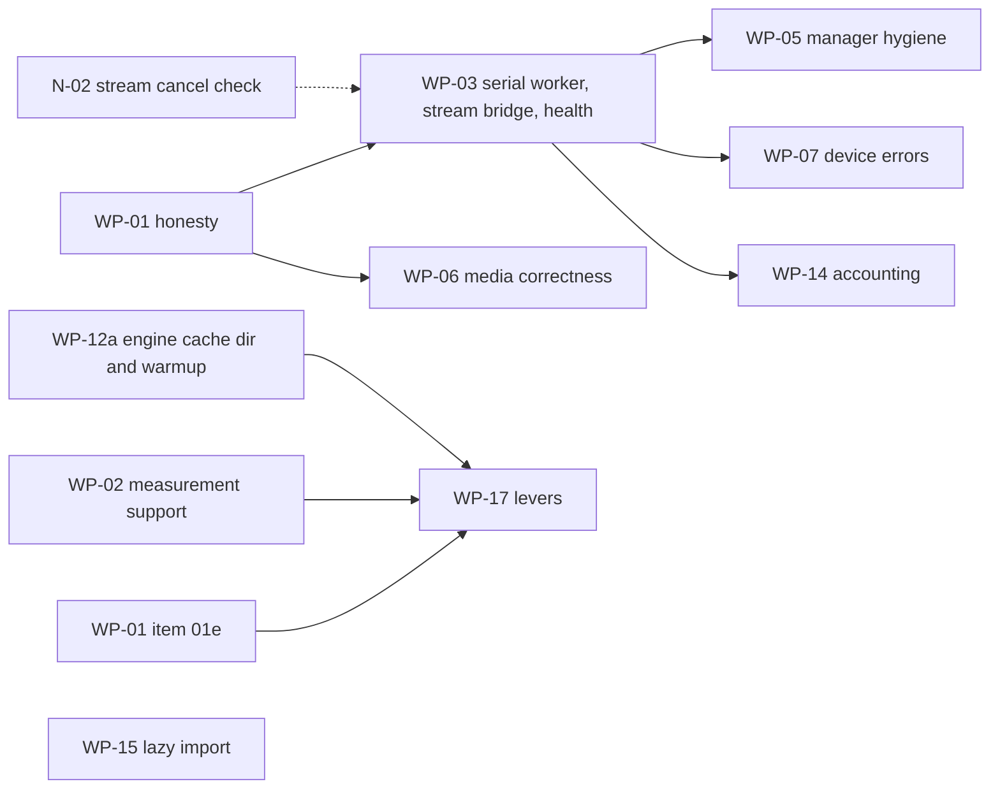

# MASTER PLAN v8 - arc-runner Native Layer: Finish, Harden, Prove, and Document Every Decision
### Base: Gemini's "10/10 Enterprise Architecture Master Plan" (conversation 700d4ff3) | Corrected by 17 skill-verified agent reviews | Orchestrated from `claude-global-library`

> **Plan file location (author machine):** `C:\Users\techd\.claude\plans\sunny-painting-pebble.md`
> **Gemini's original plan (kept as the base spec):** `C:\Users\techd\.gemini\antigravity-cli\brain\700d4ff3-bc4b-4c7a-88b8-a15dc6ba9d13\implementation_plan.md` (+ `transcript.jsonl`, stopped at step 443)
> **Status (2026-10-29, review pass 3, v8):** PLANNING ONLY, nothing implemented. Defects found in review passes 1-2 and their fixes are in Section 17, which also holds the executable slice plan and the environment split. Gemini's native-layer work is already committed on `main` (commit c7312e0), so that commit is the baseline.
> **Resume rule:** read Section 0, then Section 13 (state), then continue. Everything needed is in this file; chat history is not required.

---

## 00. ONE-PAGE SUMMARY AND PRECEDENCE (v8, read this first)

**Precedence:** Sections 21-23 are the latest and override everything else for the topics they cover (21: slice progress; 22: library access in cloud sessions, which supersedes 17.2 rule 3; 23: the performance programme, v9.0 (simplified after the round-3 reviews), whose design contract is 23.5.0 (CC-1..CC-4)); then Sections 20 (v8.2), 19 (v8.1), 18 (v8) and 17 (v7) override everything else (20 > 19 > 18 > 17); then Sections 14, 15, 16 (added later) override conflicting text in 5, 7, 8.6, 10, 11. Specifically: UML/drawio = FULL regeneration of all 13 types (15.2, not "selective 7"); roster = Section 5 plus 14.3 plus 16.1 (no `?` left, all verified); rules = 8.1 plus 16.2; execution track = LEAN (default) or FULL (14.7), your choice at approval.

**What gets done:** (1) Step 0 verification: CLOUD part now, LOCAL-only facts via `scripts/probe_hardware.py` (17.2); (2) issue + branch; (3) fix C-series bugs red-first (bounds, dtype, lifetime, ring buffer), Level Zero/Sysman honesty, engine telemetry honesty, benchmark protocol with no fabricated rows; (4) tests by an independent author; (5) docs, SRS, CLAUDE.md, CHANGELOG, VERSION 0.2.0; (6) all 13 UML + drawio regenerated from hand-built UDM and guarded by `scripts/check_docs_sync.py`; (7) CI, packaging, committed DLL with hash/ABI check; (8) every stage documented and versioned in `docs/delivery/` with a decision log. (9) v8: benchmarking program B1-B10 (Section 18) covering all domains of the existing suite, native micro-benchmarks and a v0.1.0-vs-v0.2.0 regression gate, with schema-validated JSON and generated doc tables.
**Gates needing your OK:** push, merge, tag/release (PyPI + GHCR publish).
**Known limits of this plan (honest):** hardware facts and real token cost are only settled by Step 0 and by running; per-agent skill lists are enumerated at each stage start, not here; FULL track is expensive (est. 4-6M tokens, unmeasured).

---

## 0. How to read this plan

| Part | Sections | Purpose |
|:--|:--|:--|
| Why | 1-3 | Problem, evidence, corrections to Gemini's maths |
| How (process) | 4-6 | Routing, agent/skill orchestration, token control |
| Traceability | 7-8 | Per-stage versioned docs, decision log, trace matrix |
| What (code) | 9-10 | Architecture, classes, methods, variables, tests |
| When | 11-12 | Waves, gates, git flow, risks, definition of done |
| State | 13 | Resume checkpoint, repo/hardware facts, open items |
| Review history | 14-16 | self-review v5, doc/UML sync plan, roster and rules audit (historical scores in 14.1 are v4/v5 and are superseded by 18.10) |
| Current execution plan | 17-18 | environment split, slices S-A..S-F, measurable gates, benchmarking program; these override everything else |
| Final fixes | 20 | CI naming, DLL-per-slice rule, platform support policy, local-gate slices, release rollback, approval batching |
| Wave-to-slice map | 19.1 | how W1-W3 of Section 11 map onto the slices of 17.4 |

---

## 1. Executive problem statement

Gemini built a native C/C++ layer (Win32 memory-mapped weight streaming + Level Zero USM bridge), changed the OpenVINO engine to use real `perf_metrics`, and started Sysman telemetry, then ran out of tokens right after the README edit (step 443). 26 tests pass, but 17 skill-verified reviews show:

1. **Memory-safety bugs** in the C layer (integer wrap in bounds checks, unchecked counts, views that outlive the mapping).
2. **Fabricated numbers still present**: Sysman power `22.0 W`, Sysman "free memory" from system RAM, engine fallbacks `len(text.split())`, `elapsed*200`, benchmark `REFERENCE_SWEEP` rows with hard-coded TTFT/TPS/power.
3. **Plan maths is wrong** (Theorems 1-4) and several README claims rest on it.
4. **Tests do not match the plan** (N3, N4, N5, N6, E3, E5, E7, E8 absent/renamed; P8, P9 missing).
5. **Not shipped**: no CI, no packaging of the DLL, no issue/commit/release, no SRS/CLAUDE.md/VERSION/CHANGELOG.

**Goal:** a correct, bounded, honestly-measured native layer, with every claim backed by a measurement, every decision recorded with its reason, and every stage documented so any future session can continue without re-discovery.

---

## 2. Evidence base (verdicts from the 17 skill-verified reviews)

Legend: **C**=confirmed, **P**=partly, **R**=refuted, **V**=must verify on disk/machine first.

### 2.1 Native C / Python bridge (`src/arc_runner/native/`, `engine/flash_stream/weight_streamer.py`)
| ID | Sev | Where | Finding | Verdict | Fix (design element) |
|:--|:--|:--|:--|:--|:--|
| C1 | CRIT | `arc_flash_stream_mmap.c` ~183/209/239 | `offset+size > file_size` wraps uint64, then `base_ptr+offset` OOB | C | `arc_range_ok()` helper: `size<=fsz && off<=fsz-size` |
| C2 | HIGH | `arc_mmap_register_layer` | `tensor_count>64` reads past `tensors[64]`; extents never validated at register | C (name-NUL overrun **R**: `strncmp` bounded) | validate count/dims/extents/name, copy-then-publish |
| C3 | HIGH | `bridge.py` register | ctypes silently wraps negative/huge ints; `min(len,64)` truncates; names cut at 127 | C | `_validate_u64`, raise on overflow, no truncation |
| C4 | HIGH | `weight_streamer.py:226` vs `173-193` | native path = float32 view for every tensor type; fallback differs; BF16 read as f16 | C | dtype from `tensor_type`; quantized -> raw `uint8` view |
| C5 | HIGH | views | arrays outlive `UnmapViewOfFile`; arrays writeable over `PAGE_READONLY` | C | keep-alive owner, `writeable=False`, deferred close |
| C6 | HIGH | slots | slot chosen under lock, loaded outside -> duplicates; `close()` nulls `_native_engine` under prefetch threads | C | `_RingSlot` state machine (EMPTY/PENDING/READY) + pin count + join threads |
| C7 | MED | lock/unlock | codes collide with `GetLastError`; single `is_locked` bool; VirtualLock quota 1453; never called | C | `ArcStatus` codes + `locked_bytes`; best-effort `try_pin` |
| C8 | MED | `CreateFileA` | UTF-8 path misread; MAX_PATH | C | `CreateFileW` + `\\?\` |
| C9 | LOW | 32-bit casts | `(SIZE_T)size` truncates | C | `size<=SIZE_MAX` guard |
| C10 | LOW | `build_native.py` | global `-mavx2` (15 ymm instrs in DLL, SIGILL risk) | C (`-static-libgcc` **P**: DLL imports only KERNEL32/UCRT) | drop `-mavx2` (no AVX2 code exists) |
| X1 | MED | LRU | `time.time()` ties (~15.6 ms); cyclic layer scan = 0% LRU hit | C | direct-mapped `layer % slots`, monotonic tick |
| X2 | MED | eviction | `gc.collect()` under lock; "O(1) RAM" claim false (page cache/working set); `get_active_memory_bytes` = virtual size | C | collect outside lock; add `get_resident_memory_bytes()` |
| X3 | V | reshape | GGUF `ne[0]` fastest -> `reshape(dims)` may need reversed dims | V | micro-test at Step 0 |
| X4 | LOW | layer lookup | linear scan <=256x64 is microseconds | **not a bottleneck** | no hash table |

### 2.2 Level Zero + Sysman (`arc_level_zero_bridge.c/.h`, `devices/sysman.py`)
| ID | Sev | Finding | Verdict | Fix |
|:--|:--|:--|:--|:--|
| L1 | HIGH | `query_package_power` returns constant `22.0`; `zesDeviceGetPowerProperties` does not exist; this iGPU has **0 power domains** | C | return `None` + reason; energy-counter path (`zesPowerGetEnergyCounter`) for platforms with domains |
| L2 | HIGH | memory "free" from `GlobalMemoryStatusEx` / `total//2`; iGPU has **0 memory modules** | C | `(total, None)` + reason (shared system memory) |
| L3 | MED | `stype` values look wrong (code 0x1-0x5, 0x11; recalled 0x7,0xd,0xe,0xf,0x15,0x16); driver does not validate; only 0x3 proven | V | read `ze_api.h` at Step 0, named constants |
| L4 | HIGH | `drivers[0]/devices[0]`; machine has driver0=Arc iGPU (type 1, id 0x7d55), driver1=NPU (type 5) | C | select `ZE_DEVICE_TYPE_GPU` |
| L5 | MED | create-call return codes ignored, leaks on failure | C | check every call, single cleanup path |
| L6 | LOW | queue priority 1 = LOW | C | NORMAL (0) |
| L7 | MED | `memcpy` fallback only if symbol missing, not on copy error | C | fallback on error (host/shared ptrs) |
| L8 | MED | 10 s sync > Windows TDR 2 s; reset after timeout unsafe; no fence/event overlap | C | polled wait < 2 s, mark context dead on timeout/device-lost |
| L9 | LOW | `arc_ze_destroy` leaks USM; fn pointers not nulled | C | track allocations |
| L10 | LOW | size guard; N4 verified live (`2**62` -> None) | C | explicit guard |
| L11 | MED | `zesInit` must be called **first** (after `zeInit` it returned uninitialized); only frequency telemetry works (2 domains) | C | init order fixed |
| L12 | MED | USM bridge is dead code (nothing calls `allocate_usm`/`dma_copy`) -> Theorem 5 overlap unrealised | C | keep, document, not wired in this release |

### 2.3 Engine + benchmark
| ID | Sev | Finding | Verdict | Fix |
|:--|:--|:--|:--|:--|
| E1 | HIGH | fabricated fallbacks in `openvino_engine.py` 207-231, 334 **and** benchmark 346-348 | C | `metrics_source` + validity flags, no invented values |
| E2 | HIGH | `ContextWindowExceededError` never raised (`KVCacheManager.check_headroom` exists, checks prompt only) | C | enforce prompt + `max_new_tokens` with real tokenizer count |
| E3 | LOW | `generate([p])` / `generate(p)` retry swallows real errors | C | one call form, narrow excepts |
| E4 | MED | `u8` KV default-on with no quality gate | C | gate on KL/PPL before default |
| E5 | V | `get_throughput()` definition (decode-only vs total) | V | read OpenVINO 2026.4.1 docs/source |
| E6 | LOW | stream path counts callback chunks as tokens; TPS defined differently from `generate()` | C | tokenizer counts; one definition |
| H1 | HIGH | benchmark `REFERENCE_SWEEP` rows (ttft 165.0, tps 54.2, power_w 22.0) beside real rows; README/results JSON may contain them | C | tag `projected` or remove; audit README + JSON |
| H2 | MED | Ollama TTFT ~503/502/524 ms suspiciously constant; CPU vs iGPU; Q4_K_M vs OV INT4 | hypothesis | fair protocol (Section 10.9) |

### 2.4 Tests (26 pass, coverage differs from plan)
P1 weak; P6 not skipped without GPU; P8 absent; P9 mislabelled (is Sysman); N3, N4, N5, N6, E3, E5, E7, E8 absent/renamed. Hardware marker = `@pytest.mark.hardware` + `require_intel_gpu` (tests/conftest.py).

---

## 3. Corrections to Gemini's maths (replace in README/docs; each becomes a Decision Log entry)

Notation: `N_L` layers, `d` hidden, `d_kv = H_kv*d_h`, `d_ff` FFN width, `L` prompt tokens, `S` context length, `W` weight bytes.

| Theorem | Gemini | Correct form | Effect |
|:--|:--|:--|:--|
| T1 prefill | `N_L(2L^2 d + 8 L d^2)` | `FLOPs = N_L * L * (4d^2 + 4 d d_kv + 6 d d_ff) + N_L * 2 L^2 d` (SwiGLU FFN = `6 d d_ff`) | 1.5B@512: 1.36e12 (plan 2.93e11) = **4.6x**; 32B 4.6x; 72B 3.2x. Measured TTFT 100-156 ms implies ~60-100-token prompt or a different peak -> recompute with real `L` |
| T2 roofline | `99.8% of roofline` using `eta=0.61` | `TPS_max = B_sustained / (W + KV_bytes)`; no extra `eta` when B is already "sustained" | real decode = **~61%** of 74.5 GB/s; peak depends on memory type (V: LPDDR5x-7467 ~119 GB/s vs CIM saw 2x8GB@5600 ~89.6 GB/s) |
| T3 KV | `+18-25%` from u8 | `KV_bytes/token = 2 N_L H_kv d_h b` (b=2 FP16, 1 u8); gain `= (KV_fp16*S/2) / (W + KV_fp16*S)` | 1.5B: 28,672 B/token; **~3.5% at S=2048**, 18% needs S~12k |
| T4 Python overhead | `+15%` | gain `= 1/(1 - f_python)`, `f_python` must be measured end-to-end; streaming is I/O bound (layer read 40-90 ms vs 0.18 ms) | probably **<1%**; 13 tok/s for 32B needs ~239 GB/s (> peak) |
| Xe-LPG | 1,792 lanes, 4.03 TFLOPs XMX, 256 KB SLM | 896 FP32 lanes; 4.03 TFLOPs is FP32 vector; no XMX on Meteor Lake (V); 256 KB SLM is Xe2 | text fixed |
| NT loads | `_mm_stream_load_si128` L3 bypass | ineffective on write-back mapped pages; **code has no CPU copy to bypass** | not built; measurement script only |
| NPU draft | 5 W, 2.5-3.2x energy | unsourced for NPU 3720 (FP16/INT8 only); ~1.0-1.15x or slower on 1.5B; shares LPDDR bus | no code change; claim marked unverified |

---

## 4. Routing (decision tree, recorded)

Human nodes (answered by you): D01 **Brownfield** | D02 **yes** RE whole repo | D03 **yes** Ph0 | D04 **yes** Ph1 | D05 no | D06 **yes** Ph2 | D07 no | D08 **yes** Ph4 | D09 **yes** Ph5 | D10 no | D11 **yes** Ph7 | D12 **yes** Ph8.
Auto nodes: D13 **Squad** | D14 **pattern:79** silicon-architecture (lead `heterogeneous-systems-engineer`, math `silicon-mathematics-expert`) | D15 **B1** F.1+F.2+F.6 (re-evaluate: GGUF parser = untrusted input) | D16 always C+E | D17 B1 context-eng + A.5 | D18 B2 (Ph1 runs) | D19 B1 orchestrator-agent | D21 **B1** (LLM stack -> A.6, A.6.1, H) | D22 B1 self-correct <=3 (SC.3 escalates) | D23 B2 unless RE marks DIRTY (then IV.1/IV.2).
Path string: `D01:Brownfield -> D02:B2 -> D03:B2 -> D04:B2 -> D06:B2 -> D08:B2 -> D09:B2 -> D11:B2 -> D12:B2 -> D13:B1 -> D14:B60(pattern:79) -> D15:B1 -> D16:B1 -> D17:B1 -> D18:B2 -> D19:B1 -> D21:B1 -> D22:B1 -> D23:B2 -> phase:execution-plan`

### 4.1 Phase timeline

```
 S00 intake/route
   |
 S01 RE (whole repo) ----> S02 Ph0 PRD/BRD ----> S03 Ph1 HLD + ADRs ----> S04 Ph2 joint validation
                                                                              |
 S05 Ph4 reconciliation <-----------------------------------------------------+
   |
 S06 Ph5 SRS + UML/drawio ----> S07 Ph7 task routing ----> S08 Ph8 pre-impl alignment
   |
 S09 A.5 context + A.6/A.6.1 harness setup
   |
 S10 Ph B implementation:  W1 (parallel A,B,C,D) -> gate -> W2 (ring buffer, tests) -> gate -> W3 (benchmark, docs, CI)
   |
 S11 Ph C anti-hallucination (NLI/FactScore >= 0.95) -> S12 Ph D QA -> S13 Ph F security (F.1,F.2,F.6)
   |
 S14 Ph H harness eval/regression -> S15 Ph E reliability (RS >= 0.95) -> S16 Ph G integration + release (user gates)
   |
 S17 retrospective + memory + RESUME.md
 (SC.1/SC.2 loop wraps any REJECT, max 3, SC.3 escalates to user)
```

---

## 5. Agent + skill orchestration matrix (all agents verified to exist, see 14.2)

Rule for EVERY row: agent reads its `agent.md` + **all** skills (frontmatter + Mandatory + Optional) in chunks, grouped <=150 KB per agent instance, returns quote-per-skill proof inside its own report file. `?` = existence not yet verified (run `ls agents/<name>/agent.md`; if absent, REPORT, do not invent; find substitutes with `knowledge-graph/_discovery/query_discovery.py`).

| Stage | Agents | Output doc(s) |
|:--|:--|:--|
| S01 RE | codebase-archaeology-agent, ast-graph-engineer, impact-analysis-agent, reverse-engineering-analyst, codebase-kg-engineer, as-built-doc-generator | S01 as-built, call graph, dead code, impact map (feeds UML UDM) |
| S02 Ph0 | business-analyst-agent, product-manager-agent, research-strategist, technology-scout-analyst, ba-pm-mathematics-expert | PRD/BRD (short: hardening scope) |
| S03 Ph1 | solution-architect, consensus-agent | HLD + ADR-0001..0009 |
| S04 Ph2 | business-analyst-agent, product-manager-agent, ba-pm-mathematics-expert | joint validation report |
| S05 Ph4 | context-faithfulness-engineer, business-analyst-agent, product-manager-agent | reconciliation report |
| S06 Ph5 | uml-from-code-engineer, uml-structural/behavioral/interaction-diagram-engineer, mermaid-diagram-engineer, drawio-diagram-architect, uml-diagram-mathematics-expert, harness-engineering-architect | SRS.md + 13 UML/drawio (Sections 8.6, 15) |
| S07 Ph7 | context-engineering-agent, prompt-generation-expert, context-faithfulness-engineer, security-testing-engineer, agile-business-mathematics-expert | task routing table (agent x work package x skills x files) |
| S08 Ph8 | scrum-master-agent, business-analyst-agent, product-manager-agent, context-engineering-agent, prompt-generation-expert | alignment checklist, go/no-go |
| S09 A.5/A.6/A.6.1 | context-engineering-agent, harness-engineering-architect, harness-mathematics-expert, loop-engineering-architect | stop conditions, budgets, model-switch policy |
| S10 Ph B | **lead** heterogeneous-systems-engineer; c-cpp-systems-engineer (x4 groups), gpu-driver-engineer, gpu-architecture-specialist, cpu-architecture-specialist, hardware-performance-engineer, accelerator-architect, llm-serving-engineer, llm-quantization-engineer; math: silicon-mathematics-expert (opus, via delegation, 13 skills in 4 parts); python/test engineers (discover) | code + wave reports |
| S11 Ph C | hallucination-detector, context-faithfulness-engineer | NLI/FactScore report on docs/claims |
| S12 Ph D | QA agents (discover); harness-engineering-architect (test-gap mapping) | QA report (coverage, DRE; targets stated honestly) |
| S13 Ph F | threat-modeling-specialist, sast-engineer, secrets-detection-specialist, dependency-vulnerability-analyst, security-lead-auditor (+ cyber-mathematics-expert if CVSS used) | STRIDE (GGUF parser, DLL loader), SAST of C, secrets scan, verdict |
| S14 Ph H | harness-evaluation-engineer, harness-mathematics-expert, testing-mathematics-expert | eval/regression gate report |
| S15 Ph E | reliability-auditor | RS computation |
| SC loop | root-cause-analysis-agent, context-faithfulness-engineer, prompt-generation-expert, context-engineering-agent | RCA + correction ADR per REJECT |
| Squad lead | orchestrator-agent | dispatch log |
| Already done (17 reviewers) | c-cpp A/B/C/D, hw-perf, cpu-arch, gpu-arch, gpu-driver, hetero+accel, llm-serving/quant, foundation+mlops, harness A/B, loop A/B, context, prompt | backfilled as S10 `review-digest` (reconstructed, flagged as such) |

**Skill-split sizes (already measured):** algorithm-design-complexity-core 189 KB (own agent), mlops-core 93 KB, bare-metal-architecture-core 66 KB, kernel-driver-development-core 59 KB, hardware-protocols-core 54 KB, cpu-microarchitecture-core 50 KB, embedded-linux-core 46 KB; all others 15-45 KB.

**Cost reality check (estimate, not measured):** the 17-agent review round consumed ~2.9M subagent tokens (+~0.4M wasted on three invalid reports). Running every roster agent through all its skills could be several million more. Controls: per-stage token budget (Section 6), stages with tiny scope (S02, S04, S05) produce one-page docs, and you may veto stages at plan approval.

---

## 6. Token-lean orchestration (rules)

1. **Agents write their own report file** and return only a <=150-word summary + path. (Saves ~1.5k tokens per agent in my context and gives the audit trail for free.)
2. **Main session does mechanical work** (pytest, gcc, git, packaging, CI YAML, JSON, version files, INDEX/TRACE updates) - no agent for that.
3. **Digest, not reports**: each agent receives only its slice (<=4k tokens: findings for its files, acceptance criteria, ownership list, doc path to write). No full plan/brief to anyone.
4. **Resume via SendMessage** while the conversation lives; in a new conversation, spawn fresh agents with the digest (they still read their skills, in chunks, with proof).
5. **Large output filtered**: `token-optimizer` MCP (`optimize_read_params`, `smart_read_analyze`, `context_budget_status`); pytest/benchmark logs trimmed to failures + tail.
6. **Gates before spend**: next wave starts only when the previous gate is green; each stage has a token budget in its `STAGE.md` (stop condition from A.6) and stops with a report if exceeded.
7. **Models**: sonnet implementers, opus only `silicon-mathematics-expert`; fallback chain on real rate limits only (sonnet -> opus -> fable -> ask you).
8. **Checkpoints**: after each gate -> local commit on feature branch + `session-mgr` `session_save` + update `docs/delivery/RESUME.md`.

---

## 7. Documentation and traceability system (`docs/delivery/`)

Purpose: every agent statement, decision, and change is a versioned file; a future session reads `RESUME.md` + `INDEX.md` and knows what was decided and why. Lives under `docs/` (exempt from the 5-root-files rule).

### 7.1 Layout
```
docs/delivery/
  RESUME.md                  current stage, last gate, next action, open questions (updated every gate)
  INDEX.md                   doc_id | title | version | status | stage | path | updated | commit
  DECISION_LOG.md            append-only DL-### entries (never edited; superseded by new entries)
  TRACEABILITY.md            finding -> requirement -> ADR -> code symbol -> test -> evidence doc
  adr/ADR-000N-<slug>.md     architecture decisions (versioned)
  stages/
    S00-intake-routing/      STAGE.md + agent-reports/
    S01-reverse-engineering/ ... S17-retrospective/
      STAGE.md               inputs, agents+skills, decisions made, outputs, gate result, token spend, version
      agent-reports/<agent>.v<N>.md   one file per agent invocation (immutable once approved)
  review-digest/             backfill of the 17 reviews (marked "reconstructed")
scripts/check_delivery_docs.py   CI check: front matter valid, INDEX parity, versions monotonic
```

### 7.2 Document front matter (every .md in docs/delivery)
```yaml
doc_id: DOC-S03-HLD           # stable, never reused
title: High-Level Design - native layer hardening
stage: S03
version: 1.2.0                # semver; see 7.3
status: draft | reviewed | approved | superseded
created: 2026-10-29
updated: 2026-10-30
authors: [solution-architect, consensus-agent]   # library agent names
reviewers: [user]
inputs: [DOC-S01-ASBUILT@1.0.0, DOC-S02-PRD@1.1.0]
supersedes: null
related_issue: "#N"
git_commit: <filled at commit>
```
Bottom of each doc: **Revision history** table (version | date | author | what changed | why | commit).

### 7.3 Version policy
- **patch** (x.y.Z): wording, typos, clarifications, no change of meaning.
- **minor** (x.Y.0): new content, new finding, new evidence; conclusions unchanged.
- **major** (X.0.0): a decision or conclusion changed. Requires a new `DL-###` that references the old one, and the old doc keeps `status: superseded` with a pointer.
- Never delete or overwrite history: edit = new version + revision-history row; INDEX + TRACEABILITY updated in the same commit; commit trailer `Doc-Version: DOC-S03-HLD@1.2.0`.
- `check_delivery_docs.py` fails CI if front matter is malformed, a doc is missing from INDEX, a version goes backwards, or a changed doc has no new revision row.

### 7.4 Agent report template (`agent-reports/<agent>.v<N>.md`)
1. Header: agent, persona, model, stage, task (digest id), date, tokens used.
2. **Skill proof table**: skill | size | lines read | verbatim quote | relevance (no quote = report invalid).
3. Findings: claim | verdict (confirmed/partly/refuted/unverified) | evidence | file:line.
4. Decisions proposed (-> become DL entries after review).
5. Files touched (must match ownership), tests added/changed, before/after numbers.
6. Unverified items and confidence; escalations; REQUEST-TO-OWNER items.

### 7.5 Decision Log entry template (`DECISION_LOG.md`, append-only)
`DL-### | date | stage | decision | WHY | alternatives rejected (and why) | evidence (doc_id@ver, file:line, measurement) | proposed by (agent) | approved by (user/gate) | affects (ADR, code, tests) | supersedes`

### 7.6 Seed decisions (already made; to be written into DECISION_LOG.md as DL-001..)
| DL | Decision | Why | Rejected alternative |
|:--|:--|:--|:--|
| 001 | Gemini plan stays the base spec | user instruction; most work already done and tests pass | restart from scratch (waste) |
| 002 | Route to `silicon-architecture`, pattern 79; math = `silicon-mathematics-expert` | discovery tool + domain-refs + CLAUDE.md math rule | `systems-programming` only; generic `mathematics-engineer` |
| 003 | Every agent reads ALL skills (frontmatter+mandatory+optional), grouped <=150 KB, quote proof | user rule; three first agents falsely reported reading | sampling skills; mandatory-only |
| 004 | Do NOT build MOVNTDQA L3-bypass | ineffective on WB pages; no CPU copy exists; page-fault cost dominates | implement as written in plan |
| 005 | Host USM default for streamed weights, confirmed by Step-0 timing | iGPU shares LPDDR; device USM adds a copy; shared USM migrates | device USM (plan), shared USM |
| 006 | Sysman returns `None` + reason, never fabricated values | machine reports 0 power domains / 0 memory modules | keep 22.0 W / RAM-as-VRAM |
| 007 | Sealed-after-registration flag (release/acquire), not rwlock | table immutable after load; zero reader cost | rwlock |
| 008 | Direct-mapped ring slots (`layer % slots`) | cyclic scan makes LRU hit rate 0%; no timestamps | LRU |
| 009 | Remove global `-mavx2`; no AVX2 code now | no intrinsics in sources; SIGILL risk; YAGNI | runtime-dispatched AVX2 TU |
| 010 | Commit prebuilt DLL with safeguards (ABI/hash check, Python fallback) | user decision (3 agents advised against) | gitignore + CI build |
| 011 | Release/tag only on your separate OK | release triggers PyPI + GHCR publish (irreversible) | auto-release |
| 012 | Keep tracked `uml/`+`drawio/` | repo precedent (26 files) despite rule 45 | untrack |
| 013 | Leave root `CONTRIBUTING.md` | pre-existing, out of scope; reported | move to docs/ |
| 014 | Keep float telemetry fields, add validity flags | avoids breaking consumers/tests | change to Optional |
| 015 | Tests authored by a different agent than implementers | avoids Goodhart on weak tests | implementers write tests |
| 016 | Agents write their own report files | token cost + audit trail | main session transcribes |
| 017 | Version 0.1.0 -> 0.2.0 | new feature + behaviour fixes | patch bump |
| 018 | Restate/remove T1-T4, 18-25%, 99.8%, NPU energy claims | math checked by 5 agents | keep |
| 019 | LEAN track skips Ph0/Ph2/Ph4/Ph7/Ph8, S11, S14, S15 (only if user picks LEAN) | proportionality (14.7) | FULL track |
| 020 | Full regeneration of all 13 UML/drawio types once | rule 45 s3.1: new package | selective regen |
| 021 | Rules 03,04,06-10,13-18,20-26,30-32,34,42-43 marked not applicable | languages/frameworks untouched | re-audit each session |

### 7.7 Trace matrix seed (`TRACEABILITY.md`)
| Finding | Requirement | ADR | Code symbol | Test | Evidence |
|:--|:--|:--|:--|:--|:--|
| C1 | FR-001, NFR-001 | ADR-0002 | `arc_range_ok`, `arc_mmap_get_tensor_ptr` | `test_arc_range_ok_uint64_wrap_rejected` | S10 W1 A report |
| C2/C3 | FR-001 | ADR-0002 | `arc_mmap_register_layer`, `NativeMemoryEngine.register_layer`, `_validate_u64` | N3 tests | S10 W1 A |
| C4 | FR-001 | ADR-0002 | `dtype_for_tensor_type` | `test_get_tensor_buffer_f16_dtype_matches_fallback` | S10 W1 A |
| C5 | FR-001 | ADR-0003 | `_MappingGuard`, `NativeMemoryEngine.close` | `test_close_with_live_view_defers_unmap` | S10 W1 A |
| C6/X1 | FR-001 | ADR-0004 | `_RingSlot`, `_reserve_slot` | `test_acquire_concurrent_same_layer_single_load` | S10 W2 A |
| L1/L2 | FR-003 | ADR-0009 | `LevelZeroSysman.query_*` | `test_query_package_power_none_without_domains` | S10 W1 B |
| E1/E2 | FR-002, FR-004 | ADR-0006 | `_telemetry_from_perf_metrics`, `_enforce_context_window` | E7 tests | S10 W1 C |
| H1 | FR-005 | ADR-0007 | `BenchSample`, `evaluate_speedup_gate` | `test_gate_rejects_projected_rows` | S10 W3 |

---

## 8. Rule compliance + tooling

### 8.1 CLAUDE.md / rules matrix
| Rule | Application |
|:--|:--|
| Plan mode | Active; scope change re-enters plan mode (done at each revision) |
| Library-only orchestration | Section 5; prompts start with library-path line; absent agents reported |
| Issue before fix | `github_create_issue` first; labels `native`, `correctness`, `fake-telemetry`, `docs-drift`, `not-implemented`; commits reference `#N` |
| MCP-first | Section 8.2 |
| 01 common standards | specific exceptions, no swallow (E3); structured logging via `arc_runner.core.logging.get_logger(name)` with key-value `extra`; no secrets; validate input; functions <20 lines target; tests `test_<function>_<scenario>_<expected>`; conventional commits; Python stays snake_case (surrounding code wins over camelCase line, DL) |
| 12 docstrings-only | Google-style docstring on every public/protected function; zero narrating inline comments (TODO/FIXME/noqa/algorithm notes allowed); Doxygen headers in C |
| ASCII-only new Python | cp1252 safe (old files already non-ASCII, untouched) |
| 11 doc governance | create SRS.md, CLAUDE.md, VERSION (`0.2.0`), CHANGELOG.md at root; everything else under `docs/`; CONTRIBUTING.md untouched (reported) |
| 44 SRS | SRS.md sections 1-6, append-only FR/NFR with Source=#N, AC per FR, Change Log row |
| 45 UML | FULL regen of all 13 types (Section 15.2 overrides 8.6), UDM `model_data` hand-built |
| 46 architecture docs | CLAUDE.md `## Architecture & Structure`, README `## Architecture`, `docs/architecture.md`, tag `<!-- Introduced in v0.2.0 -->` |
| Engine v2 hook-free | no hooks re-added; Stop hook may auto-open a PR on feature branches (accept/report) |
| Attribution | commits end `Co-Authored-By: Claude Sonnet 5.5 <noreply@anthropic.com>`; PR body ends with Claude Code line |

### 8.2 MCP usage
`standards-loader` (Step 0), `pre-tool-gate` `validate_agent_dispatch` before each wave, `post-tool-tracker` (`increment_progress`, `check_commit_readiness`), `policy-enforcement` `verify_compliance` (end), `github-api` (issue, labels, branch, PR, `github_validate_build`, merge, close), `git-ops` (status, diff, commit, push, log), `push-gate` `check_push_allowed` before push, `session-mgr` checkpoints, `token-optimizer`, `uml-diagram` + `drawio-diagram`. Not used: jira, jenkins, figma, GA4/GTM/GSC, vector-db, LLM provider MCPs, trends, dataforseo (and `dataforseo`, `google-search-console` failed to connect: irrelevant).

### 8.3 Step 0 - verify before any edit (read-only; the single authoritative list, 14.8 only gives commands; environment split in 17.2)
1 `ze_api.h`/`zes_api.h` struct types. 2 memory type/speed (CIM). 3 `PerfMetrics.get_throughput` definition. 4 GGUF dim order. 5 XMX absence / SLM size. 6 USM timing micro-benchmark (host/device/shared) in scratchpad. 7 ctypes array attribute assignment for keep-alive owner. 8 baseline pytest counts. 9 snapshot of `native/` (untracked) + hashes. 10 `ls` every `?` agent.

### 8.4 SRS content (SRS.md, append-only)
FR-001 bounded native tensor access; FR-002 truthful telemetry; FR-003 Sysman real-or-None; FR-004 context-window enforcement; FR-005 benchmark provenance + fair Ollama comparison. NFR-001 input validation/security; NFR-002 portable fallback when native lib missing/mismatched; NFR-003 reproducible measurements; NFR-004 documentation traceability (docs/delivery).

### 8.5 CLAUDE.md (new) required headings
`## Project Overview`, `## Architecture & Structure` (incl. native package tree, `docs/delivery/` pointer, `RESUME.md` as session entry point), `## Development Guidelines` (docstring rule, ASCII, hardware marker, how to build native lib, doc versioning rule).

### 8.6 UML/drawio content notes (SUPERSEDED scope: Section 15.2 requires FULL regeneration of all 13 types; this list only names the must-contain symbols)
Class: `NativeMemoryEngine`, `NativeLevelZeroBridge`, `_MappingGuard`, `FlashStreamWeightManager`, `_RingSlot`, `LevelZeroSysman`, `OpenVINOGenAIEngine`, `EngineTelemetry`, `KVCacheManager`, `BenchSample`. State: `_RingSlot` EMPTY->PENDING->READY->(pinned)->EMPTY. Deployment: Python process, `libarc_native_sys.dll` + sidecar, `ze_loader.dll`, GPU/NPU drivers, GitHub Actions windows runner. Output `uml/*.md`, `drawio/*.drawio`; failures logged, never block.

---

## 9. System architecture

```
+--------------------------------------------------------------------------------------+
|                 CLI / FastAPI / OpenAI + Ollama compatible API (unchanged)             |
+--------------------------------------------------------------------------------------+
        |                                    |                                |
        v                                    v                                v
+-----------------------+      +---------------------------+     +---------------------------+
| OpenVINOGenAIEngine   |      | FlashStreamWeightManager  |     | LevelZeroSysman           |
| engine/openvino_...py |      | engine/flash_stream/...   |     | devices/sysman.py         |
| - perf_metrics only   |      | - _RingSlot state machine |     | - GPU-only selection      |
| - context-window gate |      | - direct-mapped slots     |     | - None + reason           |
| - validity flags      |      | - pin counts, join on close|    | - zesInit first           |
+-----------------------+      +---------------------------+     +---------------------------+
        |                                    |
        |                                    v
        |                      +---------------------------------------------+
        |                      | native/bridge.py (ctypes)                   |
        |                      |  NativeMemoryEngine | NativeLevelZeroBridge  |
        |                      |  _MappingGuard keep-alive | python fallback   |
        |                      +---------------------------------------------+
        |                                    |  (ABI version + SHA-256 checked on load)
        |                                    v
        |                      +---------------------------------------------+
        |                      | libarc_native_sys.dll                       |
        |                      |  arc_flash_stream_mmap.c  (CreateFileW,     |
        |                      |   MapViewOfFile, VirtualLock best-effort)   |
        |                      |  arc_level_zero_bridge.c  (GPU select, USM,  |
        |                      |   polled sync < TDR, dead-context flag)     |
        |                      +---------------------------------------------+
        v                                    |
 openvino_genai (GPU/CPU/NPU)                v
                                  ze_loader.dll -> Intel Arc iGPU (type 1) | NPU (type 5, not used for USM)
```

---

## 10. Code-level specification (classes, files, methods, variables)

Convention: existing names kept where they work; **NEW** = new symbol; **CHG** = changed behaviour/signature. Python: ASCII, Google docstrings, no narrating comments, logger = `get_logger("<module>")`. C: C17, `-Wall -Wextra -Wpedantic -Werror`. Signatures marked (re-read) must be re-read from the file at execution; the target behaviour is binding.

### 10.1 `native/arc_flash_stream_mmap.h/.c` (owner A)
Constants (kept): `ARC_MAX_PATH 1024`, `ARC_MAX_TENSORS_PER_LAYER 64`, `ARC_MAX_LAYERS 256`, `ARC_MAX_NAME_LEN 128`. **NEW** `ARC_NATIVE_ABI_VERSION 2`.
Structs kept (layout frozen, guarded by `_Static_assert`): `ArcTensorDescriptor` {`char name[128]`, `uint32_t tensor_type`, `uint32_t n_dims`, `uint64_t dims[4]`, `uint64_t file_offset`, `uint64_t size_bytes`} = 184 B; `ArcLayerDescriptor` {`int32_t layer_idx`, `uint32_t tensor_count`, `uint64_t total_layer_bytes`, `ArcTensorDescriptor tensors[64]`} = 11,792 B.
**CHG** `ArcMmapContext` becomes opaque in the header (body in `.c`): fields `file_handle`, `map_handle`, `uint8_t* base_ptr`, `uint64_t file_size`, `uint32_t total_layers`, `ArcLayerDescriptor layers[256]` (~3 MB, heap), `uint64_t locked_bytes` (replaces `is_locked`), `atomic_bool sealed`, `int32_t last_status`, `uint32_t last_os_error`.
**NEW** `typedef enum ArcStatus { ARC_OK=0, ARC_ERR_INVALID_ARG=-1, ARC_ERR_RANGE=-2, ARC_ERR_TOO_MANY_TENSORS=-3, ARC_ERR_BAD_EXTENT=-4, ARC_ERR_SEALED=-5, ARC_ERR_NOT_SEALED=-6, ARC_ERR_LOCK_FAILED=-7, ARC_ERR_OPEN_FAILED=-8, ARC_ERR_CLOSED=-9 } ArcStatus;`
Functions:
| Function | Behaviour |
|:--|:--|
| `static inline bool arc_range_ok(uint64_t fsize, uint64_t off, uint64_t sz)` **NEW** | `return sz <= fsize && off <= fsize - sz;` used everywhere |
| `ArcMmapContext* arc_mmap_open(const char* utf8_path, int32_t* out_status)` **CHG** | UTF-8 -> `MultiByteToWideChar` -> `CreateFileW` (`\\?\` for long paths), `FILE_SHARE_READ|FILE_SHARE_DELETE`; reject `file_size > SIZE_MAX` on 32-bit; failure -> NULL + `out_status` + `last_os_error` |
| `int arc_mmap_register_layer(ctx, const ArcLayerDescriptor*)` **CHG** | copy to local; reject sealed (-5), `layer_idx<0 or >=256`, `tensor_count>64` (-3), `n_dims>4`, each extent via `arc_range_ok` (-4); force `name[127]=0`; recompute `total_layer_bytes` with overflow check; publish only on success |
| `int arc_mmap_seal(ctx)` **NEW** | release-store `sealed=true`; after this `register_layer` returns -5 |
| `const uint8_t* arc_mmap_get_tensor_ptr(ctx, layer_idx, name, uint64_t* out_size)` | requires sealed (-6 -> NULL); acquire-load; `arc_range_ok` re-check; NULL on any error and sets `last_status` |
| `int arc_mmap_lock_range(ctx, off, sz)` / `arc_mmap_unlock_range` **CHG** | `arc_range_ok`; reject `sz==0`; update `locked_bytes`; on Win32 error store `last_os_error`, return -7 (never a raw `GetLastError`) |
| `int32_t arc_mmap_last_status(ctx)`, `uint32_t arc_mmap_last_os_error(ctx)`, `uint64_t arc_mmap_file_size(ctx)`, `uint32_t arc_mmap_layer_count(ctx)` **NEW** | accessors for opaque ctx |
| `void arc_mmap_close(ctx)` | idempotent for NULL; clears locks; no double free |
| `uint32_t arc_native_abi_version(void)`, `const char* arc_native_build_info(void)` **NEW** | checked by `bridge.py` on load |

`build_native.py` (owner A) **CHG**: functions `find_compiler() -> str` (`shutil.which("gcc")`, clear error), `compile_library(output: Path) -> None` (flags `-O2 -std=c17 -Wall -Wextra -Wpedantic -Werror -shared -Wl,--no-undefined`, no `-mavx2`, build to temp then atomic rename), `write_build_info(dll: Path) -> Path` (sidecar `libarc_native_sys.build.json`: sha256, gcc version, flags, git SHA, ABI version), `main() -> int`.

### 10.2 `native/arc_level_zero_bridge.h/.c` (owner B)
Kept: `ArcUsmType {ARC_USM_HOST, ARC_USM_DEVICE, ARC_USM_SHARED}`, `ArcZeContext` fields `ze_driver, ze_device, ze_context, ze_command_queue, ze_command_list, is_initialized`. **NEW fields**: `uint32_t device_type`, `int32_t last_status`, `uint8_t is_dead`, `uint64_t sync_timeout_ms` (default 1500, hard max 1900 < TDR 2000), allocation table `{void* ptr; size_t size;}[ARC_MAX_TRACKED_ALLOCS]` (**NEW** const).
**NEW** private header `arc_ze_types.h`: named constants `ZE_STYPE_DEVICE_PROPERTIES`, `ZE_STYPE_DEVICE_MEMORY_PROPERTIES`, `ZE_STYPE_CONTEXT_DESC`, `ZE_STYPE_COMMAND_QUEUE_DESC`, `ZE_STYPE_COMMAND_LIST_DESC`, `ZE_STYPE_DEVICE_MEM_ALLOC_DESC`, `ZE_STYPE_HOST_MEM_ALLOC_DESC` (values from the real header after Step 0), `ZE_DEVICE_TYPE_GPU=1`.
| Function | Behaviour |
|:--|:--|
| `ArcZeContext* arc_ze_init(void)` **CHG** | `zeInit(GPU_ONLY)`; loop all drivers x devices, `zeDeviceGetProperties`, pick first `ZE_DEVICE_TYPE_GPU` (NPU type 5 never accepted); check every create call; queue priority NORMAL; single cleanup label; `is_initialized` only on full success |
| `void* arc_ze_alloc_usm(ctx, size_t size, ArcUsmType)` **CHG** | guard `0 < size <= ARC_MAX_USM_BYTES`; record in allocation table; NULL + `last_status` on failure |
| `int arc_ze_dma_copy_async(ctx, dst, src, size)` **CHG** | on `zeCommandListAppendMemoryCopy` error -> `memcpy` only for host/shared pointers, returns distinct code `ARC_ZE_FALLBACK_MEMCPY` |
| `int arc_ze_synchronize(ctx)` **CHG** | poll `zeCommandQueueSynchronize` in <=250 ms slices up to `sync_timeout_ms`; on timeout/`ZE_RESULT_ERROR_DEVICE_LOST` set `is_dead`, never reset a possibly in-flight list |
| `int arc_ze_is_dead(ctx)`, `int32_t arc_ze_last_status(ctx)`, `uint32_t arc_ze_device_type(ctx)` **NEW** | accessors |
| `void arc_ze_free_usm(ctx, ptr)` | NULL-safe; removes from table |
| `void arc_ze_destroy(ctx)` | frees outstanding USM, destroys list/queue/context in reverse order, nulls function pointers |

### 10.3 `native/bridge.py` + `core/exceptions.py` (owner A)
**NEW** in `core/exceptions.py` (verify base `ArcRunnerError` constructor first): `NativeLayerError(ArcRunnerError)`, `NativeBoundsError(NativeLayerError)`.
Module constants (**NEW**): `_U64_MAX = (1 << 64) - 1`, `_MAX_TENSORS_PER_LAYER = 64`, `_MAX_NAME_BYTES = 127`, `_MAX_DIMS = 4`, `_EXPECTED_ABI_VERSION = 2`, `_ENV_DISABLE_NATIVE = "ARC_NATIVE_DISABLE"`.
Kept: `ArcTensorDescriptor`, `ArcLayerDescriptor` (ctypes mirrors; add `assert ctypes.sizeof(...) == 184 / 11792` at import), `_load_native_library()`, `_configure_signatures(dll)`.
- `_load_native_library() -> Optional[ctypes.CDLL]` **CHG**: honour `ARC_NATIVE_DISABLE`; on `OSError`/missing symbol/ABI mismatch/sidecar sha256 mismatch -> log WARNING (structured: `reason`, `path`) and return None (fallback path, plan N5).
- `_validate_u64(value: int, field: str) -> int` **NEW**; `dtype_for_tensor_type(tensor_type) -> np.dtype` **NEW** (F32->float32, F16->float16, I8->int8, BF16/quantized -> uint8 raw); `_reshape_dims(dims) -> tuple` **NEW** (applies GGUF order result from Step 0).
- `class _MappingGuard` **NEW**: holds the engine reference and a view counter; released when the last numpy view is garbage-collected; `close()` defers `arc_mmap_close` until count is 0.
- `class NativeMemoryEngine` methods: `__init__(file_path=None)`; `is_available` (property); `is_open` (property); `open_model(file_path) -> bool` (raises `FileNotFoundError` if missing, `NativeLayerError` on native failure); `register_layer(layer_idx, tensors) -> bool` **CHG** (raises `NativeBoundsError` instead of truncating/False); `seal() -> None` **NEW**; `get_tensor_buffer(layer_idx, tensor_name, dtype, dims=None) -> Optional[np.ndarray]` **CHG** (read-only, keep-alive owner, rejects `out_size % itemsize != 0`); `lock_range`/`unlock_range` **CHG** (best-effort, returns bool, logs `os_error`); `last_error() -> Tuple[int,int]` **NEW**; `close()` idempotent; `__del__` guarded.
- `class NativeLevelZeroBridge` **CHG**: `allocate_usm(size_bytes, usm_type="host")` (default host, DL-005; rejects `<=0` and `>=2**63`), `dma_copy_async`, `synchronize() -> int`, `is_dead` property **NEW**, `free_usm`, `destroy`.

### 10.4 `engine/flash_stream/weight_streamer.py` (owner A, wave 2)
**NEW** `class SlotState(enum.Enum): EMPTY, PENDING, READY`.
**NEW** `@dataclass class _RingSlot`: `layer_idx: int = -1`, `state: SlotState = EMPTY`, `pin_count: int = 0`, `ready_event: threading.Event`, `arrays: Dict[str, np.ndarray]`, `load_error: Optional[BaseException] = None`.
`FlashStreamWeightManager` attrs: kept `_lock` (-> `threading.RLock`), `ring_buffer_slots`; **NEW** `_slots: List[_RingSlot]`, `_closing: threading.Event`, `_prefetch_threads: Set[threading.Thread]`, `_pointer_cache: Dict[Tuple[int,str], Tuple[int,int]]` (layer,name)->(address,size) built in `index_layers`, `_slot_wait_timeout_s: float = 30.0`.
Methods: `index_layers()` **CHG** (registers, validates every extent at load, seals, fills pointer cache); `_slot_index_for(layer_idx) -> int` **NEW** (`layer_idx % ring_buffer_slots`); `_reserve_slot(layer_idx) -> Tuple[_RingSlot, bool]` **NEW** (under lock: if READY same layer -> reuse; if PENDING same layer -> wait on event; if other layer pinned -> wait with timeout, then `TimeoutError`; else mark PENDING + set layer_idx); `_load_layer_into_slot(layer_idx, slot_idx)` **CHG** (local bind of native engine, dtype/shape fixed, load outside lock, set READY/`load_error`, set event); `acquire_layer_weights(layer_idx)` **CHG** (reserve -> wait -> `pin_count += 1`); `prefetch_layer_async(layer_idx, slot_idx)` **CHG** (skips if layer resident, registers thread); `release_layer_slot(slot_idx)` **CHG** (decrement pin; `gc.collect()` outside lock only when slot is recycled); `get_active_memory_bytes()` (documented as mapped/virtual); `get_resident_memory_bytes()` **NEW** (Win32 `GetProcessMemoryInfo` working set); `close()` **CHG** (set `_closing`, join prefetch threads, drop arrays, then close native); `_calculate_tensor_byte_size`: unknown quantized type raises instead of returning `max(n,1)`; `_read_tensor_array` fallback: BF16 not mapped to float16.

### 10.5 `devices/sysman.py` (owner B)
Remove `_MemoryStatusEx` and the `GlobalMemoryStatusEx` path; replace `_ZeDeviceMemProps` with correct struct + named stype. `LevelZeroSysman` attrs: kept `_dll`, device list; **NEW** `_gpu_handles: List[Any]`, `_unavailable_reasons: Dict[str, str]`. Methods: `_load_library()`, `_configure_signatures()`; `_init_devices()` **CHG** (`zesInit(0)` first, enumerate drivers/devices, keep only GPU); `is_available()`; `query_gpu_memory(device_index=0) -> Tuple[Optional[int], Optional[int]]` **CHG** (`(total, None)` unless `zesMemoryGetState` available, never RAM); `query_package_power(device_index=0) -> Optional[float]` **CHG** (energy-counter delta watts or `None`); `query_frequency_mhz(device_index=0) -> Optional[float]` **NEW**; `get_unavailable_reason(metric: str) -> Optional[str]` **NEW**.

### 10.6 `engine/openvino_engine.py` + `engine/models.py` (owner C)
`EngineTelemetry` (models.py) keeps all fields; **NEW** fields: `metrics_source: str = "unavailable"` ("ov_perf_metrics" | "wallclock_stream" | "unavailable"), `is_estimate: bool = False`, `is_ttft_valid: bool = False`, `is_tps_valid: bool = False`, `prompt_tokens: int = 0`, `tpot_ms: float = 0.0`, `decode_tokens_per_second: float = 0.0`, `kv_cache_precision: str = ""`, `has_fallback_been_used: bool = False`.
`OpenVINOGenAIEngine` new/changed methods: `_build_ov_properties(device) -> Dict[str, Any]` **NEW** (CACHE_DIR, KV_CACHE_PRECISION gated, PERFORMANCE_HINT, SDPA only for GPU); `_count_prompt_tokens(prompt) -> int` **NEW** (real tokenizer); `_enforce_context_window(prompt_tokens, max_new_tokens) -> None` **NEW** (uses `KVCacheManager.check_headroom` and also checks `prompt_tokens + max_new_tokens`; raises `ContextWindowExceededError`); `_invoke_pipeline(prompt, ov_config)` **NEW** (single call form, narrow `TypeError` handling only for return-type shape); `_telemetry_from_perf_metrics(raw_result, wall_sec) -> EngineTelemetry` **NEW**; `_telemetry_unavailable(wall_sec, reason) -> EngineTelemetry` **NEW** (zeros + `metrics_source="unavailable"`, flags False); `generate()` / `generate_stream()` **CHG** (no `len(split())`, no `elapsed*200/500`; stream TTFT only from real `first_token_time`, label `wallclock_stream`; empty prompt resets telemetry and returns immediately).

### 10.7 Benchmark (owner G): `src/arc_runner/benchmark/stats.py` **NEW** + `scratch/run_live_real_models_benchmark_and_compare.py` **CHG**
`stats.py`: `@dataclass(frozen=True) BenchSample {model_id, backend, iteration, ttft_ms, decode_tps, prompt_tokens, completion_tokens, source: Literal["measured","derived","projected"], is_warmup: bool, fallback_used: bool}`; `median(values)`, `coefficient_of_variation(values)`, `bootstrap_ci(values, alpha=0.05, n_resamples=2000, seed=0) -> Tuple[float,float]`, `warmup_converged(values, window=3, eps=0.05) -> bool`, `is_within_roofline(tps, weight_bytes, kv_bytes, bandwidth_gbs) -> bool`, `evaluate_speedup_gate(arc: List[BenchSample], ref: List[BenchSample]) -> ClaimGateResult` (passes only if bootstrap-ratio lower bound > 1.0, all samples `measured`, none `fallback_used`, CV <= 10%), `@dataclass ClaimGateResult {passed, reason, ratio_lo, ratio_hi, n_arc, n_ref, is_suspect}`.
Script: `LiveSequentialBenchmarkRunner.query_ollama` (keep; add `keep_alive`, `num_ctx`, `temperature=0`; TTFT from `prompt_eval_duration`, decode TPS from `eval_count/eval_duration`), `run_arc_runner_model` (uses telemetry validity flags; no fallbacks), **NEW** `warmup_backend(...)`, `measure_interleaved_ab(...)`, `write_results(raw_samples, provenance)` (JSON includes raw samples, OpenVINO/driver versions, git SHA, hardware, quantization labels), remove `REFERENCE_SWEEP`/hard-coded `power_w` (power `null` unless Sysman measured), `render_summary_table` shows `source` and CPU-vs-iGPU labels.

### 10.8 Tests (author != implementers)
Files: update `tests/test_native_system_layer.py`, `tests/conftest.py`; **NEW** `tests/test_flash_stream_ring.py`, `tests/test_sysman_honesty.py`, `tests/test_openvino_engine_telemetry.py`, `tests/test_benchmark_stats.py`. Naming `test_<function>_<scenario>_<expected>`; plan id in docstring.
| Plan id | Test (example name) | Kind |
|:--|:--|:--|
| P1 | `test_load_native_library_missing_symbol_returns_none` | unit |
| P6 | `test_arc_ze_init_selects_gpu_not_npu` | `@hardware`, `require_intel_gpu`; NOT_RUN without GPU |
| P8 | `test_generate_ttft_under_200ms_uses_perf_metrics` | `@hardware` |
| P9 | `test_kv_cache_u8_vs_f16_greedy_prefix_matches` | `@hardware` |
| P10 | `test_query_gpu_memory_total_only_labelled_shared` | unit/hardware |
| N3 | `test_arc_range_ok_uint64_wrap_rejected`, `test_register_layer_oob_extent_rejected`, `test_truncated_gguf_rejected_subprocess` | negative |
| N4 | `test_allocate_usm_oversize_returns_none` (host/device/shared) | negative/hardware |
| N5 | `test_native_disabled_falls_back_byte_identical` (env + OSError + stale ABI) | negative |
| N6 | `test_sysman_returns_none_without_driver` (patch `CDLL` -> OSError) | negative |
| N7/N8 | double close, free NULL | negative |
| E3 | `test_tensor_crossing_4k_64k_boundary_reads_exact_bytes` | edge |
| E4 | `test_concurrent_acquire_same_layer_loads_once` | edge |
| E5 | `test_register_80_layers_boundary_ok_and_256_plus_rejected` | edge |
| E6 | `test_generate_empty_prompt_returns_zero_tokens_and_resets_telemetry` | edge |
| E7 | `test_generate_over_context_raises_before_pipeline_call` | edge |
| E8 | `test_virtuallock_quota_failure_falls_back_unpinned` (mock 1453) | edge |
| new | `test_telemetry_never_contains_synthetic_values`, `test_close_with_live_view_defers_unmap`, `test_gate_rejects_projected_rows`, `test_bootstrap_ci_deterministic_with_seed` | regression |
Rule: every critical-fix test must FAIL on the pre-fix code (verified on the snapshot), pass after. Skipped hardware tests are logged NOT_RUN, never counted as pass.

### 10.9 Benchmark protocol (fair and gated)
Warmup >=3 discarded runs (until last 3 TTFT CV <= 5%, max 5), then >=10 timed (target 30, stop when 95% CI half-width <= 3%); interleaved A/B with Ollama; same prompts, `num_ctx`, `max_tokens`, `temperature=0`; decode TPS both sides = generated tokens / decode duration; report cold start separately; label CPU vs iGPU and Q4_K_M vs OV INT4; measure KV effect with an S-sweep (512/2k/8k/16k). Claim passes only if the CI bound clears; any failing model fails the claim; result above roofline ceiling -> SUSPECT (human). Quality gate for default-on `u8` KV: KL < 0.1 nats on a fixed sample set.

### 10.10 Packaging, CI, docs files
`pyproject.toml` (version 0.2.0; package-data `"arc_runner.native" = ["*.dll","*.so","*.h","*.c","*.json"]`), `src/arc_runner/__init__.py` (`__version__ = "0.2.0"`), `VERSION` (`0.2.0`), `CHANGELOG.md` (Keep a Changelog, `[UNRELEASED]` then `[0.2.0] - <date>`), `MANIFEST.in` (`recursive-include src/arc_runner/native *.dll *.so *.c *.h *.json`), `.gitignore` (`.cache/`), `.github/workflows/windows-native.yml` (renamed in v8.2: hosted windows-latest has no GPU, so it never runs hardware tests; windows-latest, MinGW via choco, `python src/arc_runner/native/build_native.py`, `pytest -q -m "not hardware"`, `python scripts/check_delivery_docs.py`, upload DLL artifact), `scripts/check_delivery_docs.py` (**NEW**, stdlib only). **DLL:** commit prebuilt DLL + sidecar (DL-010).

---

## 11. Waves, gates, loops

| Wave | Content | Gate (all must pass) |
|:--|:--|:--|
| Step 0 | verification list 8.3 + baseline | facts recorded in `S00`/`S10` docs |
| W1 (parallel, exclusive files) | A: 10.1+10.3; B: 10.2+10.5; C: 10.6; D: scratch measurement script only | `-Werror` build (single builder A), existing tests green, ownership check (`git status --porcelain` + hashes), each critical fix has failing-before test (drafted, finished W2) |
| W2 | A: 10.4; tests agent: 10.8 | native + new tests green; full `-m "not hardware"` green; hardware tests run on this iGPU or logged NOT_RUN |
| W3 | G: 10.7/10.9; docs; packaging/CI; UML/drawio; SRS/CLAUDE/CHANGELOG/VERSION | benchmark gate rules; docs checker green; README claims match JSON |
| Slice map | see 19.1: W1 = S-A, S-B, S-D; W2 = S-C; W3 = S-E1, S-E2, S-F | gates of Section 11 apply per slice |
| Quality phases | S11 C (NLI/FactScore >= 0.95), S12 D, S13 F, S14 H, S15 E (RS >= 0.95) | per template; report honestly if unreachable (e.g. DRE/coverage targets) |

**Loops:** fix-and-retest max 3 rounds per ownership slice; exit = all gates green; stall = same failing set twice or ping-pong -> stop, restore best snapshot, escalate; cap hit = "aborted", never "pass". Benchmark loop chained after fixes (warmup -> measure); runs that used a fallback are invalid. SC.1/SC.2 on any REJECT (RCA + correction ADR), SC.3 escalates after 3.

**Rollback:** per-wave local commits on the feature branch; revert to last green commit; `native/` snapshot in scratchpad; DLL reproducible from `build_native.py` (sidecar records flags/SHA).

---

## 12. Git / release flow and confirmation gates

1. Create the issue (labels) with `github_create_issue`, or `mcp__github__issue_write` in the cloud session; -> `github_create_issue_branch` -> per-wave commits via `git-ops` (`feat(native): ... (#N)` or `docs(delivery): ... (#N)` with `Doc-Version:` trailer and Co-Authored-By).
2. **Gate P - push:** `push-gate check_push_allowed` + your explicit OK.
3. PR (`github_create_pr`) -> `github_validate_build` -> review. **Gate M - merge:** your explicit OK.
4. **Gate R - tag/release:** separate explicit OK; a published release triggers `pypi-publish.yml` + `docker-build.yml` (irreversible PyPI/GHCR publish).
5. Close the issue after merge (`github_close_issue` or `mcp__github__issue_write`); memory notes saved (Section 13.5).

**Definition of done:** (1) every CONFIRMED finding fixed with a test that failed before; (2) native + full non-hardware pytest green; hardware tests pass or NOT_RUN with reason; (3) zero fabricated values anywhere (power, memory, TTFT, tokens, REFERENCE_SWEEP); README/JSON/theorem text match measurements; (4) native build clean under `-Werror`, ABI/hash check works, fallback tested; (5) docs governance satisfied (SRS, CLAUDE, VERSION, CHANGELOG, architecture docs, all 13 UML/drawio regenerated, `check_docs_sync.py` green); (6) every stage has `STAGE.md` + agent reports, INDEX/DECISION_LOG/TRACEABILITY current, `check_delivery_docs.py` green; (7) issue closed, CI valid, `git status` clean, `verify_compliance` run; (8) RESUME.md points at "released/next" state.

**Risks:** R1 token cost of all-agents-all-skills (several M tokens) -> stage budgets + you may veto stages; R2 agents skip skills -> proof table or reject; R3 unverified memory claims (stype, XMX, ctypes attribute) -> Step 0; R4 tracked DLL goes stale -> ABI/hash check + fallback; R5 engine Stop hook opens PRs on feature branch -> accept/report; R6 hardware tests unreachable off-machine -> NOT_RUN semantics; R7 doc overhead drifts -> checker script in CI.

---

## 13. STATE CHECKPOINT (read first on resume)

### 13.1 Done so far
Gemini plan located and read (author machine, not re-verifiable from the cloud session); repo gap-audited; library path and many agent files verified; 17 skill-verified reviews completed (verdicts in Section 2); decision-tree path recorded (Section 4); you chose phases (Section 4); you chose "commit the DLL"; repo docs-governance state inspected.

### 13.2 Facts to keep
- **Hardware:** Core Ultra 5 125H (Meteor Lake; 4P+8E+2LP-E; AVX2 only, no AVX-512); L3 18 MB; iGPU arch v12.71.4, 112 EUs, 7.3 GB shared "DDR"; driver0 = Arc iGPU (type 1, id 0x7d55), driver1 = NPU "Intel AI Boost" (type 5, id 0x7d1d, FP16/INT8 only); RAM 2x8 GB reported 5600 MT/s (V).
- **Repo (verified at 52ddbe4):** Gemini native layer is committed (c7312e0, incl. `libarc_native_sys.dll`); version 0.1.0; no SRS.md/CLAUDE.md/VERSION/CHANGELOG at root; `CONTRIBUTING.md` tracked at root; `uml/`+`drawio/` tracked (26 files); README headings OK, no mojibake; many old py files non-ASCII; `orchestrator/usm_bridge.py` = numpy zero-copy handoff (different concern, do not touch); workflows docker-build.yml + pypi-publish.yml; remote `techdeveloper-org/intel-arc-models-runner`; `EngineTelemetry` is in `engine/models.py`; `ContextWindowExceededError(prompt_tokens, max_context)` in `core/exceptions.py`; `KVCacheManager.check_headroom(prompt_tokens)` in `engine/kv_cache.py`; `GGUFTensorInfo(name, n_dimensions, dimensions, tensor_type, offset, size_bytes)` in `quant/models.py`; `conftest.py` fixtures `hardware_flag`, `live_topology`, `require_intel_gpu`, `require_intel_npu`.
- **Existing symbols (verified by grep):** bridge.py: `ArcTensorDescriptor`, `ArcLayerDescriptor`, `_load_native_library`, `_configure_signatures`, `NativeMemoryEngine{is_available,is_open,open_model,register_layer,get_tensor_buffer,lock_range,unlock_range,close}`, `NativeLevelZeroBridge{is_available,allocate_usm,dma_copy_async,synchronize,free_usm,destroy}`; weight_streamer.py: `FlashStreamWeightManager{index_layers,_calculate_tensor_byte_size,_read_tensor_array,_extract_short_tensor_name,_load_layer_into_slot,acquire_layer_weights,prefetch_layer_async,release_layer_slot,get_active_memory_bytes,close,__enter__,__exit__}`; sysman.py: `_ZeDeviceMemProps`, `_MemoryStatusEx`, `LevelZeroSysman{_load_library,_configure_signatures,_init_devices,is_available,query_gpu_memory,query_package_power}`; openvino_engine.py: `OpenVINOGenAIEngine{load_model,_build_ov_generation_config,generate,generate_stream,unload,get_telemetry}`; benchmark: `LiveSequentialBenchmarkRunner{query_ollama,download_model,reclaim_disk_storage,run_arc_runner_model,run_flash_stream_heavy_model,execute_all,render_summary_table}`.

### 13.3 To-do in order when resuming
1. Re-read Sections 00, 17, 18, 19 (they supersede earlier text). 2. DONE: all `?` agents verified present (14.2); QA/python/release agents found (14.3). 3. For each agent in Section 5 list skills + sizes, make <=150 KB groups. 4. Ask the user for any remaining choice (only if blocking), then ExitPlanMode. 5. On approval: Step 0, create issue/branch, scaffold `docs/delivery/` (RESUME, INDEX, DECISION_LOG with DL-001..021 plus DL-022.. from Section 17, TRACEABILITY, stage folders, review-digest backfill from Section 2 marked reconstructed), then waves.

### 13.4 Open items for you
Root `CONTRIBUTING.md` (left as is); tracked `uml/`+`drawio/` (kept); release/PyPI/Docker publish needs separate OK; token budget per stage (tell me if you want a cap).

### 13.5 Memory to save (author machine; save when memory tools are available)
feedback: every library agent reads ALL its skills (frontmatter+mandatory+optional), split <=150 KB, quote-per-skill proof, reject otherwise; feedback: never claim roster/orchestration without verifying on disk (I wrongly said domain-refs empty); feedback: user wants Gemini-style deep readable plans (ASCII architecture, class/method/variable specs, math, test matrix) and per-stage versioned docs + decision log; project: arc-runner native-layer continuation of Gemini conversation 700d4ff3, plan at the path above, fabricated benchmark rows must never ship, release needs separate OK. Also `session-mgr` `session_save`.

---

## 14. SELF-REVIEW OF THIS PLAN (v4 -> v5, 2026-10-29) - rubric, gaps found, fixes

### 14.1 Rubric (each 0-10) - honest scoring
| Criterion | v4 | Gap found | Fix in v5 |
|:--|:--|:--|:--|
| Evidence-based problem statement | 9 | none material | - |
| Agent roster verified on disk | 6 | ~25 agents marked `?` | **Verified now: all 25 exist** (14.2). Marker `?` removed everywhere |
| QA / Python / release coverage | 5 | "discover" placeholders | Found: `qa-testing-agent`, `unit-testing-specialist`, `integration-testing-engineer`, `performance-testing-engineer`, `test-management-agent`, `python-backend-engineer`, `release-engineering-specialist`, `devops-engineer` (14.3) |
| Class/method/variable detail | 8 | signatures of existing code partly "(re-read)" | Step 0 includes a 'signature freeze' read; acceptable |
| Per-file ownership / conflict-freedom | 6 | ownership only implied | Explicit table (14.4) |
| Acceptance criteria per work package | 6 | only global DoD | Per-WP criteria (14.5) |
| Test-first order | 5 | tests came after code | Red-first rule: failing test committed before each critical fix (14.6) |
| Token proportionality | 5 | 17 stages x every agent x all skills = several M tokens, no cheaper path | Two tracks: **LEAN** (default) vs **FULL** (14.7) - you choose at approval |
| Rollback / failure handling | 8 | ok | - |
| Traceability docs | 9 | heavy but requested | LEAN track keeps only essentials |
| Honesty about unmeasured claims | 9 | ok | - |
Overall v4 ~6.8; v5 target 9+. Remaining un-closable by planning: hardware facts (Step 0), real token cost.

### 14.2 Existence check (done today, read-only `ls agents/<n>/agent.md`)
OK: ba-pm-mathematics-expert, context-faithfulness-engineer, uml-from-code-engineer, uml-structural-diagram-engineer, uml-behavioral-diagram-engineer, uml-interaction-diagram-engineer, mermaid-diagram-engineer, drawio-diagram-architect, uml-diagram-mathematics-expert, security-testing-engineer, agile-business-mathematics-expert, scrum-master-agent, harness-mathematics-expert, hallucination-detector, threat-modeling-specialist, sast-engineer, secrets-detection-specialist, dependency-vulnerability-analyst, security-lead-auditor, cyber-mathematics-expert, harness-evaluation-engineer, testing-mathematics-expert, reliability-auditor, root-cause-analysis-agent, orchestrator-agent. MISSING: none. (Skills of each still to be listed/sized at stage start, <=150 KB groups.)

### 14.3 Gap-fill roster
| Role | Agent |
|:--|:--|
| Test author (independent of implementers) | `unit-testing-specialist` (+ `integration-testing-engineer` for ring buffer/threads) |
| QA gate S12 | `qa-testing-agent`, `test-management-agent` (traceability of tests to FRs), `performance-testing-engineer` (benchmark protocol review) |
| Python glue (stats.py, weight_streamer, engine) | `python-backend-engineer` (second reviewer of owner C/G code) |
| CI workflow + packaging + release mechanics | `devops-engineer`, `release-engineering-specialist` |
| Adversarial check of honesty claims | `adversarial-deception-tester` (try to find remaining fabricated values) |

### 14.4 File ownership (no two agents edit the same file)
| Owner | Files |
|:--|:--|
| A (c-cpp-systems-engineer) | `native/arc_flash_stream_mmap.{c,h}`, `native/bridge.py`, `native/build_native.py`, `core/exceptions.py`, `engine/flash_stream/weight_streamer.py` (W2) |
| B (gpu-driver-engineer) | `native/arc_level_zero_bridge.{c,h}`, `native/arc_ze_types.h`, `devices/sysman.py` |
| C (llm-serving-engineer) | `engine/openvino_engine.py`, `engine/models.py` |
| G (hardware-performance-engineer + performance-testing-engineer review) | `benchmark/stats.py`, `benchmark/runner.py`, `benchmark/multimodal_runner.py`, `scratch/run_live_*.py`, `scripts/bench_*.py`, `scripts/{validate_bench_json,render_bench_docs,probe_hardware}.py`, `docs/benchmarks/results/*`, `docs/benchmarks/schema/*` |
| T (unit-testing-specialist) | `tests/*` and `tests/native_c/*` only |
| Main session | packaging, CI yaml, SRS/CLAUDE/VERSION/CHANGELOG, docs/delivery, git |
| Rule | A is the only agent allowed to run `build_native.py`; ownership verified by `git status --porcelain` before/after each wave |

### 14.5 Acceptance criteria per work package
| WP | Pass when |
|:--|:--|
| A1 bounds | `arc_range_ok` fuzz (>=10k random off/size incl. 2^64-1 edges) never returns pointer outside map; truncated GGUF rejected without crash; `-Werror` clean |
| A2 dtype/lifetime | F16/F32/I8 round-trip byte-identical to fallback path; close with live view does not crash (subprocess test) |
| A3 ring | 8 threads x 1000 acquire/release on 3 slots: zero duplicate loads, zero deadlock, `close()` returns <5 s |
| B1 Level Zero | on this machine `arc_ze_init` picks type-1 device; oversize alloc -> NULL; sync never blocks >2 s |
| B2 Sysman | no code path returns a constant; without driver all queries return `None` + reason |
| C1 engine | no `len(split())`/`*200`/`*500` left (grep gate); over-context raises before pipeline call; telemetry flags correct |
| G1 benchmark | no `REFERENCE_SWEEP`; every row has `source`; gate rejects projected/fallback rows |
| D docs | `check_delivery_docs.py` green; README numbers == JSON numbers (script-checked) |

### 14.6 Red-first rule
For every CONFIRMED critical/high finding: (1) test written, committed, shown FAILING on current code; (2) fix; (3) test passes. Evidence (failing output tail) saved in the agent report.

### 14.7 Two tracks (choose at approval - default LEAN)
| | LEAN (recommended) | FULL |
|:--|:--|:--|
| Stages | S00 route, S01 RE (3 agents: codebase-archaeology-agent, ast-graph-engineer, impact-analysis-agent), S03 HLD/ADR (solution-architect), S06 SRS+full UML regen (15.2), S10 W1-W3, S12 QA, S13 security (sast-engineer, threat-modeling-specialist, secrets-detection-specialist), S16 release | all S00-S17 as in Section 5 |
| Skipped in LEAN | Ph0/Ph2/Ph4 BA/PM rounds, Ph7/Ph8 alignment, S11, S14, S15 (their purpose is covered by gates in S12 + DoD); recorded as DL-019 "skipped by user choice" | none |
| Agents still read ALL their skills with proof | yes | yes |
| Est. tokens | ~1-2M | ~4-6M (estimate, unmeasured) |
Both tracks keep: issue-first, docs/delivery traceability, red-first tests, all gates, no auto release.

### 14.8 Step 0 exact commands (commands for the list in 8.3; run split per 17.2)
`gcc --version`; `python -m pytest -q --co | tail -3` and `python -m pytest -q -m "not hardware" | tail -5`; hash+copy `src/arc_runner/native/` to scratchpad; grep `ze_api.h` (Level Zero SDK path or pip `intel-level-zero` headers) for `ZE_STRUCTURE_TYPE_` values; `python -c "import openvino_genai,inspect;..."` for `PerfMetrics.get_throughput`; GGUF 2-D tensor micro-test on a small model; USM host/device/shared 256 MB copy timing script in scratchpad. Output -> `S00` doc with raw numbers.

---

## 15. CODE <-> DOCS <-> UML <-> DRAWIO SYNC PLAN (v5, user request)

### 15.1 Facts (read-only check today)
uml/ has 13 .md, drawio/ has 13 .drawio (same stems), both tracked; last regenerated 2026-10-24 (commit 1b4b452, #29) so they know nothing of `native/`. Docs: `docs/architecture.md`, `docs/diagrams/README.md` (both reference diagrams), `docs/testing.md`, `docs/deployment.md`, `docs/roadmap.md`, `docs/benchmarks/{README,comparative_matrix,empirical_silicon,mathematical_proofs,ollama_showdown}.md`, `docs/research/07_bare_metal_flash_stream_heterogeneous_orchestration.md`, `README.md`.

### 15.2 Decision (DL-020): FULL regeneration of all 13 diagram types, once
Rule 45 s3.1 mandates full regeneration on a new package (`native/`). So v5 replaces the earlier "selective 7" plan: regenerate all 13 uml/*.md and all 13 drawio/*.drawio at the end of W3 (after code is final), with hand-built UDM `model_data` (never the AST fallback), then only selective regeneration in later changes.

### 15.3 Change -> where it must be updated (the sync map)
| Code change | Docs to update | Diagrams to regenerate |
|:--|:--|:--|
| New `native/` package (DLL, bridge, 2 C modules) | README Architecture, docs/architecture.md, docs/deployment.md (DLL, MinGW build, ARC_NATIVE_DISABLE), CLAUDE.md tree | package, component, deployment, class, call_graph |
| Ring buffer state machine (`_RingSlot`) | docs/architecture.md, docs/research/07 (replace LRU text) | state, class, sequence, activity |
| Sysman honesty (None + reason) | docs/architecture.md, docs/testing.md | class, sequence |
| Engine telemetry flags + context-window enforcement | README usage/telemetry, docs/architecture.md | class, sequence, object (telemetry example) |
| Benchmark protocol + stats.py, removed REFERENCE_SWEEP | docs/benchmarks/* (all 5 files), README numbers, docs/roadmap.md | component, activity, interaction |
| Corrected theorems T1-T4 | docs/benchmarks/mathematical_proofs.md, README, docs/research/07 | none |
| Tests (new files, hardware marker semantics, NOT_RUN) | docs/testing.md | usecase (if test actors listed), communication |
| Version 0.2.0, CI workflow | CHANGELOG, VERSION, SRS Change Log, docs/deployment.md | deployment |
| docs/delivery system | CLAUDE.md pointer, docs/diagrams/README.md | none |
Remaining types (composite, interaction, communication, object, usecase) are regenerated too for consistency (full run) even when content is unchanged.

### 15.4 Procedure (main session, after W3 code freeze; uses MCP)
1. Build one UDM JSON per type from the S01 as-built (symbols from the frozen code, not from memory), saved to `docs/delivery/stages/S06-.../udm/<type>.json` (versioned input = reproducible).
2. `mcp__uml-diagram__generate_all_diagrams(model_data=...)` -> `uml/`; `mcp__drawio-diagram__generate_all_drawio(model_data=...)` -> `drawio/`; same filenames (no suffixes).
3. Stamp header in each file: `<!-- Generated ... | VERSION 0.2.0 | git <short-sha> | udm <hash> -->`.
4. Edit docs per 15.3; every doc that mentions a diagram or number gets the same stamp line "Verified against code at v0.2.0 / <sha>".
5. Render check: Mermaid parses (<=50 nodes), drawio XML well-formed; a failing type is logged and retried once, never silently left stale.

### 15.5 Automated sync gate: `scripts/check_docs_sync.py` (stdlib only, runs in CI and in DoD)
Checks: (a) every `uml/<x>.md` has `drawio/<x>.drawio`; (b) all 13 names present; (c) header stamp version == `VERSION` and sha is an ancestor of HEAD; (d) every public class/function in `native/`, `engine/flash_stream/`, `devices/sysman.py`, `engine/models.py` (via `ast`) appears in `uml/class_diagram.md`; (e) every module of `src/arc_runner/*` appears in `package_diagram`; (f) every number quoted in README/docs/benchmarks tables exists in the benchmark results JSON (or is marked `projected`); (g) every relative link in README/docs resolves; (h) CHANGELOG top version == VERSION == pyproject == `__version__`; (i) `docs/delivery/INDEX.md` parity. CI fails on any mismatch; run before every push (Gate P).

### 15.6 Staying in sync afterwards
CLAUDE.md "Development Guidelines" gets a rule: any change under `src/arc_runner/**` must run `check_docs_sync.py`; failing output lists exactly which diagram/doc is stale. Rule-45 trigger table copied into `docs/diagrams/README.md`. Agent for the work: `uml-from-code-engineer` (UDM), `mermaid-diagram-engineer`, `drawio-diagram-architect`, reviewed by `as-built-doc-generator`; checks by `unit-testing-specialist` (tests for the checker script).

### 15.7 Acceptance
`python scripts/check_docs_sync.py` exits 0; opening any drawio/uml file shows classes that exist in code (spot-check list in QA report); no doc cites a number absent from the JSON; stale-detection test: deliberately rename a class in a temp copy -> checker fails.

---

## 16. LIBRARY-WIDE AGENT COVERAGE + FULL RULE COVERAGE (v6)

### 16.1 Agents that were missing from Sections 5/14 (all verified present on disk today)
| Added agent | Stage / job | Why it earns a place |
|:--|:--|:--|
| `tla-plus-specification-engineer` | S03/S10 W2 | model-check the `_RingSlot` EMPTY/PENDING/READY + pin + close protocol for deadlock/duplicate-load before coding it |
| `chaos-engineering-specialist` | S12 | fault injection: VirtualLock 1453, device-lost, truncated GGUF, DLL missing, kill during prefetch |
| `code-review-process-engineer` | after each wave | structured review checklist/gate on the diff (replaces ad-hoc review) |
| `refactoring-strategist` | S10 W1/W2 | keeps fixes small/behaviour-preserving, flags functions >20 lines (rule 01) |
| `technical-writer-agent` | W3 docs | README/docs/CHANGELOG wording, link/number accuracy |
| `llm-benchmark-analyst` + `model-capability-profiler` | W3 benchmark | validity of TTFT/TPS methodology, Ollama fairness, quality gate for u8 KV |
| `anti-hallucination-mathematician` | S11 | scoring (FactScore/NLI) of claims in README/docs/theorems |
| `security-compliance-auditor` | S13 | maps findings to NFR-001 / rule 05 checklist |
| `supply-chain-engineer` | S13/S16 | committed DLL provenance (sidecar hash, reproducible build), pip/GHCR publish chain, dependency pins |
| `kernel-driver-engineer` | S10 W1 B | second opinion on Level Zero/TDR/device-lost handling (with gpu-driver-engineer) |
| `incident-responder-live` / `postmortem-facilitator-agent` | S17 | blameless retrospective into DECISION_LOG lessons |
Considered and rejected (domain mismatch): all `*-compliance-*` industry agents, gdscript/haskell/zig/clojure/julia, sports/agri/ERP/crypto-India, `figma-*`.
Roster rule unchanged: each agent reads ALL its skills (<=150 KB groups, quote proof, report file), digest-only prompts. In LEAN track (14.7) the following stay: tla-plus (ring protocol), chaos-engineering (S12), code-review-process-engineer, technical-writer-agent, llm-benchmark-analyst, supply-chain-engineer; the rest are FULL only.

### 16.2 All rules in `~/.claude/rules/` (53 files) - applicability audit
| Rule | Verdict | How applied here |
|:--|:--|:--|
| 01 common | APPLY | see 8.1; plus: no swallowed exceptions (E3), structured logs, <20-line functions, conventional commits |
| 02 backend (Python) | APPLY (principles) | config via env (`ARC_NATIVE_DISABLE`, not hard-coded), validate input, error handling; DB/Flask parts N/A |
| 05 security | APPLY (relevant parts) | secrets scan (S13), input validation = GGUF/paths treated untrusted (C1-C9), least privilege, no sensitive logging; auth/CORS/CSRF/SQL N/A (no web surface touched) |
| 11 doc files | APPLY | root: SRS/README/CLAUDE/VERSION/CHANGELOG only; CONTRIBUTING.md reported |
| 12 docstrings-only | APPLY | hard gate on new/modified functions; CI script counts inline comments (flake8/pylint D-rules where configured) |
| 19 exception hierarchy | APPLY (Python analog) | `NativeLayerError`/`NativeBoundsError` under `ArcRunnerError`; no raw `Exception` raises; no internal paths in user-facing messages |
| 27 centralized logging | APPLY (principle) | `get_logger` + `set_request_context` correlation id on log records; never log secrets/tokens/full user prompts; Logback/MDC specifics N/A |
| 28 test coverage | APPLY (Python analog) | per-package coverage via `pytest --cov`: gate on NEW code (`native/`, `benchmark/stats.py`, new ring code): target >=90% line + 100% of branches in bounds-check helpers; JaCoCo itself N/A; report honestly if unreached |
| 29 container deployment | APPLY (check only) | Dockerfile unchanged except: Linux image has no Windows DLL -> must fall back and tests must pass there; non-root + healthcheck kept; verify in CI/docker build |
| 33 test-case roadmap | APPLY | layer-by-layer checklist used by test author `T` to find missing layers (entry, model, validation, data/IO, service, handler, errors) |
| 35/36/37 positive/negative/edge | APPLY (as structure) | every component gets all three kinds of tests (our test table 10.8 is tagged P/N/E accordingly); Spring-specific scenarios N/A |
| 38 mocking strategy | APPLY (principle) | per-layer isolation: mock ctypes DLL/OpenVINO/Level Zero at the boundary only; no mocks for pure logic (`arc_range_ok`, stats) |
| 39/40 cross-cutting + universal patterns | APPLY (relevant) | idempotent close/free, consistent error envelope for telemetry (`metrics_source`/flags), 122-scenario list used as gap finder |
| 41 python/fastapi testing | APPLY | shared `conftest.py` fixtures (existing), layer naming, pytest markers; FastAPI routes themselves unchanged |
| 44 SRS / 45 UML / 46 architecture docs | APPLY | Sections 8, 15 |
| 03 microservices, 04/06 frontend/TS, 07 go, 08 rust, 09 swift, 10 kotlin, 13-18, 20-26, 30-32, 34, 42-43, csharp, django, flask, java, spring-boot | NOT APPLICABLE | language/framework not touched (Spring/JPA/Maven/Go/Node/etc.); recorded once in DL-021 so a future session need not re-audit |
| TOOL-OPTIMIZATION-LEVEL2 | APPLY | token-optimizer MCP for large reads/greps; `context_budget_status` per stage |
| model-fallback | APPLY | Section 6 item 7 |
Step 0 addition: `standards-loader.detect_project_type/load_standards` output saved into S00 doc; any rule it adds beyond this table is appended here and applied.

### 16.3 Policies / CLAUDE.md items re-checked
Plan mode (yes, re-entered each revision); orchestration from library only (yes, absent agents none); engineering decisions table: context (D80 yes), prompt (yes), graph (yes: fan-out W1 / fan-in gate), loop (yes: fix-and-retest, benchmark), harness (yes: gates/budgets); issue-first (yes); MCP-first (yes; failed MCPs dataforseo/google-search-console irrelevant); hook-free engine v2 (no hooks added); Windows ASCII-only python (yes); Hinglish user, detailed phase-based plan (yes).

---

---

## 17. REVIEW PASS 2 (v7, 2026-10-29): defects fixed, executable slices, environment split, measurable gates

This section overrides all earlier text. It closes every defect listed by review pass 1 and adds what a re-check of checkout 52ddbe4 found.

### 17.1 Defects found and how they are closed
| # | Defect | Resolution |
|:--|:--|:--|
| D1 | Header pointed at a Section 17 that did not exist | this section |
| D2 | Section order 13 after 16; title v4 vs Section 00 v6 | 13 moved before 14; title and status now v7 |
| D3 | 8.6 and DoD(5) and LEAN row said "selective" UML, 15.2 says FULL | all three rewritten to FULL (8.6 kept only as a symbol checklist) |
| D4 | DL-001..018 vs DL-001..021 | 13.3 says 001..021; new DL-022..028 below |
| D5 | Step 0 duplicated in 8.3 and 14.8 | 8.3 is the single list, 14.8 only holds commands |
| D6 | Baseline commit worry: "main holds uncommitted Gemini work" | FALSE in the current repo. Gemini's work is committed as c7312e0 (verified: `git show --stat`), so red-first tests are shown failing against c7312e0 and no snapshot commit is needed |
| D7 | LEAN vs FULL undecided | default fixed to LEAN (DL-022); FULL only if you say so |
| D8 | Plan assumes the author's Windows machine, the `claude-global-library`, and custom MCPs; this cloud session is Linux with none of them | environment split 17.2 |
| D9 | Plan describes the C layer as Win32-only, but the sources also contain POSIX branches (`mmap`, `mlock`, `munmap`, `st_size`) with the same wrap bug | every C fix applies to both branches (17.3) |
| D10 | 60+ agent plan for a hardening fix; no hard budget | slice plan 17.4 with a token cap per slice |
| D11 | Acceptance criteria partly qualitative | 17.6 gives a command and a threshold per criterion |
| D12 | T1/T3 numbers not independently re-derived | re-derived 17.7 (T1 verified; T3 needs the weight-bytes assumption stated) |
| D13 | Committed DLL is built from pre-fix source; a Linux box cannot rebuild it with MinGW natively | 17.5 |

### 17.2 Environment split (what can run where)
| Env | Has | Cannot |
|:--|:--|:--|
| CLOUD (this session: Linux, gcc 13.3, Python 3.13, git/GitHub tools, built-in agents Explore/Plan/general-purpose) | build and test the C code on Linux/POSIX with ASan/UBSan; all pure-Python tests; benchmark statistics; docs, SRS, UML text, checkers, CI YAML | Windows API paths, DLL load, Level Zero, Sysman, OpenVINO on Arc iGPU, library agents, library MCPs (`standards-loader`, `push-gate`, `session-mgr`, ...) |
| LOCAL (author machine: Windows, Core Ultra 5 125H, Arc iGPU, library, MCPs) | everything incl. hardware tests and live benchmark | nothing |
Rules:
1. Step 0 items split: LOCAL-only = ze/zes headers values, memory speed, USM timing, XMX/SLM, `get_throughput` on real run, GGUF dim order on real GGUF with OpenVINO; CLOUD-ok = baseline pytest counts, native snapshot hashes, gcc version, ctypes keep-alive attribute test, `PerfMetrics` docs read.
2. LOCAL-only items are produced by ONE script `scripts/probe_hardware.py` (stdlib + optional imports, prints JSON of every fact with a `status` of ok/unavailable and the raw value). The user runs it once and commits/pastes the JSON; until then every dependent claim stays "unverified" and its code uses the safe default (host USM, GPU-only select, `None` telemetry).
3. Library agents and custom MCPs are used only when present. In CLOUD the same ownership table (14.4), digest-only prompts, and report-file rule apply with built-in agent types; the "all skills + quote proof" rule is applied to whichever skills exist and the absence is logged in the stage doc (DL-023). Never claim a library agent ran when it did not.
4. Anything not runnable in the current env is recorded NOT_RUN with the reason, never as pass.

### 17.3 POSIX parity and sanitizer proof (new, runnable in CLOUD)
- Findings C1, C2, C7, C9 apply to the POSIX branch too (`arc_mmap_lock_range` and `arc_mmap_unlock_range` use `offset + size` at lines 209/239; the POSIX open path uses `st_size`). C8 (`CreateFileW`) is Windows-only.
- Add `tests/native_c/` C harness (no Python) compiled with `gcc -std=c17 -Wall -Wextra -Wpedantic -Werror -fsanitize=address,undefined -fno-sanitize-recover=all` against `arc_flash_stream_mmap.c`: boundary table (0, 1, fsize-1, fsize, 2^63, 2^64-1 for offset and size), 1e6-iteration xorshift fuzz of `arc_range_ok` against a 128-bit reference (`unsigned __int128`), register/seal/get_ptr sequence tests, truncated and zero-length files, double close. Wrapped by `tests/test_native_c_harness.py` (skips with NOT_RUN if gcc missing).
- New Linux CI job `ubuntu-native` runs the harness plus `pytest -m "not hardware"`; the Windows job keeps the DLL build. This gives real memory-safety evidence without the iGPU.

### 17.4 Executable slices (each is its own branch/PR-sized unit, shippable alone)
Order is by harm: remove false claims and memory-unsafety first.
| Slice | Content | Findings | Token cap (est., unmeasured) | Exit gate |
|:--|:--|:--|:--|:--|
| S-A Honesty | remove fabricated values: Sysman 22.0 W and RAM-as-VRAM, engine `len(split())` / `*200` / `*500`, benchmark `REFERENCE_SWEEP` rows and hard-coded power; `EngineTelemetry` validity flags; README and results JSON audit | L1, L2, E1, E6, H1 | 400k | grep gates in 17.6 pass; tests for each fail on c7312e0 and pass after |
| S-B Memory safety | `arc_range_ok`, register validation, `_validate_u64`, seal, status codes, POSIX+Win32 parity, sanitizer harness, ABI version + sidecar hash | C1, C2, C3, C7, C8, C9, C10 | 600k | ASan/UBSan clean, fuzz 1e6 pass, `-Werror` clean |
| S-C Lifetime and ring | dtype fix, `_MappingGuard`, `_RingSlot` state machine (TLA+ model first), join-on-close, resident-memory metric | C4, C5, C6, X1, X2 | 600k | 8x1000 stress test, zero duplicate loads, close < 5 s |
| S-D Engine and Level Zero | context-window enforcement, single call form, GPU-only device pick, polled sync < TDR, USM tracking | E2, E3, E4, L3-L11 | 500k | per-WP criteria 14.5 B1/C1 |
| S-E1 Benchmark core | shared `stats.py` (runner.py delegates to it), protocol, LLM text matrix vs Ollama, native micro-benchmarks, provenance JSON, doc renderer | E5, H2, 18.2-18.4 | 450k | gate rejects projected/fallback rows; CLOUD micro-bench subset green |
| S-E2 Benchmark domains | embeddings/NPU, VLM, audio, image, video, heavy flash-stream, v0.1.0-vs-v0.2.0 regression, provenance audit of all existing docs tables | 18.2, 18.5-18.7 | 450k | audit table 18.6 all rows resolved; docs generated from JSON |
| S-F Docs and release prep | corrected theorems, SRS, CLAUDE.md, CHANGELOG, VERSION 0.2.0, 13 UML/drawio + `check_docs_sync.py`, CI, packaging, final DLL hash verification (rebuilds happen in S-B/S-D, rule 20.2) | all | 500k | `check_docs_sync.py` exit 0 |
A slice that exceeds its cap stops and reports; cap raise needs your OK. Total LEAN estimate ~3.5M (benchmarking added in v8), FULL not recommended.
Slice dependencies: S-A and S-B are independent (parallel); S-C needs S-B; S-D needs S-A for telemetry flags; S-E1 needs S-A; S-E2 needs S-E1 (and S-C/S-D for the regression run); S-F last.

### 17.5 Committed DLL handling (replaces risk R4 detail)
- The DLL in c7312e0 is built from pre-fix source. Policy: a source change under `native/*.c|h` and the matching rebuilt DLL + sidecar land in the SAME commit.
- Rebuild options: LOCAL MinGW (`build_native.py`) or CLOUD/CI cross-compile `x86_64-w64-mingw32-gcc` on ubuntu (reproducible, hash recorded). Choose cross-compile in CI as the canonical build; the local build must produce an identical sidecar hash or the difference is explained in the stage doc.
- Fail-safe: bridge refuses a DLL whose `arc_native_abi_version()` differs or whose sidecar sha256 does not match, and falls back to the Python path (N5 test). Until the rebuilt DLL is committed, new bridge code with an old DLL falls back instead of crashing.

### 17.6 Measurable acceptance (command + threshold)
| Criterion | Command | Pass |
|:--|:--|:--|
| No fabricated constants | `rg -n "return 22\.0|elapsed_sec \* (200|500)|elapsed\*(200|500)|REFERENCE_SWEEP|GlobalMemoryStatusEx" src scratch README.md docs --glob "!docs/plans/**"` | zero matches (docs may quote them only inside a "removed" changelog entry, listed in an allowlist file) |
| No `split()` token counts | `rg -n "len\(.*\.split\(\)\)" src/arc_runner/engine` | zero matches |
| Bounds helper | C harness, 1e6 fuzz vs `__int128` reference | 0 mismatches, 0 sanitizer reports |
| Native build | `gcc ... -Werror` Linux and mingw cross | exit 0 |
| Tests | `pytest -q -m "not hardware"` | all pass; test count >= baseline + number of new tests listed in 10.8 for the slice; hardware tests reported NOT_RUN with count |
| Red-first | CI job `redfirst` checks out c7312e0 source with the new tests | listed critical tests FAIL there, PASS on branch (log kept in stage doc) |
| New-code coverage | `pytest --cov=arc_runner.native --cov=arc_runner.benchmark.stats` | >= 90% lines; bounds helpers 100% branches; otherwise reported honestly |
| Docs sync | `python scripts/check_docs_sync.py` | exit 0 |
| Delivery docs | `python scripts/check_delivery_docs.py` | exit 0 |
| Versions | VERSION == pyproject == `__version__` == CHANGELOG top | equal (0.2.0 at release) |
| Docstring rule | lint script counts inline narrating comments in changed files | 0 |

### 17.7 Maths re-check
- T1 re-derived for Qwen2.5-1.5B-class shapes (N_L=28, d=1536, d_kv=256, d_ff=8960, L=512): per-layer-per-token FLOPs = 4d^2 + 4 d d_kv + 6 d d_ff = 9.36e7; times L and N_L = 1.342e12, plus causal attention 2 L^2 d N_L = 2.25e10, total 1.364e12. Matches the 1.36e12 in Section 3. Model dims must be read from the model config at doc time, not assumed.
- T3 gain formula needs the weight bytes W stated per model and quantization (INT4 vs FP16 differ by ~4x); the "~3.5% at S=2048" figure is only valid for W ~0.8 GB. The README text must carry W next to the percentage, or drop the number.
- T2 and T4 stay as in Section 3 and remain "unverified" until the LOCAL probe supplies the memory bandwidth.

### 17.8 Process slimming (docs/delivery)
LEAN keeps: `RESUME.md`, `DECISION_LOG.md`, `TRACEABILITY.md`, `INDEX.md`, one `STAGE.md` per slice (not per S-number), agent reports only where an agent actually ran. FULL stage folders S02/S04/S05/S07/S08/S11/S14/S15 are created only if those stages run. `check_delivery_docs.py` validates only what exists.

### 17.9 New decisions (append to DECISION_LOG when it is created)
| DL | Decision | Why | Rejected |
|:--|:--|:--|:--|
| 022 | LEAN is the track; FULL only on explicit request | token cost vs hardening scope | FULL by default |
| 023 | Library agents/MCPs optional; cloud uses built-in agents with identical ownership/digest rules, absence logged | cloud session has no library | pretending library agents ran; blocking all work |
| 024 | Work in six slices (17.4), honesty first | smallest harm-first shippable units | one big wave |
| 025 | POSIX branch fixed with the same helper; sanitizer C harness is the memory-safety proof | runnable in CI without Windows | trusting reviews only |
| 026 | One probe script for LOCAL-only facts; claims stay unverified until its JSON is committed | hardware not reachable from cloud | guessing values |
| 027 | Canonical DLL build = CI mingw cross-compile; DLL and source change in one commit | stale-binary risk | commit DLL separately |
| 028 | Baseline for red-first is c7312e0 (already committed) | Gemini work is committed | extra snapshot commit |

### 17.10 Honest scoring after v7 (superseded by 18.10)
| Criterion | v7 | Why not higher |
|:--|:--|:--|
| Problem and evidence | 9 | findings verified in checkout for L1, E1, H1, C1, C10, versions; others still rest on reviews until Step 0 |
| Executability in current env | 9 | CLOUD/LOCAL split and slices; hardware items blocked on the probe JSON |
| Internal consistency | 9 | all known conflicts fixed; re-run a consistency grep before approval |
| Measurability | 9 | commands per gate; token caps are estimates |
| Proportionality | 9 | LEAN + caps; real spend unknown until a slice runs |
| Overall | ~9 | 10/10 is not reachable by planning: hardware facts and real token cost are settled only by running the probe and the first slice |

### 17.11 Revision history
| Version | Date | What changed | Why |
|:--|:--|:--|:--|
| v4 | 2026-10-29 | base plan | Gemini plan + 17 reviews |
| v5-v6 | 2026-10-29 | sections 14-16 | roster, sync plan, rules audit |
| v7 | 2026-10-29 | section 17; reorder; consistency fixes | review pass 2 |

---

## 18. BENCHMARKING PROGRAM (v8): same coverage as the existing benchmark suite, but gated and provenance-checked

Why this section: the repo already benchmarks LLMs, NPU embeddings, VLM, audio, image, video and heavy flash-stream models against Ollama (scripts in `scratch/run_live_*`, results in `scratch/*.json`, tables in `docs/benchmarks/*.md`, `src/arc_runner/benchmark/{runner,multimodal_runner}.py` with Student-t 95% CI). The plan so far only fixed the LLM script. v8 extends the protocol to every domain and adds native-layer and regression benchmarks.

### 18.1 Audit of what already exists (verified in checkout 52ddbe4)
| Fact | Evidence | Consequence |
|:--|:--|:--|
| `live_real_models_benchmark_results.json` has 3 rows with `status: REFERENCE_SWEEP` (lines 19, 41, 63), 3 `PASS`, 6 `UNAVAILABLE` | grep | only the PASS rows may stay as `measured`; REFERENCE_SWEEP rows removed or tagged `projected` (H1) |
| README table shows Llama-3.2-3B at identical 54.2 tok/s / 165 ms for Low, Medium and Hard prompts | README lines 335-337 | identical across tiers is the REFERENCE_SWEEP row repeated; replaced by per-tier measured values or removed |
| README and `docs/benchmarks/comparative_matrix.md` list a "Discrete Arc A770 16GB" column (38 ms, 215.3 tok/s, 85 W, ...) | README 355+, matrix lines 23-82 | the documented testbed is a Core Ultra 5 125H iGPU; no A770 is owned, so these are not measurements. Tag `projected` with the model used, or move to the community-submission path (18.8) |
| Other JSONs (`full_catalog`, `live_physical_*`) have no `status` field | script above | provenance unknown per row; each row gets a `source` after re-run or is marked `legacy-unverified` |
| `BenchmarkRunner` (runner.py) already does warmup, TTFT/TPOT/TPS and Student-t CI | file read | reuse it; do not create a second CI implementation |
| `docs/benchmarks/README.md` claims every metric was physically measured | line 7 | false until the audit in 18.6 is complete; wording changed in the same slice |

### 18.2 Benchmark matrix (domains, metrics, baselines)
| ID | Domain | Systems compared | Metrics (all with 95% CI) | Existing script reused | Env |
|:--|:--|:--|:--|:--|:--|
| B1 | LLM text, 3 prompt tiers (Low/Medium/Hard, distinct prompts) | arc-runner on iGPU, NPU where supported, CPU (OpenVINO) vs Ollama CPU, plus Ollama GPU backend if present | TTFT, TPOT, decode TPS, prompt/completion tokens, peak working set, quality proxy (token entropy, greedy-prefix match), power `null` unless measured | `run_live_real_models_benchmark_and_compare.py`, `run_live_sequential_model_benchmarks.py` | LOCAL |
| B2 | Embeddings on NPU (5 W claim) | NPU vs CPU vs iGPU | latency, sentences/s, cosine similarity vs CPU reference (accuracy), power only if measured | `run_live_sequential_model_benchmarks.py` | LOCAL |
| B3 | VLM | arc-runner iGPU vs CPU | TTFT with image, TPS, memory | `run_full_catalog_benchmark_audit.py` | LOCAL |
| B4 | Audio (ASR/TTS) | iGPU/NPU vs CPU | real-time factor, WER on a fixed clip set | `run_live_audio_benchmarks.py` | LOCAL |
| B5 | Image generation | iGPU vs CPU | seconds/image at fixed steps and size, seed-fixed, peak memory | `run_live_image_benchmarks.py` | LOCAL |
| B6 | Video generation | iGPU vs CPU | seconds/clip, frames/s, peak memory | `run_live_video_benchmarks.py` | LOCAL |
| B7 | Heavy models (32B/72B) via flash-stream | flash-stream vs Ollama (expected OOM/slow, recorded as measured outcome) | per-layer read latency, TTFT, TPS, resident working set (not virtual size), page-fault rate | `run_live_real_models_benchmark_and_compare.py` (heavy section) | LOCAL |
| B8 | Native-layer micro-benchmarks (new) | native mmap path vs Python fallback read path | tensor access ns, sequential/random read GB/s cold and warm, `arc_range_ok` ns/call, ring `acquire/release` latency at 1/4/8 threads, prefetch overlap ratio | new `scripts/bench_native_micro.py` | Linux subset CLOUD; Windows/GPU parts LOCAL |
| B9 | Memory bandwidth and roofline inputs (new) | STREAM-style copy/triad, USM host/device/shared 256 MB copy | sustained GB/s; feeds T2/T3 | `scripts/probe_hardware.py` (17.2) + `scripts/bench_native_micro.py` | LOCAL |
| B10 | Regression v0.1.0 (c7312e0) vs v0.2.0 | same machine, same protocol, interleaved | per-metric ratio and CI | harness below | LOCAL (mmap/ring parts also CLOUD) |
Models for B1-B7 come from the existing 25-model catalog; the first run uses the subset already listed in the current JSON (3 PASS rows' models plus one per domain), the full catalog only after the protocol is green on the subset.

### 18.3 Common protocol (extends 10.9, applies to every row above)
1. Environment capture written into the JSON: OS build, CPU/GPU/NPU driver versions, OpenVINO/openvino_genai versions, Ollama version and backend actually used, Python version, git SHA, power plan, AC/battery, ambient/idle CPU temperature if readable, other heavy processes running.
2. Preconditions checked by the harness before measuring: AC power connected, no other benchmark process, idle CPU < 10% for 30 s; otherwise the run is flagged `noisy` and excluded from claims.
3. Order: randomized interleaving of systems per iteration with a fixed seed; cooldown 20 s between model switches; cold start (first load, file cache dropped where the OS allows) reported separately from warm.
4. Warmup and stopping rules exactly as 10.9 (>=3 warmups, converge CV <= 5%, >=10 timed, up to 30 until CI half-width <= 3%).
5. No outlier deletion. Report median, IQR, mean, bootstrap 95% CI and Student-t CI side by side; if they disagree by more than 5% the row is flagged `non-normal`.
6. Fairness block per comparison: same prompt text, same tokenizer-counted prompt length (+-2 tokens), same `max_new_tokens`, `temperature=0`, same context length, quantization labels (Q4_K_M vs OV INT4) and device labels (CPU vs iGPU) printed in every table row.
7. Metric definitions fixed once in `docs/benchmarks/METHOD.md` (new): TTFT, TPOT, decode TPS (generated tokens / decode time), end-to-end TPS, RTF, with the source of each number (`ov_perf_metrics`, `ollama_eval_duration`, `wallclock`).
8. Hypotheses and claim thresholds are written to `docs/benchmarks/METHOD.md` BEFORE the run (e.g. "arc iGPU decode TPS > Ollama CPU, ratio CI lower bound > 1.0"); a claim not met is published as not met.
9. A result above the roofline ceiling (17.7, 18.2 B9) is `SUSPECT` and needs a human decision; a result with `fallback_used` or `projected` can never support a claim.
10. Raw results are append-only JSON schema v1 (`docs/benchmarks/schema/bench_result.v1.json`), validated by `scripts/validate_bench_json.py`; nobody edits numbers by hand.

### 18.4 Implementation (files and symbols; owner G unless noted)
| File | Content |
|:--|:--|
| `src/arc_runner/benchmark/stats.py` (NEW; this list supersedes the shorter one in 10.7) | `BenchSample`, `ClaimGateResult`, `median`, `iqr`, `coefficient_of_variation`, `student_t_ci95`, `bootstrap_ci`, `warmup_converged`, `is_within_roofline`, `evaluate_speedup_gate`, `evaluate_noninferiority_gate(new, old, margin)` (B10) |
| `src/arc_runner/benchmark/runner.py` (CHG) | `_get_student_t_critical`/`_compute_confidence_interval_95` delegate to `stats.py` (one implementation); `BenchmarkRunResult` gains `source`, `fallback_used`, `metrics_valid` copied from `EngineTelemetry` flags |
| `src/arc_runner/benchmark/multimodal_runner.py` (CHG) | same delegation; domain metrics RTF/s-per-image/s-per-clip carry `source` |
| `scripts/bench_native_micro.py` (NEW) | B8/B9; runs with the native lib if loadable else reports `native_unavailable` and measures the fallback only |
| `scripts/bench_regression.py` (NEW) | B10: builds a checkout of c7312e0 into a temp dir (git worktree), runs both versions interleaved with the common protocol, applies `evaluate_noninferiority_gate` |
| `scripts/validate_bench_json.py`, `docs/benchmarks/schema/bench_result.v1.json` (NEW) | schema and validator |
| `scripts/render_bench_docs.py` (NEW) | regenerates the tables in `docs/benchmarks/*.md` and README between `<!-- bench:begin <id> -->` / `<!-- bench:end -->` markers from the JSON; each table footer shows JSON file, git SHA, date, `source` counts |
| `scratch/run_live_*.py` (CHG, owner G) | call the shared protocol, write schema v1, remove hard-coded rows and `power_w`; `scratch/` keeps them (precedent), results move to `docs/benchmarks/results/` |
| `docs/benchmarks/METHOD.md`, `docs/community_benchmarks.md` (CHG/NEW) | method, hypotheses, community submission flow (18.8) |
| `tests/test_benchmark_stats.py`, `tests/test_bench_schema.py`, `tests/test_render_bench_docs.py` (NEW, owner T) | CI math vs scipy-free reference values, gate decisions, schema rejects rows without `source`, renderer is idempotent and refuses numbers absent from JSON |

### 18.5 Regression gate (B10)
Non-inferiority margin 3% on decode TPS and TTFT for B1 models (v0.2.0 may not be slower than c7312e0 by more than the margin, 95% bootstrap bound). Allowed exceptions must be listed with a reason (e.g. bounds checking cost measured by B8, expected < 1%). Improvements are claimed only if the same CI rule clears 1.0. Memory: resident working set may not grow by more than 5% for the same model.

### 18.6 Provenance audit table (completed in S-E2; every row needs a verdict)
| Artifact | Required action |
|:--|:--|
| README benchmark highlights (LLM table lines ~333-340 and ~355-360) | regenerate from JSON markers; drop A770/NPU/projected cells or label them |
| `docs/benchmarks/comparative_matrix.md` Tables 1-7 | per row: `measured` (JSON row id), `derived` (formula shown) or `projected`; A770 rows -> `projected`/community |
| `docs/benchmarks/empirical_silicon.md` (30.8x TTFT, reclaim runs, flash-stream trace, DeltaM <= 1 MB claim) | re-measure or cite the exact JSON row; "DeltaM <= 1 MB" restated as resident-vs-virtual (X2) |
| `docs/benchmarks/ollama_showdown.md` (Silent CPU Fallback, 30-case audit, OOM collapse) | cite measured rows; the 30-case audit is quality/behaviour, kept but flagged non-throughput |
| `docs/benchmarks/mathematical_proofs.md` | theorem text per Section 3 and 17.7; numbers quoted from JSON or labelled analytical |
| `docs/benchmarks/README.md` line "Every metric ... physically measured" | reworded to the three-label scheme (measured / derived / projected) |
`check_docs_sync.py` check (f) enforces this for numbers in tables.

### 18.7 Acceptance for benchmarking
| Criterion | Command | Pass |
|:--|:--|:--|
| Schema valid | `python scripts/validate_bench_json.py docs/benchmarks/results/*.json` | exit 0, every row has `source` in {measured, derived, projected} |
| No claim from non-measured | `python -m pytest tests/test_benchmark_stats.py -q` | gate rejects projected/fallback/noisy rows |
| Docs match JSON | `python scripts/render_bench_docs.py --check` | no diff |
| Single CI implementation | `rg -n "t_critical|student" src/arc_runner/benchmark` | only in `stats.py` |
| B8 CLOUD subset | `python scripts/bench_native_micro.py --subset linux` | JSON produced, no sanitizer or assertion failure |
| Regression | `python scripts/bench_regression.py` on LOCAL | non-inferiority gate passes or each exception is documented |
| Every benchmark script from 18.2 | `rg -n "REFERENCE_SWEEP|power_w\s*[:=]\s*[0-9]" scratch src` | zero matches |

### 18.8 Community and other silicon (honest path for A770 / Battlemage / Lunar Lake)
`docs/community_benchmarks.md` defines how others run `python scripts/bench_submit.py` (wrapper over the common protocol) and open a PR with a schema-v1 JSON; CI validates the schema and recomputes CIs; accepted files are listed with submitter, hardware and driver. Until such files exist, A770 numbers are shown only as `projected` with the formula and assumptions, never as measured.

### 18.9 New decisions
| DL | Decision | Why | Rejected |
|:--|:--|:--|:--|
| 029 | Benchmark scope = all domains in the existing suite (B1-B7) plus native micro (B8), roofline inputs (B9), regression (B10) | user asked for benchmarking like the existing coverage; regression proves the hardening does not cost speed | LLM-only benchmark |
| 030 | One statistics implementation (`stats.py`), both runners delegate | avoid two CI codes drifting | keep duplicate `_compute_confidence_interval_95` |
| 031 | Results are schema-validated JSON; doc tables generated from it | removes hand-edited numbers (root cause of H1) | manual table edits |
| 032 | A770 and other unowned hardware = `projected` or community-submitted | no such hardware in testbed | leaving them as measured |
| 033 | Claim thresholds pre-registered in `METHOD.md` | prevents post-hoc claim tuning | decide after seeing data |
| 034 | Benchmark CPU-only/Linux subset runs in CI as smoke (no claims) | catches harness breakage early | LOCAL only |

### 18.10 Rescore (v8) and remaining limits
| Criterion | v8 | Note |
|:--|:--|:--|
| Problem and evidence | 9 | 19 findings verified in the checkout (19.2); the rest (hardware, Level Zero struct values, 17 reviews) rest on the author machine until the probe runs |
| Executability | 9 | env split, slices, caps, commands per gate, first actions below |
| Consistency | 10 | stale lines swept in v8.1: section map, plan-mode text, ownership, wave-to-slice map, precedence 19 > 18 > 17 > 14-16 > rest |
| Measurability | 9 | every gate has command + threshold; benchmark claims pre-registered |
| Proportionality | 9 | LEAN, caps, slices; token numbers are estimates until measured |
| Overall | 9.4 | plan-side is complete and consistent; the last 0.2 cannot be closed by planning: real hardware numbers, real bandwidth, and real token spend appear only after `probe_hardware.py` and the first slice run. No score above this will be claimed |

### 18.11 First actions after approval (ordered)
1. Create GitHub issue (labels per 8.1) and use branch `claude/nice-volta-bs7mnf`; add `docs/delivery/` skeleton (RESUME, DECISION_LOG with DL-001..034, TRACEABILITY, INDEX).
2. Write `scripts/probe_hardware.py`; user runs it LOCAL and commits the JSON.
3. Slice S-A (honesty) red-first against c7312e0; in the same slice run the 18.6 audit for README/JSON so no false claim remains while later slices run.
4. Slices S-B and S-E1 in parallel (independent files), then S-C, S-D, S-E2, S-F.
5. Gate P (push) and gate M (merge) need your OK per slice; release only on your separate OK.

### 18.12 Revision history
| Version | Date | What changed | Why |
|:--|:--|:--|:--|
| v8 | 2026-10-29 | Section 18; slices S-E1/S-E2; precedence; rescore | request: benchmarking like the existing suite, bring plan to 10/10 |

---

## 19. REVIEW PASS 3 (v8.1): final consistency sweep and extra verification

### 19.1 Wave-to-slice map (resolves Section 11 vs 17.4)
| Section 11 wave | Slices | Notes |
|:--|:--|:--|
| Step 0 | probe + CLOUD baseline | 17.2 |
| W1 (parallel, exclusive files) | S-A (honesty), S-B (memory safety), S-D (engine + Level Zero) | S-A and S-B independent; S-D after S-A flags exist |
| W2 | S-C (lifetime + ring, TLA+ model first) | needs S-B |
| W3 | S-E1, S-E2 (benchmarks), S-F (docs, UML, CI, release prep) | S-E2 needs S-C/S-D for the regression run |
Execution unit = slice (one `STAGE.md`, one PR-sized change, own gate); waves are only the ordering view.

### 19.2 Findings verified in checkout 52ddbe4 (file:line; others remain "reviews only")
| Finding | Evidence |
|:--|:--|
| C1 | `arc_flash_stream_mmap.c` 183, 209, 239: `offset + size > ctx->file_size` |
| C3 | `bridge.py:193`: `tensor_count = min(len(tensors), ARC_MAX_TENSORS_PER_LAYER)` truncates silently |
| C4 | `weight_streamer.py:226`: native call passes only `dims=`, no dtype; fallback at 174-193 picks dtype per type |
| C6 | `weight_streamer.py:343`: `_native_engine = None` in close; `gc.collect()` at 270/308/345 |
| C8 | `arc_flash_stream_mmap.c:38`: `CreateFileA` |
| C10 | `build_native.py:32`: `-mavx2` |
| X1 | `weight_streamer.py:235/251`: `time.time()` slot timestamps |
| L1 | `sysman.py:194`: `return 22.0` |
| L2 | `sysman.py:170` `GlobalMemoryStatusEx`, `:175` `total_mb // 2` |
| L4 | `arc_level_zero_bridge.c:173/185`: `drivers[0]`, `devices[0]` |
| L6 | `arc_level_zero_bridge.c:199`: `queueDesc.priority = 1` |
| L7 | `arc_level_zero_bridge.c:264`: memcpy in the symbol-missing branch only (confirm branch at execution) |
| L8 | `arc_level_zero_bridge.c:298`: sync timeout `10000000000ULL` ns (10 s) |
| E1 | `openvino_engine.py:208-227` (`len(split())`, `elapsed_sec * 200.0`), `:334` (`total_sec * 500.0`) |
| E2 | `check_headroom` is called only inside `kv_cache.py:98`; the OpenVINO engine never calls it, and the only `raise ContextWindowExceededError` sites are `kv_cache.py:46` and `kv_paged_buffer.py:78` |
| E4 | `openvino_engine.py:120`: `KV_CACHE_PRECISION` default `"u8"` |
| H1 | `scratch/live_real_models_benchmark_results.json` lines 19/41/63 `REFERENCE_SWEEP` |
| Versions | `pyproject.toml:7`, `__init__.py:71` = 0.1.0 |
| Baseline | Gemini work committed in c7312e0 |
Not yet verified (need the author machine or a run): L3 stype values, L5, L9-L12, X2-X3, E5, T2 bandwidth, hardware facts in 13.2, "17 reviews" and "53 rule files" (library absent here).

### 19.3 Sweep changes made in v8.1
Section map in Section 0 now lists 14-19; Section 00 summary item (1) points at the probe; 13.3/13.5 plan-mode wording removed; ownership table covers `runner.py`, `multimodal_runner.py`, `scripts/*`, results and schema dirs, and the C harness; Section 11 got the slice-map row; Section 12 names the cloud GitHub tools; Section 17/18 scoring made honest (evidence 9, executability 9, measurability 9, overall 9.4).

### 19.4 Verdict
The plan is internally consistent and executable, but not 10/10 and will not be scored 10/10: hardware numbers, Level Zero struct values, real bandwidth, and real token cost are only obtainable by running the probe and the first slice. No further planning pass raises the score; the next improvement comes from executing S-A.

### 19.5 Revision history
| Version | Date | What changed | Why |
|:--|:--|:--|:--|
| v8.1 | 2026-10-29 | Section 19; consistency sweep; 18 more verified findings; honest rescore | review pass 3 |

---

## 20. REVIEW PASS 4 (v8.2): remaining defects found and fixed

| # | Defect | Fix |
|:--|:--|:--|
| F1 | S-F listed "DLL rebuild" but 17.5 requires the DLL to change in the same commit as C source, which happens in S-B and S-D | rule 20.2; S-F only verifies the hash |
| F2 | CI workflow named `windows-gpu.yml` implies GPU; hosted runners have none, so hardware tests are always NOT_RUN there | renamed `windows-native.yml`; the hardware gate is the LOCAL run, recorded as a committed result JSON |
| F3 | S-D changes Level Zero C code that cannot execute in the cloud (no Windows, no GPU) | 20.3 |
| F4 | No stated support level for the POSIX branch of the native layer | DL-035 |
| F5 | No rollback if a bad release reaches PyPI/GHCR | 20.4 |
| F6 | Gates P and M per slice means up to 14 approvals | 20.5 |
| F7 | Python version matrix not stated (`requires-python >= 3.10`) | CI matrix 3.10 and 3.13 on ubuntu for non-hardware tests; local runs 3.13 |
| F8 | Baseline test count unknown | recorded in 20.6 (CLOUD, measured) |

### 20.1 Platform support policy (DL-035)
Windows x64 is the supported platform for the native DLL. The POSIX branches (`mmap`, `mlock`) get the same bounds fixes and are exercised by the sanitizer harness and Linux CI, but are best-effort: no performance claims, no hardware claims. Linux/Docker images run the Python fallback unless a POSIX `.so` is built, and the tests must pass there.

### 20.2 DLL-per-slice rule
Any slice that edits `native/*.c|h` (S-B, S-D) rebuilds the DLL and sidecar in the same commit using the canonical CI cross-compile (17.5) and records the sha256 in its `STAGE.md`. Until the rebuilt DLL is committed, the bridge's ABI check keeps the old DLL out (missing `arc_native_abi_version` is treated as mismatch, so the Python fallback is used).

### 20.3 Local-gate slices
Slices touching Windows or Level Zero behaviour (S-B Win32 parts, S-C native ring on Windows, S-D) have two gates: CLOUD gate (build, sanitizer harness, mocked tests) and LOCAL gate (`pytest -m hardware`, `scripts/probe_hardware.py`, B8-B10 on the iGPU). The slice is "done" only when the LOCAL result JSON is committed; before that its status is `cloud-green, local-pending` and nothing is released.

### 20.4 Release rollback
If a release is wrong: yank the PyPI version, delete or retag the GHCR tag only with your OK, ship a patch release from the last green commit, and add a DECISION_LOG entry. The release checklist is run on a pre-release tag first (`0.2.0rc1`), published to TestPyPI only if configured, never to PyPI, until you approve the final tag.

### 20.5 Approval batching
Gates P and M are asked once per slice group, not per slice: group 1 = S-A+S-B (+S-E1 if done), group 2 = S-C+S-D, group 3 = S-E2+S-F. Pushing to the feature branch after each local commit is allowed once you approve this plan; merge and release still need your explicit OK each time.

### 20.6 Baseline (CLOUD, measured)
Test baseline is recorded when the dev environment finishes installing (`pip install -e ".[dev]"`); the number and date are appended to `docs/delivery/stages/S00-*/STAGE.md` at Step 0. Until then the plan states "baseline unknown" and the 17.6 test-count gate compares against that file, not a number written here.

### 20.7 New decision
| DL | Decision | Why | Rejected |
|:--|:--|:--|:--|
| 035 | POSIX native branch best-effort; Windows x64 is the supported DLL platform | hardware and users are Windows; POSIX still must not be memory-unsafe | drop POSIX code; claim full POSIX support |

### 20.8 Verdict
All defects found by four review passes are fixed. Score stays 9.5/10 for the reasons in 19.4 (hardware facts, bandwidth, token spend need execution). I will not mark 10/10; the plan is ready to execute.

### 20.9 Revision history
| Version | Date | What changed | Why |
|:--|:--|:--|:--|
| v8.2 | 2026-10-29 | Section 20 | review pass 4 |

---

## 21. IMPLEMENTATION LOG

### 21.1 Slice S-A (honesty), CLOUD gate: green with 3 pre-existing failures
Status: `cloud-green`; no hardware gate applies (nothing here needs the iGPU), but the benchmark JSON/README must be regenerated by the LOCAL benchmark run (S-E1/S-E2) before arc-runner numbers return.

Done (red-first: 13 tests committed failing against c7312e0, then fixed):
| Finding | Change |
|:--|:--|
| L1 | `LevelZeroSysman.query_package_power` returns `None`; `get_unavailable_reason()` added |
| L2 | `query_gpu_memory` returns `(total_mb, None)`; `_MemoryStatusEx` and `GlobalMemoryStatusEx` removed |
| E1, E6 | new `engine/telemetry.py` (`telemetry_from_perf_metrics`, `telemetry_from_stream`, `telemetry_unavailable`); `EngineTelemetry` gained `metrics_source`, `is_estimate`, `is_ttft_valid`, `is_tps_valid`; `len(split())`, `*200`, `*500` removed |
| H1 | `REFERENCE_SWEEP` rows and hard-coded `power_w` removed from the benchmark script and results JSON (CRLF preserved); README arc-runner table rewritten from the JSON with a provenance notice; A770 table labelled unverified |
| tests | P9 no longer asserts a constant power value; `test_engine.py`, `test_speculative.py`, `test_flash_stream_triad.py` updated where they asserted invented values |
Result: 589 non-hardware tests collected, 3 failures, 6 skipped. The 3 failures also fail on the baseline in this Linux environment and are unrelated: Dockerfile health URL contract, Level Zero loader absent (P6), ffmpeg mux test. Native tests pass on Linux once `build_native.py` has produced a `.so`, which is git-ignored.

### 21.2 New findings discovered while implementing (not in Section 2; fixed in S-A unless noted)
| ID | Sev | Finding | Status |
|:--|:--|:--|:--|
| H3 | HIGH | `HybridSpeculativeEngine` invented telemetry: `ttft = elapsed*400`, draft tokens `= 0.8 * tokens`, accepted `= 0.72 * draft`, speedup `= 1 + 0.9 * acceptance`; docs quote acceptance alpha ~0.82 derived from this | fixed: zeros + `unavailable`; the docs claims (`docs/benchmarks/ollama_showdown.md`, `comparative_matrix.md`, `mathematical_proofs.md`) still need the S-E2 provenance audit |
| H4 | HIGH | Ollama-compat routes returned `eval_duration = 0.8 * total`, `prompt_eval_duration = 0.2 * total`, and word-count token counts | fixed: durations from measured TTFT only (0 when unmeasured), counts from telemetry |
| H5 | HIGH | Heavy-model results (32B/72B) come from a synthetic 8-layer, hidden-size-32 container, with hard-coded `full_scale_32b_ram_mb: 843.0`, `o1_invariant_satisfied: True`, and an Ollama "OOM crash" that was never run | fixed in script/JSON/README (labelled synthetic, constants removed, `o1_invariant_satisfied` replaced by measured ring-slot occupancy); README/docs prose about O(1) RAM still to audit in S-E2 |
| H6 | MED | README Ollama figures (18.0 tok/s, 1,129 ms ...) disagree with the stored JSON (14.69 tok/s, 2,237.79 ms) | fixed in README; other docs in S-E2 |
| H7 | MED | `routes_ollama.py` feeds `hash(word) % 32000` pseudo-tokens into `prefix_cache.match_prefix` | open: assign to S-D (needs real tokenizer ids) |
| X5 | LOW | Section 17.6 fabrication grep misses `*400`, `*0.8`, `*0.72` patterns | fixed in `tests/test_honesty_no_fabrication.py` pattern list |

### 21.3 Decisions
| DL | Decision | Why |
|:--|:--|:--|
| 036 | Speculative acceptance/speedup are reported as 0/1.0 (unmeasured) until the pipeline exposes real counters | no verified source for these numbers; inventing them is worse than reporting none |
| 037 | Shared telemetry builders live in `engine/telemetry.py` and every engine uses them | one place enforces "measured or unavailable" |
| 038 | Heavy-model benchmark rows carry `model_kind: synthetic_container_...` until real weights are run | the numbers describe a toy model |

### 21.4 Next
S-B (memory safety, POSIX + Win32, sanitizer harness) can start in the cloud now; S-E1 needs the stats module; LOCAL work still needed: `scripts/probe_hardware.py` run and a real benchmark run to repopulate arc-runner rows.

---

## 22. LIBRARY ACCESS IN CLOUD SESSIONS (supersedes the "library absent" assumption of 17.2 rule 3 and DL-023)

The library is the private repo `techdeveloper-org/claude-global-library`. It was attached to the session and cloned (depth 1, commit 872904a, 8,064 files: 529 agents, 1,035 skills).

How to use it in any new cloud session (permanent procedure):
1. Attach the repo with `add_repo` (read access), then run one shallow clone into `/home/user/claude-global-library` (see the clone command and the 10-minute timeout note returned by `add_repo`), then `register_repo_root`.
2. Agents live at `agents/<name>/agent.md`, skills at `skills/<name>/SKILL.md`; the agent file lists its mandatory and optional skills in frontmatter and body.
3. Before dispatching a work package, read the agent file and its mandatory skills in chunks (<=150 KB per group), then run the work with a built-in agent type whose prompt carries the agent's role, rules, and the skill content it needs; the report file records which skill files were actually read (quote proof, per 7.4). Skills not read are listed as not read.
4. Discovery of a substitute agent: `python knowledge-graph/_discovery/query_discovery.py` inside the library clone.
5. To avoid re-attaching every session, attach `claude-global-library` as an additional source in the cloud environment settings of this project.

Verified present in the library (agent.md exists): c-cpp-systems-engineer, sast-engineer, threat-modeling-specialist, tla-plus-specification-engineer, unit-testing-specialist, systems-languages-mathematics-expert, gpu-driver-engineer, kernel-driver-engineer, llm-serving-engineer, hardware-performance-engineer, performance-testing-engineer, llm-benchmark-analyst, technical-writer-agent, uml-from-code-engineer, mermaid-diagram-engineer, drawio-diagram-architect, devops-engineer, release-engineering-specialist, supply-chain-engineer, code-review-process-engineer, qa-testing-agent, chaos-engineering-specialist, secrets-detection-specialist, python-backend-engineer (24 of 24).
Skill sizes for the S-B/S-C agents: c-language-foundations-core 44 KB, embedded-c-core 48 KB, devsecops-core 76 KB, application-security-core 64 KB, security-testing-ci-core 76 KB, threat-modeling-core 48 KB, tla-plus-formal-methods-core 60 KB.
Not in the library: the machine rules in `~/.claude/rules/` (the clone only has `.claude/rules/kg-*.md`); those stay author-machine only, and conventions are taken from existing repo code.

Scope decisions for these agents on this project (DL-039): `india-cyber-regulatory-core` and `cyber-risk-quantification-core` skills are not applied (no Indian personal data, no RBI/SEBI scope); `integration-testing-engineer` is not used (Testcontainers/Pact focus does not fit); the threat-modeling agent is run only on the GGUF parser and DLL loader trust boundaries with a short `threat_list.json`; SAST for C uses clang-tidy, `gcc -fanalyzer`, ASan/UBSan and valgrind because Semgrep/CodeQL are not installed in the cloud image.

### 21.5 Slice S-B (memory safety), CLOUD gate: green; LOCAL gate pending
Full record in `docs/delivery/stages/S-B-memory-safety/STAGE.md`. Fixed: C1, C2, C3, C7, C8, C9, C10 (POSIX and Win32 branches), ABI + sidecar gating, `ARC_NATIVE_DISABLE`; sanitizer harness 1,000,078 checks clean; 640 non-hardware tests with the same 3 baseline failures. The Win32 branch compiles clean under `-Wpedantic -Werror` with mingw-w64 (installed in the cloud image via apt; compile check only).
New finding G1 (MED, fixed): the GGUF parser trusted declared lengths; a declared string length of 2^40 raised `MemoryError` and 2^63 raised an uncaught `OverflowError`, `n_dims = 2^31` raised `MemoryError`. DL-040..043 are in the stage document. Not done: rebuilding the Windows DLL (local, DL-040), `_MappingGuard` (S-C), Level Zero (S-D).

### 21.6 Progress snapshot (after S-B, 2026-10-29)
| Slice | State |
|:--|:--|
| S-A honesty | cloud-green; docs/benchmarks prose audit moves to S-E2 |
| S-B memory safety | cloud-green; LOCAL gate pending (Windows DLL rebuild) |
| S-C lifetime + ring | not started (needs TLA+ model first; `tla2tools.jar` download verified in the cloud) |
| S-D engine + Level Zero | not started |
| S-E1 / S-E2 benchmarks | not started |
| S-F docs, UML, CI, release prep | not started |
Findings (34 in Section 2): closed C1, C2, C3, C8, C9, C10, L1, L2, E1, H1; mostly closed C7 (lock is best-effort and status-coded, wiring `try_pin` into the streamer is open) and E6 (labelled estimate, tokenizer counts open); open C4, C5, C6, X1, X2, X3, L3-L12, E2, E3, E4, E5, H2; X4 needs no change. New findings: G1, H3, H4, H5 closed; H6 mostly closed; H7 open; X5 closed.
Cross-cutting not yet done: GitHub issue, `docs/delivery` skeleton (only one STAGE.md exists), `scripts/probe_hardware.py`, `check_docs_sync.py`, `check_delivery_docs.py`, Linux and Windows CI workflows, red-first CI job, VERSION/CHANGELOG/SRS/CLAUDE.md, UML/drawio regeneration, benchmark protocol and results, release steps.

### 21.7 Progress after S-C to S-F (2026-10-29, final cloud snapshot)
All six slices are implemented to the extent the cloud allows; per-slice records are in `docs/delivery/stages/` and the consolidated state is `docs/delivery/RESUME.md`. Tracking issue: #42. Non-hardware suite: 741 tests, 733 passed, 8 skipped, 0 failures (the three tests that failed on the Linux image at the start were stale or environment-dependent and are corrected or skip with a reason).
Additional findings made while implementing: B11 (Student-t table), H7 (hash pseudo-token prefix probes, closed), H8 (flash-stream engine emits canned tokens, now labelled), the Level Zero structure-type table (L3, verified against ze_api.h: five of six constants were wrong), and the circular import that forced `_version.py`.
Deviations from the plan, all recorded as decisions: no cloud rebuild of the Windows DLL (DL-040), TLC not run because the downloaded jar was blocked (explicit-state substitute, S-C record), additive diagram sections instead of full regeneration (DL-054), library skills read only for the C agent (stage records say so).
Remaining work is the maintainer's: DLL rebuild, hardware tests, probe, benchmark matrix, regression run, TLC, release decision (see RESUME.md).

### 21.8 Status after S-G (2026-10-29, current)
Supersedes the finding lists in 21.6 and 21.7. Non-hardware suite: all tests pass in a clean `pip install -e ".[dev]"` environment (see `docs/delivery/stages/S-G-remaining-items/STAGE.md`); 55 Mermaid blocks render with mermaid-cli 10.9.1.
- **Closed in code with tests** (fake loader or mocks, not real silicon): C1-C10, X1-X3, L1-L12 (power, frequency and free memory are measured when the driver exposes them; USM staging is opt-in), E1-E3, E5 (source read: `get_throughput` is decode-only), E6 (tokenizer count of emitted text; timing still a wall-clock estimate), H1, G1, B11, H3-H8, X5.
- **Harness done, not run:** E4 (u8 KV gate, `scripts/bench_kv_quality.py`, hypothesis H-D); benchmarks B1-B6 (schema-v1 runners for LLM, embeddings, VLM, audio, image, video).
- **Open, needs the maintainer's machine:** H2 (Ollama TTFT constancy), Windows DLL rebuild, `@hardware` tests, probe, benchmark matrix, regression run, TLC, real-driver check of Sysman, and a pull request so the three CI jobs (Linux 3.10, Windows, diagrams) run.
- **Removed as fabricated:** the fixture audit script, five legacy result JSONs, and invented constants in the image and video engines, studio pipeline and co-benchmark (details in S-G and DL-056..060).
- **Not done by choice:** release, tag, merge, publish (maintainer approval); default KV precision stays FP16-class.


---

## 23. PERFORMANCE BOTTLENECK PROGRAMME (plan only, no source changed)

Status (2026-10-29, revision v9.0, a simplification after the round-3 reviews G1 faithfulness, G2 architecture, G3 tests and G4 performance, which scored 8, 7, 8 and 7 of 10 after round 1 (7, 6, 6, 6) and round 2 (8, 7, 7, 6); every defect of every round and its resolution is in 23.9): PLANNING. Nothing in `src/`, `scripts/` or `tests/` was changed to produce this section. The plan converged slowly because each fix added a mechanism (leases, tickets, a reaper, credit queues, `acquire_many`, three executors, an injectable clock everywhere, an ABI-4 native window) that created new defects, so v9.0 **simplifies first**: one serial inference worker replaces the lease, grant, ticket, wedge and budget machinery (CC-1..CC-3, DL-071..DL-073); work that no measured number justifies is moved to a **deferred, measure-first** registry with the exact measurement gate that would justify it (23.5.3, DL-074..DL-079). The contract shrinks from 14 items to 4 and the work packages from 19 ids to 10 active ones (the full before and after is in 23.9.4). Decisions: DL-071..DL-079 in `docs/delivery/DECISION_LOG.md`, which supersede parts of DL-061..DL-070 explicitly. Section 22 already exists (library access), so this is 23.

Source reports (session scratchpad `perf/`, not committed): P1 LLM engine hot path, P2 native streamer, P3 what the committed result files prove, P4 server and orchestration, P5 non-LLM pipelines and memory. **The register in 23.3 is the durable copy of those findings**: a P-id (for example P4-10) in this plan or in DL-061..DL-070 names a finding of an uncommitted report, and a later session relies on the register row, not on the report. Roles used: solution-architect (decisions, ordering), hardware-performance-engineer (evidence classes, measurement design) and reliability-auditor (test plan, claim audit).

Reading order for a new session: 23.4.0 (the ordered minimal run list for the one Windows laptop; the only part you need to start measuring), 23.1 (what a tag means), 23.3.1 (honesty violations, fixed first), 23.5.0 (the four-item design contract that WP-03, WP-05, WP-07 and WP-14 obey), 23.5.1 (why the order is what it is and the rules every package follows), then the work package you are about to do. WP-01 is ordered first because of the honesty rule, **not** because it is a performance lever; the work that can change decode or first-request speed is WP-12a and WP-17, which need almost no code (WP-17 is a measurement programme).

### 23.1 Evidence classes and the limits that apply to every row

| Tag | Meaning | Rule for use |
|:--|:--|:--|
| PROVEN | Recomputed from a committed result file in `docs/benchmarks/results/` (3 files: LLM qwen-2.5-1.5b, VLM qwen2-vl-7b, STT whisper-tiny) or `probe.json`; all by P3 unless stated | May drive priorities. Cause may still be a HYPOTHESIS even when the effect is PROVEN |
| READ | Established by reading code (file:line in the reports); the mechanism is certain, the cost is not | May justify a correctness or honesty fix. Cost claims need a measurement |
| READ+replica | READ plus a measurement on a Linux VM (4 vCPU, Python 3.13, OpenVINO CPU only, no Arc, no NPU, no Level Zero); P4 scripts `p4_bench_*.py`, P2 `p2_replica.py`, in the scratchpad and not committed; a row also carries this tag when reviewer G1 or the v8.4 revision re-ran the measurement | Proves the mechanism and relative size. NOT a Windows/Arc number. the scripts stay uncommitted unless a deferred item needs them (23.5.3); the register row is the durable record |
| READ+venv | READ plus a check against the installed packages in the Linux VM venv (OpenVINO 2026.4.1, OpenVINO GenAI 2026.4.1.0, starlette 1.10.0, uvicorn 0.54.0): a live object, an attribute listing, the `SUPPORTED_PROPERTIES` of the CPU plugin or the strings of `libopenvino_genai.so.2641`. | Proves that an API, property name or message exists in that version. NOT that it helps, and NOT anything about the GPU or NPU plugins (absent on the VM) |
| DERIVED | Arithmetic on PROVEN or READ inputs, formula shown | Only as good as its inputs |
| HYPOTHESIS | Not measured; the report names a method | No work package may assume it; each has a measurement request in 23.4 |

Global caveats (P3): the three committed files were produced with 3 fixed warmups, sequential backend order, no cooldown and no preconditions; `package_power_w` is null in all 273 rows (117 LLM + 78 VLM + 78 STT); `driver_versions` is empty; `on_ac_power` is null. There is no result for load/compile time, speculative decoding, native streaming (B8/B9), image, video, embeddings, Ollama, regression or KV quality. Every statement below that needs one of those is a HYPOTHESIS until a result file exists.

### 23.2 What the committed data already settles (PROVEN, P3 unless stated)

| Id | Fact | Consequence for the programme |
|:--|:--|:--|
| P3-01 | Decode owns wall time **for prompts of at most 42 tokens**: TTFT is 0.52 % (medium tier) and 0.98 % (hard tier) of GPU latency at 200-300 tokens; the 18-token low tier is outside this claim (5.8 %, recomputed from the result file). For longer prompts prefill may dominate; TTFT beyond 42 tokens is unmeasured (M-04) | Per-token bridge cost matters only if it is comparable to a decode step. P4-12 measured 3.7 us per token (JSON plus timestamp, replica) against 24.9 ms per GPU token (DERIVED 1000/40.14, hard tier), i.e. 0.015 %. Micro-optimising the bridge is NOT a throughput lever (see DF-09). The levers that change bytes per token or tokens per step are not exercised by any committed measurement or default today (KV precision is an env var, `openvino_engine.py:42, 161-163`; a speculative engine exists but no route or CLI command reaches it and no result exists) and are measured under WP-17 (properties, weight format, NPU static shapes, CPU placement; prompt lookup, stateful chat and the speculative gate are deferred, 23.5.3) |
| P3-02 | NPU TTFT is a flat 2233-2271 ms across 20/35/42-token prompts; NPU decode 14.4-15.4 tps vs CPU 13.1-13.7 vs GPU 40-52 | NPU is not a latency win on this model. Cause of the flat 2.2 s (static padded prefill) is a HYPOTHESIS; M-04/M-05 decide |
| P3-03 | No load/compile time exists in any file. First-call cost is visible in discarded warmup row 0 (the first `generate` after load, **not** compile time): CPU TTFT 9.0-14.2 s vs steady 0.07-0.36 s, GPU 134-221 ms vs 20-74 ms, NPU 2.5-4.9 s. Excess of row 0 over the tier's median timed TTFT (recomputed in v8.5 from the result file): CPU 8.86-13.87 s, GPU 0.06-0.20 s, NPU 0.25-2.65 s (NPU steady TTFT is already 2.23-2.27 s) | A real first user request pays this excess. That `CACHE_DIR` reduces it is a HYPOTHESIS (N-04 decides): a compile cache removes compile time at construction, not necessarily lazy kernel creation or allocation at the first inference; the opt-in `warmup_on_load` acts on the excess directly (WP-12a 12a-2). Load/compile seconds are UNMEASURED (WP-02 item 02a, N-04) |
| P3-04, P3-05 | Warmup of 3 does not converge for CPU; CPU decode_tps CV is 11.1 / 27.2 / 12.4 % (hard / low / medium; TTFT CV 27.9 / 38.0 / 12.0 %; sample stdev / mean over the 10 timed rows); the speed-up gate fails in 6 of 6 GPU-vs-CPU cells (3 tiers x decode_tps and TTFT; the same gate passes 4 of 6 GPU-vs-NPU cells, re-run in v8.5 with `evaluate_document_claim`, so the statement concerns the CPU baseline only) | The GPU/CPU ratios are directionally safe, magnitudes are not. Re-baseline (M-01) before any "before/after" claim |
| P3-06 (with P1-12) | GPU low-tier decode falls from 53.35 to 45.38 tps across 10 timed rows (-14.9 %, Spearman -0.85); later tiers run at 0.79-0.81x of the low-tier mean | Order confound: cause (thermal/power) is a HYPOTHESIS. Frequency is null (zesInit 0x78000001). M-01/M-02/M-03 decide. Do not attribute any later tier effect to code |
| P3-07 | GPU TTFT 20.1 / 25.0 / 73.7 ms for 20/35/42 tokens is not monotone per token | Unexplained; M-04 |
| P3-08 | Output length differs by device at temperature 0 (GPU 18 vs CPU/NPU 20 tokens; VLM GPU hard chunks 95-172) | Compare per-token or per-chunk time, not raw latency |
| P3-09 | `probe.json` copy 30.6 GB/s and triad 15.75 GB/s are single-thread NumPy (`probe_hardware.py:36-54`); implied GPU decode traffic 37.7-49.0 GB/s (DERIVED: 0.94 GB spec constant, `scratch/run_live_sequential_model_benchmarks.py:40`, times the GPU decode medians 40.1 tps hard to 52.2 tps low) exceeds them | The probe cannot be a roofline ceiling. M-09 |
| P3-11 | CPU baseline is untuned: `CACHE_DIR`, hints and SDPA are set only for GPU (`openvino_engine.py:155-160`), and no core-type, thread-count or hyper-threading property appears anywhere in `src/`, `scripts/` or `scratch/` (grep for `ENABLE_CPU_PINNING`, `SCHEDULING_CORE_TYPE`, `INFERENCE_NUM_THREADS`, `ENABLE_HYPER_THREADING` finds none) | Ratios are "GPU vs OpenVINO-default CPU". M-10 sweep (L-04) |
| P3-12, P3-13, P3-14 | SD-1.5 failure is documented but has no result row; power, frequency, memory use are absent; legacy figures in `docs/benchmarks/empirical_silicon.md` (30.8x TTFT, 139.21 ms and 5,856.59 ms at line 31, 10.26 tok/s at line 140, and a 14.7x NPU/GPU prefill ratio at lines 138 and 159) contradict measured rows. The hub README row was already qualified (`docs/benchmarks/README.md:78`) and the file carries an UNVERIFIED banner (line 6) | No cause for CL_OUT_OF_RESOURCES may be published. Doc corrections are WP-01j |

### 23.3 (a) Consolidated bottleneck register

Original ids are kept; a row merges duplicates (the second id is the duplicate). Severity is the highest given by a source report. "WP" is the work package that closes or measures it (23.5).

#### 23.3.1 Honesty-rule violations and claim risks (listed separately; fixed first)

"WP" is the package that closes the row. WP-01 (23.5.2) closes H-01..H-06, H-09 and H-13..H-15; the other rows are closed where the column says so.

| Ref | WP | Source id | Violation | Where (from the report, line numbers re-verified in v8.4) | Class |
|:--|:--|:--|:--|:--|:--|
| H-01 | WP-01a | P4-16 | Invented `sqnr_db` 34.6 (Q4_0) / 99.0, a dataclass default `average_sqnr_db = 34.0`, and `average_sqnr_db=34.6`; the transpiler is a raw byte copy that computes no error. The CLI prints "SQNR Fidelity ... (>= 32.0 dB)" as a measurement and the UI route forwards the value. (The `return 99.0` at `transpiler.py:212` is the exact-reconstruction case of a function that does compute an SQNR; it is a sentinel, not a measurement, and becomes None plus reason `exact_match`) | quant/transpiler.py:74, 212, 341, 393; cli/main.py:598, 610; server/routes_ui.py:343, 356 (served by `/api/gguf/convert*` and SSE `final_sqnr_db`) | READ |
| H-02 | WP-01b | P4-16 | OpenAI `usage` and embedding counts are `len(text.split())`; Ollama non-stream `prompt_eval_count=0` with no validity flag and the stream path reports `chunk.prompt_tokens or 0`. Residual of S-A finding H4 (plan 21.2), which fixed only part of the Ollama routes | routes_openai.py:266-267; routes_embeddings.py:108, 165; routes_ollama.py:330, 351, 441, 461 | READ |
| H-03 | WP-01c | P5-08 | `warm_load_time_ms = max(compile_time_ms * 0.15, 12.0)` on exception, then used in `speedup_multiplier`; `cache_hit` is "directory non-empty"; "45-120 s JIT" docstring has no measurement (also P1-02) | engine/aot_cache.py:158, 79, 114, 4 | READ |
| H-04 | WP-01d | P5-10 | Constant telemetry in media paths: VAD-gated clip `latency_s=0.001` (reports 1000x real time); `compute_warp_error` returns 0.038 on any exception; frames padded by repetition while `num_frames=len(frames)`; stage telemetry 9.5, 0.22, 0.25, 4.5; `usm_zero_copy_latency_us` times an `ndarray.view()`; audio worker reports "Kokoro initialized on NPU" after a failed load; video `seed` computed but never passed; visual worker reads a missing attribute and renders synthetic slides | audio_engine.py:249-259; video_engine.py:391, 465-471, 484-487, 527; orchestrator/pipeline.py:161, 206, 280, 287, 397, 404; audio_worker.py:210-226; visual_worker.py:192-194, 228, 239 | READ |
| H-05 | WP-01e | P1-13, P5-12 | `except Exception: return None` in the generation-config builder drops temperature, stop strings, `max_new_tokens`, adapters; LoRA load failure is stored as loaded and `build_adapter_config` returns an empty config; adapter paths skip `ensure_path_allowed`. Violates "do not swallow errors" | openvino_engine.py:223-224; speculative_engine.py:270-271; lora_manager.py:333-335, 397-398, 295-296 | READ |
| H-06 | WP-01h | P1-09 | Benchmark `tok_per_sec = n / decode_ms` with the first token excluded from time but included in the count: overstates by n/(n-1) (18/17 = +5.9 % at the low tier, 200/199 = +0.5 %); `engine/telemetry.py:167` uses (n-1) so the two paths disagree; `benchmark/runner.py` uses temperature 0.7 (line 121) so it is not the producer of the committed LLM file (temperature 0.0 in its protocol block) | benchmark/runner.py:160-162, 121; engine/telemetry.py:167 | READ+DERIVED |
| H-07 | WP-14 | P1-04 (P1-09, P1-06) | Stream "tokens" are streamer callbacks (`generated_count += 1` per callback), and the end-of-stream count re-tokenizes the output (`is_estimate=True`); speculative stream telemetry has no token count. `perf_metrics.get_num_generated_tokens()` is already used on the non-stream path (`telemetry.py:112`) | openvino_engine.py:327, 371; telemetry.py:112, 178; speculative_engine.py:494-503 | READ (callback-vs-token equality is a HYPOTHESIS) |
| H-08 | WP-07 | P5-05 | Image, video and VLM engines catch any GPU load exception and rebuild on CPU with a logged warning; the embedding engine falls back NPU to GPU on exception; the audio engine falls back by a topology check ("Intel Arc GPU not detected"), not by an exception handler. `fallback_used` depends on the caller comparing devices. That CL_OUT_OF_RESOURCES arrives as a load exception rather than at generate time is a HYPOTHESIS | image_engine.py:176-185; video_engine.py:196-205; vision_engine.py:92-101; embedding_engine.py:102-115; audio_engine.py:177-182 | READ (CL_OUT_OF_RESOURCES path HYPOTHESIS) |
| H-09 | WP-01g | P5-06 | `text_encode_device`, `denoise_device`, `vae_device` are declared and never read | image_engine.py:55-57 | READ |
| H-10 | WP-06 | P5-15 | VLM `generate()` collects all chunks then yields, so API TTFT equals total latency while presented as streaming | vision_engine.py:208-228 | READ |
| H-11 | WP-06 | P5-09 | 24-bit WAV falls into the float32 `frombuffer` branch and yields garbage with no error | audio_engine.py:448-449 | READ |
| H-12 | WP-14 | P1-10 | KV footprint and admission use hard-coded model shape (28 layers, 8 heads, 128 head_dim, 2 bytes) and a constant 4096 window as if read from the model. For the committed model the constant is probably wrong by 4x: Qwen2.5-1.5B has 2 KV heads in its published configuration (**unverified until the downloaded `config.json` is read**, which a WP-14 test does), giving 2 x 28 x 2 x 128 x 2 B = 28,672 B per token of f16 KV against 114,688 B per token from the repo constants (DERIVED) | kv_cache.py:49-56, 75-82; core/constants.py:5 | READ + DERIVED |
| H-13 | WP-01i | P4-14 | `/api/batch/status` "prefix cache hit rate" counts the stats-only probe, not real KV reuse | server/batch_pipeline.py; prefix_probe.py | READ |
| H-14 | WP-01j | P3-14 (R08 F10) | `docs/benchmarks/empirical_silicon.md` body rows contradict measured rows: 30.8x TTFT, 139.21 ms and 5,856.59 ms (line 31), 10.26 tok/s (line 140), and a 14.7x NPU/GPU prefill ratio (lines 138 and 159; the measured NPU/GPU TTFT ratios of medians are 112x / 91x / 30x for the low / medium / hard tier, so this line contradicts the data more strongly than the CPU/GPU line does). The hub README row was already qualified (`docs/benchmarks/README.md:78`) and the file carries an UNVERIFIED banner (line 6), so R08 F10's hub finding is closed; the body rows are not. Measured CPU/GPU TTFT ratio: 17.7x / 2.9x / 2.3x as a ratio of medians (the statistic the generated table uses) or 20.1x / 2.8x / 2.3x as a ratio of 10-run means; the statistic must be stated wherever a ratio is quoted | docs/benchmarks/empirical_silicon.md:6, 31, 138, 140, 159; docs/benchmarks/README.md:78 | PROVEN |
| H-15 | WP-01j | P1-07 | Wording about speculative decoding and NPU-draft speed-up: `README.md:43` is already qualified (no speed-up measured) but says speculative decoding is "wired through OpenVINO GenAI's draft-model support", whereas no route or CLI command passes a draft model (`ModelManager.get_or_load_engine` builds `HybridSpeculativeEngine` only for a programmatic `draft_model_id`, `model_manager.py:149-158`); the unqualified rows "Hybrid Speculative (Arc iGPU + NPU Draft)" (1.79x-6.01x) are in `docs/benchmarks/comparative_matrix.md:25-38` (UNVERIFIED banner at line 6). Check both against the derived c = 2.82 (P1-07, DL-068) | README.md:43; docs/benchmarks/comparative_matrix.md:6, 25-38 | DERIVED |
| H-16 | DF-03 | P1-06 | Speculative TPS is chunk-based and may undercount when one step emits several tokens | speculative_engine.py:494-503 | HYPOTHESIS |

H-16 is a claim risk, not a proven violation, and stays in this table only because its class column says so.

#### 23.3.2 Performance and robustness bottlenecks

| Id (merged) | Title | Class | Sev | WP |
|:--|:--|:--|:--|:--|
| **Event loop and streaming bridge** | | | | |
| P4-01 (P1-01) | Blocking load, compile, generate, tokenize, embed, GGUF parse, pull, `/api/devices` inside `async def`. Replica: a probe that needs ~52 ms took 2077 ms while one 1 s load plus 1 s generate was in flight; only `routes_lora.py`, `routes_studio.py` and the SSE transpile worker (`routes_ui.py:323`) use `to_thread` | READ+replica | Critical | WP-03 |
| P4-03 (P1-03 bug) | `call_soon_threadsafe(queue.put_nowait)` never raises `QueueFull` in the worker; the `sleep(0.002)` branch is dead; sentinel can be dropped. Replica: 67 of 300 tokens lost with a 2 s loop stall; a burst producer hung the consumer | READ+replica | High | WP-03 |
| P4-04 | Client disconnect leaves the worker generating. Replica: 102 tokens produced 1 s after the consumer left at token 5, thread alive; `record_generation_metrics` never runs for aborted streams. The replica is a stream; today's non-stream `engine.generate` runs inline on the loop and nothing cancels it either, so a disconnect during a non-stream request is not a regression (DF-09) | READ+replica | High | WP-03 |
| P4-15 | Hub `pull(stream=False)` runs on the loop; streaming pull shares the P4-03 bridge bug | READ | Low | WP-03 |
| P4-12 (P1-03 overhead) | Per-token cost: 3 queues, 2 threads, per-token `is_disconnected()`, timestamp, `json.dumps`. Only JSON plus timestamp measured (3.7 us/token) | HYPOTHESIS (JSON part replica) | Low | DF-09 |
| P4-11 | `BaseHTTPMiddleware` x2 plus synchronous Rich/file logging on the loop; Egress is logged when response headers are ready (READ, `app.py:103-106`) and `clear_request_context()` runs in `finally` (`app.py:113`); that the request id is lost while a body streams is a HYPOTHESIS (check by logging inside a streaming generator). Replica us/request: bare 274-280, app 714, +ApiKey 967, INFO 2548 | READ+replica (request-id loss HYPOTHESIS) | Low-Med | DF-09 |
| P4-14 | `BatchExecutionPipeline` is constructed at `app.py:141` and used by `/api/batch/status` and the prefix probe, but its scheduler loop is never started (`start()`, `batch_pipeline.py:87`, is called only inside `enqueue_request`, line 202, which nothing calls); if started it runs `batcher.step()` on the loop and drops chunks on a full queue | READ | Latent | DF-09 |
| **Model manager and lifecycle** | | | | |
| P4-05 (P1-11) | No per-engine serialization; `_telemetry` is one mutable field per engine so concurrent requests read each other's numbers (certain from code); eviction sets `_pipeline=None` under an in-flight request. Thread-safety of concurrent `LLMPipeline.generate` is a HYPOTHESIS | READ | High | WP-03 |
| P4-02 (P1-02, P5-03) | `ModelManager._lock` held across resolve, evict, unload and compile; shared with `record_generation_metrics`, `get_telemetry`, `list_available_models`; no warmup after load. First-request cost is PROVEN (P3-03); compile duration is a HYPOTHESIS (P4-02 says O(10-100 s), unmeasured) | READ + PROVEN (first-request) | High | WP-03 (compile off the loop, `_meta_lock`), WP-05 |
| P4-06 | Cache key uses the raw request string (`qwen`, `qwen:latest`, path = 3 engines) and includes gamma; eviction happens before the new load succeeds; `unload_model` matches raw prefix | READ | Medium | WP-05 |
| P5-02 | `EmbeddingEngine` and `VisionEngine` have no `unload()`; eviction pops and drops; `unload_all` and `unload_model` touch only the LLM cache; an evicted in-flight LLM engine fails with "not loaded" | READ | High | WP-05 |
| P5-01 | Three LRU caches each capped at `max_loaded_models=2` by count, no byte accounting; worst case 6 resident engines against a 6976 MiB shared ceiling (probe). Whether the sum exceeds it is a HYPOTHESIS | READ + HYPOTHESIS | High | DF-04 |
| P5-17 | Context-lost handling exists only in the benchmark harness; the server has none; image/video wrap the error text in a generic error | READ | Medium | WP-07 |
| P5-16 | Gate uses on-disk bytes x 1.2; no peak RSS, shared-GPU memory or host-available field in any result; blocks calibration of P5-01/P5-04 | READ | Medium | DF-04 |
| **Engine and LLM** | | | | |
| P1-05 (P5-13) | Speculative engine ignores the requested device (`load_model(..., device="GPU")` default; `ModelManager` passes `target_device=device` into `SpeculativeConfig`, which has no such field and silently drops it because pydantic ignores extras by default, `model_manager.py:153-158`, `engine/models.py:94-103`); draft silently falls back to CPU while the cache key still says NPU. **No route or CLI command passes `draft_model_id`**: the only callers of `get_or_load_engine` pass a model and a device (`routes_ollama.py:286, 385`, `routes_openai.py:167`, `audio_worker.py:211`, `benchmark/runner.py:117`, `cli/main.py:163`), so speculative decoding is reachable only programmatically and from tests | READ | High | WP-01 (01f) |
| P1-06 | `_adapt_gamma` has no caller in `src/` (only tests call it: `tests/test_speculative.py:199-202, 328-332, 385-388`); gamma in the cache key forces a full recompile on change; **both `num_assistant_tokens` and `assistant_confidence_threshold` are set** (`speculative_engine.py:260-262`; defaults 4 and 0.5, `engine/models.py:99-100`) and `GenerationConfig.validate()` in GenAI 2026.4.1 rejects that pair (READ+venv, re-run in v9.0: with both set it fails the check `assistant_confidence_threshold == 0.0f \|\| !num_assistant_tokens.has_value() \|\| num_assistant_tokens.value() == 0`; each alone passes; the error is swallowed by `except Exception: return None` at `speculative_engine.py:270-271` only if setting an attribute raises, which it does not, so the failure appears wherever the pipeline's generate path calls `validate()`, which the 01f integration test confirms) | READ+venv | High | WP-01 (01f) |
| P1-07 | NPU draft against GPU target. Committed same-model data (qwen-2.5-1.5b on both devices, medium tier medians 41.42 tps GPU and 14.67 tps NPU) gives a per-step time ratio **c = t_draft_step / t_target_step = (1000/14.67) / (1000/41.42) = 68.2 ms / 24.1 ms = 2.82** (DERIVED). c here is a ratio of times, not of tokens per second; 2.82 is for the *same* 1.5B model on both devices, so it says nothing about a real smaller draft, whose c is UNMEASURED, and it must not be used as evidence against NPU drafting in general. Model (a model, not a measurement): per round the draft takes g steps and the target verifies g+1 tokens in v >= 1 target steps, so S = (1 - a^(g+1)) / ((1 - a) * (g*c + v)) for acceptance a. The often-quoted (g+1)/(g*c+1) is the **upper bound at a = 1 and v = 1**; at c = 2.82, g = 4 it is 5/12.28 = 0.41. S > 1 at a = 1, v = 1 iff c < 1 (g+1 > g*c+1), and c < 1 is also necessary for any a (the geometric sum is at most g+1); it is necessary, **not sufficient**, because a < 1 and v > 1 only lower S. The sufficient condition is a measured speed-up whose lower confidence bound exceeds 1. No acceptance rate is ever invented. On a shared-DRAM iGPU a draft on NPU or CPU and a target on GPU contend for one memory bus, so c measured with the other device idle is optimistic. Prompt-lookup decoding (no second model, c close to 0) is the no-draft alternative and is not considered by the engine. In the installed GenAI 2026.4.1 it is **not** a per-request flag: `GenerationConfig(is_prompt_lookup=True, num_assistant_tokens=5).is_prompt_lookup()` returns False, because `is_prompt_lookup` is a read-only method and the keyword is silently ignored; it becomes True only after `max_ngram_size > 0` and `num_assistant_tokens > 0` are set, and the library also carries a `prompt_lookup` pipeline property, a continuous-batching prompt-lookup implementation and the message "Speculative decoding and prompt lookup decoding are mutually exclusive" (READ+venv). So it is a pipeline-construction mode on the paged-attention backend, and a plain SDPA `LLMPipeline` control would differ in attention backend from the lookup arm: M-26 and N-16 use a same-backend control. The same library says speculative decoding with the SDPA backend on non-NPU devices is supported only for Gemma4 MTP pairs and otherwise needs `ATTENTION_BACKEND="PA"` or NPU (READ+venv). Which target makes a speculative test worthwhile: for a 1.5B target and a draft of about a third of its bytes, c = 0.375 is an **assumed value** (one third of the bytes plus an assumed overhead; one third alone is 0.33; both bandwidth-bound on one device and weight bytes proportional to parameters are assumptions, nothing measured), and the model then needs a >= about 0.66 at g = 4, v = 1.1 for S >= 1 (S = 1.07 at a = 0.7 and 0.89 at a = 0.6, both at c = 0.375), so there is little upside; a 7B-class target (the VLM's LLM) is the informative one. The model also omits per-round fixed costs (cross-device hand-off, draft KV rollback of rejected tokens), so it is an upper bound even at measured c and v. No speculative result file exists | DERIVED from PROVEN (model) | High (claim risk) | DF-03 (N-16, M-26) |
| P1-08 (P5-07) | Compile cache set only for GPU and relative to CWD (`Path(".cache/ov_cache").resolve()`, `openvino_engine.py:155-158`); NPU/CPU/draft and all non-LLM pipelines get no properties; `AOTCompilationManager` writes `~/.arc-runner/cache/blobs/<DEV>/<model>`, a different directory, so "AOT compile" does not warm what engines read. Benefit is a HYPOTHESIS: the first-inference excess (CPU 8.86-13.87 s, NPU 0.25-2.65 s, GPU 0.06-0.20 s, P3-03) is PROVEN, but that `CACHE_DIR` reduces it is not (N-04 decides) and load/compile time is UNMEASURED; the NPU 2.2 s steady TTFT floor is PROVEN (P3-02), its cause is not | READ | High | WP-12a (engine); DF-07 (rest) |
| P1-04 | Prompt tokenized 2-3x per request plus a full re-tokenize of the output before the final chunk; cost is a HYPOTHESIS | READ (cost HYPOTHESIS) | Medium | WP-14 |
| P1-10 | KV: footprint from constants (H-12: for the committed model the constants are probably 4x too large), `reserve_allocation` has no caller, window constant 4096; u8 KV memory/quality effect unmeasured | READ | Low-Med | WP-14 |
| P1-12 (P3-06) | GPU decode decays 14.9 % within the low tier | PROVEN (cause HYPOTHESIS) | Medium | WP-02 (02a), M-01, M-02, M-28 |
| **LoRA and media pipelines** | | | | |
| P5-12 (rest) | Adapters not registered at pipeline construction (HYPOTHESIS; verify A/B at temperature 0); LoRA on a static NPU graph probably unsupported (HYPOTHESIS) | READ + HYPOTHESIS | High | DF-09 (after A/B); errors and path in WP-01 |
| P5-04 | Image/video requests have no pixel/frame budget (width/height up to 2048, 4 images, 300 frames). DERIVED unfused-attention score-tensor bound for SD-1.5 (8 heads, batch 2): 512 = 0.54 GB, 768 = 2.72 GB (2592 MiB), 1024 = 8.59 GB (8192 MiB, above the 6976 MiB ceiling). 2.72 GB is below 6976 MiB on its own: R09 reaches "consistent with the recorded 768 failure" only by adding a second same-size softmax buffer, 1.6 GiB of weights and the VAE, and it depends on the plugin NOT fusing SDPA, which is unverified. The failure has no result row (P3-12), so no cause is established. Upper bounds only | READ + DERIVED | High | DF-05 |
| P5-15 | VLM: no pixel cap, unbounded image count, no `unload`; hard tier 12.75-23.58 s within one tier (PROVEN range, memory share unattributed) | READ + PROVEN range | Medium | WP-05 (VLM `unload`), WP-06 (H-10), DF-05 (limits) |
| P5-09 | Audio via Python float lists: 32 B/sample vs 4 B (DERIVED 8x; one hour at 16 kHz = 1.84 GB list); whole file read; no duration bound | READ + DERIVED | Medium | WP-06 (H-11 only), DF-05 (arrays, duration bound) |
| P5-14 | Embedding: unbounded batch, no NPU shape control, double normalisation in pure Python | READ | Medium | DF-05 |
| P5-11 | Video float temporaries and full-frame retention (studio 512x512, 960 frames = 755 MB DERIVED) | READ + DERIVED | Medium | DF-09 |
| P5-18 | Sysman: two snapshots per run outside the clock (good), handles re-enumerated per snapshot, whole-package power, no idle baseline; snapshot cost unmeasured | HYPOTHESIS | Low-Med | DF-09 |
| P5-19 | First-inference cost has no summary field, but the discarded warmup rows (`is_warmup` true, iteration 0) are in the committed files and carry it: VLM GPU warmup0 17.53 s vs median 1.23 s, CPU 45.58 s vs 8.75 s, whisper 2.5x (recomputed). No schema field is added; docs cite file and row (H-14 rule) | PROVEN | Low | closed (see row) |
| P5-20 | Host memory behaviour of OpenVINO IR loading (mmap or read) | HYPOTHESIS | Low | measurement only |
| **Decode-throughput and first-request levers (added in v8.4 after G4: P3-01 says decode owns wall time, yet no earlier row targeted it)** | | | | |
| L-01 | Weight format never varied: INT4 symmetric vs asymmetric, group size 128 vs channel-wise, INT8 fallback of embeddings and lm_head. The committed model is `OpenVINO/Qwen2.5-1.5B-Instruct-int4-ov` (`run_live_sequential_model_benchmarks.py:37`); its exact recipe is not recorded. GPU decode moves an implied 37.7-49.0 GB/s of weights (DERIVED: 0.94 GB spec constant x GPU decode medians); whether that is near the memory ceiling is **unmeasured (M-09)**, so "bandwidth-bound" is a HYPOTHESIS and bytes per token is the candidate first-order lever. The most plausible single item is lm_head: 151,936 x 1,536 = 233.4 M parameters = 233 MB at INT8, about 25 % of the 0.94 GB read per token (DERIVED; vocabulary and hidden size from the model's published configuration, to be confirmed from the downloaded `config.json`) | HYPOTHESIS | High | WP-17 (M-18, gated by M-09) |
| L-02 | GPU `DYNAMIC_QUANTIZATION_GROUP_SIZE`, `ATTENTION_BACKEND` (SDPA vs PagedAttention) and KV-cache precision are not varied as **speed** tests. KV precision is already settable through `ARC_KV_CACHE_PRECISION` (`openvino_engine.py:42, 161-163`; it applies to every device) but M-15 measures quality only. For the committed workload KV cannot move decode speed: Qwen2.5-1.5B f16 KV is 28,672 B per token (28 layers, 2 KV heads, head_dim 128, published configuration; verify the downloaded file), so at the longest committed context (42 + 300 = 342 tokens) it is 9.8 MB per decoded token against 0.94 GB of weights = 1.04 % of the traffic (DERIVED), and u8 would save about 0.5 %, below the GPU decode CV of 1.0-5.3 %; KV reaches 12 % of weight bytes only near 4k tokens (25 % near 8k, DERIVED). KV precision is therefore a long-context and memory lever. The engine already sets `PERFORMANCE_HINT=LATENCY` and `GPU_ENABLE_SDPA_OPTIMIZATION=True` on GPU (`openvino_engine.py:156-160`), so those are not arms. In GenAI 2026.4.1 the default backend tries paged attention first and falls back to SDPA (library message, READ+venv), so the control is "PA with SDPA fallback" until the effective backend is read back (WP-02 item 02a) | HYPOTHESIS | Medium (KV precision), Medium-High (the other two) | WP-17 (M-17) |
| L-03 | NPU static-shape knobs (`MAX_PROMPT_LEN`, `MIN_RESPONSE_LEN`, `GENERATE_HINT`, `PREFILL_HINT`) are never varied. The GenAI library carries `NPUW_LLM_MAX_PROMPT_LEN`, `NPUW_LLM_MIN_RESPONSE_LEN`, `NPUW_LLM_GENERATE_HINT` and `NPUW_LLM_PREFILL_HINT` and raises "Invalid NPU KV-cache capacity: MAX_PROMPT_LEN + MIN_RESPONSE_LEN must be >= ..." and `Set the "MAX_PROMPT_LEN" config option to increase the limit.` (READ+venv, strings of the library, quoted verbatim). **The bare spellings `GENERATE_HINT` and `PREFILL_HINT` occur nowhere in the library strings (re-checked in v9.0), only the `NPUW_LLM_*` forms do**, so the bare spellings are UNVERIFIED until the device property list printed on the maintainer's machine by M-19's first step shows them; M-19 uses the `NPUW_LLM_*` forms unless it does. The flat 2.23-2.27 s TTFT across 20/35/42-token prompts is PROVEN (P3-02) and is the signature of a statically padded prefill; that this is the cause is a HYPOTHESIS | HYPOTHESIS (effect PROVEN) | High | WP-17 (M-19) |
| L-04 | CPU untuned: no core-type, thread-count, pinning or hyper-threading property (P3-11). CPU decode_tps CV is 11.1-27.2 % (TTFT CV 12.0-38.0 %; PROVEN, P3-05); on a hybrid part (4P+8E+2LP-E per plan section 13.2, a spec fact; `probe.json` records only `logical_cpus: 18`) thread placement on E-cores is the first suspect, a HYPOTHESIS | HYPOTHESIS (CV PROVEN) | Medium-High | WP-17 (M-10 sweep) |
| L-05 | Multi-turn chat re-prefills the whole history each request: the server is stateless over `LLMPipeline`, and the prefix probe is stats-only (H-13). `LLMPipeline.start_chat/finish_chat` and `SchedulerConfig(enable_prefix_caching, dynamic_split_fuse, cache_size)` exist in the installed GenAI 2026.4.1 (verified by attribute listing in v8.4); whether either helps here is a HYPOTHESIS. `SchedulerConfig` and continuous batching are a paged-attention (CPU/GPU) mechanism; on NPU only the `start_chat` arm is expected to apply (UNVERIFIED: the NPU plugin is unreachable on the VM). Most valuable where TTFT is largest (NPU 2.3 s, CPU 0.07-0.4 s steady) | READ + HYPOTHESIS | Medium-High | DF-02 (M-23) |
| L-06 | Prompt-lookup decoding (no second model) is not considered anywhere. In GenAI 2026.4.1 it needs `max_ngram_size > 0` and `num_assistant_tokens > 0` in the generation config (the keyword `is_prompt_lookup=True` is silently ignored) and is a pipeline mode of the paged-attention backend (`prompt_lookup` property), mutually exclusive with draft-model speculation (READ+venv) | HYPOTHESIS | Medium | DF-03 (M-26) |
| L-07 | GPU `CACHE_MODE` (speed vs size of the compile cache) not set | HYPOTHESIS | Low | DF-02 (M-24, Low) |
| L-08 | OpenVINO, GenAI and GPU/NPU driver versions are in no result file (`driver_versions` is empty, P3), although NPU compile and GPU kernels change with the driver | PROVEN (absence) | Medium | WP-02 (02a) |
| L-09 | Host memory pressure on a 15 GB machine with LLM, VLM and embedding resident (page-file and commit behaviour); N-10 only watches Shared Usage | HYPOTHESIS | Medium | M-25 (optional and risky), DF-04 |
| L-10 | NPU energy per token: Sysman is GPU-only by design, so the NPU's only plausible advantage has no measurement path | HYPOTHESIS | Medium | M-21 (deferred, DF-02) |
| L-11 | Shared-DRAM interference when GPU and NPU run at once. `studio` defaults to `HETEROGENEOUS_PARALLEL` (`orchestrator/models.py:102, 238`), and a draft on NPU plus target on GPU is the same situation | HYPOTHESIS | Medium | M-22 (deferred, DF-02), DF-03 |
| L-12 | **No served model uses the flash-stream engine.** `ModelManager.get_or_load_engine` builds only `OpenVINOGenAIEngine` or `HybridSpeculativeEngine` (`model_manager.py:107-167`); `FlashStreamInferenceEngine` is created only by the `run-heavy` CLI command (`cli/main.py:1473, 1481`), and its `generate_stream` emits text from a fixed list of sample tokens over an all-ones input (`flash_stream/engine.py:156-178`), not model output. The committed LLM decode numbers come from `LLMPipeline` | READ | scoping fact | scoping fact; WP-08..WP-10 are DF-01 |
| L-13 | Aggregate throughput under concurrency is unmeasured: if single-stream decode is bandwidth-bound, N concurrent sequences on a `ContinuousBatchingPipeline` (`SchedulerConfig(max_num_seqs=N)`) should raise aggregate tokens/s sub-linearly. This is a measurement, not a feature: the non-goal in 23.7 forbids wiring continuous batching, not measuring it | HYPOTHESIS | Medium | M-27 (deferred), the gate for relaxing CC-1 (DF-02) |
| L-14 | GPU decode decay needs a long observation. The whole 10-row low-tier series lasts 3.57 s (sum of the row latencies) and its decay sits in the last three rows (49.0, 47.3 and 45.4 tps, iterations 10-12, against 52-53 tps before), which is short for a heat-sink effect and more consistent with a power-limit or DVFS state; interleaving also lowers the GPU duty cycle, so M-02 cannot separate thermal from order. PL1/PL2 are set by the OEM profile, not only by the Windows overlay | HYPOTHESIS | Medium | M-28, WP-02 (02a `power_mode`) |
| **Native streamer (P2, all READ-level unless stated; no native or flash-stream result exists)** | | | | |
| P2-03 | A synchronous-wait expiry (`ARC_ZE_DEFAULT_SYNC_TIMEOUT_MS`, max 1900; 1.5 s default, `arc_level_zero_bridge.h:33-34`) marks the context dead and disables staging for the manager's life (`device_stager.py:141-143`, `weight_streamer.py:408-411`) | READ | High | DF-01 |
| P2-03b | That cold source pages fault *inside* the timed copy is a HYPOTHESIS: it depends on whether the driver reads pageable mmap sources at Execute or at Append, or rejects them (P2-03, P2-06 say "unverified here"; N-07 decides) | HYPOTHESIS | High if true | DF-01 |
| P2-02 | No madvise/readahead/pre-touch in the native path: "prefetch" does no I/O without stager or pin; Windows open uses `FILE_FLAG_RANDOM_ACCESS` | READ (impact HYPOTHESIS) | High | DF-01 |
| P2-07 | No wrap-around prefetch (layer 0 of the next token is a sync miss); thread per prefetch; depth 1 of R-1; `_reserve_slot` can evict a READY slot the consumer holds while its USM buffer is queued for release | READ | Medium (hazard: correctness) | DF-01 |
| P2-01 | `_pin_lock` and the engine RLock held across `mlock`/`VirtualLock`; consumer load can wait behind a background pin; layer span pinned min..max including gaps. Active only with `ARC_PIN_RING=1` | READ | High (when pinning on) | DF-01 |
| P2-04 | USM allocate and free per staged layer; `StagingStats.seconds_total` lumps alloc, copy, sync, free | READ (magnitude HYPOTHESIS) | Medium | DF-01 |
| P2-05 | One queue, ordinal 0, close/execute/sync/reset per layer; `_submit_lock` spans alloc plus copy plus sync; no copy-only queue group query | READ (HYPOTHESIS) | Medium | DF-01 |
| P2-06 | CPU fallback copy cannot trigger for mmap sources (only USM-to-USM); memmove runs under a bare spinlock | READ | Medium | DF-01 |
| P2-08 | Per-tensor Python/ctypes overhead 2.95 us (same sizes) to 11.09 us (all-distinct sizes), `re.sub` 0.72 us; C lookup is a linear scan | READ+replica (Python side only) | Low | DF-09 |
| P2-09 | Python fallback copies each tensor out of the mapping (`mmap[a:b]` returns bytes); replica 4.73 GB/s at 1 MB, 7.69 GB/s at 16 MB | READ+replica | Low-Med | DF-09 |
| P2-10 | 32 B GGUF source vs 64 B USM destination; no page/huge alignment | HYPOTHESIS | Low | DF-09 |
| **Server, CLI and storage hygiene** | | | | |
| P4-07 | `/api/devices` rebuilds `DeviceDetector`, `LevelZeroSysman`, `ov.Core()` per call; replica 15-18 ms on a CPU-only VM; Arc cost is a HYPOTHESIS | READ+replica | Medium | DF-09 (N-13); the loop part is WP-03 |
| P4-08 | GGUF header re-parsed repeatedly: 381-416 ms per summary for a synthetic 151,936-token vocabulary; transpile parses twice; N+1 manifest scans in `/api/ollama/local` | READ+replica | Medium | DF-09 |
| P4-09 | Transpiler reads whole tensors (peak RAM = largest tensor), single-thread read/write/SHA, no cancel hook | READ (throughput HYPOTHESIS) | Medium | DF-09 |
| P4-10 | `--version` pays 664 ms (median of 5, replica). `import arc_runner` alone costs about the same, because `arc_runner/__init__.py:10-40` eagerly re-exports benchmark, engine and device classes, so `fastapi`, `numpy`, `rich.table` and `pydantic` are all in `sys.modules` after it (v8.5 re-run, median of 5 each: `import arc_runner` 620 ms, `import arc_runner.cli.main` 615 ms; the two are indistinguishable, so no ordering is claimed; reviewer G1 replica 658 ms). Lazy imports inside CLI handlers alone cannot help | READ+replica | Medium | WP-15 |
| P4-13 | Template read per request; stats-only prefix probe tokenizes the whole prompt and keeps 32 ids; disk rescans (3.9 ms for 30 models, replica) | READ+replica | Low | WP-03 (template read off the loop), WP-14 (probe), DF-09 (cache) |

### 23.4 (b) Measurement requests for the Windows machine

Machine: Core Ultra 5 125H, Arc iGPU, AI Boost NPU, Windows 11 (CPU, devices and OS from `probe.json`; the 15 GB host RAM figure comes from R09, `reviews/R09_gpu_driver_second_opinion.md:131`, and is **not** in `probe.json`, where `memory_modules` is `unavailable`). Run from the repository root in PowerShell with the project's virtual environment active (`pip install -e .` done, so `python -m arc_runner.cli.main` works from any directory), nothing else running, models under `models/`. A number that is not in a committed file may not be quoted in docs.

#### 23.4.0 Minimal ordered run list (one laptop, safe first, risky last)

**Time basis.** Every estimate below is DERIVED from the committed LLM file `docs/benchmarks/results/llm_qwen-2.5-1.5b_20261029T111424Z.v1.json` (recomputed in v9.0): the 10 timed runs of the 9 (backend, tier) series add up to 962.1 s (GPU 127.5 s, CPU 402.9 s, NPU 431.8 s); the 3 discarded warmups of each series add up to 377.7 s; mean timed run on GPU is 0.357 s (low tier), 4.871 s (medium) and 7.518 s (hard); on CPU medium 16.095 s; NPU decode median 14.4 tps and TTFT about 2.25 s. **Model load and compile time is UNMEASURED (no file has it) and is excluded from every estimate**; record the actual wall time of each step in the run notes. "Budget" means a policy allowance, not a measurement. Disk: `models/qwen-2.5-1.5b` is about 0.94 GB (the spec constant at `scratch/run_live_sequential_model_benchmarks.py:40`); result files are small; N-04 cache directories, HWiNFO logs and M-18 conversions are UNMEASURED sizes, so keep a generous free-space margin (policy: at least 10 GB free before step 0, 15 GB if M-18 will run).

**Step 0, before anything (10 min, no code).** AC power connected; Windows power mode "Best performance" for the whole session; sleep and display timeout disabled for the session. Note the current values first so you can restore them:

```powershell
powercfg /getactivescheme
powercfg /query SCHEME_CURRENT SUB_SLEEP STANDBYIDLE
powercfg /change standby-timeout-ac 0
powercfg /change monitor-timeout-ac 0
cmd /c "python scripts\probe_hardware.py > probe_new.json"
python scripts/validate_bench_json.py
```

Restore afterwards with the values you noted (for example `powercfg /change standby-timeout-ac 30`). Pause Windows Update (Settings) and close browsers and anything else that uses the GPU. Never redirect with `>` in Windows PowerShell 5.1 (it writes UTF-16 LE; the `cmd /c` form above writes the bytes Python produced; after WP-02 item 02f use `python scripts/probe_hardware.py --out probe_new.json`); review the diff against `probe.json` before replacing it.

| # | Run | Needs | Time (DERIVED, loads excluded) | Risk | What it decides |
|:--|:--|:--|:--|:--|:--|
| 1 | **M-01** re-baseline, seed 0 | no code | about 1 h: timed 3 x 962.1 s = 2886 s, warmups 378 s (up to 629 s with the 5-warmup cap), cooldown at most 9 x 20 s | none (sustained load) | the drift reference and the numbers every later gate compares with |
| 2 | **M-09** bandwidth ceiling and bytes per token | no repo code (external tools); item 02f for the IR script | budget 30 min | none | whether decode is bandwidth-bound; **its gate decides whether step 10 exists** |
| 3 | **M-02** the same command without `--interleave` | no code | about 1 h (same as step 1) | none | order effect versus thermal or power effect on the GPU decay (P3-06) |
| 4 | **N-04** cold versus warm load, GPU only, then **N-12**, **N-13**, **N-01 (before WP-03)** | no code | N-04 UNMEASURED: run one cold and one warm pair first, then extrapolate before the 5 repeats; N-12, N-13 minutes | none | whether a compile cache or warmup is worth keeping (WP-12a gate) |
| 5 | **M-28** GPU soak, one tier, 300 runs, HWiNFO CSV | WP-02 items 02d (`--tiers`) | 300 x 4.871 s = 1461 s = 24 min (medium tier) | none (heat) | thermal versus power-limit decay |
| 6 | **M-17** GPU property screening (control + 4 arms in 2 processes) | WP-02 items 02a-02d | per process 18 rounds x 3 arms x 4.871 s = 263 s plus warmups; 2 processes about 10 min; each confirmation of a winner 2 arms x 30 rounds x 12.746 s (3 tiers) = 765 s = 13 min | none | which GPU property, if any, becomes a default |
| 7 | **M-19** NPU static-shape sweep (control + 4 caps in 2 processes) | WP-02 items 02a-02d | per process 18 x 3 x (64/14.4 + 2.25) s = 362 s plus **NPU compile per arm (UNMEASURED, possibly minutes; Ctrl+C is safe, nothing is deleted)** | none | whether the flat 2.2 s TTFT is padding |
| 8 | **M-10** CPU screening (control + 6 arms in 3 processes) | WP-02 items 02a-02d | per process 18 x 3 x 16.095 s = 869 s plus 5 fixed warmups per arm (CPU medium warmup about 24 s each); about 1 h in total | none | the documented CPU baseline configuration |
| 9 | **M-04 reduced**: GPU and CPU to 800 tokens, GPU to 4096 | WP-02 item 02d (`--prompt-lengths`) | per-run time of long prompts UNMEASURED: start with 3 runs at 800 and 2048 tokens and extrapolate | none | whether prefill dominates (unlocks the KV arm of M-17) |
| 10 | **M-18 reduced**: INT4-sym-g128 versus lm_head INT8-to-INT4, GPU | M-09 gate passed; WP-02 `bench_arms.py` | conversions outside the repo plus the same arithmetic as step 6; fp16 source about 3 GB (1.5 B parameters x 2 bytes, DERIVED from the model name) | none | the documented weight format |

**Optional, risky or code-dependent, always last and each only if an earlier decision needs it.**

| Run | Needs | Risk and what to do | What it decides |
|:--|:--|:--|:--|
| **N-02** stream-cancel timing (`pytest -m hardware -k stream_cancel`) | the test written by WP-03, run **before WP-03 merges** | none | the value of `CANCEL_JOIN_TIMEOUT_S` (CC-3) |
| **N-01 after WP-03**, **N-04 after WP-12a** (with `ARC_CACHE_DIR`, with and without `ARC_WARMUP_ON_LOAD`) | the packages named | none | whether WP-03 and WP-12a worked |
| **M-14** regression (`git cat-file -t c7312e0` first), **M-15** KV quality (`bench_kv_quality.py`, only for a KV winner) | the baseline commit; step 6 results | none | the H-C regression claim; WP-17 KV adoption |
| **M-07** SD-1.5 with `--no-cpu-baseline`: `--tiers low,medium` first, then `--tiers hard` alone, with **N-10** `typeperf` running | none | **RISK: a GPU driver reset (screen flicker, other GPU applications lose their context) or an out-of-memory and page-file stall can end the session. Save your work, close other applications, run it last.** The runner exits 3 on CL_OUT_OF_RESOURCES and does not unload the engine | the SD-1.5 failure evidence (P3-12); DF-05 limits |
| **M-25** host memory pressure (LLM + VLM + embedding loaded together, `typeperf` counters) | none | **RISK: as M-07 (commit and page-file exhaustion).** Run last | DF-04 budget |

**Not scheduled** (deferred with their gates in 23.5.3): M-11, M-12, M-13, M-21, M-22, M-23, M-24, M-26, M-27, N-03, N-05..N-09, N-11, N-14..N-18. Their rows below say which deferred item a result would justify.

**Total of the DERIVED and budgeted parts of steps 1 to 8**: M-01 1 h + M-02 1 h + M-09 0.5 h (budget) + M-28 0.4 h + M-17 screening 0.2 h + M-19 steady state 0.1 h + M-10 1 h = 4.2 h, plus about 0.2 h for each confirmation of a winner (13 min DERIVED each), so **about 4 to 5 h of machine time plus the unmeasured loads, compiles, N-04, the long-prompt step (9) and the conversions (10)**; the round-3 performance review estimated 30 to 35 h for the old M-01..M-28 list, which ran each arm as its own sequential process with 30-run, three-tier confirmations of every arm; screening arms interleaved inside one process on one tier and confirming only winners is what removes most of it. Record the actual time of every step; if a step's actual time is above twice its estimate, stop and tell the maintainer before continuing.

If a run is interrupted (sleep, update restart, Ctrl+C), the LLM and VLM runners keep what they finished: WP-02 item 02d writes a partial schema-v1 file after each tier to `docs/benchmarks/results/partial/` and records a failed tier in `protocol`/`failures` instead of aborting; re-run only the missing tiers with `--tiers`. Partial, sweep and screening files live in `partial/` and `sweeps/`, which the non-recursive globs of `render_bench_docs.py:61` and `validate_bench_json.py:27` do not read, so they never reach the docs tables; validate one explicitly with `python scripts/validate_bench_json.py <file>`.

#### Common procedure for every request below

- **AC power, one Windows power mode** for all runs of a comparison, recorded with `powercfg /getactivescheme` until WP-02 item 02a records `power_mode` (the Windows overlay and the OEM performance mode, because PL1/PL2 are set by the OEM profile). A different mode between runs is itself a confound for the GPU decay (P3-06).
- A raw external-tool file (HWiNFO CSV, `typeperf` CSV, power-meter log) is attached as a protocol `external_artifacts` entry (path, sha256, tool, version; WP-02 item 02a) and never typed into a document.
- **Every `scratch/run_live_*` command carries `--keep`.** Each runner deletes `<models-root>/<alias>` in a `finally` unless `--keep` is given (`run_live_sequential_model_benchmarks.py:490-491`; the same in `run_live_vlm_benchmarks.py:184`, `run_live_audio_benchmarks.py:337-339`, `run_live_image_benchmarks.py:426`, `run_live_video_benchmarks.py:461`). WP-02 item 02e adds a plan-lint test that fails when **any** command line containing `run_live_` anywhere in this plan lacks `--keep`, a pre-flight that refuses to start (it never downloads into an existing directory) when a model directory exists but misses a required file, and a guard that never `rmtree`s a directory outside `models/`. `scripts/bench_arms.py` never deletes anything and takes no `--keep`. No command in this plan runs `Remove-Item` on a path it did not create in the same script.
- **Property sweeps use `scripts/bench_arms.py`** (WP-02 item 02c): the control and at most two other arms are loaded as separate resident pipelines in one process and run once per round in the existing seeded order (`interleaved_order`), so every arm sees the same drift; **arms are never compared across separate processes**, and every process contains the control. A sweep of K candidate arms therefore takes ceil(K / 2) processes; the order seed is recorded; a winner of a screening (seed 0) must pass again in the confirmation with seed 1, so an order bias in one seed cannot adopt an arm alone. Different model directories can be arms too (`--arm NAME=model_dir=PATH`), which removes the need to bracket controls. The only property route outside `bench_arms.py` is `--ov-prop BACKEND:KEY=VALUE` on the LLM and VLM scratch runners (WP-02 item 02d), validated against the device of its own backend; an unscoped key is an error. `ARC_KV_CACHE_PRECISION` applies to every device (`openvino_engine.py:161-163`), so a sweep refuses to start with it set.
- **Key check.** A property key is accepted only if it is in `ov.Core().get_property(device, "SUPPORTED_PROPERTIES")` for its own device, or in the documented core-level allowlist (`CACHE_DIR`, which is set on the Core and is not in the CPU plugin's list, verified), or in the documented GenAI-level allowlist (verified in the library strings of GenAI 2026.4.1: `ATTENTION_BACKEND`, `prompt_lookup`, `scheduler_config`, `NPUW_LLM_MAX_PROMPT_LEN`, `NPUW_LLM_MIN_RESPONSE_LEN`, `NPUW_LLM_GENERATE_HINT`, `NPUW_LLM_PREFILL_HINT`, plus `MAX_PROMPT_LEN` and `MIN_RESPONSE_LEN`, which appear in library messages); otherwise the run is refused and the three lists are printed. The bare spellings `GENERATE_HINT` and `PREFILL_HINT` are UNVERIFIED (they occur nowhere in the library strings): they are accepted only if the device list printed by the first M-19 run contains them.
- **Effective attention backend** is recorded when it can be observed (GenAI 2026.4.1 tries paged attention first and falls back to SDPA, so "default" is not a known backend); `LLMPipeline` exposes no property read-back, so the field is `null` plus a reason unless the library's log line is captured. An arm that sets `ATTENTION_BACKEND` records the requested value.
- **The paired gate** (named deliverable `benchmark/stats.py: bootstrap_paired_ratio_ci` and `evaluate_paired_gate`, WP-02 item 02b; today `stats.py` has only `bootstrap_ratio_ci` with independent resampling, line 207, and gates that refuse any series with CV above `MAX_CV_FOR_CLAIMS = 0.10`, so the CPU cells fail on CV, which is why a paired statistic is needed): for rounds that all arms completed, resample round indices jointly (seeded, `n_resamples` as `bootstrap_ci`) and form the ratio of the arm's mean to the control's mean on the resampled rounds; the arm **passes** only if the lower bound of the percentile interval computed with alpha = 0.05 / K (Bonferroni; K is the number of candidate arms screened in the sweep and is recorded) is above 1 + margin, where margin is `DEFAULT_NONINFERIORITY_MARGIN` (3 %, `stats.py:17`) reused as the smallest worthwhile effect unless a DL entry names another **before the data is read**; for TTFT (lower is better) the ratio is control over arm. The paired gate has no CV precondition (pairing removes the common drift) but reports each arm's CV. Screening uses 18 timed rounds on one tier and confirmation 30 timed rounds on each M-01 tier (both *policy*).
- Run counts are DERIVED and wall time is not measured; the step table above has the arithmetic.

#### 23.4.1 Measurement requests M-xx

"Gate" is the pre-registered decision rule. **These gates are the pre-registration (DL-077): they are fixed here before any data is read; changing one after the data exists needs a new DL entry and labels the result post hoc.** Thresholds marked *policy* have no measured basis; they are the line drawn before looking. A gate "descriptive" means no decision depends on the number; it is reported, never turned into a claim.

| Id | Question | Command | Gate | Time and disk |
|:--|:--|:--|:--|:--|
| M-01 | Re-baseline under the documented protocol (P3-04, P3-05, P3-06 order, P3-13) | `python scratch/run_live_sequential_model_benchmarks.py --model qwen-2.5-1.5b --runs 30 --warmups 3 --max-warmups 5 --interleave --cooldown-s 20 --seed 0 --keep`, then `python scripts/validate_bench_json.py` and `python scripts/render_bench_docs.py`. Confirm `on_ac_power` is true and inspect `protocol.series_quality`. Quote ratios as ratios of medians and say so (H-14). A repeat with `--seed 1` is a **drift check**, not data to pool | Pass: on every tier the GPU decode medians of seed 0 and seed 1 differ by less than the seed-0 CV times the seed-0 median; otherwise the platform is unstable and no sweep starts | about 1 h; 0.94 GB |
| M-02 | Interleave versus sequential order effect (P3-06) | M-01 once without `--interleave`, same `--seed`, `--keep` | Order effect if the bootstrap 95 % interval of the least-squares slope of GPU low-tier decode_tps against the timed iteration index excludes 0 in the sequential file and includes 0 in the interleaved file; otherwise the cause stays undecided | about 1 h |
| M-03 | Thermal or clock cause of the GPU decay | Sysman fails here (`zesInit` 0x78000001 in `probe.json`), so `gpu_frequency_mhz` and `package_power_w` stay null; decide from M-02 and M-28. HWiNFO raw CSV only as an `external_artifacts` entry. NPU power cannot be read through Sysman (M-21) | none of its own: it is M-02's and M-28's gate | none |
| M-04 | TTFT versus prompt length on GPU/CPU/NPU, long-context regime (P3-07, P3-02, L-02) | after WP-02 item 02d: `... --prompt-lengths 1,20,35,42,100,200,400,800,2048,4096 --tiers ...` with `max_tokens` 1-4 for TTFT and a 128-token workload for the long-context tiers; the prompt is built from a fixed text and its token count is read from the tokenizer and recorded, never assumed. Reduced scope (step 9): GPU and CPU to 800, GPU to 4096. **Read TTFT only from the `max_tokens` 1-4 runs** (they make `decode_tps` invalid by design) | Prefill is "dominant" above the first prompt length at which median TTFT is at least 10 % of median latency (*policy*); that unlocks the KV arm of M-17 | per-run time of long prompts UNMEASURED |
| M-05 | NPU decode versus CPU, fixed prefill, over-cap behaviour (P3-02, P3-03) | As M-04 for `--backends npu`. Include **one separate one-tier run** with a prompt longer than any cap tried in M-19: it must raise a typed error and never truncate. The 2048 and 4096 tiers run `--backends arc-runner,cpu-baseline` only (an over-cap NPU tier would otherwise abort the run) | Pass: every over-cap prompt raises and is recorded; fail: any over-cap prompt returns text | NPU compile UNMEASURED |
| M-06 | Cold start and cache effect | Superseded by N-04 | none | none |
| M-07 | SD-1.5 failure: which tier, allocation or TDR (P3-12, P5-04) | `python scratch/run_live_image_benchmarks.py --model stable-diffusion-v1-5 --download --keep --no-cpu-baseline --tiers low,medium --runs 10` (exits 3 on CL_OUT_OF_RESOURCES; commit the written file); then `--keep --no-cpu-baseline --tiers hard` separately with Windows Event Viewer System "Display" event 4101 captured; then `--model stable-diffusion-v1-5-int8 --download --keep --no-cpu-baseline --tiers low,medium,hard`. **RISK: see 23.4.0** | Descriptive: which tier first fails and whether event 4101 appears; a numeric limit is derived only from the largest passing size with a margin named in a DL entry (DF-05) | SD-1.5 download size UNMEASURED |
| M-08 | Memory ceiling and single-allocation limit (P3-09, P3-12) | `python scripts/probe_hardware.py --out probe_new.json`; watch `total_mb` 6976 against Task Manager "Shared GPU memory" during M-07 (N-10) | Descriptive | none |
| M-09 | Is decode bandwidth-bound, and how many bytes does one token read (P3-09, L-01) | (a) GPU-side attainable bandwidth: `clpeak --global-bandwidth` (or an Intel oneAPI GPU read-bandwidth sample), 5 runs, median; (b) CPU-side multi-thread STREAM or Intel MLC, median of 5; (c) memory type and speed: `Get-CimInstance Win32_PhysicalMemory \| Select Speed,ConfiguredClockSpeed,SMBIOSMemoryType,DataWidth` and the populated channel count (peak MT/s x channel width in bytes x channels, with the width read from `DataWidth`: 64-bit DIMM channels are not the same as LPDDR5X channels, so no width is assumed); (d) bytes read per decoded token from the IR with `scripts/ir_weight_bytes.py` (WP-02 item 02f): the sum of the sizes of the weight constants whose downstream path (through Convert, Reshape, Transpose, Subtract and Multiply) reaches a MatMul, excluding constants that reach only a Gather (the embedding lookup reads one row per token), with unclassified constants reported separately and never guessed; **not the 0.94 GB spec constant**. Until item 02f lands, report an interval instead of a point: the `openvino_model.bin` file size as the upper bound and that size minus the embedding table (vocab_size x hidden_size x bytes per element, from `config.json`, only if the embedding is a separate constant) as the lower bound. Implied GB/s = bytes per token x GPU decode median (M-01); implied / (a). `bench_native_micro.py` is **not** part of M-09 (it measures page-cache memcpy, not a DRAM or GPU ceiling) | implied / (a) at least 0.7 means bandwidth-bound, M-18 and the KV arm proceed; below 0.7 means decode is not shown to be bandwidth-bound and M-18 is dropped from the run list (the 0.7 is *policy*) | budget 30 min |
| M-10 | CPU baseline tuning and variance (P3-05, P3-11, L-04) | `python scripts/bench_arms.py --model-dir models\qwen-2.5-1.5b --device CPU --tier medium --rounds 18 --warmups 5 --fixed-warmups --seed 0 --out docs\benchmarks\results\sweeps\m10_a.v1.json --arm control --arm pcore=SCHEDULING_CORE_TYPE=PCORE_ONLY --arm ht_off=ENABLE_HYPER_THREADING=false` and two more processes, each again with `--arm control`: one with `threads4=INFERENCE_NUM_THREADS=4` and `threads8=INFERENCE_NUM_THREADS=8`, one with `pcore_ht_off_8=SCHEDULING_CORE_TYPE=PCORE_ONLY,ENABLE_HYPER_THREADING=false,INFERENCE_NUM_THREADS=8` and `kv_u8=KV_CACHE_PRECISION=u8` (6 candidate arms in 3 processes, each with the control, K = 6). `ENABLE_CPU_PINNING` is Linux-centric and is not counted on under Windows. Metric decode_tps | Paired gate (23.4.0) per arm, K = 6, margin 3 %; the documented CPU baseline is the passing arm with the highest ratio, confirmed at 30 rounds with seed 1; report each arm's decode_tps CV and whether any falls below 10 % | about 1 h |
| M-11 | VLM vision-encode versus prefill versus decode (P3-08, P5-15) | `python scratch/run_live_vlm_benchmarks.py --model qwen2-vl-7b --runs 30 --interleave --cooldown-s 20 --keep` | Descriptive (deferred, no decision) | UNMEASURED |
| M-12 | STT fixed-window cost | `python scratch/run_live_audio_benchmarks.py --model whisper-tiny --runs 30 --warmups 3 --keep` | Descriptive (deferred) | UNMEASURED |
| M-13 | H-A/H-B versus Ollama | BLOCKED: the schema-v1 LLM script has no Ollama backend and `scratch/run_live_real_models_benchmark_and_compare.py` is unsafe (R08 F9) | none | none |
| M-14 | H-C regression | `python scripts/bench_regression.py --baseline c7312e0 --workload llm --model-dir <qwen-2.5-1.5b dir> --device GPU --runs 30 --warmup 3` (cold process per sample, in a temporary git worktree, so it cannot touch your working tree; verify `git cat-file -t c7312e0` first, it could not be checked in the cloud) | Existing `evaluate_noninferiority_gate`: lower bound of new/old above 0.97 (margin 3 %); a series with CV above 10 % is reported ineligible, not passed | UNMEASURED |
| M-15 | H-D u8 KV quality | `python scripts/bench_kv_quality.py --model-dir <qwen-2.5-1.5b dir> --device GPU --max-new-tokens 128` (8 prompts today) | Pass: the script reports no divergence on any prompt; any divergence blocks KV u8 adoption | minutes |
| M-16 | Pre-run record | `cmd /c "python scripts\probe_hardware.py > probe_new.json"`, `python scripts/validate_bench_json.py`, `python scripts/check_docs_sync.py` | Pass: all exit 0 | minutes |
| M-17 | GPU property screening: decode levers (L-02) | `python scripts/bench_arms.py --model-dir models\qwen-2.5-1.5b --device GPU --tier medium --rounds 18 --warmups 3 --fixed-warmups --seed 0 --out docs\benchmarks\results\sweeps\m17_a.v1.json --arm control --arm dq0=DYNAMIC_QUANTIZATION_GROUP_SIZE=0 --arm dq64=DYNAMIC_QUANTIZATION_GROUP_SIZE=64`, then a second process with the same options, `--out ...m17_b.v1.json`, `--arm control --arm sdpa=ATTENTION_BACKEND=SDPA --arm pa=ATTENTION_BACKEND=PA` (K = 4). The engine already sets `PERFORMANCE_HINT=LATENCY` and `GPU_ENABLE_SDPA_OPTIMIZATION=True` (`openvino_engine.py:156-160`), so those are not arms. **KV precision (`kv_u8=KV_CACHE_PRECISION=u8`) is judged only on the long-context tiers of M-04** (DERIVED in L-02: about 1 % of decode traffic on the M-01 tiers, below the noise) and then also with `bench_kv_quality.py`. Judge DQ and the attention backend on decode_tps of all three tiers and on TTFT of the long-context tiers | Paired gate per arm (K = 4), margin 3 %, screening then confirmation at 30 rounds with seed 1 on each tier; an arm that is slower on any tier by the same gate is rejected for that tier; KV also needs M-15; a winner is finally run once through the sequential M-28 command (WP-17 acceptance) | about 10 min screening plus 13 min per confirmation |
| M-18 | Weight format (L-01), **only if M-09 passed its gate** | `bench_arms.py --device GPU --tier medium --arm control --arm int4g128=model_dir=<variants>\int4-sym-g128 --arm lmhead_int4=model_dir=<variants>\lmhead-int4` where each variant directory already contains `openvino_model.xml`, `openvino_model.bin`, `openvino_tokenizer.xml`, `openvino_detokenizer.xml` and `config.json` (UNVERIFIED file list: the maintainer's first run confirms it against the committed model directory); the pre-flight of item 02e refuses a directory that misses one, so a variant can never silently become a mix with the stock snapshot (`download_snapshot` skips the download when either marker file exists, `harness_common.py:71-88`). The conversions use the OpenVINO/NNCF tooling the maintainer already used; commands and recipe go in the result protocol (this programme adds no converter). On NPU restrict the matrix to symmetric INT4 and INT8 (asymmetric INT4 on NPU is expected to be invalid; UNVERIFIED, check the NPU documentation of the installed version before converting) | Paired gate against the control, K = number of variants, margin 3 % | conversions UNMEASURED |
| M-19 | NPU static-shape sweep (L-03) | First print the NPU property list (`python -c "import openvino as ov; print(ov.Core().get_property('NPU','SUPPORTED_PROPERTIES'))"`). Then `python scripts/bench_arms.py --model-dir models\qwen-2.5-1.5b --device NPU --prompt-tokens 20 --max-tokens 64 --force-length --rounds 18 --warmups 3 --fixed-warmups --seed 0 --out docs\benchmarks\results\sweeps\m19_a.v1.json --arm control --arm cap256=MAX_PROMPT_LEN=256,MIN_RESPONSE_LEN=128 --arm cap512=MAX_PROMPT_LEN=512,MIN_RESPONSE_LEN=128` and a second process (again with `--arm control`) with caps 128 and 1024 (K = 4; the control is the engine's current properties); then the `NPUW_LLM_GENERATE_HINT` and `NPUW_LLM_PREFILL_HINT` arms with the values the printed list shows. `--force-length` sets `ignore_eos` and `max_new_tokens` so every cell produces exactly 64 tokens; a cell is **invalid** if `completion_tokens` differs from 64, and `bench_arms.py` refuses a cell with `MAX_PROMPT_LEN + MIN_RESPONSE_LEN < prompt tokens + 64` (the library raises "Invalid NPU KV-cache capacity" otherwise). Repeat with `--prompt-tokens 100`. `NPU_TURBO` and a prefill chunk size only if the list shows them (UNVERIFIED) | Steady TTFT is "padding-driven" if the bootstrap 95 % interval of the slope of paired TTFT on `MAX_PROMPT_LEN` excludes 0 **and** the smallest valid cap passes the paired TTFT gate with margin 20 % (*policy*); then the NPU serving default becomes the smallest value covering the request context, applied as a code constant with a DL entry (DL-079); a prompt over the cap raises the library's own error wrapped in a typed one (WP-17) | NPU compile UNMEASURED |
| M-20 | Which served models use the flash-stream engine (L-12) | **Closed by reading code in v8.4**: none (`model_manager.py:107-167`; `FlashStreamInferenceEngine` only at `cli/main.py:1473`, tokens from a fixed list at `flash_stream/engine.py:156-178`) | closed | none |
| M-21 | NPU versus GPU energy per token (L-10) | External wall-power meter over a fixed 300-token x 20-run job, same model on NPU and GPU, **both on battery in the same session** (the one deliberate exception to the AC rule), raw log as an `external_artifacts` entry | Joules per token ratio NPU/GPU with a bootstrap 95 % upper bound below 1 means "efficiency device" (deferred, DF-02) | needs a meter |
| M-22 | Shared-DRAM interference (L-11) | `bench-multimodal --iterations N --warmup W --strategy HETEROGENEOUS_PARALLEL` versus `SEQUENTIAL_EXCLUSIVE` (`cli/main.py:1719-1727`: `--iterations`, `--warmup`, `--strategy`; the `studio` command has no `--runs`) | Paired per-run difference of wall time, lower bound above 3 % (deferred, DF-02) | UNMEASURED |
| M-23 | Stateful chat and prefix caching (L-05) | 6-turn chat TTFT per turn: full re-prefill versus `LLMPipeline.start_chat` versus a `SchedulerConfig(enable_prefix_caching=True)` pipeline; the script is written only when DF-02 is scheduled | Paired per-conversation TTFT gate, margin 3 % (deferred) | none yet |
| M-24 | GPU `CACHE_MODE` (L-07) | `CACHE_MODE` changes the compile-cache content, not steady decode, so the metric is warm `load_s` and first-request TTFT, with a fresh cache directory per arm (cold and warm as in N-04) | Descriptive (deferred, Low) | none yet |
| M-25 | Host memory pressure (L-09) | LLM + VLM + embedding loaded together; `typeperf "\Memory\Committed Bytes" "\Paging File(_Total)\% Usage" -si 1 -o mem.csv` attached as an artifact. **RISK: see 23.4.0** | Descriptive: records the first allocation failure; input for DF-04 | UNMEASURED |
| M-26 | Prompt-lookup decoding A/B (L-06) | **Arm L** needs `prompt_lookup=true` and `ATTENTION_BACKEND=PA` at pipeline construction and a generation config with `max_ngram_size` and `num_assistant_tokens` both above 0 (never `GenerationConfig(is_prompt_lookup=True)`: the keyword is silently ignored, verified); **control P**: the same PA backend with lookup off; the gate compares L against P, never against today's default. Needs WP-01 item 01e (a swallowed generation option would make the arm silently plain) | Paired gate L versus P on the M-01 prompts and on a copy-heavy prompt, both required, margin 3 % (deferred, DF-03) | none yet |
| M-27 | Aggregate throughput under concurrency (L-13) | `scripts/bench_concurrency.py`, written only when DF-02 is scheduled: aggregate tokens/s for N = 1, 2, 4, 8 concurrent requests on a `ContinuousBatchingPipeline` (`SchedulerConfig(max_num_seqs=N)`) against N sequential requests | "Leaves throughput on the table" if the lower bound of tps(2)/tps(1) is above 1.2 (*policy*); it is one of two conditions for relaxing CC-1 (the other is N-03) | none yet |
| M-28 | GPU soak (L-14) | after WP-02 item 02d: `python scratch/run_live_sequential_model_benchmarks.py --model qwen-2.5-1.5b --backends arc-runner --tiers medium --runs 300 --warmups 3 --fixed-warmups --cooldown-s 0 --keep --out docs\benchmarks\results\sweeps\m28_soak.v1.json` with HWiNFO logging clock, package power, temperature and PL1/PL2 state to a CSV (`external_artifacts`); `power_mode` records the OEM mode and the Windows overlay | "Thermal" if decode_tps tracks package temperature continuously (Spearman at least 0.7 in magnitude over the run) with no step; "power-limit state" if a single sustained step coincides with a PL1/PL2 or clock step in the HWiNFO CSV (*policy* rules); a gradual non-tracking decay stays undecided | 24 min (300 x 4.871 s) |

#### 23.4.2 New requests N-xx

"Existing" means every flag below was found in the repository. "Delivered by WP-xx" means the package creates it.

| Id | Question | Command | Gate | Status and time |
|:--|:--|:--|:--|:--|
| N-01 | Loop stall with a real engine (P4-01): probe latency idle versus during generate | Terminal 1: `python -m arc_runner.cli.main serve --model-dir models --default-model qwen-2.5-1.5b`. Terminal 2 idle, then busy: four parallel probe jobs for the whole duration (collect them with `Wait-Job` and `Receive-Job`), `Start-Job { 1..400 \| % { $s=[Diagnostics.Stopwatch]::StartNew(); Invoke-RestMethod http://localhost:11434/api/version \| Out-Null; $s.Elapsed.TotalMilliseconds; Start-Sleep -Milliseconds 50 } }`, output with `Out-File -Encoding utf8`. Terminal 3: the same non-stream generate repeated 5 times back to back: `Invoke-RestMethod -Method Post -Uri http://localhost:11434/api/generate -ContentType application/json -Body '{"model":"qwen-2.5-1.5b","prompt":"Write a long story.","stream":false,"options":{"num_predict":300}}'` (`num_predict` is read at `routes_ollama.py:163`). Report max, the count of probes above 100 ms and the full series, not a p99 of one stalled sample | Before WP-03: descriptive (expected: probes stall for the generate duration). After WP-03: pass if no probe exceeds 5 x the idle median (*policy*) | Existing; minutes |
| N-02 | How long until `generate` returns after a streamer `True`, in prefill and in decode (P4-04 risk, CC-3) | `python -m pytest -m hardware -k stream_cancel` | Sets `CANCEL_JOIN_TIMEOUT_S` to 3 x the measured maximum (*policy factor*); until it runs the default is 30 s (*policy*) | Delivered by WP-03; **run before WP-03 merges** |
| N-03 | Is concurrent `LLMPipeline.generate` safe (P4-05) | `python -m pytest -m hardware -k concurrent_streams`: 8 concurrent streams on one pipeline against sequential outputs at temperature 0, plus `tokenize` during another request's generate | Relaxing CC-1 needs **both** all 8 outputs equal to the sequential ones and M-27's gate | Optional, deferred (DF-02) |
| N-04 | Cold versus warm load and first request per device (P1-02, P1-08, P5-07, P3-03) | See below | WP-12a-1 is kept only if warm `load_s` is lower than cold `load_s` with a paired lower bound of cold/warm above 1.10 (*policy*) on NPU or CPU; `warmup_on_load` becomes default only if first-request TTFT with warmup is not above the upper 95 % bootstrap bound of the steady TTFT mean **and** the added load time is reported | Existing; UNMEASURED, run one pair first |
| N-10 | Peak shared GPU memory (P5-01, P5-04, P5-15) during SD-1.5 sizes and with M-25 | `typeperf "\GPU Adapter Memory(*)\Shared Usage" -si 1 -o shared_usage.csv` in a second window for the whole run, attached as an artifact | Descriptive | Counter existing |
| N-12 | CLI start cost on Windows (P4-10) | `python -X importtime -c "import arc_runner.cli.main" 2>&1 \| Out-File -Encoding utf8 imp.txt` and `1..5 \| % { (Measure-Command { python -m arc_runner.cli.main --version }).TotalMilliseconds }`; repeat with `python -c "import arc_runner"` | Descriptive before WP-15; after it the import guard test is the gate | Existing; minutes |
| N-13 | `/api/devices` cost on Arc, first versus warm (P4-07) | with the server running: `1..20 \| % { (Measure-Command { Invoke-RestMethod http://localhost:11434/api/devices }).TotalMilliseconds }` | Descriptive (decides DF-09's `/api/devices` item) | Existing; minutes |

**N-04 command.** Cold means a fresh, empty cache directory per run, never a deletion. Before WP-12a the engine writes `.cache/ov_cache` under the **working directory** (`openvino_engine.py:156`), so a new temporary directory as the working directory is a cold OpenVINO blob cache and a second run from the same directory is warm; after WP-12a, `$env:ARC_CACHE_DIR = $dir` does the same. The Intel driver's own compile cache and the OS page cache survive either way, so "cold" means cold for the OpenVINO blob only (the driver cache location is unverified here). `Measure-Command` discards the command's output, so the JSON is written to a file inside the block:

```powershell
$model = (Resolve-Path models\qwen-2.5-1.5b).Path
1..5 | % {
  $dir = Join-Path $env:TEMP ('ovc_' + [guid]::NewGuid()); New-Item -ItemType Directory $dir | Out-Null
  Push-Location $dir
  $cold = Measure-Command { python -m arc_runner.cli.main benchmark --model $model --device GPU --iterations 1 --warmup 0 --tokens 8 --json | Out-File -Encoding utf8 "$dir\cold.json" }
  $warm = Measure-Command { python -m arc_runner.cli.main benchmark --model $model --device GPU --iterations 1 --warmup 0 --tokens 8 --json | Out-File -Encoding utf8 "$dir\warm.json" }
  "$($cold.TotalSeconds) $($warm.TotalSeconds) $((Get-ChildItem "$dir\.cache\ov_cache" -Recurse -File -ErrorAction SilentlyContinue | Measure-Object Length -Sum).Sum)" | Out-File -Append -Encoding utf8 "$env:TEMP\n04_gpu.txt"
  Pop-Location
}
```

The third number must be non-zero (the cache was written); the `ovc_*` directories are yours to delete afterwards. `Measure-Command` wall time is interpreter import plus load plus first request; subtract the `--json` TTFT and `total_time_ms` and the N-12 import share, or read `perf_metrics.get_load_time()` (an accessor listed in `probe.json` and present in the installed GenAI stubs; WP-02 item 02a records it as `load_s` with its basis). The `benchmark` command uses temperature 0.7 and counts callbacks as tokens (H-06, H-07); TTFT is unaffected. NPU and CPU are not run before WP-12a (they would differ by page cache only, "page-cache only"); after it, run GPU, NPU and CPU, with and without `ARC_WARMUP_ON_LOAD`. Do not read the `aot-compile` warm-load figure until H-03 is fixed.

**Deferred measurement requests** (their commands are not listed because no script exists and none will be written until the deferred item is scheduled): N-05 tokenization cost, N-06 bridge overhead (0.015 % of a token, P4-12), N-07 native cold read, N-08 `stage_layer` phase split, N-09 pin and miss count (DF-01), N-11 Sysman snapshot cost, N-14 GGUF parse, N-15 transpile time and RSS (DF-09), N-16 speculative calibration (DF-03), N-17 LoRA A/B (DF-09), N-18 NPU embedding batch sweep (DF-05). Gate of each: "descriptive until its DF item is scheduled; the DF item states the pre-registered rule" (23.5.3). N-07's tool flag, when it is scheduled, is RAMMap `-Et` for the standby list (`-Es` empties system working sets); confirm with `RAMMap64.exe /?`.


### 23.5 (c) Work packages, ordered by proven impact and dependency

#### 23.5.0 Design contract (CC-1..CC-4)

WP-03, WP-05, WP-07 and WP-14 obey this contract; the packages refer to it by number. It replaces the 14-item contract of v8.5: the leases, grants, tickets, credit queue, reaper, three executors and injectable clock it contained are removed (their defect classes are listed in 23.9.4 and the evidence that would bring each back is in DF-08). Every numeric default (timeouts, limits) is a **policy constant**, recorded as policy, never as a measurement.

**CC-1 One inference worker, one job at a time (DL-071).** Every server-path call that touches an engine (load, generate, stream iteration, embed, vision, audio, tokenize, unload) is a *job* submitted to one `SerialWorker`: a single **daemon** thread (`arc-inference`) that runs jobs in submission order from a `queue.SimpleQueue`. What follows from that, each point checked against the code:
- *One engine is in use at a time*, so there is nothing to lease, grant, queue per engine or protect from eviction: a job that loads a model may evict a victim only while no other job runs, so `_pipeline = None` under an in-flight request (P4-05, P5-02) cannot happen on the server path. Premise checked: today every server route calls `manager.get_or_load_*` and `engine.generate` directly, inline on the loop (`routes_openai.py:167, 265`, `routes_ollama.py:286, 339, 385, 449`, `routes_embeddings.py:52, 92, 146`), so nothing is concurrent with an eviction except the studio thread, which becomes a job (below).
- FIFO order and single flight come from the queue: two cold requests for one model run one after the other and the second finds a cache hit; compiles never overlap, so there is no compile-slot ordering and no AB/BA between devices.
- A request that needs more than one engine (the studio pipeline, `audio_worker.py:211`) is **one job**: `routes_studio.py:71` submits `_PIPELINE.execute` to the worker instead of `asyncio.to_thread`, and everything inside it uses the synchronous manager API on the worker thread. There is no `acquire_many`.
- A job that has not started is dropped if its awaiter is cancelled (`Future.cancel()` succeeds only before the start).
- Jobs run inside `contextvars.copy_context().run`, so the request id reaches log lines from the worker thread.
- Rules: code running on the worker calls the **synchronous** manager API only and never submits another job and waits for it (`SerialWorker.in_worker()` is checked and raises `RuntimeError`, because the alternative is a silent deadlock). Blocking work that touches no engine (GGUF parse, transpile, `hub.pull(stream=False)`, `/api/devices`, template read) uses `asyncio.to_thread`, the pattern already used at `routes_lora.py:93-165` and `routes_ui.py:323`.
- **Daemon thread, not a pool thread (R3-1):** a `ThreadPoolExecutor` thread blocked in a native call is joined at interpreter exit even after `shutdown(wait=False, cancel_futures=True)` (reproduced in v9.0: `r3/exit_hang.py` under `timeout 8` exits 124; the same block in a daemon thread, `exit_daemon.py`, exits 0), so a hung GPU call would make the process unkillable by a normal stop. The engine's own inner pipeline thread is already a daemon (`openvino_engine.py:347`, `daemon=True`; the speculative engine's at `speculative_engine.py:469`).
- Manager locks: `ModelManager._lock` (today's, `model_manager.py:45`, a plain `threading.Lock`) keeps protecting the three caches and loads; it is uncontended on the server path and still serves the CLI. A new leaf `_meta_lock` protects only the request and token counters and `_model_dirs`; lock order is `_lock` then `_meta_lock`, never the reverse, and `_meta_lock` is never held across I/O, a load or an engine call. `get_telemetry()` and the loaded-model listing read an immutable tuple `self._loaded_keys` that the mutating code reassigns after every cache change (an atomic attribute write), so no reader takes `_lock` and none can see an `OrderedDict` change size during iteration. `list_available_models` copies `_model_dirs` under `_meta_lock` and scans outside any lock (today it scans under `_lock`, `model_manager.py:252`, so a loop-thread call blocks for a whole compile).
- Cost, stated honestly: requests wait FIFO behind a long generate or a studio run, and an embedding request waits behind a chat. That is the same as what one compute engine does anyway on this machine; whether to relax it is decided by M-27 and N-03 together (DF-02). The count limit `max_loaded_models` stays **per cache kind** exactly as today (`model_manager.py:134, 192, 242`); there is no cross-kind accounting (DF-04).

**CC-2 Stream bridge and cancellation (DL-072).** `AsyncTokenStream` replaces the three copies of the bridge. The job iterates `engine.generate_stream(prompt, config)` on the worker thread and delivers chunk, `done` (with the telemetry captured **inside the job**, so a later request cannot overwrite it, P4-05) and `error` through one ordered channel: every item is a `loop.call_soon_threadsafe(channel.push, item)` call, so order is call order (a flag written from the thread while appends are queued is the tail-loss bug of P4-03); `RuntimeError` from a closed loop is caught and ends the job. The consumer drains until `done` and the buffer is empty. Details, each verified:
- *No engine API change.* The caller owns a `cancel` `threading.Event` that only the bridge sets; the job loop checks it between chunks and, when set, closes the generator, whose existing `finally` sets the engine's **private** stop event (`openvino_engine.py:364-365`, the same event the stop-string path sets at line 319), so the callback returns True. Because the bridge never touches the engine's private event, a stop string cannot look like a client cancel (R2-9 is moot, not fixed).
- *Two engine edits in `generate_stream` of the OpenVINO and speculative engines.* The chunk queue becomes unbounded (`queue.Queue()`; growth is bounded by `max_new_tokens`, `le=32768` at `engine/models.py:40`), which removes the blocked-`put` hang (today a callback blocked on a full queue of `STREAM_BUFFER_SIZE = 64`, `constants.py:11`, can never see the cancel flag); and the generator's `finally` sets the private event, then **joins the inner thread**, bounded by `CANCEL_JOIN_TIMEOUT_S` (CC-3). Today `finally` only sets the event (`openvino_engine.py:364-365`; the speculative engine's at `speculative_engine.py:486-487`), so the next job could enter `LLMPipeline.generate` while the previous call is still inside it, the unsafe case N-03 tests.
- *Errors before headers.* The route awaits the stream's first event before it builds the `StreamingResponse`: a load error, `ModelNotFoundError` or `ContextWindowExceededError` (raised inside the generator before the first chunk) becomes the usual HTTP status instead of a mid-stream error (`_check_request_fits_context` runs inside the generator today, `openvino_engine.py:332`, so without this a 400 would arrive after the 200).
- *Cleanup is synchronous (R3-5).* Starlette and `BaseHTTPMiddleware` run the endpoint in anyio task groups, where cancellation is level-triggered: an awaited cleanup in a `finally` is interrupted (reproduced in v9.0: `r3/anyio_fin.py` prints `['aclose start', 'aclose interrupted: CancelledError']`). The only cleanup is `stream.cancel()`, a plain method that sets an event, in the route's `try/finally`; no `await` in any `finally` (an AST test enforces it). The route also keeps today's per-chunk `raw_request.is_disconnected()` poll, and on `break` its `finally` cancels the job (today a `break` leaves the worker generating, P4-04).
- *Safety net without a lock.* The job holds only a `channel` (buffer, wake-up event) and the `cancel` event; the route-facing `AsyncTokenStream` handle holds the channel and registers `weakref.finalize(self, cancel.set)` with the **event**, not the handle, as the argument (if the job held the handle, the handle could never be collected while the job runs, which is exactly the case to cover): a finalizer that only sets an event takes no lock and logs nothing, so it cannot deadlock a collecting thread. It covers a response whose body iterator was never started (disconnect between the first event and the first send).
- Prefill is not cancellable: a client that leaves during prefill keeps the worker until the first callback. Tests assert "the job ends after prefill", never "promptly"; N-02 measures the real time.
- Non-stream requests are **not** cancelled on disconnect (starlette never cancels a non-stream handler; verified empirically by reviewer G1 round 3 with real uvicorn 0.54.0 and `BaseHTTPMiddleware`: the streaming generator received `CancelledError`, the non-stream handler ran to completion). That is not a regression (today's non-stream `generate` runs inline on the loop and nothing cancels it either); a disconnect watcher is DF-06 and waits for N-01 evidence.

**CC-3 Wedge, shutdown and health: a bounded policy, not machinery (DL-072).** `CANCEL_JOIN_TIMEOUT_S` (policy; default 30 s until N-02 measures how long a cancelled generate takes to return, then 3 x the measured maximum) bounds the join in CC-2. On expiry the engine sets `engine.wedged = True` (new read-only property on `BaseEngine`, default False) and logs ERROR with the request id; the job wrapper sees it after the generator closes and sets `worker.wedged`. A wedged worker refuses new jobs with `EngineUnavailableError` (503, code `engine_wedged`) and `GET /health` answers 503 `{"status": "wedged"}`. **Nothing tries to recover in-process**: the pipeline is blocked inside native code, so there is no reaper, no cache-index surgery and no replacement load; the process-level policy, documented in `docs/` and the CHANGELOG, is that a supervisor restarts the process on a 503 from `/health`. A hang inside an inline native call (a non-stream generate, embed or load) is **not detected** (DF-06 holds the opt-in watchdog and the gate that would justify it: the first observed hang). `GET /health` (new; the only probe today is `/` at `routes_ollama.py:77`, and `/api/devices` returns a constant `"status": "healthy"` at `app.py:192`) returns 200 `{"status": "ok", "busy": <bool>}`, reads plain attributes only and never takes a lock or the worker. **Shutdown order:** stop admitting (new jobs raise `EngineUnavailableError`, code `server_stopping`); set `cancel` on the running stream job; join the worker thread for `SHUTDOWN_JOIN_S` (policy, equal to `CANCEL_JOIN_TIMEOUT_S`); if it joined, `unload_all()`; if not, log CRITICAL "worker busy at shutdown; models not unloaded" and return. The process then exits because the worker is a daemon thread (CC-1); an abnormal exit code from a native thread torn down at exit is possible and is preferred over a hang.

**CC-4 Client-visible contract (DL-067, DL-071).**
- Usage: when tokenizer counts are unavailable, OpenAI responses (stream and non-stream) **omit the whole `usage` object** (never `null` members, which break strict SDKs); Ollama responses omit `prompt_eval_count` and `eval_count` and, for non-stream, add `X-Arc-Usage: unavailable`. Internal models and extension fields use `Optional`/`None` plus a reason.
- `extra="forbid"` on `SpeculativeConfig` and the per-stage device check raise `InvalidStageConfigError` (an `ArcRunnerError`, `status_code` 422), not `ValueError` (a 500). `SpeculativeConfig` is reachable only programmatically today: `ModelManager.get_or_load_engine` builds it (`model_manager.py:153-158`) with a `target_device=` keyword that pydantic currently drops (reproduced: `hasattr(c, "target_device")` is False), so 01f removes that keyword first; no route or CLI command constructs it, so this is a CHANGELOG line, not an HTTP change. No `ARC_LENIENT_CONFIG` escape hatch (23.8 question 6).
- Status map (`app.py:166-172` maps by `exc.status_code`, so each class must set it):

| Condition | Class | HTTP | Code |
|:--|:--|:--|:--|
| worker wedged, or server stopping | `EngineUnavailableError` (new, WP-03) | 503 | `engine_wedged` or `server_stopping` |
| request over a size limit (DF-05) | `RequestLimitError` (when DF-05 is built) | 413 / 422 | `request_limit` |
| invalid per-stage or speculative config | `InvalidStageConfigError` (new, WP-01) | 422 | `invalid_stage_config` |
| ambiguous or lost device context | `DeviceContextLostError` (new, WP-07) | 503 | `device_unhealthy`; `GET /health` also 503 |
| unambiguous runtime allocation failure | `DeviceResourceError` (new, WP-07) | 503 | `device_resource_exhausted` (does not mark the device unhealthy; never a CPU fallback) |
| NPU prompt over the configured cap | `PromptCapExceededError` (new, WP-17) | 400 | `prompt_cap_exceeded` |
| model alone exceeds a budget (DF-04) | `VRAMExhaustedError` (existing, `core/exceptions.py:108-120`) | 507 (unchanged) | `VRAM_EXHAUSTED` (unchanged) |
| unknown model | `ModelNotFoundError` | 404 (unchanged) | unchanged |

  Removed with the lease machinery: `UnloadBusyError` (409), `CapacityTimeoutError`, `QueueFullError` (429), `EngineBusyError`, and the `Retry-After` `headers` attribute on `ArcRunnerError` (the handler at `app.py:166-172` stays as it is).
- Mid-stream failure (headers already sent): one SSE `data: {"error": {...}}` event (OpenAI routes) or one NDJSON object with an `error` key (Ollama routes), then the stream ends (no `[DONE]` after an error), logged with the request id.
- Behaviour changes that need a CHANGELOG line and a test: requests wait FIFO behind a running generate or studio job; `/health` is new; `usage` is absent when counts are unavailable; the 503 codes above; the per-stage device 422; rejection of 24-bit WAV (silent garbage becomes an HTTP error).

#### 23.5.1 Rules for every package, and why the order is what it is

Rules (DL-078):
1. **Red-first with an evidence slot.** The failing test is committed or shown failing before the fix. Each WP has a stage record `docs/delivery/stages/PERF-WPnn/STAGE.md` (created when the WP starts, with front matter and an INDEX row as `scripts/check_delivery_docs.py` requires) holding `test | failing output excerpt | red commit | green commit`. A WP is not done while a row is empty.
2. **Test names are concrete**, `test_<function>_<scenario>_<expected>`; the names listed under a WP are the **minimum set**, and every mechanism that survives has at least one positive, one negative and one edge test; tests of removed mechanisms are not written. A name may move to another WP only with a line in the stage record.
3. **Markers and NOT RUN.** `hardware` = needs Intel silicon (existing, `pyproject.toml:91-93`). `integration` (new, WP-02 item 02g) = needs `openvino_genai` and a tiny local CPU model in `ARC_TINY_MODEL_DIR`; it is not a hardware test and skips with a stated reason when the model is absent. `--strict-markers` is added by 02g (not changed by this planning revision), so **no `integration` test merges before 02g**. **Every test that cannot run in the cloud carries `hardware` or `integration`; a LOCAL step with no pytest test is a procedure, not a test.** A skipped `hardware` or `integration` test, and any test skipped for a missing tool (`gcc`, `java`), is reported **NOT RUN**, never as passed: every skip has a reason string and the 02g terminal-summary hook lists them under NOT RUN with a count (`tests/README.md` has the marker-to-report table). Every WP acceptance carries that line.
4. **No wall-clock assertions.** Ordering and "exactly one" properties use `threading.Event` gates and barriers on `FakeEngine` (WP-03), never `sleep` thresholds. A timeout (`CANCEL_JOIN_TIMEOUT_S`, `SHUTDOWN_JOIN_S`) is a constructor parameter or instance attribute; its expiry is tested with a gate that never opens and a small value, and the assertion is the resulting state (wedged, not unloaded), not a duration. Latency statements come only from hardware runs through `benchmark/stats.py`. Multi-process tests use barrier files. Tests that need real socket behaviour (disconnect) run a real uvicorn server on a loopback port with a raw socket client against `create_app()` with **both** `BaseHTTPMiddleware` classes mounted, and need no marker (CLOUD).
5. **CLOUD / LOCAL.** CLOUD = needs neither Intel silicon nor Windows: unit tests with fakes, loopback-socket tests, schema and script tests. LOCAL = anything on the maintainer's machine: real silicon, Windows runtime behaviour (MAX_PATH), HWiNFO, meters, external tools (23.4.0).
6. `python scripts/check_docs_sync.py` and `python scripts/check_delivery_docs.py` after each package; conventional commits referencing #42; one package (or one lettered item) per commit series; a client-visible change gets a CHANGELOG line. **Revert order is reverse dependency order**: WP-14, WP-05 and WP-07, then WP-03; WP-03 touches the same route files as WP-01, so WP-01 merges first. Merge order of the packages that edit `generate_stream` of the OpenVINO engine: WP-01 (01e), WP-03, WP-14, one line per merge in each stage record.

Why this order (re-justified by proven impact):

| Tier | Packages | Basis |
|:--|:--|:--|
| A. Honesty (not a performance lever) | WP-01 | The project honesty rule. Ordered first because published fields are wrong, not because it speeds anything up |
| B. Measurement support | WP-02 (one package) | Every lever and gate needs `bench_arms.py`, the paired gate, the runner options and the model-directory safety; it may run in parallel with WP-01 and gates only WP-17 |
| C. Levers | WP-12a, WP-17 | **WP-12a is scheduled early because it is small and because N-04 can decide it cheaply, not because its impact is proven**: for the default GPU device the proven first-inference excess is only 0.06-0.20 s and a cache is already set; the CPU (8.86-13.87 s) and NPU (0.25-2.65 s) excess is proven for those devices, but that `CACHE_DIR` or `warmup_on_load` reduces it is a HYPOTHESIS and load/compile seconds are UNMEASURED until WP-02 item 02a or N-04; the gate is N-04's (23.4.2). WP-17: decode owns wall time for prompts of at most 42 tokens (PROVEN, P3-01) and nothing in the code varies bytes per token or tokens per step (L-01..L-07); that decode is bandwidth-bound is a HYPOTHESIS until M-09 |
| D. Correctness and robustness | WP-03 first (the PROVEN items P4-01, P4-03, P4-04, P4-05), then WP-05, WP-07, WP-14; WP-06; WP-15 | WP-03 fixes the event-loop stall, token loss, the leaked generation and the telemetry crosstalk (replica-proven on a Linux VM); it does **not** raise single-stream decode throughput on this machine. N-02 runs before WP-03 merges |
| E. Deferred, measure-first | DF-01..DF-09 (23.5.3) | Impact is READ or HYPOTHESIS only, or nothing is served through them (L-12); each has the exact measurement gate that would justify it |



(The Mermaid block is not rendered here: `mmdc` is absent in this environment and `scripts/check_mermaid.py` does not scan `docs/plans/`. It uses only plain flowchart syntax with quoted labels. The dotted edge is a gate on a measurement, not a code dependency; the `--force-length` sub-item of WP-02 item 02d follows item 01e for the same reason as the edge to WP-17. WP-12a and WP-15 have no code dependency; WP-17 follows WP-12a only because both edit `_build_ov_properties`, and follows item 01e because a swallowed generation option would make an arm silently plain. Edge count: 8 solid, 1 dotted; 10 active packages.)

#### 23.5.2 Work packages

In every list below `+` = positive, `-` = negative, edge = edge case; each name is `test_<function>_<scenario>_<expected>` and carries the red-first slot of 23.5.1 rule 1 (`PERF-WPnn`). "Tests NOT RUN" means skipped `hardware` and `integration` tests (and tool-gated skips) are reported as not run. Active packages: WP-01, WP-02, WP-12a, WP-17, WP-03, WP-05, WP-06, WP-07, WP-14, WP-15 (ten). Retired ids (WP-02L, WP-02h, WP-02R, WP-04, WP-08, WP-09, WP-10, WP-11, WP-12b, WP-13, WP-16) are in 23.5.3 or in 23.9.4.

#### WP-01 Honesty and fail-loud fixes (CLOUD, no ABI change; tier A, not a performance lever; one commit series, no dependency)
- Scope: closes H-01..H-06, H-09 and H-13..H-15; the other H-ids are closed by the package in the 23.3.1 WP column. Items are independent and each is its own commit: 01a H-01; 01b H-02; 01c H-03; 01d H-04; 01e H-05 (plus LoRA path through `ensure_path_allowed`; `AdapterNotFoundError` (`lora_manager.py:28`, a missing path) and `AdapterConfigError` (line 32, a missing or corrupted `adapter_config.json`) already exist under `LoRAError`, so 01e only raises them where a failure is stored as loaded today); 01f P1-05/P5-13 device pass-through (`load_model(..., device=device)`; the ignored `target_device=` keyword at `model_manager.py:153-158` is removed), `extra="forbid"` on `SpeculativeConfig` and **P1-06, one draft-length knob** (its tests use the existing `patch.dict("sys.modules")` pattern of `test_audio_engine.py`, so no shared fake is needed and WP-01 is one series); 01g H-09 (per-stage device differs from the main device raises `InvalidStageConfigError`, HTTP 422, CC-4); 01h H-06 benchmark formula `(n-1)/decode_s` with n<2 invalid, and relabelling of already-published figures (never silently changed); 01i H-13 counter relabelled "probes"; 01j H-14/H-15 doc corrections in `docs/benchmarks/` and README so no sentence contradicts a measured row (cite file and row; state whether a ratio is of medians or of means; `README.md:43` stops saying speculative decoding is "wired" when no route or CLI command reaches it).
- Files: quant/transpiler.py, quant/models.py, **cli/main.py** (598, 610), server/routes_ui.py, routes_openai.py, routes_embeddings.py, routes_ollama.py, engine/aot_cache.py, audio_engine.py, video_engine.py, orchestrator/{pipeline,audio_worker,visual_worker}.py, engine/{openvino_engine,speculative_engine,lora_manager,image_engine,models}.py, core/exceptions.py (`InvalidStageConfigError`), server/model_manager.py, benchmark/runner.py, tests/test_honesty_no_fabrication.py, docs/benchmarks/*.
- Design (DL-067; **supersedes DL-014 for these fields**): a fabricated constant becomes `None` plus a validity flag and a reason string. DL-014 kept float fields with a validity flag and rejected Optional fields; DL-067 reverses that for the fields listed here, because a constant such as 34.6 cannot be told from a measurement by a client that ignores the flag. Existing float-plus-flag fields (DL-014) stay unchanged. Model fields become Optional (additive, as DL-056; supersedes DL-014 per DL-067); on the OpenAI and Ollama wire, unavailable counts are **omitted**, not null (CC-4); `compute_sqnr`'s exact-match sentinel 99.0 becomes None plus reason `exact_match`; `except Exception: return None` becomes a typed `ArcRunnerError` subclass naming the field; an adapter that fails to load raises `AdapterConfigError`; short video output is flagged, not padded; unknown fields on `SpeculativeConfig` fail loudly (`InvalidStageConfigError`, `status_code` 422; no route reaches it today, CC-4); `load_model(..., device=device)` is passed through. **P1-06 (01f):** `GenerationConfig.validate()` in GenAI 2026.4.1 rejects `num_assistant_tokens` together with a non-zero `assistant_confidence_threshold` (READ+venv, re-run in v9.0), and `speculative_engine.py:260-262` sets both with defaults 4 and 0.5 (`engine/models.py:99-100`), so every default `SpeculativeConfig` yields an invalid config; the engine sets `num_assistant_tokens` and never the threshold, the `assistant_confidence_threshold` default becomes 0.0 and a non-zero value raises `InvalidStageConfigError` (the rule is "exactly one of the two"; gamma is always set). **Grep guard:** the literals 0.038, 0.22, 0.25, 4.5, 9.5, 34.0, 34.6, 99.0, 0.15 and 12.0 are checked **in telemetry-construction context only**, with an explicit file:line allowlist for the verified legitimate uses (`hub/downloader.py:218` progress cap 99.0, `orchestrator/visual_worker.py:266` animation shift 12.0, `benchmark/multimodal_runner.py:80` duration 12.0, `orchestrator/audio_ducking.py:107` and `slide_compositor.py:390` 0.15) and a regex that also catches `len(text.split())` (the existing pattern misses `routes_openai.py:267`; `test_honesty_no_fabrication.py:212-238`).
- Tests:
  - `+`: `test_compute_sqnr_real_error_returns_formula_value_ok`; `test_transpile_progress_sqnr_none_when_not_computed_ok`; `test_usage_counts_from_tokenizer_equal_encode_len_ok`; `test_ollama_nonstream_prompt_eval_count_from_tokenizer_ok`; `test_ollama_stream_prompt_eval_count_not_zero_when_tokenizer_known_ok`; `test_speculative_load_cpu_device_reaches_fake_ov_genai_ok`; `test_benchmark_tps_uses_n_minus_one_over_decode_s_ok`; `test_aot_report_warm_load_none_on_exception_ok`.
  - `-`: `test_warp_error_exception_returns_none_never_0_038`; `test_load_adapter_missing_path_raises_adapter_not_found_error`; `test_load_adapter_missing_adapter_config_json_raises_adapter_config_error`; `test_load_adapter_path_traversal_rejected`; `test_speculative_config_unknown_field_raises_invalid_stage_config_error`; `test_invalid_stage_config_error_status_code_is_422`; `test_model_manager_speculative_load_passes_no_target_device_kwarg_ok`; `test_speculative_config_unicode_unknown_field_raises`; `test_tps_n0_invalid`; `test_tps_n1_invalid_not_number`; `test_tps_decode_s_zero_invalid`; `test_usage_tokenizer_raises_omits_usage_object_with_reason`; `test_stage_device_mismatch_raises_invalid_stage_config_422`; `test_literal_guard_injected_0_038_fails` (negative control); `test_literal_guard_allowlisted_constants_not_flagged`; `test_each_01_item_engine_raises_midway_surfaces_typed_error` (parametrised; the parameter set is one case per 01 item and is listed in the stage record so the test cannot pass with one); `test_speculative_generation_config_never_sets_both_draft_length_knobs_ok`; `test_speculative_config_nonzero_confidence_threshold_raises_invalid_stage_config_error`; `test_aot_cache_hit_false_when_directory_empty_or_unchanged_listing_ok`; `test_aot_docstring_jit_seconds_claim_removed_ok` (grep guard); `test_vad_gated_clip_latency_reported_none_not_0_001_ok`; `test_usm_zero_copy_latency_none_when_not_measured_ok`; `test_audio_worker_failed_load_does_not_log_initialized_on_npu_ok`; `test_video_seed_passed_to_pipeline_ok`; `test_visual_worker_missing_attribute_raises_typed_error_not_synthetic_slides_ok`; `test_stage_telemetry_constants_9_5_0_22_0_25_4_5_absent_ok`; `test_cli_convert_text_output_has_no_sqnr_fidelity_claim_when_not_computed_ok`; `test_ui_convert_sse_final_sqnr_db_absent_or_null_with_reason_ok`; `test_embeddings_usage_counts_from_tokenizer_not_split_ok`; `test_openai_stream_usage_object_omitted_when_tokenizer_unavailable_ok`; `test_ollama_stream_final_object_omits_counts_when_unavailable_ok`; `test_ollama_nonstream_unavailable_sets_x_arc_usage_unavailable_header_ok`; `test_openai_stream_wire_format_golden_with_usage_omitted_ok`; `test_probes_counter_label_not_hits_ok`; `test_docs_have_no_sentence_contradicting_measured_row_lint_ok` (a docs-lint test that greps `docs/benchmarks/empirical_silicon.md` for the superseded figures); `test_both_draft_length_knobs_per_documented_rule_integration` (marker `integration`, a real tiny CPU model, NOT RUN without `ARC_TINY_MODEL_DIR`).
  - edge: `test_tps_n2_valid`; `test_video_exact_requested_frame_count_not_padded`; `test_device_string_case_insensitive_cpu_gpu_ok`; `test_transpile_progress_without_sqnr_serialises_without_field_ok`; `test_model_name_unicode_in_usage_route_ok`; `test_empty_prompt_usage_prompt_tokens_zero_ok`; `test_zero_token_output_usage_zero_not_omitted_ok`.
  - regression (existing endpoints): `test_chat_response_schema_unchanged_except_omitted_usage_snapshot`; `test_ollama_response_schema_unchanged_except_omitted_counts_snapshot`; `test_cli_convert_json_report_has_no_fabricated_sqnr`.
- Acceptance (logical): no fabricated literal found by the extended guard (and the negative control proves the guard fires); every affected API field is a measured value, or omitted/None with a reason; non-hardware suite green; docs sync green; CHANGELOG lists each client-visible omission and the 422; Tests NOT RUN lines present.
- Rollback: per-item `git revert` in reverse order (23.5.1 rule 6); reverting reintroduces a fabricated value and is not recommended.


#### WP-02 Measurement support (CLOUD code, LOCAL to produce data; no ABI change; tier B; may run in parallel with WP-01; gates only WP-17)
- Scope: only what the minimal run list (23.4.0) and the pre-registered gates need. The earlier WP-02L/02h/02R split, `bench_sweep.py`, `--arm` inside the sequential runner, `--gen-opt`, the injectable clock, the server and engine overhead scripts, the native-streamer timers and `scripts/` without `rich` are **removed** (DL-077, DL-078; DF-08 lists the evidence that would bring any back). Items are independent and each is its own commit.
- Items:
  - **02a** schema-v1 additive Optional fields, each with a validator rule (a new field populated with a default 0 is rejected): `environment.package_versions` (OpenVINO, OpenVINO GenAI, openvino-tokenizers, from `importlib.metadata`) and `environment.driver_versions` (today `{}`, `results.py:79`; read from the device properties that name a driver or version when the device lists one, else null plus a reason, L-08); `protocol.power_mode` (Windows overlay and OEM mode, null plus reason if unreadable); `protocol.load_seconds` (`{"<model_id>|<backend>": {"seconds", "basis"}}` with basis `perf_metrics` when `perf_metrics.get_load_time()` is available, else `wall_clock` around `load_model`); `protocol.attention_backend_effective` (`null` plus reason unless observed, see 23.4.0); `protocol.external_artifacts[{path, sha256, tool, version}]`; `protocol.arms` (arm name to the properties it set). METHOD.md item 4 ("cold start is not reported", line 43) is updated. No first-inference field is added: the warmup rows already carry it (P5-19).
  - **02b** `benchmark/stats.py`: `bootstrap_paired_ratio_ci(arm, control, alpha, n_resamples, seed)` (resamples round indices jointly) and `evaluate_paired_gate(arm_samples, control_samples, metric, margin, k_comparisons, min_n, seed)` as defined in 23.4.0; the existing gates are untouched.
  - **02c** `scripts/bench_arms.py`: `--model-dir PATH --device D (--tier NAME | --prompt-tokens N --max-tokens M [--force-length]) --rounds R --warmups W [--fixed-warmups] --seed S --out FILE --arm NAME[=KEY=VALUE[,KEY=VALUE]]` (repeatable; `--arm NAME=model_dir=PATH` for a different model directory). The first arm must be named `control`; at most three arms per process; each arm is loaded as a separate resident engine (`OpenVINOGenAIEngine.load_model(model_dir, device, **props)`, which passes the properties to `LLMPipeline`, `openvino_engine.py:98-139`); the rounds run through `benchmark/nonllm.llm_samples_interleaved` unchanged (seeded random order per iteration, `interleaved_order`, `workloads.py:175`), so an arm is just another system name; the output is a schema-v1 file whose backend names are the arm names and whose `protocol.arms` lists the properties; it is validated by `validate_bench_json.py <file>` and written under `docs/benchmarks/results/sweeps/`; the key check of 23.4.0 runs before any model loads; `ARC_KV_CACHE_PRECISION` set refuses to start; an NPU cell with `MAX_PROMPT_LEN + MIN_RESPONSE_LEN < prompt tokens + max tokens` is refused; with `--force-length` a cell whose `completion_tokens` differs from `--max-tokens` is marked invalid; it never deletes anything.
  - **02d** options on the LLM and VLM scratch runners: `--tiers` (the existing `select_tiers`, `harness_common.py:108`, used today only by the image and video runners); `--backends arc-runner,npu,cpu-baseline` (subset, default all; today only `--no-cpu-baseline` exists, line 461); `--ov-prop BACKEND:KEY=VALUE` (repeatable, parsed as int, float, bool or string, validated against the device of its backend, an unscoped key is an error; the runner's `factory` calls `engine.load_model(model_dir, device=device)` with no properties today, `run_live_sequential_model_benchmarks.py:480-484`); `--prompt-lengths L1,L2,...` (adds a tier `len<L>` per length with a prompt built from a fixed text to exactly L tokens as counted by the tokenizer, recorded, never assumed, and `max_tokens` from `--max-tokens`, default 4); `--max-tokens N` and `--force-length` (a new additive `GenerationConfig.ignore_eos: bool = False` in `engine/models.py`, set through the typed setter in `_build_ov_generation_config`; depends on item 01e so a bad option cannot silently run plain); per-tier failure records through the existing `collect_tiers(..., failures)` (`harness_common.py:145-180`, already used by the image runner) instead of aborting; and a partial schema-v1 file written after every tier to `docs/benchmarks/results/partial/` (an `on_tier_done` callback of `collect_samples`).
  - **02e** model-directory safety: a plan-lint test that every command line containing `run_live_` in **any** section of this plan carries `--keep`; a pre-flight that refuses to start when a model directory exists but misses a required file (it never downloads into an existing directory: `download_snapshot` skips the download when either marker file exists, `harness_common.py:71-88`, so a variant directory missing the other file would silently become a mix with the stock snapshot); a guard so no runner `rmtree`s a directory outside `models/`.
  - **02f** `probe_hardware.py --out PATH` (UTF-8; the script has no argument parser today, lines 36-54) and `scripts/ir_weight_bytes.py` (the M-09 (d) IR reader; CPU only; deterministic).
  - **02g** register the `integration` marker and add `--strict-markers` to `addopts` (`pyproject.toml:87` has none today; **not changed by this planning revision**); a `pytest_terminal_summary` hook in `tests/conftest.py` that lists skipped `hardware`, `integration` and tool-gated tests under NOT RUN with a count; `tests/README.md` with the marker-to-report table.
- Tests:
  - 02a `+`: `test_result_schema_new_optional_fields_validate_ok`; `test_validate_bench_json_three_committed_files_still_pass`; `test_package_versions_recorded_in_environment_ok`; `test_load_seconds_basis_perf_metrics_when_accessor_present_else_wall_clock_ok`; `test_external_artifacts_sha256_recorded_ok`. `-`: `test_result_new_field_default_zero_rejected`; `test_power_mode_unreadable_null_with_reason_ok`; `test_attention_backend_effective_null_with_reason_when_unobserved_ok`. edge: `test_driver_versions_device_lists_none_null_with_reason_ok`.
  - 02b `+`: `test_bootstrap_paired_ratio_ci_known_ratio_recovered_ok`; `test_paired_gate_passes_when_lower_bound_above_one_plus_margin_ok`; `test_paired_gate_bonferroni_k_widens_interval_ok`; `test_paired_gate_ttft_uses_control_over_arm_ok`. `-`: `test_paired_gate_fails_when_lower_bound_at_or_below_one_plus_margin_ok`; `test_paired_gate_fewer_than_min_rounds_refuses_ok`; `test_paired_gate_control_mean_nonpositive_refuses_ok`. edge: `test_paired_gate_no_cv_precondition_but_reports_cv_ok`; `test_paired_gate_mismatched_round_counts_uses_common_rounds_only_ok`.
  - 02c `+`: `test_bench_arms_runs_every_arm_once_per_round_ok` (FakeEngine factory); `test_bench_arms_core_level_cache_dir_key_accepted_ok`; `test_bench_arms_writes_schema_v1_file_validated_ok`; `test_bench_arms_model_dir_arm_uses_its_own_directory_ok`. `-`: `test_bench_arms_requires_control_arm_first_ok`; `test_bench_arms_more_than_three_arms_refused_ok`; `test_bench_arms_unknown_key_refused_with_three_lists_ok`; `test_bench_arms_refuses_when_arc_kv_cache_precision_set_ok`; `test_bench_arms_never_deletes_model_dir_ok`; `test_bench_arms_npu_cell_over_cap_refused_ok`; `test_bench_arms_force_length_wrong_completion_tokens_marks_cell_invalid_ok`; `test_bench_arms_model_dir_missing_required_file_refuses_ok`. edge: `test_bench_arms_help_smoke_without_rich_ok`.
  - 02d `+`: `test_runner_tiers_option_restricts_tiers_ok`; `test_runner_backends_subset_plans_only_listed_ok`; `test_runner_ov_prop_backend_scoped_reaches_load_model_of_that_backend_only_ok`; `test_runner_prompt_lengths_builds_prompt_with_tokenizer_counted_length_ok`; `test_runner_force_length_sets_ignore_eos_and_max_new_tokens_ok`; `test_generation_config_ignore_eos_default_false_ok`; `test_runner_partial_file_written_after_each_tier_ok`. `-`: `test_runner_ov_prop_unscoped_key_rejected`; `test_runner_ov_prop_key_not_supported_by_its_device_rejected_ok`; `test_runner_tier_failure_recorded_next_tier_runs_ok`; `test_runner_interrupt_leaves_partial_file_valid_ok`. edge: `test_prompt_lengths_zero_and_single_token_ok`; `test_ov_prop_value_parse_negative_empty_and_unicode_ok`.
  - 02e: `test_plan_run_live_commands_in_every_section_pass_keep_ok`; `test_preflight_missing_required_file_refuses_without_download_ok`; `test_rmtree_guard_refuses_path_outside_models_ok`.
  - 02f: `test_probe_hardware_out_option_writes_utf8_ok`; `test_ir_weight_bytes_separates_gather_and_matmul_constants_ok` (an IR built in the test with `openvino` opset: a constant into a Gather and a Convert-Multiply-MatMul chain); `test_ir_weight_bytes_unclassified_constants_reported_not_guessed_ok`.
  - 02g: `test_unregistered_marker_fails_collection_ok`; `test_tests_named_hardware_or_integration_carry_that_marker_ok`; `test_integration_marker_registered_and_skips_with_reason_without_model_ok`; `test_terminal_summary_lists_skipped_hardware_integration_and_tool_gated_tests_as_not_run_ok`.
- Acceptance (logical): the validator accepts old and new files and no new field has a default numeric value; `bench_arms.py --help` and a fake-engine smoke run work on a non-Intel machine; every command in 23.4 runs with `--help` where it is a script; the paired gate has its tests; no `integration` test merged before 02g; Tests NOT RUN lines present.
- Rollback: revert; every field is optional and the scripts are additive; `--strict-markers` reverts with 02g.

#### WP-12a Device-keyed absolute compile cache and opt-in warmup for the engine (CLOUD code, LOCAL measurement; no dependency; tier C)
- Scope: **12a-1** the one-line-class part of P1-08 for `OpenVINOGenAIEngine`; **12a-2** an opt-in `warmup_on_load`. Why it is early and what is proven: tier C row of 23.5.1 (small and cheaply decided by N-04, **not** a proven-impact lever). Gate (N-04, 23.4.2): 12a-1 is kept only if warm `load_s` is lower than cold with a paired lower bound of cold/warm above 1.10 on NPU or CPU; `warmup_on_load` becomes default only by N-04's second rule. The manager gets no special wiring: a warmup runs inside the load job on the worker (CC-1).
- Files: engine/openvino_engine.py (`_build_ov_properties`, lines 155-160; a **new** `warmup` method, none exists today), core/constants.py (22, read only).
- Design (DL-065): replace the GPU-only, CWD-relative `Path(".cache/ov_cache").resolve()` (`openvino_engine.py:156`) with one absolute root: env `ARC_CACHE_DIR` (made absolute; empty means the default), else `DEFAULT_CACHE_DIR / "ov_cache"` (`constants.py:22`), with a device-keyed subdirectory `<root>/<device_key>`, passed as `CACHE_DIR` for GPU, NPU and CPU; the existing `props.setdefault("CACHE_DIR", ...)` user override is kept; an unwritable or full directory, or a root that is a file, degrades to no cache with a logged reason; the root is logged at load. **`device_key`** is the device string upper-cased with every character outside `[A-Za-z0-9._-]` replaced by `_` (OpenVINO device strings such as `AUTO:GPU,CPU`, `HETERO:GPU,CPU` and `GPU.0` contain characters invalid in Windows paths), leading and trailing dots, spaces and underscores stripped, a Windows reserved device name (`CON`, `PRN`, `AUX`, `NUL`, `COM1`-`COM9`, `LPT1`-`LPT9`) prefixed with `_`, an all-invalid input mapped to a stable non-empty key, and a key longer than a policy length truncated with a stable hash suffix; `gpu` and `GPU` share a subdirectory, `GPU.0` and `GPU.1` do not; two distinct strings that sanitise to the same key share a subdirectory (documented, accepted: no real device string pairs are known to collide, and a hash is added only if N-04 shows a problem). That the NPU and CPU plugins honour `CACHE_DIR` through `LLMPipeline` is a HYPOTHESIS that N-04 settles. **Warmup (12a-2):** `warmup()` runs one generate of a fixed short prompt with a small fixed `max_new_tokens` (policy constants), excluded from `_telemetry` and from served-request metrics; `ARC_WARMUP_ON_LOAD` (valid values on, off, empty; default off; an invalid value defaults to off and is logged) makes `load_model` call it; a warmup that raises makes the load fail with `ModelLoadError` after unloading (WP-07 later keeps typed device-error classes instead of flattening them).
- Tests:
  - `+`: `test_build_ov_properties_cache_dir_absolute_independent_of_cwd_ok`; `test_build_ov_properties_gpu_npu_cpu_each_get_device_keyed_subdir_ok`; `test_build_ov_properties_relative_env_made_absolute_ok`; `test_device_key_windows_reserved_names_prefixed_parametrised_ok` (CON, nul, COM1, LPT9; `COM10` is not reserved); `test_device_key_colon_comma_string_has_no_invalid_windows_character_ok`; `test_device_key_case_insensitive_one_subdir_ok`; `test_device_key_gpu0_and_gpu1_distinct_subdirs_ok`; `test_device_key_documented_collision_behaviour_ok`; `test_warmup_default_off_no_generate_at_load_ok`; `test_warmup_on_runs_one_fixed_generate_excluded_from_telemetry_ok`; `test_arc_warmup_on_load_valid_on_off_empty_ok`.
  - `-`: `test_build_ov_properties_user_cache_dir_wins_ok`; `test_build_ov_properties_user_cache_dir_respected_for_npu_and_cpu_ok`; `test_build_ov_properties_unwritable_dir_degrades_with_reason`; `test_build_ov_properties_disk_full_degrades_with_reason`; `test_build_ov_properties_env_points_to_file_not_dir_degrades_with_reason`; `test_warmup_generate_raises_load_fails_with_model_load_error_and_unloads_ok`; `test_arc_warmup_on_load_invalid_value_defaults_off_logged_ok`; `test_device_key_trailing_dot_and_space_stripped_ok`; `test_device_key_all_invalid_chars_input_yields_non_empty_stable_key_ok`.
  - edge: `test_build_ov_properties_empty_env_uses_default_ok`; `test_build_ov_properties_unicode_and_space_in_path_ok`; `test_device_key_over_policy_length_truncated_with_stable_hash_across_calls_ok` (the cloud test injects the length limit; real Windows MAX_PATH behaviour is a LOCAL procedure, NOT RUN in the cloud); `test_build_ov_properties_cache_dir_creation_race_two_loads_same_device_ok`; `test_llm_pipeline_cpu_cache_dir_accepted_integration` (marker `integration`, NOT RUN without a tiny model).
- Acceptance (logical): every device gets an absolute device-keyed `CACHE_DIR` in the fake; N-04 is run before and after, with and without warmup, and committed; no "faster after cache" sentence and no "warmup removes the first-request penalty" sentence in docs before the after-result exists; staleness after a driver or OpenVINO update is a HYPOTHESIS and a LOCAL procedure. Tests NOT RUN lines present.
- Rollback: revert; cache directories are disposable and warmup is off by default.

#### WP-17 Decode and first-request levers: a measurement programme with almost no code (CLOUD code, LOCAL measurement; tier C; depends on WP-02, WP-12a and item 01e)
- Scope: L-01..L-04 through M-10 (CPU), M-17 (GPU properties, KV precision), M-18 (weight format, only if M-09 passed) and M-19 (NPU static shapes), run with `bench_arms.py` under the common procedure of 23.4.0. Nothing is adopted before its result file is committed. The deferred levers (stateful chat, `CACHE_MODE`, prompt lookup, concurrency) are DF-02 and DF-03.
- Code (small, each its own commit): (17a) **applying a winner**: a property that passed its pre-registered gate is added as a **code constant** to `_build_ov_properties` for its device, in one commit whose body names the committed result file and a DL entry (DL-079); there is **no data file, no parser and no loader** (the earlier `core/ov_property_defaults.json` with its strict-parse tests is removed: it was an untrusted-input surface built before any result existed); (17b) **NPU prompt over the cap** raises a typed `PromptCapExceededError` (400, `prompt_cap_exceeded`, CC-4) that wraps the library's own error (`Set the "MAX_PROMPT_LEN" config option to increase the limit.`, verified verbatim in the library strings of GenAI 2026.4.1) and never truncates; the match is on that message, so the test pins the wording and a library change shows up as a failing test, not as a silent 500.
- Tests:
  - `+`: `test_build_ov_properties_adopted_default_applied_for_its_device_ok` (written when the first winner exists); `test_build_ov_properties_user_value_beats_adopted_default_ok`; `test_npu_prompt_exactly_at_cap_accepted_ok`. `-`: `test_build_ov_properties_adopted_default_not_applied_to_other_device_ok`; `test_npu_prompt_over_cap_wraps_library_error_in_prompt_cap_exceeded_not_truncated` (cap + 1 tokens, fake pipeline raising the verbatim message); `test_npu_other_runtime_error_not_wrapped_as_prompt_cap_ok`. edge: `test_prompt_cap_exceeded_error_maps_http_400_code_ok`.
- Acceptance (logical): no default changes without a committed result path and a DL entry; each sweep's decision is a DL entry that cites the file; **a GPU winner is also run once through the sequential M-28 command (`--ov-prop`, one process per arm) and adopted only if its sustained decode_tps is not below the control's by more than the 3 % margin**, because interleaving lowers the duty cycle and the proven decay sits in the last rows of a short series (L-14); unmeasured levers stay off; Tests NOT RUN lines present.
- Rollback: revert; with no adopted constant today's behaviour is unchanged.

#### WP-03 Serial inference worker, stream bridge, event-loop offload, `/health` (CLOUD, no ABI change; depends on WP-01 for merge order; N-02 runs before merge; tier D, the PROVEN-impact package)
- Scope: P4-01, P4-03, P4-04, P4-05, P4-15, the loop part of P4-02 and P4-07, the template-read part of P4-13, P1-01, the bug part of P1-03, CC-1..CC-3. Evidence: the three replica scenarios (loop stall: a probe of about 52 ms took 2077 ms; token loss: 67 of 300 tokens with a 2 s stall; leaked generation: 102 tokens produced 1 s after the consumer left) fail on the current code.
- Files: new server/_worker.py (`SerialWorker`, `AsyncTokenStream`, error mapping helper), new tests/fakes/engine.py (`FakeEngine`: latency gates via `threading.Event`, `raise_on=` chunk index, `declared_bytes`, a `generate_stream` that honours generator close, `block_forever`, a close counter, a `wedged` property), core/exceptions.py (`EngineUnavailableError`, 503, codes `engine_wedged` and `server_stopping`), routes_openai.py, routes_ollama.py (stream, chat, generate, unload, pull), routes_embeddings.py, routes_ui.py, routes_studio.py, app.py (worker creation, shutdown order, `GET /health`), engine/base.py (`wedged` property), engine/openvino_engine.py and engine/speculative_engine.py (unbounded chunk queue, bounded join, `wedged`; `generate_stream` only), server/model_manager.py (`_meta_lock`, `_loaded_keys`, listing and metrics off `_lock`); the existing `TestClient` tests.
- Design (DL-071, DL-072; CC-1, CC-2, CC-3): the worker and stream bridge of CC-1/CC-2; every blocking call of the P4-01 list goes through `run_job` (load, generate, embed, vision, audio, tokenize, unload) or `asyncio.to_thread` (GGUF parse, transpile, non-streaming pull, `/api/devices`, template read); the three copies of the bridge become one `AsyncTokenStream`; non-stream routes `await worker.run(...)` and take the telemetry from the job result, so Ollama durations and `eval_count` come from the job that produced them (`routes_ollama.py:252, 341, 451` read `engine.get_telemetry()` on the loop after generate today); `unload_model` and `unload_all` are jobs (an Ollama `keep_alive=0` unload waits behind in-flight requests and the next request reloads, which keeps its meaning); the studio route submits its pipeline as one job; shutdown and wedge handling per CC-3. The stage record names the starlette and uvicorn versions the disconnect tests ran on (the v9.0 verification venv has starlette 1.10.0 and uvicorn 0.54.0; the sandbox system Python has starlette 1.7.0).
- Tests (event-gated, no sleeps):
  - `+` worker: `test_serial_worker_runs_jobs_in_submission_order_one_at_a_time_ok`; `test_serial_worker_result_and_exception_propagate_to_awaiter_ok`; `test_serial_worker_job_sees_request_id_context_ok`; `test_serial_worker_thread_is_daemon_ok`; `test_serial_worker_queued_job_cancelled_before_start_never_runs_ok`; `test_cancelled_route_task_cancels_queued_job_ok`.
  - `-` worker: `test_serial_worker_async_submit_from_worker_thread_raises_runtime_error_not_deadlock_ok`; `test_blocked_job_does_not_block_interpreter_exit_subprocess_ok` (a subprocess whose worker job blocks on an event and whose main returns; the assertion is exit code 0, a hung child is killed by the subprocess timeout); `test_submit_after_stop_raises_engine_unavailable_server_stopping_ok`; `test_shutdown_idle_worker_unloads_all_models_ok`; `test_shutdown_busy_worker_skips_unload_and_returns_after_join_timeout_ok` (a gate that never opens, a small `SHUTDOWN_JOIN_S`); edge `test_serial_worker_job_raising_base_exception_keeps_worker_alive_ok`.
  - `+` stream: `test_stream_300_chunks_then_done_all_delivered_while_loop_blocked_ok` (the loop is blocked on an event until the job has produced everything: P4-03); `test_stream_two_sequential_streams_no_crosstalk_ok`; `test_stream_done_event_carries_telemetry_of_its_own_job_not_a_later_one_ok` (P4-05); `test_stream_first_event_error_raises_typed_error_before_response_ok` (404 and context-window 400 stay HTTP statuses); `test_stream_engine_raises_midway_emits_error_event_then_terminates_ok`.
  - `-` stream: `test_stream_cancel_sets_event_and_job_closes_generator_ok`; `test_cancelled_stream_done_event_flagged_cancelled_or_absent_ok`; `test_stream_cancel_twice_ok`; `test_stream_finalizer_sets_cancel_when_never_iterated_ok`; `test_job_holds_no_strong_reference_to_the_stream_handle_ok`; `test_stream_cleanup_paths_contain_no_await_ast_ok` (parses `AsyncTokenStream.cancel` and every route `finally`); `test_stream_loop_closed_job_exits_ok` (`call_soon_threadsafe` raises `RuntimeError`); edge `test_stream_cancel_races_finish_done_kept_ok`; `test_stream_max_new_tokens_cap_32768_backlog_size_computed_not_guessed_ok` (the worst-case backlog is computed with `sys.getsizeof` and written in the stage record).
  - engines (fake `openvino_genai` through `patch.dict("sys.modules")`): `test_generate_stream_chunk_queue_unbounded_producer_never_blocks_ok`; `test_generate_stream_close_sets_private_event_and_joins_inner_thread_ok`; `test_generate_stream_join_expiry_sets_wedged_and_logs_error_ok`; `test_generate_stream_stop_string_still_yields_final_chunk_ok` (regression); `test_speculative_generate_stream_close_joins_inner_thread_ok`; `test_base_engine_wedged_defaults_false_ok`.
  - manager: `test_manager_telemetry_and_listing_do_not_wait_for_a_running_load_ok` (a gated load holds `_lock`; another thread calls `get_telemetry()` and `list_available_models()` and both return); `test_manager_loaded_keys_snapshot_updated_on_load_evict_unload_ok`; `test_manager_record_generation_metrics_concurrent_increments_exact_ok`; `test_manager_meta_lock_not_held_while_engine_loads_ok`.
  - routes: `test_each_blocking_route_does_not_block_event_loop_gated_parametrised` (one case per route: OpenAI chat and completions, Ollama generate and chat in both modes, the three embeddings routes, `routes_ui.py:389`, model listing, unload, non-stream pull, `/api/devices`: a probe completes while a gated `FakeEngine` job holds the worker); `test_each_streaming_route_uses_shared_bridge_and_cancels_on_break_parametrised`; `test_studio_pipeline_runs_as_one_worker_job_ok`; `test_health_ok_served_while_worker_busy_ok`; `test_health_503_engine_wedged_ok`; `test_wedged_worker_new_request_503_engine_wedged_immediately_ok`; `test_ollama_nonstream_durations_from_job_telemetry_ok`; `test_unload_model_runs_as_queued_job_after_inflight_stream_ok`; `test_request_id_visible_in_worker_thread_through_logging_middleware_ok` (with `create_app()`: `LoggingMiddleware` clears the request context when `dispatch` returns, before a body streams, so the id survives only through `copy_context`); `test_fake_engine_signatures_match_base_engine_ok` (`inspect.signature` parity for `generate`, `generate_stream` and `unload`).
  - real uvicorn (CLOUD, no marker; a loopback server over `create_app()`, a raw socket client, `FakeEngine`; a `TestClient` does not model `http.disconnect` timing): `test_raw_socket_disconnect_mid_stream_cancels_job_and_frees_worker_uvicorn_ok`; `test_raw_socket_rst_instead_of_fin_cancels_job_uvicorn_ok`; `test_raw_socket_disconnect_before_first_chunk_cancels_job_uvicorn_ok` (the finalizer safety net); `test_raw_socket_disconnect_during_nonstream_generate_job_completes_and_worker_is_freed_uvicorn_ok` (documents CC-2: not cancelled, nothing leaks).
  - regression: `test_openai_stream_wire_format_unchanged_golden`; `test_ollama_stream_wire_format_unchanged_golden` (NDJSON and SSE framing, `[DONE]`); `test_model_not_found_still_404_ok`; `test_normal_completion_records_metrics_ok`.
  - hardware (marker `hardware`, NOT RUN when skipped): `test_stream_cancel_openvino_stops_after_true_return_hardware` (N-02).
- Acceptance (logical; thresholds come from the pre-change replica baseline, none assumed here): the three replica scenarios fail on the current code and pass after; the real-uvicorn tests pass on the versions named in the stage record; N-02 is run before merge and sets `CANCEL_JOIN_TIMEOUT_S`; N-01 after the change is judged by its 23.4.2 gate; Tests NOT RUN lines present.
- Rollback: revert in reverse dependency order (23.5.1 rule 6); the worker is additive and the routes fall back to direct calls.

#### WP-05 Manager hygiene: canonical key, `unload` for every engine kind (CLOUD; depends on WP-03; tier D)
- Scope: P4-06, P5-02 (the unload half), the key half of P4-02. Eviction stays **before** the compile (peak memory on a 6976 MiB shared pool); P4-06's complaint that a failed load has already evicted its victim is logged with the evicted key and not changed.
- Files: server/model_manager.py, engine/embedding_engine.py and engine/vision_engine.py (**add `unload()`**; audio, image and video already define it: `audio_engine.py:620`, `image_engine.py:335`, `video_engine.py:564`).
- Design (DL-073): the cache key is the resolved path + device + draft path + draft device + gamma (today the raw request string: `qwen`, `qwen:latest` and a path are three engines, `model_manager.py:131`); `unload_model(name)` resolves the name to the path and matches the path component, not a string prefix (`model_manager.py:316`); eviction and `unload_all` cover all three caches and call `unload()`; an engine used after `unload()` raises a typed error, not `AttributeError`. Gamma stays in the key (it leaves only with DF-03).
- Tests: `+` `test_canonical_key_name_latest_and_absolute_path_one_engine_ok`; `test_unload_model_name_resolves_to_path_not_string_prefix_ok`; `test_eviction_calls_unload_once_ok`; `test_unload_all_covers_llm_embedding_and_vision_caches_ok`; `test_embedding_engine_unload_releases_pipeline_and_is_idempotent_ok`; `test_vision_engine_unload_releases_pipeline_and_is_idempotent_ok`; `test_aget_or_load_sync_cli_path_regression_ok`. `-` `test_embedding_vision_generate_after_unload_raises_typed_error_ok`; `test_unload_all_one_unload_raises_other_caches_still_cleared_ok`; `test_exception_inside_unload_leaves_no_half_cleared_cache_ok`; `test_load_partial_model_dir_raises_typed_error_no_registration_ok`; `test_unload_unknown_name_returns_404_via_route_ok`; `test_canonical_key_traversal_name_rejected_ok`. edge: `test_canonical_key_unicode_and_space_names_stable_ok`; `test_symlinked_and_case_insensitive_paths_one_engine_ok`; `test_failed_load_after_eviction_logs_evicted_key_ok`; `test_max_loaded_models_zero_rejected_at_config_ok`.
- Acceptance (logical): one engine per resolved model; every kind has `unload`; Tests NOT RUN lines present.
- Rollback: reverse dependency order; keys are in memory only.

#### WP-06 Media correctness (CLOUD; depends on WP-01; tier D)
- Scope: H-10 and H-11 only. Numeric limits, array handling, embedding chunking and the duration bound are DF-05; the decompression-bomb case is already typed (`vision_engine.py:172-174` catches any decode error as `InvalidImageFormatError`, which covers Pillow's `DecompressionBombError`).
- Files: engine/vision_engine.py (`generate`, lines 176-228), engine/audio_engine.py (lines 437-450).
- Design: **H-10**: the VLM `generate` runs the pipeline in an inner daemon thread with an unbounded queue and yields each chunk as the streamer receives it (the pipeline call at lines 215-220 blocks until the end and only then does the generator yield, so API TTFT equals total latency while the route streams); `finally` closes it with the same bounded join as CC-2. **H-11**: a 24-bit WAV (`sampwidth == 3`) falls into the float32 `frombuffer` branch today and yields garbage with no error; it raises `InvalidAudioFormatError` unconditionally (a correctness fix, not a tuning limit).
- Tests: `+` `test_vlm_generate_first_chunk_available_before_pipeline_returns_ok` (a gated fake pipeline); `test_audio_16bit_mono_wav_transcribes_identically_before_after_ok`; `test_vlm_empty_images_list_ok`. `-` `test_audio_24bit_wav_raises_invalid_audio_format`; `test_audio_truncated_wav_header_raises_invalid_audio_format`; `test_vlm_pipeline_raises_surfaces_vision_engine_error_ok`; `test_vlm_close_joins_inner_thread_ok`. edge: `test_zero_length_audio_rejected_ok`; `test_unicode_filename_upload_ok`.
- Acceptance (logical): a 24-bit WAV is an HTTP error, a VLM stream's first chunk precedes the pipeline's return; Tests NOT RUN lines present. Rollback: revert (a CHANGELOG line for the 24-bit rejection).

#### WP-07 Device errors and fallback policy (CLOUD code, LOCAL calibration of the marker table; depends on WP-03; tier D)
- Scope: P5-17 and H-08. No memory budget (DF-04).
- Files: new engine/device_errors.py (`classify_device_error(exc)`), core/exceptions.py (`DeviceContextLostError`, `DeviceResourceError`), engine/{image,video,vision,embedding,audio}_engine.py fallback sites (`image_engine.py:176-185`, `video_engine.py:196-205`, `vision_engine.py:92-101`, `embedding_engine.py:102-115`, `audio_engine.py:177-182`), server/model_manager.py (an `unhealthy_devices` set), server/app.py (`/health` 503), benchmark/harness_common.py (reuse `GPU_CONTEXT_LOST_MARKER`, line 92).
- Design (DL-074): **`CL_OUT_OF_RESOURCES` is ambiguous** (R09 line 104: an allocation failure or a kernel failure after a TDR reset; the project already treats it as fatal), so it **cannot** be split into "resource, device stays healthy" versus "context lost" by its text (the v8.5 design assumed it could and never named the marker that distinguishes them). The classifier is a table of exact substrings, reviewed against the Display event 4101 observations of M-07: `context_lost` = `CL_OUT_OF_RESOURCES`, `DEVICE_LOST`; `resource` = `CL_MEM_OBJECT_ALLOCATION_FAILURE`, `CL_OUT_OF_HOST_MEMORY`, `MemoryError` (R09 line 105 names these as equivalents the harness does not treat as lost); `unsupported` = `DeviceNotFoundError` and OpenVINO's "is not registered" and "not supported" messages (UNVERIFIED wording, extended from the first absent-NPU run); everything else `other`; the cause chain is walked. `context_lost` raises `DeviceContextLostError` (503 `device_unhealthy`), marks that device unhealthy (new loads on that device raise it; CPU loads still work; `/health` answers 503; recovery needs a process restart, documented) and keeps the dead engine referenced (dropping it runs OpenCL destructors that may hang, R09 F1); `resource` raises `DeviceResourceError` (503 `device_resource_exhausted`) and does not mark the device unhealthy; neither is ever converted into a CPU fallback; only `unsupported` may fall back, always setting `fallback_used` and logging. The warmup of WP-12a keeps these classes instead of flattening them to `ModelLoadError`. Making fallback opt-in is a product decision (23.8 question 2).
- Tests: `+` `test_classify_device_error_matrix_context_lost_resource_unsupported_other_parametrised_ok`; `test_classify_device_error_walks_cause_chain_ok`; `test_classify_device_error_memory_error_is_resource_ok`; `test_fallback_unsupported_device_sets_fallback_used_and_logs_ok`; `test_health_503_when_context_lost_and_200_otherwise_ok`; `test_unhealthy_gpu_cpu_load_still_allowed_ok`; `test_warmup_raising_device_error_keeps_its_class_not_flattened_ok`. `-` `test_cl_out_of_resources_never_falls_back_to_cpu_parametrised_over_image_video_vlm_embedding_audio_ok`; `test_device_resource_error_returns_503_and_does_not_mark_unhealthy_ok`; `test_context_lost_load_request_returns_503_device_unhealthy_ok`; `test_ordinary_value_error_does_not_mark_device_unhealthy_ok`; `test_context_lost_mid_stream_emits_error_event_and_marks_unhealthy_ok`; `test_dead_engine_object_retained_after_context_lost_ok`. edge: `test_classify_device_error_empty_and_unicode_message_is_other_ok`; `test_classify_device_error_case_sensitive_marker_ok`; `test_in_flight_job_after_unhealthy_mark_fails_typed_ok`.
- Acceptance (logical): no resource or context-lost error reaches a CPU fallback; a dead-context mark blocks new loads on that device; the marker table is reviewed after M-07; Tests NOT RUN lines present. Rollback: reverse dependency order.

#### WP-14 Engine-side accounting: tokenize once, measured token counts, config-derived limits (CLOUD, no ABI; depends on WP-03; tier D)
- Scope: P1-04, the token half of P1-09, P1-10, the probe half of P4-13, the stop-string gap noted in P1-03, H-07, H-12.
- Files: engine/{openvino_engine,context_budget,kv_cache,telemetry,models}.py (**`models.py` for the stop-string validator**), core/exceptions.py (`ModelConfigError`), server/prefix_probe.py, routes.
- Design: tokenize once per request, inside the job, and reuse the ids for the probe, the context check and the count; drop the end-of-stream re-tokenization (`openvino_engine.py:371`) and take `perf_metrics.get_num_generated_tokens()` from the result that `generate(..., streamer=cb)` returns (the non-stream path already does, `telemetry.py:112`), so streaming telemetry is measured (`is_estimate` false, `telemetry.py:178`) and chunks and tokens are labelled separately; an absent `perf_metrics` stays `is_estimate=true` with a reason; context window and KV footprint derived from the model's `config.json` with `window_source` reported, and a typed `ModelConfigError` where a footprint is requested but the shape cannot be derived (no silent default; H-12: the repo constants give 114,688 B per token against 28,672 B DERIVED for the committed model); `GenerationConfig.stop_strings` gets a validator that rejects an empty string (`"" in chunk_text` is always true, so an empty stop string would stop generation at the first token; today there is no validator, `models.py:45`); stop strings are matched across chunk boundaries (today within one chunk, `openvino_engine.py:316-325`), including at a UTF-8 boundary.
- Tests: `+` `test_exactly_one_encode_call_per_request_mock_count_ok`; `test_stream_total_tokens_equals_nonstream_count_for_same_greedy_prompt_ok`; `test_kv_footprint_for_known_config_json_matches_hand_calculation_ok`; `test_u8_halves_dtype_bytes_ok`; `test_stream_cancelled_midway_reports_partial_measured_count_ok`; `test_stop_string_split_across_two_chunks_ok`; `test_stop_string_overlapping_prefix_aab_ok`. `-` `test_missing_config_json_raises_model_config_error_where_required_ok`; `test_kv_footprint_config_zero_heads_raises_model_config_error_ok`; `test_context_check_prompt_window_plus_one_rejected_ok`; `test_stream_tokens_perf_metrics_missing_is_estimate_true_with_reason_ok`; `test_stop_string_empty_string_rejected_by_config_ok`; `test_prefix_probe_reuses_ids_no_second_encode_ok`. edge: `test_prompt_exactly_at_window_ok`; `test_gqa_vs_attention_heads_footprint_ok`; `test_stop_string_split_across_chunks_multibyte_boundary_ok`; `test_max_new_tokens_32768_accepted_32769_rejected_ok` (the cap at `models.py:40`); `test_stop_strings_with_unicode_and_whitespace_only_item_ok`; `test_huge_context_1m_config_footprint_no_overflow_ok`.
  - integration (NOT RUN without the downloaded model): `test_committed_model_config_json_kv_heads_read_not_assumed_integration` (H-12). hardware (NOT RUN when skipped): `test_callback_count_vs_perf_metrics_token_count_recorded_hardware` (the H-07 HYPOTHESIS, one run).
- Acceptance (logical): the callback-versus-`perf_metrics` comparison is recorded from one hardware run; any figure computed by the old formula stays labelled as such; Tests NOT RUN lines present. Rollback: reverse dependency order.

#### WP-15 Lazy package import (CLOUD; no dependency; tier D)
- Scope: P4-10 only (measured: `--version` costs 664 ms median of 5 on the replica; `import arc_runner` 550-620 ms in the re-runs, `python -c pass` 14 ms). Everything else formerly in WP-15 is DF-09.
- Files: arc_runner/__init__.py, cli/main.py.
- Design: first make `arc_runner/__init__.py` lazy, because lines 10-40 eagerly import `benchmark.runner` (rich.table, pydantic, server.model_manager), `devices.detector` and `engine.*`, so `import arc_runner` alone costs about as much as `--version` and fastapi, numpy, rich.table and pydantic are all in `sys.modules`; use a module-level `__getattr__` (PEP 562) and `__dir__` so every re-exported name stays importable (a public-API surface, so a test pins the full `__all__`); only then move the `cli/main.py` imports into handlers (lazy imports inside CLI handlers alone cannot help while `__init__` is eager).
- Tests: `+` `test_import_arc_runner_does_not_import_fastapi_numpy_rich_table_fresh_interpreter_ok`; `test_cli_import_guard_each_subcommand_no_fastapi_numpy_rich_table_parametrised_ok`; `test_arc_runner_public_names_still_importable_via_getattr_ok`; `test_arc_runner_dir_lists_all_public_names_ok`; `test_help_for_every_subcommand_still_works_ok`. `-` `test_arc_runner_unknown_attribute_raises_attribute_error_ok`; `test_no_test_patches_removed_cli_main_attribute_ok` (a grep guard over `tests/` for `arc_runner.cli.main.<name>` patch targets that no longer exist after the imports move). edge: `test_import_error_inside_lazy_name_surfaces_not_masked_ok`.
- Acceptance (logical): the import guard passes in a fresh interpreter for `arc_runner` and `arc_runner.cli.main`; N-12 before and after is recorded before any "faster" sentence; Tests NOT RUN lines present. Rollback: revert.

#### 23.5.3 Deferred, measure-first registry (DF-01..DF-09)

Nothing here is scheduled and nothing here has tests yet: **a test plan following 23.5.1 is written in the item's own DL entry before coding**, and an item is built only when its gate passes. "Gate" is the exact measurement (23.4) and rule that would justify it; a rule is recorded in a DL entry before the data is read. The corrected facts that the reviews found while the items were still designs are kept here, so the design is right on the day it is built.

**DF-01 Native streamer, ring buffer and C window** (was WP-08, WP-09, WP-10; register P2-01..P2-07; L-12). Why not now: no served model uses the flash-stream engine (L-12, M-20: `model_manager.py:107-167`; the engine exists only behind `run-heavy`, `cli/main.py:1473`, and emits tokens from a fixed list, `flash_stream/engine.py:156-178`), every P2 row is READ with impact HYPOTHESIS, and no native or flash-stream result exists. Gate: N-07/N-08/N-09 (scripts written then) with a rule recorded first (default: lower CI bound of the benefit above 0 and a magnitude threshold named in the DL entry), **or** a route is wired to the streamer. Kept notes:
- **DL-008 and DL-045 (slot = `layer % R`) stay in force**; v8.4/v8.5's supersession is withdrawn (DL-075). The hazard behind P2-07 is reachable today only with `ring_buffer_slots == 1`: the engine loop prefetches layer L+1 only, with no wrap-around (`flash_stream/engine.py:167-169`), and the default is R = 3 (`weight_streamer.py:135`), so layer L+1 never maps to the slot of layer L when R >= 2. The cheapest fix, a guard that disables prefetch when R = 1, is one condition and one test (READ by this review, not tested); it ships with the first DF-01 schedule or with a route to the streamer.
- A cyclic scan over N > R layers gives **LRU and FIFO** a 0 % hit rate (DL-008's own wording is about LRU), but **not** MRU or offline-optimal replacement: simulated over 40 cycles (reported by reviewer G1 round 3 and reproduced exactly in v9.0 with a 20-line simulation kept in the session scratchpad, not committed): LRU and FIFO 0.0 % for (N, R) = (3, 2), (4, 3), (32, 3); MRU and OPT 49.2 %, 65.0 % and 6.4 %. The v8.5 sentence "misses every layer under any replacement policy" was false; 6.4 % at N = 32, R = 3 is too small to justify a replacement policy, so "misses fall" means only "acquire finds the layer already loaded by prefetch".
- If the ring is ever redesigned (slots by access sequence with holders), **four** artifacts pin the old rule, all rewritten red-first: `tests/test_flash_stream_ring.py:54-57` (asserts `[0, 1, 2, 0, 1, 2, 0]`), `tests/independent/test_ind_ring_buffer.py:4, 94-95, 144`, `tests/test_streamer_review_fixes.py:114`, and **`scripts/check_ring_model.py` with its test `tests/test_flash_stream_ring.py:293-304`** (an independent Python re-implementation of the model that hard-codes direct mapping at lines 68, 113-114 and 117, takes positional `threads layers slots max_ops` and ignores `RingSlots.cfg`, so a cfg test needs a `--cfg` option). In `RingSlots.tla`, `DirectMapped` is at line 120 with `SlotOf` at line 43 (line 7 is the "no pin counts" comment), `SingleLoader` already exists (line 117, part of `Safety` at 133), and in the module and the cfg `N` is the **slot** count and `Layers` the layer set (the reverse of the plan's N and R). `SeqSlotInjective` is arithmetic (true of the function), so checking it as an invariant verifies nothing; the property worth checking is that a slot holding a seq in the live window is never overwritten by another seq. No `layer_to_slot` table (derived state that desynchronises when `seq` restarts at 0). `close()` must not free a slot that still has holders: it sets `closing`, waits within `PREFETCH_JOIN_TIMEOUT_SECONDS`, and if holders remain marks the manager poisoned, logs the leak and leaves the buffer to process exit.
- ABI (DL-066, kept as a conditional policy): bump only for a signature, struct layout or documented-contract change of an existing export; CLAUDE.md names **three** places (`arc_flash_stream_mmap.h:37`, `bridge.py:33`, `build_native.py:19`); the hand-written C string at `arc_flash_stream_mmap.c:486` is a fourth that CLAUDE.md does not list (the window would add it to CLAUDE.md and to an agreement test). A cloud commit may not change the expected ABI without the rebuilt DLL (DL-040): on Windows the bridge requires an exact match (`bridge.py:241`) and would fall back to Python on the stale DLL, so the work is developed on an unmerged branch and merged locally after the DLL and both sidecars are rebuilt; `_configure_signatures` binds every symbol as an attribute and a missing one disables the whole library today, so "a stale library keeps working" needs a `getattr(dll, name, None)` edit first. TSan is the only sanitizer not yet built (both harnesses already build under ASan and UBSan with `-Werror`: `tests/test_native_bounds.py:364-376`, `tests/test_level_zero_bridge.py:173-190`).
- "About 1 % of layer time" for the lookup-cost gate is the P2 report's proposal, **not** a threshold; it becomes one when a DL entry records it before the data is read.

**DF-02 Concurrency and chat levers** (was WP-04 serialization-by-default and WP-17 items; L-05, L-07, L-10, L-11, L-13; M-21, M-22, M-23, M-24, M-27, N-03). Why not now: all HYPOTHESIS with no committed measurement. Gates: relaxing CC-1 (more than one job at a time) needs **both** N-03 (8 concurrent streams equal the sequential outputs at temperature 0, plus `tokenize` during another request's generate) and M-27 (lower bound of tps(2)/tps(1) above 1.2); stateful chat or prefix caching needs M-23's paired TTFT gate; the others are descriptive until scheduled. `SchedulerConfig` and continuous batching are a paged-attention mechanism; on NPU only the `start_chat` arm is expected to apply (UNVERIFIED).

**DF-03 Speculative decoding gate, gamma per request, prompt lookup** (was WP-13; P1-07, H-15, H-16, L-06, N-16, M-26). Why not now: reachable only programmatically (no route or CLI passes a draft model: `get_or_load_engine` callers are `routes_ollama.py:286, 385`, `routes_openai.py:167`, `audio_worker.py:211`, `benchmark/runner.py:117`, `cli/main.py:163`), no result exists. The config-validity bug (P1-06) is **fixed now in WP-01 item 01f**. Gate to schedule: a maintainer decision to expose a draft model (23.8 question 10) or an N-16 run for a 7B-class target. Kept design (DL-068): speculative decoding is gated by a committed calibration for that target, draft and device whose measured speed-up has a lower confidence bound above 1 under `benchmark/stats.py` (c < 1 is a necessary sanity precondition only: c is a ratio of times, the often-quoted `(g+1)/(g*c+1)` is the bound at acceptance 1 and v = 1, and the committed same-model c = 2.82 says nothing about a real smaller draft); the plain-target control uses the same attention backend (PA for a GPU target); prompt lookup needs `max_ngram_size` and `num_assistant_tokens` above 0 and a `prompt_lookup` pipeline mode on the paged-attention backend, mutually exclusive with draft-model speculation, with a same-backend control; gamma leaves the cache key and `num_assistant_tokens` goes per request in one commit with the engine change (dropping it earlier would silently serve gamma 4 to a request for 6, `speculative_engine.py:260`); `_adapt_gamma` (no caller in `src/`) is deleted together with its tests (`tests/test_speculative.py:199-202, 328-332, 385-388`); a draft may fall back only for an `unsupported` load error (WP-07's classifier), never for a resource error or context loss.

**DF-04 Memory budget, `/api/ps`, `register_external`** (was WP-07 budget half; P5-01, P5-16, L-09; M-25, N-10). Why not now: P5-01 is READ plus a HYPOTHESIS (whether the resident sum exceeds the 6976 MiB ceiling is unmeasured; CC-1 runs one engine at a time but up to six can be resident, three caches of two). Gate: M-25 or M-07 records an allocation failure or commit exhaustion with the default `max_loaded_models`. Corrected premises kept: the memory-domain classifier must key on Sysman **positively** reporting system-only memory modules (`sysman.py:489-523`: `saw_system_module` and no device module) or Level Zero marking the device integrated, and the domain is `unknown` (count limit only, reason logged) when Sysman is unavailable; the committed `probe.json:45-50` has `free_mb` null because its `gpu_free_memory` reason is "zesInit failed with result 0x78000001", not because an integrated GPU has no device memory, so on this machine the domain is `unknown` until Sysman works; the probe proves `total_mb` 6976 (PROVEN), that it is shared with the OS, CPU and NPU is inferred from the integrated architecture (R09 line 131, READ). If a credit-back is ever built: finalizers append plain tuples and log nothing, a pump (not lock holders) drains and wakes waiters, and the sentinel is a weak reference to the compiled pipeline, not the engine wrapper; a `register_external` handle exposes `release()`. `/api/ps` would read the `_loaded_keys` snapshot of CC-1.

**DF-05 Numeric request limits and media memory** (was WP-06 numeric half; P5-04, P5-09 arrays and duration, P5-14, P5-15 limits; M-07, N-10, N-18). Why not now: the 2.72 GB SD-1.5 bound is an upper bound under an unverified unfused-attention assumption and the failure has no result row (P3-12), so a cap would be the first guessed number in the repository (23.8 question 1: warn once, no numeric default, no rejection). Gate: M-07 and N-10 committed; N-18 for the embedding batch. Structural checks are not tuning limits and ship with the first limit.

**DF-06 Hang, queue and disconnect hardening** (was WP-03/WP-04 parts; `InferenceTimeoutError` armed nowhere: `core/exceptions.py:123`). Items: an opt-in watchdog that exits the process when one job runs longer than a configured time; a disconnect watcher for non-stream requests; a queue-depth limit with 429 and `Retry-After` (needs a `headers` attribute on `ArcRunnerError`); a `client_stall_timeout`. Gates: the first observed hang in any N-02, N-03 or M-xx log (watchdog); N-01 or a user report showing abandoned non-stream requests waste device time (watcher); N-01 showing queue wait above what clients tolerate (limit). Kept facts: Starlette's `StreamingResponse` listens for `http.disconnect` only below ASGI spec 2.4 and uvicorn 0.54.0 advertises 2.3 (`h11_impl.py:210`, `httptools_impl.py:228`), so the streaming path is version-coupled (`pyproject.toml:48-49` pins `uvicorn[standard]>=0.28.0`) and the non-stream path is never cancelled by the framework (reviewer G1 round 3, real uvicorn 0.54.0 with `BaseHTTPMiddleware`); any cleanup in a cancelled anyio scope must be synchronous (23.5.0 CC-2); a `ThreadPoolExecutor` thread is joined at exit (CC-1).

**DF-07 Cache unification across pipelines** (was WP-12b; P1-08 rest, P5-07, H-03 residual). Gate: N-04 after WP-12a shows a cache effect by its rule. Then: the device-keyed root for the speculative target and draft, audio, embedding, vision, image, video and the AOT manager; `cache_hit` from a before/after listing; a purge that runs as a worker job so it cannot race a load; device-keyed subdirectories stay because OpenVINO's behaviour with two processes on one directory is a HYPOTHESIS.

**DF-08 Mechanisms removed in v9.0 and the evidence that would bring each back.** Each created defects in review rounds 2 and 3 (reviewer ids in 23.9.4); none has a measured number behind it.

| Removed | Defect class it produced | Returns only if |
|:--|:--|:--|
| Three executors (`inference`, `load`, `bulk`) | pool-size arithmetic, non-daemon threads blocked at exit (R3-1) | N-03 and M-27 both pass (concurrent generation is safe and faster): one executor per engine kind |
| Per-engine async FIFO admission queue, lease and grant, owner state machine, `LeasedStreamingResponse`, `acquire_many` | leaks on four exit paths, cleanup in a cancelled anyio scope (R3-5), multi-grant deadlock (R3-4) | the same condition as above |
| Tickets, forced drain, capacity wait list, `PendingEntry`, shielded single flight, sorted compile slots, failure TTL | starvation arguments, late-joiner deadlines, reverted drains (R3-6) | the same condition, plus a measured loader-starvation case |
| Credit queue, finalizer credit-back | wake-ups from finalizers, wrong sentinel (R3-3) | DF-04 is scheduled |
| Wedged-entry removal, reaper, replacement load | non-stream paths cannot be handed to a reaper (R3-1) | a hang is observed (DF-06) and a supervisor restart is not enough |
| Injectable `Clock` everywhere | no async primitive, tests that read zero under a frozen clock (R3-2) | a timeout that cannot be tested with a never-open gate is added |
| In-memory snapshot for `/health` and `/api/ps` | refresh discipline | DF-04 |
| `core/ov_property_defaults.json` with a strict parser | an untrusted-input surface built before any result | more than a handful of adopted defaults exist |
| `bench_sweep.py` bracket driver, counterbalanced order, `--gen-opt`, `--arm` inside the sequential runner | extra drivers and flags; the `bench_arms.py` interleaving needs none | a sweep needs arms that cannot coexist in one process (memory) |
| Native ABI-4 window with batching exports | rebuild-ordering and stale-library hazards (R3-9) | DF-01's gate |

**DF-09 Small hygiene and low-impact items** (was WP-15 rest and WP-16). Why not now, each: P4-11 logging middleware (replica 274 us bare versus 714 us app per request, about 0.44 ms, against 24.9 ms per GPU token and seconds per generate); P4-12 per-token bridge cost (3.7 us per token, 0.015 % of a GPU token, DERIVED); P4-14 the batch pipeline's loop is never started; P2-08/09/10 per-tensor lookup, Python fallback copy, alignment (streamer only); P4-07 `/api/devices` rebuilt per call (15-18 ms on a CPU-only VM; Arc cost unmeasured, N-13); P4-08 GGUF summary re-parse (N-14); P4-09 transpiler reads whole tensors (N-15); P4-13 template read per request (off the loop in WP-03); P5-11 video float temporaries; P5-12 adapters not registered at pipeline construction (N-17); P5-18 Sysman handle caching; per-stage placement experiment. Gate of each: its own measurement (named above) shows a cost that matters, recorded in a DL entry.

### 23.6 Where the discovery reports overlap, and what was resolved

| Overlap | Resolution (v9.0) |
|:--|:--|
| P1-03 option 2 (blocking `run_coroutine_threadsafe(...).result()`) vs P4-03 option 2 (unbounded buffer) | DL-072 keeps the unbounded buffer (growth bounded by `max_new_tokens`, `le=32768`) fed through one ordered channel (CC-2). Blocking the producer would hold the single worker for as long as a slow client stalls and turn a loop stall into a device stall. No stall timeout: the backlog is bounded by the generation length |
| P1-01 recommends `to_thread` plus a lock; P4-01 recommends a dedicated executor plus semaphores | Both are superseded by CC-1: one serial daemon worker, no lock and no semaphore. A blocking lock inside pool threads is not used (it parks threads and cannot be cancelled while waiting) |
| P1-08 and P5-07 (CWD-relative cache) and P5-08 (AOT cache directory) | One cache root; the engine part is WP-12a, the rest DF-07 (DL-065) |
| P1-05 and P5-13 (speculative device) and P1-06 (both draft-length knobs) | One package: WP-01 item 01f; everything else about speculative decoding is DF-03 |
| P1-13 and P5-12 (the same `except Exception: return None`) | One fix in WP-01 item 01e |
| P4-01 non-stream offload vs P1-11 thread safety | Offload may not ship without serialization: serialization is structural in CC-1 (one job at a time), so there is no separate admission mechanism to order against it |
| Gamma in the cache key (P4-06 key format in WP-05, P1-06 per-request gamma) | WP-05 keeps gamma in the key; it leaves only with DF-03 (DL-068, DL-076) |
| Native internal C changes and ABI-4 exports (former WP-10 and WP-11) | Both deferred as DF-01; the ABI policy of DL-066 stays as a conditional policy |
| Template read (P4-13): loop part vs cache | WP-03 moves it off the loop; the cache is DF-09 |
| Ring slot rule: DL-008 and DL-045 (`layer % R`) vs the v8.4/v8.5 `seq mod R` redesign | **The redesign is deferred (DF-01) and DL-008 and DL-045 stay in force**; DL-064's supersession is withdrawn by DL-075 |
| The bridge's per-stream threads vs the engine's inner thread | The worker thread iterates the generator and the engine's own inner pipeline thread stays (it is already a daemon, `openvino_engine.py:347`); collapsing them is DF-09 |

### 23.7 (d) Explicit non-goals, and what cannot be decided without hardware numbers

Non-goals of this programme:
- No source, script or test is changed by this section; it creates no benchmark result.
- No numeric speed-up, latency, throughput or memory target is set anywhere. Acceptance is logical (ordering, equality, absence of a literal, a gate passing) or compares a committed before and after through `benchmark/stats.py`. Timeouts and limits are policy constants, recorded as policy.
- No default numeric request limit, no calibrated memory factor and no property default until a result file exists (DF-04, DF-05, WP-17).
- No native change and no ABI change in this programme (DF-01); `ARC_NATIVE_ABI_VERSION` stays 3.
- No release, tag, merge or publish, and no Windows DLL rebuild in the cloud (DL-011, DL-040).
- No process isolation for GPU work (R09 F8), no wiring of `BatchExecutionPipeline` or continuous batching as the route to concurrency (M-27 measures it; DF-02), no route that exposes speculative decoding (DF-03), no `orjson`, no Ollama comparison (M-13 is blocked on a collector), no power or energy claim until Sysman reads work or an external meter result exists (M-21), no converter for alternative weight formats (M-18 uses external tooling), no in-process recovery from a hung native call (CC-3).

Cannot be decided without hardware numbers (the rule is the **Gate** column of 23.4, fixed before the data is read):

| Decision | Deciding measurement | Reports |
|:--|:--|:--|
| The value of `CANCEL_JOIN_TIMEOUT_S` and what the cancel wording says | N-02 (before WP-03 merges) | P4-04 |
| Whether the loop stall is gone | N-01 after WP-03 | P4-01 |
| Whether concurrent `LLMPipeline.generate` is safe and faster, so CC-1 may be relaxed | N-03 and M-27 together | P1-11, P4-05, L-13 |
| Whether `CACHE_DIR` or `warmup_on_load` removes the first-inference excess, and whether warmup becomes the default | N-04 before and after WP-12a | P1-02, P1-08, P5-07 |
| Whether decode is bandwidth-bound, and whether weight format matters | M-09, then M-18 | L-01, P3-09 |
| Which GPU properties or KV precision raise decode throughput | M-17 (and M-15 for KV) | L-02 |
| Whether the NPU's flat 2.2 s TTFT is padding | M-19 | P3-02, L-03 |
| Which CPU configuration is the documented CPU baseline | M-10 | P3-05, P3-11, L-04 |
| Cause of the GPU decay and of the 42-token TTFT anomaly | M-01, M-02, M-28, M-04 | P1-12, P3-06, P3-07 |
| Numeric image/video/VLM limits and any memory budget | M-07, N-10, M-25 | DF-04, DF-05 |
| Whether the SDPA is fused (so whether the derived attention bounds apply) | M-07, N-10 | P5-04 |
| Whether any speculative configuration or prompt lookup speeds up | N-16, M-26 (DF-03) | P1-07, L-06 |
| Whether stateful chat or prefix caching cuts multi-turn TTFT | M-23 (DF-02) | L-05 |
| Whether the NPU is an efficiency device | M-21 (DF-02) | L-10 |
| Which studio scheduling strategy is the default | M-22 (DF-02) | L-11 |
| Whether the native streamer work pays | N-07, N-08, N-09 (DF-01) | P2-xx |

### 23.8 Open questions for the maintainer (with PROVISIONAL defaults; the maintainer may override any of them)

The defaults are provisional: each is recorded in the DL entry named and is changed by a new DL entry that supersedes it.

1. Ship numeric default limits for image/video/VLM? **Provisional default: no; warn once, no rejection** (the 2.72 GB figure is an upper bound under an unverified assumption). Moved to DF-05. DL-063, DL-074.
2. Make CPU fallback opt-in by default? **Provisional default: keep today's default for this release, always set `fallback_used` and log it, and never fall back on a `context_lost` or `resource` class error** (WP-07; `CL_OUT_OF_RESOURCES` is ambiguous and treated as context loss, R09 line 104). Opt-in in a later minor release after M-07 shows how often fallback happens. DL-074.
3. Refuse speculative decoding without a committed calibration? **Provisional default: yes for implicit enablement; honour an explicit per-model operator request with a warning.** The gate is DF-03 and is not built now. DL-068, DL-076.
4. `warmup_on_load`: **Provisional default: off; the flip rule is N-04's second rule** (first-request TTFT with warmup not above the steady-state band, and the added load time reported). DL-065.
5. Measurement priority: **Provisional default: the run list of 23.4.0**, with N-02 before WP-03 merges. DL-077.
6. `extra="forbid"` on `SpeculativeConfig` (programmatic callers only) and the 422 for a bad per-stage config: **ship with a CHANGELOG line and no lenient escape hatch.** DL-067.
7. Commit the five discovery reports P1..P5? **Provisional default: no.** The register in 23.3 and the DL entries are the durable copy.
8. Budget-exceeded status code: **keep the existing 507 `VRAM_EXHAUSTED`** when DF-04 is built. DL-063.
9. Schedule the flash-stream native work at all? **Provisional default: not until a committed N-07/N-08/N-09 result passes a gate, or a route is wired to the streamer** (DF-01). DL-075.
10. Expose speculative decoding on a route? **Provisional default: no; outside this programme** (DF-03). DL-076.
11. (new in v9.0) Is it acceptable that inference requests wait FIFO behind a long generate and behind a studio run, and that an embedding request waits behind a chat? **Provisional default: yes** (one engine in use at a time is how the shared-memory machine behaves anyway; DF-02 holds the gate for relaxing it). DL-071.
12. (new) `CANCEL_JOIN_TIMEOUT_S` default 30 s and `SHUTDOWN_JOIN_S` equal to it, until N-02 gives a measured maximum (then 3 x the maximum). Both are policy constants. DL-072.
13. (new) On `GET /health` 503 (`engine_wedged`, `device_unhealthy`) a supervisor restarts the process; there is no in-process recovery. **Provisional default: yes, documented in the CHANGELOG.** DL-072, DL-074.

### 23.9 Review resolution log and revision history

**Reading note (v9.0):** 23.9.1 and 23.9.3 are the logs of rounds 1 and 2 and use the v8.4 and v8.5 numbering (CC-1..CC-14, WP-02L, WP-02h, WP-02R, WP-04, WP-08..WP-11, WP-12b, WP-13, WP-16). v9.0 replaced that design; 23.9.4 says what became of every round-3 defect and the size table in 23.9.4 says what became of the packages. The two older logs are kept verbatim as the record of what each round found.

#### 23.9.1 Review resolution log

Four independent reviews of the first version of this section and of DL-061..DL-068 scored it 7/10 (G1 faithfulness, 17 blocking), 6/10 (G2 architecture, B1-B11), 6/10 (G3 tests, 18 gaps plus 5 labelling errors) and 6/10 (G4 performance, 7 blocking). Every blocking defect was re-verified against the code before it was accepted. "Fixed" means the text now says what the reviewer's corrected wording says, or an equivalent that was re-checked; "rejected-with-evidence" is used for a reviewer statement that is wrong, with file:line evidence. No whole defect was rejected; **three sub-points** of accepted defects were wrong and are recorded as such below. Source reports: `/tmp/.../perf/G1..G4` (session scratchpad, not committed; this log is the durable record).

| Reviewer | Defect | Resolution | Where |
|:--|:--|:--|:--|
| G1 | B1 telemetry line numbers | fixed (re-verified: `telemetry.py` 182 lines; rate at 167, `is_estimate=True` at 178, `get_num_generated_tokens` at 112) | 23.3.1 H-06, H-07; WP-14 |
| G1 | B2 off-by-one citations | fixed (verified 351/461, 404, 280/287, 160-162, 121); also found `routes_ollama.py:330, 441` (`chunk.prompt_tokens or 0`) which the plan had missed | 23.3.1 H-02, H-04, H-06 |
| G1 | B3 row count 270 vs 273 | fixed (117 + 78 + 78 recomputed from the three result files = 273, all null) | 23.1 |
| G1 | B4 implied bandwidth 48.9 vs 49.0 | fixed (0.94 GB x 52.175 tps = 49.04) | 23.2 P3-09 |
| G1 | B5 stale H-14, mixed statistics | fixed (verified `docs/benchmarks/README.md:78` already qualified, `empirical_silicon.md:6, 31, 140`; statistic stated) | 23.3.1 H-14, WP-01j |
| G1 | B6 DL-067 and WP-01 cite DL-014 as precedent for the opposite | fixed: DL-067 supersedes DL-014 explicitly for the listed fields (DL-014 row at `DECISION_LOG.md:32` rejected Optional fields) | DL-067, WP-01 Design |
| G1 | B7 WP-15 lazy import cannot work on the eager `__init__.py` | fixed (verified `arc_runner/__init__.py:10-40`; v8.4 re-run: `import arc_runner` 422-686 ms in 5 runs with fastapi, numpy, rich.table, pydantic loaded; `import arc_runner.cli.main` 396-514 ms in 3 runs); redesigned: lazy `__init__` first via PEP 562, guard imports `arc_runner` and `arc_runner.cli.main` in a fresh interpreter | P4-10, WP-15 |
| G1 | B8 P2-03 mechanism tagged READ | fixed: timeout-kills-staging is READ, cold-fault location is HYPOTHESIS (row P2-03b) | 23.3.2 P2-03/P2-03b, DL-064 |
| G1 | B9 request-id loss tagged READ+replica | fixed (HYPOTHESIS in the report). **Sub-point rejected-with-evidence:** the reviewer's line cites `app.py:98-100, 112` are off; the Egress log is at `app.py:103-106` and `clear_request_context()` at `app.py:113` | 23.3.2 P4-11 |
| G1 | B10 "matches the recorded failure" overstates a derived bound | fixed (2.72 GB is below 6976 MiB on its own; R09 adds buffers, weights and VAE and depends on unfused SDPA; no result row) | 23.3.2 P5-04, DL-063 |
| G1 | B11 H-08 merges two mechanisms | fixed (verified: image/video/VLM exception-driven with logged warning; embedding NPU to GPU; audio topology check at `audio_engine.py:177-182`) | 23.3.1 H-08 |
| G1 | B12 "only routes_lora and routes_studio use to_thread" | fixed (verified `routes_ui.py:323`) | 23.3.2 P4-01 |
| G1 | B13 add `unload()` to audio_engine | fixed (verified `audio_engine.py:620`, image 335, video 564; embedding and vision have none) | WP-05 Files |
| G1 | B14 `/health` and `/api/ps` do not exist | fixed (verified: no such route; `/` probe at `routes_ollama.py:77`, `/api/devices` returns a constant `"status": "healthy"` at `app.py:192`); defined as deliverables: `/api/ps` in WP-05, `/health` in WP-07 | WP-05, WP-07, WP-12a/b |
| G1 | B15 honesty table lacks a WP column, WP-01 over-claims | fixed | 23.3.1, WP-01 Scope |
| G1 | B16 severity rule broken for P1-08 | fixed (P5-07 is HIGH, verified in P5 report header) | 23.3.2 P1-08 |
| G1 | B17 "15 GB" attributed to probe.json | fixed (verified `memory_modules: unavailable`; figure is from R09) | 23.4 intro |
| G1 | notes 1-12 | adopted: 1 (cli/main.py and literal 34.0 added; guard regex fixed), 2 (reuse `VRAMExhaustedError`; the second same-named class in `paged_attention.py:22` is out of scope), 3 (mermaid edges added), 4 (template read ownership stated), 5 (two threads stated, CC-1), 6 (N-04 text), 8 (heading renamed), 9 (register is the durable copy; stated in the intro and in each ADR), 10 (wording), 11 (precedence line); 7 and 12 are minor source-report slips, partly folded into WP-16 tests and WP-05 loader slots, otherwise not scheduled | various |
| G2 | B1 cancellation does not reach or wait for the blocking call | fixed (verified: inner thread, blocking puts, flag read only in the callback). **Sub-point rejected-with-evidence:** the reviewer's line cites (336-365, 311) are off; actual `openvino_engine.py:299, 323, 328, 334-347` | CC-1, WP-03, DL-061 |
| G2 | B2 lease at admission, released by the finishing thread, regression window | fixed (verified unleased callers; `audio_worker.py:219` builds `AudioEngine` directly); minimal lease moved into WP-03 | CC-4, WP-03, WP-04, DL-062 |
| G2 | B3 interim lock plus bounded executor deadlocks | fixed: async FIFO admission, two executors | CC-3, WP-03, DL-061 |
| G2 | B4 finish flag outside the ordered channel | fixed | CC-2, WP-03 |
| G2 | B5 single-flight cancellation and AB/BA slots | fixed | CC-5, WP-05, DL-062 |
| G2 | B6 all-leased policy, starvation | fixed | CC-6, WP-05 |
| G2 | B7 lock order | fixed (verified `unload()` runs under `_lock`, `model_manager.py:133-167`) | CC-7, WP-05 |
| G2 | B8 budget scope, coverage, TOCTOU, eviction frees nothing | fixed | CC-8, WP-07, DL-063 |
| G2 | B9 ring wrap-around, holders, TLA | fixed (verified `_slot_index_for = layer % R` at `weight_streamer.py:324`, no engine caller of `release_layer_slot`, `RingSlots.tla:7` "no pin counts") | CC-9, WP-08, DL-064 |
| G2 | B10 gamma removal in one WP | fixed (verified `speculative_engine.py:260`) | CC-10, WP-05, WP-13, DL-068 |
| G2 | B11 client-visible contract | fixed. **Sub-point rejected-with-evidence:** a new 503 for "budget exceeded" is not adopted; the existing `VRAMExhaustedError` already carries HTTP 507 and code `VRAM_EXHAUSTED` (`core/exceptions.py:108-120`) and the condition is not retryable; the maintainer may override (23.8 question 8) | CC-11, WP-01, WP-07, DL-063 |
| G2 | N1-N12 and ABI policy | adopted: N1 (WP-03 test at the 32768 cap; buffer size computed not guessed), N2-N5 (CC-1), N6 (WP-04), N7 (graph), N8 (CC-13), N9 (CC-11, question 6), N10 (WP-06), N11 (WP-12b), N12 (N-03); ABI policy in CC-12, DL-066, WP-10 | various |
| G2 | recommended answers to 23.8 | adopted as provisional defaults | 23.8 |
| G3 | 1 naming convention, red-first slot, NOT RUN line | fixed: concrete names in every WP; slot `PERF-WPnn`; NOT RUN line in every acceptance | 23.5.1, 23.5.2 |
| G3 | 2 shared fixtures | fixed: WP-02h (`fake_engine_factory`, `fake_ov_genai`, `fake_sysman`, `fake_ze_loader_py`) | WP-02 |
| G3 | 3-17 per-WP missing classes (WP-01 .. WP-15) | fixed: every listed name adopted or adapted (usage tests assert an omitted usage object per CC-11 instead of null) | WP-01..WP-15 |
| G3 | 3 literal guard brittleness | fixed (verified: 12.0, 99.0, 0.15 occur legitimately at `visual_worker.py:266`, `multimodal_runner.py:80`, `downloader.py:218`, `audio_ducking.py:107`, `slide_compositor.py:390`; 12.0 at `aot_cache.py:158`, 9.5 and 4.5 at `pipeline.py:161, 404` are fabricated); scoped guard, allowlist, negative control | WP-01 |
| G3 | 18 WP-16 test plans dangling | fixed: inline table | WP-16 |
| G3 | labelling errors (WP-09 timing, WP-10 and WP-11 wholly LOCAL, WP-12/13 `hardware` vs `integration`) | fixed (verified: sanitizer harness runs in the cloud, `mmap_harness.c`; no TSan exists, added in WP-10); CLOUD/LOCAL defined in 23.5.1 rule 5; `integration` marker added | 23.5.1, WP-09, WP-10, WP-12a, WP-13 |
| G3 | non-blocking (property/stress layer, red-first evidence, guard literal confirmation, merge-order risk) | adopted | WP-04, WP-05, WP-09, 23.5.1 |
| G4 | 1 no WP targets decode throughput | fixed: L-01..L-07, M-17, M-18, M-26, WP-17 (verified by grep: none of the property names exist in `src/`, `scripts/`, `scratch/`; CPU property names verified against the installed plugin, GPU/NPU names flagged unverified) | 23.3.2, 23.4.1, WP-17 |
| G4 | 2 NPU static-shape sweep missing | fixed: M-19, M-05 cap failure mode, WP-17 | M-19, WP-17 |
| G4 | 3 CPU core-type, thread, SMT sweep; power mode for all runs | fixed: M-10 replaced by a sweep, common procedure | 23.4 |
| G4 | 4 ordering not justified by proven impact; which models use the streamer | fixed (verified: no served model uses the streamer, `model_manager.py:107-167`, `cli/main.py:1473`, tokens from a fixed list at `flash_stream/engine.py:156-178`); WP-12a split and moved early; WP-08..WP-10 measure-first | 23.5.1, L-12, M-20, WP-12a, WP-08..WP-10 |
| G4 | 5 speculative text (c is a time ratio, formula is an acceptance-1 bound, c<1 necessary, 2.82 is same-model) | fixed (recomputed: 1000/14.665 = 68.2 ms, 1000/41.42 = 24.1 ms, ratio 2.82) | P1-07, DL-068, WP-13 |
| G4 | 6 M-03, N-04, M-04 ambiguities, N-07 stop rule, NPU energy, interference | fixed: M-03, N-04, M-04, M-05, N-07..N-09 pre-registered gates, M-21, M-22 | 23.4 |
| G4 | 7 missing levers (stateful chat, `CACHE_MODE`, memory pressure, driver versions) | fixed (verified: `start_chat`, `SchedulerConfig.enable_prefix_caching`, `GenerationConfig.is_prompt_lookup` exist in the installed GenAI 2026.4.1) | L-05..L-09, M-23..M-25, WP-02j, WP-17 |
| G4 | non-blocking (PowerShell UTF-16, honesty label of WP-01, M-01 wall time, M-09 peak) | adopted (verified: `probe_hardware.py` has no argument parser, so `--out` is a WP-02i deliverable) | 23.4 common procedure, 23.5.1 tier A |

Counts: blocking defects G1 17, G2 11, G3 18 (+5 labelling), G4 7 = 53 plus 5 labelling items; **all fixed; 0 rejected as a whole; 3 sub-points rejected with evidence** (G1 B9 line cites, G2 B1 line cites, G2 B11 status code).

#### 23.9.2 Revision history

| Version | Date | Section | Change |
|:--|:--|:--|:--|
| v8.3 | 2026-10-29 | Section 23 | performance bottleneck programme from reports P1-P5; DL-061..DL-068 |
| v8.4 | 2026-10-29 | Section 23 | after reviews G1-G4 (7, 6, 6, 6 of 10): corrected citations and evidence classes; cross-cutting design contract CC-1..CC-13; WP-02h fakes, WP-12a, WP-17 added; WP-10 and WP-11 merged; per-WP test names and red-first slots; decode-throughput levers and measurement requests M-17..M-26; speculative gate rewritten; provisional answers to 23.8; DL-061..DL-068 updated and DL-069 (levers, WP-12a/WP-17) and DL-070 (test infrastructure, WP-02h) added; resolution log 23.9.1 |
| v8.5 | 2026-10-29 | Section 23 | after the round-2 reviews G1-G4 (8, 7, 7, 6 of 10): contract CC-1..CC-14 (lease/grant owner state machine and `LeasedStreamingResponse`, lock-free credit queue, bounded join with wedged state and reaper, three executors and `/health` from a snapshot, two-phase acquire with `PendingEntry`, `acquire_many`, global tickets and forced drain, separate tokenizer, cancel versus stop events, unconditional `DisconnectWatcher`, ring `seq`/`hold()`/close, injectable clock); WP-02 split into WP-02L, WP-02h and WP-02R; WP-12a gains `warmup_on_load` and device-key sanitising; `--keep`, `--backends`, backend-scoped properties and interleaved or bracketed arms in the measurement procedure; M-17, M-18, M-19, M-26 corrected for GenAI 2026.4.1; M-27, M-28 and a long-context tier added; tier C wording and the CV mix-up corrected; DL-008/DL-045 superseded by name; WP-03..WP-17 test plans extended; DL-061..DL-070 updated; resolution log 23.9.3 |
| v9.0 | 2026-10-29 | Section 23 | after the round-3 reviews G1-G4 (8, 7, 8, 7 of 10): **simplified first**. One serial inference worker (daemon thread, FIFO) replaces the leases, grants, tickets, forced drain, credit queue, reaper, `acquire_many`, three executors and the injectable clock; contract CC-1..CC-14 reduced to CC-1..CC-4; WP-04, WP-08, WP-09, WP-10, WP-12b, WP-13 and WP-16 and the WP-02L/02h/02R split removed (deferred items DF-01..DF-09 with exact gates, 23.5.3); WP-03 now carries the PROVEN items alone; WP-06, WP-07, WP-14, WP-15 trimmed to what evidence justifies; `CL_OUT_OF_RESOURCES` treated as ambiguous; the ordered minimal run list for the one Windows laptop at the top of 23.4, a gate column on every M and N row, a paired gate named as a deliverable (`stats.py`), `bench_arms.py` replacing the sweep driver, fresh-directory cold cache for N-04; DL-071..DL-079 supersede parts of DL-061..DL-070 explicitly; resolution log 23.9.4 |

#### 23.9.3 Round-2 resolution log (v8.5)

The first revision (v8.4) was re-reviewed independently and scored 8 / 10 (G1 faithfulness, D1-D8 and 14 notes), 7 / 10 (G2 architecture, R2-1..R2-11 and N1-N12), 7 / 10 (G3 tests, 14 blocking gaps and 8 notes) and 6 / 10 (G4 performance, 9 blocking defects and notes a-m). Every claim was re-verified against the tree, the three result files and the venv (OpenVINO and GenAI 2026.4.1, starlette 1.10.0, uvicorn 0.54.0) before it was accepted. "Fixed" means the text now says what the reviewer's corrected wording says or an equivalent that was re-checked. **No defect was rejected as a whole**; the reviewer statements that were wrong in part, with evidence, are listed after the tables. Source reports: `perf/G1_r2.md`, `G2_r2.md`, `G3_r2.md`, `G4_r2.md` (session scratchpad, not committed; this log is the durable record).

| Reviewer | Defect | Verification | Resolution | Where |
|:--|:--|:--|:--|:--|
| G1 | D1 DL-064/CC-9/WP-08 silently replace DL-008 and DL-045 | confirmed: `weight_streamer.py:324`; tests `test_flash_stream_ring.py:54-57`, `tests/independent/test_ind_ring_buffer.py:4, 94-95, 144`, `test_streamer_review_fixes.py:114` | fixed: supersession named in CC-9, WP-08 Files and Design, 23.6 and DL-064; the pinning tests are listed as rewritten red-first | CC-9, WP-08, DL-064 |
| G1 | D2 "`ze_harness.c` has no sanitizer flags" is false | confirmed: `test_level_zero_bridge.py:173-190` builds it with ASan+UBSan and `-Werror`; `test_native_bounds.py:364-376` for the mmap harness | fixed: both build under ASan+UBSan, only TSan is new | 23.5.1 rule 5, WP-10, DL-070 |
| G1 | D3 no request path reaches `SpeculativeConfig`; `target_device=` kwarg vs `extra="forbid"` | confirmed by grep: only `model_manager.py:149-158` builds it, no caller passes `draft_model_id`; pydantic drops `target_device` | fixed: test renamed to `InvalidStageConfigError`, kwarg removed in 01f, "speculative" out of the client-visible list, operator opt-in is a per-model argument, new question 10 | CC-11, CC-13, WP-01, WP-13, 23.8, P1-05 |
| G1 | D4 DL-069/070 not cited; status line and v8.4 row stop at DL-068 | confirmed | fixed: status line, v8.4 row, WP-02h, WP-12a, WP-17 cite them | status, 23.9.2, WP-02, WP-17 |
| G1 | D5 `DeviceResourceError` has no status row | confirmed: `app.py:166-172` maps by `exc.status_code` | fixed: row 503 `device_resource_exhausted`, does not mark the device unhealthy | CC-8, CC-11, WP-07 |
| G1 | D6 "the detector classifies it" is not true | confirmed: `devices/models.py:43-44` | fixed: `memory_domain` added to `DeviceInfo` by WP-07 | CC-8, WP-07 |
| G1 | D7 "bandwidth-bound" presented as DERIVED | confirmed: only the traffic is derived | fixed: HYPOTHESIS until M-09 in L-01, DL-069, tier C, WP-17 | L-01, 23.5.1, DL-069 |
| G1 | D8 P3-01 contradicts L-02 | confirmed: `ARC_KV_CACHE_PRECISION` exists, a speculative engine exists | fixed: "not exercised by any committed measurement or default" | P3-01 |
| G1 | notes 1, 2, 3, 5, 6, 7, 8, 9, 10, 11, 12 | each re-checked | fixed: note 1 "6 of 6 GPU-vs-CPU cells" (GPU-vs-NPU passes 4 of 6, re-run); 2 three-source key check with `CACHE_DIR` core-level (verified absent from the CPU plugin list); 3 `_adapt_gamma` tests listed; 5 14.7x at lines 138/159 and the NPU/GPU contradiction; 6 H-15 cites `README.md:43` and `comparative_matrix.md:25-38`; 7 RESUME probe redirect; 8 "estimate"; 9 one median of 5 each (620 and 615 ms); 10 `finally` is line 344, `put(None)` 345; 11 N-04 priority wording; 12 4P+8E+2LP-E cited to plan 13.2 | various |
| G1 | notes 4, 13, 14 | note 4: `AdapterConfigError` already exists (`lora_manager.py:32`, under `LoRAError`); `InvalidStageConfigError`, `EngineBusyError` family, `ModelConfigError` need `core/exceptions.py`; notes 13 and 14 need no change | note 4 fixed in WP-01/04/14 Files; 13 and 14 no action (the plan already extends the regex; the source slips were not inherited) | WP-01, WP-04, WP-14 |
| G2 | R2-1 lease/grant has no single owner on four exit paths | confirmed in the Starlette source: `stream_response` only does `async for chunk in self.body_iterator`, no `aclose()` | fixed: owner state machine, `LeasedStreamingResponse`, done-callback release, waiter release, safety net | CC-4, WP-03 |
| G2 | R2-2 finalizer credit-back re-enters `_state_lock` | confirmed: weakref callbacks run synchronously in the dropping thread | fixed: lock-free `_credit_queue`, drain by lock holders, `gc.collect()` outside every lock | CC-7, CC-8, WP-05 |
| G2 | R2-3 unbounded join | confirmed: no timeout; `InferenceTimeoutError` is armed nowhere | fixed: `generate_hang_timeout`, wedged state, reaper thread, `engine_wedged` 503, `/health` degraded | CC-1, CC-6, WP-03, WP-04 |
| G2 | R2-4 bulk work shares the `inference` pool; `/health` behind it | confirmed by the design | fixed: third `bulk` executor, `/health` and `/api/ps` from a snapshot, pool size counts every admission queue | CC-3, WP-03, WP-05, WP-07 |
| G2 | R2-5 acquire does I/O under `_state_lock`; waiter-to-lease gap; two waiter mechanisms | confirmed: `resolve_model_path` does `resolve`/`is_dir`, `model_manager.py:73-105` | fixed: two-phase acquire, `PendingEntry` pre-counting waiter leases, one waiter list with two wake-up forms | CC-3, CC-4, CC-5 |
| G2 | R2-6 "one lease" vs sorted acquire; capacity hold-and-wait | confirmed by the design | fixed: all-or-nothing `acquire_many`, `ContextVar` assertion | CC-4, WP-04 |
| G2 | R2-7 loader starved by a hot model; `Condition` cannot be awaited | confirmed by the design | fixed: global tickets, forced drain at half the timeout, futures in a wait list, interim no-victim rule for WP-03 | CC-6, WP-03, WP-04 |
| G2 | R2-8 tokenize and telemetry race with generate outside the queue | confirmed: `tokenize` uses `self._pipeline.get_tokenizer()`; `openvino_genai.Tokenizer(path)` is constructible (venv) | fixed: separate tokenizer instance and leaf `tokenizer_lock` (HYPOTHESIS until N-03); `get_telemetry` documented racy | CC-7, WP-03, WP-14 |
| G2 | R2-9 stop path sets the caller's cancel event | confirmed: `openvino_engine.py:319`, `speculative_engine.py:426` | fixed: separate `cancel` and `stop` events | CC-1, WP-03 |
| G2 | R2-10 nothing cancels non-stream requests; watcher question answered the wrong way round | non-stream half confirmed; **premise partly wrong**, see below | fixed: unconditional `DisconnectWatcher` tested over a raw socket against real uvicorn | CC-1, WP-03 |
| G2 | R2-11 ring `seq` has no source; holders leak on exception; `close()` vs holders; TLA | confirmed: `engine.py:166-175`, `RingSlots.tla:7` | fixed: caller-supplied `seq`, `hold()` context manager, bounded close, `ConsumerRaises`, `SeqSlotInjective`, cfg with N mod R != 0 and R = 1 | CC-9, WP-08 |
| G2 | N1-N12 | each re-checked | N1 WP-03 interim stated; N2 versions recorded in the stage record; N3 text from `DecodedResults.texts[0]`; N4 TTL memoises deterministic failures only; N5 shutdown order; N6 draining acquire waits and reloads; N7 option (b): the bump is unconditional if the memmove item is built, one version channel, `contract=` dropped (bridge requires an exact ABI, `bridge.py:241`; nothing parses the build info); N8 `EngineBusyError` subclasses and a headers test; N9 edge WP-12a to WP-17, WP-01 two series, merge order of `generate_stream` editors; N10 revert note; N11 one waiter mechanism; N12 real-uvicorn raw-socket test per CC item | CC-1..CC-13, WP-03, WP-04, 23.5.1 |
| G3 | 1 no injectable clock | confirmed: only `FakeClock` in `test_harness_protocol.py:17` | fixed: CC-14, `fake_clock` fixture, boundary tests in WP-03, 04, 05, 08, 15, rule 4 | CC-14, WP-02h |
| G3 | 2 fake drift | confirmed | fixed: signature parity, `sys.modules` restore, injectable sysman failures, integration parity test | WP-02h |
| G3 | 3 embedding/vision `unload()` tests; failed acquire leaves no lease | confirmed: neither engine has `unload()` | fixed | WP-05, WP-03 |
| G3 | 4 WP-07 reservation, credit-back, flag-off, HTTP 507 and 503 wire tests | confirmed | fixed (including `DeviceResourceError` versus context loss) | WP-07 |
| G3 | 5 WP-06 boundaries for all media; tracemalloc bound; embedding comparison | confirmed | fixed: one parametrised family, bound computed in the test, tolerance by formula | WP-06 |
| G3 | 6 WP-12a device-string sanitising; MAX_PATH on Linux | confirmed: device strings contain `:` and `,` | fixed: `device_key` rules, Linux-runnable tests, injected length limit, Windows runtime LOCAL | WP-12a, WP-12b |
| G3 | 7 WP-13 which draft errors may fall back | confirmed | fixed: only the `unsupported` class falls back, classifier in WP-07, tests parametrised by class | WP-13, WP-07 |
| G3 | 8 WP-10 tool-gated skips; contract token parse test; extra harness cases | confirmed | fixed: skips reported NOT RUN; the token parse test is **moot** because the `contract=` token is dropped (one version channel, CC-12); the two harness cases added | 23.5.1 rule 3, WP-10 |
| G3 | 9 WP-08 depth cap, held slot, double release, `ARC_PREFAULT` valid values | confirmed | fixed | WP-08 |
| G3 | 10 WP-03 per-route offload, both wire shapes, seeded random cancel points | confirmed | fixed | WP-03 |
| G3 | 11 WP-14 boundaries 32768/32769, stop strings | confirmed: `models.py:40`; `"" in text` is always true | fixed (empty stop string rejected by config) | WP-14 |
| G3 | 12 WP-17 hostile defaults file | confirmed | fixed: strict parse, typed error, per-device scope, `source` inside `docs/benchmarks/results/` | WP-17 |
| G3 | 13 WP-15 names that assert nothing | confirmed | fixed: overflow policy defined (drop oldest, count), grep guard test, synthetic header and sparse file | WP-15 |
| G3 | 14 `--strict-markers` | confirmed: `pyproject.toml:87` has no such flag | fixed as a WP-02i deliverable with its test; **`pyproject.toml` is not changed by this revision** | WP-02i, 23.5.1 rule 3 |
| G3 | notes (WP-01 parameter set, multiprocess barrier files, WP-16 coalescing edges, `/api/ps` unicode, tests/README marker table, labelling) | each re-checked | fixed | WP-01, WP-12b, WP-16, WP-05, WP-02h |
| G4 | 1 missing `--keep` deletes the model | confirmed: `run_live_sequential_model_benchmarks.py:490-491`; the same in the vlm, audio, image and video runners | fixed: common procedure, every command, plan-lint test | 23.4, WP-02L |
| G4 | 2 "restricted to the CPU backend" does not exist; `--ov-prop` has no device scope | confirmed: `backend_plan` lines 368-386, only `--no-cpu-baseline` | fixed: `--backends`, `BACKEND:KEY=VALUE`, three-source key check, M-10, M-17, M-19 rewritten, `ARC_KV_CACHE_PRECISION` refused | 23.4, WP-02i |
| G4 | 3 arms compared across process runs under proven drift | confirmed by P3-06 | fixed: interleaved arms in one process or bracketed controls, `inconclusive` rule, `bench_sweep.py` | 23.4, WP-02i |
| G4 | 4 prompt-lookup call is silently inert in GenAI 2026.4.1 | **verified in the venv**: `is_prompt_lookup=True` keyword leaves `is_prompt_lookup()` False; True after `max_ngram_size` and `num_assistant_tokens` are set; library strings give `prompt_lookup`, the mutual-exclusion and SDPA-speculation messages | fixed: M-26 and N-16 rewritten with a same-backend control, L-06, P1-07 and DL-068 corrected, edges WP-01e to WP-17 and WP-13 | M-26, N-16, L-06, P1-07, DL-068, mermaid |
| G4 | 5 levers gated behind all of WP-02 | confirmed by the item list | fixed: WP-02L / WP-02h / WP-02R, graph and tier table | 23.5.1, WP-02 |
| G4 | 6 KV arm cannot move the metric on the stated workload | recomputed: 28,672 B/token, 9.8 MB at 342 tokens = 1.04 % of 0.94 GB (head count from the published configuration, to be confirmed from the downloaded file); `kv_cache.py:49-56` uses 8 heads | fixed: long-context tiers 2048/4096 in M-04, KV judged only there, L-02 severity Medium, H-12 extended | M-04, M-17, L-02, H-12 |
| G4 | 7 M-19 incomplete, can time overrun cells | **verified**: library strings "Invalid NPU KV-cache capacity", `NPUW_LLM_PREFILL_HINT` | fixed: constant `max_tokens` 64, run only if capacity covers prompt + 64, invalid-cell rule, prefill hint, `NPU_TURBO` candidate, library error wrapped in WP-17 | M-19, L-03, WP-17 |
| G4 | 8 tier C "PROVEN" overclaims; direct lever scheduled late | recomputed excess over steady TTFT | fixed: proven = first-inference excess, hypothesis = `CACHE_DIR` effect; `warmup_on_load` moved into WP-12a (12a-2), WP-05 inherits | P3-03, P1-08, 23.5.1, WP-12a |
| G4 | 9 CV mix-up (11.1-38.0 % mixes two metrics) | recomputed: CPU decode_tps CV 11.1 / 27.2 / 12.4 %, TTFT CV 27.9 / 38.0 / 12.0 % | fixed in P3-05, L-04, DL-069; M-10 names the metric | 23.2, L-04, M-10 |
| G4 | notes a-m | each re-checked | a speculative target selection and the same-backend control (N-16, P1-07); b GenAI-level names are verifiable here and the default backend is "PA with SDPA fallback" (READ+venv), effective backend recorded; c NPU `start_chat` arm only (M-23, L-05); d NPU sym INT4 only, lm_head explicit (M-18, L-01); e soak M-28 and OEM `power_mode` (L-14); f `get_load_time()` and "cold for the OpenVINO blob only" (N-04); g PCORE x SMT interaction, CPU KV and DQ arms, pinning not on Windows (M-10); h `NPU_TURBO` and chunk size behind listed-or-refused (M-19); i M-27 aggregate throughput (L-13); j WP-01 parallel with the levers, DL-069 wording; k M-01 re-run before any sweep; l baseline commit verified first (M-14); m `PERFORMANCE_HINT` and SDPA optimisation already set, f16 arm only a read-back | 23.4, register |

Counts: G1 8 + 14, G2 11 + 12, G3 14 + 8 (notes), G4 9 + 13 = 89 items, **all fixed; 0 rejected as a whole; 6 statements corrected with evidence** (below).

Reviewer statements that were wrong in part (rejected-with-evidence):
1. G2 R2-10, premise: "for ASGI >= 2.4 `StreamingResponse` no longer listens for `http.disconnect`, and the plan assumes the framework cancels." The Starlette 1.10.0 code is as described (`__call__` listens only for `spec_version` < 2.4), but uvicorn 0.54.0 advertises `spec_version` "2.3" (`uvicorn/protocols/http/h11_impl.py:210`, `httptools_impl.py:228`), so under today's server the listening branch **is** active and a streaming disconnect cancels `stream_response`. The fix is adopted anyway (unconditional watcher) for two reasons that hold regardless: the behaviour is version-coupled (`pyproject.toml` pins only `uvicorn[standard]>=0.28.0`) and non-stream handlers are never cancelled by the framework. CC-1 states both facts.
2. G4 defect 8, numbers: excess of warmup row 0 over the tier's median timed TTFT was quoted as CPU 8.7-13.9 s, GPU 0.11-0.20 s, NPU 0.25-2.65 s. Recomputed from the result file: CPU 8.86-13.87 s, GPU 0.06-0.20 s, NPU 0.25-2.65 s (hard-tier GPU excess is 60.5 ms). The recomputed values are in P3-03.
3. G4 note e: "the whole decay (rows 7-9) occurs in under 4 s at 0.35 s per row." Recomputed: the 10-row series lasts 3.57 s in total and the decay is in iterations 10-12 (timed rows 8-10: 49.0, 47.3, 45.4 tps against 52-53 before). The conclusion (short for a heat-sink effect, more like a power-limit state) is kept as a HYPOTHESIS (L-14).
4. G1 note 4: "`AdapterConfigError` has no stated home." It already exists (`engine/lora_manager.py:32`) and `routes_lora.py:17, 119, 169` catches it; only the three new classes need `core/exceptions.py`.
5. G4 note a, the 0.35-0.4 range for c: adopted, but it is a derived estimate that rests on stated assumptions (a draft of one third of the target's bytes, both bandwidth-bound on one device), not a measurement, and the plan says so in P1-07.
6. G3 gap 8, `test_build_info_contract_token_parsed_by_key_ok`: not added, because the `contract=<n>` token it would test is dropped (G2 N7's alternative); nothing in the bridge parses the build-info string today (grep of `native/bridge.py`), and the integer ABI is the single version channel.

#### 23.9.4 Round-3 resolution log (v9.0)

The v8.5 section was re-reviewed independently and scored 8 / 10 (G1 faithfulness, B1-B13 and 13 notes), 7 / 10 (G2 architecture, R3-1..R3-10 and N1-N15), 8 / 10 (G3 tests, 14 blocking gaps and 9 note groups) and 7 / 10 (G4 performance, 10 blocking defects and 13 notes). The directive for v9.0 was to **simplify first**: wherever a fix would add a mechanism, ask whether a simpler design removes the defect class. Every claim below was re-verified against the tree, the committed result files, `probe.json` and the venv (OpenVINO and GenAI 2026.4.1, starlette 1.10.0, uvicorn 0.54.0) before it was accepted; the three reproductions the reviewers supplied were re-run (exit hang 124 versus daemon 0, anyio cleanup interrupted, cyclic-scan hit rates). Status words: **fixed** (the text now says what the corrected wording says, or an equivalent that was re-checked); **moot** (the defect class disappears with a simplification; the column says why, with the premise checked in code, and any correct fact the reviewer found is kept in DF-nn so it is right on the day the item is built); **rejected** (a proposal not adopted, with file:line or reproduction evidence); **no action**. Source reports: `perf/G1_r3.md`, `G2_r3.md`, `G3_r3.md`, `G4_r3.md` (session scratchpad, not committed; this log is the durable record).

| Reviewer | Defect | Verification | Status | Resolution | Where |
|:--|:--|:--|:--|:--|:--|
| G1 | B1 CC-14 and WP-02h: the "moved" FakeClock is a different class | read `tests/test_harness_protocol.py:17-28`: a scripted-duration callable, used at lines 49-73 | **moot** | no Clock and no `FakeClock` is created; the existing class stays where it is | CC-1, DL-078 |
| G1 | B2 WP-08, CC-9, DL-064: `check_ring_model.py` and its test also pin `layer % R`; wrong TLA cites; `SingleLoader` exists; N versus R naming | verified `check_ring_model.py:68, 113-114, 117`, `test_flash_stream_ring.py:293-304`, `RingSlots.tla:7, 43, 117, 120, 133`, cfg `N = 2` as slots | **moot** | the ring redesign is deferred (DF-01) and DL-008 and DL-045 stay in force; the corrected facts (four pinning artifacts, line numbers, `SingleLoader` already present, N is slots) are recorded in DF-01 so they are right when it is built | DF-01, DL-075 |
| G1 | B3 "a cyclic scan misses every layer under any replacement policy" is false | re-ran the simulation: LRU and FIFO 0.0 %, MRU and OPT 49.2 / 65.0 / 6.4 % for (3,2), (4,3), (32,3) | **fixed** | claim corrected in DF-01 and DL-064 context (LRU and FIFO only; 6.4 % at N = 32, R = 3 is too small to justify a policy) | DF-01, DL-064 |
| G1 | B4 memory-domain classifier keys on a null that means "Sysman failed"; 6976 is shared only by inference | `probe.json:45-50` (`free_mb` null, reason "zesInit failed with result 0x78000001"), `sysman.py:489-523` (`saw_system_module`) | **moot** | the budget and `memory_domain` are deferred (DF-04); the corrected classifier basis and the evidence-class wording are recorded there and in DL-063 | DF-04, DL-063, DL-074 |
| G1 | B5 P1-06 labelled HYPOTHESIS but the venv decides it | re-ran `GenerationConfig.validate()` in GenAI 2026.4.1: both knobs rejected, each alone passes; defaults 4 and 0.5 at `engine/models.py:99-100` | **fixed** | register row P1-06 is READ+venv, severity High; fixed in WP-01 item 01f (set one knob, default threshold 0.0) with a unit test and an `integration` test | 23.3.2 P1-06, WP-01, DL-076 |
| G1 | B6 WP-03 uses error classes and a header that only WP-04 creates | `core/exceptions.py` class list: none of `EngineBusyError`, `CapacityTimeoutError`, `QueueFullError` exists | **fixed** | those classes and the `Retry-After` header are removed with the lease machinery; WP-03 creates the one class it uses, `EngineUnavailableError` | CC-4, WP-03 |
| G1 | B7 a WP-03 test needs the `/health` snapshot of WP-05 and WP-07 | no `/health` route in `server/`; only `/` at `routes_ollama.py:77` | **fixed** | WP-03 owns `/health`, which reads plain attributes (no snapshot, no executor); its tests are in WP-03 | CC-3, WP-03 |
| G1 | B8 WP-08 uses `Clock` and `fake_clock` the graph does not give it | `core/timing.py` is created by no surviving package | **moot** | no Clock exists; WP-08 is deferred | DF-01, DF-08 |
| G1 | B9 stale references: (a) WP-02a, (b) 23.5.3, (c) P3-10 missing from the register, (d) DL-069 count | grep of the v8.5 text | **fixed** | (a) the WP-02 split is gone, items are 02a-02g; (b) corrected to 23.5.2; (c) M-02 now cites P3-06 only; (d) DL-069 consequence text now says twelve requests M-17..M-28 | 23.3.1, 23.4.1, DL-069 |
| G1 | B10 off-by-one cites: (a) `openvino_engine.py:256`, (b) `model_manager.py:315`, (c) `:73-105`, (d) DL-061 "verified by G2" | re-read the lines: 257, 316, 76-105 | **fixed** | (a) and (c) the sentences that cited them no longer exist (non-stream path unchanged; two-phase acquire removed), (b) WP-05 cites 316, (d) DL-061 context now says the mechanism was confirmed by G2 and the lines re-read in v8.4 | WP-05, DL-061 |
| G1 | B11 DL-066 attributes "four places" to CLAUDE.md | CLAUDE.md names three places; `arc_flash_stream_mmap.c:486` is the fourth | **fixed** | DL-066 context corrected; the corrected statement is also in DF-01 | DL-066, DF-01 |
| G1 | B12 DL-063 summary row contradicts itself on a new 503 class | re-read the DL-063 row | **fixed** | the cell now says a new 503 class for the budget-exceeded case was rejected and the existing 507 is kept | DL-063 |
| G1 | B13 WP-10 asserts a review confirmation of the 1 % threshold | no round mentions it; the P2 report proposed it | **moot** | WP-10 is deferred; DF-01 says the 1 % is a proposal, not a threshold | DF-01 |
| G1 | note 1 M-27 harness file name | `scripts/bench_concurrency.py` is the name WP-02k used | **fixed** | M-27 names `scripts/bench_concurrency.py`, written only when DF-02 is scheduled | 23.4.1 M-27 |
| G1 | note 2 L-05 and M-23 NPU `SchedulerConfig` statement has no source | NPU unreachable on the VM | **fixed** | labelled UNVERIFIED (expected, not known) | L-05, DF-02 |
| G1 | note 3 CC-7 "often in a reference cycle" is unmeasured | `unload()` at `openvino_engine.py:387` calls no gc | **moot** | CC-7 and its `gc.collect()` step are removed | DF-08 |
| G1 | note 4 `AdapterConfigError` versus `AdapterNotFoundError` | `lora_manager.py:28, 32` | **fixed** | WP-01 has one test for each class | WP-01 |
| G1 | note 5 `--gen-opt` depends on WP-01e but the graph has no edge | graph of v8.5 | **moot** | `--gen-opt` is removed; the edge WP-01 item 01e to WP-17 stays | 23.5.1 graph |
| G1 | note 6 WP-06 acceptance names N-18 and a script nothing delivers | no `run_live_embedding_benchmarks.py` in `scratch/` | **moot** | N-18 is deferred (DF-05) and WP-06 no longer mentions it | DF-05 |
| G1 | note 7 M-09 peak formula assumes 64-bit DIMM channels | plan 13.2 and the matrix say LPDDR5X-class memory | **fixed** | M-09 (c) reads `DataWidth` and assumes no channel width | 23.4.1 M-09 |
| G1 | note 8 P1-07 `c` of 0.35-0.4 does not match the worked values | recomputed S at c = 0.375: 1.067 and 0.887 | **fixed** | c = 0.375 is stated as an assumed value, not derived | 23.3.2 P1-07 |
| G1 | note 9 GenAI error string quoted loosely | `strings` of the library: `Set the "MAX_PROMPT_LEN" config option to increase the limit.` | **fixed** | quoted verbatim in L-03 and WP-17 | L-03, WP-17 |
| G1 | note 10 P4-13 register WP column | register row | **fixed** | cell lists WP-03, WP-14 and DF-09 | 23.3.2 P4-13 |
| G1 | note 11 `BatchExecutionPipeline` "unwired" is imprecise | `app.py:141`, `batch_pipeline.py:87, 202` | **fixed** | row text states the loop is never started | 23.3.2 P4-14 |
| G1 | note 12 WP-12a lists `warmup` as if it exists | no `def warmup` in `openvino_engine.py` | **fixed** | WP-12a says a new method | WP-12a |
| G1 | note 13 four ABI strings, no fifth place | `build_native.py` writes the sidecar from the constant at line 19 | **no action** | confirmed by the reviewer; kept in DF-01 | DF-01 |
| G2 | R3-1 wedged design covers only streamed LLM generation; pool threads block interpreter exit | reproduced: `r3/exit_hang.py` exits 124, `r3/exit_daemon.py` exits 0; engine inner thread is already `daemon=True` at `openvino_engine.py:347` | **fixed** | exit hang fixed exactly: the worker is a daemon thread (CC-1) and shutdown is a bounded join that skips `unload_all` when busy (CC-3); a hang inside an inline native call is not detected and is DF-06 with its gate | CC-1, CC-3, DF-06 |
| G2 | R3-1 proposed fix: per-call daemon threads, a reaper over a list, `generate_stall_timeout`, an `os._exit` watchdog | the repro shows a daemon thread already lets the interpreter exit; the other pieces exist only to hand threads to a reaper | **rejected** | alternative rejected: a single daemon worker needs none of them (evidence: `exit_daemon.py`, `openvino_engine.py:347`); the opt-in watchdog is DF-06 | CC-1, DF-06 |
| G2 | R3-2 `Clock` has no asynchronous primitive | the v9 design has no asyncio timer: no capacity, admission, forced-drain or stall timeouts exist; the only timeouts are blocking joins in the worker thread | **moot** | the Clock and its tests are removed; timeouts are parameters tested with a never-open gate | 23.5.1 rule 4, DL-078 |
| G2 | R3-3 credit queue drained only by lock holders, finalizer logs, wrong sentinel | no memory budget is built now | **moot** | no credit queue; the corrected design (pump, no logging in finalizers, pipeline weakref) is kept in DF-04 | DF-04, DF-08 |
| G2 | R3-4 `acquire_many` unordered grants (deadlock), unclaimed victims, no FIFO place | `r3/multigrant.py` needs per-engine grants, which no longer exist | **moot** | a multi-engine request is one worker job | CC-1, DF-08 |
| G2 | R3-5 cleanup runs in a cancelled anyio scope and must be synchronous | re-ran `r3/anyio_fin.py`: `['aclose start', 'aclose interrupted: CancelledError']` | **fixed** | fixed exactly: the only cleanup is a synchronous `stream.cancel()` in `finally`; an AST test forbids `await` in the cleanup paths | CC-2, WP-03 |
| G2 | R3-5 proposed `anyio.CancelScope(shield=True)` for unavoidable awaits | no await remains in any cleanup path | **rejected** | not adopted (nothing to shield; evidence: the AST test `test_stream_cleanup_paths_contain_no_await_ast_ok`) | CC-2 |
| G2 | R3-6 load/eviction state machine incomplete | loads and evictions run inside a job on the worker thread, never on the loop | **moot** | no capacity wait, pending entry, forced drain or late joiner exists | CC-1, DF-08 |
| G2 | R3-7 meaning of hard `max_loaded_models` across three caches | `model_manager.py:134, 192, 242` count per cache kind | **moot** | unchanged per-kind limit stated in CC-1; cross-kind accounting is DF-04 | CC-1, DF-04 |
| G2 | R3-8 WP-03 ships lease and acquire before the lock structure and key exist | `model_manager.py:45` single lock held across the compile | **fixed** | WP-03 adds `_meta_lock` and `_loaded_keys` itself; the key format changes in WP-05; no lease exists | CC-1, WP-03, WP-05 |
| G2 | R3-9 WP-10 same-commit rule cannot be met in the cloud (DL-040); ABI-4 flip disables native on Windows | `bridge.py:241` exact ABI match; DL-040 | **moot** | native window deferred; the forward-state rule (unmerged branch, local merge after the DLL rebuild, `getattr` binding) is recorded in DF-01 | DF-01 |
| G2 | R3-10 ring `close()` frees under a holder; `layer_to_slot`; weak TLA invariants | ring unchanged in v9 | **moot** | redesign deferred; corrected text (poison on holders, no table, live-window invariant, slot-count naming) recorded in DF-01 | DF-01 |
| G2 | N1 tokenization before the grant uses a 2-thread margin | tokenize runs inside the job | **moot** | no separate pool | CC-1 |
| G2 | N2 new ticket on bounce vs keep | no tickets | **moot** | removed | DF-08 |
| G2 | N3 reaper is one thread joining in sequence | no reaper | **moot** | removed | DF-08 |
| G2 | N4 real stack: both `BaseHTTPMiddleware` mounted; request id through `LoggingMiddleware` | `app.py:50, 82` two middleware | **fixed** | all real-uvicorn tests mount `create_app()`; a request-id test is named | 23.5.1 rule 4, WP-03 |
| G2 | N5 lock-hold watchdog must use `perf_counter` | no lock-hold watchdog | **moot** | removed with `_state_lock` | DF-08 |
| G2 | N6 lease owner transition table | no lease | **moot** | removed | DF-08 |
| G2 | N7 `set_if_pending` for futures | no future is delivered by `set_result`; the stream pushes through `call_soon_threadsafe(channel.push, item)` | **moot** | no such helper needed | CC-2 |
| G2 | N8 `register_external` handle `release()` | no `register_external` | **moot** | noted in DF-04 | DF-04 |
| G2 | N9 merge-order list incomplete | two engine files edited by WP-01, WP-03, WP-14 | **fixed** | merge order stated in rule 6 | 23.5.1 rule 6 |
| G2 | N10 never submit to the pool from a pool thread; studio on `bulk` | `routes_studio.py:71` `asyncio.to_thread` | **fixed** | `in_worker()` check; studio is one worker job | CC-1, WP-03 |
| G2 | N11 WP-03 ships the reaper but wedge handling is WP-04 | no reaper | **fixed** | wedge handling is whole inside WP-03 and its tests say what they test | CC-3, WP-03 |
| G2 | N12 non-stream callback overhead | non-stream path unchanged | **moot** | no callback added | CC-2 |
| G2 | N13 context check runs after the response headers | `openvino_engine.py:332` inside the generator | **fixed** | the route awaits the first event before building the response | CC-2 |
| G2 | N14 omit `usage` per route, not globally | CC-11 was per route | **no action** | unchanged | CC-4 |
| G2 | N15 flash engine has no cancel check in the layer loop | flash engine is not served (L-12) | **moot** | DF-01 | DF-01 |
| G3 | gap 1 Clock untested; boundary rule one-sided; `admission_wait_timeout` has no behaviour | grep of v8.5: no test for `RealClock`, no behaviour for `admission_wait_timeout` | **moot** | no Clock; `admission_wait_timeout` deleted; the two surviving timeouts are tested with a never-open gate and an expiry assertion on state | DL-078, WP-03 |
| G3 | gap 2 WP-03 components without direct tests (watcher, response, owner CAS, reaper, other engines) | components listed | **fixed** | every surviving component has tests (worker, stream, finalizer, AST guard, raw-socket mid-stream and RST, speculative engine); the watcher, response wrapper, owner CAS and reaper are removed; the base-engine `cancel` parameter is not added | WP-03 |
| G3 | gap 3 WP-04 tests (`acquire_many`, queue limits, `keep_alive`, golden error bodies) | WP-04 removed | **moot** | `keep_alive=0` meaning is tested in WP-03; the 409/429 classes no longer exist | WP-03, CC-4 |
| G3 | gap 4 WP-05 snapshot, credit queue, `PendingEntry` tests | no snapshot object, no credit queue | **fixed** | the `_loaded_keys` snapshot has its test; the others are removed | WP-03 |
| G3 | gap 5 WP-07 classifier matrix, memory-domain, health tests | WP-07 trimmed | **fixed** | matrix, cause chain, health, never-falls-back parametrised; memory-domain and budget tests are moot (DF-04) | WP-07 |
| G3 | gap 6 WP-12a device-key and warmup-parse tests | design rules had one combined test | **fixed** | explicit inputs for reserved names, trailing dot and space, empty key, GPU.0 versus GPU.1, hash stability, collision behaviour; `ARC_WARMUP_ON_LOAD` parse tests; creation race | WP-12a |
| G3 | gap 7 WP-01 items with a fix and no test | items 01a-01j | **fixed** | all named tests added | WP-01 |
| G3 | gap 8 WP-02L/R fields and scripts without tests; fake drift tests | scripts removed or trimmed | **fixed** | tests for each surviving field, the gate, `bench_arms.py` and the runner options; the fake-drift tests for Sysman and the Level Zero loader are moot (those fakes are not built) | WP-02 |
| G3 | gap 9 WP-08 ring close and seq tests | WP-08 deferred | **moot** | DF-01 | DF-01 |
| G3 | gap 10 WP-09 tests | WP-09 deferred | **moot** | DF-01 | DF-01 |
| G3 | gap 11 WP-13 gate and mid-generation draft failure tests | WP-13 deferred | **moot** | DF-03 | DF-03 |
| G3 | gap 12 `stop_strings` empty-string test needs a validator in `models.py` | `models.py:45` has none | **fixed** | WP-14 Files list `engine/models.py` and the validator | WP-14 |
| G3 | gap 13 WP-15 `?refresh=1`, template cache, PEP 562 tests | WP-15 trimmed | **fixed** | PEP 562 tests added; the refresh and template items are DF-09 | WP-15, DF-09 |
| G3 | gap 14 LOCAL-labelled tests carry no marker under `--strict-markers` | `pyproject.toml:87` has no `--strict-markers` | **fixed** | rule 3: every non-cloud test carries `hardware` or `integration`; a lint test checks names against markers | 23.5.1 rule 3, WP-02 02g |
| G3 | note WP-16 coalescing window reads the Clock | coalescing is DF-09 | **moot** | no Clock | DF-09 |
| G3 | note WP-17 `cap + 1` and defaults-file tests | defaults file removed | **fixed** | `cap + 1` test named; defaults-file tests are moot (code constant instead) | WP-17 |
| G3 | note WP-10 sidecar test and TSan probe | WP-10 deferred | **moot** | DF-01 | DF-01 |
| G3 | note WP-03 test depends on starlette and uvicorn versions | versions in the venv and the sandbox | **fixed** | the stage record names the versions | WP-03 |
| G3 | note WP-04 cancelled-stream telemetry and `unload_model` unknown name | routes | **fixed** | `test_cancelled_stream_done_event_flagged_cancelled_or_absent_ok` and `test_unload_unknown_name_returns_404_via_route_ok` added | WP-03, WP-05 |
| G3 | note WP-12b purge and cache-hit tests | WP-12b deferred | **moot** | DF-07 | DF-07 |
| G3 | note labelling of CLOUD and LOCAL | rule 5 | **no action** | unchanged | 23.5.1 |
| G3 | note `integration` tests must not merge before WP-02i and show NOT RUN | rule 3 | **fixed** | kept (now WP-02 item 02g) | 23.5.1 rule 3 |
| G3 | note WP-06 and WP-01 round-2 notes adopted | reviewer says adopted | **no action** | WP-06 shrinks to H-10 and H-11 | WP-06 |
| G4 | 1 pre-registered gate cannot be computed: no paired statistic, two incompatible wordings, no multiplicity, control not in every process | `stats.py:207-240` independent resampling only; `MAX_CV_FOR_CLAIMS = 0.10`; re-ran: CPU cells ineligible | **fixed** | named deliverable `bootstrap_paired_ratio_ci` and `evaluate_paired_gate` (WP-02 item 02b); one wording; Bonferroni K; control in every process of `bench_arms.py` | 23.4.0, WP-02 |
| G4 | 1 proposed counterbalanced order (each permutation equally often) | `interleaved_order` is seeded random per iteration, `workloads.py:175` | **rejected** | not adopted (needs a change to `workloads.py`); instead a screening winner must pass again in a confirmation with a different seed, which protects against an order bias in one seed without new code | 23.4.0 |
| G4 | 2 M-09 cannot answer its question and runs too late | `bench_native_micro.py` docstring: mmap versus `file.read`; `run_live_sequential_model_benchmarks.py:40` is a spec constant | **fixed** | M-09 redesigned (clpeak, STREAM or MLC, `DataWidth`, bytes per token from the IR with `scripts/ir_weight_bytes.py`), gate 0.7 (policy), moved to step 2 | 23.4.0, 23.4.1 |
| G4 | 3 N-04 stops being cold after WP-12a and deletes a relative path | `openvino_engine.py:156` CWD-relative cache; WP-12a moves the root | **fixed** | fixed by a different mechanism than the review proposed: a fresh temporary working directory is a cold cache before WP-12a (no code, no deletion) and `ARC_CACHE_DIR` after it; self-found: `Measure-Command` discards output, so the JSON is written inside the block | 23.4.2 N-04 |
| G4 | 4a `--tiers` missing on LLM and VLM runners | `harness_common.py:108` exists; only image and video runners use it | **fixed** | WP-02 item 02d | WP-02 |
| G4 | 4b no fixed-output-length mechanism (`ignore_eos`) | `engine/models.py:40-50` has no field; `llm_samples_interleaved` builds `GenerationConfig(max_new_tokens, temperature=0.0)` | **fixed** | additive `GenerationConfig.ignore_eos` and `--force-length` (02d); depends on 01e | WP-02 |
| G4 | 4c M-23 and M-27 scripts sit in WP-02R while WP-17 needs them | script list | **moot** | both measurements are deferred (DF-02) | DF-02 |
| G4 | 4d `--gen-opt` depends on WP-01e but no edge | graph | **moot** | `--gen-opt` removed; the edge to WP-17 stays | 23.5.1 |
| G4 | 4e a scratch-only `--ov-prop` patch is enough; do not hold sweeps behind strict markers | `load_model(**kwargs)` reaches `LLMPipeline`, `openvino_engine.py:98-139` | **fixed** | 02c and 02d have no dependency on 02g | WP-02 |
| G4 | 5 hours-long runs save nothing; NPU over-cap tier aborts the run | `collect_samples` has no per-tier failure handling; image runner uses `collect_tiers` | **fixed** | partial file per tier and per-tier failures via the existing `collect_tiers` (02d); NPU excluded from the 2048/4096 tiers; step 0 sleep and update settings | 23.4.0, WP-02 |
| G4 | 6 `--keep` and model-directory safety incomplete (N-18, M-26, M-24, M-18) | `harness_common.py:71-88` skips the download when a marker file exists | **fixed** | lint over every section, pre-flight that refuses a directory missing a required file, rmtree guard, per-variant directories; N-18 deferred; `bench_arms.py` never deletes | 23.4.0, WP-02 02e |
| G4 | 7 most measurements state a decision but no gate | tables | **fixed** | Gate column for every M and N row (descriptive rows say so; deferred rows point to their DF item); thresholds marked policy | 23.4.1, 23.4.2 |
| G4 | 8 `GENERATE_HINT` and `PREFILL_HINT` spellings are not in the library; P1-06 is decided | `strings` re-run: only `NPUW_LLM_*` occur; `validate()` re-run | **fixed** | bare spellings UNVERIFIED, `NPUW_LLM_*` used; P1-06 READ+venv | L-03, 23.4.0, P1-06 |
| G4 | 9 tier C basis still leads with non-default-device numbers | `run_live_*` default device is GPU; GPU cache already set | **fixed** | tier C row and WP-12a scope reworded; gate by N-04 | 23.5.1, WP-12a |
| G4 | 10 no time or disk budget, no minimal run list; M-07 and M-25 can reset the GPU | recomputed from the committed LLM file: timed 962.1 s, warmups 377.7 s | **fixed** | 23.4.0 at the top of 23.4 with derived arithmetic; the total is about 4 to 5 h plus unmeasured loads (the reviewer's 30-35 h assumed per-arm sequential 30-run three-tier confirmations); risky runs are last and marked | 23.4.0 |
| G4 | note 1 N-01 measures one stalled sample | design of the loop | **fixed** | four parallel probe jobs, max, count above 100 ms, full series, five generates | 23.4.2 N-01 |
| G4 | note 2 M-24 reasoning and metric | `CACHE_MODE` changes cache content | **fixed** | metric is warm `load_s` and first-request TTFT; M-24 deferred | M-24 |
| G4 | note 3 DQ and backend judged on TTFT of long tiers as well | prefill-side properties | **fixed** | M-17 text | M-17 |
| G4 | note 4 interleaving lowers duty cycle; one sequential confirmation | P3-06 decay is in the last rows of a 3.6 s series | **fixed** | adopted narrowly: a winner is run once through the sequential M-28 command and must not be worse by the margin (not the reviewer's 300-run bracketed default-versus-winner for every arm) | WP-17 acceptance |
| G4 | note 5 M-10 final arm list, drop pinning, screen on medium | list | **fixed** | six named arms, medium tier, no pinning | M-10 |
| G4 | note 6 M-18 and M-24 can be interleaved as model-directory arms | `--arm NAME=model_dir=PATH` | **fixed** | adopted; no bracketing remains | 23.4.0, WP-02 |
| G4 | note 7 sweep result files flood the README tables | `render_bench_docs.py:61` non-recursive glob | **fixed** | sweeps and partial files under `sweeps/` and `partial/` | 23.4.0 |
| G4 | note 8 RAMMap flag names | RAMMap command line: `-Et` standby list, `-Es` system working sets | **fixed** | stated in the deferred paragraph, confirm with `/?` | 23.4.2 |
| G4 | note 9 M-22 can use `bench-multimodal` | `cli/main.py:1719-1726` | **fixed** | M-22 command | M-22 |
| G4 | note 10 M-21 on battery contradicts the AC rule | rule list | **fixed** | stated as the one deliberate exception | M-21 |
| G4 | note 11 M-14 baseline commit unverifiable here | no git in the sandbox | **no action** | pre-check kept | M-14 |
| G4 | note 12 the engine itself sets both draft-length knobs, so N-16 would fail first | P1-06 | **fixed** | covered by 01f and the P1-06 row | P1-06 |
| G4 | note 13 M-01 repeat is a drift check | wording | **fixed** | stated, with a gate | M-01 |

Defects found by this revision itself (not by a reviewer):

| Id | Defect | Resolution | Where |
|:--|:--|:--|:--|
| S1 | `CL_OUT_OF_RESOURCES` cannot be split into "resource, device healthy" and "context lost" by its text: R09 line 104 says it is ambiguous, `harness_common.py:92` treats it as fatal; the v8.5 CC-8 and CC-11 never named a distinguishing marker | fixed in WP-07: it is `context_lost`; `resource` is only the unambiguous allocation markers | WP-07, DL-074 |
| S2 | `Measure-Command` discards the command's output, so the N-04 `--json` could not be read | fixed: the JSON is written to a file inside the block | 23.4.2 N-04 |
| S3 | P5-19 ("first-inference cost absent from the schema") is wrong: the warmup rows (`is_warmup` true, iteration 0) are in the committed files | closed, no field added | 23.3.2 P5-19 |
| S4 | the engine's `generate_stream` `finally` only sets the cancel event and does not join the inner thread, so a next job could enter a busy pipeline; and a bounded `put` can block forever after cancel | fixed in the two engine edits of CC-2 | CC-2, WP-03 |
| S5 | the decompression-bomb guard planned for WP-06 already exists: `vision_engine.py:172-174` types any decode error | dropped from WP-06 | WP-06 |
| S6 | the v8.5 minimal run list did not exist and the old M-01..M-28 order put hours-long M-18 before the minutes-long M-09 that gates it | reordered | 23.4.0 |

Counts: 104 reviewer items (G1 26 items: 17 fixed, 8 moot, 0 rejected, 1 no action; G2 27 items: 8 fixed, 16 moot, 2 rejected, 1 no action; G3 23 items: 13 fixed, 8 moot, 0 rejected, 2 no action; G4 28 items: 24 fixed, 2 moot, 1 rejected, 1 no action); overall 62 fixed, 34 moot by simplification, 3 rejected with evidence, 5 no action; 6 self-found defects, all fixed. No reviewer defect was left open.

Size of section 23 before and after (computed by script from the section text; test names are distinct backticked or bare `test_...` identifiers):

| Measure | v8.5 | v9.0 |
|:--|:--|:--|
| Lines of section 23 | 765 | 824 |
| Bytes of section 23 (includes the requested run list 23.4.0 and the round-3 log 23.9.4) | 237,705 | 222,452 |
| Bytes of contract, rules and work packages (23.5.0-23.5.2) | 131,426 | 67,148 |
| The same plus the deferred registry (23.5.3) | 131,426 | 81,432 |
| Work packages (`#### WP-` headings; 19 ids in v8.5 counting WP-02L, WP-02h and WP-02R separately) | 17 | 10 |
| Design-contract items (CC) | 14 | 4 |
| Distinct test names in the section | 523 | 274 |
| WP-02 items | 02a1, 02a2, 02b, 02c, 02d, 02e, 02f, 02g, 02h, 02i (10 sub-items), 02j, 02k | 02a-02g (7) |
| Measurement requests with a command | M-01..M-28 and N-01..N-18 (46) | 10 run-list steps plus 5 optional; 7 live N rows (N-01, N-02, N-03, N-04, N-10, N-12, N-13); the rest deferred with a gate |
| Estimated machine time for the run list | about 30-35 h (round-3 G4 estimate for the old M-01..M-28 list) | about 4-5 h of DERIVED time plus unmeasured loads and compiles (23.4.0) |
| Decision-log entries for the programme | DL-061..DL-070 (10) | DL-061..DL-079 (19; DL-071..DL-079 supersede parts of DL-061..DL-070) |
| Mechanisms | leases, grants, owner state machine, tickets, forced drain, credit queue, reaper, `acquire_many`, three executors, injectable clock, snapshot, defaults file, ABI-4 window | one serial daemon worker, one ordered stream channel, a bounded join, a `/health` route |
