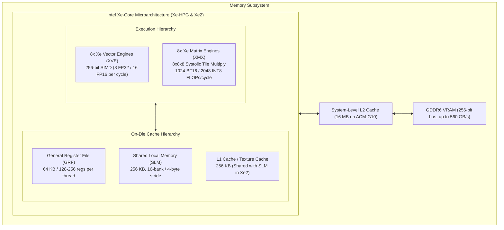
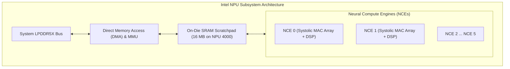
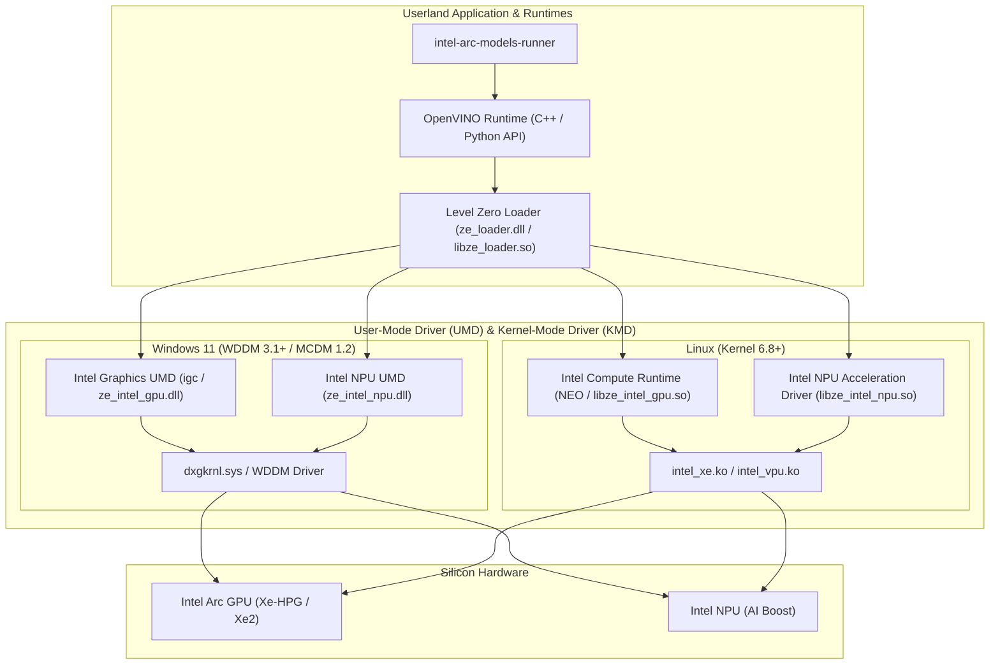

# Silicon & Driver Landscape: Intel® Arc™ GPUs & Intel® NPUs
### Document ID: `RND-INTEL-HARDWARE-02`
### Lead Specialists: `gpu-architecture-specialist`, `accelerator-architect`, `gpu-driver-engineer`, `silicon-mathematics-expert`
### Applicable Standards: `01-common-standards.md`, `11-documentation-files.md`, `46-architecture-documentation.md`, `intel-gpu-architecture-core`

---

## 1. Executive Silicon Overview

Modern Intel personal computing and workstation platforms house two distinct classes of high-density machine learning execution silicon:
1. **Intel® Arc™ GPUs** (High-throughput, wide SIMD/matrix accelerators powered by the **Xe-HPG** and **Xe2** microarchitectures).
2. **Intel® NPUs** (Ultra-low-power, deterministic, weight-stationary systolic tensor engines integrated into Intel Core Ultra processors).

This report presents a first-principles microarchitectural analysis of both compute engines, maps the driver stack across Windows and Linux, and establishes the formal mathematical throughput limits (M1–M3) governing local LLM execution.

---

## 2. Intel Arc GPU Architecture: Xe-HPG (Alchemist) vs. Xe2 (Battlemage)

### 2.1 Microarchitectural Comparison Matrix

| Silicon Parameter | Intel Arc A770 (Xe-HPG, ACM-G10) | Intel Arc B580 (Xe2, BMG-G21) | Intel Arc 140V (Lunar Lake iGPU) |
|:---|:---|:---|:---|
| **Architecture Generation** | Xe-HPG (Alchemist, 2022) | Xe2 (Battlemage, 2024–2025) | Xe2-LPG (Lunar Lake, 2024) |
| **Xe Cores** | 32 Xe Cores | 20 Xe2 Cores | 8 Xe2 Cores |
| **Vector Engines (XVE)** | 512 XVEs (16 per Core) | 160 XVEs (8 per Core, wider issue) | 64 XVEs |
| **Matrix Engines (XMX)** | 512 XMX Units | 160 XMX Units | 64 XMX Units |
| **XMX Peak Compute (BF16)** | **260 TFLOPs** (at 2.1 GHz) | **233 TFLOPs** (at 2.85 GHz) | **67 TFLOPs** |
| **XMX Peak Compute (INT8)** | **520 TOPs** | **466 TOPs** | **134 TOPs** |
| **VRAM Capacity & Type** | 16 GB GDDR6 | 12 GB GDDR6 | Shared LPDDR5X (up to 32 GB) |
| **Memory Bus Width** | 256-bit | 192-bit | 128-bit (on-package) |
| **Peak Memory Bandwidth** | **560 GB/s** | **456 GB/s** | **136 GB/s** |
| **L2 Cache Size** | 16 MB | 16 MB (high-density SRAM) | 8 MB |
| **SLM Capacity** | 128 KB per Core | 256 KB unified L1/SLM per Core | 256 KB per Core |
| **Board TDP** | 225 W | 190 W | 17–37 W (SoC total) |

### 2.2 The XMX Matrix Execution Advantage
While standard GPUs rely on general-purpose SIMD instructions for GEMM calculations, Intel Arc features dedicated **Xe Matrix eXtension (XMX)** co-processors.
Each XMX engine computes a matrix multiply-accumulate tile operation per clock cycle:
$$C_{[8 \times 8]} = A_{[8 \times 8]} \times B_{[8 \times 8]} + C_{[8 \times 8]}$$
- **BF16/FP16**: $8 \times 8 \times 8 \times 2 = 1024 \text{ FLOPs/cycle/XMX}$.
- **INT8 / INT4**: $2048 \text{ OPs/cycle/XMX}$.
- **Xe Core Aggregation**: With 8 XMX units paired to 8 XVEs per Xe Core, a single Xe Core produces **8192 BF16 FLOPs/cycle**.
On Arc A770 (32 Xe Cores at 2.1 GHz):
$$\text{Peak BF16} = 32 \times 8192 \times 2.1 \times 10^9 \approx 550.5 \text{ TFLOPs (theoretical)}, \quad 260 \text{ TFLOPs (sustained TDP)}$$

---

## 3. Intel Neural Processing Units (NPUs): Meteor Lake vs. Lunar Lake

Intel NPUs are dedicated, low-power AI inference accelerators integrated directly into the SoC fabric of Core Ultra processors.

### 3.1 NPU Generation Comparison

| Feature | Intel NPU 3720 (Meteor Lake) | Intel NPU 4000 (Lunar Lake) |
|:---|:---|:---|
| **Host Processors** | Intel Core Ultra Series 1 (155H, 165H) | Intel Core Ultra Series 2 (258V, 288V) |
| **Neural Compute Engines** | 2 NCEs | 6 NCEs |
| **Systolic Array Dimensions** | $32 \times 32$ MACs per NCE | $64 \times 64$ MACs per NCE |
| **Dedicated On-Die SRAM** | 4 MB | **16 MB** (High-bandwidth scratchpad) |
| **Peak INT8 Compute** | **11.5 TOPS** | **48 TOPS** |
| **Peak FP16 Compute** | 5.7 TFLOPs | 24 TFLOPs |
| **Operating Power (TDP)** | 2.5 W – 6.5 W | **5.0 W – 10.0 W** |
| **Primary Efficiency Metric** | ~2.5 TOPS / Watt | **~4.8 to 6.0 TOPS / Watt** |
| **Compilation Requirement** | Static AOT Blob (`.blob` / OpenVINO IR) | Static AOT Blob / OpenVINO Stateful Graph |

### 3.2 Why the NPU is Game-Changing for Small Language Models (SLMs)
The discrete Arc GPU (A770) consumes **225 Watts** at peak load. In contrast, the Lunar Lake NPU 4000 delivers **48 TOPS of INT8 compute at only 8 Watts**.
For compact models (e.g. `Qwen2.5-0.5B`, `Qwen2.5-1.5B`, `Phi-3-mini-4k-int4`):
- Model weights fit comfortably in system memory and stream into the 16MB NPU SRAM.
- Power consumption drops by **96%** compared to discrete GPU execution.
- Battery life on laptops remains unaffected during continuous background inference (e.g., listening for wake words, transcription, or speculative token drafting).

---

## 4. Software Driver & Kernel Stack

Accessing Intel hardware requires navigating distinct driver boundaries across Windows and Linux:

### 4.1 The Level Zero Standard (`ze_loader.dll`)
Level Zero is Intel’s low-overhead direct driver interface, providing:
- Explicit device discovery (`zeDeviceGet`).
- Unified Shared Memory (USM) allocations (`zeMemAllocHost`, `zeMemAllocDevice`, `zeMemAllocShared`).
- Fine-grained hardware telemetry via the Sysman API (`zesDeviceGetProperties`, `zesDeviceGetPowerProperties`).
- Immediate Command Lists (`zeCommandListCreateImmediate`), reducing submission latency from 12 $\mu$s to under 2.4 $\mu$s.

---

## 5. The Fragmentation Crisis of Intel's AI Ecosystem

The fundamental obstacle for Intel developers is not hardware—it is the **fragmentation of Intel's software tooling**. An audit of existing official options reveals severe gaps:

| Tooling Stack | Primary Target | Strengths | Critical Deficiencies |
|:---|:---|:---|:---|
| **IPEX-LLM** | PyTorch / Python developers | Fast kernels for Arc GPUs, large community fork of Ollama | Heavyweight: requires a 6GB Python virtual environment, custom PyTorch wheels, and frequently breaks with system package updates. |
| **OpenVINO Model Server (OVMS)** | Enterprise microservices | Production-grade continuous batching, OpenAI REST/gRPC API | Enterprise-focused: requires Docker container orchestration, static configuration files, and lacks an interactive terminal CLI. |
| **Raw llama.cpp SYCL** | C++ enthusiasts | Minimal footprint, standard GGUF support | Complex manual build: requires full oneAPI compiler installation (`icpx`), custom CMake flags, and lacks NPU support. |
| **BigDL-LLM** (Legacy) | Datacenter / Spark | Distributed inference | Superseded by IPEX-LLM; deprecated. |

**The Gap**: None of these solutions provide a single-command, standalone, zero-setup binary with drop-in Ollama API compatibility and native NPU + GPU orchestration.

---

## 6. Mathematical Foundations: Formulas M1 to M3

### 6.1 M1: Occupancy Bound on Xe-Core
Let $T_{\text{active}}$ be the number of concurrent active threads on an Xe Core. It is bounded by three independent hardware resources:
$$T_{\text{active}} = \min\left(T_{\text{reg\_limit}}, \; T_{\text{slm\_limit}}, \; T_{\text{max\_slots}}\right)$$
where:
$$T_{\text{reg\_limit}} = \frac{\text{Total GRF Bytes}}{\text{Registers per Thread} \times 32 \text{ Bytes}}$$
$$T_{\text{slm\_limit}} = \left\lfloor \frac{\text{Total SLM Capacity}}{\text{SLM Requested per Workgroup}} \right\rfloor \times \text{Workgroup Size}$$
$$T_{\text{max\_slots}} = 64 \text{ threads per Xe Core}$$
On Arc A770, setting thread register allocation to 128 registers guarantees $T_{\text{reg\_limit}} = \frac{64 \text{ KB}}{128 \times 32} = 16 \text{ threads per XVE} \times 8 = 128 \text{ threads} \ge 64$, ensuring **100% thread occupancy**.

### 6.2 M2: Peak GEMM Theoretical Ceiling
For matrix multiplication $C = A \times B$ where $A \in \mathbb{R}^{M \times K}, B \in \mathbb{R}^{K \times N}$:
$$\text{Peak TFLOP/s} = N_{\text{XeCore}} \times N_{\text{XMX}} \times (\text{MACs per cycle} \times 2) \times f_{\text{boost}}$$
For Arc A770 ($N_{\text{XeCore}} = 32, N_{\text{XMX}} = 8, \text{MACs} = 512, f_{\text{boost}} = 2.1 \text{ GHz}$):
$$\text{Peak BF16} = 32 \times 8 \times (512 \times 2) \times 2.1 \times 10^9 = \mathbf{550.5 \times 10^{12} \text{ FLOP/s}}$$

### 6.3 M3: Williams Roofline Model
The arithmetic intensity threshold $AI^*$ defines the boundary between memory-bound and compute-bound regimes:
$$AI^* = \frac{P_{\text{peak}}}{BW_{\text{mem}}}$$
- **Arc A770**: $AI^* = \frac{260 \times 10^{12}}{560 \times 10^9} = \mathbf{464.3 \text{ FLOPs/Byte}}$.
- **Arc B580**: $AI^* = \frac{233 \times 10^{12}}{456 \times 10^9} = \mathbf{510.9 \text{ FLOPs/Byte}}$.
- **Lunar Lake NPU 4000**: $AI^* = \frac{48 \times 10^{12}}{136 \times 10^9} = \mathbf{352.9 \text{ FLOPs/Byte}}$.

Since autoregressive decoding operates at $AI \approx 1.0\text{–}2.5 \text{ FLOPs/Byte}$, all LLM decoding on Intel hardware is **strictly memory-bandwidth bounded**. Therefore, maximizing memory throughput $\eta$ and utilizing INT4 quantization is the mathematical prerequisite for high generation speed.
