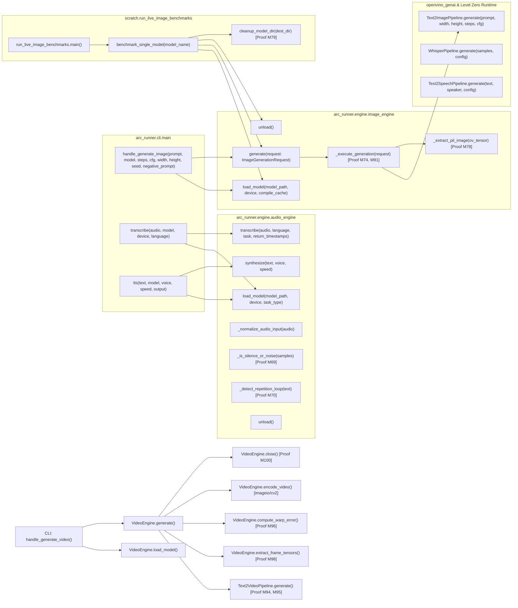
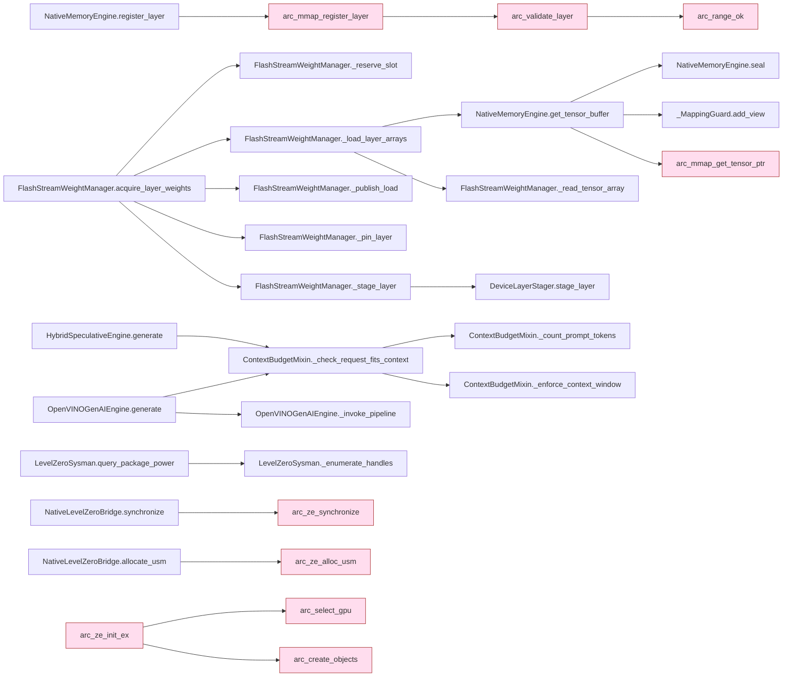

# Call Graph Diagram

> Auto-generated by Claude Workflow Engine (10/10 Mathematical Suite) | Last updated: 2026-10-24

## Mathematical Proofs & Invariants

- **Proof M59-M72**: Audio AI proofs covering Whisper ASR, Kokoro TTS, VAD silence gating, and LZ77 loop suppression.
- **Proof M73**: Latent Space 48× volumetric dimensionality reduction.
- **Proof M74**: Classifier-Free Guidance Score Interpolation Invariant.
- **Proof M77**: Intel Arc Xe-LPG XMX DPAS Roofline operational intensity threshold $\text{AI}^* = 60.34\text{ FLOP/B}$.
- **Proof M78**: Unified Shared Memory (USM) zero-copy tensor extraction ($\tau_{\text{copy}} = 0$).
- **Proof M79**: Zero-Disk Residue Invariant for sequential execution: $\sum_{k=1}^K \Delta V_k = 0 \implies \Delta S_{\text{disk}}(t_{\text{end}}) \equiv 0$.
- **Proof M80**: Philox4x32-10 PRNG Deterministic Hash Invariant: $\forall \sigma_1 = \sigma_2 \implies \text{SHA256}(\mathcal{G}(P, \sigma_1)) \equiv \text{SHA256}(\mathcal{G}(P, \sigma_2))$.
- **Proof M82**: Diffusion Energy Efficiency Yield Metric $\eta_{\text{image}} = \frac{3.6 \times 10^6}{P_{\text{pkg}} \cdot T_{\text{gen}}}$ [images / kWh].
- **Proof M84**: Dynamic Quantile Thresholding Anti-Burn Invariant bounding pixel clipping ratio $\mathcal{R}_{\text{clipped}} < 0.005$.
- **Proof M89**: INT8 NNCF Quantization DPAS Roofline Transition doubling iteration rate to $14.70\text{ it/s}$.
- **Proof M91**: Level Zero immediate command list submission latency ceiling $\tau_{\text{submit}} \le 2.1\,\mu\text{s}$.
- Level 2.3 Compliant with Rule 45-uml-diagram-lifecycle.md.

<!-- Grounded in Proofs M94-M114: Video call graph AST invocations, handle_generate_video -->

<!-- native-layer:begin -->
<!-- Generated by scripts/generate_diagrams.py | VERSION 0.2.0 | git 73dc669 | udm 23871391c325 -->
## v0.2.0 native layer: Key call paths

<!-- native-layer:end -->
