# Class Diagram

> Auto-generated by Claude Workflow Engine (10/10 Mathematical Suite) | Last updated: 2026-10-24

```mermaid
classDiagram
    class BaseEngine {
        +is_loaded
        +model_path
        +device
        +*load_model(model_path: Path, device: DeviceType) 
        +*generate_stream(prompt: str, config: GenerationConfig) 
        +*get_telemetry() 
        +*unload() 
    }
    class OpenVINOGenAIEngine {
        -_pipeline
        -_device
        +load_model(model_path: Path, device: DeviceType) 
        +generate_stream(prompt: str, config: GenerationConfig) 
        -_build_ov_generation_config(config: GenerationConfig) 
    }
    class HybridSpeculativeEngine {
        -target_engine
        -draft_engine
        +current_gamma
        +load_model(model_path: Path, draft_model_path: Path) 
        +generate_stream(prompt: str, config: GenerationConfig) 
        -_validate_path(path: Path) 
    }
    class ContinuousBatcher {
        +active_sequences_count
        +waiting_sequences_count
        +add_request(seq: BatchSequence) 
        +step() 
        +preempt_sequence(seq_id: str) 
    }
    class PagedBlockTable {
        +block_size
        +total_blocks
        +utilization_ratio
        +get_sequence_blocks(seq_id: str) 
        +get_block_map() 
    }
    class RadixPrefixCache {
        +hit_rate
        +total_lookups
        +match_prefix(tokens: List[int]) 
        +insert_prefix(tokens: List[int], blocks: List[int]) 
    }
    class LoRAManager {
        +adapters_dir
        +max_cached
        +inspect_safetensors_header(path: Path) 
        +parse_adapter_metadata(path: Path) 
    }
    class VisionEngine {
        +patch_size
        +device
        +calculate_visual_tokens(width: int, height: int) 
        +decode_image_tensor(image_bytes: bytes) 
        +generate(prompt: str, image_bytes: bytes) 
    }
    class EmbeddingEngine {
        +dimension
        +device
        +embed_query(query: str) 
        +embed_documents(docs: List[str]) 
        +l2_normalize(vec: np.ndarray) 
    }
    class GGUFTranspiler {
        +input_path
        +output_dir
        +dequantize_q4_0_block(block_bytes: bytes) 
        +pack_xmx_nibbles(weights: np.ndarray) 
        +compute_sqnr(fp_orig: np.ndarray, dequant: np.ndarray) 
        +transpile_stream(target_precision: str) 
    }
    class ModelManager {
        +model_dirs
        +get_or_load_engine(model_id: str, device: str) 
        +get_or_load_embedding_engine(model_id: str) 
        +get_or_load_vision_engine(model_id: str) 
    }
    class BatchExecutionPipeline {
        +is_running
        +start() 
        +stop() 
        +tick_step() 
    }
    class DeviceDetector {
        +detect_topology() 
        -_classify_gpu_architecture(name: str) 
    }
    class LevelZeroSysman {
        +is_available() 
        +query_gpu_memory() 
    }
    BaseEngine <|-- OpenVINOGenAIEngine
    BaseEngine <|-- HybridSpeculativeEngine
```

## Mathematical Proofs & Invariants

- Grounded in proofs M1-M6, M8-M9, M15-M20, M29-M34, M50-M58.
- Level 2.3 Compliant with Rule 45-uml-diagram-lifecycle.md.
