# Class Diagram

> Auto-generated by Claude Workflow Engine (10/10 Mathematical Suite) | Last updated: 2026-10-24

```mermaid
classDiagram
    class BaseEngine {
        +is_loaded
        +model_path
        +device
        +*load_model(model_path: Path, device: DeviceType)
        +*generate_stream(prompt: str, config: GenerationConfig)
        +*get_telemetry()
        +*unload()
    }
    class OpenVINOGenAIEngine {
        -_pipeline
        -_device
        +load_model(model_path: Path, device: DeviceType)
        +generate_stream(prompt: str, config: GenerationConfig)
        -_build_ov_generation_config(config: GenerationConfig)
    }
    class HybridSpeculativeEngine {
        -target_engine
        -draft_engine
        +current_gamma
        +load_model(model_path: Path, draft_model_path: Path)
        +generate_stream(prompt: str, config: GenerationConfig)
        -_validate_path(path: Path)
    }
    class AudioEngineConfig {
        +device: str
        +sample_rate: int
        +tts_sample_rate: int
        +default_tts_voice: str
        +default_tts_speed: float
        +language: Optional[str]
        +return_timestamps: bool
        +word_timestamps: bool
        +vad_energy_threshold: float
        +vad_entropy_threshold: float
        +max_compression_ratio: float
    }
    class TranscriptionSegment {
        +start_ts: float
        +end_ts: float
        +text: str
    }
    class TranscriptionResult {
        +text: str
        +segments: List[TranscriptionSegment]
        +latency_s: float
        +audio_duration_s: float
        +rtf: float
        +throughput_audio_s_per_s: float
        +device_used: str
        +model_name: str
        +compression_ratio: float
    }
    class SynthesisResult {
        +samples: np.ndarray
        +sample_rate: int
        +latency_s: float
        +audio_duration_s: float
        +rtf: float
        +energy_yield_audio_s_per_j: float
        +device_used: str
        +voice_used: str
        +speed_used: float
    }
    class AudioEngine {
        -_pipeline
        -_device: str
        -_config: AudioEngineConfig
        -_current_model_path: Optional[Path]
        -_current_task: Optional[str]
        +load_model(model_path: Path, device: str, task_type: str)
        +transcribe(audio_input: Union[str, Path, np.ndarray], ...)
        +synthesize(text: str, voice: str, speed: float)
        -_normalize_audio_input(audio_input)
        -_is_silence_or_noise(samples)
        -_detect_repetition_loop(text)
        -_load_speaker_embedding(voice_name)
        +save_audio_wav(samples, output_path)
        +unload()
    }
    class ImageEngineConfig {
        +device: str
        +default_steps: int
        +default_guidance_scale: float
        +default_width: int
        +default_height: int
        +enable_compile_cache: bool
    }
    class ImageGenerationRequest {
        +prompt: str
        +negative_prompt: str
        +width: int
        +height: int
        +steps: int
        +guidance_scale: float
        +seed: Optional[int]
    }
    class ImageGenerationBreakdown {
        +text_encoder_ms: float
        +denoise_unet_ms: float
        +vae_decoder_ms: float
    }
    class ImageGenerationResult {
        +image: Any
        +latency_s: float
        +step_latency_ms: float
        +iteration_rate_it_s: float
        +megapixels_per_sec: float
        +breakdown: ImageGenerationBreakdown
        +device_used: str
        +seed_used: int
    }
    class ImageEngine {
        -_pipeline
        -_device: str
        -_config: ImageEngineConfig
        -_current_model_path: Optional[Path]
        +load_model(model_path: Path, device: str, compile_cache: bool)
        +generate(request: ImageGenerationRequest)
        -_execute_generation(request: ImageGenerationRequest)
        -_extract_pil_image(ov_tensor)
        +unload()
    }
    class VideoEngineConfig {
        +device: str
        +default_num_frames: int
        +default_fps: int
        +default_width: int
        +default_height: int
        +default_steps: int
        +default_guidance_scale: float
        +enable_temporal_slicing: bool
        +output_container: str
    }
    class VideoGenerationRequest {
        +prompt: str
        +negative_prompt: str
        +num_frames: int
        +fps: int
        +width: int
        +height: int
        +num_inference_steps: int
        +guidance_scale: float
        +rng_seed: Optional[int]
        +output_path: Optional[str]
        +export_container: str
    }
    class VideoGenerationBreakdown {
        +text_encoder_ms: float
        +denoise_transformer_ms: float
        +vae_decoder_ms: float
        +video_encode_ms: float
        +step_latency_ms: float
        +iteration_rate_it_s: float
        +frames_per_second: float
        +real_time_factor: float
        +energy_yield_frames_per_kwh: float
    }
    class VideoGenerationResult {
        +frames: List[np.ndarray]
        +output_path: Optional[str]
        +num_frames: int
        +fps: int
        +duration_sec: float
        +resolution: Tuple[int, int]
        +breakdown: VideoGenerationBreakdown
        +total_latency_ms: float
    }
    class VideoEngine {
        -_pipeline: Text2VideoPipeline
        -_device: str
        -_config: VideoEngineConfig
        +load_model(model_path: Path, device: str)
        +generate(request: VideoGenerationRequest)
        +extract_frame_tensors(ov_video_result)
        +encode_video(frames, output_path, fps, container)
        +compute_warp_error(frames)
        +unload()
    }

    class ContinuousBatcher {
        +active_sequences_count
        +waiting_sequences_count
        +add_request(seq: BatchSequence)
        +step()
        +preempt_sequence(seq_id: str)
    }
    class PagedBlockTable {
        +block_size: int
        +total_blocks: int
        +utilization_ratio: float
        +allocate(seq_id: str, num_blocks: int)
        +free(seq_id: str)
    }
    class RadixPrefixCache {
        +cached_tokens_count: int
        +match_prefix(tokens: List[int])
        +insert_prefix(tokens: List[int], block_ids: List[int])
    }
    class BatchExecutionPipeline {
        -_batcher: ContinuousBatcher
        -_model_mgr: ModelManager
        +enqueue(request: GenerateRequest)
        +abort(request_id: str)
    }
    class LoRAManager {
        -_adapters: Dict[str, LoRAAdapter]
        -_lru_cache: List[str]
        +load_adapter(name: str, path: Path)
        +apply_adapter(engine, name: str)
    }

    BaseEngine <|-- OpenVINOGenAIEngine
    BaseEngine <|-- HybridSpeculativeEngine
    BaseEngine <|-- AudioEngine
    BaseEngine <|-- ImageEngine
    AudioEngine *-- AudioEngineConfig
    AudioEngine ..> TranscriptionResult
    AudioEngine ..> SynthesisResult
    TranscriptionResult *-- TranscriptionSegment
    ImageEngine *-- ImageEngineConfig
    ImageEngine ..> ImageGenerationRequest
    ImageEngine ..> ImageGenerationResult
    ImageGenerationResult *-- ImageGenerationBreakdown
    ContinuousBatcher *-- PagedBlockTable
    ContinuousBatcher *-- RadixPrefixCache
    BatchExecutionPipeline o-- ContinuousBatcher
```

## Mathematical Proofs & Invariants

- **Proof M1-M6, M8-M9, M15-M20, M29-M34**: Transformer KV caching, Little's Law, speculative decoding.
- **Proof M59-M72**: Audio AI proofs for Whisper ASR and Kokoro TTS.
- **Proof M73**: Latent Space 48× volumetric dimensionality reduction.
- **Proof M74**: Classifier-Free Guidance Score Interpolation Invariant.
- **Proof M78**: Unified Shared Memory (USM) zero-copy tensor extraction.
- **Proof M80**: Philox4x32-10 PRNG Deterministic Hash Invariant.
- **Proof M84**: Dynamic Quantile Thresholding Anti-Burn Invariant ($\mathcal{R}_{\text{clipped}} < 0.005$).
- **Proof M87**: Gram-Schmidt Negative Guidance Projection Invariant.
- **Proof M91**: Level Zero immediate command list driver latency ceiling $\tau_{\text{submit}} \le 2.1\,\mu\text{s}$.
- Level 2.3 Compliant with Rule 45-uml-diagram-lifecycle.md.

<!-- Grounded in Proofs M94-M114: Spatio-Temporal 3D Latent Compression (M94), Factorized Attention (M95), OFWE (M96), Zero-Disk Residue (M100) -->
