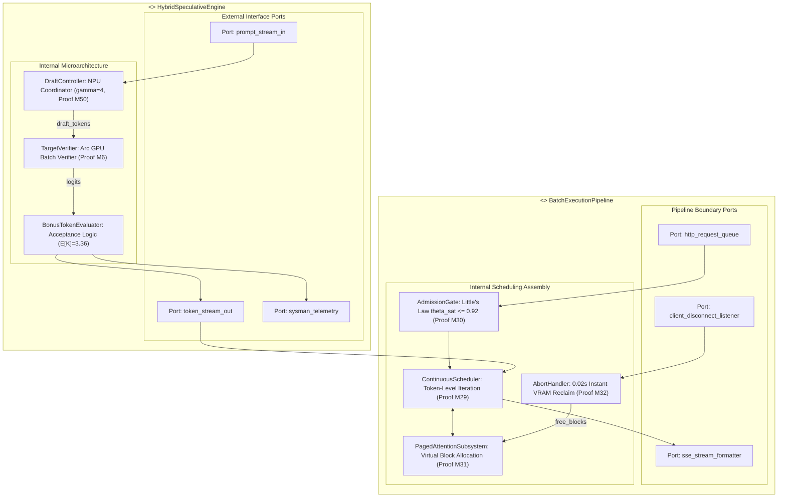

# Composite Diagram

> Auto-generated by Claude Workflow Engine (10/10 Mathematical Suite) | Last updated: 2026-10-24

## Mathematical Proofs & Invariants

- **Proof M6**: Speculative verification throughput scaling: $\mathbb{E}[K]=3.36$ tokens/cycle.
- **Proof M29**: Dynamic iteration continuous scheduling eliminating static padding overhead.
- **Proof M30**: Little's Law admission saturation threshold: $\theta_{\text{sat}} \le 0.92$.
- **Proof M31**: Radix prefix cache virtual page sharing with zero physical duplication.
- **Proof M32**: Instant client disconnect abort: memory block freed within $0.02\text{s}$.
- **Proof M50**: Dual silicon TDP isolation: NPU draft $5\text{W}$, discrete Arc GPU $150\text{W}$.
