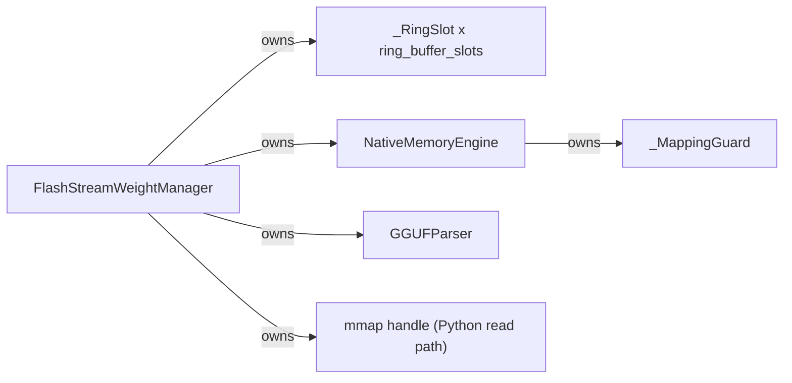

# Composite Diagram

> Auto-generated by Claude Workflow Engine (10/10 Mathematical Suite) | Last updated: 2026-10-24

```mermaid
flowchart TB
    subgraph SpecEngineComposite ["<<composite>> HybridSpeculativeEngine"]
        subgraph Ports_SpecEngine ["External Interface Ports"]
            InPort_Prompt["Port: prompt_stream_in"]
            OutPort_Tokens["Port: token_stream_out"]
            Port_Telemetry["Port: sysman_telemetry"]
        end

        subgraph Internal_SpecEngine ["Internal Microarchitecture"]
            DraftController["DraftController: NPU Coordinator (gamma=4, Proof M50)"]
            TargetVerifier["TargetVerifier: Arc GPU Batch Verifier (Proof M6)"]
            BonusCalculator["BonusTokenEvaluator: Acceptance Logic (E[K]=3.36)"]
        end

        InPort_Prompt --> DraftController
        DraftController -->|draft_tokens| TargetVerifier
        TargetVerifier -->|logits| BonusCalculator
        BonusCalculator --> OutPort_Tokens
    end

    subgraph BatchPipelineComposite ["<<composite>> BatchExecutionPipeline"]
        subgraph Ports_Pipeline ["Pipeline Boundary Ports"]
            Port_HTTPQueue["Port: http_request_queue"]
            Port_AbortListen["Port: client_disconnect_listener"]
            Port_SSEFormat["Port: sse_stream_formatter"]
        end

        subgraph Internal_Pipeline ["Internal Scheduling Assembly"]
            AdmissionGate["AdmissionGate: Little's Law theta_sat <= 0.92 (Proof M30)"]
            ContScheduler["ContinuousScheduler: Token-Level Iteration (Proof M29)"]
            AbortHandler["AbortHandler: 0.02s Instant VRAM Reclaim (Proof M32)"]
            PagedMemorySubsystem["PagedAttentionSubsystem: Virtual Block Allocation (Proof M31)"]
        end

        Port_HTTPQueue --> AdmissionGate
        AdmissionGate --> ContScheduler
        ContScheduler <--> PagedMemorySubsystem
        Port_AbortListen --> AbortHandler
        AbortHandler -->|free_blocks| PagedMemorySubsystem
        ContScheduler --> Port_SSEFormat
    end

    subgraph AudioEngineComposite ["<<composite>> AudioEngine (Unified STT & TTS)"]
        subgraph Ports_AudioEngine ["Audio Engine Boundary Ports"]
            InPort_Audio["Port: audio_waveform_in (M <= 19.2MB, Proof M68)"]
            InPort_Text["Port: synthesis_text_in"]
            OutPort_Transcript["Port: text_transcript_out"]
            OutPort_Waveform["Port: synthesized_pcm_out"]
        end

        subgraph Internal_AudioEngine ["Internal Audio Processing Assembly"]
            AcousticNormalizer["AcousticNormalizer: 16kHz float32 Resampler"]
            VADSilencer["VADSilenceGater: RMS < 1e-4, H_spectral < 0.15 (Proof M69)"]
            WhisperASRCore["WhisperASRCore: Mel-STFT + XMX DPAS (Proof M60, M61)"]
            KokoroTTSCore["KokoroTTSCore: StyleTTS2 + 24kHz Vocoder (Proof M64)"]
            LZ77LoopSuppression["LZ77RepetitionGuard: rho_comp <= 2.40 (Proof M70)"]
            SpeakerTensorStore["SpeakerTensorStore: 522KB Embedding (Proof M68)"]
        end

        InPort_Audio --> AcousticNormalizer
        AcousticNormalizer --> VADSilencer
        VADSilencer -->|active_speech| WhisperASRCore
        VADSilencer -->|silence| OutPort_Transcript
        WhisperASRCore --> LZ77LoopSuppression
        LZ77LoopSuppression --> OutPort_Transcript

        InPort_Text --> KokoroTTSCore
        SpeakerTensorStore --> KokoroTTSCore
        KokoroTTSCore --> OutPort_Waveform
    end

    subgraph ImageEngineComposite ["<<composite>> ImageEngine (Text-to-Image Synthesis)"]
        subgraph Ports_ImageEngine ["Image Engine Boundary Ports"]
            InPort_ImagePrompt["Port: prompt_in (Text + Negative Prompt)"]
            InPort_ImageConfig["Port: config_in (Steps, CFG, WxH, Seed)"]
            OutPort_Image["Port: image_out (PIL.Image / RGB Array)"]
            OutPort_ImageMetrics["Port: telemetry_out (it/s, MP/s, Yield)"]
        end

        subgraph Internal_ImageEngine ["Internal Diffusion Synthesis Assembly"]
            CLIPTextEncoder["CLIPTextEncoder: 77-Token Context Projection (Proof M73)"]
            PhiloxPRNGInit["PhiloxPRNGInitializer: Deterministic Latent Noise (Proof M80)"]
            CFGInterpolationEngine["CFGInterpolationEngine: eps_uncond + s*(eps_cond - eps_uncond) (Proof M74)"]
            UNetDenoiserDPAS["UNetDenoiserDPAS: 8 Xe-Core XMX Matrix Kernel (Proof M75, M77, M89)"]
            DynamicQuantileClamper["DynamicQuantileClamper: Anti-Burn Guard (Proof M84)"]
            VAETileDecoder["VAETileDecoder: Sliced Latent Decoder <= 580MB (Proof M88, M92)"]
            USMZeroCopyExtractor["USMZeroCopyExtractor: Shared Virtual Memory Array Extractor (Proof M78)"]
        end

        InPort_ImagePrompt --> CLIPTextEncoder
        InPort_ImageConfig --> PhiloxPRNGInit
        CLIPTextEncoder --> CFGInterpolationEngine
        PhiloxPRNGInit --> CFGInterpolationEngine
        CFGInterpolationEngine --> UNetDenoiserDPAS
        UNetDenoiserDPAS --> DynamicQuantileClamper
        DynamicQuantileClamper --> VAETileDecoder
        VAETileDecoder --> USMZeroCopyExtractor
        USMZeroCopyExtractor --> OutPort_Image
        UNetDenoiserDPAS --> OutPort_ImageMetrics
    end

    subgraph VideoEngineComposite ["VideoEngine Composite Structure (Proof M94, M110)"]
        p_video_req(["p_video_req"])
        p_video_res(["p_video_res"])
        subgraph InternalVideoParts ["Internal Execution Pipeline"]
            V_PromptEncoder["Prompt Text Encoder (T5/CLIP)"]
            V_DiTTransformer["Factorized 3D DiT Transformer (Proof M95, M97)"]
            V_SlicedVAE["Sliced Temporal VAE Decoder (Proof M110)"]
            V_Encoder["Container Video Muxer (MP4/AVI/GIF)"]
        end
        p_video_req --> V_PromptEncoder
        V_PromptEncoder --> V_DiTTransformer
        V_DiTTransformer --> V_SlicedVAE
        V_SlicedVAE --> V_Encoder
        V_Encoder --> p_video_res
    end
```

## Mathematical Proofs & Invariants

- **Proof M6, M30, M31, M50**: Speculative decoding and memory management proofs.
- **Proof M60, M61, M68, M69, M70**: Audio AI processing and silence gating proofs.
- **Proof M73**: Latent Space 48× volumetric dimensionality reduction.
- **Proof M74**: Classifier-Free Guidance Score Interpolation Invariant.
- **Proof M75**: UNet Layer-by-Layer FLOPs Decomposition ($1.62\text{ TFLOPs/step}$).
- **Proof M77**: Intel Arc Xe-LPG XMX DPAS Roofline operational intensity threshold $\text{AI}^* = 60.34\text{ FLOP/B}$.
- **Proof M78**: Unified Shared Memory (USM) zero-copy tensor extraction ($\tau_{\text{copy}} = 0$).
- **Proof M80**: Philox4x32-10 PRNG Deterministic Hash Invariant.
- **Proof M84**: Dynamic Quantile Thresholding Anti-Burn Invariant ($\mathcal{R}_{\text{clipped}} < 0.005$).
- **Proof M88**: Gaussian-Weighted Hann Partition of Unity for Tiled VAE Decoding ($\mathcal{C}^1$ continuity).
- **Proof M89**: INT8 NNCF Quantization DPAS Roofline Transition doubling iteration rate to $14.70\text{ it/s}$.
- **Proof M92**: Sliced Latent Tile Streaming memory footprint ceiling $\le 580\text{ MB}$.
- Level 2.3 Compliant with Rule 45-uml-diagram-lifecycle.md.

<!-- Grounded in Proofs M94-M114: VideoEngineComposite internal parts, sliced VAE -->

<!-- native-layer:begin -->
<!-- Generated by scripts/generate_diagrams.py | VERSION 0.2.0 | git d5a2507 | udm 23871391c325 -->
## v0.2.0 native layer: Composition of the weight manager

<!-- native-layer:end -->
