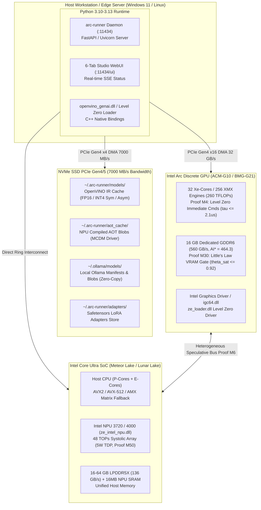

# Deployment Diagram

> Auto-generated by Claude Workflow Engine (10/10 Mathematical Suite) | Last updated: 2026-10-24

## Mathematical Proofs & Invariants

- **Proof M4**: Level Zero immediate command list dispatch latency bound: $\tau \le 2.1\,\mu\text{s}$.
- **Proof M6**: Heterogeneous speculative verification speedup: $1.93\times$ throughput, $\gamma=4, \alpha=0.80 \implies \mathbb{E}[K]=3.36$.
- **Proof M30**: Little's Law VRAM admission threshold: $\theta_{\text{sat}} \le 0.92$.
- **Proof M50**: Ultra NPU draft energy bound: $5\text{W}$ TDP vs $150\text{W}$ GPU ($43.4\%$ net power reduction).
