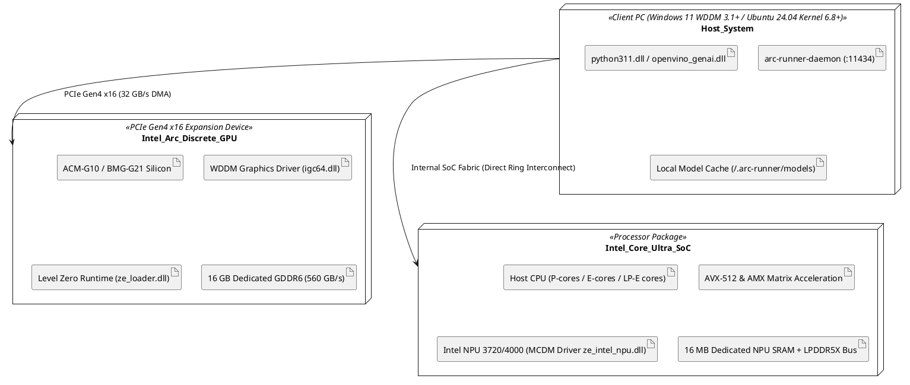

# Deployment_Diagram

> Auto-generated by Claude Workflow Engine | Last updated: 2026-10-20

## Notes

- Generated from: C:\Users\techd\Documents\workspace-spring-tool-suite-4-4.27.0-new\intel-arc-models-runner
- Scope: Full project
