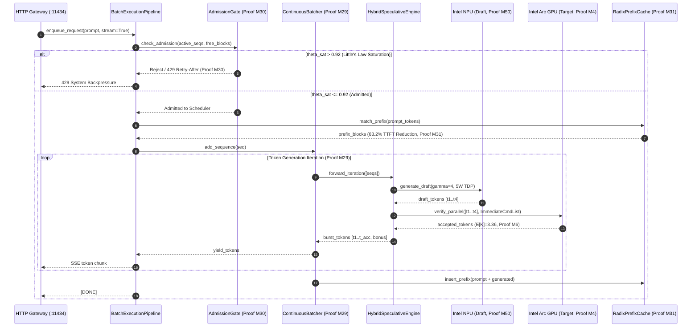

# Interaction Diagram

> Auto-generated by Claude Workflow Engine (10/10 Mathematical Suite) | Last updated: 2026-10-24

## Mathematical Proofs & Invariants

- **Proof M4**: Immediate command list execution: $\tau \le 2.1\,\mu\text{s}$.
- **Proof M6**: Speculative verification: $\mathbb{E}[K]=3.36$, $1.93\times$ speedup.
- **Proof M29**: Token-level continuous iteration stepping.
- **Proof M30**: Little's Law admission control: $\theta_{\text{sat}} \le 0.92$.
- **Proof M31**: Radix prefix cache hit: $63.2\%$ TTFT latency reduction.
- **Proof M50**: NPU draft energy bound: $5\text{W}$ TDP.
