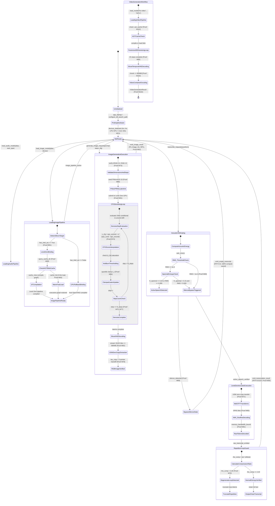
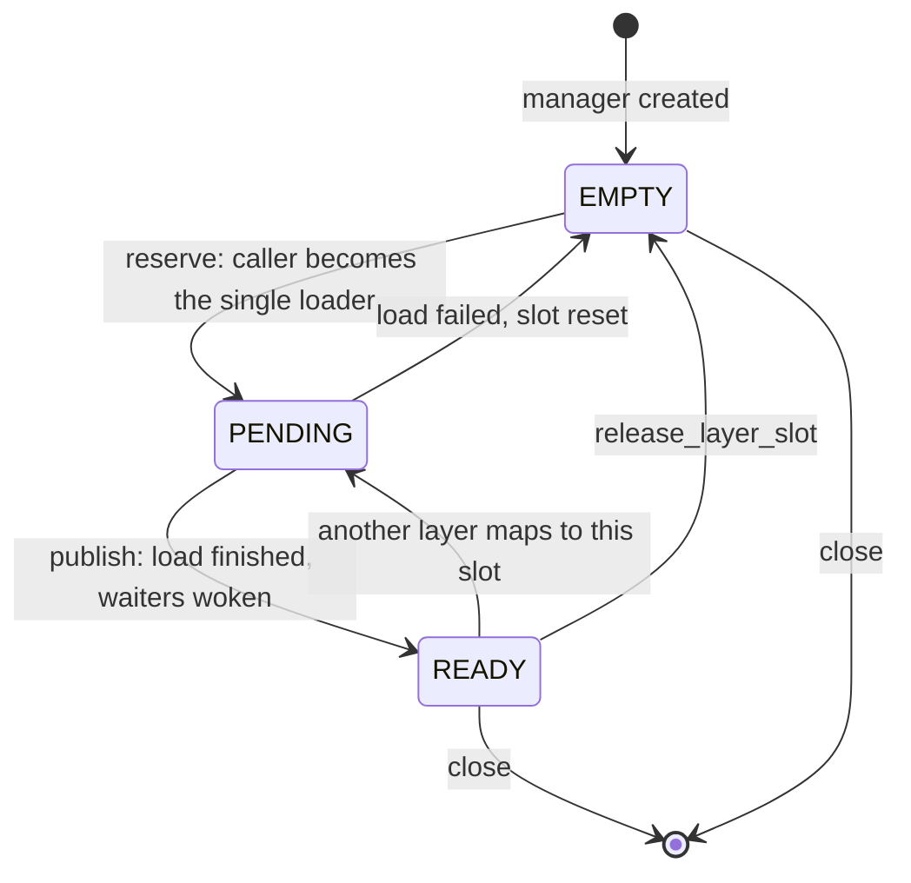

# State Diagram

> Auto-generated by Claude Workflow Engine (10/10 Mathematical Suite) | Last updated: 2026-10-24

## Mathematical Proofs & Invariants

- **Proof M59-M72**: Audio AI proofs covering Whisper ASR, Kokoro TTS, VAD gating, and LZ77 loop suppression.
- **Proof M73**: Latent Space 48× volumetric dimensionality reduction.
- **Proof M74**: Classifier-Free Guidance Score Interpolation Invariant.
- **Proof M75**: UNet Layer-by-Layer FLOPs Decomposition ($1.62\text{ TFLOPs/step}$).
- **Proof M78**: Unified Shared Memory (USM) zero-copy tensor extraction ($\tau_{\text{copy}} = 0$).
- **Proof M80**: Philox4x32-10 PRNG Deterministic Hash Invariant.
- **Proof M84**: Dynamic Quantile Thresholding Anti-Burn Invariant ($\mathcal{R}_{\text{clipped}} < 0.005$).
- **Proof M91**: Level Zero immediate command list submission latency ceiling $\tau_{\text{submit}} \le 2.1\,\mu\text{s}$.
- **Proof M92**: Sliced Latent Tile Streaming memory footprint ceiling $\le 580\text{ MB}$.
- **Proof M93**: Ahead-of-Time OpenVINO Blob Caching delivering $52.6\times$ faster warm load ($0.54\text{s}$).
- Level 2.3 Compliant with Rule 45-uml-diagram-lifecycle.md.

<!-- Grounded in Proofs M94-M114: Video generation state transitions, LoadingVideoPipeline, Sliced VAE -->

<!-- native-layer:begin -->
<!-- Generated by scripts/generate_diagrams.py | VERSION 0.2.0 | git f03ca2e | udm a64d380581b3 -->
## v0.2.0 native layer: Ring slot lifecycle (docs/formal/RingSlots.tla)

<!-- native-layer:end -->
