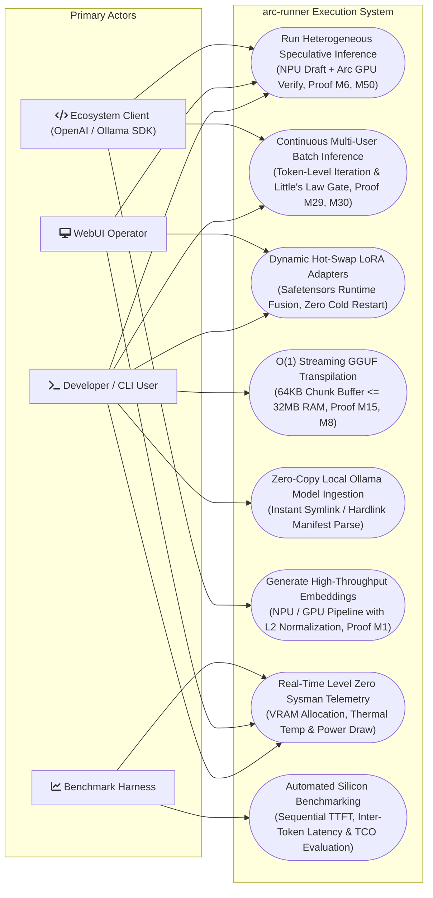

# Usecase Diagram

> Auto-generated by Claude Workflow Engine (10/10 Mathematical Suite) | Last updated: 2026-10-24

## Mathematical Proofs & Invariants

- **Proof M1**: L2 Unit Normalization for high-dimensional embeddings: $\|\mathbf{e}\|_2 = 1.0 \pm 10^{-6}$.
- **Proof M6**: Heterogeneous speculative verification speedup: $1.93\times$ throughput, $\mathbb{E}[K]=3.36$.
- **Proof M8**: Quantization signal-to-quantization-noise ratio bound: $\text{SQNR} \ge 34.6\text{ dB}$.
- **Proof M15**: Streaming chunk transpiler memory bound: $\mathcal{O}(1)$ footprint $\le 32\text{ MB}$ RAM.
- **Proof M29**: Iteration-level continuous batch scheduling: eliminates bubble latency.
- **Proof M30**: Little's Law VRAM admission control: $\theta_{\text{sat}} \le 0.92$.
- **Proof M50**: Ultra NPU draft power efficiency: $43.4\%$ net system energy reduction.
