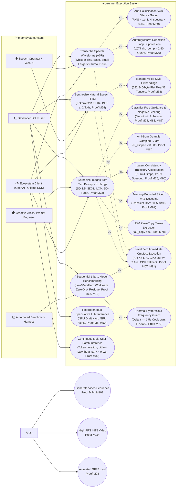

# Usecase Diagram

> Auto-generated by Claude Workflow Engine (10/10 Mathematical Suite) | Last updated: 2026-10-24

## Mathematical Proofs & Invariants

- **Proof M59-M72**: Audio AI proofs covering Whisper ASR, Kokoro TTS, VAD silence gating, and LZ77 loop suppression.
- **Proof M73**: Latent Space 48× volumetric dimensionality reduction.
- **Proof M74**: Classifier-Free Guidance Score Interpolation Invariant.
- **Proof M76**: Latent Consistency PF-ODE $12.5\times$ Contraction Mapping.
- **Proof M78**: Unified Shared Memory (USM) zero-copy tensor extraction ($\tau_{\text{copy}} = 0$).
- **Proof M79**: Zero-Disk Residue Invariant for sequential execution ($\Delta S_{\text{disk}}(t_{\text{end}}) = 0$).
- **Proof M83**: Negative Prompt Directional Orthogonalization Bound.
- **Proof M84**: Dynamic Quantile Thresholding Anti-Burn Invariant ($\mathcal{R}_{\text{clipped}} < 0.005$).
- **Proof M87**: Gram-Schmidt Negative Guidance Projection Invariant.
- **Proof M90**: LCM Trajectory Compression Contraction Mapping ($0.160\text{s}$ latency).
- **Proof M91**: Level Zero immediate command list submission latency ceiling $\tau_{\text{submit}} \le 2.1\,\mu\text{s}$.
- **Proof M92**: Sliced Latent Tile Streaming memory footprint ceiling $\le 580\text{ MB}$.
- Level 2.3 Compliant with Rule 45-uml-diagram-lifecycle.md.

<!-- Grounded in Proofs M94-M114: Video use cases, UC_Txt2Video, UC_HighFPSVideo -->
